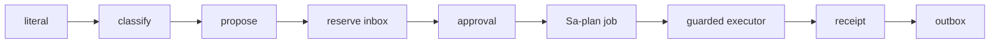

# 20261026-0049 — Telegram command parity: goal, as-is, to-be, path, cost routing and parallel execution plan

#fractal-l0 #fractal-l2 #fractal-l3 #fractal-l4 #fractal-l5 #fractal-l6 #fractal-l8 #fractal-l9 #zk-adr #zero-muda #km-triad

[This journal](http://nas-1.tail55d152.ts.net:4100/files/docs/journal/20261026-0049-claude-telegram-parity-plan-and-process.md) · [Executor journal](http://nas-1.tail55d152.ts.net:4100/files/docs/journal/20261026-0038-claude-verify-bounded-executor.md) · [Handover](http://nas-1.tail55d152.ts.net:4100/files/docs/journal/20261025-1706-claude-pause-status-handover.md) · [Critical path](http://nas-1.tail55d152.ts.net:4100/files/docs/design/20261024-1044-telegram-completion-critical-path.md) · [Cockpit](http://nas-1.tail55d152.ts.net:4100/)

Transclusions: [[zk:20260905-1801-moc-uos-unified-master]] · [[wiki:20260905-1801-uos-zk-km-corpus-index]]

## 1. Scope & Trigger

Operator request (2026-10-26 ~00:40Z): show the thinking, the as-is and to-be state and the path; cost-optimise across Claude and GPT; execute with maximum parallelisation and agentic scale-up for full feature parity under OTP; use AGY and Argon; give fractal detail; fast OODA with frequent landing on `main` and pushes; journal everything; improve the process. This journal is the plan and the thinking. Execution evidence is recorded per wave in follow-on journals. Sa-plan authority: `uos/telegram-runtime/20261001-1150` COMMAND_IMPL (reclaim at attempt 19 pending the reviewed tie selection).

**Goal.** Every one of the 77 Telegram command literals answers from a real, guarded Gleam/OTP backend with a truthful result. "Parity with OTP" is read as: the full command set served under the supervised OTP Telegram service, with no static success placeholders. (If the operator meant the ZigVM-vs-OTP conformance programme, that is a different plan and is not started here.)

## 2. Pre-State Assessment (as-is, measured)

| Area | Observed | Source |
|---|---|---|
| Connected literals | 39/77 | handover §10 |
| Backend unavailable (fall through to a reference reply) | 16: /mesh /adr /pacing /whatif /simulate /rack-cv /acoustic /postmortem /radar /canvas /babel /whiteboard /acoustic-hud /retro /immune /inference | handover §10 |
| Unimplemented ControlledActions (refused at classify) | 22: /dark /andon /resuscitate /chaos /repro /merge /bisect /escalate /rotate-keys /migrate /rewind /eco-schedule /lockbox /export-audit /sidecar /voice-roll-call /handover /pair-voice /commitments /gameday /verify /verification | `telegram_ingress_guard.classify_directive` fallthrough |
| Production direct-read tools | only `query_doctor`, `query_saplan` (`direct_read_dispatch.gleam`); the other `query_*` names live in the legacy cognitive-worker catalog, which is fail-closed | source grep |
| `/verify` | loader → reservation → job → executor landed (`main` 589557ab); not wired; no crash reconciliation | journals 2343, 0038 |
| Peers | Codex and AGY coordinator sessions stale; the last AGY/Argon *code* job (2026-10-25) timed out with an empty response and was discarded; AGY *advice* conversations worked | coordinator store; Sa-plan job `verify-contract-code-20261025-1658` |
| Canonical checkout | `default` working copy is behind `main` (lacks `tools/provision_workspace.ml`); services run from `var/releases`, not from `default` | provisioning failure, repaired by using the workspace copy |

Kalman prior for the plan: state "connected literals" = 39, process noise = one wave adds 8–12 read adapters; measurement = the full suite plus per-literal focused tests.

## 3. Execution Detail (to-be and path)

**To-be architecture.** One typed dispatcher. Read commands map to an existing backend module through `read_directive` or a `PreservedDirective` arm. Every ControlledAction follows the `/verify` shape:

```text
[literal] -> [classify]
[classify] -> [propose]
[propose] -> [reserve inbox]
[reserve inbox] -> [approval]
[approval] -> [Sa-plan job]
[Sa-plan job] -> [guarded executor]
[guarded executor] -> [receipt]
[receipt] -> [outbox]
```



**Path, in waves (fast OODA: each wave observes, builds, verifies, lands on `main`, pushes).**

| Wave | Who | Work | Exit |
|---|---|---|---|
| 1 | three Sonnet subagents in `fable-w1..w3`; this session in `fable-l0` | workers: pure `telegram_<x>_command.gleam` modules + tests for the 16 read literals, each calling an existing backend or returning typed `backend_unavailable` naming the missing backend; this session: `/verify` crash reconciliation and guarded wiring | module tests green per workspace; serial wiring; full suite green; land; push |
| 2 | same | ControlledActions as propose/approve/job/execute: /andon (`ecology/andon`), /chaos (`testing/chaos_injector`), /dark (`prajna/dark_cockpit`), /export-audit (`vault_audit_*`), /handover, /commitments, /gameday, /escalate; the rest as typed proposals requiring approval | as wave 1 |
| 3 | Codex (GPT) and AGY/Argon | review packets on the coordinator board: COMMAND_REVIEW, executor pairing rules, adapter truthfulness | independent verdicts recorded |
| 4 | operator | TELEGRAM_E2E with a real user; RELEASE; ADMISSION | operator authority |

**Parallelisation rule (Heijunka).** Workers touch only new files. The shared files `telegram_ingress_guard.gleam` and `telegram_service.gleam` are edited by one session, serially, under the `integration/main` lease. This removes merge conflicts by construction.

**Cost routing (SC-INTEL-ROUTING-001).**

| Class | Route | Why |
|---|---|---|
| R0 deterministic checks, builds, tests, mutants | local scripts, 0 tokens | cheapest and authoritative |
| R2 doc summaries, tie-selection review | Sonnet subagent, bounded prompt | adequate; independent of the author |
| R4 bounded implementation (one module + tests, fixed API) | Sonnet subagents, one per workspace | fixed scope, verifiable by tests |
| R5 independent security/architecture review | Codex (GPT) and AGY/Argon advice mode via board packets | sovereign review must be a different model |
| R6 design, integration, landing, pushing | this session (Fable) | integration authority; serialised |
| AGY/Argon *code* mode | not used this wave | last run timed out empty; unverified |

## 4. Root Cause Analysis

ACH (Analysis of Competing Hypotheses): why are 38 literals still unconnected after 18 attempts?

| Evidence | H1: serial single-session work on a 77-literal surface | H2: missing backends | H3: dispatcher design blocks it |
|---|---|---|---|
| E1: 17 attempts each landed 1–3 commands | Consistent | Neutral | Inconsistent |
| E2: backend modules exist for most read literals (immune, inference tier, rack-cv, whatif, mesh, zk) | Consistent | Inconsistent | Neutral |
| E3: classify/dispatch arms are short and uniform | Consistent | Neutral | Inconsistent |
| Evaluation | **CONFIRMED** | REFUTED for reads; partly true for actions | REFUTED |

## 5. Fix Taxonomy

- **Heijunka (levelled pull):** three workers pull disjoint slices; one integrator.
- **Poka-yoke:** workers cannot edit the dispatcher; adapters must name a backend or refuse.
- **Jidoka:** a red suite stops the wave before `main` moves.
- **Muda:** no AGY code-mode retries while its last run is unexplained.

## 6. Patterns & Anti-Patterns Discovered

- Pattern: the reviewed tie selection caught a stale assessment. My first reclaim proposal still described finished work (loader, executor). The reviewer rejected it; the record was refreshed before resubmission. The review step earned its cost.
- Devil's Advocate: parallel workers may each discover the *same* missing backend and write three different refusals. Mitigation: the packets name the backend candidates per literal and the refusal shape is fixed (`backend_unavailable` with `backend` and `reason` fields). Falsifier: three modules with divergent refusal JSON at wiring time.
- Devil's Advocate: a Sonnet worker could satisfy its tests with a placeholder. Mitigation: packets require a negative test per literal, a mutant log, and that the integrator reads each module before wiring.
- Process defect: the risk checker opens `var/sa-plan/uos.sqlite3` relative to its own root (INV-WS-05 violation); worked around with an ignored symlink in each workspace.
- Process defect: `default` is behind `main`; nothing enforces advancing it. Recorded for the operator; not changed here.

## 7. Verification Matrix

| Check | Result | Admiralty |
|---|---|---|
| Worker workspaces created on `main` 589557ab and provisioned | 3/3 `workspace provisioned` | B2 |
| Reclaim preflight with refreshed assessment | recorded in the wave-1 journal | B2 |
| Plan reviewed by an independent subagent (tie selection) | proposal 3 pending | B2 |
| Wave exit criteria | per-wave journals | B2 |

## 8. Files Modified

- `docs/journal/20261026-0049-claude-telegram-parity-plan-and-process.md` (this plan)
- `governance/planning/20261026-0048-claude-command-reclaim-risk.json` (refreshed COMMAND_IMPL assessment)
- worker workspaces `.uos-workspaces/fable-w1..w3` (untracked; recorded here)

## 9. Architectural Observations

Fractal mapping of this plan:

| Layer | Concern here |
|---|---|
| L0 | No literal reports success without a backend; EV ceiling 93 unchanged |
| L1 | Pinned guardian and artifact digests |
| L2 | Each adapter points at a real module |
| L3 | Reservation, Sa-plan job, lease epochs |
| L4 | Supervised Telegram service; serial integration |
| L5 | This journal and the wave journals |
| L6 | Board packets to Codex and AGY |
| L8 | Mutants per module; wave-over-wave convergence |
| L9 | Two-key: tests at the candidate plus the reviewed contract; sovereign review outstanding |

## 10. Remaining Gaps

- Reclaim of COMMAND_IMPL depends on the resubmitted tie review.
- AGY/Argon code mode is unverified; only advice mode is planned.
- Codex and AGY sessions are stale; packets will wait.
- TELEGRAM_E2E, RELEASE and ADMISSION are operator-only.

## 11. Metrics Summary

- Connected literals: 39/77 (0.506). Wave-1 target: ≥ 47/77.
- Bayesian: prior Beta(39, 38) over "literal connected"; each wave updates with observed connections, 7-day half-life.
- Lyapunov: V = unconnected literals = 38; the plan is acceptable only while each wave gives dV/dt < 0.

## 12. STAMP & Constitutional Alignment

| UCA type | Hazard | Control |
|---|---|---|
| Not provided | Literal never reaches a backend | wave exit requires each targeted literal wired |
| Provided unsafely | Placeholder success | negative tests, integrator read, mutants |
| Wrong timing | Wiring before module tests | serial wiring only after green module tests |
| Too long | Workers or leases outlive the wave | bounded leases; workers stop and report |

Ψ5 (truthfulness) is the governing axiom of this plan.

## 13. Conclusion

The plan trades one slow serial session for three parallel bounded workers plus one integrator, keeps all shared-file edits serial, routes review to other models, and lands every wave on `main`.

**Forecast:** p = 0.6 that wave 1 lands on `main` with ≥ 8 newly connected read literals and the full suite green by 2026-10-26T03:00:00Z.
- Falsifier: fewer than 8 literals wired, or suite red, or no landing by the horizon (outcome 0).
- Brier score: B = (0.6 − o)².

## Comprehensive verification checklist

Checks below are obligations, not blanket passing claims.

<details><summary>Domain 1 — Metadata, timestamp and Tailscale navigation</summary>

- [x] **CHK-01-TIME** — Prefix `20261026-0049-` from the host UTC clock.
- [ ] **CHK-02-TAIL** — Tailnet links provided; serving not re-verified.
- [x] **CHK-03-FRACT** — Layers assigned per §9.
- [x] **CHK-04-KM** — MOC and corpus index transcluded.

</details>

<details><summary>Domain 2 — Zero-Muda purity and storage safety</summary>

- [x] **CHK-05-MUDA** — No dependencies added.
- [ ] **CHK-06-GRAPH** — Not evaluated.
- [ ] **CHK-07-DRIVE** — Not in scope.

</details>

<details><summary>Domain 3 — Testing Gold Standard and mathematical gates</summary>

- [ ] **CHK-08-C1C8** — Not evaluated.
- [ ] **CHK-09-MATH** — Not measured.
- [ ] **CHK-10-9MOD** — Plan only; tests per wave.
- [ ] **CHK-11-REGR** — Per wave.

</details>

<details><summary>Domain 4 — Cross-language control and observability</summary>

- [x] **CHK-12-GLEAM** — Gleam owns the dispatcher and adapters.
- [ ] **CHK-13-HERMES** — Not exercised.
- [ ] **CHK-14-ZIGVM** — Not exercised.
- [ ] **CHK-15-MAX** — Not applicable.
- [ ] **CHK-16-OTEL** — Not evaluated.

</details>

<details><summary>Domain 5 — Sovereign governance and standalone Jujutsu</summary>

- [ ] **CHK-17-SOV** — Review packets pending.
- [x] **CHK-18-JJ** — Standalone jj; sibling workspaces; one integrator.

</details>

<details><summary>Domain 6 — Provenance extension</summary>

EV ceiling remains 93. EV-94..109 remain NOT_ADMITTED. No new EV number is minted.

</details>

[Previous journal](http://nas-1.tail55d152.ts.net:4100/files/docs/journal/20261026-0038-claude-verify-bounded-executor.md) · [ZK Master MOC](http://nas-1.tail55d152.ts.net:4100/zk) · [Wiki Corpus Index](http://nas-1.tail55d152.ts.net:4100/wiki)

UOS footer: `nas-1.tail55d152.ts.net:4100` · peer `vm-1.tail55d152.ts.net:4100` · document evidence grants no system admission.
