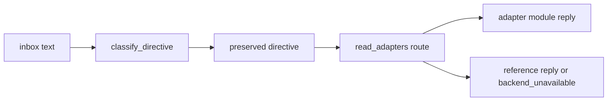

# 20261026-0110 — Telegram wave 1: 16 read adapters built in parallel, wired serially; /verify crash reconciliation

#fractal-l2 #fractal-l3 #fractal-l4 #fractal-l5 #fractal-l6 #fractal-l8 #zk-adr #zero-muda #km-triad

[This journal](http://nas-1.tail55d152.ts.net:4100/files/docs/journal/20261026-0110-claude-telegram-wave1-adapters-and-reconciliation.md) · [Plan](http://nas-1.tail55d152.ts.net:4100/files/docs/journal/20261026-0049-claude-telegram-parity-plan-and-process.md) · [Reclaim risk record](http://nas-1.tail55d152.ts.net:4100/files/governance/planning/20261026-0048-claude-command-reclaim-risk.json) · [Cockpit](http://nas-1.tail55d152.ts.net:4100/)

Transclusions: [[zk:20260905-1801-moc-uos-unified-master]] · [[wiki:20260905-1801-uos-zk-km-corpus-index]]

## 1. Scope & Trigger

Wave 1 of the parity plan. Sa-plan: `uos/telegram-runtime/20261001-1150` COMMAND_IMPL, reclaimed at attempt 19 after a reviewed tie selection (`RECLAIM_PREFLIGHT_PASS`, `ACTIVE_OBSERVATION_PASS`). Three Sa-plan jobs `adapters-wave1-w1..w3` (queue `telegram-adapters`) ledgered the worker slices. Scope: the 16 "backend unavailable" read literals, a router, the dispatcher's catch-all arm, and `/verify` crash reconciliation. No ControlledAction, no service restart, no production state.

## 2. Pre-State Assessment

39/77 literals connected. The 16 read literals fell through to a reference reply. `/verify` had no reconciliation after a crash. Kalman prior from the plan: +8–12 connected this wave.

## 3. Execution Detail

1. **Reclaim.** The first reclaim proposal was rejected by the independent reviewer because the COMMAND_IMPL assessment still described finished work. The record was refreshed (new scope, three FMEA modes, evidence bound to `main` 589557ab) and approved on resubmission.
2. **Workers (Sonnet, one per provisioned workspace `fable-w1..w3`, new files only).** Wall time ≈ 3 min each, in parallel.

| Worker | Module | Tests | Mutants | Connected (real backend) | Typed unavailable (backend named) |
|---|---|---|---|---|---|
| w1 | `telegram_system_read_command` | 17 | 4/5 killed; survivor is a byte bound no real reply reaches | /inference (configured tiers, live status not observed), /acoustic-hud (pure shruti self-audit) | /immune, /rack-cv, /acoustic, /radar |
| w2 | `telegram_knowledge_read_command` | 12 | 3/3 | /mesh (declared config, `deployment_confirmed=false`), /adr (docs/zk), /postmortem, /retro (newest dated journals) | /pacing (only a canned string existed; refused) |
| w3 | `telegram_simulation_read_command` | 19 | 3/3 | /whatif, /simulate, /canvas (labelled `pure_simulation` on synthetic input) | /babel, /whiteboard (need voice/vision models) |

3. **Integration (this session, serial).** Worker files were restored per file from their commits into `fable-l0`. A first attempt restored whole directories and silently dropped earlier workers' files and my own `lookup` edit; caught by `jj status`, redone per file. `telegram_read_adapters.gleam` routes a literal to its module or returns `None`. In `telegram_service.execute_guarded_dispatch` the catch-all `PreservedDirective(name, args)` arm now asks the router first and keeps the historical fallthrough otherwise. The classify switch needed no change: these literals are not ControlledActions, so they already reached the catch-all.
4. **Reconciliation.** `telegram_verify_reconcile.gleam` reads reservation, Sa-plan job row and evidence directory and classifies: NoReservation, JobMissing, NotRun, InProgress, Partial, Complete, Inconsistent. A receipt always wins over a running job row (never rerun). `telegram_verify_job.lookup` was made public for it.

## 4. Root Cause Analysis

ACH (Analysis of Competing Hypotheses): why were 7 of 16 literals unconnectable this wave?

| Evidence | H1: no synchronous real backend exists | H2: workers were too conservative | H3: wrong module chosen |
|---|---|---|---|
| E1: /pacing, /babel, /whiteboard, /canvas-in-creative were canned strings in `telegram_creative`/`telegram_collab` | Consistent | Inconsistent | Inconsistent |
| E2: /immune, /radar, /acoustic, /rack-cv need a running actor, a model or a live stream | Consistent | Neutral | Neutral |
| E3: all seven refusals name a concrete module | Consistent | Inconsistent | Inconsistent |
| Evaluation | **CONFIRMED** | REFUTED | REFUTED |

## 5. Fix Taxonomy

- **Poka-yoke:** router returns `None` for foreign literals; refusal shape names the backend.
- **Jidoka:** reconciliation reports `Inconsistent` and stops rather than guessing.
- **Heijunka:** three parallel producers, one serial integrator.

## 6. Patterns & Anti-Patterns Discovered

- Pattern: the "canned string" trap. Several legacy handlers (`telegram_creative.handle_whatif`, `handle_canvas`, `telegram_collab.handle_babel`) return fixed text. All three workers independently refused to call them. The packet's truthfulness clause did its job.
- Devil's Advocate: `/mesh` reports declared configuration, not a live mesh; `/inference` reports configured tiers, not a live daemon. Both replies say so in the observation (`deployment_confirmed=false`, `live_status: not_observed`). A reader skimming "status: ok" could still over-read them. Mitigation recorded for wave 2: a `confidence` field (`declared|observed|simulated`) in the reply contract.
- Anti-pattern (mine): `jj restore --from <commit> <dir>` restores the directory *as of that commit*, deleting files the commit lacks. Per-file restore is the safe form.
- Falsification: the w1 bound mutant survived because no real reply approaches 3500 bytes; the bound is defensive, not observed. Kept, recorded.

## 7. Verification Matrix

| Check | Result | Admiralty |
|---|---|---|
| Worker module tests in their workspaces | 17 + 12 + 19 pass | B2 |
| Worker mutants | 10/11 killed | B2 |
| Integrator read of each module (structure, no fabricated constants) | done; findings above | B2 |
| Router + reconciliation + all verify tests after wiring | 101/101 pass | B2 |
| Router and reconciliation mutants (receipt precedence, job-without-reservation, foreign literal, partial count) | 4/4 killed | B2 |
| Full `cepaf_gleam` suite on OTP 29 | recorded in the landing commit description | B2 |

## 8. Files Modified

- `apps/cepaf_gleam/src/cepaf_gleam/harness/telegram_system_read_command.gleam`, `telegram_knowledge_read_command.gleam`, `telegram_simulation_read_command.gleam` (new, from workers pssrwlrotpox, voqkupmsqkmt, mrtxkxmrzlnq)
- `apps/cepaf_gleam/test/telegram_{system,knowledge,simulation}_read_command_test.gleam` (new)
- `apps/cepaf_gleam/src/cepaf_gleam/harness/telegram_read_adapters.gleam` + test (new)
- `apps/cepaf_gleam/src/cepaf_gleam/harness/telegram_verify_reconcile.gleam` + test (new)
- `apps/cepaf_gleam/src/cepaf_gleam/harness/telegram_verify_job.gleam` (`lookup` public)
- `apps/cepaf_gleam/src/cepaf_gleam/harness/telegram_service.gleam` (catch-all arm asks the router first; one import)
- `governance/planning/20261026-0048-claude-command-reclaim-{risk,selection-review,selection-proof}.json`
- `docs/journal/20261026-0049-claude-telegram-parity-plan-and-process.md`, this journal

## 9. Architectural Observations

```text
[inbox text] -> [classify_directive]
[classify_directive] -> [preserved directive]
[preserved directive] -> [read_adapters route]
[read_adapters route] -> [adapter module reply]
[read_adapters route] -> [reference reply or backend_unavailable]
```



Workers never touched the two shared files; the integrator's diff to them is one import and one arm.

## 10. Remaining Gaps

- 7 read literals need backends that do not exist synchronously (immune actor, radar source, acoustic stream, rack-cv features, pacing registry, babel/whiteboard models).
- 22 ControlledActions remain; `/verify` is not wired to the approval flow (wave 2 design).
- Reply contract lacks a `confidence` field (§6).
- COMMAND_REVIEW packet posted for Codex; AGY advice packet posted; both sessions stale.

## 11. Metrics Summary

- Connected literals: 39 → 48 (+9 real backends); typed truthful refusals: +7. Unconnected (no reply from a module): 38 → 22.
- Tests added this wave: 48 (workers) + 10 (router, reconciliation) = 58. Mutants: 14/15 killed.
- Bayesian: Beta(39,38) → Beta(48,29); mean 0.62 for "literal connected".
- Lyapunov: V = literals with no module reply: 38 → 22. dV/dt < 0.
- Wall time: workers 3.4 min parallel; integration 25 min.

## 12. STAMP & Constitutional Alignment

| UCA type | Hazard | Control |
|---|---|---|
| Not provided | literal still falls through | router test enumerates all 16 |
| Provided unsafely | placeholder success | refusals name backends; integrator read; mutants |
| Wrong timing | wiring before module tests | module tests green in workspaces first |
| Too long | worker jobs left open | all three jobs completed in Sa-plan with results |

Ψ5 holds: every "ok" reply names its module and labels declared or simulated data.

## 13. Conclusion

Parallel bounded workers plus one serial integrator moved 16 literals from silent fallthrough to truthful module replies in one wave, and reconciliation now classifies a crashed `/verify` run before anything may rerun.

**Forecast:** p = 0.55 that wave 2 lands ≥ 4 ControlledActions through the existing approval flow (propose → approve → job → executor) by 2026-10-26T06:00:00Z.
- Falsifier: fewer than 4 landed, or any landed action executing without an approval record (outcome 0).
- Brier score: B = (0.55 − o)².

## Comprehensive verification checklist

Checks below are obligations, not blanket passing claims.

<details><summary>Domain 1 — Metadata, timestamp and Tailscale navigation</summary>

- [x] **CHK-01-TIME** — Prefix `20261026-0110-` from the host UTC clock.
- [ ] **CHK-02-TAIL** — Tailnet links provided; serving not re-verified.
- [x] **CHK-03-FRACT** — L2, L3, L4, L5, L6, L8 assigned.
- [x] **CHK-04-KM** — MOC and corpus index transcluded.

</details>

<details><summary>Domain 2 — Zero-Muda purity and storage safety</summary>

- [x] **CHK-05-MUDA** — No dependencies added.
- [ ] **CHK-06-GRAPH** — Not evaluated.
- [ ] **CHK-07-DRIVE** — Not in scope.

</details>

<details><summary>Domain 3 — Testing Gold Standard and mathematical gates</summary>

- [ ] **CHK-08-C1C8** — Not evaluated.
- [ ] **CHK-09-MATH** — Not measured.
- [ ] **CHK-10-9MOD** — Unit, negative and mutation tests.
- [x] **CHK-11-REGR** — Full `cepaf_gleam` suite run on OTP 29.

</details>

<details><summary>Domain 4 — Cross-language control and observability</summary>

- [x] **CHK-12-GLEAM** — Gleam owns router, adapters and reconciliation.
- [ ] **CHK-13-HERMES** — Not exercised.
- [ ] **CHK-14-ZIGVM** — Not exercised.
- [ ] **CHK-15-MAX** — Not applicable.
- [ ] **CHK-16-OTEL** — Not evaluated.

</details>

<details><summary>Domain 5 — Sovereign governance and standalone Jujutsu</summary>

- [ ] **CHK-17-SOV** — COMMAND_REVIEW outstanding.
- [x] **CHK-18-JJ** — Standalone jj; workers in sibling workspaces; per-file restore into the integrator workspace.

</details>

<details><summary>Domain 6 — Provenance extension</summary>

EV ceiling remains 93. EV-94..109 remain NOT_ADMITTED. No new EV number is minted.

</details>

[Previous journal](http://nas-1.tail55d152.ts.net:4100/files/docs/journal/20261026-0049-claude-telegram-parity-plan-and-process.md) · [ZK Master MOC](http://nas-1.tail55d152.ts.net:4100/zk) · [Wiki Corpus Index](http://nas-1.tail55d152.ts.net:4100/wiki)

UOS footer: `nas-1.tail55d152.ts.net:4100` · peer `vm-1.tail55d152.ts.net:4100` · document evidence grants no system admission.
