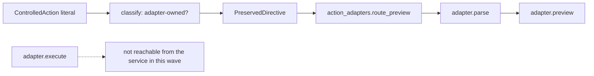

# 20261026-0125 — Telegram wave 2: six ControlledAction adapters, preview-only wiring, no execution path

#fractal-l0 #fractal-l3 #fractal-l4 #fractal-l5 #fractal-l6 #fractal-l9 #zk-adr #zero-muda #km-triad

[This journal](http://nas-1.tail55d152.ts.net:4100/files/docs/journal/20261026-0125-claude-telegram-wave2-controlled-action-previews.md) · [Adapter contract](http://nas-1.tail55d152.ts.net:4100/files/docs/design/20261026-0115-telegram-controlled-action-adapter-contract.md) · [Wave 1](http://nas-1.tail55d152.ts.net:4100/files/docs/journal/20261026-0110-claude-telegram-wave1-adapters-and-reconciliation.md) · [Plan](http://nas-1.tail55d152.ts.net:4100/files/docs/journal/20261026-0049-claude-telegram-parity-plan-and-process.md) · [Cockpit](http://nas-1.tail55d152.ts.net:4100/)

Transclusions: [[zk:20260905-1801-moc-uos-unified-master]] · [[wiki:20260905-1801-uos-zk-km-corpus-index]]

## 1. Scope & Trigger

Wave 2 of the parity plan under `uos/telegram-runtime/20261001-1150` COMMAND_IMPL attempt 19; Sa-plan jobs `actions-wave2-w1..w3`. Six ControlledAction literals (/andon, /dark, /chaos, /gameday, /export-audit, /handover) get adapters that follow the published contract (parse, effect_id, preview, execute). Only `preview` is wired into the service. `execute` is unreachable from Telegram until the signed approval flow is extended; that extension is a separate, reviewed increment.

## 2. Pre-State Assessment

After wave 1: 48/77 literals answer from modules; 22 ControlledActions still refused at classify ("not implemented yet"). The repository's approval subsystem (`telegram_action_intent`, `telegram_action_proposal`, `telegram_approval`, `telegram_action_profile`) executes exactly one effect kind, a job-lease cancellation.

## 3. Execution Detail

1. **Contract first.** `docs/design/20261026-0115` fixed the adapter API and the authority path before any worker started.
2. **Workers (Sonnet, `fable-w1..w3`, new files only):**

| Worker | Modules | Tests | Mutants | execute in development |
|---|---|---|---|---|
| w1 | `telegram_action_andon`, `telegram_action_dark` | 29 | 9/10 (one equivalent) | real, receipt-only: `andon.finish` on a hypothetical Ready service; `dark_cockpit` fold; no process or service signalled |
| w2 | `telegram_action_chaos`, `telegram_action_gameday` | 22 | 8/8 | real, in-process on synthetic targets; 20-scenario and 7-scenario allowlists; confidence declared/simulated |
| w3 | `telegram_action_export_audit`, `telegram_action_handover` | 17 | 7/7 | export: `backend_unavailable:rusty_vault_nif` (needs an opened vault handle); handover: real skeleton file into the evidence dir, host-clock prefix |

3. **Integration (serial, this session).** `telegram_action_adapters.route_preview` maps a literal to `parse` then `preview`; `execute` is not imported into any service path (verified by grep: no `.execute(` in router, service or guard). The classify switch's ControlledAction branch now preserves a literal only when an adapter owns it; all other actions keep the historical denial. The service catch-all tries read adapters, then action previews, then the historical reference.
4. **Mutants on the wiring:** 4/4 killed (router drops a literal; denied relabelled executed; preserved name replaced; denial replaced by preservation). One attempted mutant did not compile and was discarded as invalid, not counted.
5. **Process repair.** After landing wave 1 the active check returned HOLD: my own edit of `telegram_service.gleam` changed a hash bound in COMMAND_IMPL and in two completed peer records. The landing chain had printed the HOLD but did not stop on it. The portfolio was re-observed with a small OCaml tool (`rehash.ml`) and the check returned `ACTIVE_OBSERVATION_PASS`; the chain now gates on PASS. Recorded as a lapse, not hidden.

## 4. Root Cause Analysis

ACH (Analysis of Competing Hypotheses): why did the wave-1 landing proceed on a HOLD?

| Evidence | H1: shell chain did not gate on the check's status | H2: the check was wrong | H3: the evidence binding is too broad |
|---|---|---|---|
| E1: the chain used `;` after the check, not `&&` on PASS | Consistent | Neutral | Neutral |
| E2: HOLD detail named the exact file I had edited | Consistent | Inconsistent | Consistent |
| E3: two completed peer records also bound that file | Neutral | Inconsistent | Consistent |
| Evaluation | **CONFIRMED** | REFUTED | Partly true: a shared dispatcher file bound by many records will churn every wave |

## 5. Fix Taxonomy

- **Poka-yoke:** `execute` unreachable from the service; classify preserves only adapter-owned actions.
- **Jidoka:** landing chain now stops on anything but PASS.
- **Standardised work:** one published contract, three identical packets.

## 6. Patterns & Anti-Patterns Discovered

- Pattern: contract-before-workers removed all API drift between the three workers; integration needed no adapter edits.
- Devil's Advocate: a "preview" that reads only declared configuration can be mistaken for an observation. Every preview carries `confidence`; `/andon` and `/dark` say `simulated`/`declared` because live actor state is not readable synchronously. Falsifier for wave 3: a preview labelled `observed` whose backend call is pure.
- Anti-pattern (shared scratch): worker w2 overwrote my mutation script in the session scratchpad; my sources were verified intact (key lines present, no stray backups) and the script was rewritten under an integrator-only name. Next packets give each worker its own scratch directory.
- Residual (w3): a crash between artifact and receipt writes leaves an orphan artifact; the retry then fails closed rather than overwriting. Acceptable, recorded.

## 7. Verification Matrix

| Check | Result | Admiralty |
|---|---|---|
| Worker module tests in their workspaces | 29 + 22 + 17 pass | B2 |
| Worker mutants | 24/25 killed (1 equivalent) | B2 |
| Focused run after wiring (actions, routers, guard, reconcile, executor) | 92/92 pass | B2 |
| Wiring mutants | 4/4 killed | B2 |
| `execute` unreachable from router/service/guard | grep: no call sites | B2 |
| Active check after portfolio re-observation | ACTIVE_OBSERVATION_PASS | B2 |
| Full `cepaf_gleam` suite on OTP 29 | recorded in the landing commit description | B2 |

## 8. Files Modified

- `apps/cepaf_gleam/src/cepaf_gleam/harness/telegram_action_{andon,dark,chaos,gameday,export_audit,handover}.gleam` + tests (new, from workers ssxkqott, kklrrnqz, rwkrurwolsrq)
- `apps/cepaf_gleam/src/cepaf_gleam/harness/telegram_action_adapters.gleam` + test (new)
- `apps/cepaf_gleam/src/cepaf_gleam/harness/telegram_ingress_guard.gleam` (ControlledAction branch; one import)
- `apps/cepaf_gleam/src/cepaf_gleam/harness/telegram_service.gleam` (catch-all tries action previews; one import)
- `docs/design/20261026-0115-telegram-controlled-action-adapter-contract.md` (new)
- `governance/planning/20261026-0116-claude-command-active-risk.json` (re-observed portfolio), this journal

## 9. Architectural Observations

```text
[ControlledAction literal] -> [classify: adapter-owned?] -> [PreservedDirective]
[PreservedDirective] -> [action_adapters.route_preview] -> [adapter.parse] -> [adapter.preview]
[adapter.execute] -> [not reachable from the service in this wave]
```



## 10. Remaining Gaps

- 15 ControlledActions still denied at classify (wave 3 in progress).
- `execute` path: extend the approval flow so an approved Intent targeting a Sa-plan job calls the adapter's `execute` under the guardian; `/verify` is the first consumer. Design increment, not started.
- `/export-audit` needs a vault handle; unavailable in development.
- COMMAND_REVIEW still needs Codex or AGY.

## 11. Metrics Summary

- Literals answering from a module: 48 → 54 (previews). Denied-at-classify: 22 → 16 (15 pending + `/verify` reserved for the executor path).
- Tests added: 68 (workers) + 4 (router) = 72. Mutants: 28/29 killed.
- Bayesian: Beta(48,29) → Beta(54,23); mean 0.70.
- Lyapunov: V = literals with no module reply: 22 → 16. dV/dt < 0.

## 12. STAMP & Constitutional Alignment

| UCA type | Hazard | Control |
|---|---|---|
| Not provided | action literal silently denied | classify preserves adapter-owned literals; test enumerates all six |
| Provided unsafely | an action executes from a chat message | `execute` not reachable; router tests assert no `executed`/`duplicate` status |
| Wrong timing | landing on a HOLD | chain gates on PASS (repaired this wave) |
| Too long | worker jobs left open | three jobs completed with results |

Ψ4 (human alignment): no effect without the approval flow. Ψ5: every preview states its confidence.

## 13. Conclusion

Six ControlledActions now answer truthfully with previews, under a published contract, with execution kept behind the approval flow by construction.

**Forecast:** p = 0.7 that wave 3 lands adapters for all remaining 15 ControlledActions (previews, with at least 5 real bounded `execute` paths) by 2026-10-26T04:00:00Z.
- Falsifier: any of the 15 still denied at classify at the horizon, or fewer than 5 real `execute` paths (outcome 0).
- Brier score: B = (0.7 − o)².

## Comprehensive verification checklist

Checks below are obligations, not blanket passing claims.

<details><summary>Domain 1 — Metadata, timestamp and Tailscale navigation</summary>

- [x] **CHK-01-TIME** — Prefix `20261026-0125-` from the host UTC clock.
- [ ] **CHK-02-TAIL** — Tailnet links provided; serving not re-verified.
- [x] **CHK-03-FRACT** — L0, L3, L4, L5, L6, L9 assigned.
- [x] **CHK-04-KM** — MOC and corpus index transcluded.

</details>

<details><summary>Domain 2 — Zero-Muda purity and storage safety</summary>

- [x] **CHK-05-MUDA** — No dependencies added.
- [ ] **CHK-06-GRAPH** — Not evaluated.
- [ ] **CHK-07-DRIVE** — Not in scope.

</details>

<details><summary>Domain 3 — Testing Gold Standard and mathematical gates</summary>

- [ ] **CHK-08-C1C8** — Not evaluated.
- [ ] **CHK-09-MATH** — Not measured.
- [ ] **CHK-10-9MOD** — Unit, negative, idempotency and mutation tests.
- [x] **CHK-11-REGR** — Full `cepaf_gleam` suite run on OTP 29.

</details>

<details><summary>Domain 4 — Cross-language control and observability</summary>

- [x] **CHK-12-GLEAM** — Gleam owns adapters, router and guard.
- [ ] **CHK-13-HERMES** — Not exercised.
- [ ] **CHK-14-ZIGVM** — Not exercised.
- [ ] **CHK-15-MAX** — Not applicable.
- [ ] **CHK-16-OTEL** — Not evaluated.

</details>

<details><summary>Domain 5 — Sovereign governance and standalone Jujutsu</summary>

- [ ] **CHK-17-SOV** — COMMAND_REVIEW outstanding.
- [x] **CHK-18-JJ** — Standalone jj; per-file restore from worker commits.

</details>

<details><summary>Domain 6 — Provenance extension</summary>

EV ceiling remains 93. EV-94..109 remain NOT_ADMITTED. No new EV number is minted.

</details>

[Previous journal](http://nas-1.tail55d152.ts.net:4100/files/docs/journal/20261026-0110-claude-telegram-wave1-adapters-and-reconciliation.md) · [ZK Master MOC](http://nas-1.tail55d152.ts.net:4100/zk) · [Wiki Corpus Index](http://nas-1.tail55d152.ts.net:4100/wiki)

UOS footer: `nas-1.tail55d152.ts.net:4100` · peer `vm-1.tail55d152.ts.net:4100` · document evidence grants no system admission.
