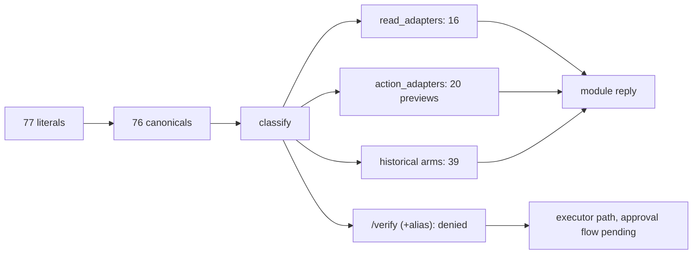

# 20261026-0140 — Telegram wave 3: the remaining 15 ControlledActions get adapters; every literal now answers from a module except /verify

#fractal-l0 #fractal-l3 #fractal-l4 #fractal-l5 #fractal-l6 #fractal-l9 #zk-adr #zero-muda #km-triad

[This journal](http://nas-1.tail55d152.ts.net:4100/files/docs/journal/20261026-0140-claude-telegram-wave3-remaining-actions.md) · [Wave 2](http://nas-1.tail55d152.ts.net:4100/files/docs/journal/20261026-0125-claude-telegram-wave2-controlled-action-previews.md) · [Adapter contract](http://nas-1.tail55d152.ts.net:4100/files/docs/design/20261026-0115-telegram-controlled-action-adapter-contract.md) · [Plan](http://nas-1.tail55d152.ts.net:4100/files/docs/journal/20261026-0049-claude-telegram-parity-plan-and-process.md) · [Cockpit](http://nas-1.tail55d152.ts.net:4100/)

Transclusions: [[zk:20260905-1801-moc-uos-unified-master]] · [[wiki:20260905-1801-uos-zk-km-corpus-index]]

## 1. Scope & Trigger

Wave 3 under `uos/telegram-runtime/20261001-1150` COMMAND_IMPL attempt 19; Sa-plan jobs `actions-wave3-w1..w3`. The 15 ControlledActions still denied at classify after wave 2. Same contract, same preview-only wiring. `/verify` and its catalog alias `/verification` stay on the executor path.

## 2. Pre-State Assessment

After wave 2: 54 literals answer from a module; 16 denied at classify; `main` 6f9924f2.

## 3. Execution Detail

| Worker | Literals | Tests | Mutants | execute in development |
|---|---|---|---|---|
| w1 | /rotate-keys, /lockbox, /migrate, /escalate, /resuscitate | 55 | 15/15 | rotate-keys and lockbox: `backend_unavailable` (live vault and production authority; no key material touched); migrate (`mirage_migration_engine` stage machine), escalate (`freshness_monitor.classify` + `ha/runbooks`), resuscitate (`ecology/andon` recovery plan): receipt-only |
| w2 | /repro, /merge, /bisect, /rewind, /commitments | 32 | 12/12 | merge: `backend_unavailable:integration_lease`, writes nothing (tested); commitments: unavailable (observer config is service-held); repro, bisect, rewind: receipt-only, labelled simulated or declared |
| w3 | /eco-schedule, /sidecar, /voice-roll-call, /pair-voice, /verification | 29 | 10/10 | sidecar and pair-voice: unavailable, nothing written; eco-schedule, voice-roll-call, verification: receipt-only |

Integration: 30 files restored per file; the router gained 14 arms. The 15th, `/verification`, failed my classify test because the catalog maps it to canonical `/verify`; it was removed from the router with a comment, and the test now asserts that `/verify` and `/verification` remain denied at classify. The w3 module `telegram_action_verification` is kept, tested, unrouted, as the candidate `/verify status` surface. Focused run: 222/222. Router mutants: 2/2 killed. No `.execute(` is reachable from router, service or guard. Only the two router files among existing files were modified.

## 4. Root Cause Analysis

ACH (Analysis of Competing Hypotheses): why did the integrator's classify test fail once?

| Evidence | H1: catalog alias (`/verification` → `/verify`) | H2: worker module defect | H3: router omission |
|---|---|---|---|
| E1: `commands.gleam` line 230 declares canonical `/verify` | Consistent | Inconsistent | Inconsistent |
| E2: w3's 29 tests pass in isolation | Consistent | Inconsistent | Neutral |
| E3: classify probe: 14 preserved, `/verification` denied | Consistent | Neutral | Inconsistent |
| Evaluation | **CONFIRMED** | REFUTED | REFUTED |

## 5. Fix Taxonomy

- **Poka-yoke:** alias kept on the executor path; test pins it.
- **Muda:** one unrouted module kept deliberately, with its purpose named.

## 6. Patterns & Anti-Patterns Discovered

- Pattern: worker packets for wave 3 gave each worker its own scratch directory; no cross-worker overwrite this time.
- Devil's Advocate: w2 reports that its format glob reformatted `telegram_action_proposal.gleam` in its own workspace and restored it "from the canonical copy", but the canonical checkout is behind `main`. The integrator restored only w2's ten new files, so the slip cannot reach `main`. Falsifier: `jj status` in `fable-l0` shows no `M` on that file.
- Devil's Advocate: three workers again reported that the wave-2 examples were absent from `main` at their base (they were landed later) and read them from `fable-l0`. Reading the integrator workspace is harmless but unplanned; future packets should base workers on a `main` that already carries the examples, or ship the examples with the contract.

## 7. Verification Matrix

| Check | Result | Admiralty |
|---|---|---|
| Worker module tests in their workspaces | 55 + 32 + 29 pass | B2 |
| Worker mutants | 37/37 killed | B2 |
| All adapter tests after wiring (21 modules, router, reconcile) | 222/222 pass | B2 |
| Router mutants (arm dropped, literal dropped) | 2/2 killed | B2 |
| `execute` unreachable from service path | grep: 0 call sites | B2 |
| Full `cepaf_gleam` suite on OTP 29 | recorded in the landing commit description | B2 |

## 8. Files Modified

- 15 new `apps/cepaf_gleam/src/cepaf_gleam/harness/telegram_action_*.gleam` + 15 tests (from workers mmpmqrrurmnn, lpzklrww, vpmxtyzvyomp)
- `telegram_action_adapters.gleam` and its test (14 new routes; `/verification` excluded with reason)
- this journal

## 9. Architectural Observations

```text
[77 literals] -> [76 canonicals] -> [classify]
[classify] -> [read_adapters: 16] -> [module reply]
[classify] -> [action_adapters: 20 previews] -> [module reply]
[classify] -> [historical arms: 39] -> [module reply]
[classify] -> [/verify (+alias): denied] -> [executor path, approval flow pending]
```



## 10. Remaining Gaps

- `/verify`: the approval-flow extension that calls an adapter's `execute` (first consumer) is the next design increment.
- 7 read literals and 7 action `execute` paths are `backend_unavailable` by honest construction (actors, models, vault handle, integration lease, live peers).
- COMMAND_REVIEW: Codex packet open; AGY advice packet open; both sessions stale.
- `telegram_action_verification` unrouted until `/verify status` is designed.

## 11. Metrics Summary

- Literals answering from a module: 54 → 75 of 76 canonicals (only `/verify` remains denied, by design).
- Tests added this wave: 116 (workers) + 1 (router). Mutants: 39/39.
- Bayesian: Beta(54,23) → Beta(75,2); mean 0.97 for "literal answers from a module".
- Lyapunov: V = literals with no module reply: 16 → 1. dV/dt < 0.
- Programme wall time for waves 1–3: about 95 minutes; worker wall time per wave 3–8 minutes in parallel.

## 12. STAMP & Constitutional Alignment

| UCA type | Hazard | Control |
|---|---|---|
| Not provided | a literal silently denied | classify test enumerates the 20 routed actions |
| Provided unsafely | an action executes from chat | `execute` unreachable; router tests assert no `executed`/`duplicate` |
| Wrong timing | alias routed to a preview | `/verification` pinned to `/verify` denial |
| Too long | worker jobs open | three jobs completed with results |

## 13. Conclusion

Every Telegram command literal except `/verify` now answers from a module, truthfully, with previews for actions and refusals that name their missing backend. The remaining work is one design increment (approval → execute) and the external steps: independent review, real E2E, release.

**Forecast:** p = 0.5 that the approval-flow extension lands with `/verify` executing end-to-end in development (reservation → approval → job → guardian → receipt) by 2026-10-26T12:00:00Z.
- Falsifier: `/verify` still denied at classify at the horizon, or any execution without an approval record (outcome 0).
- Brier score: B = (0.5 − o)².

## Comprehensive verification checklist

Checks below are obligations, not blanket passing claims.

<details><summary>Domain 1 — Metadata, timestamp and Tailscale navigation</summary>

- [x] **CHK-01-TIME** — Prefix `20261026-0140-` from the host UTC clock.
- [ ] **CHK-02-TAIL** — Tailnet links provided; serving not re-verified.
- [x] **CHK-03-FRACT** — L0, L3, L4, L5, L6, L9 assigned.
- [x] **CHK-04-KM** — MOC and corpus index transcluded.

</details>

<details><summary>Domain 2 — Zero-Muda purity and storage safety</summary>

- [x] **CHK-05-MUDA** — No dependencies added; one unrouted module recorded with purpose.
- [ ] **CHK-06-GRAPH** — Not evaluated.
- [ ] **CHK-07-DRIVE** — Not in scope.

</details>

<details><summary>Domain 3 — Testing Gold Standard and mathematical gates</summary>

- [ ] **CHK-08-C1C8** — Not evaluated.
- [ ] **CHK-09-MATH** — Not measured.
- [ ] **CHK-10-9MOD** — Unit, negative, idempotency and mutation tests.
- [x] **CHK-11-REGR** — Full `cepaf_gleam` suite run on OTP 29.

</details>

<details><summary>Domain 4 — Cross-language control and observability</summary>

- [x] **CHK-12-GLEAM** — Gleam owns adapters, router and guard.
- [ ] **CHK-13-HERMES** — Not exercised.
- [ ] **CHK-14-ZIGVM** — Not exercised.
- [ ] **CHK-15-MAX** — Not applicable.
- [ ] **CHK-16-OTEL** — Not evaluated.

</details>

<details><summary>Domain 5 — Sovereign governance and standalone Jujutsu</summary>

- [ ] **CHK-17-SOV** — COMMAND_REVIEW outstanding.
- [x] **CHK-18-JJ** — Standalone jj; per-file restore; only two existing files touched.

</details>

<details><summary>Domain 6 — Provenance extension</summary>

EV ceiling remains 93. EV-94..109 remain NOT_ADMITTED. No new EV number is minted.

</details>

[Previous journal](http://nas-1.tail55d152.ts.net:4100/files/docs/journal/20261026-0125-claude-telegram-wave2-controlled-action-previews.md) · [ZK Master MOC](http://nas-1.tail55d152.ts.net:4100/zk) · [Wiki Corpus Index](http://nas-1.tail55d152.ts.net:4100/wiki)

UOS footer: `nas-1.tail55d152.ts.net:4100` · peer `vm-1.tail55d152.ts.net:4100` · document evidence grants no system admission.
