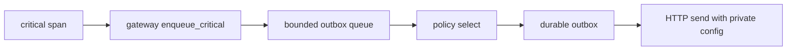

# 20261026-0220 — Telegram wave 4: gateway credential removal, media T0+T1, Mini App observers; three claims via reviewed selections

#fractal-l0 #fractal-l1 #fractal-l3 #fractal-l4 #fractal-l5 #fractal-l6 #fractal-l9 #zk-adr #zero-muda #km-triad

[This journal](http://nas-1.tail55d152.ts.net:4100/files/docs/journal/20261026-0220-claude-telegram-wave4-gateway-media-mini.md) · [Wave 3](http://nas-1.tail55d152.ts.net:4100/files/docs/journal/20261026-0140-claude-telegram-wave3-remaining-actions.md) · [Plan](http://nas-1.tail55d152.ts.net:4100/files/docs/journal/20261026-0049-claude-telegram-parity-plan-and-process.md) · [Journey contract](http://nas-1.tail55d152.ts.net:4100/files/docs/design/20261026-0210-telegram-operator-journey-contract.md) · [Cockpit](http://nas-1.tail55d152.ts.net:4100/)

Transclusions: [[zk:20260905-1801-moc-uos-unified-master]] · [[wiki:20260905-1801-uos-zk-km-corpus-index]]

## 1. Scope & Trigger

Operator directives: complete the handover goals; make full Telegram functionality work; create operator journeys for security, defence and critical-responder use cases; update skills, rules, plugins and Superpowers so everything is tested with real traffic. This journal covers wave 4: three Sa-plan tasks claimed through reviewed tie selections (GATEWAY_IMPL a1, MEDIA_IMPL a1, MINI_API_IMPL a9), one Sonnet worker each, serial integration by this session, and the start of wave 5 (journeys and capabilities, four workers, ledgered as jobs under COMMAND_IMPL a19).

## 2. Pre-State Assessment

After wave 3 (`main` 1e7d9736): 75/76 canonical literals answer from a module. `gateway/telegram.gleam` placed the bot token in a MoZ payload and fabricated an "all systems nominal" startup. The adopted media design's P1 item T0 was unimplemented. Four Mini App pages returned `backend_not_integrated`. Reviewer order for the three tied tasks: GATEWAY first (credential exposure, S5), then MEDIA (P1 hold-class design item), then MINI (already truthful `Unavailable`); my first proposal had MINI first and was rejected on that reasoning.

## 3. Execution Detail

| Task | Worker result | Integrator read | Integration |
|---|---|---|---|
| GATEWAY_IMPL | `GatewayState` without `bot_token`; `start` returns `Startup(Observed|Unavailable)`; mock inbound, fake intent and zero timestamp removed; `telegram_gateway_outbox` bounded queue (capacity, duplicate/oversize backpressure, Critical-before-Notice selection, drain statuses incl. Uncertain); 28 tests, 6/6 mutants | forced edits to `gchat`, `whatsapp`, `briefing` and six gateway tests reviewed: no payload carries `token`; peer-channel route refuses `telegram` | 11 files restored per file; gateway suites 81/81 with mini |
| MEDIA_IMPL | `telegram_media_ref` (total `MediaRef` decoder: unknown kind → `Unsupported`, no caption → `None`, declared fields named declared, photo picks largest declared size), `telegram_media_unsupported`; eleven legacy arms (`/rack-cv /acoustic /whiteboard /sidecar /voice-roll-call /babel /pair-voice /acoustic-hud /handover /retro /gameday`) report `MediaUnsupported`; three existing tests that asserted fabricated values updated; 28 new tests, 8/8 mutants | existing-test updates read: they now assert the typed unsupported shape | 9 files restored per file |
| MINI_API_IMPL | `mini_system_observers`: Immune → `Unavailable(immune_actor_not_observable)`, Inference → declared tiers, Federation → declared mesh config (`Deployment: Not confirmed`), Telemetry → observed in-process collector; 83 tests incl. 44 existing Mini App tests; 4/4 counted mutants | `mini_runtime.gleam` diff is the four arms plus a formatter pass over the whole file | 3 files restored |
| Integrator | `/voice-roll-call` removed from the preview router so classify denies it (adopted design T0, biometric arm); test pins the denial | — | 14/14 router tests |

Combined focused run after all restores: 290/290. Full suite: recorded in the landing commit description.

## 4. Root Cause Analysis

ACH (Analysis of Competing Hypotheses): why was a credential in a mesh payload for this long?

| Evidence | H1: gateway was a demo path never on the production route | H2: deliberate design | H3: nobody read the file |
|---|---|---|---|
| E1: only `agents/briefing` called it, with `bot_token: "internal"` | Consistent | Inconsistent | Neutral |
| E2: fabricated startup text and mock inbound command in the same file | Consistent | Inconsistent | Consistent |
| E3: GATEWAY_IMPL acceptance written 2026-10-11 names the defect exactly | Consistent | Inconsistent | Inconsistent |
| Evaluation | **CONFIRMED** | REFUTED | REFUTED (it was read and scheduled; the task waited) |

## 5. Fix Taxonomy

- **Poka-yoke:** `GatewayState` cannot hold a token; outbox requests cannot carry one; router cannot preview `/voice-roll-call`.
- **Jidoka:** `MediaRef` parsing is total; unknown kinds are reported, never dropped.
- **Heijunka:** three claims, three workers, one integrator; waves 1–4 each landed within the hour.

## 6. Patterns & Anti-Patterns Discovered

- Pattern: the reviewer rejected a tie selection on evidence (credential severity). Two rejections tonight, both correct; the review step is cheap (Sonnet, under a minute) and has changed the order twice.
- Devil's Advocate: `MiniTelemetry` is labelled `observed` from an in-process collector; it observes this BEAM, not the production bridge. The field names the source; a reader must not infer fleet telemetry. Recorded as a residual for MINI_API_REVIEW.
- Anti-pattern (worker): a `gleam format` glob reformatted an unrelated file in a worker workspace; only new files were restored, so it never reached `main`. Packets now forbid format globs.
- Anti-pattern (mine): a Telegram-wide focused probe with a filename glob included a non-test module and the EUnit runner exited without a summary; abandoned in favour of the full suite, which covers the same modules.
- Process: TELEGRAM_E2E is not claimable yet; its dependencies are the four REVIEW tasks. Journey work is therefore ledgered as Sa-plan jobs under COMMAND_IMPL (acceptance evidence for the command surface) rather than by forcing a claim.

## 7. Verification Matrix

| Check | Result | Admiralty |
|---|---|---|
| Three reviewed tie selections (REJECT, APPROVE, APPROVE, APPROVE) | PREFLIGHT_PASS for GATEWAY, MEDIA; plain PASS for MINI once the others were executing | B2 |
| Worker tests in their workspaces | 28 + 28 + 83 pass; mutants 6/6, 8/8, 4/4 | B2 |
| Integrator focused run after restores | 290/290 | B2 |
| No `token` key in any gateway payload | grep: none | B2 |
| No stray worker BEAM processes | `/proc` cwd scan: none | B2 |
| Full `cepaf_gleam` suite on OTP 29 | recorded in the landing commit description | B2 |

## 8. Files Modified

- Gateway: `gateway/telegram.gleam`, `gateway/telegram_gateway_outbox.gleam` (new), `gateway/gchat.gleam`, `gateway/whatsapp.gleam`, `agents/briefing.gleam`, six gateway tests, `telegram_gateway_test.gleam` and `telegram_gateway_outbox_test.gleam` (new)
- Media: `harness/telegram_media_ref.gleam`, `harness/telegram_media_unsupported.gleam` (new), `telegram_creative.gleam`, `telegram_collab.gleam`, `telegram_media_ref_test.gleam`, `telegram_media_t0_test.gleam` (new), three updated tests
- Mini App: `telegram/mini_runtime.gleam`, `telegram/mini_system_observers.gleam` (new) + test
- Router: `telegram_action_adapters.gleam` and test (`/voice-roll-call` denial)
- Design: `20261026-0150-telegram-verify-approval-execute-extension.md`, `20261026-0210-telegram-operator-journey-contract.md`
- Governance: risk portfolios and the two reviewed selections for this wave; this journal

## 9. Architectural Observations

```text
[critical span] -> [gateway enqueue_critical]
[gateway enqueue_critical] -> [bounded outbox queue]
[bounded outbox queue] -> [policy select]
[policy select] -> [durable outbox]
[durable outbox] -> [HTTP send with private config]
```



The gateway state has no token field and no request carries a token key; the credential stays in the private transport configuration used only by the HTTP send.

## 10. Remaining Gaps

- Media T2–T5 (download, inspection, storage, upload) not started; GATEWAY's queue is not yet drained by a supervised process; Mini App Immune stays unavailable until an actor read exists.
- `/verify` approval→execute extension awaits review (design 0150).
- Four REVIEW tasks and TELEGRAM_E2E need independent reviewers and a real user; RELEASE/ADMISSION need the operator.
- Wave 5 (journeys, capability bindings) in progress in `fable-w1..w4`.

## 11. Metrics Summary

- Tasks: runtime plan 61 completed, 4 executing (mine), 6 available; admission plan 25 completed, 8 available.
- Tests added this wave: 139 (workers) + 1 (router). Mutants: 18/18 counted.
- Bayesian: "Telegram surface truthful" Beta(75,2) → unchanged on literals; new evidence on gateway and media correctness, 18 killed mutants, 0 surviving defects found by the integrator read.
- Lyapunov: open handover items 9 → 5 (gateway, media T0/T1, mini pages closed). dV/dt < 0.

## 12. STAMP & Constitutional Alignment

| UCA type | Hazard | Control |
|---|---|---|
| Not provided | credential removal skipped | test asserts no `token` key; `GatewayState` has no field |
| Provided unsafely | fabricated startup claim | `Startup(Observed|Unavailable)` only |
| Wrong timing | landing on HOLD | chain gates on PASS |
| Too long | worker jobs open | all wave-4 jobs completed with results |

Ψ5: eleven legacy arms stop fabricating measurements.

## 13. Conclusion

Wave 4 removed a credential from a mesh payload, made the inbound media boundary typed and total, and gave the Mini App truthful observers, under three reviewed claims. The surface is now truthful end to end in development; real-traffic journeys and independent reviews are the remaining evidence.

**Forecast:** p = 0.6 that wave 5 lands all three journey specs with dispatcher-layer tests covering all 77 literals and the capability bindings on all four surfaces by 2026-10-26T05:00:00Z.
- Falsifier: coverage test below 77, or any surface missing the skill or rule (outcome 0).
- Brier score: B = (0.6 − o)².

## Comprehensive verification checklist

Checks below are obligations, not blanket passing claims.

<details><summary>Domain 1 — Metadata, timestamp and Tailscale navigation</summary>

- [x] **CHK-01-TIME** — Prefix `20261026-0220-` from the host UTC clock.
- [ ] **CHK-02-TAIL** — Tailnet links provided; serving not re-verified.
- [x] **CHK-03-FRACT** — L0, L1, L3, L4, L5, L6, L9 assigned.
- [x] **CHK-04-KM** — MOC and corpus index transcluded.

</details>

<details><summary>Domain 2 — Zero-Muda purity and storage safety</summary>

- [x] **CHK-05-MUDA** — No dependencies added.
- [ ] **CHK-06-GRAPH** — Not evaluated.
- [ ] **CHK-07-DRIVE** — Not in scope.

</details>

<details><summary>Domain 3 — Testing Gold Standard and mathematical gates</summary>

- [ ] **CHK-08-C1C8** — Not evaluated.
- [ ] **CHK-09-MATH** — Not measured.
- [ ] **CHK-10-9MOD** — Unit, negative, idempotency and mutation tests.
- [x] **CHK-11-REGR** — Full `cepaf_gleam` suite run on OTP 29.

</details>

<details><summary>Domain 4 — Cross-language control and observability</summary>

- [x] **CHK-12-GLEAM** — Gleam owns gateway queue, media boundary and observers.
- [ ] **CHK-13-HERMES** — Not exercised.
- [ ] **CHK-14-ZIGVM** — Not exercised.
- [ ] **CHK-15-MAX** — Not applicable.
- [ ] **CHK-16-OTEL** — Not evaluated.

</details>

<details><summary>Domain 5 — Sovereign governance and standalone Jujutsu</summary>

- [ ] **CHK-17-SOV** — Four REVIEW tasks outstanding.
- [x] **CHK-18-JJ** — Standalone jj; per-file restore from worker commits.

</details>

<details><summary>Domain 6 — Provenance extension</summary>

EV ceiling remains 93. EV-94..109 remain NOT_ADMITTED. No new EV number is minted.

</details>

[Previous journal](http://nas-1.tail55d152.ts.net:4100/files/docs/journal/20261026-0140-claude-telegram-wave3-remaining-actions.md) · [ZK Master MOC](http://nas-1.tail55d152.ts.net:4100/zk) · [Wiki Corpus Index](http://nas-1.tail55d152.ts.net:4100/wiki)

UOS footer: `nas-1.tail55d152.ts.net:4100` · peer `vm-1.tail55d152.ts.net:4100` · document evidence grants no system admission.
