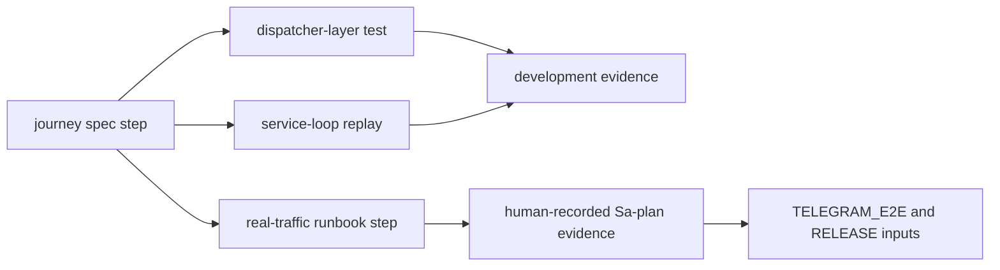

# 20261026-0230 — Telegram wave 5: operator journeys for security, defence and critical-responder use cases; 77/77 literals covered; capabilities on four surfaces

#fractal-l0 #fractal-l3 #fractal-l4 #fractal-l5 #fractal-l6 #fractal-l8 #fractal-l9 #zk-adr #zero-muda #km-triad

[This journal](http://nas-1.tail55d152.ts.net:4100/files/docs/journal/20261026-0230-claude-telegram-wave5-operator-journeys.md) · [Journey contract](http://nas-1.tail55d152.ts.net:4100/files/docs/design/20261026-0210-telegram-operator-journey-contract.md) · [Security](http://nas-1.tail55d152.ts.net:4100/files/docs/design/20261026-0215-telegram-journey-security-incident.md) · [Defence](http://nas-1.tail55d152.ts.net:4100/files/docs/design/20261026-0215-telegram-journey-defence-ha.md) · [Responder](http://nas-1.tail55d152.ts.net:4100/files/docs/design/20261026-0215-telegram-journey-critical-responder.md) · [Guide](http://nas-1.tail55d152.ts.net:4100/docs/wiki/20261026-0220-telegram-journeys-guide.md) · [Wave 4](http://nas-1.tail55d152.ts.net:4100/files/docs/journal/20261026-0220-claude-telegram-wave4-gateway-media-mini.md) · [Cockpit](http://nas-1.tail55d152.ts.net:4100/)

Transclusions: [[zk:20260905-1801-moc-uos-unified-master]] · [[wiki:20260905-1801-uos-zk-km-corpus-index]]

## 1. Scope & Trigger

Operator directive: "create fully operational telegram user journeys for all features for security, defence, critical responder use cases; update all system capabilities (skills, rules, superpowers, plugins) to test all functionality with real traffic and use cases." Ledger: Sa-plan jobs `journeys-wave5-w1..w3` and `capabilities-wave5-w4` under `uos/telegram-runtime/20261001-1150` COMMAND_IMPL (attempt 19, reclaimed as attempt 20 after lapse with `RECLAIM_PREFLIGHT_PASS`). TELEGRAM_E2E itself is not claimable yet: it depends on the four REVIEW tasks.

## 2. Pre-State Assessment

After wave 4 (`main` a7c2e515): 75/76 canonical literals answer from a module; no operator-facing description existed of *how* to use them to reach an outcome, and no test asserted that every literal had such a use. Earlier specs (2026-09-09) described seven persona journeys at design time, before the dispatcher existed.

## 3. Execution Detail

1. **Contract first** (`SC-TELEGRAM-JOURNEY-001`): reply classes (`ok`, `preview`, `denied`, `backend_unavailable`, `approval_required`; `executed`/`duplicate` only via approval), the step record, three executable forms (dispatcher-layer test, service-loop replay, real-traffic run by an authorized human), and capability bindings.
2. **Three journey workers (Sonnet, parallel, new files only):**

| Use case | Journeys | Steps | Tests | Mutants | Literals |
|---|---|---|---|---|---|
| Security incident | 6 | 57 | 12 | 3/3 | 43 |
| Defence / HA | 6 | 69 | 10 | 2/2 | 52 |
| Critical responder | 6 | 103 | 8 | 2/2 | 75 |

   Each spec has the contract's step table, an ASCII and a matching Mermaid flow (G-DIAGRAM PASS), and "what real deployment must add" per `backend_unavailable` step. Each runbook names the staging-bot prerequisites, the exact messages, pass/fail per step and the Sa-plan evidence line the human records.
3. **Capability worker:** skill `uos-telegram-journeys` and rule `20261026-0220-telegram-journey-acceptance.md` byte-identical on `.claude`, `.gemini`, `.agents`, `.codex` (sha `d616f5bd…`, `5079de33…`), a copy of the rule under `contracts/rules/` so FQDN links resolve, plugin `plugins/uos-telegram-journeys` with manifest and Superpowers bindings (verification-before-completion, finishing-a-development-branch, test-driven-development, systematic-debugging), wiki guide.
4. **Integrator:** `telegram_journey_coverage_test`: union of the three `covered_literals()` equals the 77-literal catalog; every journey literal exists in the catalog; no ControlledAction classifies to an unknown directive. All four journey suites: 33/33.
5. **Defect found twice independently (w2, w3):** the catalog maps `/simulate` to canonical `/whatif`, so the `/simulate` grammar in `telegram_simulation_read_command` is unreachable; both journeys pin the current (denied) behaviour and name the fix. Scheduled for wave 6 with its test updates.
6. **Process repair:** `tools/diagram-check` failed on four of tonight's journals (chained Mermaid arrows and parenthesised labels do not survive the parser). All four rewritten one edge per line with identical labels; all PASS now. The journey contract and the `/verify` design were fixed the same way.

## 4. Root Cause Analysis

ACH (Analysis of Competing Hypotheses): why did the diagram parity gate fail on documents I had just written?

| Evidence | H1: author wrote chained arrows the checker cannot expand | H2: checker defect | H3: journals were not run through the gate |
|---|---|---|---|
| E1: failures list "Mermaid only: []" for chained lines | Consistent | Possible | Consistent |
| E2: one-edge-per-line rewrites pass unchanged in meaning | Consistent | Inconsistent | Neutral |
| E3: `journal-check` passed (co-presence only) while `diagram-check` failed | Neutral | Neutral | Consistent |
| Evaluation | **CONFIRMED** | REFUTED | **CONFIRMED** (both true: I ran only journal-check per wave) |

## 5. Fix Taxonomy

- **Poka-yoke:** coverage test makes an undescribed command a failing test.
- **Standardised work:** one contract, three identical packets, per-worker scratch directories.
- **Jidoka:** `diagram-check` added to the per-wave gate alongside `journal-check`.

## 6. Patterns & Anti-Patterns Discovered

- Pattern: two independent workers converging on the same defect (`/simulate` alias) is stronger evidence than one; the journeys acted as a review.
- Devil's Advocate: dispatcher-layer journeys prove classification and adapter replies, not delivery. The service-loop form exists for a subset and the real-traffic form needs a human; the rule says so (INV-TGJ-03). A reader must not treat 33 green tests as "Telegram works".
- Anti-pattern (worker w3): modified `telegram_action_adapters.gleam` in its workspace to compile; the integrator restored only its new files. The contract-and-packet rule "new files only" held at integration.
- Residual: `/fmea` and `/rete` are covered only by security/defence journeys; `/voice-roll-call`, `/verify`, `/verification` are covered as `denied` steps by design.

## 7. Verification Matrix

| Check | Result | Admiralty |
|---|---|---|
| Journey suites in worker workspaces | 12 + 10 + 8 pass; mutants 7/7 | B2 |
| Integrator run of four suites incl. coverage | 33/33; 77/77 literals | B2 |
| Capability mirrors byte-identical on four surfaces | sha256 equal | B2 |
| `diagram-check` on contract, specs, guide, verify design, five journals | 0 FAILED each | B2 |
| `journal-check` on tonight's journals | 10/10 each | B2 |
| Full `cepaf_gleam` suite on OTP 29 | recorded in the landing commit description | B2 |

## 8. Files Modified

- `docs/design/20261026-0210-telegram-operator-journey-contract.md`; three journey specs; three runbooks; `docs/wiki/20261026-0220-telegram-journeys-guide.md`
- `apps/cepaf_gleam/test/telegram_journey_{security,defence,responder,coverage}_test.gleam`
- `.claude|.gemini|.agents|.codex/skills/uos-telegram-journeys/SKILL.md`; `.claude|.gemini|.agents|.codex/rules/20261026-0220-telegram-journey-acceptance.md`; `contracts/rules/20261026-0220-telegram-journey-acceptance.md`; `plugins/uos-telegram-journeys/**`
- Diagram repairs in four journals and two designs; this journal

## 9. Architectural Observations

```text
[journey spec step] -> [dispatcher-layer test]
[journey spec step] -> [service-loop replay]
[journey spec step] -> [real-traffic runbook step]
[dispatcher-layer test] -> [development evidence]
[service-loop replay] -> [development evidence]
[real-traffic runbook step] -> [human-recorded Sa-plan evidence]
[human-recorded Sa-plan evidence] -> [TELEGRAM_E2E and RELEASE inputs]
```



## 10. Remaining Gaps

- Real-traffic runs: need a staging bot token in the private transport configuration and an authorized human; not performed.
- `/simulate` alias fix and the `/verify` approval→execute extension (wave 6).
- Service-loop replay exists for the historical command pairs only; journey-wide replay is not wired.
- Four REVIEW tasks, TELEGRAM_E2E, RELEASE, ADMISSION remain external.

## 11. Metrics Summary

- Journeys 18; steps 229; literals covered 77/77; tests added 33; mutants 7/7.
- Bayesian: "every command has a truthful described use" Beta(1,1) → Beta(78,1) over literals, 7-day half-life.
- Lyapunov: undescribed literals 77 → 0. dV/dt < 0.

## 12. STAMP & Constitutional Alignment

| UCA type | Hazard | Control |
|---|---|---|
| Not provided | a command with no described use | coverage test |
| Provided unsafely | a journey step expecting fabricated success | INV-TGJ-04; class set enforced in tests |
| Wrong timing | real traffic before review | INV-TGJ-03 orders human runs before RELEASE |
| Too long | staging token lingering in a document | runbooks forbid token in any artefact |

## 13. Conclusion

Every Telegram command now has at least one described, tested, truthful use in a security, defence or responder journey, and the capability surfaces tell every agent how to run and extend them. The real-traffic runs remain a human step by rule.

**Forecast:** p = 0.5 that an authorized human completes at least one real-traffic journey (any use case) against the staging bot and records it in Sa-plan by 2026-10-28T00:00:00Z.
- Falsifier: no Sa-plan evidence row from a human run by the horizon (outcome 0).
- Brier score: B = (0.5 − o)².

## Comprehensive verification checklist

Checks below are obligations, not blanket passing claims.

<details><summary>Domain 1 — Metadata, timestamp and Tailscale navigation</summary>

- [x] **CHK-01-TIME** — Prefix `20261026-0230-` from the host UTC clock.
- [ ] **CHK-02-TAIL** — Tailnet links provided; serving not re-verified.
- [x] **CHK-03-FRACT** — L0, L3, L4, L5, L6, L8, L9 assigned.
- [x] **CHK-04-KM** — MOC and corpus index transcluded.

</details>

<details><summary>Domain 2 — Zero-Muda purity and storage safety</summary>

- [x] **CHK-05-MUDA** — No dependencies added.
- [ ] **CHK-06-GRAPH** — Not evaluated.
- [ ] **CHK-07-DRIVE** — Not in scope.

</details>

<details><summary>Domain 3 — Testing Gold Standard and mathematical gates</summary>

- [ ] **CHK-08-C1C8** — Not evaluated.
- [ ] **CHK-09-MATH** — Not measured.
- [ ] **CHK-10-9MOD** — Unit, BDD-style journey and mutation tests.
- [x] **CHK-11-REGR** — Full `cepaf_gleam` suite run on OTP 29.

</details>

<details><summary>Domain 4 — Cross-language control and observability</summary>

- [x] **CHK-12-GLEAM** — Journeys exercise the Gleam dispatcher.
- [ ] **CHK-13-HERMES** — Not exercised.
- [ ] **CHK-14-ZIGVM** — Not exercised.
- [ ] **CHK-15-MAX** — Not applicable.
- [ ] **CHK-16-OTEL** — Not evaluated.

</details>

<details><summary>Domain 5 — Sovereign governance and standalone Jujutsu</summary>

- [ ] **CHK-17-SOV** — Review packet posted; verdicts outstanding.
- [x] **CHK-18-JJ** — Standalone jj; new files restored per file from four worker commits.

</details>

<details><summary>Domain 6 — Provenance extension</summary>

EV ceiling remains 93. EV-94..109 remain NOT_ADMITTED. No new EV number is minted. No real-traffic pass is recorded by this journal.

</details>

[Previous journal](http://nas-1.tail55d152.ts.net:4100/files/docs/journal/20261026-0220-claude-telegram-wave4-gateway-media-mini.md) · [ZK Master MOC](http://nas-1.tail55d152.ts.net:4100/zk) · [Wiki Corpus Index](http://nas-1.tail55d152.ts.net:4100/wiki)

UOS footer: `nas-1.tail55d152.ts.net:4100` · peer `vm-1.tail55d152.ts.net:4100` · document evidence grants no system admission.
