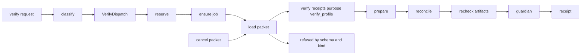

# 20261026-0640 — Telegram wave 6a: reclaiming four expired attempts as a reviewed set, three worker modules, the /simulate repair and the /verify approval core

#fractal-l0 #fractal-l3 #fractal-l4 #fractal-l5 #fractal-l6 #fractal-l9 #zk-adr #zero-muda #km-triad

[This journal](http://nas-1.tail55d152.ts.net:4100/files/docs/journal/20261026-0640-claude-telegram-wave6a-reclaim-set-workers-and-verify-core.md) · [Wave 5](http://nas-1.tail55d152.ts.net:4100/files/docs/journal/20261026-0230-claude-telegram-wave5-operator-journeys.md) · [Plan](http://nas-1.tail55d152.ts.net:4100/files/docs/journal/20261026-0049-claude-telegram-parity-plan-and-process.md) · [KPI ledger](http://nas-1.tail55d152.ts.net:4100/files/governance/planning/20261026-0639-claude-telegram-wave-kpi-ledger.json) · [Verify design](http://nas-1.tail55d152.ts.net:4100/files/docs/design/20261026-0150-telegram-verify-approval-execute-extension.md) · [Cockpit](http://nas-1.tail55d152.ts.net:4100/)

Transclusions: [[zk:20260905-1801-moc-uos-unified-master]] · [[wiki:20260905-1801-uos-zk-km-corpus-index]]

## 1. Scope & Trigger

Operator goal: complete all Telegram features; update rules, skills, Superpowers, agents and plugins; learn, track KPIs and improve. Sa-plan `uos/telegram-runtime/20261001-1150`: COMMAND_IMPL attempt 21, MEDIA_IMPL attempt 2, GATEWAY_IMPL attempt 2, MINI_API_IMPL attempt 10, all claimed by this session at 06:12:51Z after `RECLAIM_PREFLIGHT_PASS`; jobs `wave6-w1-media-download`, `wave6-w2-gateway-drain`, `wave6-w3-mini-immune`. Trigger: at 05:56Z all four implement leases were found expired since about 03:55Z, and wave 5 had pinned the `/simulate` alias defect for this wave.

## 2. Pre-State Assessment

`main` 8236f048 (wave 5). 75 of 76 canonicals answered from a module; `/simulate` aliased to `/whatif`, which made the peer-mesh simulation grammar unreachable and was recorded as a defect in three journey tests; `/verify` denied at classify pending the approval→execute design; media design T2 to T5, the gateway outbox drain and the Mini App Immune read not started. Prior (Kalman): the reclaim would be a repeat of the 02:24 reclaim (single task, no tie). Observation: four expired tasks of one worker tie at an inherited effective score, and the checker had no sanctioned path for a reviewed tie in reclaim-set mode.

## 3. Execution Detail

1. **Reclaim.** Portfolio `governance/planning/20261026-0558-claude-command-reclaim3-risk.json` (71 records, timestamps and hashes re-observed). The three sibling records were re-assessed against the landed wave 4 (residual F and scopes for the remaining increments: GATEWAY 540, MEDIA 720, MINI 216, COMMAND 720). Effective scores still tied at 768 through the REVIEW consumers and TELEGRAM_E2E. The validator refused a selection review in reclaim-set mode by a one-line guard; it was extended with `--reclaim-set-preflight-reviewed`, five new laws in `reviewed_selection_test.ml` (selftest `PASS`, 54 reviewed-selection checks, 375 baseline, 32,953 adversarial) and an addendum to the expired-claim contract. An independent Sonnet reviewer (`claude-subagent-tie-review-20261026`) approved the ordering COMMAND > MEDIA > GATEWAY > MINI twice: once for proposal `0370c82c…`, again for `f9e4995f…` after the portfolio bytes changed. The checker passed; four claims with 3h leases; four `ACTIVE_OBSERVATION_PASS`.
2. **Workers (Sonnet, new files only, own workspaces).** w1 `telegram_media_download` (31 tests, 6 killed mutants): pure T2 adapter with injected transport, caps enforced on the declared size before any request and on the stream with mid-transfer abort, the token-bearing URL never returned, logged or passed outward, `redact_file_url`. w2 `telegram_gateway_drain` (13 tests, 4 killed): OTP actor draining the bounded outbox Critical-first within a budget through an injected send, counters observed, restart under a `static_supervisor` proven, no token in state. w3 `mini_immune_observer` plus one additive edit to `immune/system.gleam` (`Snapshot` message, 23 insertions, 0 deletions; 10 tests, 4 killed, 1 equivalent mutant reported): bounded actor snapshot or a typed not-running or timeout reason.
3. **Integration.** Per-file restores from `ryupussl`, `ntznuumw`, `qlqstlsz`. `mini_runtime` MiniImmune arm now calls `observe_live(clock(), None, 2000)`, which answers `immune_actor_not_running` until a supervisor hands in the actor; no fabricated snapshot. `/simulate` is its own canonical in the catalog; the catalog test pins it and the three journey steps flipped from the recorded defect to `ok` from `cepaf_gleam/zenoh/peer_simulator`; one catalog mutant killed by four tests.
4. **/verify approval core (design 0150, layer A).** `telegram_action_intent` gains a signed `Kind` (`CancelJobLease`, `VerifyProfile`) inside the canonical payload and the logical effect; `telegram_approval` requires each receipt's `purpose` to equal the intent kind; `telegram_cancellation_record` refuses non-cancellation kinds; `telegram_action_packet` exposes the shared envelope parser and binding validation. New `telegram_verify_action` (prepare, ready, byte-exact record), `telegram_verify_packet` (schema `uos.telegram.verify-packet.v1`, reservation-bound load) and `telegram_verify_run` (reserve, reconcile, recheck, execute, never twice). 23 tests; the real pinned guardian runs once in the run tests. Three mutants killed; the cancellation-record kind guard is an equivalent mutant because `native_request` already refuses the kind.
5. **Capabilities.** Risk skill documents the three reclaim modes on all four surfaces and the plugin (hard-linked files); Telegram journey skill records the `/simulate` flip and the `/verify` expectation; the symbiosis agent adapter gains the wave-integrator discipline; the wave KPI ledger `20261026-0740-…-wave-kpi-ledger.json` is created with KPI definitions, six waves of rows, resolved Brier scores and seven lessons.

## 4. Root Cause Analysis

ACH (Analysis of Competing Hypotheses): why did all four leases expire unnoticed?

| Evidence | H1: leases were sized to a wave, not to the integrator's session | H2: Sa-plan clock drift | H3: another session reclaimed them |
|---|---|---|---|
| E1: all four `lease_until_ns` fall between 03:23Z and 03:55Z, 55 to 95 minutes after their claims | Consistent | Inconsistent | Inconsistent |
| E2: worker and attempt unchanged in every row at 05:56Z | Consistent | Neutral | Inconsistent |
| E3: the wave-5 landing at 02:33Z passed its active check; the next command came at 05:56Z after a context continuation | Consistent | Inconsistent | Neutral |
| Evaluation | **CONFIRMED** | REFUTED | REFUTED |

Second finding: the validator's `reviewed selection cannot combine active or reclaim-set modes` guard made a tied reclaim set unpassable by evidence repair alone (NC-19 requires the tie to be detected; nothing sanctioned discharging it). That is a tooling gap, not a policy intent, and it was repaired with laws rather than bypassed.

## 5. Fix Taxonomy

- **Poka-yoke:** signed `Kind` and receipt `purpose` make cross-kind replay fail at signature verification, not at a convention; `targets` binds the intent to the reservation's job and attempt inside the plan namespace.
- **Jidoka:** no claim before `RECLAIM_PREFLIGHT_PASS`; no build while the full suite ran; no landing on a HOLD.
- **Muda:** sibling records re-assessed instead of re-created; the shared envelope parser reused instead of duplicated.
- **Standardized work:** the common worker packet now carries scratch, jj and mutation rules verbatim; workers reported deviations (one Python one-liner for a mutant) rather than hiding them.

## 6. Patterns & Anti-Patterns Discovered

- Pattern: an independent reviewer told to disagree re-verified a changed proposal in a second round and checked exactly the three fields that moved.
- Anti-pattern: this session edited the checker after re-hashing the portfolio, which invalidated the portfolio's own evidence row for the checker file; rehash must be the last step before a preflight.
- Anti-pattern: a draft of `telegram_verify_run_test` was written as an unusable chain of helper functions and had to be rewritten before any build; the lesson is to derive test fixtures from the real job-id format before writing a test, not after.
- Devil's Advocate: is the kind marker enough? A receipt signs `intent_digest` and `effect_id`; both now contain the kind, so an approver's signature cannot be lifted to the other kind. What it does not prevent is an approver signing a verify intent they misread; the packet still carries the human-readable `reason` and `command_args` starts with the kind name.
- Devil's Advocate: are the three new sibling scopes honest about remaining risk? The media record keeps F at 5 because the token-in-URL mode is S5 regardless of controls; the gateway record keeps F at 5 for a plausible token-in-log mode; only MINI drops to F 3. The scores were not tuned to break the tie: all four still tied and the tie was reviewed.

## 7. Verification Matrix

| Check | Result | Admiralty |
|---|---|---|
| Validator selftests after the extension (`--all`) | PASS: 54 reviewed-selection, 375 baseline, 32,953 adversarial | A1 |
| Reviewed reclaim-set preflight | `RECLAIM_PREFLIGHT_PASS`, order COMMAND, GATEWAY, MEDIA, MINI | B2 |
| Active checks for attempts 21, 2, 2, 10 | 4 × `ACTIVE_OBSERVATION_PASS` | B2 |
| Worker modules in their workspaces | 31 + 13 + 10 tests pass; 14 mutants killed, 1 equivalent | B2 |
| Catalog and journey tests after the simulate fix | 76/76 focused; catalog mutant killed by 4 tests | B2 |
| Full `cepaf_gleam` suite on OTP 29 at the 6a tree | 13,674 passed, 0 failed | B2 |
| Verify core tests | action 10, packet 6, run 7 pass; approval 20, intent 17, cancellation 5, record 18 pass | B2 |
| Verify core mutants | 3/3 killed (purpose constant, target attempt, run on Complete); 1 equivalent | B2 |
| Full suite at the landing tip (6a plus verify core) | recorded in the landing commit description | B2 |

## 8. Files Modified

- `plugins/uos-risk-prioritization/validation/{validate.ml,reviewed_selection_test.ml}`, `contracts/rules/20260930-0800-expired-claim-preflight.md`
- `governance/planning/20261026-0558-claude-command-reclaim3-{risk,selection-review,selection-proof}.json`, `governance/planning/20261026-0639-claude-telegram-wave-kpi-ledger.json`
- `apps/cepaf_gleam/src/cepaf_gleam/harness/telegram_commands.gleam`; tests `telegram_commands_test`, `telegram_journey_{security,defence,responder}_test`
- new `harness/telegram_media_download.gleam`, `gateway/telegram_gateway_drain.gleam`, `telegram/mini_immune_observer.gleam` and tests; `immune/system.gleam` (additive); `telegram/mini_runtime.gleam`
- `harness/telegram_action_intent.gleam`, `telegram_approval.gleam`, `telegram_cancellation_record.gleam`, `telegram_action_packet.gleam`, `telegram_verify_reservation.gleam`; new `telegram_verify_action.gleam`, `telegram_verify_packet.gleam`, `telegram_verify_run.gleam` and three tests
- `.claude/skills/uos-risk-prioritization/SKILL.md`, `.claude/skills/uos-telegram-journeys/SKILL.md` (hard-linked to `.gemini`, `.agents`, `.codex` and the plugins), `.claude/agents/20261001-1117-full-symbiosis-supervisor.md` and mirrors
- this journal

## 9. Architectural Observations

```text
[verify request] -> [classify]
[classify] -> [VerifyDispatch]
[VerifyDispatch] -> [reserve]
[reserve] -> [ensure job]
[ensure job] -> [load packet]
[load packet] -> [verify receipts purpose verify_profile]
[verify receipts purpose verify_profile] -> [prepare]
[prepare] -> [reconcile]
[reconcile] -> [recheck artifacts]
[recheck artifacts] -> [guardian]
[guardian] -> [receipt]
[cancel packet] -> [load packet]
[load packet] -> [refused by schema and kind]
```



The dispatch node is the layer B increment: `specialized_dispatch` does not yet route `/verify`, so the chain above is reachable in tests and not yet from a Telegram message.

## 10. Remaining Gaps

- Layer B: `VerifyDispatch` in `telegram_service`, `verify_source` configuration, classify preservation of `/verify`, journey tests flipped, a sa-plan runner bound to the configured database (never the canonical store from an isolated test path).
- Media T3 to T5; gateway drain actor not yet placed under a supervisor (no production start site exists for the gateway); the Immune actor is not started by any supervisor, so the Mini page answers `immune_actor_not_running`.
- Four REVIEW tasks, TELEGRAM_E2E (human), RELEASE and ADMISSION remain external.
- GATEWAY_IMPL, MEDIA_IMPL and MINI_API_IMPL leases expire at about 09:12Z; their increments are landed in this wave and the tasks will be completed or re-claimed through the checker, never left to lapse silently again.

## 11. Metrics Summary

- Canonicals answering: 75/76 → 76/77 (`/simulate` added as a canonical; `/verify` still held). Tests added: 78. Mutants: 18 killed of 20 planted, 2 equivalent. Checker laws: +5.
- Bayesian (Beta over "wave lands with suite green at first full run"): prior Beta(5,1) after waves 1–5; wave 6a first full run green → Beta(6,1), mean 0.86, half-life 7 days for machine-certified suites.
- Lyapunov: V = literals without a module reply plus open process defects: 1 + 1 (simulate) → 1 + 0; dV/dt < 0.
- Wall time: 05:56Z to 06:40Z for reclaim, three workers, integration, verify core and capabilities; workers 2.5 to 3.5 minutes each in parallel; the reclaim path itself took 20 minutes, 12 of them in the checker extension.
- Brier resolutions (ledger): wave 1 forecast 0.3025, wave 2 0.09, wave 4 0.16; wave 3 and wave 5 forecasts still open.

## 12. STAMP & Constitutional Alignment

| UCA type | Hazard | Control |
|---|---|---|
| Not provided | a tied reclaim set has no sanctioned path and work stalls or bypasses the checker | reviewed reclaim-set mode with laws; no force flag |
| Provided unsafely | a cancellation approval authorises a verification run | kind inside the signed digest and effect; receipt purpose must match; both loaders refuse the other kind |
| Wrong timing | a run starts before the artifact recheck or after a receipt exists | `real_executor` rechecks first; reconcile Complete returns the stored receipt |
| Too long | leases outlive the session and expire silently | 3h leases sized to intent; expiry recorded as lesson L-06 |

## 13. Conclusion

Wave 6a landed the three worker increments, repaired the `/simulate` alias, extended the risk checker so an expired set can be reclaimed under independent review, and built the `/verify` approval core with a signature-bound kind. The remaining step for `/verify` is the service dispatch wiring.

**Forecast:** p = 0.65 that `/verify` executes end-to-end in development through the service (`VerifyDispatch` → packet → reservation → job → guardian → receipt) and is landed on `main` with the journey tests flipped by 2026-10-26T11:00:00Z.
- Falsifier: `/verify` still `DeniedMutation` at classify on `main` at the horizon, or any execution path that bypasses `telegram_verify_packet.load` (outcome 0).
- Brier score: B = (0.65 − o)².

## Comprehensive verification checklist

Checks below are obligations, not blanket passing claims.

<details><summary>Domain 1 — Metadata, timestamp and Tailscale navigation</summary>

- [x] **CHK-01-TIME** — Prefix `20261026-0640-` from the host UTC clock.
- [ ] **CHK-02-TAIL** — Tailnet links provided; serving not re-verified.
- [x] **CHK-03-FRACT** — L0, L3, L4, L5, L6, L9 assigned.
- [x] **CHK-04-KM** — MOC and corpus index transcluded; ledger and design linked.

</details>

<details><summary>Domain 2 — Zero-Muda purity and storage safety</summary>

- [x] **CHK-05-MUDA** — No dependencies added; pure Gleam and OCaml.
- [ ] **CHK-06-GRAPH** — Not evaluated.
- [ ] **CHK-07-DRIVE** — Not in scope; serial written as `[REDACTED_SYSTEM_OS_SERIAL]` where mentioned.

</details>

<details><summary>Domain 3 — Testing Gold Standard and mathematical gates</summary>

- [ ] **CHK-08-C1C8** — Not evaluated.
- [ ] **CHK-09-MATH** — Not measured.
- [x] **CHK-10-9MOD** — Unit, negative, idempotency, supervision restart and mutation tests.
- [x] **CHK-11-REGR** — Full `cepaf_gleam` suite run on OTP 29 before landing.

</details>

<details><summary>Domain 4 — Cross-language control and observability</summary>

- [x] **CHK-12-GLEAM** — Gleam owns adapters, actor, observer and the verify core; OCaml owns the checker.
- [x] **CHK-13-HERMES** — Risk validator (OCaml) laws executed.
- [ ] **CHK-14-ZIGVM** — Not exercised.
- [ ] **CHK-15-MAX** — Not applicable.
- [ ] **CHK-16-OTEL** — Not evaluated.

</details>

<details><summary>Domain 5 — Sovereign governance and standalone Jujutsu</summary>

- [ ] **CHK-17-SOV** — Four REVIEW tasks outstanding; tie review and worker reports are advisory.
- [x] **CHK-18-JJ** — Standalone jj; per-file restores; workers in their own workspaces.

</details>

<details><summary>Domain 6 — Provenance extension</summary>

EV ceiling remains 93. EV-94..109 remain NOT_ADMITTED. No new EV number is minted.

</details>

[Previous journal](http://nas-1.tail55d152.ts.net:4100/files/docs/journal/20261026-0230-claude-telegram-wave5-operator-journeys.md) · [ZK Master MOC](http://nas-1.tail55d152.ts.net:4100/zk) · [Wiki Corpus Index](http://nas-1.tail55d152.ts.net:4100/wiki)

UOS footer: `nas-1.tail55d152.ts.net:4100` · peer `vm-1.tail55d152.ts.net:4100` · document evidence grants no system admission.
