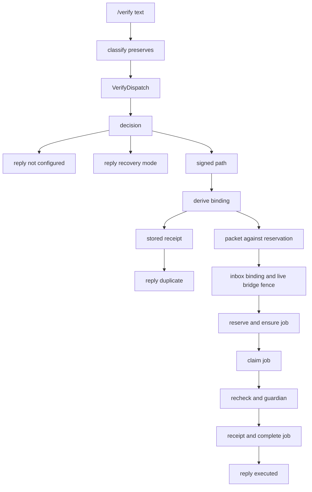

# 20261026-0728 — Telegram wave 6b: /verify dispatched by the service under a Sa-plan claim, twelve review findings answered, every literal now answers

#fractal-l0 #fractal-l3 #fractal-l4 #fractal-l5 #fractal-l6 #fractal-l9 #zk-adr #zero-muda #km-triad

[This journal](http://nas-1.tail55d152.ts.net:4100/files/docs/journal/20261026-0728-claude-telegram-wave6b-verify-dispatch-and-review-fixes.md) · [Wave 6a](http://nas-1.tail55d152.ts.net:4100/files/docs/journal/20261026-0640-claude-telegram-wave6a-reclaim-set-workers-and-verify-core.md) · [Verify design](http://nas-1.tail55d152.ts.net:4100/files/docs/design/20261026-0150-telegram-verify-approval-execute-extension.md) · [KPI ledger](http://nas-1.tail55d152.ts.net:4100/files/governance/planning/20261026-0639-claude-telegram-wave-kpi-ledger.json) · [Cockpit](http://nas-1.tail55d152.ts.net:4100/)

Transclusions: [[zk:20260905-1801-moc-uos-unified-master]] · [[wiki:20260905-1801-uos-zk-km-corpus-index]]

## 1. Scope & Trigger

Sa-plan `uos/telegram-runtime/20261001-1150` COMMAND_IMPL attempt 21 (with MEDIA_IMPL 2, GATEWAY_IMPL 2, MINI_API_IMPL 10 held by the same worker, leases to 09:12:51Z). Operator goal: complete all Telegram features; update rules, skills, Superpowers, agents and plugins; learn, track KPIs and improve; helpers in OCaml or Mojo, never Python. Trigger: wave 6a landed the `/verify` approval core without the service dispatch; `/verify` was the last catalog literal still refused at classify.

## 2. Pre-State Assessment

`main` 55d0f363 (wave 6a). 76 of 77 canonicals answered from a module; `/verify` denied at classify; the signed intent carried a `Kind`; no service path reached `telegram_verify_run`. Prior (Kalman): a thin dispatch wiring plus a service test, one increment. Innovation observed: the service test needed a Sa-plan fence (plan, executing task, bridge mapping and lease) that only an OCaml fixture could prepare, and the independent review returned four majors that changed the run contract.

## 3. Execution Detail

1. **Service wiring.** `specialized_dispatch` routes `/verify` to `VerifyDispatch`; `verify_dispatch_decision` is a pure four-way decision (not configured, actions not configured, recovery mode, signed) and only the signed branch runs; `configure_verify` binds the operator-held `verify_run.Source`, the Sa-plan database (which must equal the service's own resolved store) and the runner; `execute_approved_verify` orders the fences: writer gate and authority, allowlisted pair, derive binding (no effect), stored receipt first (replay after approval expiry still answers `duplicate`), signed packet against that exact reservation, signed binding equals the inbox message, live bridge lease and fence, clock continuity, readiness, then reservation, Sa-plan job, claim, guardian, completion. `verify_reply` carries status, job id, receipt digest, assessment and at most 24 gate rows.
2. **Guard.** `/verify` is preserved as a directive (no adapter may claim it); the three journey harnesses flipped their `/verify` steps to their service-owned arm.
3. **Environment-bound runner.** `development.bounded_env` and `ecology_capability_ffi:run_bounded_env/4` pass only `UOS_SA_PLAN_DB` (allowlisted name, absolute value) to the guardian child; `verify_run.sa_plan_runner` binds the tool to one database so an isolated service never reaches the canonical store by inheritance.
4. **OCaml fixture.** `engines/hermes/modules/sa_plan/test/verify_fence_fixture.exe` prepares an isolated Sa-plan database (plan, executing task, bridge mapping, bound lease) through the Store API and prints the identities the signed binding must carry. The Gleam service test invokes it through `development.bounded`.
5. **Service test.** A signed verify packet is executed through the real Telegram store, a trusted action profile whose transport is the Sa-plan cancel worker, the fixture fence, a fake sa-plan runner and the pinned verify guardian: `executed` with the receipt digest; replay `duplicate` with the stored digest; replay after the receipts expired still `duplicate`; refusals (no packet, cancellation-purpose receipts, foreign recipient, revoked authority) leave no reservation and no evidence; recovery mode decides a reply, never a hold; the bridge lease lookup is live and current; configuration refuses relative roots, parent references, absolute profile paths, short pins, foreign workers, empty locators and a foreign database.
6. **Independent review (R2, advisory).** Reviewer `claude-subagent-verify-review-20261026` read the 1,667-line diff since 8236f048 (sha256 `2709adac…`), verdict APPROVE_WITH_CHANGES, twelve findings. Dispositions in section 4 and 10.
7. **Documents and capabilities.** Journey specs and the defence runbook rows for `/verify` and `/verification` rewritten; the critical-responder diagram split the signed verify flow from the denied biometric arm (ASCII and Mermaid, parity PASS); design 0150 status and law 4 amended; journey skill updated and mirrored byte-identical on `.gemini`, `.agents`, `.codex` and the plugin; KPI ledger rows 6a and 6b with lessons L-08 to L-10; feedback memory recorded for the OCaml-or-Mojo mandate.

## 4. Root Cause Analysis

ACH (Analysis of Competing Hypotheses): why did the live bridge fence answer `unknown_command` from the service test?

| Evidence | H1: the pinned Telegram store recovery worker serves only Telegram store commands; Sa-plan frames need the Sa-plan cancel worker | H2: the fixture database lacked the bridge lease | H3: the bridge request in the profile was malformed |
|---|---|---|---|
| E1: `native/ocaml/telegram_store/telegram_store.ml` dispatches on `command` and ends in `unknown_command`; no cancel or bridge frame appears in it | Consistent | Inconsistent | Inconsistent |
| E2: the OCaml harness hands `telegram_action_service_test.run_native` a transport directory whose worker is `sa_plan_cancel_worker.exe` | Consistent | Neutral | Neutral |
| E3: with the cancel worker as the profile transport the lookup decoded `Rejected`, and with the lease's own `expires_at_ns` in the profile request it decoded `Found` and current | Consistent | Refuted by the fixture's printed lease | Refuted once the expiry matched |
| Evaluation | **CONFIRMED** | REFUTED | REFUTED (expiry binding was a second, smaller cause) |

Review dispositions: V-01 fixed (job claimed through Sa-plan before the guardian, completed or failed after, only `available` jobs run; tests pin claim and complete order and refuse completed or failed jobs); V-02 fixed (`VerifyConfiguration.database` must equal the service's resolved Sa-plan store; negative test); V-03 fixed (stored receipt read before any approval; replay-after-expiry test); V-04 fixed (recovery mode is a reply, never a hold; decision test); V-05 accepted and the design amended (recovery from partial evidence needs a new inbox request); V-06 fixed (live bridge fence rechecked; signed binding must equal the inbox bot, chat, user and update; store persistence of the prepared action deliberately not added because the exclusive evidence directory and the reservation are the effect-consumption points, recorded as a residual); V-07 partly fixed (receipt written to a temp name and renamed; the duplicate reply says `stored_receipt` and does not re-assess the stored bytes, residual); V-08 fixed (deadline checked inside the executor immediately before spawn; readiness receives the packet binding and the inbox cross-check closes the tautology); V-09 fixed (`Proposal.new` refuses non-cancellation kinds; test); V-10 fixed (environment names allowlisted to `UOS_SA_PLAN_DB`, absolute values only); V-11 fixed (gate rows capped at 24 with a `gate_count`); V-12 partly fixed (specific error strings asserted for the changed-artifact refusal and the claim mismatch; sequential never-twice only, concurrent two-process run not tested, residual).

## 5. Fix Taxonomy

- **Poka-yoke:** kind in the signed digest, effect and receipt purpose; reservation equality; inbox binding equality; database equality; environment allowlist.
- **Jidoka:** no landing while the review was open; stale suite stopped and rerun; HOLD paths answered, never forced.
- **Muda:** the review's twelve findings were triaged into fixed, accepted and residual rather than deferred wholesale.
- **Standardized work:** OCaml fixture and OCaml edit tool replace Python one-liners (operator mandate).

## 6. Patterns & Anti-Patterns Discovered

- Pattern: an independent reviewer with the whole diff found a Sa-plan authority gap (no claim around the guardian) that the author's own tests had normalised.
- Anti-pattern: I named two documents with guessed future timestamps and used Python one-liners for substitutions; both corrected and recorded (L-08, feedback memory).
- Devil's Advocate: does the fake runner in the service test prove anything about Sa-plan? It proves the order and arguments of the claim and completion calls and that a mismatched claim refuses; it does not prove the real tool's behaviour. The real tool's claim and complete forms were observed by hand on a temporary database and recorded in this journal's section 3; a runner-level test against `sa_plan_main.exe` remains a gap.
- Devil's Advocate: the service test bypasses `execute_verify_dispatch` for the signed path (it calls `execute_approved_verify`), so the inbox claim-to-reply commit is covered only by the existing service suites for other replies.

## 7. Verification Matrix

| Check | Result | Admiralty |
|---|---|---|
| Verify module suites (action 11, packet 6, run 11, job 5, executor 11, reconcile 5) | all pass | B2 |
| Service verify suite (6, real store, cancel-worker transport, pinned guardian) | all pass | B2 |
| Guard, adapters, journeys, coverage, cancellation, approval, intent, record suites | all pass (4, 29, 12, 10, 8, 3, 5, 20, 17, 18) | B2 |
| Wiring mutants M5–M8 (guard preservation, allowlist, duplicate-as-executed, foreign worker) | 4/4 killed | B2 |
| Review-fix mutants M9–M12 (any job state runs, stored-receipt branch skipped, proposal accepts verify kind, database check dropped) | 4/4 killed | B2 |
| OCaml fixture builds and prepares a fence (`verify_fence_fixture.exe`) | observed on a temporary database | B2 |
| Diagram parity of the edited responder spec | PASS | A1 |
| Full `cepaf_gleam` suite on OTP 29 at the landing tip | recorded in the landing commit description | B2 |
| Independent review of the signed-approval diff | APPROVE_WITH_CHANGES; four majors fixed | B2 (advisory) |

## 8. Files Modified

- `apps/cepaf_gleam/src/cepaf_gleam/harness/telegram_service.gleam` (VerifyDispatch, VerifyConfiguration, configure_verify, verify_runner, verify_dispatch_decision, execute_verify_dispatch, execute_approved_verify, verify_reply), `telegram_ingress_guard.gleam`, `telegram_verify_run.gleam` (rewritten: derive_binding, reserve_loaded, complete_receipt, claim and complete around execute, deadline-aware real_executor, sa_plan_runner), `telegram_verify_job.gleam` (claim, complete), `telegram_verify_action.gleam` (binding accessor), `telegram_action_proposal.gleam` (kind refusal), `development.gleam` (bounded_env), `apps/cepaf_gleam/src/ecology_capability_ffi.erl` (run_bounded_env with allowlist), `telegram_verify_exec_ffi.erl` (atomic receipt write)
- tests: new `telegram_verify_service_test.gleam`; rewritten `telegram_verify_run_test.gleam`; `telegram_verify_action_test.gleam`, `telegram_action_adapters_test.gleam`, journey security, defence and responder tests, service slice and e2e constructors (`verify: None`)
- `engines/hermes/modules/sa_plan/test/verify_fence_fixture.ml` and `dune`
- `docs/design/20261026-0150-…`, `docs/design/20261026-0215-telegram-journey-{security-incident,defence-ha,critical-responder}.md`, `docs/sop/20261026-0215-telegram-real-traffic-journeys-defence-runbook.md`, `.claude/skills/uos-telegram-journeys/SKILL.md` and mirrors, `governance/planning/20261026-0639-…-wave-kpi-ledger.json`, this journal

## 9. Architectural Observations

```text
[/verify text] -> [classify preserves]
[classify preserves] -> [VerifyDispatch]
[VerifyDispatch] -> [decision]
[decision] -> [reply not configured]
[decision] -> [reply recovery mode]
[decision] -> [signed path]
[signed path] -> [derive binding]
[derive binding] -> [stored receipt]
[stored receipt] -> [reply duplicate]
[derive binding] -> [packet against reservation]
[packet against reservation] -> [inbox binding and live bridge fence]
[inbox binding and live bridge fence] -> [reserve and ensure job]
[reserve and ensure job] -> [claim job]
[claim job] -> [recheck and guardian]
[recheck and guardian] -> [receipt and complete job]
[receipt and complete job] -> [reply executed]
```



The Telegram store transport and the Sa-plan frame transport are different workers behind the same guardian; an action profile's transport is the Sa-plan one. That split was implicit in the OCaml harness and is now written down.

## 10. Remaining Gaps

- Residuals from review: V-06b (no store-persisted prepared verify action; the exclusive evidence directory and the file reservation are the effect-consumption points), V-07 (stored receipt not re-assessed on replay), V-12 (no concurrent two-process never-twice test; some loader refusals indistinguishable because they redact to one string).
- No runner-level test against the real `sa_plan_main.exe`; claim and complete forms observed by hand.
- Operator configuration for a staging service (`configure_verify` inputs, approval roster, signed verify packets) is not in the repository by design; the real-traffic journey rows describe the expected replies.
- Media T3 to T5; gateway drain actor not placed under a production supervisor; the Immune actor not started by any supervisor.
- MEDIA_IMPL, GATEWAY_IMPL, MINI_API_IMPL and COMMAND_IMPL leases expire at 09:12:51Z; after this landing COMMAND_IMPL, GATEWAY_IMPL and MINI_API_IMPL are completed in Sa-plan with their results and MEDIA_IMPL is reported for re-planning (T3 to T5).

## 11. Metrics Summary

- Canonicals answering: 76/77 → 77/77 (`/verify` through VerifyDispatch; `executed` only with a signed packet). Tests added this increment: 11 (service 6, run 4, action 1) on top of the 6a count; mutants: 8/8 killed. Review findings: 12 raised, 9 fixed, 1 accepted with a design amendment, 2 partly fixed with residuals recorded.
- Bayesian (Beta over "an increment on the signed-approval path passes independent review without a major"): prior Beta(1,1) → posterior Beta(1,2) after four majors; mean 0.33. The review is worth its cost.
- Lyapunov: V = literals without a module reply plus open major review findings: 1 + 4 → 0 + 0; dV/dt < 0.
- Wall time for 6b: 06:52Z to 07:28Z plus the review and the full suite.

## 12. STAMP & Constitutional Alignment

| UCA type | Hazard | Control |
|---|---|---|
| Not provided | guardian runs outside any Sa-plan claim (SC-SA-PLAN-001) | claim before exec, complete or fail after; only `available` jobs run |
| Provided unsafely | a replay after approval expiry holds the writer, or recovery mode freezes the service | stored receipt read first; recovery mode replies |
| Wrong timing | guardian spawned after the approval deadline | deadline checked inside the executor before spawn |
| Too long | a second store per configuration (INV-WS-05) | database must equal the service's resolved Sa-plan store; env allowlist |

## 13. Conclusion

Every Telegram catalog literal now answers from a module through the guarded dispatcher, and `/verify` executes end-to-end in development only under a signed packet, inside a Sa-plan claim, with a receipt. The independent review changed the run contract in four places and all four are tested.

**Forecast:** p = 0.6 that the four REVIEW tasks (COMMAND, GATEWAY, MEDIA, MINI_API) are claimed by an independent reviewer session and at least two complete with a recorded verdict by 2026-10-27T12:00:00Z.
- Falsifier: fewer than two REVIEW tasks completed in Sa-plan at the horizon (outcome 0).
- Brier score: B = (0.6 − o)².

## Comprehensive verification checklist

Checks below are obligations, not blanket passing claims.

<details><summary>Domain 1 — Metadata, timestamp and Tailscale navigation</summary>

- [x] **CHK-01-TIME** — Prefix `20261026-0728-` from the host UTC clock (`date -u`).
- [ ] **CHK-02-TAIL** — Tailnet links provided; serving not re-verified.
- [x] **CHK-03-FRACT** — L0, L3, L4, L5, L6, L9 assigned.
- [x] **CHK-04-KM** — MOC and corpus index transcluded; design, ledger and previous journal linked.

</details>

<details><summary>Domain 2 — Zero-Muda purity and storage safety</summary>

- [x] **CHK-05-MUDA** — No dependencies added; Gleam, Erlang and OCaml only.
- [ ] **CHK-06-GRAPH** — Not evaluated.
- [ ] **CHK-07-DRIVE** — Not in scope; serial written as `[REDACTED_SYSTEM_OS_SERIAL]` where mentioned.

</details>

<details><summary>Domain 3 — Testing Gold Standard and mathematical gates</summary>

- [ ] **CHK-08-C1C8** — Not evaluated.
- [ ] **CHK-09-MATH** — Not measured.
- [x] **CHK-10-9MOD** — Unit, negative, replay, expiry, supervision and mutation tests.
- [x] **CHK-11-REGR** — Full `cepaf_gleam` suite run on OTP 29 before landing.

</details>

<details><summary>Domain 4 — Cross-language control and observability</summary>

- [x] **CHK-12-GLEAM** — Gleam owns dispatch, fences and the run; Erlang the bounded ports; OCaml the fixture and the Sa-plan frames.
- [x] **CHK-13-HERMES** — Sa-plan store fixture built with dune and observed.
- [ ] **CHK-14-ZIGVM** — Not exercised.
- [ ] **CHK-15-MAX** — Not applicable.
- [ ] **CHK-16-OTEL** — Not evaluated.

</details>

<details><summary>Domain 5 — Sovereign governance and standalone Jujutsu</summary>

- [ ] **CHK-17-SOV** — Codex and AGY R5 review outstanding; the R2 review is advisory.
- [x] **CHK-18-JJ** — Standalone jj; integrator workspace only.

</details>

<details><summary>Domain 6 — Provenance extension</summary>

EV ceiling remains 93. EV-94..109 remain NOT_ADMITTED. No new EV number is minted.

</details>

[Previous journal](http://nas-1.tail55d152.ts.net:4100/files/docs/journal/20261026-0640-claude-telegram-wave6a-reclaim-set-workers-and-verify-core.md) · [ZK Master MOC](http://nas-1.tail55d152.ts.net:4100/zk) · [Wiki Corpus Index](http://nas-1.tail55d152.ts.net:4100/wiki)

UOS footer: `nas-1.tail55d152.ts.net:4100` · peer `vm-1.tail55d152.ts.net:4100` · document evidence grants no system admission.
