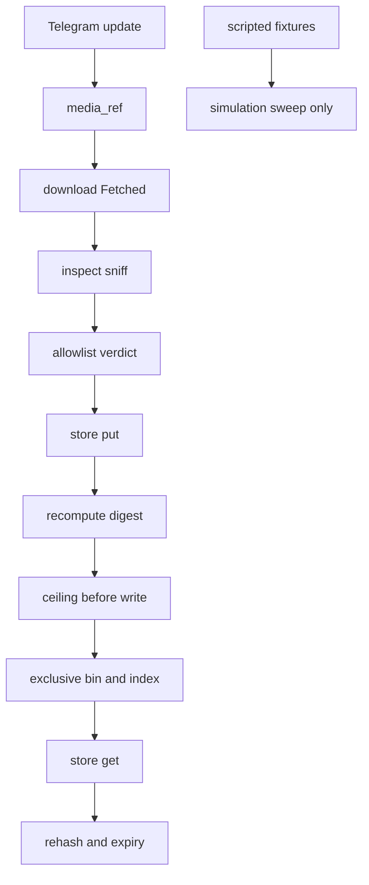

# 20261026-0750 — Telegram wave 6c: media T3 and T4, bounded content inspection and a content-addressed store, degenerate simulators renamed to scripted fixtures

#fractal-l1 #fractal-l3 #fractal-l4 #fractal-l5 #fractal-l6 #fractal-l9 #zk-adr #zero-muda #km-triad

[This journal](http://nas-1.tail55d152.ts.net:4100/files/docs/journal/20261026-0750-claude-telegram-wave6c-media-inspect-store.md) · [Wave 6b](http://nas-1.tail55d152.ts.net:4100/files/docs/journal/20261026-0728-claude-telegram-wave6b-verify-dispatch-and-review-fixes.md) · [Media design](http://nas-1.tail55d152.ts.net:4100/files/governance/planning/20261011-1354-claude-telegram-media-design.json) · [KPI ledger](http://nas-1.tail55d152.ts.net:4100/files/governance/planning/20261026-0639-claude-telegram-wave-kpi-ledger.json) · [Cockpit](http://nas-1.tail55d152.ts.net:4100/)

Transclusions: [[zk:20260905-1801-moc-uos-unified-master]] · [[wiki:20260905-1801-uos-zk-km-corpus-index]]

## 1. Scope & Trigger

Sa-plan `uos/telegram-runtime/20261001-1150` MEDIA_IMPL attempt 2, worker `claude-fable-l0-35600f5c`, lease to 09:12:51Z; Oban jobs `wave6c-w1-media-inspect` and `wave6c-w2-media-store` in queue `telegram-wave6`. Operator goal: complete all Telegram features; update rules, skills, Superpowers, agents and plugins; learn, track KPIs and improve; helpers in OCaml or Mojo, never Python. Trigger: wave 6b left media design items T3 (bounded content inspection, replacing the degenerate simulators), T4 (bounded media storage with explicit retention) and T5 (upload path, only if a use case survives review) as the last open Telegram feature gap.

## 2. Pre-State Assessment

`main` e122cb0b (wave 6b). `telegram_media_download` (wave 6a) yields `Fetched` bytes with a SHA-256, and nothing inspected or kept them. `telegram_simulator` exported `simulate_acoustic_fft` and `simulate_vision_inspection`, two functions whose names claim a transform they do not perform: any non-empty input gives the same scripted spectrum and the image bytes are never examined. No media store existed. Prior (Kalman): two pure modules by two workers plus one integrator rename, one increment, about 45 minutes of wall time. Innovation observed: the 64-byte prefix bound cannot be falsified through `sniff` results alone, and one of my own mutants was equivalent.

## 3. Execution Detail

1. **Two R4 workers, new files only.** `fable-w1` (change `trsqkouu`, commit 091a9c64) wrote `telegram_media_inspect.gleam` and its test; `fable-w2` (change `wkpzqlok`, commit 74ee9a6b) wrote `telegram_media_store.gleam` and its test. Each ran one `jj new main`; each reported build, tests, mutants and deviations. The integrator restored the four files per file (`jj restore --from <commit> <paths>`); no worker change was described, squashed or abandoned.
2. **Inspection (T3).** Pure function over the first 64 bytes (`prefix_bytes`, `examined_prefix`): `sniff` recognises JPEG, PNG, GIF, WEBP, OGG, MP3, MP4, PDF and ZIP by magic bytes only; `allowlist(kind)` is the fixed table from the packet (GIF allowed for no kind, ZIP for Document only); `inspect` answers `Accepted(sniffed)` or `Rejected(reason, sniffed)` with the reasons `sniffed_type_not_allowed_for_kind`, `unknown_content_type`, `unsupported_kind`; `inspect_fetched` inspects a `Fetched` download and returns an error naming an `Aborted` or `Rejected` download, never `Accepted`. `declared_mime` is never consulted. No decoder, no NIF, no process, no I/O.
3. **Store (T4).** Content-addressed under `root/<base>/<2 hex>/<sha256>.bin` and `.json`; the name is the SHA-256 recomputed over the content, never the caller's digest and never a sender string (`file_unique_id` lives only inside the index record, schema `uos.telegram.media-object.v1`). `put` returns `Written`, `AlreadyStored` (index found first, nothing rewritten) or `Refused` (`policy_invalid`, `content_digest_mismatch`, `ceiling_reached`, `kind_unsupported`, `usage_invalid`, `write_failed:<reason>`); a refused put creates no file. `get` re-reads the bytes and refuses `content_tampered`, `expired` (`now_ms >= expires_at_ms`), `not_found`, `content_missing`, `index_invalid`. `expired` lists records past their horizon; `usage` sums index-recorded bytes and fails closed on a malformed record. Bytes are written through a small `file:write_file` external with `[exclusive, binary, sync]` because `files.create` takes UTF-8 strings capped at 262,144 bytes; every path still passes `files.checked_path`. No deletion, by packet.
4. **Simulator rename (integrator).** `simulate_acoustic_fft` became `scripted_acoustic_spectrum` and `simulate_vision_inspection` became `scripted_vision_fixture`, with doc comments that say they are scripted fixtures; the four test call sites were updated and a law was added: two different non-empty byte strings yield identical scripted output, so nothing in the module claims a transform.
5. **Mutants.** Integrator: M13 (`fundamental_hz` depends on the sample size) killed; M14 (`amber_led` depends on the image bytes) killed; one earlier integrator mutant was equivalent and is not counted (section 4). Worker w1: five killed (PDF signature byte, GIF added to the Photo allowlist, prefix bound ignored, Unsupported accepted, Aborted mapped to Accepted). Worker w2: four killed (ceiling `>` to `>=`, digest recomputation skipped, expiry inverted, tamper check dropped). The integrator re-ran one mutant per worker module (GIF in Photo; ceiling boundary): both killed.
6. **Suites.** Inspect 13, store 23, simulator 6, download 31 in one run: 73 passed, 0 failed. Full `cepaf_gleam` suite on OTP 29 at the landing tip: see section 7.
7. **Sa-plan and KPIs.** MEDIA_IMPL attempt 2 completed after landing with T3 and T4 accepted as source and T5 deferred by the design's own condition; both wave6c jobs claimed and completed; KPI ledger row 6c, lessons L-13 to L-15, and the wave 3 forecast on `/verify` resolved (outcome 1 at e122cb0b, Brier 0.25).

## 4. Root Cause Analysis

ACH (Analysis of Competing Hypotheses): why could the 64-byte prefix bound not be falsified through `sniff` outputs?

| Evidence | H1: every signature lies in the first 12 bytes, so a sniff over the whole content gives the same answers as a bounded sniff | H2: the test inputs were shorter than the bound | H3: `bit_array.slice` ignored the length argument |
|---|---|---|---|
| E1: signature table in `telegram_media_inspect.gleam` (longest is WEBP, bytes 0 to 11) | Consistent | Neutral | Inconsistent |
| E2: a 600-byte input with a signature placed after byte 512 sniffs Unknown both with and without the bound | Consistent | Inconsistent | Inconsistent |
| E3: the mutant `slice(content, 0, prefix_bytes)` replaced by `Ok(content)` survived every output test and died only on `examined_prefix` | Very consistent | Inconsistent | Inconsistent |
| Evaluation | **CONFIRMED** | REFUTED | REFUTED |

Fix: the module exposes the observation `examined_prefix`, and the bound is a law over that observation, not an inference from outputs. A second, smaller finding on the integrator side: my vision-fixture mutant (`byte_size > 20 && bay == 3` falling through to the original `case`) was equivalent because the inner arm still answered bay 3; it was replaced by a mutant that changes an observable (`amber_led` from the byte count) and that one died.

## 5. Fix Taxonomy

- **Poka-yoke:** names say what the code does (`scripted_*`, `sniff`, `inspect`); the stored name is the recomputed digest, never the caller's; sender strings never reach a path; ceiling and digest checks precede any write; `get` re-hashes before serving.
- **Jidoka:** no landing before the full suite; an equivalent mutant is not counted as a kill; `usage` fails closed on a malformed index rather than under-counting.
- **Muda:** no decoder, no NIF, no network, no deletion machinery invented without a caller.
- **Standardized work:** worker packet with laws and mutants; per-file restore; integrator re-runs one worker mutant per module.

## 6. Patterns & Anti-Patterns Discovered

- Pattern: a bound that outputs cannot reveal gets its own observation accessor and a law over it (L-14).
- Pattern: a worker that deviates from the packet (index-before-ceiling order, extra refusal reasons, binary external) states the deviation in the module doc and in a test, so the integrator reviews a claim, not a surprise.
- Anti-pattern: an integrator mutant that falls through to the same arm (L-13).
- Devil's Advocate: a magic-byte sniff is not content validation. A `PK\x03\x04` header says nothing about an archive, a PDF may carry scripts, a polyglot file can satisfy one signature and be another thing. The verdict only narrows what a later stage may be handed; nothing here opens, decodes or renders.
- Devil's Advocate: retention without deletion leaves bytes on disk, and the ceiling is a guard on a caller-measured number, not a quota lock. Both are stated in the module doc; a deletion job and a lease around `put` belong to a caller that does not yet exist.
- Devil's Advocate: three historical documents still name `simulate_acoustic_fft` and `simulate_vision_inspection` (the 2026-09-09 simulator wiki guide, its journal and ADR-108). They are preserved byte-for-byte; the nonconformance is recorded here, not rewritten.
- Process: worker w1 asked whether `sed -i` for mutants is acceptable under the OCaml-or-Mojo mandate. It is a host utility applying a one-line edit, not a helper script; the mandate bars Python, awk and perl scripts. Recorded as L-15 and in the shared worker packet.

## 7. Verification Matrix

| Check | Result | Admiralty |
|---|---|---|
| `telegram_media_inspect_test` (13) | all pass, run by the integrator | B2 |
| `telegram_media_store_test` (23, real directories under scratch `TMPDIR`) | all pass, run by the integrator | B2 |
| `telegram_simulator_test` (6, including the scripted-fixture law) | all pass | B2 |
| `telegram_media_download_test` (31) unchanged | all pass | B2 |
| Integrator mutants M13, M14 on the simulator fixtures | 2/2 killed | B2 |
| Integrator re-run of worker mutants (GIF in Photo allowlist; ceiling `>=`) | 2/2 killed | B2 |
| Worker-reported mutants (w1 five, w2 four) | reported killed, restored byte-for-byte | C3 (self-report; two re-observed above) |
| `gleam build` warnings in the four new files | none | B2 |
| Full `cepaf_gleam` suite on OTP 29 at the landing tip | 13744 passed, 0 failed (07:46Z to 07:57Z) | B2 |
| Diagram parity of this journal (`tools/diagram-check`) | PASS | A1 |
| Journal linter | 10/10 PASS | A1 |

## 8. Files Modified

- new: `apps/cepaf_gleam/src/cepaf_gleam/harness/telegram_media_inspect.gleam`, `apps/cepaf_gleam/test/telegram_media_inspect_test.gleam` (w1); `apps/cepaf_gleam/src/cepaf_gleam/harness/telegram_media_store.gleam`, `apps/cepaf_gleam/test/telegram_media_store_test.gleam` (w2)
- changed: `apps/cepaf_gleam/src/cepaf_gleam/harness/telegram_simulator.gleam` (two renames and doc comments), `apps/cepaf_gleam/test/telegram_simulator_test.gleam` (call sites and the fixture law)
- `governance/planning/20261026-0639-claude-telegram-wave-kpi-ledger.json` (row 6b filled, row 6c, lessons L-13 to L-15, wave 3 forecast resolved); `.claude/agents/20261001-1117-full-symbiosis-supervisor.md` mutant discipline paragraph, mirrored byte-identical to `.gemini`, `.agents` and `.codex`; this journal

## 9. Architectural Observations

The media path is now four pure stages with one effectful store, and no stage trusts the one before it: download recomputes nothing but records the digest, inspect reads 64 bytes, the store recomputes the digest before naming anything and again before serving.

```text
[Telegram update] -> [media_ref]
[media_ref] -> [download Fetched]
[download Fetched] -> [inspect sniff]
[inspect sniff] -> [allowlist verdict]
[allowlist verdict] -> [store put]
[store put] -> [recompute digest]
[recompute digest] -> [ceiling before write]
[ceiling before write] -> [exclusive bin and index]
[exclusive bin and index] -> [store get]
[store get] -> [rehash and expiry]
[scripted fixtures] -> [simulation sweep only]
```



Sheaf view: each stage's output type is the next stage's input, and the digest is the gluing datum carried unchanged from `Fetched.sha256_hex` to the store name; a mismatch anywhere is a refusal, not a repair. The scripted fixtures are deliberately disconnected from this path.

## 10. Remaining Gaps

- T5 (upload path) is deferred by the design's own condition: no use case survived review in this wave. Recorded in the MEDIA_IMPL result, not silently dropped.
- No production caller yet wires download, inspect and store together; the `store_write` deadline of 2,000 ms must be enforced by that caller running `put` in a bounded process.
- No deletion of expired objects; the ceiling is not a quota lock under concurrent callers; parent-directory rename races need a cooperative lease.
- A magic-byte verdict is not content validation; nothing downstream may treat `Accepted` as safe to open.
- Historical documents naming the old simulator functions are preserved, not rewritten.
- MEDIA_REVIEW by an independent reviewer; TELEGRAM_E2E by an authorized human; Codex and AGY R5 review of the whole Telegram surface remain open.

## 11. Metrics Summary

- Tests added: 37 (inspect 13, store 23, simulator law 1); mutants: 11 killed across workers and integrator plus two integrator re-observations; equivalent mutants discarded: 1. Media design items: T3 and T4 implemented as source, T5 deferred by condition.
- Bayesian (Beta over "a worker packet lands without integrator rework of the worker's files"): prior Beta(4,2) after waves 6a and 6b → posterior Beta(6,2) after w1 and w2 landed unchanged; mean 0.75.
- Lyapunov: V = open media design items without an implementation or a recorded deferral: 3 → 0; dV/dt < 0.
- Wall time for 6c: workers spawned 07:41Z, both reported by 07:48Z, landing time in the landing commit description.

## 12. STAMP & Constitutional Alignment

| UCA type | Hazard | Control |
|---|---|---|
| Not provided | downloaded bytes are kept or handed on without any inspection | `inspect_fetched` before `put`; unknown and disallowed types rejected |
| Provided unsafely | a sender string names a file on disk | names derive only from the recomputed SHA-256; hostile `file_unique_id` test |
| Wrong timing | ceiling consulted after bytes are written | ceiling and digest checks before the exclusive create; refused put creates no file |
| Too long | an expired or tampered object is served | `get` re-hashes and refuses at or past `expires_at_ms` |

## 13. Conclusion

Media design items T3 and T4 exist as pure, bounded Gleam modules with laws and killed mutants, and the two simulator functions no longer claim a transform they never performed. The remaining Telegram feature work is a caller that wires the media stages under a supervised deadline, plus the external reviews.

**Forecast:** p = 0.55 that a supervised caller landing on `main` wires `telegram_media_inspect` and `telegram_media_store.put` behind a bounded deadline with a test by 2026-10-27T12:00:00Z.
- Falsifier: no commit on `main` at the horizon contains a caller of `telegram_media_store.put` outside the test suite (outcome 0).
- Brier score: B = (0.55 − o)².

## Comprehensive verification checklist

Checks below are obligations, not blanket passing claims.

<details><summary>Domain 1 — Metadata, timestamp and Tailscale navigation</summary>

- [x] **CHK-01-TIME** — Prefix `20261026-0750-` from the host UTC clock (`date -u`).
- [ ] **CHK-02-TAIL** — Tailnet links provided; serving not re-verified.
- [x] **CHK-03-FRACT** — L1, L3, L4, L5, L6, L9 assigned.
- [x] **CHK-04-KM** — MOC and corpus index transcluded; design, ledger and previous journal linked.

</details>

<details><summary>Domain 2 — Zero-Muda purity and storage safety</summary>

- [x] **CHK-05-MUDA** — No dependencies added; Gleam and one Erlang `file` external only.
- [ ] **CHK-06-GRAPH** — Not evaluated.
- [ ] **CHK-07-DRIVE** — Not in scope; serial written as `[REDACTED_SYSTEM_OS_SERIAL]` where mentioned.

</details>

<details><summary>Domain 3 — Testing Gold Standard and mathematical gates</summary>

- [ ] **CHK-08-C1C8** — Not evaluated.
- [ ] **CHK-09-MATH** — Not measured.
- [x] **CHK-10-9MOD** — Unit, negative, boundary, tamper, expiry, hostile-input and mutation tests.
- [x] **CHK-11-REGR** — Full `cepaf_gleam` suite run on OTP 29 before landing.

</details>

<details><summary>Domain 4 — Cross-language control and observability</summary>

- [x] **CHK-12-GLEAM** — Gleam owns inspection, the store and the fixtures; Erlang supplies one bounded file external.
- [ ] **CHK-13-HERMES** — Not exercised in this wave.
- [ ] **CHK-14-ZIGVM** — Not exercised.
- [ ] **CHK-15-MAX** — Not applicable; byte-level inspection by MAX is out of T3 scope.
- [ ] **CHK-16-OTEL** — Not evaluated.

</details>

<details><summary>Domain 5 — Sovereign governance and standalone Jujutsu</summary>

- [ ] **CHK-17-SOV** — MEDIA_REVIEW and Codex and AGY R5 review outstanding.
- [x] **CHK-18-JJ** — Standalone jj; worker changes restored per file; no peer commit rewritten.

</details>

<details><summary>Domain 6 — Provenance extension</summary>

EV ceiling remains 93. EV-94..109 remain NOT_ADMITTED. No new EV number is minted.

</details>

[Previous journal](http://nas-1.tail55d152.ts.net:4100/files/docs/journal/20261026-0728-claude-telegram-wave6b-verify-dispatch-and-review-fixes.md) · [ZK Master MOC](http://nas-1.tail55d152.ts.net:4100/zk) · [Wiki Corpus Index](http://nas-1.tail55d152.ts.net:4100/wiki)

UOS footer: `nas-1.tail55d152.ts.net:4100` · peer `vm-1.tail55d152.ts.net:4100` · document evidence grants no system admission.
