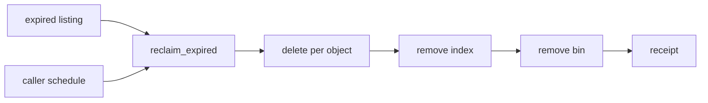

# 20261026-0826 — Telegram wave 6e: bounded deletion and expired-object reclaim for the media store

#fractal-l1 #fractal-l3 #fractal-l5 #fractal-l9 #zk-adr #zero-muda #km-triad

[This journal](http://nas-1.tail55d152.ts.net:4100/files/docs/journal/20261026-0826-claude-telegram-wave6e-media-store-reclaim.md) · [Wave 6c and 6d](http://nas-1.tail55d152.ts.net:4100/files/docs/journal/20261026-0750-claude-telegram-wave6c-media-inspect-store.md) · [Media pipeline guide](http://nas-1.tail55d152.ts.net:4100/docs/wiki/20261026-0801-telegram-media-pipeline-guide.md) · [KPI ledger](http://nas-1.tail55d152.ts.net:4100/files/governance/planning/20261026-0639-claude-telegram-wave-kpi-ledger.json) · [Cockpit](http://nas-1.tail55d152.ts.net:4100/)

Transclusions: [[zk:20260905-1801-moc-uos-unified-master]] · [[wiki:20260905-1801-uos-zk-km-corpus-index]]

## 1. Scope & Trigger

Sa-plan `uos/telegram-runtime/20261001-1150` MEDIA_RECLAIM attempt 1 (created with dependency MEDIA_FIX; preflight PREFLIGHT_PASS; worker `claude-fable-l0-35600f5c`), job `wave6e-w2-store-reclaim`. Trigger: the media design's safety requirement that a stored unit is deletable on request was unmet after waves 6c and 6d (review M-11 residual, recorded as T4 partial). Trivial scale: two files.

## 2. Pre-State Assessment

`main` 5745dd3e. The store wrote, verified, listed expired objects and refused to serve or re-admit them, but could delete nothing; the ceiling counted expired bytes until an operator removed files by hand. Prior: one worker increment on one module, no shared files.

## 3. Execution Detail

1. Worker w2 (store author, context intact) in `fable-w2` (change `xvtrmvut`, commit a0ef869a): `delete(policy, sha256_hex) -> Result(Removed, String)` removes the index first and then the `.bin`, each under `files.checked_path` and a `link_info` check (regular file, single link); symlinks and hard links are refused untouched; half-present objects remove the present half and say so. `reclaim_expired(policy, now_ms, max_objects) -> Result(ReclaimReceipt, String)` deletes at most `max_objects` expired objects in sha order, collects refusals instead of stopping, flags `truncated`, never touches an unexpired object or a `.tmp-` file.
2. Integrator: files restored per file, store and inspect suites run together, one worker mutant re-observed, full suite on OTP 29, wiki guide and journey skill updated for deletion, KPI ledger row 6e.

## 4. Root Cause Analysis

ACH: why was deletion left out of the T4 packet in wave 6c?

| Evidence | H1: the packet scoped T4 to write, verify and list, deferring reclaim to "a caller" that did not exist | H2: deletion was judged unsafe without a lease | H3: the design did not require it |
|---|---|---|---|
| E1: the 6c packet says "No deletion in this packet (retention is a horizon the caller enforces through expired)" | Consistent | Neutral | Inconsistent |
| E2: design `safety_requirements` line 25: "a stored media unit is deletable on request" | Consistent | Neutral | Refuted |
| E3: review M-11 named the gap as a safety-requirement miss, not a race | Consistent | Inconsistent | Inconsistent |
| Evaluation | **CONFIRMED** | REFUTED | REFUTED |

The packet author (this session) scoped the increment below the design's own safety requirement and recorded the omission as a limit instead of a gap. Fix: the gap became its own Sa-plan task rather than a note.

## 5. Fix Taxonomy

- **Poka-yoke:** index removed before bytes, so a crash leaves an adoptable orphan and never a dangling index; `link_info` before every removal; `max_objects` bound with `bound_invalid`.
- **Jidoka:** own Sa-plan task, preflight and active check; no landing before the full suite.
- **Muda:** no scheduler added without a caller; reclaim is a pure bounded function with a receipt.

## 6. Patterns & Anti-Patterns Discovered

- Pattern: a design safety requirement is a deliverable, not a limit to document.
- Devil's Advocate: deletion of an object whose bytes do not hash to the name still deletes it, by design (it is garbage); an operator who wants forensic retention must copy first. Reclaim order by sha is stable but arbitrary; the oldest horizon is not reclaimed first when `max_objects` truncates.

## 7. Verification Matrix

| Check | Result | Admiralty |
|---|---|---|
| `telegram_media_store_test` (51), run by the integrator | all pass | B2 |
| `telegram_media_inspect_test` (13), `telegram_simulator_test` (6) | all pass | B2 |
| Worker mutants | 5 reported killed (bound ignored, unexpired deleted, comparison flipped, symlink followed, single-link check dropped); index-before-bin order not testable without failure injection | C3 (self-report; one re-observed below) |
| Integrator re-run of one worker mutant (reclaim ignores max_objects) | killed | B2 |
| Full `cepaf_gleam` suite on OTP 29 at the landing tip | 13772 passed, 0 failed (08:26Z to 08:37Z) | B2 |
| Diagram parity and journal linter | PASS / 10/10 PASS | A1 |

## 8. Files Modified

- `apps/cepaf_gleam/src/cepaf_gleam/harness/telegram_media_store.gleam`, `apps/cepaf_gleam/test/telegram_media_store_test.gleam` (w2)
- `docs/wiki/20261026-0801-telegram-media-pipeline-guide.md`, `.claude/skills/uos-telegram-journeys/SKILL.md` and mirrors, `governance/planning/20261026-0639-claude-telegram-wave-kpi-ledger.json`, this journal

## 9. Architectural Observations

```text
[expired listing] -> [reclaim_expired]
[reclaim_expired] -> [delete per object]
[delete per object] -> [remove index]
[remove index] -> [remove bin]
[remove bin] -> [receipt]
[caller schedule] -> [reclaim_expired]
```



The store now has a complete lifecycle (put, get, expire, reclaim) with every transition bounded and receipted; the only thing outside the module is the clock and the schedule.

## 10. Remaining Gaps

- No scheduled caller runs `reclaim_expired`; the ceiling counts bytes until one does.
- MEDIA_REVIEW by an independent reviewer; TELEGRAM_E2E by an authorized human; Codex and AGY R5 review.

## 11. Metrics Summary

- Tests added: 14 (store 37 to 51); mutants: 5 worker plus 1 integrator re-observation killed. Design safety requirements unmet by T4: 1 → 0 at source.
- Bayesian (Beta over "a worker packet lands without integrator rework"): Beta(6,2) → Beta(7,2), mean 0.78.
- Lyapunov: V = design safety requirements without an implementation: 1 → 0; dV/dt < 0.

## 12. STAMP & Constitutional Alignment

| UCA type | Hazard | Control |
|---|---|---|
| Not provided | expired bytes accumulate and the ceiling starves live media | `reclaim_expired` with a receipt |
| Provided unsafely | a delete follows a symlink out of the root | `checked_path` and `link_info` before every removal |
| Wrong timing | bin removed before index, leaving a dangling index | index first, then bin |
| Too long | an unbounded reclaim pass | `max_objects` and `truncated` |

## 13. Conclusion

The media store meets the design's deletable-on-request requirement at source with bounded, receipted deletion.

**Forecast:** p = 0.5 that a scheduled caller (supervised actor or Oban job) runs `reclaim_expired` on `main` with a test by 2026-10-28T00:00:00Z.
- Falsifier: no commit on `main` at the horizon contains a non-test caller of `reclaim_expired` (outcome 0).
- Brier score: B = (0.5 − o)².

## Comprehensive verification checklist

Checks below are obligations, not blanket passing claims.

<details><summary>Domain 1 — Metadata, timestamp and Tailscale navigation</summary>

- [x] **CHK-01-TIME** — Prefix `20261026-0826-` from the host UTC clock (`date -u`).
- [ ] **CHK-02-TAIL** — Tailnet links provided; serving not re-verified.
- [x] **CHK-03-FRACT** — L1, L3, L5, L9 assigned.
- [x] **CHK-04-KM** — MOC and corpus index transcluded; guide, ledger and previous journal linked.

</details>

<details><summary>Domain 2 — Zero-Muda purity and storage safety</summary>

- [x] **CHK-05-MUDA** — No dependencies added.
- [ ] **CHK-06-GRAPH** — Not evaluated.
- [ ] **CHK-07-DRIVE** — Not in scope; serial written as `[REDACTED_SYSTEM_OS_SERIAL]` where mentioned.

</details>

<details><summary>Domain 3 — Testing Gold Standard and mathematical gates</summary>

- [ ] **CHK-08-C1C8** — Not evaluated.
- [ ] **CHK-09-MATH** — Not measured.
- [x] **CHK-10-9MOD** — Unit, negative, boundary, symlink and mutation tests.
- [x] **CHK-11-REGR** — Full `cepaf_gleam` suite on OTP 29 before landing.

</details>

<details><summary>Domain 4 — Cross-language control and observability</summary>

- [x] **CHK-12-GLEAM** — Gleam owns the store lifecycle.
- [ ] **CHK-13-HERMES** — Not exercised.
- [ ] **CHK-14-ZIGVM** — Not exercised.
- [ ] **CHK-15-MAX** — Not applicable.
- [ ] **CHK-16-OTEL** — Not evaluated.

</details>

<details><summary>Domain 5 — Sovereign governance and standalone Jujutsu</summary>

- [ ] **CHK-17-SOV** — MEDIA_REVIEW and R5 review outstanding.
- [x] **CHK-18-JJ** — Standalone jj; worker change restored per file.

</details>

<details><summary>Domain 6 — Provenance extension</summary>

EV ceiling remains 93. EV-94..109 remain NOT_ADMITTED. No new EV number is minted.

</details>

[Previous journal](http://nas-1.tail55d152.ts.net:4100/files/docs/journal/20261026-0750-claude-telegram-wave6c-media-inspect-store.md) · [ZK Master MOC](http://nas-1.tail55d152.ts.net:4100/zk) · [Wiki Corpus Index](http://nas-1.tail55d152.ts.net:4100/wiki)

UOS footer: `nas-1.tail55d152.ts.net:4100` · peer `vm-1.tail55d152.ts.net:4100` · document evidence grants no system admission.
