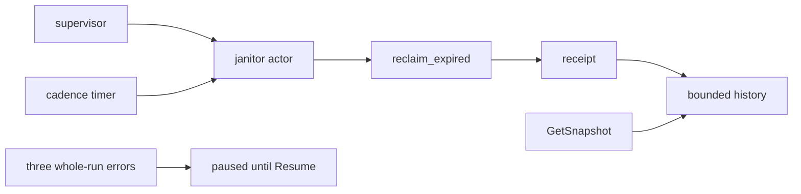

# 20261026-0844 — Telegram wave 6f: a supervised bounded janitor enforces media retention

#fractal-l2 #fractal-l3 #fractal-l4 #fractal-l5 #fractal-l9 #zk-adr #zero-muda #km-triad

[This journal](http://nas-1.tail55d152.ts.net:4100/files/docs/journal/20261026-0844-claude-telegram-wave6f-media-janitor.md) · [Wave 6e](http://nas-1.tail55d152.ts.net:4100/files/docs/journal/20261026-0826-claude-telegram-wave6e-media-store-reclaim.md) · [Media pipeline guide](http://nas-1.tail55d152.ts.net:4100/docs/wiki/20261026-0801-telegram-media-pipeline-guide.md) · [KPI ledger](http://nas-1.tail55d152.ts.net:4100/files/governance/planning/20261026-0639-claude-telegram-wave-kpi-ledger.json) · [Cockpit](http://nas-1.tail55d152.ts.net:4100/)

Transclusions: [[zk:20260905-1801-moc-uos-unified-master]] · [[wiki:20260905-1801-uos-zk-km-corpus-index]]

## 1. Scope & Trigger

Sa-plan `uos/telegram-runtime/20261001-1150` MEDIA_JANITOR attempt 1 (created with dependency MEDIA_RECLAIM; preflight PREFLIGHT_PASS; worker `claude-fable-l0-35600f5c`), job `wave6f-w2-media-janitor`. Trigger: after wave 6e the store could reclaim expired objects, but only when something called it; the wave 6e forecast named a scheduled caller as the open piece. Trivial scale: two new files.

## 2. Pre-State Assessment

`main` 029e7491. `reclaim_expired` existed with a receipt and no caller; retention was enforced by hand. The gateway drain actor (wave 6a) was the proven pattern for a supervised, bounded, restartable periodic worker. Prior: one worker increment mirroring that pattern.

## 3. Execution Detail

1. Worker w2 in `fable-w2` (change `lttwxlxp`, commit d1192190): `telegram/telegram_media_janitor.gleam` with `Config(policy, cadence_ms, max_objects, history_limit, now_ms)`, `validate` (cadence at least 1,000 ms, `max_objects` 1 to 10,000, `history_limit` 1 to 64, policy checked through `store.object_path`), `start`, `start_named`, `child_spec_named`, bounded clients `snapshot`, `run_now`, `resume`, `stop`. One place calls `store.reclaim_expired(policy, now_ms(), max_objects)`, once per `Tick` or `RunNow`; the actor does no file I/O of its own. History is bounded; `consecutive_errors` resets on `Ok`; three whole-run errors in a row pause the actor (timer cancelled, `paused = True`, `next_tick_ms = None`) until `Resume`; exactly one `send_after` timer exists at a time; `RunNow` leaves the cadence alone; `Stop` ends the actor normally. The message constructor is `GetSnapshot` because `Snapshot` names the record.
2. Twelve tests over real store roots with a fake clock in a `persistent_term`: one tick removes expired and keeps live; `max_objects` bounds each tick; history bounded; `.tmp-` and foreign files survive; three errors pause and `Resume` restores; success resets the streak; `RunNow` replies and leaves the cadence; the scheduled tick fires on the cadence; `Stop` ends the actor; `validate` refuses unusable configs; restart under `one_for_one` after a kill; an invalid config is refused by the child-spec start.
3. Integrator: files restored per file, janitor and store suites run together, one worker mutant re-observed, full suite on OTP 29, wiki guide and journey skill updated, KPI ledger row 6f.

## 4. Root Cause Analysis

ACH: why could "store root removed" not produce the error streak the packet asked for?

| Evidence | H1: `reclaim_expired` treats a missing `root/base` as an empty store and answers `Ok` with an empty receipt | H2: the janitor swallowed errors | H3: the fake clock never advanced past a horizon |
|---|---|---|---|
| E1: store source: an absent base lists no shards and returns an empty receipt | Consistent | Inconsistent | Neutral |
| E2: making `base` a plain file yields `Error("store_unavailable")` and the streak counts | Consistent | Inconsistent | Inconsistent |
| E3: the counter mutant (never increments) dies on the pause test | Consistent | Refuted | Neutral |
| Evaluation | **CONFIRMED** | REFUTED | REFUTED |

A deleted store is an empty store by the store's own law; the packet's test description assumed otherwise and the worker corrected the fixture rather than the module. Recorded as the honest shape of the error path.

## 5. Fix Taxonomy

- **Poka-yoke:** a single store call site; one timer at a time; invalid configs never start.
- **Jidoka:** pause after three consecutive whole-run errors until an explicit `Resume`; a store that cannot be listed is not hammered.
- **Muda:** no durable history and no production placement invented without a start site.

## 6. Patterns & Anti-Patterns Discovered

- Pattern: a supervised periodic worker is specified by the single effect it is allowed to perform, its bound, its history and its stop condition; the drain actor and the janitor now share that shape.
- Devil's Advocate: a refusal inside a successful receipt (a symlinked half) never trips the pause, so a store that refuses every object forever looks healthy to the janitor; the receipt's `refused` list is the signal and a caller must read it. Two tests wait on real timers (1.4 s each) and are the only wall-clock dependence in the media suites.

## 7. Verification Matrix

| Check | Result | Admiralty |
|---|---|---|
| `telegram_media_janitor_test` (12) and `telegram_media_store_test` (51), run by the integrator | all pass | B2 |
| Worker mutants (counter never increments; pause unreachable; history unbounded; `RunNow` reschedules; `max_objects` ignored; `Resume` does not reset) | 6 reported killed | C3 (self-report; one re-observed below) |
| Integrator re-run of the history-unbounded mutant | killed | B2 |
| Full `cepaf_gleam` suite on OTP 29 at the landing tip | 13784 passed, 0 failed (08:47Z to 08:55Z) | B2 |
| Diagram parity and journal linter | PASS / 10/10 PASS | A1 |

## 8. Files Modified

- new: `apps/cepaf_gleam/src/cepaf_gleam/telegram/telegram_media_janitor.gleam`, `apps/cepaf_gleam/test/telegram_media_janitor_test.gleam` (w2)
- `docs/wiki/20261026-0801-telegram-media-pipeline-guide.md`, `.claude/skills/uos-telegram-journeys/SKILL.md` and mirrors, `governance/planning/20261026-0639-claude-telegram-wave-kpi-ledger.json`, this journal

## 9. Architectural Observations

```text
[supervisor] -> [janitor actor]
[cadence timer] -> [janitor actor]
[janitor actor] -> [reclaim_expired]
[reclaim_expired] -> [receipt]
[receipt] -> [bounded history]
[three whole-run errors] -> [paused until Resume]
[GetSnapshot] -> [bounded history]
```



The media lifecycle is now closed at source: parse, download, inspect, store, reclaim, and a supervised janitor that enforces the horizon while it runs. What remains outside the tree is placement under a production supervisor, which has no start site in the repository.

## 10. Remaining Gaps

- Production placement of the janitor and the gateway drain is deployment configuration.
- History and counters are not durable across a restart; a refusal inside a successful receipt never trips the pause; a truncated index from an interrupted `put` is reported, not repaired.
- MEDIA_REVIEW by an independent reviewer; TELEGRAM_E2E by an authorized human; Codex and AGY R5 review.

## 11. Metrics Summary

- Tests added: 12; mutants: 6 worker plus 1 integrator re-observation killed. Media lifecycle stages with a supervised owner: 0 → 1.
- Bayesian (Beta over "a worker packet lands without integrator rework"): Beta(7,2) → Beta(8,2), mean 0.80.
- Lyapunov: V = media design obligations without a service-side owner: 1 → 0; dV/dt < 0.

## 12. STAMP & Constitutional Alignment

| UCA type | Hazard | Control |
|---|---|---|
| Not provided | expired bytes accumulate because nothing calls reclaim | supervised cadence with a receipt |
| Provided unsafely | the janitor deletes by any path but the store's | single call site; no file I/O of its own |
| Wrong timing | duplicate timer chains after a restart or an injected tick | one timer at a time, cancelled before rescheduling |
| Too long | a failing store hammered every cadence | pause after three consecutive errors until `Resume` |

## 13. Conclusion

Retention for Telegram media is enforced by a supervised, bounded service component rather than by hand, closing the last source-level gap in the media lifecycle.

**Forecast:** p = 0.4 that an independent reviewer session claims MEDIA_REVIEW in Sa-plan and records a verdict by 2026-10-28T00:00:00Z.
- Falsifier: MEDIA_REVIEW still `available` or without a result at the horizon (outcome 0).
- Brier score: B = (0.4 − o)².

## Comprehensive verification checklist

Checks below are obligations, not blanket passing claims.

<details><summary>Domain 1 — Metadata, timestamp and Tailscale navigation</summary>

- [x] **CHK-01-TIME** — Prefix `20261026-0844-` from the host UTC clock (`date -u`).
- [ ] **CHK-02-TAIL** — Tailnet links provided; serving not re-verified.
- [x] **CHK-03-FRACT** — L2, L3, L4, L5, L9 assigned.
- [x] **CHK-04-KM** — MOC and corpus index transcluded; guide, ledger and previous journal linked.

</details>

<details><summary>Domain 2 — Zero-Muda purity and storage safety</summary>

- [x] **CHK-05-MUDA** — No dependencies added.
- [ ] **CHK-06-GRAPH** — Not evaluated.
- [ ] **CHK-07-DRIVE** — Not in scope; serial written as `[REDACTED_SYSTEM_OS_SERIAL]` where mentioned.

</details>

<details><summary>Domain 3 — Testing Gold Standard and mathematical gates</summary>

- [ ] **CHK-08-C1C8** — Not evaluated.
- [ ] **CHK-09-MATH** — Not measured.
- [x] **CHK-10-9MOD** — Unit, negative, supervision restart, timer and mutation tests.
- [x] **CHK-11-REGR** — Full `cepaf_gleam` suite on OTP 29 before landing.

</details>

<details><summary>Domain 4 — Cross-language control and observability</summary>

- [x] **CHK-12-GLEAM** — Gleam/OTP owns the actor, its supervision and its bounds.
- [ ] **CHK-13-HERMES** — Not exercised.
- [ ] **CHK-14-ZIGVM** — Not exercised.
- [ ] **CHK-15-MAX** — Not applicable.
- [ ] **CHK-16-OTEL** — Not evaluated.

</details>

<details><summary>Domain 5 — Sovereign governance and standalone Jujutsu</summary>

- [ ] **CHK-17-SOV** — MEDIA_REVIEW and R5 review outstanding.
- [x] **CHK-18-JJ** — Standalone jj; worker change restored per file.

</details>

<details><summary>Domain 6 — Provenance extension</summary>

EV ceiling remains 93. EV-94..109 remain NOT_ADMITTED. No new EV number is minted.

</details>

[Previous journal](http://nas-1.tail55d152.ts.net:4100/files/docs/journal/20261026-0826-claude-telegram-wave6e-media-store-reclaim.md) · [ZK Master MOC](http://nas-1.tail55d152.ts.net:4100/zk) · [Wiki Corpus Index](http://nas-1.tail55d152.ts.net:4100/wiki)

UOS footer: `nas-1.tail55d152.ts.net:4100` · peer `vm-1.tail55d152.ts.net:4100` · document evidence grants no system admission.
