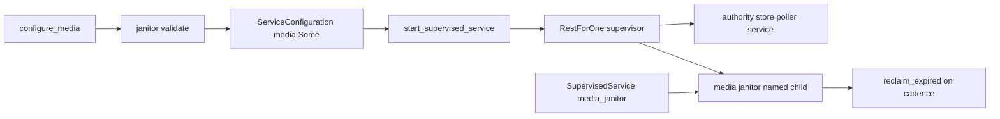

# 20261026-0906 — Telegram wave 6g: the media janitor is placed under the service supervisor behind a validated media configuration

#fractal-l2 #fractal-l3 #fractal-l4 #fractal-l5 #fractal-l9 #zk-adr #zero-muda #km-triad

[This journal](http://nas-1.tail55d152.ts.net:4100/files/docs/journal/20261026-0906-claude-telegram-wave6g-media-placement.md) · [Wave 6f](http://nas-1.tail55d152.ts.net:4100/files/docs/journal/20261026-0847-claude-telegram-wave6f-media-janitor.md) · [Media pipeline guide](http://nas-1.tail55d152.ts.net:4100/docs/wiki/20261026-0801-telegram-media-pipeline-guide.md) · [KPI ledger](http://nas-1.tail55d152.ts.net:4100/files/governance/planning/20261026-0639-claude-telegram-wave-kpi-ledger.json) · [Cockpit](http://nas-1.tail55d152.ts.net:4100/)

Transclusions: [[zk:20260905-1801-moc-uos-unified-master]] · [[wiki:20260905-1801-uos-zk-km-corpus-index]]

## 1. Scope & Trigger

Sa-plan `uos/telegram-runtime/20261001-1150` MEDIA_PLACEMENT attempt 1 (created with dependency MEDIA_JANITOR; preflight PREFLIGHT_PASS; worker `claude-fable-l0-35600f5c`; integrator increment, no worker). Trigger: wave 6f left the janitor without a start site, and the service's own supervisor (`start_supervised_service`, four children under RestForOne) is the start site that exists in the tree. Trivial scale by file count (two source files, two test files), standard by surface (the service configuration record).

## 2. Pre-State Assessment

`main` 495f1e66. `ServiceConfiguration` had no media field; nobody started the janitor; the runtime started the service through `start_supervised_service`. Prior: an additive optional field, a validated binder and one optional child.

## 3. Execution Detail

1. `MediaConfiguration(store_policy, reclaim_cadence_ms, reclaim_max_objects, reclaim_history_limit)` and `ServiceConfiguration.media: Option(MediaConfiguration)` (both constructors and the three test constructors carry `media: None`).
2. `configure_media(config, policy, cadence, max_objects, history)` refuses a relative store root (`media_root_not_absolute`) and otherwise delegates to `telegram_media_janitor.validate` on the janitor configuration it would start (`cadence_invalid`, `max_objects_invalid`, `history_limit_invalid`, `policy_invalid`). Nothing starts here.
3. `start_supervised_service` builds an optional fifth child from `config.media`: a janitor registered under `telegram_media_janitor_<bot_id>` placed after the service actor under RestForOne, so a service restart restarts it and it never outlives the service. `SupervisedService.media_janitor: Option(Name(janitor.Message))` hands clients the name; `None` means no janitor was started.
4. Tests in the slice1 service suite: `supervised_service_starts_media_janitor_when_configured_test` (four refusals, a bound configuration, a started service whose janitor answers a snapshot with zero runs and a `RunNow` receipt over an empty store, and a stop after which the name is gone) and one assertion in `non_parent_can_stop_supervised_service_test` that a service without media starts no janitor.
5. Process defect and repair: `gleam format` on the two service files reflowed 4,997 lines that this increment did not touch; both files were restored from `main` and the edits reapplied by hand, leaving a 217-line diff. Recorded as L-19.

## 4. Root Cause Analysis

ACH: why did the first build of this increment carry a 5,000-line diff?

| Evidence | H1: `telegram_service.gleam` and the slice1 test were never `gleam format`-clean, so formatting them rewrote the whole file | H2: my edits were large | H3: the formatter changed behaviour |
|---|---|---|---|
| E1: `jj diff --stat` showed 4,086 changed lines in the service file against six small edits | Consistent | Inconsistent | Neutral |
| E2: the original file uses `actions:None,` spacing the formatter never emits | Consistent | Neutral | Inconsistent |
| E3: after restoring from `main` and reapplying the same edits the diff is 217 lines and the tests pass identically | Consistent | Inconsistent | Inconsistent |
| Evaluation | **CONFIRMED** | REFUTED | REFUTED |

## 5. Fix Taxonomy

- **Poka-yoke:** a media configuration can only enter the record through `configure_media` with the janitor's own validator; a literal `Some(_)` is still refused at child start.
- **Jidoka:** the mass reformat was reverted before any test result was trusted; the landing diff carries only the increment.
- **Muda:** no runtime flag, no second supervisor, no production placement claim; the janitor rides the supervisor that exists.

## 6. Patterns & Anti-Patterns Discovered

- Anti-pattern: formatting a shared file that was never formatter-clean (L-19); format only new files, and check `jj diff --stat` before trusting a build.
- Devil's Advocate: the janitor runs under RestForOne after the service actor, so a janitor crash loop counts against the supervisor's restart tolerance (3 in 5 s) and could take the service down with it. The janitor's own pause after three errors makes a crash loop unlikely but not impossible; a separate one-for-one sub-supervisor would isolate it at the cost of a second tree. Recorded, not built.
- Devil's Advocate: the service test exercises a start, a snapshot, one `RunNow` over an empty store and a stop; it does not wait a cadence, so the cadence itself is proven only by the janitor's own suite.

## 7. Verification Matrix

| Check | Result | Admiralty |
|---|---|---|
| `supervised_service_starts_media_janitor_when_configured_test` and the amended `non_parent_can_stop_supervised_service_test` | pass | B2 |
| Wiring mutants: janitor child built but not added; `configure_media` skips `validate` | 2/2 killed against the placement test alone (the slice1 module shows 9 environment failures of HTTP-fixture tests when run outside `gleam test`; both mutants added exactly one failure in the whole-module run and were then re-run against the single test) | B2 |
| `jj diff --stat` after the restore | 217 insertions, 5 deletions across five files | A1 |
| Full `cepaf_gleam` suite on OTP 29 at the landing tip | 13785 passed, 0 failed (09:06Z to 09:17Z) | B2 |
| Diagram parity and journal linter | PASS / 10/10 PASS | A1 |

## 8. Files Modified

- `apps/cepaf_gleam/src/cepaf_gleam/harness/telegram_service.gleam` (imports, `MediaConfiguration`, `media` field, `configure_media`, `janitor_config`, `SupervisedService.media_janitor`, optional fifth child)
- `apps/cepaf_gleam/test/telegram_service_slice1_test.gleam` (imports, `media: None` twice, one assertion, one new test), `apps/cepaf_gleam/test/telegram_service_e2e_test.gleam` (`media: None`)
- `governance/planning/20261026-0639-claude-telegram-wave-kpi-ledger.json` (rows 6f landed and 6g, lesson L-19), `docs/wiki/20261026-0801-telegram-media-pipeline-guide.md`, this journal

## 9. Architectural Observations

```text
[configure_media] -> [janitor validate]
[janitor validate] -> [ServiceConfiguration media Some]
[ServiceConfiguration media Some] -> [start_supervised_service]
[start_supervised_service] -> [RestForOne supervisor]
[RestForOne supervisor] -> [authority store poller service]
[RestForOne supervisor] -> [media janitor named child]
[media janitor named child] -> [reclaim_expired on cadence]
[SupervisedService media_janitor] -> [media janitor named child]
```



The service supervisor is the one start site in the tree, so retention now rides the same restart budget as the service it protects; that is the honest meaning of "enforced by the service".

## 10. Remaining Gaps

- No operator configuration binds a media policy for the staging or production service; the field is `None` until deployment configuration calls `configure_media`.
- Media updates are still rejected at ingress (the guard's message decoder requires `message.text`), so nothing downstream ever calls `put`; the intake path is the next increment and needs a codec change for the stored verdict.
- The gateway drain actor still has no start site.
- MEDIA_REVIEW by an independent reviewer; TELEGRAM_E2E by an authorized human; Codex and AGY R5 review.

## 11. Metrics Summary

- Tests added: 1 plus one assertion; mutants: 2 killed. Media lifecycle components without a service start site: 1 → 0.
- Bayesian (Beta over "an integrator increment on a shared service file lands without a process defect"): prior Beta(3,1) → posterior Beta(3,2) after the reformat defect; mean 0.6.
- Lyapunov: V = media lifecycle stages with no supervised owner: 1 → 0; dV/dt < 0.

## 12. STAMP & Constitutional Alignment

| UCA type | Hazard | Control |
|---|---|---|
| Not provided | a janitor exists but nothing starts it | optional fifth child of the service supervisor |
| Provided unsafely | an unvalidated media policy reaches a running janitor | `configure_media` validates through the janitor; child start re-validates |
| Wrong timing | the janitor outlives or precedes the service | placed after the service actor under RestForOne |
| Too long | a 5,000-line reformat lands as an increment | restored from `main`, edits reapplied, diff checked before landing |

## 13. Conclusion

Media retention is a supervised part of the Telegram service whenever an operator binds a media configuration; the remaining media gap is intake at ingress.

**Forecast:** p = 0.5 that the media intake increment (guard accepts captioned media, verdict codec carries a media reference, service answers a typed media reply) lands on `main` with tests by 2026-10-27T12:00:00Z.
- Falsifier: no commit on `main` at the horizon in which the ingress guard produces a verdict for an update without `message.text` (outcome 0).
- Brier score: B = (0.5 − o)².

## Comprehensive verification checklist

Checks below are obligations, not blanket passing claims.

<details><summary>Domain 1 — Metadata, timestamp and Tailscale navigation</summary>

- [x] **CHK-01-TIME** — Prefix `20261026-0906-` from the host UTC clock (`date -u`).
- [ ] **CHK-02-TAIL** — Tailnet links provided; serving not re-verified.
- [x] **CHK-03-FRACT** — L2, L3, L4, L5, L9 assigned.
- [x] **CHK-04-KM** — MOC and corpus index transcluded; guide, ledger and previous journal linked.

</details>

<details><summary>Domain 2 — Zero-Muda purity and storage safety</summary>

- [x] **CHK-05-MUDA** — No dependencies added.
- [ ] **CHK-06-GRAPH** — Not evaluated.
- [ ] **CHK-07-DRIVE** — Not in scope; serial written as `[REDACTED_SYSTEM_OS_SERIAL]` where mentioned.

</details>

<details><summary>Domain 3 — Testing Gold Standard and mathematical gates</summary>

- [ ] **CHK-08-C1C8** — Not evaluated.
- [ ] **CHK-09-MATH** — Not measured.
- [x] **CHK-10-9MOD** — Unit, negative, supervision and mutation tests.
- [x] **CHK-11-REGR** — Full `cepaf_gleam` suite on OTP 29 before landing.

</details>

<details><summary>Domain 4 — Cross-language control and observability</summary>

- [x] **CHK-12-GLEAM** — Gleam/OTP owns the configuration, the supervisor and the child.
- [ ] **CHK-13-HERMES** — Not exercised.
- [ ] **CHK-14-ZIGVM** — Not exercised.
- [ ] **CHK-15-MAX** — Not applicable.
- [ ] **CHK-16-OTEL** — Not evaluated.

</details>

<details><summary>Domain 5 — Sovereign governance and standalone Jujutsu</summary>

- [ ] **CHK-17-SOV** — MEDIA_REVIEW and R5 review outstanding.
- [x] **CHK-18-JJ** — Standalone jj; integrator workspace only; mass reformat reverted before landing.

</details>

<details><summary>Domain 6 — Provenance extension</summary>

EV ceiling remains 93. EV-94..109 remain NOT_ADMITTED. No new EV number is minted.

</details>

[Previous journal](http://nas-1.tail55d152.ts.net:4100/files/docs/journal/20261026-0847-claude-telegram-wave6f-media-janitor.md) · [ZK Master MOC](http://nas-1.tail55d152.ts.net:4100/zk) · [Wiki Corpus Index](http://nas-1.tail55d152.ts.net:4100/wiki)

UOS footer: `nas-1.tail55d152.ts.net:4100` · peer `vm-1.tail55d152.ts.net:4100` · document evidence grants no system admission.
