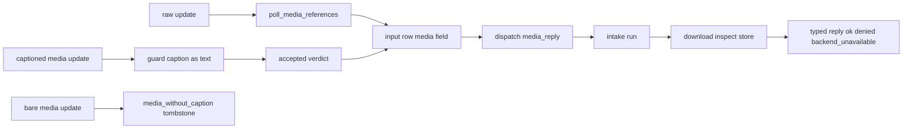

# 20261026-0936 — Telegram wave 6h: captioned media is admitted at ingress and answered by a typed media reply through download, inspection and the store

#fractal-l1 #fractal-l3 #fractal-l4 #fractal-l5 #fractal-l6 #fractal-l9 #zk-adr #zero-muda #km-triad

[This journal](http://nas-1.tail55d152.ts.net:4100/files/docs/journal/20261026-0936-claude-telegram-wave6h-media-intake.md) · [Wave 6g](http://nas-1.tail55d152.ts.net:4100/files/docs/journal/20261026-0903-claude-telegram-wave6g-media-placement.md) · [Media pipeline guide](http://nas-1.tail55d152.ts.net:4100/docs/wiki/20261026-0801-telegram-media-pipeline-guide.md) · [Security journey spec](http://nas-1.tail55d152.ts.net:4100/files/docs/design/20261026-0215-telegram-journey-security-incident.md) · [KPI ledger](http://nas-1.tail55d152.ts.net:4100/files/governance/planning/20261026-0639-claude-telegram-wave-kpi-ledger.json) · [Cockpit](http://nas-1.tail55d152.ts.net:4100/)

Transclusions: [[zk:20260905-1801-moc-uos-unified-master]] · [[wiki:20260905-1801-uos-zk-km-corpus-index]]

## 1. Scope & Trigger

Sa-plan `uos/telegram-runtime/20261001-1150` MEDIA_INTAKE attempt 1 (created with dependency MEDIA_PLACEMENT; preflight PREFLIGHT_PASS; worker `claude-fable-l0-35600f5c`; integrator increment across shared files, no worker). Trigger: after wave 6g every media stage existed and nothing fed them, because the ingress guard required `message.text` and tombstoned every media update, and the raw update bytes are never retained. Standard scale: nine source and test files plus two specs and a runbook.

## 2. Pre-State Assessment

`main` c92dd151. A captioned photo from the allowlisted pair was a `missing_or_malformed_message_identity` tombstone (security journey SEC-J3/S1 recorded exactly that). `commit_prefix` wrote input rows holding the verdict only; the dispatcher had no way to learn a message carried media. Prior: a caption fallback in the guard, an optional field on the stored row, one chain module, one service arm.

## 3. Execution Detail

1. **Guard.** `message_identity_decoder` reads the command text from `message.text`, or from `message.caption` when `text` is absent (`text` still wins when both exist). A media message with neither is refused as `media_without_caption`, identified through `media_ref.from_update`, instead of the generic identity failure. No command text is invented for bare media.
2. **Stored row.** `media_ref` gains `to_json`, `decoder` and `kind_from_label` with the same bounds as update parsing. The codec gains `encode_input_verdict_with_media` (an optional top-level `media` object; `None` yields bytes identical to the pre-6h form) and `decode_input_media` (`Ok(None)` for every old row, `Ok(Some)` within bounds, `Error("invalid_input_media")` for a malformed field, never a silent `None`). `decode_input_verdict` ignores the field. The store gains `commit_prefix_media` keyed by update id; `commit_prefix` delegates with an empty map, so its sixty call sites are untouched.
3. **Service, poll side.** `poll_media_references` zips the raw updates with their verdicts and parses a reference for each accepted update; the store worker message, its handler, `store_worker_commit_prefix` and `svc_commit_prefix` carry the map.
4. **Service, dispatch side.** When the stored input row carries a reference, the accepted-envelope arm answers `media_reply` instead of the caption's directive: `telegram_media_intake.run` under the observation authority window (one second without a transport, twenty with one), then `reply_json`. A malformed stored reference answers a `denied` refusal reply.
5. **Intake module.** `telegram_media_intake` orders the stages (download, `inspect_fetched`, `usage`, `put`) and maps outcomes to the journey vocabulary: `backend_unavailable` for no policy, no transport or an unmeasurable store; `denied` for a download, inspection or store refusal; `ok` only when the bytes are stored under their recomputed digest. The caption directive is reported by name and never executed. `MediaConfiguration.transport: Option(download.Transport)` and `configure_media` take the transport; no production transport exists in the tree, so a deployment injects one.
6. **Journeys and documents.** SEC-J3/S1 flips from a tombstone expectation to `MediaAccepted("/status")` (caption as text, directive equal to `classify_directive`) and SEC-J3/S1b records the bare-media tombstone; the security spec rows and note 4 and the runbook rows 90 and 181 describe the typed reply and the remaining transport gap; the media guide and the journey skill (five surfaces) describe intake.
7. **Tests.** Guard 5 new (captioned photo accepted with caption as text; text wins over caption; bare photo `media_without_caption`; blank caption `invalid_text`; bare message unidentified); store 1 (media round trip, backward compatibility, verdict decoder ignores media, malformed media refused); intake 10 (not configured, transport absent fetches nothing, PNG fetched inspected stored and retrievable then already-stored, PDF under Photo denied and not stored, unknown bytes denied, unsupported kind denied before any fetch, ceiling refusal denied, directive labels, refusal reply, summary carries no token); e2e 1 (captioned photo through the runner answers `media.intake` `backend_unavailable` `media_not_configured` with the largest declared size and the caption directive, nothing from the caption executes, a bare photo is a named tombstone with no reply).

## 4. Root Cause Analysis

ACH: why did the first e2e run fail before any media code ran?

| Evidence | H1: the runner harness seeds one Sa-plan task (`lease-e2e-01`) and my test named a task that was never seeded | H2: the guard rejected the captioned update | H3: the runner was built from stale beams |
|---|---|---|---|
| E1: the recorded poll result was `{"reason":"task_not_found_in_plan: lease-e2e-media","status":"error"}` | Consistent | Inconsistent | Inconsistent |
| E2: with the seeded task and worker names the same test passes unchanged | Consistent | Inconsistent | Inconsistent |
| E3: the guard suite's captioned-photo test passed before the e2e run | Neutral | Refuted | Neutral |
| Evaluation | **CONFIRMED** | REFUTED | REFUTED |

The harness's authority is Sa-plan even in a test: a poll with a task the plan does not know fails closed before ingress, which is the designed behaviour and a reminder that the e2e identities are seeded, not free.

## 5. Fix Taxonomy

- **Poka-yoke:** no command text invented for bare media; the stored reference is re-bounded on decode; a malformed stored reference is a refusal; the token never enters an outcome or a summary.
- **Jidoka:** the caption directive is never executed from a media message; `ok` requires a stored digest.
- **Muda:** the sixty `commit_prefix` callers and the twenty-seven envelope constructors are untouched; the media reference rides an optional field instead of a record change.
- **Standardized work:** OCaml literal replacement for every multi-line edit; no mass format.

## 6. Patterns & Anti-Patterns Discovered

- Pattern: carry new durable data as an optional top-level field with a `None`-is-byte-identical encoder, so old rows, old tests and old callers stay valid and the new decoder is the only new law.
- Pattern: the e2e harness's seeded identities are part of its contract; a test names them, it does not choose them.
- Devil's Advocate: media replies take precedence over the caption directive, so an operator who captions a photo `/status` gets the media reply and not the status; the reply names the directive so nothing is hidden, and a plain `/status` text still works. The alternative, running the directive and attaching media, would execute a command carried by an attachment; refused by design.
- Devil's Advocate: the observation window for a fetch is twenty seconds inside the service actor; a slow transport blocks the dispatcher for that long. The transport's own deadlines (three plus fifteen seconds) bound it, and no production transport exists yet; a supervised fetch worker is the next step if one is bound.
- Devil's Advocate: `poll_media_references` parses each raw update a second time (the guard parsed it once); the cost is one JSON parse per accepted update per poll, bounded by the poll limit.

## 7. Verification Matrix

| Check | Result | Admiralty |
|---|---|---|
| Guard (34), media_ref (19), store (32), intake (10), verify-service (6), journey security (12) and coverage (3) suites | all pass | B2 |
| Placement, non-parent stop and store-worker slice1 tests | pass | B2 |
| e2e `e2e_captioned_photo_answers_typed_media_reply_test` through the runner harness | pass | B2 |
| Mutants: guard caption fallback removed; poll never carries media; intake `Stored` not `ok`; malformed stored media decodes silently | 4/4 killed (guard 3 failures across guard and journey suites; poll carry killed by the e2e test alone; intake 1; codec 1) | B2 |
| `jj diff --stat` | 23 files, 1,119 insertions, 38 deletions before the journal; no file reformatted | A1 |
| Full `cepaf_gleam` suite on OTP 29 at the landing tip | 13802 passed, 0 failed (to 09:46Z) | B2 |
| Diagram parity and journal linter | PASS / 10/10 PASS | A1 |

## 8. Files Modified

- `apps/cepaf_gleam/src/cepaf_gleam/harness/telegram_ingress_guard.gleam` (caption fallback, `media_without_caption`), `telegram_media_ref.gleam` (`kind_from_label`, `to_json`, `decoder`), `telegram_store_codec.gleam` (`encode_input_verdict_with_media`, `decode_input_media`, `encode_verdict_object`), `telegram_store.gleam` (`commit_prefix_media`), `telegram_service.gleam` (`MediaConfiguration.transport`, `configure_media`, `media_reply`, `poll_media_references`, store worker message and handler, dispatch arm), new `telegram_media_intake.gleam`
- tests: new `telegram_media_intake_test.gleam`; `telegram_ingress_guard_test.gleam`, `telegram_store_test.gleam`, `telegram_journey_security_test.gleam`, `telegram_service_slice1_test.gleam` (worker commit map, `configure_media` transport), `telegram_service_e2e_test.gleam` (new e2e)
- `docs/design/20261026-0215-telegram-journey-security-incident.md`, `docs/sop/20261026-0215-telegram-real-traffic-journeys-security-runbook.md`, `docs/wiki/20261026-0801-telegram-media-pipeline-guide.md`, `.claude/skills/uos-telegram-journeys/SKILL.md` and mirrors, `governance/planning/20261026-0639-claude-telegram-wave-kpi-ledger.json`, this journal

## 9. Architectural Observations

```text
[captioned media update] -> [guard caption as text]
[guard caption as text] -> [accepted verdict]
[raw update] -> [poll_media_references]
[poll_media_references] -> [input row media field]
[accepted verdict] -> [input row media field]
[input row media field] -> [dispatch media_reply]
[dispatch media_reply] -> [intake run]
[intake run] -> [download inspect store]
[download inspect store] -> [typed reply ok denied backend_unavailable]
[bare media update] -> [media_without_caption tombstone]
```



The durable boundary is the stored input row; everything the dispatcher knows about a media message is what the poll wrote there, under the same bounds the guard applies to text. The intake chain is a pure function of that row, the bound policy and the injected transport.

## 10. Remaining Gaps

- No fetch transport exists in the tree, so every deployment answers `backend_unavailable` until one is injected through `configure_media`; building one on the HTTP client (getFile plus a streamed body) is the next increment.
- The fetch runs inside the dispatcher's observation window rather than a supervised fetch worker.
- The gateway drain actor still has no start site.
- MEDIA_REVIEW, COMMAND_REVIEW, GATEWAY_REVIEW and MINI_API_REVIEW by an independent reviewer; TELEGRAM_E2E by an authorized human; Codex and AGY R5 review.

## 11. Metrics Summary

- Tests added: 17 (guard 5, store 1, intake 10, e2e 1); journey steps: 1 flipped, 1 added. Media messages reaching the dispatcher: 0 → every captioned media message from the allowlisted pair.
- Bayesian (Beta over "an integrator increment on shared service files lands without a process defect"): Beta(3,2) → Beta(4,2) after this increment (the e2e identity mistake was caught by the harness before any landing and is recorded as a pattern, not a defect); mean 0.67.
- Lyapunov: V = media design items without a path from a real update to a reply: 1 → 0; dV/dt < 0.

## 12. STAMP & Constitutional Alignment

| UCA type | Hazard | Control |
|---|---|---|
| Not provided | a media message is silently tombstoned and the operator never learns why | `media_without_caption` named tombstone; captioned media answered |
| Provided unsafely | a caption executes a command carried by an attachment, or `ok` is claimed from declared fields | caption directive reported, never executed; `ok` only with a stored digest |
| Wrong timing | the dispatcher trusts a reference parsed at a different time than the verdict | reference written in the same commit as the verdict, keyed by update id |
| Too long | a fetch blocks the dispatcher without bound | observation window of twenty seconds plus transport deadlines; no transport bound today |

## 13. Conclusion

Every media design item now has a path from a real Telegram update to a typed reply, with the fetch gated on a transport no deployment has yet bound; the last Telegram feature gap at source is that transport.

**Forecast:** p = 0.45 that an HTTP fetch transport (getFile plus streamed body on the existing HTTP client) lands on `main` with tests and is bound through `configure_media` in a staged service test by 2026-10-27T18:00:00Z.
- Falsifier: no commit on `main` at the horizon provides a `download.Transport` outside the test suite (outcome 0).
- Brier score: B = (0.45 − o)².

## Comprehensive verification checklist

Checks below are obligations, not blanket passing claims.

<details><summary>Domain 1 — Metadata, timestamp and Tailscale navigation</summary>

- [x] **CHK-01-TIME** — Prefix `20261026-0936-` from the host UTC clock (`date -u`).
- [ ] **CHK-02-TAIL** — Tailnet links provided; serving not re-verified.
- [x] **CHK-03-FRACT** — L1, L3, L4, L5, L6, L9 assigned.
- [x] **CHK-04-KM** — MOC and corpus index transcluded; guide, spec, ledger and previous journal linked.

</details>

<details><summary>Domain 2 — Zero-Muda purity and storage safety</summary>

- [x] **CHK-05-MUDA** — No dependencies added.
- [ ] **CHK-06-GRAPH** — Not evaluated.
- [ ] **CHK-07-DRIVE** — Not in scope; serial written as `[REDACTED_SYSTEM_OS_SERIAL]` where mentioned.

</details>

<details><summary>Domain 3 — Testing Gold Standard and mathematical gates</summary>

- [ ] **CHK-08-C1C8** — Not evaluated.
- [ ] **CHK-09-MATH** — Not measured.
- [x] **CHK-10-9MOD** — Unit, negative, backward-compatibility, end-to-end through the runner, and mutation tests.
- [x] **CHK-11-REGR** — Full `cepaf_gleam` suite on OTP 29 before landing.

</details>

<details><summary>Domain 4 — Cross-language control and observability</summary>

- [x] **CHK-12-GLEAM** — Gleam owns the guard, the codec, the store, the service and the intake chain.
- [ ] **CHK-13-HERMES** — Not exercised.
- [ ] **CHK-14-ZIGVM** — Not exercised.
- [ ] **CHK-15-MAX** — Not applicable.
- [ ] **CHK-16-OTEL** — Not evaluated.

</details>

<details><summary>Domain 5 — Sovereign governance and standalone Jujutsu</summary>

- [ ] **CHK-17-SOV** — MEDIA_REVIEW and R5 review outstanding.
- [x] **CHK-18-JJ** — Standalone jj; integrator workspace only; no mass reformat.

</details>

<details><summary>Domain 6 — Provenance extension</summary>

EV ceiling remains 93. EV-94..109 remain NOT_ADMITTED. No new EV number is minted.

</details>

[Previous journal](http://nas-1.tail55d152.ts.net:4100/files/docs/journal/20261026-0903-claude-telegram-wave6g-media-placement.md) · [ZK Master MOC](http://nas-1.tail55d152.ts.net:4100/zk) · [Wiki Corpus Index](http://nas-1.tail55d152.ts.net:4100/wiki)

UOS footer: `nas-1.tail55d152.ts.net:4100` · peer `vm-1.tail55d152.ts.net:4100` · document evidence grants no system admission.
