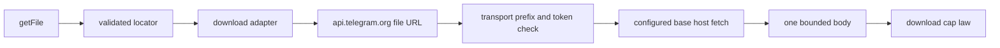

# 20261026-0954 — Telegram wave 6i: the HTTP media transport, so a deployment can bind intake to a real fetch

#fractal-l1 #fractal-l3 #fractal-l4 #fractal-l6 #fractal-l9 #zk-adr #zero-muda #km-triad

[This journal](http://nas-1.tail55d152.ts.net:4100/files/docs/journal/20261026-0954-claude-telegram-wave6i-media-transport.md) · [Wave 6h](http://nas-1.tail55d152.ts.net:4100/files/docs/journal/20261026-0936-claude-telegram-wave6h-media-intake.md) · [Media pipeline guide](http://nas-1.tail55d152.ts.net:4100/docs/wiki/20261026-0801-telegram-media-pipeline-guide.md) · [KPI ledger](http://nas-1.tail55d152.ts.net:4100/files/governance/planning/20261026-0639-claude-telegram-wave-kpi-ledger.json) · [Cockpit](http://nas-1.tail55d152.ts.net:4100/)

Transclusions: [[zk:20260905-1801-moc-uos-unified-master]] · [[wiki:20260905-1801-uos-zk-km-corpus-index]]

## 1. Scope & Trigger

Sa-plan `uos/telegram-runtime/20261001-1150` MEDIA_TRANSPORT attempt 1 (created with dependency MEDIA_INTAKE; preflight PREFLIGHT_PASS; worker `claude-fable-l0-35600f5c`; integrator increment). Trigger: after wave 6h every captioned media message reached the intake chain and answered `backend_unavailable`, because no `download.Transport` existed in the tree. Trivial scale by files: two source files extended, one new module, one Erlang fixture extended, one new test file.

## 2. Pre-State Assessment

`main` a985c3a1. `telegram_http_client` knew `sendMessage`, `getUpdates` and `answerCallbackQuery`; the HTTP FFI bounds every response to at most 10 MiB by policy. The download adapter builds the credential-bearing file URL itself on `api.telegram.org` and hands it to `open_stream`. Prior: two client functions, one constructor module, two fixture endpoints.

## 3. Execution Detail

1. **Client.** `get_file` posts Bot API `getFile` and returns a `FileLocator(file_path, declared_size_bytes)` after validating the path (non-empty, relative, no traversal, no query, no fragment, no NUL, at most 256 bytes); every error is a short name with no URL and no token. `fetch_file_bytes` performs one bounded GET of `<base_url>/file/bot<token>/<file_path>` with the bound clamped to the FFI ceiling `max_file_body_bytes` (10 MiB); an oversize body is an error, never a truncated success. Deadlines are the smaller of the caller's and the configured timeout.
2. **Transport.** `telegram_media_transport.from_http(http_config)` builds the `download.Transport`: `get_file` maps the locator to `FileMeta`; `open_stream` accepts only `https://api.telegram.org/file/bot<configured token>/` (`file_url_not_for_this_bot` otherwise), re-validates the path (`file_url_invalid_path`), fetches from the configured base host, and yields the body once. The configured host is the only host ever contacted, which is what lets a staged service fetch from the local fixture under the production URL law.
3. **Fixture.** The Erlang HTTP fixture gains `set_file(Pid, FileId, FilePath, Bytes)`, answers `getFile` with the registered locator (400 for an unknown id) and serves `/file/bot<token>/<path>` as `application/octet-stream` (404 otherwise), in `normal` mode only.
4. **Tests (8).** Locator for a registered id, unknown id and empty id; exact bounded fetch, oversize bound, missing path, hostile path; URL accepted only for this bot (other token, other host, traversal, query); intake through the real transport stores the fixture bytes under their sha256 and the reply carries the digest and never the token or URL; declared over-cap refused before any fetch; unknown id is a denied download; the transport bound equals the FFI ceiling; a hostile declared path from `getFile` is refused.
5. **Environment finding.** Fixture-backed tests fail under a bare `erl` eunit call because hackney is not started there; the `gleam test` runner starts it. This explains the nine baseline slice1 fixture failures observed in waves 6g and 6h and is recorded as L-20; the mutant runner for this wave starts hackney first.

## 4. Root Cause Analysis

ACH: why did the transport suite fail three tests on first run and pass unchanged afterwards?

| Evidence | H1: hackney was not started in the bare `erl` process, so every real HTTP call failed before reaching the fixture | H2: the fixture's new endpoints were wrong | H3: the client's URL construction was wrong |
|---|---|---|---|
| E1: the three failing tests were exactly the three that perform HTTP; the four pure tests passed | Consistent | Neutral | Neutral |
| E2: the same suite passes 7 of 7 with `application:ensure_all_started(hackney)` before eunit, with no code change | Consistent | Refuted | Refuted |
| E3: the earlier slice1 baseline under `erl` failed the nine `http_fixture_*` and worker tests, all of which perform HTTP, while `gleam test` passed them | Consistent | Inconsistent | Inconsistent |
| Evaluation | **CONFIRMED** | REFUTED | REFUTED |

## 5. Fix Taxonomy

- **Poka-yoke:** URL prefix bound to the configured token; path validated twice (client and adapter); bound clamped to the FFI ceiling; errors carry names only.
- **Jidoka:** oversize bodies refused, never truncated; media above the ceiling reported, never partially stored.
- **Muda:** no retries, no redirects, no streaming to disk, no second HTTP stack.

## 6. Patterns & Anti-Patterns Discovered

- Pattern: keep the credential-bearing URL where it was (the download adapter) and let the transport translate the host; the production URL law and the staged fixture then share one code path.
- Anti-pattern (environment): running fixture-backed suites under a bare `erl` and reading the failures as defects; L-20.
- Devil's Advocate: one bounded read caps fetchable media at 10 MiB, below the design caps for audio, document and video. The transport refuses rather than streams; raising the ceiling means a streaming FFI with a per-chunk bound, a separate increment.
- Devil's Advocate: the fixture matches the file path by suffix, so two registered files with the same path would collide; tests register distinct paths, and the fixture is test-only by its own header.

## 7. Verification Matrix

| Check | Result | Admiralty |
|---|---|---|
| `telegram_media_transport_test` (8) with hackney started, against the local fixture | all pass | B2 |
| Intake (10) and download (31) suites unchanged | all pass | B2 |
| Mutants: URL prefix check dropped; fetch bound ignored; `getFile` path validation dropped | 3/3 killed (each against the transport suite with hackney started) | B2 |
| Full `cepaf_gleam` suite on OTP 29 at the landing tip | 13810 passed, 0 failed (09:54Z to 10:05Z) | B2 |
| Diagram parity and journal linter | PASS / 10/10 PASS | A1 |

## 8. Files Modified

- `apps/cepaf_gleam/src/cepaf_gleam/harness/telegram_http_client.gleam` (`FileLocator`, `max_file_body_bytes`, `get_file`, `valid_file_path`, `fetch_file_bytes`), new `telegram_media_transport.gleam`, `apps/cepaf_gleam/src/telegram_http_test_fixture.erl` (`set_file`, `getFile`, file body), new `apps/cepaf_gleam/test/telegram_media_transport_test.gleam`
- `docs/wiki/20261026-0801-telegram-media-pipeline-guide.md`, `.claude/skills/uos-telegram-journeys/SKILL.md` and mirrors, `governance/planning/20261026-0639-claude-telegram-wave-kpi-ledger.json` (row 6i, lesson L-20, wave 6h forecast resolved), this journal

## 9. Architectural Observations

```text
[download adapter] -> [api.telegram.org file URL]
[api.telegram.org file URL] -> [transport prefix and token check]
[transport prefix and token check] -> [configured base host fetch]
[configured base host fetch] -> [one bounded body]
[one bounded body] -> [download cap law]
[getFile] -> [validated locator]
[validated locator] -> [download adapter]
```



The media lifecycle is now complete at source end to end: a captioned photo sent to a staged service with `configure_media(..., Some(from_http(http_config)))` is fetched, sniffed, stored under its digest and answered `ok`. What remains is a deployment binding it.

## 10. Remaining Gaps

- Fetchable media is capped at 10 MiB by the single bounded read; audio, document and video caps above it need a streaming FFI.
- No staged service binds the transport yet (deployment configuration); the service-level path is proven through intake and the e2e of wave 6h.
- The gateway drain actor still has no start site.
- MEDIA_REVIEW, COMMAND_REVIEW, GATEWAY_REVIEW and MINI_API_REVIEW by an independent reviewer; TELEGRAM_E2E by an authorized human; Codex and AGY R5 review.

## 11. Metrics Summary

- Tests added: 8; mutants: 3 integrator. Media design stages without a production-shaped implementation: 1 → 0.
- Bayesian (Beta over "an integrator increment lands without a process defect"): Beta(4,2) → Beta(5,2); mean 0.71.
- Lyapunov: V = media design items without a real transport: 1 → 0; dV/dt < 0.

## 12. STAMP & Constitutional Alignment

| UCA type | Hazard | Control |
|---|---|---|
| Not provided | intake exists but nothing can fetch | `from_http` transport |
| Provided unsafely | a fetch reaches a host other than the configured one, or a hostile path | prefix and token check; path validated twice; configured host only |
| Wrong timing | a fetch outlives its deadline | deadline clamped to the configured timeout; FFI deadline |
| Too long | an oversize body is read or stored partially | bound clamped to the ceiling; oversize is an error |

## 13. Conclusion

The Telegram media lifecycle has a real fetch transport, bounded and host-pinned, proven against the local fixture; every media design item now exists at source.

**Forecast:** p = 0.5 that MEDIA_REVIEW is claimed and completed by an independent reviewer session with a recorded verdict by 2026-10-28T12:00:00Z.
- Falsifier: MEDIA_REVIEW still without a result in Sa-plan at the horizon (outcome 0).
- Brier score: B = (0.5 − o)².

## Comprehensive verification checklist

Checks below are obligations, not blanket passing claims.

<details><summary>Domain 1 — Metadata, timestamp and Tailscale navigation</summary>

- [x] **CHK-01-TIME** — Prefix `20261026-0954-` from the host UTC clock (`date -u`).
- [ ] **CHK-02-TAIL** — Tailnet links provided; serving not re-verified.
- [x] **CHK-03-FRACT** — L1, L3, L4, L6, L9 assigned.
- [x] **CHK-04-KM** — MOC and corpus index transcluded; guide, ledger and previous journal linked.

</details>

<details><summary>Domain 2 — Zero-Muda purity and storage safety</summary>

- [x] **CHK-05-MUDA** — No dependencies added; the existing hackney-backed FFI is reused.
- [ ] **CHK-06-GRAPH** — Not evaluated.
- [ ] **CHK-07-DRIVE** — Not in scope; serial written as `[REDACTED_SYSTEM_OS_SERIAL]` where mentioned.

</details>

<details><summary>Domain 3 — Testing Gold Standard and mathematical gates</summary>

- [ ] **CHK-08-C1C8** — Not evaluated.
- [ ] **CHK-09-MATH** — Not measured.
- [x] **CHK-10-9MOD** — Unit, negative, hostile-input, real-HTTP-against-fixture and mutation tests.
- [x] **CHK-11-REGR** — Full `cepaf_gleam` suite on OTP 29 before landing.

</details>

<details><summary>Domain 4 — Cross-language control and observability</summary>

- [x] **CHK-12-GLEAM** — Gleam owns the client, the transport and the chain; Erlang supplies the bounded HTTP FFI and the test fixture.
- [ ] **CHK-13-HERMES** — Not exercised.
- [ ] **CHK-14-ZIGVM** — Not exercised.
- [ ] **CHK-15-MAX** — Not applicable.
- [ ] **CHK-16-OTEL** — Not evaluated.

</details>

<details><summary>Domain 5 — Sovereign governance and standalone Jujutsu</summary>

- [ ] **CHK-17-SOV** — MEDIA_REVIEW and R5 review outstanding.
- [x] **CHK-18-JJ** — Standalone jj; integrator workspace only.

</details>

<details><summary>Domain 6 — Provenance extension</summary>

EV ceiling remains 93. EV-94..109 remain NOT_ADMITTED. No new EV number is minted.

</details>

[Previous journal](http://nas-1.tail55d152.ts.net:4100/files/docs/journal/20261026-0936-claude-telegram-wave6h-media-intake.md) · [ZK Master MOC](http://nas-1.tail55d152.ts.net:4100/zk) · [Wiki Corpus Index](http://nas-1.tail55d152.ts.net:4100/wiki)

UOS footer: `nas-1.tail55d152.ts.net:4100` · peer `vm-1.tail55d152.ts.net:4100` · document evidence grants no system admission.
