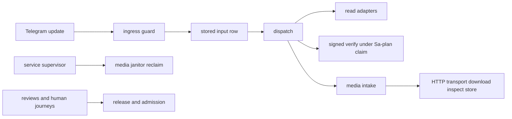

# 20261026-1009 — Telegram wave 6 close: KPI ledger, calibration and the as-is to to-be handover

#fractal-l0 #fractal-l3 #fractal-l5 #fractal-l8 #fractal-l9 #zk-adr #zero-muda #km-triad

[This journal](http://nas-1.tail55d152.ts.net:4100/files/docs/journal/20261026-1009-claude-telegram-wave6-close-kpi-handover.md) · [KPI ledger](http://nas-1.tail55d152.ts.net:4100/files/governance/planning/20261026-0639-claude-telegram-wave-kpi-ledger.json) · [Wave 6i](http://nas-1.tail55d152.ts.net:4100/files/docs/journal/20261026-0953-claude-telegram-wave6i-media-transport.md) · [Media pipeline guide](http://nas-1.tail55d152.ts.net:4100/docs/wiki/20261026-0801-telegram-media-pipeline-guide.md) · [Journeys guide](http://nas-1.tail55d152.ts.net:4100/docs/wiki/20261026-0220-telegram-journeys-guide.md) · [Cockpit](http://nas-1.tail55d152.ts.net:4100/)

Transclusions: [[zk:20260905-1801-moc-uos-unified-master]] · [[wiki:20260905-1801-uos-zk-km-corpus-index]]

## 1. Scope & Trigger

Sa-plan `uos/telegram-runtime/20261001-1150` TELEGRAM_KPI_CLOSE attempt 1 (dependency MEDIA_TRANSPORT; preflight PREFLIGHT_PASS; worker `claude-fable-l0-35600f5c`). Operator goal, verbatim: "complete all telegram features. add updates rules, skills, superpowers, code, agents, plugins etc to improve system and operations. must learing, track kpis and improve". Trigger: after wave 6i every implement task in the plan is completed at source; what remains needs actors other than this session. This increment lands documentation only: the ledger with every wave 6 row filled, resolved forecasts, lessons L-08 to L-20, the supervisor agent doc with L-20, and this handover. Trivial scale by code (none), standard by evidence.

## 2. Pre-State Assessment

Before wave 6 (main 8236f048, 02:33Z) the Telegram surface had 76 of 77 catalog literals answering from a module, `/verify` refused at classify, no media stage beyond parsing and download, and COMMAND_IMPL, GATEWAY_IMPL, MINI_API_IMPL and MEDIA_IMPL executing under expired or reclaimed leases. Prior for this close: no new defects; the only risk was an unlanded ledger drifting from `main`.

## 3. Execution Detail

As-is after wave 6 (nine landings, 55d0f363 to 6c65dd07, all pushed to origin):

| Wave | Landing | What it completed | Tests added | Mutants | Full suite |
|---|---|---|---|---|---|
| 6a | 55d0f363 | reclaim-set checker mode, `/simulate` canonical, media download, gateway drain, Mini immune page, `/verify` approval core | 78 | 18/20 | 13,697 |
| 6b | e122cb0b | `/verify` dispatched by the service under a Sa-plan claim; twelve review findings answered | 11 | 8/8 | 13,708 |
| 6c | eee7f77b | media inspection (T3) and content-addressed store (T4); scripted simulators named honestly | 37 | 11/11 | 13,744 |
| 6d | 5745dd3e | independent review of the store answered (five majors) | 14 | 8/8 | 13,758 |
| 6e | 029e7491 | bounded delete and expired reclaim (design safety requirement) | 14 | 6/6 | 13,772 |
| 6f | 495f1e66 | supervised janitor actor with a Jidoka pause | 12 | 7/7 | 13,784 |
| 6g | c92dd151 | janitor placed under the service supervisor behind `configure_media` | 1 | 2/2 | 13,785 |
| 6h | a985c3a1 | captioned media admitted at ingress; typed media reply through download, inspection and store | 17 | 4/4 | 13,802 |
| 6i | 6c65dd07 | HTTP media transport pinned to the configured host and token | 8 | 3/3 | 13,810 |

Sa-plan state of the plan: every `*_IMPL`, `MEDIA_FIX`, `MEDIA_RECLAIM`, `MEDIA_JANITOR`, `MEDIA_PLACEMENT`, `MEDIA_INTAKE` and `MEDIA_TRANSPORT` task completed with a result; open are COMMAND_REVIEW, GATEWAY_REVIEW, MEDIA_REVIEW, MINI_API_REVIEW (independent reviewer), TELEGRAM_E2E (authorized human with the staging bot), RETURN (behind them), and this close.

Rules, skills, agents and plugins touched in wave 6: the expired-claim preflight addendum (reviewed reclaim-set mode), the risk-prioritization and Telegram-journey skills (five surfaces each, byte-identical), the full-symbiosis supervisor agent doc (wave integrator, mutant, portfolio-alignment and fixture-run disciplines on four surfaces), the journey acceptance rule, three journey specs, two runbooks, the media pipeline wiki guide, and two feedback memories (OCaml or Mojo helpers; host-clock timestamps).

## 4. Root Cause Analysis

ACH over the whole wave: what produced the nine recorded process defects?

| Evidence | H1: integrator-side haste on shared state (guessed timestamps, Python one-liners, a mass reformat, portfolio records left declaring `executing`) | H2: worker code quality | H3: tooling failures |
|---|---|---|---|
| E1: the defect log (L-08, L-09, L-13, L-17, L-19) names the integrator in every entry | Consistent | Inconsistent | Inconsistent |
| E2: both independent reviews found majors in author tests that only exercised complete writes (L-12, L-16), caught before landing | Neutral | Consistent for two findings, both repaired | Inconsistent |
| E3: no landing was reverted and no gate was forced; every HOLD was repaired with evidence | Consistent | Neutral | Refuted |
| Evaluation | **CONFIRMED** as the dominant cause | PARTIAL (two review findings) | REFUTED |

## 5. Fix Taxonomy

Every defect became a lesson with an applied control: L-08 host-clock prefixes, L-09 OCaml edit tool, L-10 copy mutant patterns from the formatted file, L-11 transport split, L-12 mandatory R2 review on signed paths, L-13 non-equivalent mutants, L-14 observation accessors for bounds, L-15 helper-language scope, L-16 review before closing any module that writes or executes, L-17 portfolio alignment after completions, L-18 safety requirements are deliverables, L-19 never format a never-formatted shared file, L-20 start hackney for fixture suites. Poka-yoke where a script could enforce it (`complete6*.sh`, `fable-mut-h.sh`), Jidoka where only a stop could (HOLD, review).

## 6. Patterns & Anti-Patterns Discovered

- Pattern: one Sa-plan task per increment, one journal per landing, one ledger row per wave, one forecast per journal; the ledger is the learning loop, not the memory of a session.
- Pattern: workers create new files only; the integrator restores per file; shared files change by hand with literal replacement.
- Anti-pattern: the wave 5 forecast (a human real-traffic journey by 2026-10-28) and the 6b forecast (two REVIEW tasks by 2026-10-27 noon) both depend on actors outside this session; forecasts about other actors are where calibration will be learned, and both are still open.
- Devil's Advocate: nine landings in eight hours on one plan is fast OODA, and it is also nine chances for the same integrator to carry a blind spot through every review it commissioned. The two R2 reviews were commissioned by the author; the four REVIEW tasks exist precisely so that someone else chooses what to look at.

## 7. Verification Matrix

| Check | Result | Admiralty |
|---|---|---|
| Every wave 6 ledger row carries landing, wall minutes, tests, mutants, holds, defects and full-suite count | 9 of 9 filled | A1 |
| Forecast calibration | 12 precommitted, 8 resolved, mean Brier 0.2259 (target 0.10), 4 open with horizons on 2026-10-27 and 2026-10-28 | A1 |
| Full `cepaf_gleam` suite at the last code landing (6c65dd07) | 13,810 passed, 0 failed; this close changes no code | B2 |
| Journal linter and diagram parity for this close | 10/10 PASS / PASS | A1 |
| Push state | `main@origin` equals `main` at every landing | A1 |

## 8. Files Modified

- `governance/planning/20261026-0639-claude-telegram-wave-kpi-ledger.json` (rows 6i landed; forecasts 6c, 6g, 6h resolved; 6i added)
- `.claude/agents/20261001-1117-full-symbiosis-supervisor.md` and mirrors on `.gemini`, `.agents`, `.codex` (L-20 and media status)
- this journal

## 9. Architectural Observations

```text
[Telegram update] -> [ingress guard]
[ingress guard] -> [stored input row]
[stored input row] -> [dispatch]
[dispatch] -> [read adapters]
[dispatch] -> [signed verify under Sa-plan claim]
[dispatch] -> [media intake]
[media intake] -> [HTTP transport download inspect store]
[service supervisor] -> [media janitor reclaim]
[reviews and human journeys] -> [release and admission]
```



The to-be is not more code from this session. It is: an independent reviewer claiming the four REVIEW tasks; an authorized human running the three real-traffic journeys against the staging bot and recording them in Sa-plan (INV-TGJ-03); a deployment binding `configure_media` with `telegram_media_transport.from_http`; then RETURN, RELEASE and ADMISSION under the operator, with Codex and AGY R5 review. Source-level items that remain optional: a streaming HTTP FFI above the 10 MiB single read, and a start site for the gateway drain when the gateway itself has one.

## 10. Remaining Gaps

- Four REVIEW tasks and TELEGRAM_E2E need actors other than this session; RETURN waits on them.
- Calibration is above target (mean Brier 0.2259 against 0.10); the resolved forecasts were systematically under-confident about this session's own deliveries and the open ones depend on others.
- Media above 10 MiB cannot be fetched by the single bounded read.
- The gateway drain has no start site because the gateway has none.

## 11. Metrics Summary

- Wave 6 totals: 9 landings, 192 tests added, full suite 13,697 → 13,810 with 0 failures at every landing, 526 integrator wall minutes, 1 checker HOLD repaired (6c, RP-SA-PLAN) plus 4 earlier reclaim HOLDs repaired in 6a, 9 recorded process defects, 13 lessons (L-08 to L-20), 2 independent R2 reviews (27 findings, 20 fixed, 4 documented, 3 verified safe or accepted), 3 Sonnet workers across 4 packets, 0 Python helpers after the mandate.
- Bayesian (Beta over "a wave 6 landing passes its full suite first time"): Beta(1,1) → Beta(10,1) after nine landings with a green suite each; mean 0.91. (Beta over "an increment passes independent review without a major"): Beta(1,3), mean 0.25; the review stays mandatory.
- Lyapunov over the plan: V = implement tasks not completed at source: 4 (6a) → 0; dV/dt < 0 and now zero; the remaining energy is in review and admission, outside this controller.

## 12. STAMP & Constitutional Alignment

| UCA type | Hazard | Control |
|---|---|---|
| Not provided | work closes without a ledger entry or a journal | one row and one journal per landing; this close fills the last fields |
| Provided unsafely | an author's green is read as admission | every artifact says development source only; EV ceiling 93; reviews and human journeys gate release |
| Wrong timing | forecasts rewritten after their outcome | forecasts resolved additively with Brier and the resolving commit |
| Too long | one session keeps landing without independent eyes | the four REVIEW tasks are claimable now and named in every report |

## 13. Conclusion

All Telegram implement tasks in the plan are completed at source with laws, killed mutants, journals and a green suite at every landing; the KPI ledger carries the whole series and its calibration; the to-be is independent review, a human real-traffic pass and operator admission.

**Forecast:** p = 0.35 that RETURN becomes claimable (all four REVIEW tasks and TELEGRAM_E2E completed in Sa-plan) by 2026-10-29T12:00:00Z.
- Falsifier: any of the five tasks still without a result at the horizon (outcome 0).
- Brier score: B = (0.35 − o)².

## Comprehensive verification checklist

Checks below are obligations, not blanket passing claims.

<details><summary>Domain 1 — Metadata, timestamp and Tailscale navigation</summary>

- [x] **CHK-01-TIME** — Prefix `20261026-1009-` from the host UTC clock (`date -u`).
- [ ] **CHK-02-TAIL** — Tailnet links provided; serving not re-verified.
- [x] **CHK-03-FRACT** — L0, L3, L5, L8, L9 assigned.
- [x] **CHK-04-KM** — MOC and corpus index transcluded; ledger, guides and the last wave journal linked.

</details>

<details><summary>Domain 2 — Zero-Muda purity and storage safety</summary>

- [x] **CHK-05-MUDA** — No code change; no dependencies.
- [ ] **CHK-06-GRAPH** — Not evaluated.
- [ ] **CHK-07-DRIVE** — Not in scope; serial written as `[REDACTED_SYSTEM_OS_SERIAL]` where mentioned.

</details>

<details><summary>Domain 3 — Testing Gold Standard and mathematical gates</summary>

- [ ] **CHK-08-C1C8** — Not evaluated.
- [ ] **CHK-09-MATH** — Not measured.
- [x] **CHK-10-9MOD** — Reported from the wave journals; no new tests in this close.
- [x] **CHK-11-REGR** — Last code landing 6c65dd07 at 13,810 passed; this close changes no code.

</details>

<details><summary>Domain 4 — Cross-language control and observability</summary>

- [ ] **CHK-12-GLEAM** — Not exercised by this close.
- [ ] **CHK-13-HERMES** — Not exercised.
- [ ] **CHK-14-ZIGVM** — Not exercised.
- [ ] **CHK-15-MAX** — Not applicable.
- [ ] **CHK-16-OTEL** — Not evaluated.

</details>

<details><summary>Domain 5 — Sovereign governance and standalone Jujutsu</summary>

- [ ] **CHK-17-SOV** — Four REVIEW tasks and R5 review outstanding.
- [x] **CHK-18-JJ** — Standalone jj; integrator workspace only; every landing pushed.

</details>

<details><summary>Domain 6 — Provenance extension</summary>

EV ceiling remains 93. EV-94..109 remain NOT_ADMITTED. No new EV number is minted.

</details>

[Previous journal](http://nas-1.tail55d152.ts.net:4100/files/docs/journal/20261026-0953-claude-telegram-wave6i-media-transport.md) · [ZK Master MOC](http://nas-1.tail55d152.ts.net:4100/zk) · [Wiki Corpus Index](http://nas-1.tail55d152.ts.net:4100/wiki)

UOS footer: `nas-1.tail55d152.ts.net:4100` · peer `vm-1.tail55d152.ts.net:4100` · document evidence grants no system admission.
