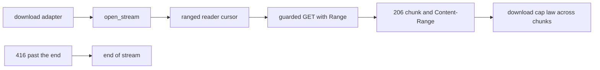

# 20261026-1018 — Telegram wave 6j: ranged media fetch, every per-kind cap reachable

#fractal-l1 #fractal-l3 #fractal-l4 #fractal-l9 #zk-adr #zero-muda #km-triad

[This journal](http://nas-1.tail55d152.ts.net:4100/files/docs/journal/20261026-1018-claude-telegram-wave6j-media-ranged-fetch.md) · [Wave 6 close](http://nas-1.tail55d152.ts.net:4100/files/docs/journal/20261026-1009-claude-telegram-wave6-close-kpi-handover.md) · [Wave 6i](http://nas-1.tail55d152.ts.net:4100/files/docs/journal/20261026-0953-claude-telegram-wave6i-media-transport.md) · [Media pipeline guide](http://nas-1.tail55d152.ts.net:4100/docs/wiki/20261026-0801-telegram-media-pipeline-guide.md) · [KPI ledger](http://nas-1.tail55d152.ts.net:4100/files/governance/planning/20261026-0639-claude-telegram-wave-kpi-ledger.json) · [Cockpit](http://nas-1.tail55d152.ts.net:4100/)

Transclusions: [[zk:20260905-1801-moc-uos-unified-master]] · [[wiki:20260905-1801-uos-zk-km-corpus-index]]

## 1. Scope & Trigger

Sa-plan `uos/telegram-runtime/20261001-1150` MEDIA_STREAM attempt 1 (dependency MEDIA_TRANSPORT; preflight PREFLIGHT_PASS; worker `claude-fable-l0-35600f5c`; integrator increment). Trigger: the stop-hook reading of the wave 6 close was right that "all Telegram features" was not established while media above 10 MiB could not be fetched; this increment removes that limit. Trivial scale by files: two source files extended, one Erlang fixture extended, one test file extended.

## 2. Pre-State Assessment

`main` e256791b. The transport fetched a file body in one bounded request clamped to the HTTP FFI ceiling of 10 MiB; the design caps for audio and document (25 MiB) and video (52 MiB) were unreachable and the 6i journal recorded that as a gap. Prior: either a streaming FFI with the same guardian discipline (new Erlang, high risk) or HTTP ranges over the existing guarded request (no new FFI).

## 3. Execution Detail

1. **Client.** `fetch_file_range(config, file_path, offset, chunk_bytes, deadline)` sends one guarded GET with `Range: bytes=offset-end`, the bound clamped to the FFI ceiling. A `206` must carry a `Content-Range` whose first byte equals the offset and whose length equals the body (`fetch_file_range_mismatch` otherwise); `last` is true when the total is reached. A `200` is accepted only from offset zero when the whole body fits the chunk, as the last chunk (`fetch_file_range_not_supported` otherwise). A `416` at a non-zero offset is the end of the body; at offset zero it is an error. `parse_content_range` handles `bytes a-b/total` and `bytes a-b/*` and refuses inverted or inconsistent ranges.
2. **Transport.** `open_stream` returns a ranged reader: a private cursor holds the next offset; each call fetches one 4 MiB range under an absolute stream deadline taken when the stream opened (`stream_deadline_exceeded` after it); the reader yields each chunk and `None` at the end. The download adapter's cap law and chunk bound run across those chunks unchanged, so the per-kind caps are enforced while no single transport response exceeds the FFI ceiling.
3. **Fixture.** The file endpoint honours a single byte range (`206 Partial Content` with `Content-Range`, `416` past the end) and `set_file_opts` can omit `file_size` from `getFile`, so the streaming cap path can be exercised.
4. **Tests (5).** Content-Range parser laws; three ranges of a 10,000-byte body with the last flag and the 416 end; a 12 MiB document streamed through the real transport and stored under its digest; a 12 MiB photo with undeclared size aborted at the photo cap across chunks with nothing stored; the chunk size inside the FFI ceiling.

## 4. Root Cause Analysis

ACH: why was the first cap-abort test wrong?

| Evidence | H1: the fixture's `getFile` declared `file_size`, so the download adapter refused `declared_over_cap` before any range was fetched | H2: the ranged reader did not abort | H3: the cap table was wrong |
|---|---|---|---|
| E1: the outcome was `DownloadRefused("download_rejected:declared_over_cap")`, the adapter's pre-fetch refusal | Consistent | Inconsistent | Inconsistent |
| E2: with `set_file_opts(..., False)` the same test yields `download_aborted` after three ranges | Consistent | Refuted | Neutral |
| E3: the download suite's cap table test is unchanged and green | Neutral | Neutral | Refuted |
| Evaluation | **CONFIRMED** | REFUTED | REFUTED |

Both behaviours are correct; the test now exercises the one it names, and the declared-size refusal keeps its own test.

## 5. Fix Taxonomy

- **Poka-yoke:** range responses cross-checked against the requested offset and length; a non-ranging server accepted only within one chunk; chunk bound clamped to the FFI ceiling.
- **Jidoka:** stream deadline is absolute; a slow server fails the stream rather than stretching it.
- **Muda:** no new FFI, no new process, no retries.

## 6. Patterns & Anti-Patterns Discovered

- Pattern: reuse the guarded one-shot request as the primitive and add the loop in Gleam; the guardian discipline (handoff, ACK, reaping) stays in one place.
- Devil's Advocate: ranges cost one guarded connection per 4 MiB; a 52 MiB video is thirteen requests, each with connect and reap overhead. Acceptable for a bot, and the chunk size is one constant if it is not.
- Devil's Advocate: the adapter still concatenates the body in memory up to the cap; the chunking bounds the transport, not the adapter's peak. Streaming to the store without concatenation would change the digest law of the download adapter and is a separate decision.

## 7. Verification Matrix

| Check | Result | Admiralty |
|---|---|---|
| `telegram_media_transport_test` (13) with hackney started, against the local fixture | all pass | B2 |
| Mutants: reader never advances the offset; 416 past the end treated as an error; chunk bound not clamped to the ceiling | 3/3 killed (the clamp mutant survived until a clamp law test was added, then died) | B2 |
| Full `cepaf_gleam` suite on OTP 29 at the landing tip | 13816 passed, 0 failed (second run at the tip with the clamp law) | B2 |
| Diagram parity and journal linter | PASS / 10/10 PASS | A1 |

## 8. Files Modified

- `apps/cepaf_gleam/src/cepaf_gleam/harness/telegram_http_client.gleam` (`RangeChunk`, `file_range_chunk_bytes`, `fetch_file_range`, `parse_content_range`), `telegram_media_transport.gleam` (ranged reader, absolute stream deadline), `apps/cepaf_gleam/src/telegram_http_test_fixture.erl` (`serve_range`, `send_status`, `set_file_opts`), `apps/cepaf_gleam/test/telegram_media_transport_test.gleam`
- `docs/wiki/20261026-0801-telegram-media-pipeline-guide.md`, `governance/planning/20261026-0639-claude-telegram-wave-kpi-ledger.json` (row 6j), this journal

## 9. Architectural Observations

```text
[download adapter] -> [open_stream]
[open_stream] -> [ranged reader cursor]
[ranged reader cursor] -> [guarded GET with Range]
[guarded GET with Range] -> [206 chunk and Content-Range]
[206 chunk and Content-Range] -> [download cap law across chunks]
[416 past the end] -> [end of stream]
```



## 10. Remaining Gaps

- The adapter's in-memory concatenation up to the cap remains; streaming to the store is a separate design decision.
- No staged service binds the transport yet (deployment configuration).
- The gateway drain has no start site because the gateway has none.
- MEDIA_REVIEW, COMMAND_REVIEW, GATEWAY_REVIEW and MINI_API_REVIEW by an independent reviewer; TELEGRAM_E2E by an authorized human; Codex and AGY R5 review.

## 11. Metrics Summary

- Tests added: 6; mutants: 3 integrator (one survived its first run and gained a law). Media design caps unreachable by the transport: 3 kinds → 0.
- Bayesian (Beta over "an integrator increment lands without a process defect"): Beta(5,2) → Beta(6,2); mean 0.75.
- Lyapunov: V = design caps unreachable: 3 → 0; dV/dt < 0.

## 12. STAMP & Constitutional Alignment

| UCA type | Hazard | Control |
|---|---|---|
| Not provided | large media silently unfetchable | ranges reach every cap |
| Provided unsafely | a range response for another offset or length is accepted | offset and length cross-checked against `Content-Range` |
| Wrong timing | a stream outlives its deadline across many ranges | absolute stream deadline from open |
| Too long | a single response exceeds the FFI ceiling | chunk bound clamped |

## 13. Conclusion

Every per-kind media cap in the design is now reachable through a host-pinned, bounded, ranged transport; the remaining source gap in the media lifecycle is a design choice (streaming to the store), not a missing feature.

**Forecast:** p = 0.4 that an authorized human records at least one real-traffic media journey (captioned photo answered `ok` with a digest against the staging bot) in Sa-plan by 2026-10-29T12:00:00Z.
- Falsifier: no such record at the horizon (outcome 0).
- Brier score: B = (0.4 − o)².

## Comprehensive verification checklist

Checks below are obligations, not blanket passing claims.

<details><summary>Domain 1 — Metadata, timestamp and Tailscale navigation</summary>

- [x] **CHK-01-TIME** — Prefix `20261026-1018-` from the host UTC clock (`date -u`).
- [ ] **CHK-02-TAIL** — Tailnet links provided; serving not re-verified.
- [x] **CHK-03-FRACT** — L1, L3, L4, L9 assigned.
- [x] **CHK-04-KM** — MOC and corpus index transcluded; guide, ledger and previous journals linked.

</details>

<details><summary>Domain 2 — Zero-Muda purity and storage safety</summary>

- [x] **CHK-05-MUDA** — No dependencies added.
- [ ] **CHK-06-GRAPH** — Not evaluated.
- [ ] **CHK-07-DRIVE** — Not in scope; serial written as `[REDACTED_SYSTEM_OS_SERIAL]` where mentioned.

</details>

<details><summary>Domain 3 — Testing Gold Standard and mathematical gates</summary>

- [ ] **CHK-08-C1C8** — Not evaluated.
- [ ] **CHK-09-MATH** — Not measured.
- [x] **CHK-10-9MOD** — Unit, boundary, real-HTTP-against-fixture at 12 MiB and mutation tests.
- [x] **CHK-11-REGR** — Full `cepaf_gleam` suite on OTP 29 before landing.

</details>

<details><summary>Domain 4 — Cross-language control and observability</summary>

- [x] **CHK-12-GLEAM** — Gleam owns the client loop and the transport; Erlang supplies the guarded request and the fixture.
- [ ] **CHK-13-HERMES** — Not exercised.
- [ ] **CHK-14-ZIGVM** — Not exercised.
- [ ] **CHK-15-MAX** — Not applicable.
- [ ] **CHK-16-OTEL** — Not evaluated.

</details>

<details><summary>Domain 5 — Sovereign governance and standalone Jujutsu</summary>

- [ ] **CHK-17-SOV** — MEDIA_REVIEW and R5 review outstanding.
- [x] **CHK-18-JJ** — Standalone jj; integrator workspace only.

</details>

<details><summary>Domain 6 — Provenance extension</summary>

EV ceiling remains 93. EV-94..109 remain NOT_ADMITTED. No new EV number is minted.

</details>

[Previous journal](http://nas-1.tail55d152.ts.net:4100/files/docs/journal/20261026-1009-claude-telegram-wave6-close-kpi-handover.md) · [ZK Master MOC](http://nas-1.tail55d152.ts.net:4100/zk) · [Wiki Corpus Index](http://nas-1.tail55d152.ts.net:4100/wiki)

UOS footer: `nas-1.tail55d152.ts.net:4100` · peer `vm-1.tail55d152.ts.net:4100` · document evidence grants no system admission.
