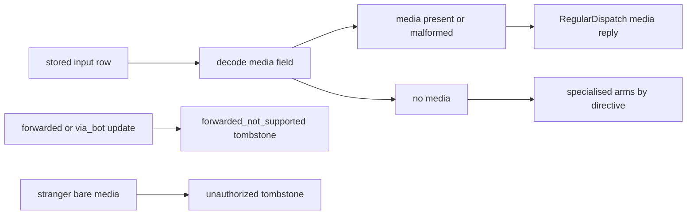

# 20261026-1048 — Telegram wave 6k: the command-surface review answered, captioned media gated at every dispatch entry, forwarded messages refused

#fractal-l0 #fractal-l3 #fractal-l4 #fractal-l5 #fractal-l9 #zk-adr #zero-muda #km-triad

[This journal](http://nas-1.tail55d152.ts.net:4100/files/docs/journal/20261026-1048-claude-telegram-wave6k-command-review-fixes.md) · [Wave 6j](http://nas-1.tail55d152.ts.net:4100/files/docs/journal/20261026-1014-claude-telegram-wave6j-media-ranged-fetch.md) · [Review packets](http://nas-1.tail55d152.ts.net:4100/files/docs/sop/20261026-1014-telegram-review-packets.md) · [Journey rule](http://nas-1.tail55d152.ts.net:4100/files/contracts/rules/20261026-0220-telegram-journey-acceptance.md) · [KPI ledger](http://nas-1.tail55d152.ts.net:4100/files/governance/planning/20261026-0639-claude-telegram-wave-kpi-ledger.json) · [Cockpit](http://nas-1.tail55d152.ts.net:4100/)

Transclusions: [[zk:20260905-1801-moc-uos-unified-master]] · [[wiki:20260905-1801-uos-zk-km-corpus-index]]

## 1. Scope & Trigger

Sa-plan `uos/telegram-runtime/20261001-1150` COMMAND_FIX attempt 1 (class P1; dependency COMMAND_IMPL; preflight PREFLIGHT_PASS; worker `claude-fable-l0-35600f5c`; integrator increment). Trigger: an advisory R2 review of the command surface by `claude-subagent-command-review-20261026` (REQUEST_CHANGES, sixteen findings, two majors) commissioned to prepare COMMAND_REVIEW. Standard scale: three source files, four test files, a rule and a spec.

## 2. Pre-State Assessment

`main` 628e7c7d. The wave 6h media precedence lived only in the regular dispatch arm; `specialized_dispatch` re-read the same stored row, never looked at its media field, and routed by the caption's directive, so a captioned photo whose caption classified to `/verify`, `/memory`, `/history`, `/messages`, a conversation or an approval ran that arm. The guard read no forwarding field, so forwarded third-party text from an allowlisted user was accepted as that user's command. Refusal replies carried no journey status. Prior: four targeted repairs plus two test-rigor repairs; the review's remaining items recorded as residuals.

## 3. Execution Detail

1. **C-01 (major).** `specialized_dispatch` decodes the row once, calls `decode_input_media` first and returns `RegularDispatch` for any row that carries or malforms a media reference; only `Ok(None)` rows reach `specialized_dispatch_of`, which holds the former routing unchanged.
2. **C-02 (major).** `has_forwarding` detects `forward_origin`, `forward_from`, `forward_from_chat`, `forward_date`, `forward_sender_name`, `forward_from_message_id`, `is_automatic_forward` and `via_bot` on the message or a callback query's message (a parse failure counts as forwarded); such updates are refused as `forwarded_not_supported` on both the text and the bare-media paths.
3. **C-10.** A bare media message is authorized first through an identity-only decoder and `identity_authorized`; a stranger's bare photo is `unsupported_or_unauthorized_identity`, never media-named.
4. **C-03.** `media_reply` checks the authority window before the chain runs and reports the chain's outcome as it happened; a stored object is reported stored even if the window closed afterwards.
5. **C-04 and C-06.** `DeniedMutation` and `UnknownDirective` replies carry `status: denied` with a reason and the request id; the fallthrough arm answers `backend_unavailable` with `no_service_arm` instead of echoing the text; `status_failure` answers `backend_unavailable` and keeps `observation_failed` as the reason.
6. **C-08.** The unknown-directive echo is bounded to 64 bytes; `/cmd@bot` forms stay refused as unknown until a bot username is configured (recorded).
7. **C-14 and C-15.** The security journey's `covered_literals` counts only steps with a behavioural expectation; the coverage law for ControlledAction literals walks five argument shapes (empty, `x`, `{}`, a 2,000-byte string, NUL and newline injection), asserts adapter preview statuses within the journey vocabulary, and requires an unclaimed preserved name to be in the closed service-owned set.
8. **C-12.** INV-TGJ-06 in the journey rule (five surfaces) records the media precedence, the bounded disk effect of a captioned message under a bound transport, and the forwarded refusal.
9. **Tests (7).** Guard: forwarded text (four field shapes), forwarded caption, stranger bare photo, echo bound; coverage law rewritten; e2e: a `/verify` caption and a `/memory` caption each answer `media.intake` and no verify or memory reply appears, and a `/voice-roll-call` text answers `status: denied`.

## 4. Root Cause Analysis

ACH: why did the media gate miss the specialised arms in wave 6h?

| Evidence | H1: the gate was placed where the author read the arms, in RegularDispatch, and the second reader of the row was not noticed | H2: the e2e proved the gate | H3: specialised dispatch was added after 6h |
|---|---|---|---|
| E1: `specialized_dispatch` reads the same `input_key` row and existed before 6h (verify, memory, conversation, cancellation, approval arms) | Consistent | Neutral | Refuted |
| E2: the 6h e2e used caption `/status`, a RegularDispatch directive, and passed | Consistent | Refuted as proof of the gate | Neutral |
| E3: with captions `/verify something` and `/memory` the pre-fix dispatcher would have run those arms; the fixed one answers `media.intake` for both | Consistent | Inconsistent | Inconsistent |
| Evaluation | **CONFIRMED** | REFUTED | REFUTED |

Lesson L-21: a gate added at one entry is not a gate; every entry that decodes the row gets the check and a test.

## 5. Fix Taxonomy

- **Poka-yoke:** the media check sits where the row is decoded, before any arm; forwarding detected by key presence with parse failure as forwarded; allowlist before media naming; status on every refusal.
- **Jidoka:** the review blocked COMMAND_REVIEW as written; no landing until the majors had laws.
- **Muda:** residuals recorded rather than half-fixed (C-05 closed labels, C-07 ownership partition, C-09 bounds, C-11 update id zero, C-16 further service-level tests).

## 6. Patterns & Anti-Patterns Discovered

- Pattern: an independent reader of the whole surface finds the second entry the author did not see; the two advisory reviews of this day both found their majors in paths the author tests normalised (L-12, L-16, L-21).
- Devil's Advocate: refusing every forwarded message also refuses an operator who forwards their own earlier command; the reply is a silent tombstone. A later increment may answer a `denied` reply with the reason instead of a tombstone, which needs an allowlisted sender and a bounded echo.
- Devil's Advocate: `/cmd@bot` in groups remains refused; the honest fix needs a configured bot username, which no configuration carries yet.

## 7. Verification Matrix

| Check | Result | Admiralty |
|---|---|---|
| Guard (38), journey security (12), defence (10), responder (8), coverage (3), intake (10), verify-service (6), adapters (4 and 4) | all pass, hackney started | B2 |
| e2e `e2e_captioned_media_never_reaches_specialised_arms_test`, the 6h captioned-photo e2e and the callback e2e | pass | B2 |
| Mutants: media gate removed; forwarding never detected; allowlist skipped before media naming | 3/3 killed (hackney started) | B2 |
| Full `cepaf_gleam` suite on OTP 29 at the landing tip | 13821 passed, 0 failed | B2 |
| Diagram parity and journal linter | PASS / 10/10 PASS | A1 |

## 8. Files Modified

- `apps/cepaf_gleam/src/cepaf_gleam/harness/telegram_service.gleam` (`specialized_dispatch` and `specialized_dispatch_of`, `media_reply`, denied, unknown, fallthrough and `status_failure` replies), `telegram_ingress_guard.gleam` (`has_forwarding`, `identity_authorized`, `message_identity_only_decoder`, `bounded_name`)
- tests: `telegram_ingress_guard_test.gleam`, `telegram_journey_security_test.gleam` (`covered_literals`), `telegram_journey_coverage_test.gleam` (rewritten law), `telegram_service_e2e_test.gleam`
- `contracts/rules/20261026-0220-telegram-journey-acceptance.md` (INV-TGJ-06) and its four mirrors, `docs/design/20261026-0215-telegram-journey-security-incident.md` (note 4), `governance/planning/20261026-0639-claude-telegram-wave-kpi-ledger.json` (row 6k, L-21), this journal

## 9. Architectural Observations

```text
[stored input row] -> [decode media field]
[decode media field] -> [media present or malformed]
[media present or malformed] -> [RegularDispatch media reply]
[decode media field] -> [no media]
[no media] -> [specialised arms by directive]
[forwarded or via_bot update] -> [forwarded_not_supported tombstone]
[stranger bare media] -> [unauthorized tombstone]
```



## 10. Remaining Gaps

- Recorded residuals from the review: C-05 (raw backend strings in some replies; closed-label mapping), C-07 (classify defaults non-action literals to preserved; an ownership-partition test), C-09 (approval token bound alignment and stored `raw_text`), C-11 (`update_id` zero accepted), C-13 (adapter header count), C-16 (callback-query ingress edge cases, control characters in conversational text, `ConversationDisabled` replies, `/cmd@bot`).
- Forwarded messages are tombstoned silently; `/cmd@bot` needs a configured bot username.
- COMMAND_REVIEW, GATEWAY_REVIEW, MEDIA_REVIEW and MINI_API_REVIEW by an independent reviewer (packets published); TELEGRAM_E2E by an authorized human; Codex and AGY R5 review. The Mini App advisory review (A-01, A-02 majors) is the next increment.

## 11. Metrics Summary

- Tests added: 7 plus one rewritten law; mutants: 3 integrator. Review findings: 16 raised, 9 fixed, 1 documented in the rule, 6 recorded as residuals.
- Bayesian (Beta over "an increment on a surface with more than one dispatch entry passes independent review without a major"): Beta(1,1) → Beta(1,2); mean 0.33; the review stays mandatory before any landing that touches dispatch.
- Lyapunov: V = open majors on the command surface: 2 → 0; dV/dt < 0.

## 12. STAMP & Constitutional Alignment

| UCA type | Hazard | Control |
|---|---|---|
| Not provided | a captioned attachment runs a specialised arm | media gate at the row decode, before any arm |
| Provided unsafely | forwarded third-party text executes as the user's command | forwarding keys refused by name |
| Wrong timing | authority checked after an effect and the effect denied in the reply | window checked before the chain; outcome reported as it happened |
| Too long | an unbounded echo of a hostile command name | 64-byte bound |

## 13. Conclusion

The command surface has both review majors closed with laws, every refusal carries the journey status, and the rule now states the media effect explicitly; COMMAND_REVIEW can proceed from its packet with the residuals listed.

**Forecast:** p = 0.5 that the independent COMMAND_REVIEW, when claimed, records no major beyond the residuals listed in section 10, by 2026-10-29T12:00:00Z.
- Falsifier: a COMMAND_REVIEW result naming a major not in section 10 (outcome 0); no result by the horizon is also outcome 0.
- Brier score: B = (0.5 − o)².

## Comprehensive verification checklist

Checks below are obligations, not blanket passing claims.

<details><summary>Domain 1 — Metadata, timestamp and Tailscale navigation</summary>

- [x] **CHK-01-TIME** — Prefix `20261026-1048-` from the host UTC clock (`date -u`).
- [ ] **CHK-02-TAIL** — Tailnet links provided; serving not re-verified.
- [x] **CHK-03-FRACT** — L0, L3, L4, L5, L9 assigned.
- [x] **CHK-04-KM** — MOC and corpus index transcluded; rule, packets, ledger and previous journal linked.

</details>

<details><summary>Domain 2 — Zero-Muda purity and storage safety</summary>

- [x] **CHK-05-MUDA** — No dependencies added.
- [ ] **CHK-06-GRAPH** — Not evaluated.
- [ ] **CHK-07-DRIVE** — Not in scope; serial written as `[REDACTED_SYSTEM_OS_SERIAL]` where mentioned.

</details>

<details><summary>Domain 3 — Testing Gold Standard and mathematical gates</summary>

- [ ] **CHK-08-C1C8** — Not evaluated.
- [ ] **CHK-09-MATH** — Not measured.
- [x] **CHK-10-9MOD** — Unit, hostile-input, end-to-end through the runner and mutation tests.
- [x] **CHK-11-REGR** — Full `cepaf_gleam` suite on OTP 29 before landing.

</details>

<details><summary>Domain 4 — Cross-language control and observability</summary>

- [x] **CHK-12-GLEAM** — Gleam owns the guard, dispatch and replies.
- [ ] **CHK-13-HERMES** — Not exercised.
- [ ] **CHK-14-ZIGVM** — Not exercised.
- [ ] **CHK-15-MAX** — Not applicable.
- [ ] **CHK-16-OTEL** — Not evaluated.

</details>

<details><summary>Domain 5 — Sovereign governance and standalone Jujutsu</summary>

- [ ] **CHK-17-SOV** — COMMAND_REVIEW and R5 review outstanding; the R2 review is advisory.
- [x] **CHK-18-JJ** — Standalone jj; integrator workspace only.

</details>

<details><summary>Domain 6 — Provenance extension</summary>

EV ceiling remains 93. EV-94..109 remain NOT_ADMITTED. No new EV number is minted.

</details>

[Previous journal](http://nas-1.tail55d152.ts.net:4100/files/docs/journal/20261026-1014-claude-telegram-wave6j-media-ranged-fetch.md) · [ZK Master MOC](http://nas-1.tail55d152.ts.net:4100/zk) · [Wiki Corpus Index](http://nas-1.tail55d152.ts.net:4100/wiki)

UOS footer: `nas-1.tail55d152.ts.net:4100` · peer `vm-1.tail55d152.ts.net:4100` · document evidence grants no system admission.
