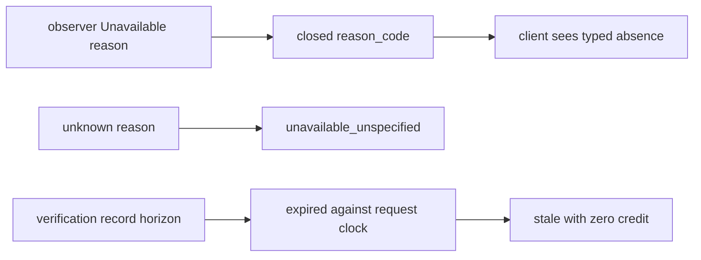

# 20261026-1103 — Telegram wave 6l: the Mini App review answered on the server side, absence named by a closed reason code, evidence expiry recomputed

#fractal-l0 #fractal-l2 #fractal-l3 #fractal-l5 #fractal-l9 #zk-adr #zero-muda #km-triad

[This journal](http://nas-1.tail55d152.ts.net:4100/files/docs/journal/20261026-1103-claude-telegram-wave6l-mini-review-fixes.md) · [Wave 6k](http://nas-1.tail55d152.ts.net:4100/files/docs/journal/20261026-1037-claude-telegram-wave6k-command-review-fixes.md) · [Review packets](http://nas-1.tail55d152.ts.net:4100/files/docs/sop/20261026-1014-telegram-review-packets.md) · [KPI ledger](http://nas-1.tail55d152.ts.net:4100/files/governance/planning/20261026-0639-claude-telegram-wave-kpi-ledger.json) · [Cockpit](http://nas-1.tail55d152.ts.net:4100/)

Transclusions: [[zk:20260905-1801-moc-uos-unified-master]] · [[wiki:20260905-1801-uos-zk-km-corpus-index]]

## 1. Scope & Trigger

Sa-plan `uos/telegram-runtime/20261001-1150` MINI_FIX attempt 1 (class P1; dependency MINI_API_IMPL; preflight PREFLIGHT_PASS; worker `claude-fable-l0-35600f5c`; integrator increment). Trigger: an advisory R2 review of the Mini App by `claude-subagent-mini-review-20261026` (APPROVE_WITH_CHANGES, eighteen findings, two majors) commissioned to prepare MINI_API_REVIEW. Trivial scale by files: three source files, three test files.

## 2. Pre-State Assessment

`main` 0645a45a. Every `Unavailable(reason)` observation rendered as `status: unavailable` with no reason, so the Immune page's typed `immune_actor_not_running` never reached a client and was indistinguishable from an outage (the wave 6a claim about that page was true of the observer and false of the response). The verification record's `stale` flag and pass count were copied from the worker's file; its own `record_expires_at_ms` was never compared with now. The VM logger accepted the target `none`. A failed Sa-plan enqueue without a receipt answered 404 `receipt_not_found`. Prior: four small repairs, the rest recorded.

## 3. Execution Detail

1. **A-01 (major).** `mini_api` renders a `reason_code` on every data response: for `Unavailable(reason)` the reason itself when it is in the closed `unavailability_reasons` list (nineteen observer codes, including `immune_actor_not_running`), otherwise `unavailable_unspecified`; `none` on observed, stale and forbidden replies. Raw observer strings never render, which keeps the boundary law that a backend error text is absent from the body.
2. **A-02 (major).** `mini_evidence.verification` computes `expired = record_expires_at_ms <= now` and renders `Record expired`, forces `Record stale: true` and reports `Recorded passes: 0 (expired)` for an expired record whatever the worker wrote; a live record renders unchanged.
3. **A-06.** The logger target `none` is refused; `emergency` stays allowed as the quietest real level.
4. **A-07.** When an enqueue fails and the receipt lookup finds nothing, the reply is 503 `sa_plan_unavailable` instead of 404; a duplicate enqueue still resolves to its receipt.
5. **Tests (3).** Boundary: a typed absence carries its code, a raw string collapses to `unavailable_unspecified` and never renders, observed replies carry `none`; evidence: an expired record is expired, stale and creditless while the fresh one is unchanged; control: `none` refused, `emergency`, `all`, `debug` accepted.
6. **Process.** `gleam format` reflowed the never-formatted `mini_control_test.gleam`; it was restored from `main` and the one test re-appended (L-19 applied before the landing).

## 4. Root Cause Analysis

ACH: why was the Immune page's typed reason unreachable although wave 6a's journal said the page "says `immune_actor_not_running`"?

| Evidence | H1: the observer produced the typed reason and the API's render function dropped every reason by design, to keep backend strings out of responses | H2: the observer returned a generic reason | H3: the runtime never called the observer |
|---|---|---|---|
| E1: `render_observation_inner` mapped `Unavailable(_)` to `("unavailable", null, "", {})` with the reason discarded | Consistent | Inconsistent | Neutral |
| E2: `mini_immune_observer.observe_live(_, None, _)` returns `Unavailable("immune_actor_not_running")` and its suite asserts that | Consistent | Refuted | Refuted |
| E3: `mini_boundary_test` asserts that `private_backend_error` is absent from an unavailable body, the law the render function served | Consistent | Neutral | Neutral |
| Evaluation | **CONFIRMED** | REFUTED | REFUTED |

The 6a claim described the observer, not the response; the closed reason code keeps both laws.

## 5. Fix Taxonomy

- **Poka-yoke:** closed reason set; expiry computed from the record's own horizon against the request clock; `none` outside the level set.
- **Jidoka:** an unavailable Sa-plan is a 503, which is the Andon class, not a "no such request".
- **Muda:** the reflowed test file restored rather than landed; residuals recorded, not half-fixed.

## 6. Patterns & Anti-Patterns Discovered

- Pattern: when a leak law and a truthfulness law collide, a closed enum satisfies both.
- Devil's Advocate: the closed list must be maintained; a new observer reason outside it silently renders as `unavailable_unspecified`, which is honest but loses information. A test that every `Unavailable("…")` literal in the module directory appears in the list would close that gap; recorded as a follow-up.
- Devil's Advocate: FMEA `freshness` is still copied from the file because `valid_until` is an ISO string this module does not parse; the verification record was the one with a numeric horizon.

## 7. Verification Matrix

| Check | Result | Admiralty |
|---|---|---|
| Mini boundary (9), control (9), evidence (11), immune observer (10), Mini App (35), dashboard (12), alerts (23) | all pass, hackney started | B2 |
| Mutants: raw reason rendered; expiry comparison inverted; `none` accepted again | 3/3 killed (hackney started) | B2 |
| Full `cepaf_gleam` suite on OTP 29 at the landing tip | 13824 passed, 0 failed | B2 |
| Diagram parity and journal linter | PASS / 10/10 PASS | A1 |

## 8. Files Modified

- `apps/cepaf_gleam/src/cepaf_gleam/telegram/mini_api.gleam` (`unavailability_reasons`, `reason_code`, `reason_code_of`, response field), `mini_evidence.gleam` (`expired`, three fields), `mini_control.gleam` (`level`, enqueue failure)
- tests: `mini_boundary_test.gleam`, `mini_evidence_test.gleam` (`with_int_field`, expired record), `mini_control_test.gleam` (one test)
- `governance/planning/20261026-0639-claude-telegram-wave-kpi-ledger.json` (row 6k landed, row 6l), this journal

## 9. Architectural Observations

```text
[observer Unavailable reason] -> [closed reason_code]
[closed reason_code] -> [client sees typed absence]
[unknown reason] -> [unavailable_unspecified]
[verification record horizon] -> [expired against request clock]
[expired against request clock] -> [stale with zero credit]
```



## 10. Remaining Gaps

- Recorded residuals from the review: A-03 (authorization before the control actor call needs the configuration outside the actor), A-04 (shorter `max_age` for actions), A-05 (hold only the derived secret), A-08, A-10, A-11, A-12, A-13, A-14, A-15 (hard-coded SHAs and host paths), FMEA freshness recomputation, and the missing tests listed in A-18.
- Browser behaviour is not established by any suite; MINI_API_REVIEW needs a human or a driven browser for that part.
- MINI_API_REVIEW, COMMAND_REVIEW, GATEWAY_REVIEW and MEDIA_REVIEW by an independent reviewer; TELEGRAM_E2E by an authorized human; Codex and AGY R5 review.

## 11. Metrics Summary

- Tests added: 3; mutants: 3 integrator. Review findings: 18 raised, 4 fixed, 1 positive, 13 recorded as residuals.
- Bayesian (Beta over "a surface passes its first independent review without a major"): Beta(1,3) → Beta(1,4) after the Mini App; mean 0.2; every surface gets its advisory review before the independent one.
- Lyapunov: V = open majors across the four reviewed surfaces: 2 → 0; dV/dt < 0.

## 12. STAMP & Constitutional Alignment

| UCA type | Hazard | Control |
|---|---|---|
| Not provided | a typed absence is rendered as an outage | closed reason code |
| Provided unsafely | a worker's stale flag grants credit past the record horizon | expiry recomputed from the record against now |
| Wrong timing | an unavailable authority answered as a missing request | 503 `sa_plan_unavailable` when no receipt exists |
| Too long | the VM logger silenced by a control user | `none` refused |

## 13. Conclusion

The Mini App's server side now names its absences, expires its own evidence and refuses silence; MINI_API_REVIEW can proceed from its packet with the residuals and the browser part explicitly outside the suites.

**Forecast:** p = 0.5 that the independent MINI_API_REVIEW, when claimed, records no server-side major beyond the residuals in section 10, by 2026-10-29T12:00:00Z.
- Falsifier: a MINI_API_REVIEW result naming a server-side major not in section 10, or no result by the horizon (outcome 0).
- Brier score: B = (0.5 − o)².

## Comprehensive verification checklist

Checks below are obligations, not blanket passing claims.

<details><summary>Domain 1 — Metadata, timestamp and Tailscale navigation</summary>

- [x] **CHK-01-TIME** — Prefix `20261026-1103-` from the host UTC clock (`date -u`).
- [ ] **CHK-02-TAIL** — Tailnet links provided; serving not re-verified.
- [x] **CHK-03-FRACT** — L0, L2, L3, L5, L9 assigned.
- [x] **CHK-04-KM** — MOC and corpus index transcluded; packets, ledger and previous journal linked.

</details>

<details><summary>Domain 2 — Zero-Muda purity and storage safety</summary>

- [x] **CHK-05-MUDA** — No dependencies added.
- [ ] **CHK-06-GRAPH** — Not evaluated.
- [ ] **CHK-07-DRIVE** — Not in scope; serial written as `[REDACTED_SYSTEM_OS_SERIAL]` where mentioned.

</details>

<details><summary>Domain 3 — Testing Gold Standard and mathematical gates</summary>

- [ ] **CHK-08-C1C8** — Not evaluated.
- [ ] **CHK-09-MATH** — Not measured.
- [x] **CHK-10-9MOD** — Unit, boundary, hostile-string and mutation tests; browser behaviour not covered.
- [x] **CHK-11-REGR** — Full `cepaf_gleam` suite on OTP 29 before landing.

</details>

<details><summary>Domain 4 — Cross-language control and observability</summary>

- [x] **CHK-12-GLEAM** — Gleam owns the API, evidence and control modules.
- [ ] **CHK-13-HERMES** — Not exercised.
- [ ] **CHK-14-ZIGVM** — Not exercised.
- [ ] **CHK-15-MAX** — Not applicable.
- [ ] **CHK-16-OTEL** — Not evaluated.

</details>

<details><summary>Domain 5 — Sovereign governance and standalone Jujutsu</summary>

- [ ] **CHK-17-SOV** — MINI_API_REVIEW and R5 review outstanding; the R2 review is advisory.
- [x] **CHK-18-JJ** — Standalone jj; integrator workspace only; reflowed test file restored before landing.

</details>

<details><summary>Domain 6 — Provenance extension</summary>

EV ceiling remains 93. EV-94..109 remain NOT_ADMITTED. No new EV number is minted.

</details>

[Previous journal](http://nas-1.tail55d152.ts.net:4100/files/docs/journal/20261026-1037-claude-telegram-wave6k-command-review-fixes.md) · [ZK Master MOC](http://nas-1.tail55d152.ts.net:4100/zk) · [Wiki Corpus Index](http://nas-1.tail55d152.ts.net:4100/wiki)

UOS footer: `nas-1.tail55d152.ts.net:4100` · peer `vm-1.tail55d152.ts.net:4100` · document evidence grants no system admission.
