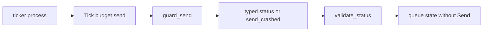

# 20261026-1136 — Telegram wave 6n: the gateway advisory review answered, the drain keeps no closure, a crashing send is contained, and the outbox no longer starves criticals

#fractal-l0 #fractal-l1 #fractal-l3 #fractal-l4 #fractal-l7 #fractal-l9 #zk-adr #zero-muda #km-triad

[This journal](http://nas-1.tail55d152.ts.net:4100/files/docs/journal/20261026-1136-claude-telegram-wave6n-gateway-review-fixes.md) · [Wave 6m](http://nas-1.tail55d152.ts.net:4100/files/docs/journal/20261026-1149-claude-telegram-wave6m-reason-code-completeness.md) · [Review packets](http://nas-1.tail55d152.ts.net:4100/files/docs/sop/20261026-1018-telegram-review-packets.md) · [KPI ledger](http://nas-1.tail55d152.ts.net:4100/files/governance/planning/20261026-0639-claude-telegram-wave-kpi-ledger.json) · [Cockpit](http://nas-1.tail55d152.ts.net:4100/)

Transclusions: [[zk:20260905-1801-moc-uos-unified-master]] · [[wiki:20260905-1801-uos-zk-km-corpus-index]]

## 1. Scope & Trigger

Sa-plan `uos/telegram-runtime/20261001-1150` GATEWAY_FIX attempt 1 (class P1; dependency GATEWAY_IMPL; preflight PREFLIGHT_PASS; active check ACTIVE_OBSERVATION_PASS; worker `claude-fable-l0-35600f5c`; integrator increment). Trigger: the advisory R2 review of the gateway by `claude-subagent-gateway-review-20261026` (REQUEST_CHANGES, nine majors, G-01 to G-09) commissioned to prepare GATEWAY_REVIEW. Standard scale by files: three source modules, one new Erlang guard, three test modules.

## 2. Pre-State Assessment

`main` 49399a9d. The drain actor held the injected `Send` closure in its state for its whole life, so a closure that captured a bot token kept the token on this process's heap, reachable through `sys:get_state` and a crash dump (G-01). A `panic` inside `Send` crashed the actor and the supervisor restarted it with an empty queue, with the panic reason in the crash report (G-02). The request digest covered chat, topic and text but not kind, so a Notice with the same text made a later Critical a `Duplicate` (G-03). An uncertain backlog at capacity refused every request including Criticals, and a failed Critical was counted but never named (G-04). `Resolve` accepted `Delivered(0)` as a delivery (G-05). The module header said durable recovery belonged to the delivery ledger, which holds no gateway request (G-06). A client timeout on `enqueue` was reported as `Full(False)` (G-07). The channel refusal matched `"telegram"` exactly (G-08). The header implied event routing that the Zenoh client cannot provide (G-09). Prior: all of G-01, G-02, G-03, G-05, G-07 and G-08 answered by tests in one wave; G-04 partially; G-06 and G-09 by truthful documentation.

## 3. Execution Detail

1. **G-01.** The drain state is `queue`, `now_ms`, `ticks`, `last_tick_ms`. `Send` is passed with every `Tick` message and dropped when the tick ends; `start`, `start_named` and both child specs no longer take it. Test: a Send capturing a sentinel is ticked through the actor and `sys:get_state` never contains the sentinel, before or after.
2. **G-02.** `telegram_gateway_drain_ffi:guard_send/2` wraps the call in `try … catch _:_`, discarding the reason. The drain records `OutboxUncertain("send_crashed")`; the actor keeps serving and the crashed digest stays blocked as a duplicate. Test: a panic whose message carries the sentinel; the report, counters and state are free of it.
3. **G-03.** `request_digest(kind, chat_id, topic, text)`. Test: Notice then identical-text Critical ends with the Critical queued and selected first.
4. **G-04.** The uncertain bound refuses Notices at `capacity` (`Full(uncertain_backlog: True)`) and Criticals only at the hard ceiling of twice the capacity; `Full(dropped_oldest)`, a field that could never be true on a refusal, became `Full(uncertain_backlog)`. `TickReport.failed_digests` names every failed send. Tests for both.
5. **G-05.** `outbox.validate_status` turns `Delivered(id ≤ 0)` into `Uncertain("invalid_message_id")`; `drain_result` and `Resolve` both pass through it. Tests at the queue and the actor.
6. **G-06, G-09.** The drain header now states that no durable recovery exists and that the ledger holds no gateway request; the gateway header states that with the current client `start` can only report `subscribed: False` and that no routing to `enqueue_critical` exists. The restart test now kills the actor (a contained Send crash no longer restarts it) and shows the lost digest is accepted again: the boundary, demonstrated.
7. **G-07.** `enqueue` returns `Error(Unobserved("call_timeout"))` or `Error(Unobserved("actor_unavailable"))`, distinct from every queue refusal. Running Send under its own deadline inside the actor is recorded as a residual.
8. **G-08.** `is_telegram_channel` trims and lowercases; test over five variants.

## 4. Root Cause Analysis

ACH: why did the drain retain the closure?

| Evidence | H1: injection at start was chosen for supervisor restarts (a child spec needs its arguments up front), and the secrecy consequence was not examined | H2: the author believed closures are not inspectable | H3: the token was meant to be resolved per call and the contract was lost |
|---|---|---|---|
| E1: `child_spec_named(name, capacity, send, now_ms)` took the Send so a restart could rebuild the actor | Consistent | Neutral | Inconsistent |
| E2: the header said "the actor never holds … a bot token" while `State.send: Send` was a field | Consistent | Consistent | Neutral |
| E3: no test touched `sys:get_state`; the secrecy tests were lexical over reports | Consistent | Consistent | Neutral |
| E4: `telegram_outbound.send_single_message(token, …)` takes the token as a parameter, so any Send closing over it captures it | Consistent | Refuted (closures are terms on the heap) | Neutral |
| Evaluation | **CONFIRMED** | REFUTED | NOT SUPPORTED |

Passing the Send per tick keeps the restart path simple (no argument to rebuild) and removes the field.

## 5. Fix Taxonomy

- **Poka-yoke:** no `Send` field exists to leak; `validate_status` at the only two entry points; a channel normaliser instead of an exact match.
- **Jidoka:** a crashing send is contained as a typed uncertain, not swallowed as success and not escalated into a restart that empties the queue.
- **Muda:** the dead `dropped_oldest` field replaced by one that carries information; the false recovery claim removed.

## 6. Patterns & Anti-Patterns Discovered

- Pattern (L-23): a capability injected at start is retained for the process lifetime; inject per call when the capability may close over a secret, and prove it with `sys:get_state`, not with a lexical scan of reports.
- Devil's Advocate: the ticker's process now holds the closure instead; the secret moved, it did not vanish. That process is the deployment's, and the drain's contract is only that *this* actor's heap is clean.
- Devil's Advocate: `guard_send` catches every class including `exit`, so a deliberate `exit(normal)` inside Send becomes an uncertain send rather than a stop; acceptable, since Send has no business stopping the actor.
- Devil's Advocate: a Critical flood still fills `capacity` and later Criticals are refused `Full(False)`; the reserve requested by G-04 is a recorded residual, as is the stale-uncertain alarm.

## 7. Verification Matrix

| Check | Result | Admiralty |
|---|---|---|
| Drain (17), outbox (20), gateway (12) suites, plus gateway coverage and comms dispatch | 89 pass (gateway coverage 16, comprehensive 24 included) | B2 |
| Mutants: criticals bounded by the uncertain backlog at capacity; Delivered(0) accepted; channel match case-sensitive; crashed send reported Failed; kind dropped from the digest | 5/5 killed | B2 |
| Full `cepaf_gleam` suite on OTP 29 at the landing tip | 13836 passed, 0 failed | B2 |
| Diagram parity and journal linter | PASS / 10/10 | A1 |

## 8. Files Modified

- `apps/cepaf_gleam/src/cepaf_gleam/gateway/telegram_gateway_drain.gleam` (Send per tick, guard, `failed_digests`, `Unobserved`, header), `telegram_gateway_outbox.gleam` (`Full(uncertain_backlog)`, `Unobserved`, hard ceiling, `validate_status`), `telegram.gleam` (digest with kind, `is_telegram_channel`, header)
- `apps/cepaf_gleam/src/telegram_gateway_drain_ffi.erl` (new)
- tests: `telegram_gateway_drain_test.gleam` (rewritten for the new signatures; five new laws), `telegram_gateway_outbox_test.gleam` (three new laws), `telegram_gateway_test.gleam` (two new laws)
- `governance/planning/20261026-0639-claude-telegram-wave-kpi-ledger.json` (row 6m landed, row 6n, lesson L-23), the portfolio record, this journal

## 9. Architectural Observations

```text
[ticker process] -> [Tick budget send]
[Tick budget send] -> [guard_send]
[guard_send] -> [typed status or send_crashed]
[typed status or send_crashed] -> [validate_status]
[validate_status] -> [queue state without Send]
```



## 10. Remaining Gaps

- G-04 residuals: no Critical-reserved capacity slice; no age or count alarm on a stale uncertain backlog (the hard ceiling bounds memory, not latency).
- G-05 residual: any holder of the Subject can `Resolve`; a resolver capability is not implemented.
- G-06 residual: no pre-send durable record; a producer re-enqueue after a restart can send twice. Stated in the header, not solved.
- G-07 residual: Send still runs synchronously inside the actor with no deadline of its own.
- G-09: event routing from the critical topic does not exist; the queue is fed only by callers. G-10 (the briefing's dead queue), G-11 (caller-supplied `now`), G-12 (the broken app file) and G-13 (no start site) unchanged.
- GATEWAY_REVIEW by an independent reviewer; the packet in the SOP is updated to this candidate.

## 11. Metrics Summary

- Tests added: 10; mutants: 5 integrator. Review findings: 9 majors raised, 6 fixed, 1 partially fixed, 2 answered by documentation.
- Bayesian (Beta over "a surface passes its first advisory review without a major"): unchanged at Beta(1,6); this wave resolves findings, it does not add a trial.
- Lyapunov: V = open majors across the four reviewed surfaces: 12 → 3 (the media majors remain for the next wave); dV/dt < 0.

## 12. STAMP & Constitutional Alignment

| UCA type | Hazard | Control |
|---|---|---|
| Not provided | a Critical alert is refused because routine sends hang | Criticals admitted until the hard ceiling |
| Provided unsafely | a bot token retained on an inspectable heap | no Send in state; proven with `sys:get_state` |
| Wrong timing | a Notice pre-empts a later Critical as a duplicate | kind in the digest |
| Too long | a crashed send restarts the actor and empties the queue | contained as uncertain; the actor keeps its queue |

## 13. Conclusion

The gateway's drain and outbox now match their headers: nothing credential-shaped lives in the actor, a crashing transport is a typed uncertainty, criticals are not starved, and the recovery claim is honest. GATEWAY_REVIEW can proceed from its packet with the residuals in section 10.

**Forecast:** p = 0.6 that the independent GATEWAY_REVIEW, when claimed, records no major beyond the residuals in section 10, by 2026-10-29T12:00:00Z.
- Falsifier: a GATEWAY_REVIEW result naming a major not in section 10, or no result by the horizon (outcome 0).
- Brier score: B = (0.6 − o)².

## Comprehensive verification checklist

Checks below are obligations, not blanket passing claims.

<details><summary>Domain 1 — Metadata, timestamp and Tailscale navigation</summary>

- [x] **CHK-01-TIME** — Prefix `20261026-1136-` from the host UTC clock (`date -u`).
- [ ] **CHK-02-TAIL** — Tailnet links provided; serving not re-verified.
- [x] **CHK-03-FRACT** — L0, L1, L3, L4, L7, L9 assigned.
- [x] **CHK-04-KM** — MOC and corpus index transcluded; packets, ledger and previous journal linked.

</details>

<details><summary>Domain 2 — Zero-Muda purity and storage safety</summary>

- [x] **CHK-05-MUDA** — No dependencies added; one Erlang guard of three lines.
- [ ] **CHK-06-GRAPH** — Not evaluated.
- [ ] **CHK-07-DRIVE** — Not in scope; serial written as `[REDACTED_SYSTEM_OS_SERIAL]` where mentioned.

</details>

<details><summary>Domain 3 — Testing Gold Standard and mathematical gates</summary>

- [ ] **CHK-08-C1C8** — Not evaluated.
- [ ] **CHK-09-MATH** — Not measured.
- [x] **CHK-10-9MOD** — Unit, state-inspection, crash-containment, supervision and mutation tests.
- [x] **CHK-11-REGR** — Full `cepaf_gleam` suite on OTP 29 before landing.

</details>

<details><summary>Domain 4 — Cross-language control and observability</summary>

- [x] **CHK-12-GLEAM** — Gleam owns the queue, the actor and the policy; Erlang holds only the exception guard.
- [ ] **CHK-13-HERMES** — Not exercised.
- [ ] **CHK-14-ZIGVM** — Not exercised.
- [ ] **CHK-15-MAX** — Not applicable.
- [ ] **CHK-16-OTEL** — Not evaluated.

</details>

<details><summary>Domain 5 — Sovereign governance and standalone Jujutsu</summary>

- [ ] **CHK-17-SOV** — GATEWAY_REVIEW and R5 review outstanding; the advisory review grants nothing.
- [x] **CHK-18-JJ** — Standalone jj; integrator workspace only.

</details>

<details><summary>Domain 6 — Provenance extension</summary>

EV ceiling remains 93. EV-94..109 remain NOT_ADMITTED. No new EV number is minted.

</details>

[Previous journal](http://nas-1.tail55d152.ts.net:4100/files/docs/journal/20261026-1149-claude-telegram-wave6m-reason-code-completeness.md) · [ZK Master MOC](http://nas-1.tail55d152.ts.net:4100/zk) · [Wiki Corpus Index](http://nas-1.tail55d152.ts.net:4100/wiki)

UOS footer: `nas-1.tail55d152.ts.net:4100` · peer `vm-1.tail55d152.ts.net:4100` · document evidence grants no system admission.
