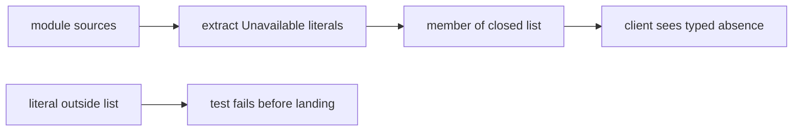

# 20261026-1149 — Telegram wave 6m: the closed reason list made complete by a source-scanning law, and the gateway and media advisory reviews received

#fractal-l0 #fractal-l2 #fractal-l3 #fractal-l5 #fractal-l9 #zk-adr #zero-muda #km-triad

[This journal](http://nas-1.tail55d152.ts.net:4100/files/docs/journal/20261026-1149-claude-telegram-wave6m-reason-code-completeness.md) · [Wave 6l](http://nas-1.tail55d152.ts.net:4100/files/docs/journal/20261026-1103-claude-telegram-wave6l-mini-review-fixes.md) · [Review packets](http://nas-1.tail55d152.ts.net:4100/files/docs/sop/20261026-1014-telegram-review-packets.md) · [KPI ledger](http://nas-1.tail55d152.ts.net:4100/files/governance/planning/20261026-0639-claude-telegram-wave-kpi-ledger.json) · [Cockpit](http://nas-1.tail55d152.ts.net:4100/)

Transclusions: [[zk:20260905-1801-moc-uos-unified-master]] · [[wiki:20260905-1801-uos-zk-km-corpus-index]]

## 1. Scope & Trigger

Sa-plan `uos/telegram-runtime/20261001-1150` MINI_REASONS attempt 1 (class P2; dependency MINI_FIX; preflight PREFLIGHT_PASS; active check ACTIVE_OBSERVATION_PASS; worker `claude-fable-l0-35600f5c`; integrator increment). Trigger: the Devil's Advocate entry of the wave 6l journal (section 6) said the closed reason list "must be maintained" and named the missing control: a test that every `Unavailable("…")` literal in the Mini App modules is a member of the list. Also in this wave: the two remaining advisory R2 reviews (gateway, media lifecycle since 6d) were commissioned and received; their findings are recorded here and answered in the next waves under GATEWAY_FIX and a media fix task. Standard scale by files.

## 2. Pre-State Assessment

`main` 661c64a1. The closed list held nineteen codes. A grep anchored on snake-case identifiers had reported fifteen literals, all members. The actual source held four more: `backend_exception` in the span wrapper of `mini_telemetry` (the reason a crashed backend reports) and three prose reasons in `mini_zenoh` ("Invalid observation timestamp", "Zenoh query failed", "Observation exceeds 100 fields"). All four rendered as `unavailable_unspecified`: safe, and exactly the information loss the 6l journal predicted. The 6l landing was not yet recorded in the KPI ledger and the 6k and 6l forecasts were not yet in its forecast table. Prior: the test exists within the hour; it finds at least one gap (the 6l author had already suspected `backend_exception`).

## 3. Execution Detail

1. **Law.** `mini_reason_code_completeness_test` reads every `.gleam` file under `src/cepaf_gleam/telegram` at test time, extracts every string literal passed to `Unavailable(…)` (a variable argument is skipped), requires at least ten literals so a wrong working directory cannot pass vacuously, and refuses any literal outside `mini_api.unavailability_reasons`. Three more laws: the extractor reads only string literals; every member renders itself and a stranger renders `unavailable_unspecified`; the list has no duplicates.
2. **Gaps closed.** `backend_exception` joined the list. The three prose reasons in `mini_zenoh` became codes: `zenoh_observation_clock_refused`, `zenoh_query_failed`, `zenoh_observation_field_bound`; no test asserted the prose strings.
3. **Ledger.** Row 6l gained its landed commit and time; the 6k and 6l journal forecasts were added to the forecast table (fifteen forecasts, five resolved).
4. **Reviews received.** The gateway advisory review (identity `claude-subagent-gateway-review-20261026`) returned REQUEST_CHANGES with nine majors; the media lifecycle review since 6d (`claude-subagent-media-review2-20261026`) returned REQUEST_CHANGES with three majors and eight minors. Both are summarised in section 10 and answered in the following waves; the Sa-plan task GATEWAY_FIX was created with its portfolio record.

## 4. Root Cause Analysis

ACH: why did four literals escape the list the 6l wave had just introduced?

| Evidence | H1: the author enumerated literals with a pattern that assumed snake-case codes, and the list was built from that enumeration | H2: the four reasons were added after 6l | H3: the observers wrap the prose in a code elsewhere |
|---|---|---|---|
| E1: the 6l grep pattern was `Unavailable\("[a-z0-9_]+"` and reported fifteen | Consistent | Neutral | Neutral |
| E2: all four sites predate 6l in `jj` history | Consistent | Refuted | Neutral |
| E3: `render_observation_inner` passes the reason straight to `reason_code`; no wrapping | Consistent | Neutral | Refuted |
| Evaluation | **CONFIRMED** | REFUTED | REFUTED |

The enumeration tool encoded an assumption about the data; the completeness test encodes none.

## 5. Fix Taxonomy

- **Poka-yoke:** a source-scanning law that fails on the next unlisted literal, with a floor so an empty scan cannot pass.
- **Jidoka:** the three prose reasons were converted, not silently accepted into the list as prose.
- **Muda:** no runtime change for a reason already in the list; rows without an `Unavailable` are untouched.

## 6. Patterns & Anti-Patterns Discovered

- Pattern (L-22): when a closed enumeration is introduced, land the completeness law in the same wave; a grep is an enumeration with an assumption baked in.
- Devil's Advocate: the test depends on the test runner's working directory being `apps/cepaf_gleam`; the floor of ten literals turns a wrong directory into a failure rather than a vacuous pass, but a directory with ten unrelated matches would pass. Mitigation: the directory is a constant and the scan is restricted to `.gleam` files.
- Devil's Advocate: a reason built by concatenation (`"x_" <> y`) is invisible to the extractor; today none exists in the module directory, and the renderer would collapse it honestly.

## 7. Verification Matrix

| Check | Result | Admiralty |
|---|---|---|
| Completeness (4), boundary, zenoh, Mini App suites with hackney started | 59 pass | B2 |
| Mutants: `backend_exception` removed from the list; `reason_code` collapses every reason; a prose Zenoh reason reintroduced | 3/3 killed (2, 1, 1 failures) | B2 |
| Full `cepaf_gleam` suite on OTP 29 at the landing tip | 13828 passed, 0 failed | B2 |
| Diagram parity and journal linter | PASS / 10/10 | A1 |

## 8. Files Modified

- `apps/cepaf_gleam/src/cepaf_gleam/telegram/mini_api.gleam` (four codes added), `mini_zenoh.gleam` (three prose reasons replaced by codes)
- `apps/cepaf_gleam/test/mini_reason_code_completeness_test.gleam` (new)
- `governance/planning/20261026-0639-claude-telegram-wave-kpi-ledger.json` (row 6l landed, forecasts 6k and 6l, row 6m, lesson L-22), `governance/planning/20261026-0558-claude-command-reclaim3-risk.json` (MINI_REASONS and GATEWAY_FIX records), this journal

## 9. Architectural Observations

```text
[module sources] -> [extract Unavailable literals]
[extract Unavailable literals] -> [member of closed list]
[member of closed list] -> [client sees typed absence]
[literal outside list] -> [test fails before landing]
```



## 10. Remaining Gaps

- **Gateway advisory review (REQUEST_CHANGES, nine majors), to be answered under GATEWAY_FIX:** G-01 the drain keeps the Send closure in actor state, so a token captured by the closure is reachable through the process heap; G-02 no crash containment around Send; G-03 the outbox digest excludes the kind, so a Notice with the same text pre-empts a later Critical as a duplicate; G-04 a Critical is refused as full when the uncertain count reaches capacity even with nothing pending, nothing calls `resolve`, a failed Critical is dropped; G-05 `Resolve` and `Delivered(id)` are unchecked; G-06 the delivery ledger does not hold gateway requests, so "durable recovery belongs to the ledger" is a false claim; G-07 Send runs synchronously in the actor and a call timeout is reported as full; G-08 the peer channel match is case-sensitive; G-09 subscriptions are unsupported by the Zenoh client, so no event is ever routed to `enqueue_critical`. Minor: G-10 the briefing's dead outbox queue, G-11 caller-supplied `now`. Notes: G-12 the broken app file, G-13 no start site, G-14 mid-tick partial failure untested.
- **Media lifecycle advisory review (REQUEST_CHANGES), to be answered under a media fix task:** M2-01 a 416 at a positive offset is treated as end of body and the 206 total is discarded, so a truncated file can be stored under its own digest with `ok`; M2-02 orphans and malformed indexes are never reclaimed and one malformed index makes `usage` fail, which makes intake answer `backend_unavailable` for every media message; M2-03 the janitor shares the service supervisor's restart tolerance, so three crashes in five seconds take the Telegram service down. Minor: M2-04 no operator path out of pause, M2-05 `now_ms` sampled before the download, M2-06 the window checked once up front, M2-07 `valid_file_path` is a denylist, M2-08 no total consistency across chunks, M2-09 unsupported refs with empty ids fail the decoder and the 256-byte caption bound, M2-10 recursive delete after a separate probe, M2-11 unbounded refused list and no clock guard. Holds (M2-14): paths derive from the recomputed digest only, the transport contacts only the configured host, the token never reaches a reply, caption directives never execute.
- Mini residuals from 6l (A-03, A-04, A-05, A-08, A-10 to A-15, browser behaviour) unchanged.
- MINI_API_REVIEW, COMMAND_REVIEW, GATEWAY_REVIEW and MEDIA_REVIEW by an independent reviewer; TELEGRAM_E2E by an authorized human; Codex and AGY R5 review.

## 11. Metrics Summary

- Tests added: 4; mutants: 3 integrator. Advisory reviews received: 2 (gateway 9 majors, 2 minors, 3 notes; media 3 majors, 8 minors, 3 notes). Reason codes: 19 → 23; literals outside the list: 4 → 0.
- Bayesian (Beta over "a surface passes its first advisory review without a major"): Beta(1,4) → Beta(1,6) after gateway and media; mean 0.14. Every surface has now had one advisory review before its independent one.
- Lyapunov: V = open majors across the four reviewed surfaces: 0 → 12 on receipt of the two reviews; the next two waves are bound to drive it down; dV/dt < 0 is a precommitment, not an observation, for this wave.

## 12. STAMP & Constitutional Alignment

| UCA type | Hazard | Control |
|---|---|---|
| Not provided | a typed absence collapses to `unavailable_unspecified` | completeness law over the module sources |
| Provided unsafely | prose added to the closed list to make the test pass | the prose was converted to codes |
| Wrong timing | the law lands after the next observer is written | landed in the wave after the list, before any new observer |
| Too long | an empty scan passes forever | floor of ten literals |

## 13. Conclusion

The closed reason list is now kept complete by a law rather than by attention, the 6l landing and forecasts are in the ledger, and the last two advisory reviews are in hand with their majors named for the next two waves.

**Forecast:** p = 0.7 that GATEWAY_FIX lands on `main` with G-01, G-02, G-03, G-05, G-07 and G-08 answered by tests and the full suite green, by 2026-10-26T16:00:00Z.
- Falsifier: no GATEWAY_FIX completion in Sa-plan by the horizon, or a completion whose result omits any of those six findings (outcome 0).
- Brier score: B = (0.7 − o)².

## Comprehensive verification checklist

Checks below are obligations, not blanket passing claims.

<details><summary>Domain 1 — Metadata, timestamp and Tailscale navigation</summary>

- [x] **CHK-01-TIME** — Prefix `20261026-1149-` from the host UTC clock (`date -u`).
- [ ] **CHK-02-TAIL** — Tailnet links provided; serving not re-verified.
- [x] **CHK-03-FRACT** — L0, L2, L3, L5, L9 assigned.
- [x] **CHK-04-KM** — MOC and corpus index transcluded; packets, ledger and previous journal linked.

</details>

<details><summary>Domain 2 — Zero-Muda purity and storage safety</summary>

- [x] **CHK-05-MUDA** — No dependencies added.
- [ ] **CHK-06-GRAPH** — Not evaluated.
- [ ] **CHK-07-DRIVE** — Not in scope; serial written as `[REDACTED_SYSTEM_OS_SERIAL]` where mentioned.

</details>

<details><summary>Domain 3 — Testing Gold Standard and mathematical gates</summary>

- [ ] **CHK-08-C1C8** — Not evaluated.
- [ ] **CHK-09-MATH** — Not measured.
- [x] **CHK-10-9MOD** — Unit, source-scanning and mutation tests.
- [x] **CHK-11-REGR** — Full `cepaf_gleam` suite on OTP 29 before landing.

</details>

<details><summary>Domain 4 — Cross-language control and observability</summary>

- [x] **CHK-12-GLEAM** — Gleam owns the API and observer modules.
- [ ] **CHK-13-HERMES** — Not exercised.
- [ ] **CHK-14-ZIGVM** — Not exercised.
- [ ] **CHK-15-MAX** — Not applicable.
- [ ] **CHK-16-OTEL** — Not evaluated.

</details>

<details><summary>Domain 5 — Sovereign governance and standalone Jujutsu</summary>

- [ ] **CHK-17-SOV** — Independent reviews and R5 review outstanding; the advisory reviews grant nothing.
- [x] **CHK-18-JJ** — Standalone jj; integrator workspace only.

</details>

<details><summary>Domain 6 — Provenance extension</summary>

EV ceiling remains 93. EV-94..109 remain NOT_ADMITTED. No new EV number is minted.

</details>

[Previous journal](http://nas-1.tail55d152.ts.net:4100/files/docs/journal/20261026-1103-claude-telegram-wave6l-mini-review-fixes.md) · [ZK Master MOC](http://nas-1.tail55d152.ts.net:4100/zk) · [Wiki Corpus Index](http://nas-1.tail55d152.ts.net:4100/wiki)

UOS footer: `nas-1.tail55d152.ts.net:4100` · peer `vm-1.tail55d152.ts.net:4100` · document evidence grants no system admission.
