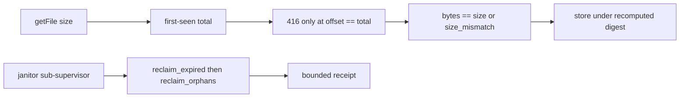

# 20261026-1233 — Telegram wave 6o: the media lifecycle review answered by two workers, a truncated range can no longer be stored as ok, orphans are reclaimed, and the janitor cannot take the service down

#fractal-l0 #fractal-l1 #fractal-l3 #fractal-l4 #fractal-l6 #fractal-l9 #zk-adr #zero-muda #km-triad

[This journal](http://nas-1.tail55d152.ts.net:4100/files/docs/journal/20261026-1233-claude-telegram-wave6o-media-review-fixes.md) · [Wave 6n](http://nas-1.tail55d152.ts.net:4100/files/docs/journal/20261026-1136-claude-telegram-wave6n-gateway-review-fixes.md) · [Review packets](http://nas-1.tail55d152.ts.net:4100/files/docs/sop/20261026-1018-telegram-review-packets.md) · [Media guide](http://nas-1.tail55d152.ts.net:4100/docs/wiki/20261026-0801-telegram-media-pipeline-guide.md) · [KPI ledger](http://nas-1.tail55d152.ts.net:4100/files/governance/planning/20261026-0639-claude-telegram-wave-kpi-ledger.json) · [Cockpit](http://nas-1.tail55d152.ts.net:4100/)

Transclusions: [[zk:20260905-1801-moc-uos-unified-master]] · [[wiki:20260905-1801-uos-zk-km-corpus-index]]

## 1. Scope & Trigger

Sa-plan `uos/telegram-runtime/20261001-1150` MEDIA_FIX2 attempt 1 (class P1; dependency MEDIA_STREAM; preflight PREFLIGHT_PASS; active check ACTIVE_OBSERVATION_PASS; integrator `claude-fable-l0-35600f5c`). Trigger: the advisory R2 review of the media lifecycle since 6d by `claude-subagent-media-review2-20261026` (REQUEST_CHANGES: three majors, eight minors). Two R4 Sonnet workers in sibling workspaces: `claude-worker-media-transport-20261026` in `fable-w3` (http client, transport, download adapter, fixture, two test modules) and `claude-worker-media-store-20261026` in `fable-w2` (store, janitor, two lines of the service, two test modules). Disjoint file sets; the integrator restored each worker's files per file from its snapshotted commit (`381ab36d`, `1b33a07c`), built, ran the suites and the full suite. Standard scale by files: eleven source and test files.

## 2. Pre-State Assessment

`main` 0ae16197. A server that advertised a total and then answered 416 before it made the client treat the truncated bytes as the whole file, store them under their own digest and report `ok` (M2-01). A single malformed index made `usage` fail and intake answer `backend_unavailable` for every media message; orphan `.bin` and `.tmp-` files were never listed and counted against the ceiling forever (M2-02). The janitor was a Permanent worker under the service supervisor's tolerance of three restarts in five seconds, so a janitor crash loop took the Telegram service down (M2-03). Prior: all three majors answered with laws in one wave through two workers; the minors M2-05, M2-06 and M2-09 deferred.

## 3. Execution Detail

1. **M2-01 (transport worker).** The transport `Cursor` keeps the first-seen total and passes it to `fetch_file_range_checked`; a 416 at a positive offset is accepted only when `offset == total` (`range_truncated` otherwise); a later chunk advertising a different total is refused (`range_total_changed`); the download adapter refuses a body whose length differs from the getFile size (`size_mismatch`, carried as `StreamReadFailed`) and stores nothing.
2. **M2-08 (part).** A first-seen total above 52 MiB, the largest per-kind cap, aborts before a second range (`range_total_over_limit`); the per-kind cap itself is not visible to the transport, so an over-cap photo still aborts at the third chunk.
3. **M2-07.** `valid_file_path` is an allowlist of `[A-Za-z0-9._/-]`, non-empty, no leading `/`, no `..` segment, at most 256 bytes; CR, LF, space, `%`, backslash and every other byte are refused before a request target is built.
4. **Fixture.** Six hostile modes (`ignore_range`, `wrong_first`, `span_differs`, `truncated_body`, `total_changes`, `early_416`) with one law each and a combined intake run over a 9 MiB body asserting every mode is refused with nothing stored; a whole-body 200 at offset 0 within one chunk is accepted because it is complete.
5. **M2-02 (store worker).** `usage_report` returns bytes plus the count and the first 32 relative paths of malformed indexes; `usage` is its byte count and no longer fails; `reclaim_orphans(policy, now_ms, max_objects, grace_ms)` removes `.tmp-` files, index-less `.bin` files and undecodable indexes whose mtime is older than the grace (default ten minutes, minimum one second), within the shared bound and with a typed receipt; symlinks, hard links, directories and foreign files are refused.
6. **M2-03.** `child_spec_named` is Transient; `isolated_child_spec_named` wraps the janitor in its own OneForOne supervisor with intensity 10 over 60 s, itself Transient under the service; the service's janitor child block (two lines, no formatter) uses it. Law: under a RestForOne supervisor with the service's tolerance and a sibling, four kills in five seconds leave the supervisor and the sibling alive; the control law shows the direct spec exhausts it; a `Stop` is not restarted.
7. **M2-04, M2-10, M2-11.** Three all-refused runs pause the janitor (benign refusals excluded); `unlink_file` re-checks `link_info` and uses the file-only `delete_file`, never removing a directory; history refusals are capped at 32 with a dropped count; `Snapshot` exposes `last_refused`, `refused_total` and `paused`.

## 4. Root Cause Analysis

ACH: why could a truncated range be stored as `ok`?

| Evidence | H1: the ranged reader treated 416 as the server's end-of-file signal and discarded the 206 total, so the only completeness witness was never consulted | H2: the fixture never produced an early 416, so the law was never falsifiable | H3: the digest check was expected to catch truncation |
|---|---|---|---|
| E1: `RangeChunk(bytes:, total: _, last:)` in the transport discarded the total | Consistent | Neutral | Neutral |
| E2: the fixture was one honest range server (review M2-15) | Consistent | Consistent | Neutral |
| E3: the store digest is recomputed over the bytes received, so a truncated body has a valid digest of itself | Consistent | Neutral | Refuted |
| E4: the download adapter compared the declared size only to the cap, never to the count | Consistent | Neutral | Neutral |
| Evaluation | **CONFIRMED** | CONTRIBUTING | REFUTED |

Both causes are addressed: the total is kept and compared, and the fixture now lies in six ways.

## 5. Fix Taxonomy

- **Poka-yoke:** first-seen total as the completeness witness; allowlisted paths; a grace period that can never be below one second; a file-only unlink behind a re-check.
- **Jidoka:** a janitor crash loop stops the janitor's sub-supervisor, not the service; an all-refused streak pauses rather than retrying forever.
- **Muda:** orphans and malformed indexes no longer occupy the ceiling indefinitely; a malformed index no longer costs every media message.

## 6. Patterns & Anti-Patterns Discovered

- Pattern (L-24): two workers on disjoint file sets, each restoring per file into the integrator's workspace, landed eleven files in one wave with no conflict; the file list in the brief is the isolation mechanism, and the one shared file (the service) was edited by exact-string replacement under an explicit no-formatter rule.
- Devil's Advocate: the store worker's `usage` now tolerates a malformed index; a store with many malformed indexes reports a byte count that omits their bytes, so the ceiling is slightly under-counted until the orphan sweep ages them out. Bounded by the grace period.
- Devil's Advocate: the transport's 52 MiB abort protects memory, not the per-kind budget; a hostile 40 MiB "photo" is still fetched up to the photo cap before refusal. Recorded under M2-08.
- Devil's Advocate: the transport worker's sixth mutant (Cursor keeps the latest total) survived because the client refuses a changed total first; equivalent, not claimed.

## 7. Verification Matrix

| Check | Result | Admiralty |
|---|---|---|
| Store (65), janitor (23), transport (25), download (35), intake (10), inspect (13), slice1 (68), e2e, t0 suites at the integrated candidate, hackney started | 347 pass | B2 |
| Worker mutants: transport 5 (416 at any offset; total-changed check dropped; allowlist admits space; size check removed; 52 MiB limit lifted), store 6 (grace ignored; usage fails again; Permanent restart; failed-run rule removed; directory recheck removed; refusal cap removed) | 11/11 killed, 1 equivalent recorded | B2 |
| Integrator mutants: 416 accepted at any offset; orphan grace ignored (one from each worker, re-run at the integrated candidate) | 2/2 killed (1 and 6 failures) | B2 |
| Full `cepaf_gleam` suite on OTP 29 at the landing tip | 13876 passed, 0 failed | B2 |
| Diagram parity and journal linter | PASS / 10/10 | A1 |

## 8. Files Modified

- transport worker: `apps/cepaf_gleam/src/cepaf_gleam/harness/telegram_http_client.gleam`, `telegram_media_transport.gleam`, `telegram_media_download.gleam`, `apps/cepaf_gleam/src/telegram_http_test_fixture.erl`, `test/telegram_media_transport_test.gleam`, `test/telegram_media_download_test.gleam`
- store worker: `apps/cepaf_gleam/src/cepaf_gleam/harness/telegram_media_store.gleam`, `src/cepaf_gleam/telegram/telegram_media_janitor.gleam`, `harness/telegram_service.gleam` (two lines), `test/telegram_media_store_test.gleam`, `test/telegram_media_janitor_test.gleam`
- integrator: `docs/sop/20261026-1018-telegram-review-packets.md` (MEDIA_REVIEW candidate and residuals), `docs/wiki/20261026-0801-telegram-media-pipeline-guide.md` (limits), `governance/planning/20261026-0639-claude-telegram-wave-kpi-ledger.json` (row 6n landed, row 6o, lesson L-24), the portfolio record, this journal

## 9. Architectural Observations

```text
[getFile size] -> [first-seen total]
[first-seen total] -> [416 only at offset == total]
[416 only at offset == total] -> [bytes == size or size_mismatch]
[bytes == size or size_mismatch] -> [store under recomputed digest]
[janitor sub-supervisor] -> [reclaim_expired then reclaim_orphans]
[reclaim_expired then reclaim_orphans] -> [bounded receipt]
```



## 10. Remaining Gaps

- M2-05 `now_ms` sampled before the download; M2-06 the observation window checked once up front and the pre-chain failure label; M2-09 unsupported refs with empty ids and the 256-byte caption bound; M2-12 `redact_file_url` versus `scrub_secret`; M2-13 per-chat consent and delete-on-request from the design.
- M2-08 in part: the per-kind cap is not passed into `open_stream`; the sender-declared size is not compared; the download adapter's private `valid_file_path` is still the old denylist behind the transport's allowlist.
- `delete` removes the index before the bytes; a swap between probe and unlink leaves an orphan for the sweep; orphan unlinks do not fsync the shard directory; `MediaConfiguration` has no grace field.
- MEDIA_REVIEW by an independent reviewer (packet updated to this candidate); TELEGRAM_E2E by an authorized human; Codex and AGY R5 review.

## 11. Metrics Summary

- Tests added: 14 store, 11 janitor, 11 transport, 1 download, by the workers' counts; integrator mutants 2. Review findings: 3 majors fixed, 5 minors fixed, 1 minor in part, 3 minors and 2 notes recorded.
- Workers: 2 Sonnet R4 in parallel, wall time about 18 minutes each; integrator wall time 45 minutes.
- Bayesian (Beta over "a worker-delivered file set integrates without a conflict or a reflowed shared file"): Beta(5,1) → Beta(7,1); mean 0.88.
- Lyapunov: V = open majors across the four reviewed surfaces: 3 → 0; dV/dt < 0.

## 12. STAMP & Constitutional Alignment

| UCA type | Hazard | Control |
|---|---|---|
| Not provided | a truncated body reported as a stored file | first-seen total, 416 only at the end, size compared to bytes |
| Provided unsafely | a smuggled request target from a hostile `file_path` | allowlist before the request is built |
| Wrong timing | a janitor crash loop exhausting the service's restart budget | Transient janitor under its own sub-supervisor |
| Too long | orphans and malformed indexes occupying the ceiling forever | graced orphan sweep within the shared bound |

## 13. Conclusion

The media lifecycle's three majors are closed by laws at the candidate, the minors that could be answered without widening the file sets are closed, and the rest are named in the packet. MEDIA_REVIEW can proceed from its packet.

**Forecast:** p = 0.55 that the independent MEDIA_REVIEW, when claimed, records no major beyond the residuals in section 10, by 2026-10-29T12:00:00Z.
- Falsifier: a MEDIA_REVIEW result naming a major not in section 10, or no result by the horizon (outcome 0).
- Brier score: B = (0.55 − o)².

## Comprehensive verification checklist

Checks below are obligations, not blanket passing claims.

<details><summary>Domain 1 — Metadata, timestamp and Tailscale navigation</summary>

- [x] **CHK-01-TIME** — Prefix `20261026-1233-` from the host UTC clock (`date -u`).
- [ ] **CHK-02-TAIL** — Tailnet links provided; serving not re-verified.
- [x] **CHK-03-FRACT** — L0, L1, L3, L4, L6, L9 assigned.
- [x] **CHK-04-KM** — MOC and corpus index transcluded; packets, guide, ledger and previous journal linked.

</details>

<details><summary>Domain 2 — Zero-Muda purity and storage safety</summary>

- [x] **CHK-05-MUDA** — No dependencies added.
- [ ] **CHK-06-GRAPH** — Not evaluated.
- [ ] **CHK-07-DRIVE** — Not in scope; serial written as `[REDACTED_SYSTEM_OS_SERIAL]` where mentioned.

</details>

<details><summary>Domain 3 — Testing Gold Standard and mathematical gates</summary>

- [ ] **CHK-08-C1C8** — Not evaluated.
- [ ] **CHK-09-MATH** — Not measured.
- [x] **CHK-10-9MOD** — Unit, hostile-fixture, supervision, race and mutation tests.
- [x] **CHK-11-REGR** — Full `cepaf_gleam` suite on OTP 29 before landing.

</details>

<details><summary>Domain 4 — Cross-language control and observability</summary>

- [x] **CHK-12-GLEAM** — Gleam owns the transport, store and janitor; the fixture is test-only Erlang.
- [ ] **CHK-13-HERMES** — Not exercised.
- [ ] **CHK-14-ZIGVM** — Not exercised.
- [ ] **CHK-15-MAX** — Not applicable.
- [ ] **CHK-16-OTEL** — Not evaluated.

</details>

<details><summary>Domain 5 — Sovereign governance and standalone Jujutsu</summary>

- [ ] **CHK-17-SOV** — MEDIA_REVIEW and R5 review outstanding; worker and advisory output grants nothing.
- [x] **CHK-18-JJ** — Standalone jj; workers in their own sibling workspaces, integrator restored per file.

</details>

<details><summary>Domain 6 — Provenance extension</summary>

EV ceiling remains 93. EV-94..109 remain NOT_ADMITTED. No new EV number is minted.

</details>

[Previous journal](http://nas-1.tail55d152.ts.net:4100/files/docs/journal/20261026-1136-claude-telegram-wave6n-gateway-review-fixes.md) · [ZK Master MOC](http://nas-1.tail55d152.ts.net:4100/zk) · [Wiki Corpus Index](http://nas-1.tail55d152.ts.net:4100/wiki)

UOS footer: `nas-1.tail55d152.ts.net:4100` · peer `vm-1.tail55d152.ts.net:4100` · document evidence grants no system admission.
