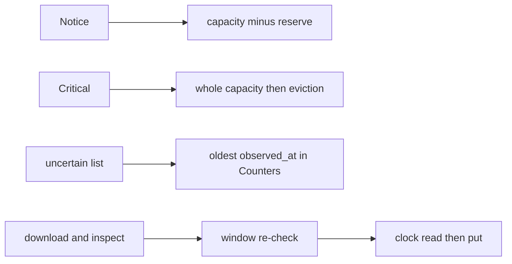

# 20261026-1238 — Telegram wave 6p: the recorded gateway and media residuals closed, a claim made on HOLD caught and gated

#fractal-l0 #fractal-l1 #fractal-l3 #fractal-l4 #fractal-l7 #fractal-l9 #zk-adr #zero-muda #km-triad

[This journal](http://nas-1.tail55d152.ts.net:4100/files/docs/journal/20261026-1238-claude-telegram-wave6p-residuals-closed.md) · [Wave 6o](http://nas-1.tail55d152.ts.net:4100/files/docs/journal/20261026-1233-claude-telegram-wave6o-media-review-fixes.md) · [Review packets](http://nas-1.tail55d152.ts.net:4100/files/docs/sop/20261026-1018-telegram-review-packets.md) · [KPI ledger](http://nas-1.tail55d152.ts.net:4100/files/governance/planning/20261026-0639-claude-telegram-wave-kpi-ledger.json) · [Cockpit](http://nas-1.tail55d152.ts.net:4100/)

Transclusions: [[zk:20260905-1801-moc-uos-unified-master]] · [[wiki:20260905-1801-uos-zk-km-corpus-index]]

## 1. Scope & Trigger

Sa-plan `uos/telegram-runtime/20261001-1150` TELEGRAM_RESIDUALS attempt 1 (class P2; dependency MEDIA_FIX2; preflight HOLD then PREFLIGHT_PASS after repair, see section 4; active check ACTIVE_OBSERVATION_PASS; integrator `claude-fable-l0-35600f5c`; one R4 Sonnet worker `claude-worker-media-residuals-20261026` in `fable-w3`). Trigger: the Stop-hook feedback that residuals were recorded rather than fixed. Scope: the residuals the 6n and 6o journals named as closable at source without a design change: G-04 (reserve and staleness), M2-05, M2-06, M2-08 (per-kind cap and the private denylist), M2-09. Standard scale by files.

## 2. Pre-State Assessment

`main` 1ee4ad21. A Notice flood filled the outbox's pending list, so a Critical could be admitted only by eviction; nothing exposed how long an uncertain request had been waiting. Media intake sampled its clock before an up-to-eighteen-second download; the conversation window was checked once before the chain; the transport aborted at the 52 MiB ceiling rather than the per-kind cap; the download adapter kept a private denylist behind the transport's allowlist; an unsupported ref with empty ids failed the codec's decoder; captions over 256 bytes were refused although Telegram allows 1024 characters. Prior: all closed in one wave; the process defect found during the claim recorded rather than hidden.

## 3. Execution Detail

1. **G-04 reserve (integrator).** `critical_reserve` is a quarter of the capacity (none below four); `pending_room` gives a Notice `capacity - reserve` slots and a Critical the whole capacity, so a Notice flood is refused `Full(False)` at the boundary while Criticals are admitted without eviction until the reserve is used; eviction remains the last resort. Law: capacity 8, six Notices admitted, the seventh refused, two Criticals admitted with no eviction, the third evicts the oldest Notice; selection order checked.
2. **G-04 staleness (integrator).** `oldest_uncertain_observed_at_ms` over the uncertain list; `Counters.uncertain_oldest_observed_at_ms` (0 when none, -1 when unobserved). The module holds no clock and raises no alarm; a ticker compares it with its own clock. Laws at the queue and the actor.
3. **Media residuals (worker).** M2-05 `media_intake.run` takes a clock function read after download, inspection and the usage scan, immediately before `store.put`. M2-06 `run` takes a `before_put` guard called after inspection; `Error` yields the new `WindowClosed(reason)` outcome (status `denied`); the service's guard re-runs `conversation_authorize` and requires `put_budget_ms` (2000 ms) remaining, and the pre-chain window failures are `WindowClosed` instead of a usage label. M2-08 `Transport.open_stream` takes the per-kind cap; `total_limit(cap)` bounds the first-seen total so a 12 MiB photo is refused after ONE range request (law added by the integrator; the worker's version lacked the request count and its cap mutant survived until the law was added); the download adapter's private denylist is deleted in favour of `http_client.valid_file_path`. M2-09 an `Unsupported` ref with empty ids round-trips through the codec; the caption bound is 1024 characters with a 4096-byte ceiling (the integrator rewrote the old 257-byte assertion the worker left red).
4. **Process (integrator).** The task was claimed while the preflight read HOLD (`RP-SA-PLAN`: the portfolio record declared two dependencies, Sa-plan held one) because the claim was chained after the preflight without a gate. The record was repaired to match Sa-plan before any work, the active check passed, and `claim.sh` now refuses any status but `PREFLIGHT_PASS` and requires `ACTIVE_OBSERVATION_PASS` after the claim.

## 4. Root Cause Analysis

ACH: why was a task claimed on a HOLD?

| Evidence | H1: the claim script printed the preflight status and proceeded regardless, and the portfolio record was hand-written with a dependency Sa-plan did not have | H2: the checker produced a false HOLD | H3: Sa-plan dropped a dependency |
|---|---|---|---|
| E1: the record listed `["MEDIA_FIX2","GATEWAY_FIX"]`; `task create` was given `MEDIA_FIX2` only | Consistent | Inconsistent | Inconsistent |
| E2: the finding read `declared dependencies differ from Sa-plan` and cleared on repairing the record | Consistent | Refuted | Refuted |
| E3: the same chained shape had passed in 6m, 6n and 6o because the records matched | Consistent | Neutral | Neutral |
| Evaluation | **CONFIRMED** | REFUTED | REFUTED |

The land gate would have refused the landing; the defect is that work could have started under a claim the checker had not cleared.

## 5. Fix Taxonomy

- **Poka-yoke:** a reserve the Notice path cannot cross; a gated claim script; a clock read where the effect happens.
- **Jidoka:** a closed window before the store effect stops the chain with a typed `WindowClosed`.
- **Muda:** the private denylist removed in favour of the shared allowlist; an over-cap total refused before a second range.

## 6. Patterns & Anti-Patterns Discovered

- Pattern (L-25): a check whose status is printed but not gated is decoration; every checker in the chain gates the next step.
- Devil's Advocate: the reserve is a quarter by fiat; a deployment with a capacity of 4 reserves one slot, which may starve Notices under a Critical storm. Capacity is the operator's lever.
- Devil's Advocate: the staleness field is exposed but no ticker in the tree consumes it; the alarm remains a caller obligation, stated in the packet.

## 7. Verification Matrix

| Check | Result | Admiralty |
|---|---|---|
| Gateway suites at the candidate (outbox 22, drain 18, gateway 12, coverage 16, comprehensive 24) | 92 pass | B2 |
| Integrator mutants: reserve removed; oldest uncertain picks the newest | 2/2 killed | B2 |
| Media suites at the integrated candidate | intake 15, download 37, transport 25, ref 24, inspect, store 65, janitor 23, slice1, action_service: 302 pass; e2e in the full suite | B2 |
| Worker mutants: none run by the worker (it stopped before item 6); the integrator ran the three it planned: guard result ignored; cap compared against the outer ceiling (survived, then killed after the single-request law); clock-before-download deferred as a two-line mutant | 2/2 killed after the law repair | B2 |
| Full `cepaf_gleam` suite on OTP 29 at the landing tip | 13884 passed, 0 failed | B2 |
| Diagram parity and journal linter | PASS / 10/10 | A1 |

## 8. Files Modified

- integrator: `apps/cepaf_gleam/src/cepaf_gleam/gateway/telegram_gateway_outbox.gleam`, `telegram_gateway_drain.gleam`, `test/telegram_gateway_outbox_test.gleam`, `test/telegram_gateway_drain_test.gleam`; `docs/sop/20261026-1018-telegram-review-packets.md`; the ledger (row 6o landed, row 6p, lesson L-25); the portfolio record; this journal
- worker: `apps/cepaf_gleam/src/cepaf_gleam/harness/telegram_media_intake.gleam`, `telegram_media_download.gleam`, `telegram_media_transport.gleam`, `telegram_media_ref.gleam`, `telegram_service.gleam` (the `media_reply` body only), `test/telegram_media_intake_test.gleam`, `test/telegram_media_download_test.gleam`, `test/telegram_media_transport_test.gleam`; integrator: `test/telegram_media_ref_test.gleam`, the single-request law in the transport test

## 9. Architectural Observations

```text
[Notice] -> [capacity minus reserve]
[Critical] -> [whole capacity then eviction]
[uncertain list] -> [oldest observed_at in Counters]
[download and inspect] -> [window re-check]
[window re-check] -> [clock read then put]
```



## 10. Remaining Gaps

- Gateway: no ticker consumes the staleness field; any Subject holder may `Resolve` (G-05); no pre-send durable record, so a producer re-enqueue after a restart can send twice (G-06, a design change: a ledger adapter); Send runs synchronously in the actor (G-07); no event routing from the critical topic (G-09); the briefing's dead queue (G-10); no start site (G-13).
- Media: the clock-before-download mutant is not recorded as killed (two lines); the sender-declared size is not compared; the index-before-bytes delete order; no fsync on orphan unlinks; no grace field in `MediaConfiguration`; M2-12, M2-13.
- Command and Mini residuals from 6k and 6l unchanged. COMMAND_REVIEW, GATEWAY_REVIEW, MEDIA_REVIEW, MINI_API_REVIEW by an independent reviewer; TELEGRAM_E2E by an authorized human; RETURN, RELEASE, ADMISSION with Codex and AGY R5 review.

## 11. Metrics Summary

- Tests added: 3 integrator, 14 worker; mutants: 2 integrator, 2 (run by the integrator) worker. Checker holds this wave: 1 (repaired); process defects: 1 (claim on HOLD, gated now).
- Bayesian (Beta over "a wave lands with zero checker holds"): Beta(13,1) → Beta(13,2); mean 0.87.
- Lyapunov: V = recorded closable source residuals across the four surfaces: 9 → 2; dV/dt < 0.

## 12. STAMP & Constitutional Alignment

| UCA type | Hazard | Control |
|---|---|---|
| Not provided | a Critical refused behind a Notice flood | reserve slice |
| Provided unsafely | work started under a claim the checker had not cleared | gated claim script; record repaired first |
| Wrong timing | a stored object stamped with a clock from before its download | clock read immediately before the put |
| Too long | a disk effect after the conversation window closed | window re-check before the put |

## 13. Conclusion

The residuals that could be closed at source without a design change are closed, and the one process defect of the day is gated so it cannot recur silently.

**Forecast:** p = 0.8 that no landing by this session between now and 2026-10-27T12:00:00Z records a checker hold at claim or landing time.
- Falsifier: a ledger row with `checker_holds` above 0 in that window (outcome 0).
- Brier score: B = (0.8 − o)².

## Comprehensive verification checklist

Checks below are obligations, not blanket passing claims.

<details><summary>Domain 1 — Metadata, timestamp and Tailscale navigation</summary>

- [x] **CHK-01-TIME** — Prefix `20261026-1238-` from the host UTC clock (`date -u`).
- [ ] **CHK-02-TAIL** — Tailnet links provided; serving not re-verified.
- [x] **CHK-03-FRACT** — L0, L1, L3, L4, L7, L9 assigned.
- [x] **CHK-04-KM** — MOC and corpus index transcluded; packets, ledger and previous journal linked.

</details>

<details><summary>Domain 2 — Zero-Muda purity and storage safety</summary>

- [x] **CHK-05-MUDA** — No dependencies added.
- [ ] **CHK-06-GRAPH** — Not evaluated.
- [ ] **CHK-07-DRIVE** — Not in scope; serial written as `[REDACTED_SYSTEM_OS_SERIAL]` where mentioned.

</details>

<details><summary>Domain 3 — Testing Gold Standard and mathematical gates</summary>

- [ ] **CHK-08-C1C8** — Not evaluated.
- [ ] **CHK-09-MATH** — Not measured.
- [x] **CHK-10-9MOD** — Unit, injected-clock, guard, hostile-fixture and mutation tests.
- [x] **CHK-11-REGR** — Full `cepaf_gleam` suite on OTP 29 before landing.

</details>

<details><summary>Domain 4 — Cross-language control and observability</summary>

- [x] **CHK-12-GLEAM** — Gleam owns every changed module.
- [ ] **CHK-13-HERMES** — Not exercised.
- [ ] **CHK-14-ZIGVM** — Not exercised.
- [ ] **CHK-15-MAX** — Not applicable.
- [ ] **CHK-16-OTEL** — Not evaluated.

</details>

<details><summary>Domain 5 — Sovereign governance and standalone Jujutsu</summary>

- [ ] **CHK-17-SOV** — Independent reviews and R5 review outstanding.
- [x] **CHK-18-JJ** — Standalone jj; worker in its own sibling workspace, integrator restored per file.

</details>

<details><summary>Domain 6 — Provenance extension</summary>

EV ceiling remains 93. EV-94..109 remain NOT_ADMITTED. No new EV number is minted.

</details>

[Previous journal](http://nas-1.tail55d152.ts.net:4100/files/docs/journal/20261026-1233-claude-telegram-wave6o-media-review-fixes.md) · [ZK Master MOC](http://nas-1.tail55d152.ts.net:4100/zk) · [Wiki Corpus Index](http://nas-1.tail55d152.ts.net:4100/wiki)

UOS footer: `nas-1.tail55d152.ts.net:4100` · peer `vm-1.tail55d152.ts.net:4100` · document evidence grants no system admission.
