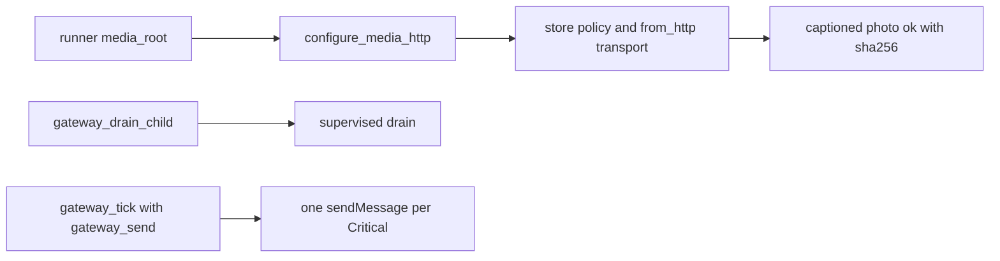

# 20261026-1332 — Telegram wave 6q: the staged service wired on AGY counsel, a captioned photo stored through the supervised runner, and a start site for the gateway drain

#fractal-l0 #fractal-l3 #fractal-l4 #fractal-l6 #fractal-l7 #fractal-l9 #zk-adr #zero-muda #km-triad

[This journal](http://nas-1.tail55d152.ts.net:4100/files/docs/journal/20261026-1332-claude-telegram-wave6q-staged-wiring.md) · [Wave 6p](http://nas-1.tail55d152.ts.net:4100/files/docs/journal/20261026-1238-claude-telegram-wave6p-residuals-closed.md) · [AGY counsel](http://nas-1.tail55d152.ts.net:4100/files/governance/planning/20261026-1212-agy-advice-telegram-next-actions.json) · [Review packets](http://nas-1.tail55d152.ts.net:4100/files/docs/sop/20261026-1018-telegram-review-packets.md) · [Media guide](http://nas-1.tail55d152.ts.net:4100/docs/wiki/20261026-0801-telegram-media-pipeline-guide.md) · [KPI ledger](http://nas-1.tail55d152.ts.net:4100/files/governance/planning/20261026-0639-claude-telegram-wave-kpi-ledger.json) · [Cockpit](http://nas-1.tail55d152.ts.net:4100/)

Transclusions: [[zk:20260905-1801-moc-uos-unified-master]] · [[wiki:20260905-1801-uos-zk-km-corpus-index]]

## 1. Scope & Trigger

Sa-plan `uos/telegram-runtime/20261001-1150` STAGED_WIRING attempt 1 (class P1; dependency TELEGRAM_RESIDUALS; claimed through the gated `claim.sh`: PREFLIGHT_PASS then ACTIVE_OBSERVATION_PASS; integrator `claude-fable-l0-35600f5c`). Trigger: the operator asked for AGY advice and AGY-run agents; AGY's bounded advisory counsel named the staged service wiring as the author's highest-value action (the transport bound in the operational configuration and a start site for the gateway drain), flagged the 6h forecast as an unearned pass, and proposed a staged-runtime-closure KPI. Standard scale by files.

## 2. Pre-State Assessment

`main` 7c152add. `configure_media` existed but nothing in the tree called it with a real transport: the worker runner built the operational configuration with `media: None`, so every staged node answered captioned media with `backend_unavailable`, and the review packets said "no staged service binds the transport". The gateway drain had no importer outside its tests (G-13). The ledger scored the 6h forecast as met although its precommitted condition, a staged service test binding the transport, did not exist. Prior: the binding lands in one wave with an end-to-end proof; the drain start site lands as composable functions rather than a new configuration field, because twenty-eight tests construct the configuration literally.

## 3. Execution Detail

1. **One-call binding.** `telegram_service.configure_media_http(config, root, retention_ms, ceiling_bytes)` builds the store policy under `root/objects` and binds `telegram_media_transport.from_http(config.http_config)` with the default janitor bounds; the runner takes `media_root` (optional `media_retention_ms`, `media_ceiling_bytes`) and calls it after the other sources.
2. **Staged proof.** The e2e builder injects `media_root` when a `.media` directory sits beside the store; `e2e_captioned_photo_with_bound_transport_is_stored_test` starts the supervised runner in a transient unit, serves a PNG from the fixture's `getFile` and `/file/bot<token>/<path>` routes, and shows the captioned photo fetched, stored under its recomputed digest and answered `ok` with a `sha256`, the caption directive named and never executed, the token absent from the reply, the fixture's file route hit and the object present under the media root. The unbound test keeps answering `backend_unavailable`.
3. **Drain start site (G-13).** `gateway_drain_child(config, capacity)` returns a per-bot name and a supervised child spec; `gateway_send(config)` maps one `sendMessage` through the configuration's HTTP client onto the ledger statuses (`Delivered(id)`, `Failed("http_<code>")` with no description text, `Uncertain("ambiguous_outcome")`); `gateway_tick` runs one bounded tick with that Send. `telegram_gateway_wiring_test` enqueues a Critical and a Notice on the drain under a supervisor, ticks once with budget one, and sees exactly one `sendMessage` carrying the Critical at the fixture, with the drain's state free of the token afterwards; an unreachable base URL yields a non-delivered status with no token in it.
4. **Ledger corrections on counsel.** The 6h forecast outcome is 0 with a correction note; `TG-KPI-09 staged_runtime_closure` is defined and measured at 9/80 (eight canonicals and the media flow run through the supervised runner); `TG-KPI-10 worker_delivery_quality` is 2/3; lesson L-26 records the insular-loop risk; the counsel is filed as evidence.
5. **AGY as agents.** Four AGY reviewer runs were dispatched under their own worker ids. The first attempt stopped at a HOLD because the canonical checkout lacks the portfolio and the review records were still marked blocked; the records were repaired (ready, current source binding, distinct reasoned factors, real ready-since times) and the four reviews are serialized through a chain that readies the next when the previous is claimed, because equal-score reviews cannot be ordered under the checker's sensitivity rule. Their verdicts are outside this wave.

## 4. Root Cause Analysis

ACH: why did no staged node bind the transport although the transport and `configure_media` had existed since wave 6i?

| Evidence | H1: the binding was left to "a deployment" and the runner, the only deployment-shaped code in the tree, was never taught the key | H2: the transport could not be constructed from the runner's inputs | H3: the e2e harness could not carry a media directory |
|---|---|---|---|
| E1: `operational_service_configuration` sets `media: None` and the runner never called `configure_media` | Consistent | Neutral | Neutral |
| E2: `from_http(http_config)` needs only the base URL and token the runner already has | Consistent | Refuted | Neutral |
| E3: the e2e builder already injects risk, verification and budget sources from files beside the store | Consistent | Neutral | Refuted |
| E4: the packets and the 6h forecast both described the binding as someone else's step | Consistent | Neutral | Neutral |
| Evaluation | **CONFIRMED** | REFUTED | REFUTED |

## 5. Fix Taxonomy

- **Poka-yoke:** one call binds policy and transport together, so a deployment cannot bind a policy without a fetch path; the runner key is absolute-path checked by `configure_media`.
- **Jidoka:** the staged proof runs the real supervisor, runner, poller and dispatcher; a regression in any of them turns the e2e red.
- **Muda:** no new configuration field; the drain start site is three functions over the existing configuration.

## 6. Patterns & Anti-Patterns Discovered

- Pattern (L-27): when a capability is "for a deployment to bind", the tree must contain one deployment-shaped caller that binds it under test, or the capability's status is a claim; the runner is that caller for the Telegram service.
- Devil's Advocate: the staged node uses the fixture as Telegram; the real API's rate limits, redirects and TLS are not exercised, which is exactly why TELEGRAM_E2E needs a human and a client.
- Devil's Advocate: the drain start site is composable but no runner composes it; `gateway_tick` has no scheduler, so a deployment must own the cadence. G-13 moves from "no start site" to "no production composition".

## 7. Verification Matrix

| Check | Result | Admiralty |
|---|---|---|
| Bound and unbound captioned-photo e2e tests through the supervised runner | 2 pass | B2 |
| Wiring, drain, intake and slice1 suites | 103 pass | B2 |
| Mutants: runner ignores `media_root`; `configure_media_http` binds no transport; `gateway_send` reports a delivery as failed | 3/3 killed (a first runner mutant crashed the unit rather than ignoring the key and was replaced) | B2 |
| Full `cepaf_gleam` suite on OTP 29 at the landing tip | 13887 passed, 0 failed | B2 |
| Diagram parity and journal linter | PASS / 10/10 | A1 |

## 8. Files Modified

- `apps/cepaf_gleam/src/cepaf_gleam/harness/telegram_service.gleam` (`configure_media_http`, default janitor constants, `gateway_drain_child`, `gateway_send`, `gateway_tick`), `apps/cepaf_gleam/src/telegram_service_worker_runner.erl` (`media_root`)
- `apps/cepaf_gleam/test/telegram_service_e2e_test.gleam` (fixture file extern, `media_root` injection, the bound test), `test/telegram_gateway_wiring_test.gleam` (new)
- `docs/sop/20261026-1018-telegram-review-packets.md`, `docs/wiki/20261026-0801-telegram-media-pipeline-guide.md`, `governance/planning/20261026-0639-claude-telegram-wave-kpi-ledger.json` (6h correction, TG-KPI-09, TG-KPI-10, L-26, row 6q), the AGY counsel evidence file, the portfolio (review records repaired; STAGED_WIRING), this journal

## 9. Architectural Observations

```text
[runner media_root] -> [configure_media_http]
[configure_media_http] -> [store policy and from_http transport]
[store policy and from_http transport] -> [captioned photo ok with sha256]
[gateway_drain_child] -> [supervised drain]
[gateway_tick with gateway_send] -> [one sendMessage per Critical]
```



## 10. Remaining Gaps

- No production runner composes the drain child and its tick cadence (G-13 narrowed, not closed); no production deployment passes `media_root` yet.
- TELEGRAM_E2E needs a running staging service with the staging bot token and a user-side Telegram client; no bridge is active on this host at the time of writing and no staging deployment is described in the tree.
- The four independent reviews are running under AGY; their verdicts, and RETURN, RELEASE and ADMISSION, are outside this wave.
- Residuals from 6n to 6p unchanged.

## 11. Metrics Summary

- Tests added: 3; mutants: 3 integrator. TG-KPI-09 staged runtime closure: 0/80 → 9/80. Forecast corrections on counsel: 1.
- Bayesian (Beta over "a capability described as deployment-bound has a deployment-shaped caller under test"): Beta(1,2) → Beta(2,2); mean 0.5.
- Lyapunov: V = packets' "no staged service" claims: 2 → 0; dV/dt < 0.

## 12. STAMP & Constitutional Alignment

| UCA type | Hazard | Control |
|---|---|---|
| Not provided | a transport that exists but is never bound, reported as a feature | the runner binds it and an e2e proves the bound path |
| Provided unsafely | a gateway Send retaining the token in the drain | Send built per tick, state checked clean |
| Wrong timing | a forecast scored met before its condition existed | corrected to 0 with the reason recorded |
| Too long | a review backlog that only the author's subagents ever read | four AGY reviewers under their own worker ids |

## 13. Conclusion

The staged service now binds the media transport in one call and proves it end to end through the supervised runner, the gateway drain has a start site under test, and the ledger says what AGY found. What remains is outside the author: the AGY verdicts, a staging deployment, and a human with a client.

**Forecast:** p = 0.6 that at least two of the four AGY review runs complete their Sa-plan task with a verdict by 2026-10-26T16:00:00Z.
- Falsifier: fewer than two of COMMAND_REVIEW, MEDIA_REVIEW, GATEWAY_REVIEW, MINI_API_REVIEW in state completed with an AGY worker by the horizon (outcome 0).
- Brier score: B = (0.6 − o)².

## Comprehensive verification checklist

Checks below are obligations, not blanket passing claims.

<details><summary>Domain 1 — Metadata, timestamp and Tailscale navigation</summary>

- [x] **CHK-01-TIME** — Prefix `20261026-1332-` from the host UTC clock (`date -u`).
- [ ] **CHK-02-TAIL** — Tailnet links provided; serving not re-verified.
- [x] **CHK-03-FRACT** — L0, L3, L4, L6, L7, L9 assigned.
- [x] **CHK-04-KM** — MOC and corpus index transcluded; counsel, packets, guide, ledger and previous journal linked.

</details>

<details><summary>Domain 2 — Zero-Muda purity and storage safety</summary>

- [x] **CHK-05-MUDA** — No dependencies added.
- [ ] **CHK-06-GRAPH** — Not evaluated.
- [ ] **CHK-07-DRIVE** — Not in scope; serial written as `[REDACTED_SYSTEM_OS_SERIAL]` where mentioned.

</details>

<details><summary>Domain 3 — Testing Gold Standard and mathematical gates</summary>

- [ ] **CHK-08-C1C8** — Not evaluated.
- [ ] **CHK-09-MATH** — Not measured.
- [x] **CHK-10-9MOD** — Unit, supervised end-to-end, system (transient units) and mutation tests.
- [x] **CHK-11-REGR** — Full `cepaf_gleam` suite on OTP 29 before landing.

</details>

<details><summary>Domain 4 — Cross-language control and observability</summary>

- [x] **CHK-12-GLEAM** — Gleam owns the binding and the drain start site; the runner's Erlang reads one key.
- [ ] **CHK-13-HERMES** — Not exercised.
- [ ] **CHK-14-ZIGVM** — Not exercised.
- [ ] **CHK-15-MAX** — Not applicable.
- [ ] **CHK-16-OTEL** — Not evaluated.

</details>

<details><summary>Domain 5 — Sovereign governance and standalone Jujutsu</summary>

- [ ] **CHK-17-SOV** — AGY reviews running; R5 review outstanding; counsel is advisory.
- [x] **CHK-18-JJ** — Standalone jj; integrator workspace only; AGY reviewers in their own sibling workspaces.

</details>

<details><summary>Domain 6 — Provenance extension</summary>

EV ceiling remains 93. EV-94..109 remain NOT_ADMITTED. No new EV number is minted.

</details>

[Previous journal](http://nas-1.tail55d152.ts.net:4100/files/docs/journal/20261026-1238-claude-telegram-wave6p-residuals-closed.md) · [ZK Master MOC](http://nas-1.tail55d152.ts.net:4100/zk) · [Wiki Corpus Index](http://nas-1.tail55d152.ts.net:4100/wiki)

UOS footer: `nas-1.tail55d152.ts.net:4100` · peer `vm-1.tail55d152.ts.net:4100` · document evidence grants no system admission.
