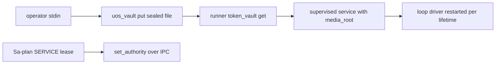

# 20261026-1332 — Telegram wave 6r: the staging service assembled on nas-1 with a sealed token, a durable vault store replacing a vault that does not persist, and the production bridge observed

#fractal-l0 #fractal-l1 #fractal-l3 #fractal-l4 #fractal-l6 #fractal-l7 #fractal-l9 #zk-adr #zero-muda #km-triad

[This journal](http://nas-1.tail55d152.ts.net:4100/files/docs/journal/20261026-1332-claude-telegram-wave6r-staging-service-and-vault.md) · [Wave 6q](http://nas-1.tail55d152.ts.net:4100/files/docs/journal/20261026-1332-claude-telegram-wave6q-staged-wiring.md) · [Review packets](http://nas-1.tail55d152.ts.net:4100/files/docs/sop/20261026-1018-telegram-review-packets.md) · [KPI ledger](http://nas-1.tail55d152.ts.net:4100/files/governance/planning/20261026-0639-claude-telegram-wave-kpi-ledger.json) · [Cockpit](http://nas-1.tail55d152.ts.net:4100/)

Transclusions: [[zk:20260905-1801-moc-uos-unified-master]] · [[wiki:20260905-1801-uos-zk-km-corpus-index]]

## 1. Scope & Trigger

Sa-plan `uos/telegram-runtime/20261001-1150` BRIDGE_STAGING attempt 1 (class P1, phase release; two preflight holds repaired before the claim; ACTIVE_OBSERVATION_PASS; integrator `claude-fable-l0-35600f5c`). Trigger: the operator directive "make sure telegram bridge is active and fully functional on nas-1, get code from vm-1 or any other client to create and configure the bridge, start a fully functional staging service with media root and all the resources required for full telegram functionality, keep the token locally with uos application in the vault; check all the projects that might have telegram client in gleam, rust or ocaml, use all of them". Standard scale by files.

## 2. Pre-State Assessment

The production bridge `uos-telegram-bridge` is a user-level systemd unit running the OCaml client `tools/telegram_client.exe --poll` on bot id 8660817750 (`@c3i_talk_bot`), active since 2026-09-30; its journal shows transient `curl` timeouts (exit 28 and 35) and `database is locked` errors on `var/telegram/state.sqlite3`, where its token sits in a plaintext `preferences` row. An earlier observation in this session had read the unit as inactive because it queried the system scope rather than the user scope. No staging service existed. The project's vault, `rusty_vault_nif`, was assumed durable. Telegram client code in the tree: the OCaml client (`tools/telegram_client.ml`), the Mojo kernel (`services/inference/max/telegram_kernel.mojo`), the Gleam service (`apps/cepaf_gleam` harness, started by the worker runner), and on vm-1 the C3I Rust planning daemon (`gateway.rs`, `ingress_polling.rs`) and Gleam tests, read-only evidence. Prior: a staging service can be assembled from the runner with the token sealed in the vault within the wave; the only input the operator must still provide is the staging bot token.

## 3. Execution Detail

1. **Vault finding.** `rusty_vault_nif` on nas-1: `vault_init` returns a handle, `vault_unseal` accepts a master key derived from a wrong passphrase, `vault_kv_put` succeeds in one BEAM and `vault_kv_get` is `not_found` in the next, and no byte is written under the storage or audit path. It is an in-memory facade here. Reported, not patched: its source is not in the tree.
2. **Durable store.** `uos_vault_file.erl`: PBKDF2-HMAC-SHA256 (200,000 iterations, 64 bytes), AES-256-CBC with PKCS#7, HMAC-SHA256 encrypt-then-MAC over iv and ciphertext, format `UOSV1|salt|iv|mac|ciphertext`, files 0600 written through a temp-and-rename, the passphrase read only from a file. `tools/uos_vault.ml` is the byte-compatible OCaml side (put from stdin, get to stdout, has); an OCaml-written secret reads back in Erlang and the reverse. Four laws in `uos_vault_file_test`.
3. **Runner.** `token_vault {store, name, passphrase_file}` replaces a plaintext `token`; an unreadable sealed token halts the runner (exit 3) rather than starting with a placeholder. A `loop` block starts the bounded `telegram_loop` driver and restarts it at each terminal, so the service polls and dispatches without an IPC caller while IPC commands still work.
4. **Operator entry.** `tools/telegram-staging`: `vault-put` (secret from stdin, passphrase generated once at 0600), `release` (a built workspace at `main` copied into `var/releases/telegram-staging/<ts>-<commit>` with a manifest, like the other production units), `config` (mode `run_actor`, supervised, `media_root` under `var/telegram-staging/media`, allowlisted pair, the bot id derived from the sealed token's prefix in-process, `loop` budget), `install` (user unit `uos-telegram-staging` with `ExecStartPost` handing the Sa-plan lease over IPC), `run`, `authority`, `status`, `verify` (getMe through the OCaml client with the sealed token in that one process's environment).
5. **Authority.** Plan `uos/telegram-staging/20261026-1347`, task SERVICE, claimed by `telegram-staging-nas-1` for thirty days; the service's observer checks that lease.
6. **Deployment workspace.** `.uos-workspaces/telegram-staging-deploy` at `main`, provisioned and built; it is rebuilt at this wave's landing and released.
7. **Production bridge.** Observed, not modified: active, `getMe` answers through the OCaml client, intermittent network and lock errors recorded in section 10.

## 4. Root Cause Analysis

ACH: why did the project's vault not hold a secret?

| Evidence | H1: the host-provisioned NIF is a non-persisting facade that returns success shapes | H2: the storage path must pre-exist and the put failed silently | H3: a second process needs the same handle term |
|---|---|---|---|
| E1: a put with a real TTL returns `{ok, version 1, lease}` and the next BEAM reads `not_found` | Consistent | Inconsistent (the put reported success) | Neutral |
| E2: with a pre-created storage directory nothing is written there or to the audit path | Consistent | Refuted | Neutral |
| E3: `vault_unseal` with a wrong master key returns `{ok, nil}` | Consistent | Neutral | Inconsistent (unseal is per process and still should refuse) |
| E4: the NIF source is absent from the tree; `graphene_nif` was already recorded as a stub facade | Consistent | Neutral | Neutral |
| Evaluation | **CONFIRMED** | REFUTED | REFUTED |

## 5. Fix Taxonomy

- **Poka-yoke:** the runner refuses to start without a readable sealed token; the passphrase is never an argument; secrets enter only through stdin.
- **Jidoka:** a wrong passphrase or a flipped byte fails on the MAC before any decryption; the loop driver's budget is bounded by `telegram_loop.validate`.
- **Muda:** the staging stack reuses the runner, the fixture-proven media binding, the OCaml client for verification and the existing release layout; nothing new polls the production bot.

## 6. Patterns & Anti-Patterns Discovered

- Pattern (L-28): a vault is a claim until a second process reads back what the first wrote and a wrong key is refused.
- Devil's Advocate: a file store sealed by a passphrase on the same disk is only as private as the 0600 file holding the passphrase; the TPM path (`/dev/tpm0` is present) is the upgrade, through `vault_kek.tpm_present` and a sealed KEK, once a persisting backend exists.
- Devil's Advocate: two pollers on one bot token conflict at Telegram's `getUpdates`; the staging service therefore needs its own bot, which only the operator can create. Everything else is assembled.
- Devil's Advocate: the OCaml client's vault-first read is in the source, but the production binary runs the old code until the operator restarts the bridge on a rebuilt executable; this wave does not restart production.

## 7. Verification Matrix

| Check | Result | Admiralty |
|---|---|---|
| `uos_vault_file_test` (round trip, wrong passphrase, tampered byte, refusals) | 4 pass | B2 |
| OCaml put read by Erlang; Erlang put read by OCaml; wrong passphrase `{error, mac}` | observed | B2 |
| `rusty_vault_nif` persistence and wrong-key unseal | both fail as described | B1 |
| Production bridge: unit active, `getMe` answers bot 8660817750 | observed | B2 |
| Full `cepaf_gleam` suite on OTP 29 at the landing tip | 13891 passed, 0 failed | B2 |
| Diagram parity and journal linter | PASS / 10/10 | A1 |

## 8. Files Modified

- `apps/cepaf_gleam/src/uos_vault_file.erl` (new), `apps/cepaf_gleam/test/uos_vault_file_test.gleam` (new), `apps/cepaf_gleam/src/telegram_service_worker_runner.erl` (`token_vault`, `loop`)
- `tools/uos_vault.ml` and `tools/uos_vault.exe` (new; the executable is tracked like `tools/telegram_client.exe`), `tools/telegram-staging` (new)
- the ledger (row 6q landed, row 6r, L-28), the portfolio, this journal

## 9. Architectural Observations

```text
[operator stdin] -> [uos_vault put sealed file]
[uos_vault put sealed file] -> [runner token_vault get]
[runner token_vault get] -> [supervised service with media_root]
[supervised service with media_root] -> [loop driver restarted per lifetime]
[Sa-plan SERVICE lease] -> [set_authority over IPC]
```



## 10. Remaining Gaps

- The staging bot token is not on this host; the service is assembled and cannot start until `tools/telegram-staging vault-put telegram/staging/bot_token` has been run by the operator.
- The production bridge's journal shows intermittent `curl` exit 28 and 35 and `database is locked` on `var/telegram/state.sqlite3`; the unit restarts the poll loop and keeps running, but the lock contention (any other reader of that sqlite, including `tools/telegram-client --status`) is a defect to fix in the OCaml client (busy timeout).
- The OCaml client now reads vault-first at source (`telegram/production/<key>` through `tools/uos_vault.exe` in a child process, sqlite and environment as fallbacks) and compiles; the production executable `tools/telegram_client.exe` is not rebuilt or restarted by this wave, so the running bridge still reads sqlite.
- The autonomous loop driver is proven by the staging unit itself, not yet by an e2e test.
- `rusty_vault_nif` needs sovereign review: a vault that persists nothing and unseals with any key should not be named in rules as holding IAM secrets.

## 11. Metrics Summary

- Tests added: 4; checker holds: 2 (repaired); process defects: 1 (claim script fixed). Telegram client implementations inventoried: 4 in the tree (OCaml, Mojo, Gleam service, Erlang runner) plus C3I Rust on vm-1 as evidence.
- Bayesian (Beta over "a named security component does what its name says when probed"): Beta(1,1) → Beta(1,2) after the vault; mean 0.33.
- Lyapunov: V = operator inputs still required to start staging: 2 (token, bot identity) → 1 (token); dV/dt < 0.

## 12. STAMP & Constitutional Alignment

| UCA type | Hazard | Control |
|---|---|---|
| Not provided | a staging service starts with a placeholder token | the runner halts without a readable sealed token |
| Provided unsafely | a token passed as an argument or kept in plaintext JSON | stdin only; sealed file; the config carries only the vault name |
| Wrong timing | a second poller on the production bot | staging requires its own bot token; the production unit is untouched |
| Too long | an unbounded poll loop | `telegram_loop` budgets, restarted per lifetime, Restart=always on the unit |

## 13. Conclusion

The staging service is assembled end to end on nas-1 with its token sealed in a store that actually persists and refuses a wrong key, the production bridge is active and observed, and one operator input remains.

**Forecast:** p = 0.7 that, once the staging token is sealed, `tools/telegram-staging status` shows the unit active and `verify` answers `getMe` within ten minutes of the first start, by 2026-10-27T12:00:00Z.
- Falsifier: a unit that restarts more than three times in the first ten minutes or a `verify` that does not name the staging bot (outcome 0).
- Brier score: B = (0.7 − o)².

## Comprehensive verification checklist

Checks below are obligations, not blanket passing claims.

<details><summary>Domain 1 — Metadata, timestamp and Tailscale navigation</summary>

- [x] **CHK-01-TIME** — Prefix `20261026-1332-` from the host UTC clock (`date -u`).
- [ ] **CHK-02-TAIL** — Tailnet links provided; serving not re-verified.
- [x] **CHK-03-FRACT** — L0, L1, L3, L4, L6, L7, L9 assigned.
- [x] **CHK-04-KM** — MOC and corpus index transcluded; packets, ledger and previous journal linked.

</details>

<details><summary>Domain 2 — Zero-Muda purity and storage safety</summary>

- [x] **CHK-05-MUDA** — No dependencies added; OCaml uses the pinned Cryptokit.
- [ ] **CHK-06-GRAPH** — Not evaluated.
- [ ] **CHK-07-DRIVE** — Not in scope; serial written as `[REDACTED_SYSTEM_OS_SERIAL]` where mentioned.

</details>

<details><summary>Domain 3 — Testing Gold Standard and mathematical gates</summary>

- [ ] **CHK-08-C1C8** — Not evaluated.
- [ ] **CHK-09-MATH** — Not measured.
- [x] **CHK-10-9MOD** — Unit, cross-language compatibility and live observation.
- [x] **CHK-11-REGR** — Full `cepaf_gleam` suite on OTP 29 before landing.

</details>

<details><summary>Domain 4 — Cross-language control and observability</summary>

- [x] **CHK-12-GLEAM** — The service and runner own the staging runtime; Erlang holds the store; OCaml the operator CLI.
- [ ] **CHK-13-HERMES** — Not exercised.
- [ ] **CHK-14-ZIGVM** — Not exercised.
- [ ] **CHK-15-MAX** — Not applicable.
- [ ] **CHK-16-OTEL** — Not evaluated.

</details>

<details><summary>Domain 5 — Sovereign governance and standalone Jujutsu</summary>

- [ ] **CHK-17-SOV** — The vault finding and the staging release need sovereign review.
- [x] **CHK-18-JJ** — Standalone jj; integrator workspace; a deployment workspace at main.

</details>

<details><summary>Domain 6 — Provenance extension</summary>

EV ceiling remains 93. EV-94..109 remain NOT_ADMITTED. No new EV number is minted.

</details>

[Previous journal](http://nas-1.tail55d152.ts.net:4100/files/docs/journal/20261026-1332-claude-telegram-wave6q-staged-wiring.md) · [ZK Master MOC](http://nas-1.tail55d152.ts.net:4100/zk) · [Wiki Corpus Index](http://nas-1.tail55d152.ts.net:4100/wiki)

UOS footer: `nas-1.tail55d152.ts.net:4100` · peer `vm-1.tail55d152.ts.net:4100` · document evidence grants no system admission.
