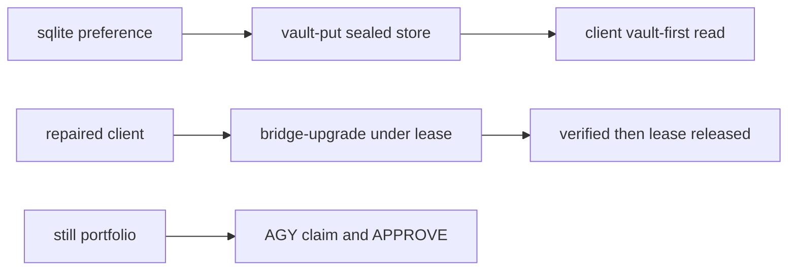

# 20261026-1405 — Telegram wave 6t: the production bridge upgraded and its token sealed on operator direction, and the first independent review completed by AGY

#fractal-l0 #fractal-l1 #fractal-l3 #fractal-l4 #fractal-l6 #fractal-l7 #fractal-l9 #zk-adr #zero-muda #km-triad

[This journal](http://nas-1.tail55d152.ts.net:4100/files/docs/journal/20261026-1405-claude-telegram-wave6t-bridge-upgrade-and-first-independent-review.md) · [Wave 6s](http://nas-1.tail55d152.ts.net:4100/files/docs/journal/20261026-1417-claude-telegram-wave6s-bridge-repair.md) · [AGY verdict](http://nas-1.tail55d152.ts.net:4100/files/governance/planning/20261026-1434-agy-command-review-independent-verdict.json) · [Review packets](http://nas-1.tail55d152.ts.net:4100/files/docs/sop/20261026-1018-telegram-review-packets.md) · [KPI ledger](http://nas-1.tail55d152.ts.net:4100/files/governance/planning/20261026-0639-claude-telegram-wave-kpi-ledger.json) · [Cockpit](http://nas-1.tail55d152.ts.net:4100/)

Transclusions: [[zk:20260905-1801-moc-uos-unified-master]] · [[wiki:20260905-1801-uos-zk-km-corpus-index]]

## 1. Scope & Trigger

Sa-plan `uos/telegram-runtime/20261001-1150` BRIDGE_UPGRADE attempt 1 (class P1, phase release; claimed through the gated claim after the portfolio was aligned with the live Sa-plan state; ACTIVE_OBSERVATION_PASS; coordinator lease `runtime:telegram-bridge` epoch 2 held for the restart and released after verification). Trigger: the operator directive "run and complete the full bridge-upgrade and vault commands and all other related features". This journal also records the first independent review completion: COMMAND_REVIEW by `agy-review-e-20261026`. Trivial scale by files.

## 2. Pre-State Assessment

The production bridge ran the pre-session OCaml client with its token in a plaintext sqlite preference; the repaired client (wave 6s) was tracked but not installed; the vault store held nothing for production. Four AGY reviewer runs had produced advisory passes and no claim. Prior: the two production effects complete within the wave with a clean journal; the review claims once the portfolio stops drifting.

## 3. Execution Detail

1. **Vault.** `telegram_token` and `telegram_chat_id` piped from the sqlite preference into `tools/telegram-staging vault-put` as `telegram/production/telegram_token` and `telegram/production/telegram_chat_id`; the passphrase was generated once at 0600; nothing was printed. The sqlite rows remain as the rollback.
2. **Upgrade.** `tools/telegram-staging bridge-upgrade` installed the repaired client (sha256 `dfc2f907…`, identical to the tracked executable) over the canonical binary with the rollback copy `telegram_client.exe.pre-20261026-1410`, and restarted `uos-telegram-bridge` under the held lease. The unit had consumed 6 h 30 min of CPU over 3 w 5 d before the restart.
3. **Verification.** Unit active; `getMe` through the new client names bot 8660817750; two minutes of journal after the restart, with a concurrent status probe, contain zero `locked`, `failed` or `error` lines. The lease was released.
4. **First independent review.** With the portfolio aligned to live Sa-plan (COMMAND_REVIEW executing by its AGY claimant, then completed), AGY run e claimed COMMAND_REVIEW, verified the six packet laws at main 6a776b51 across 205 tests in ten suites and seven hostile inputs, and completed the task with verdict APPROVE; the verdict is filed as governance evidence. MEDIA_REVIEW was readied and its reviewer relaunched; GATEWAY and MINI_API follow through the chain.

## 4. Root Cause Analysis

ACH: why did four reviewer runs fail to claim before the fifth succeeded?

| Evidence | H1: the author kept changing the portfolio (new ready records, unlanded completions) while the reviewer was between launch and claim, so the checker read drift or a tie each time | H2: AGY disobeyed the claim-first instruction | H3: the checker is unusable for a second claimant |
|---|---|---|---|
| E1: holds named `RP-SA-PLAN` state drift on BRIDGE_STAGING or COMMAND_REVIEW, and `RP-SENSITIVITY` ties with BRIDGE_FIX or BRIDGE_UPGRADE, all records the author had just touched | Consistent | Neutral | Inconsistent |
| E2: run e, launched against the live portfolio with no author edits until its claim, claimed within minutes and completed | Consistent | Refuted | Refuted |
| E3: each AGY report shows the preflight run before any claim | Neutral | Refuted | Neutral |
| Evaluation | **CONFIRMED** | REFUTED | REFUTED |

## 5. Fix Taxonomy

- **Poka-yoke:** a rollback copy beside the live binary; the sqlite rows retained until a soak passes.
- **Jidoka:** the restart only under a held runtime lease and a claimed release task; verification before the lease release.
- **Muda:** author records are created blocked while a reviewer is in flight (L-30).

## 6. Patterns & Anti-Patterns Discovered

- Pattern (L-30): a second claimant needs a still portfolio from launch to claim; completions by other claimants are mirrored at the next alignment.
- Devil's Advocate: a two-minute clean journal is a smoke check, not the soak; the lock defect reproduced only under concurrent readers over hours. The 24-hour forecast from wave 6s stands.
- Devil's Advocate: the token still exists in sqlite until the soak; "in the vault" is true, "only in the vault" is not yet.

## 7. Verification Matrix

| Check | Result | Admiralty |
|---|---|---|
| Vault store holds both production secrets (presence) and the client reads vault-first | `vault-has` present; `--status` answers | B2 |
| Installed binary equals the tracked executable | sha256 equal | A2 |
| Unit active; `getMe` bot 8660817750; journal clean for two minutes with a concurrent probe | observed | B2 |
| COMMAND_REVIEW completed in Sa-plan by an AGY claimant with APPROVE | Sa-plan result | B1 |
| Diagram parity and journal linter | PASS / 10/10 | A1 |

## 8. Files Modified

- the ledger (row 6t, TG-KPI-11, L-30), the packets (COMMAND_REVIEW completed), the portfolio, the AGY verdict evidence file, this journal; no source

## 9. Architectural Observations

```text
[sqlite preference] -> [vault-put sealed store]
[vault-put sealed store] -> [client vault-first read]
[repaired client] -> [bridge-upgrade under lease]
[bridge-upgrade under lease] -> [verified then lease released]
[still portfolio] -> [AGY claim and APPROVE]
```



## 10. Remaining Gaps

- The staging bot token: still the operator's input; the staging service is otherwise complete.
- MEDIA_REVIEW (reviewer running), GATEWAY_REVIEW and MINI_API_REVIEW (chained), TELEGRAM_E2E, RETURN, RELEASE, ADMISSION, the vault NIF sovereign review.
- Remove the sqlite token rows after the 24-hour soak.

## 11. Metrics Summary

- Production effects: 2, both verified; TG-KPI-11 independent review closure 0/4 → 1/4.
- Bayesian (Beta over "a reviewer run claims its task"): Beta(1,4) → Beta(2,4); mean 0.33.
- Lyapunov: V = open review tasks: 4 → 3; dV/dt < 0.

## 12. STAMP & Constitutional Alignment

| UCA type | Hazard | Control |
|---|---|---|
| Not provided | a bridge restarted without a rollback | the pre- copy and the printed rollback line |
| Provided unsafely | a token printed on its way into the vault | stdin pipe; redaction on every log line shown |
| Wrong timing | a restart outside a lease | lease held and released around it |
| Too long | a stale sqlite token kept forever | removal scheduled after the soak |

## 13. Conclusion

The production bridge runs the repaired client with its secrets sealed in the vault store, and the first independent review of the Telegram surface is complete with an APPROVE from AGY.

**Forecast:** p = 0.6 that MEDIA_REVIEW, GATEWAY_REVIEW and MINI_API_REVIEW are all completed in Sa-plan by AGY claimants by 2026-10-27T12:00:00Z.
- Falsifier: any of the three not completed by an AGY worker by the horizon (outcome 0).
- Brier score: B = (0.6 − o)².

## Comprehensive verification checklist

Checks below are obligations, not blanket passing claims.

<details><summary>Domain 1 — Metadata, timestamp and Tailscale navigation</summary>

- [x] **CHK-01-TIME** — Prefix `20261026-1405-` from the host UTC clock (`date -u`).
- [ ] **CHK-02-TAIL** — Tailnet links provided; serving not re-verified.
- [x] **CHK-03-FRACT** — L0, L1, L3, L4, L6, L7, L9 assigned.
- [x] **CHK-04-KM** — MOC and corpus index transcluded; verdict, packets, ledger and previous journal linked.

</details>

<details><summary>Domain 2 — Zero-Muda purity and storage safety</summary>

- [x] **CHK-05-MUDA** — No dependencies added.
- [ ] **CHK-06-GRAPH** — Not evaluated.
- [ ] **CHK-07-DRIVE** — Not in scope; serial written as `[REDACTED_SYSTEM_OS_SERIAL]` where mentioned.

</details>

<details><summary>Domain 3 — Testing Gold Standard and mathematical gates</summary>

- [ ] **CHK-08-C1C8** — Not evaluated.
- [ ] **CHK-09-MATH** — Not measured.
- [x] **CHK-10-9MOD** — Live verification after a production effect.
- [ ] **CHK-11-REGR** — Gleam suite unchanged by this wave.

</details>

<details><summary>Domain 4 — Cross-language control and observability</summary>

- [x] **CHK-12-GLEAM** — Unchanged; OCaml owns the bridge client.
- [ ] **CHK-13-HERMES** — Not exercised.
- [ ] **CHK-14-ZIGVM** — Not exercised.
- [ ] **CHK-15-MAX** — Not applicable.
- [ ] **CHK-16-OTEL** — Not evaluated.

</details>

<details><summary>Domain 5 — Sovereign governance and standalone Jujutsu</summary>

- [ ] **CHK-17-SOV** — One of four independent reviews complete; R5 outstanding.
- [x] **CHK-18-JJ** — Standalone jj; integrator workspace only.

</details>

<details><summary>Domain 6 — Provenance extension</summary>

EV ceiling remains 93. EV-94..109 remain NOT_ADMITTED. No new EV number is minted.

</details>

[Previous journal](http://nas-1.tail55d152.ts.net:4100/files/docs/journal/20261026-1417-claude-telegram-wave6s-bridge-repair.md) · [ZK Master MOC](http://nas-1.tail55d152.ts.net:4100/zk) · [Wiki Corpus Index](http://nas-1.tail55d152.ts.net:4100/wiki)

UOS footer: `nas-1.tail55d152.ts.net:4100` · peer `vm-1.tail55d152.ts.net:4100` · document evidence grants no system admission.
