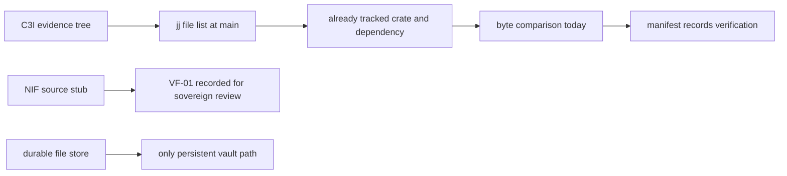

# 20261026-1413 — Telegram wave 6u: the vault and bridge sources verified under UOS control, the vault NIF stub explained at source, and all four independent reviews complete

#fractal-l1 #fractal-l3 #fractal-l5 #fractal-l6 #fractal-l9 #zk-adr #zero-muda #km-triad

[This journal](http://nas-1.tail55d152.ts.net:4100/files/docs/journal/20261026-1413-claude-telegram-wave6u-source-control-verification-and-reviews-complete.md) · [Wave 6t](http://nas-1.tail55d152.ts.net:4100/files/docs/journal/20261026-1405-claude-telegram-wave6t-bridge-upgrade-and-first-independent-review.md) · [Manifest](http://nas-1.tail55d152.ts.net:4100/files/governance/sources/20261026-1420-vault-source-control-verification-and-c3i-telegram-gateway-ingestion.json) · [Crate README](http://nas-1.tail55d152.ts.net:4100/files/apps/cepaf_gleam/native/rusty_vault_nif/README.md) · [Review packets](http://nas-1.tail55d152.ts.net:4100/files/docs/sop/20261026-1018-telegram-review-packets.md) · [KPI ledger](http://nas-1.tail55d152.ts.net:4100/files/governance/planning/20261026-0639-claude-telegram-wave-kpi-ledger.json) · [Cockpit](http://nas-1.tail55d152.ts.net:4100/)

Transclusions: [[zk:20260905-1801-moc-uos-unified-master]] · [[wiki:20260905-1801-uos-zk-km-corpus-index]]

## 1. Scope & Trigger

Sa-plan `uos/telegram-runtime/20261001-1150` SOURCE_INGEST attempt 1 (class P2, phase implementation; claimed through the gated claim after the three AGY completions were mirrored and the last reviewer had taken its task; PREFLIGHT_PASS, ACTIVE_OBSERVATION_PASS; integrator `claude-fable-l0-35600f5c`). Trigger: the operator directive "get the source code of the bridge code and vault code. ALL project related artifacts MUST be in uos code path and control". This journal also records the completion of MEDIA_REVIEW, GATEWAY_REVIEW and MINI_API_REVIEW by AGY claimants. Standard scale by files.

## 2. Pre-State Assessment

The vault NIF had been found in wave 6r to persist nothing and to unseal with a wrong key, and its source was believed to live only in the C3I evidence tree. The C3I Rust Telegram gateway sources were not in UOS. One of four independent reviews was complete. Prior: the sources would be copied in under a sanitized manifest; the NIF defect would turn out to be either a source stub or a build drift; the remaining reviewers would claim once the portfolio stood still.

## 3. Execution Detail

1. **Reviews mirrored.** MEDIA_REVIEW (`agy-review-f2-20261026`, APPROVE, 207 tests, four hostile-input families) and GATEWAY_REVIEW (`agy-review-g-20261026`, APPROVE, 94 tests, four families) completed while run h was launching; both were mirrored into the portfolio before run h claimed, so its preflight read no drift and it claimed MINI_API_REVIEW within minutes. MINI_API_REVIEW completed (`agy-review-h-20261026`, APPROVE, 244 tests over 19 suites; M-05 browser behaviour NOT_CHECKABLE by suites, as the packet states). All three verdict JSONs are filed as governance evidence and the packets carry the completion lines.
2. **Source ingestion, first pass.** The prepared script copied the NIF crate, the vendored RustyVault dependency and the two gateway sources into the workspace and failed twice before writing a manifest: once because a secret scan that finds nothing exits 1 under `pipefail`, once because the first repair unbalanced a parenthesis.
3. **The duplicate discovered.** Asking Jujutsu what `main` tracks showed the NIF crate at `apps/cepaf_gleam/native/rusty_vault_nif` and the dependency at `sub-projects/rusty_vault_vendored` (155 files), both ingested on 2026-10-25 under `governance/sources/20261025-2230-nif-in-project-build.json`, with the PEM private-key test fixtures in two upstream files redacted and `docs/` excluded; the pinned `.so` was built from that crate. `diff -rq` against C3I rev 47f93223 today: the crate is identical (C3I carries an empty `tests/`); the dependency differs only by the recorded redactions and exclusions. The fresh copies under `native/nifs/rust` were removed: a second copy, and one that would have re-imported the PEM fixtures.
4. **The NIF finding explained at source (VF-01).** `src/lib.rs` keeps the NIF resource's key-value store as a `HashMap` in RAM and its audit log as a `Vec`; `vault_unseal` carries `TODO Slice B+: integrate RustyVault::core::Core::unseal` and checks only that the key is 32 bytes; `src/vault_handle.rs` defines a disk-backed handle over `src/sqlite_backend.rs` with unit tests, and no NIF entry point calls it. The binary matches its source. Recorded in the manifest and in a crate README; the durable file store from wave 6r stays the only persistent vault path.
5. **Bridge sources.** `gateway.rs` and `ingress_polling.rs` are ingested as inert evidence under `governance/sources/20261026-1402-c3i-telegram-gateway-evidence/` with per-file digests and a zero-hit secret scan; the bridge code UOS actually runs is already in control (the OCaml client, the Gleam service and the staging runner), and the manifest lists it.

## 4. Root Cause Analysis

ACH: why did the vault NIF persist nothing and accept a wrong key?

| Evidence | H1: the source itself is a stub (in-RAM store, unseal TODO) and the binary is a faithful build of it | H2: the pinned `.so` drifted from the source (built from an older or different tree) | H3: the loader or the Gleam wrapper opened a different storage path than the test read |
|---|---|---|---|
| E1: `lib.rs` `VaultHandle` holds `kv_store: Mutex<HashMap<…>>` and `audit_log: Mutex<Vec<…>>` with the comment "Future: replaced by SqliteBackend in Slice B-full" | Consistent | Neutral | Inconsistent |
| E2: `vault_unseal` validates only `len() == 32` under a TODO and stores the key in RAM | Consistent | Neutral | Inconsistent |
| E3: the tracked crate is byte-identical to C3I rev 47f93223 and the pin records an in-project build from it on 2026-10-25 | Consistent | Refuted | Neutral |
| E4: nothing was written under the storage or audit paths in wave 6r, with the paths confirmed by the NIF's own status call | Consistent | Neutral | Refuted |
| Evaluation | **CONFIRMED** | REFUTED | REFUTED |

## 5. Fix Taxonomy

- **Poka-yoke:** the ingestion manifest records a verification against tracked paths, not a copy; the crate README states VF-01 beside the source so a reader of the crate meets the finding first.
- **Jidoka:** the duplicate copies were removed before landing; no second copy of a dependency with redaction history enters the tree.
- **Muda:** zero source files added for the vault; two gateway files added as evidence; the `docs/` site of the dependency stays excluded.

## 6. Patterns & Anti-Patterns Discovered

- Pattern (L-31): ask the VCS what it already tracks before ingesting from an external tree; the answer was "all of it, better sanitized".
- Anti-pattern (L-32): `pipefail` turns a clean secret scan into a silent script failure; the no-match path must be the success path.
- Devil's Advocate: "verified byte-identical" is a statement about today's C3I revision; the external tree moves, and the tracked copy is the authority from here on, not the comparison.
- Devil's Advocate: four APPROVE verdicts from one reviewer family (AGY) are independent of the author, not of each other; the R5 sovereign review by Codex is still a separate obligation and VF-01 is its first item.

## 7. Verification Matrix

| Check | Result | Admiralty |
|---|---|---|
| NIF crate tracked at `main` equals C3I rev 47f93223 (`diff -rq`, `target/` excluded) | identical; empty `tests/` only in C3I | A2 |
| Vendored dependency tracked at `main` equals C3I except recorded redactions and exclusions | two files differ as recorded; 0 PEM fixtures in UOS, 2 in C3I | A2 |
| Pinned `.so` provenance names the tracked crate | `rusty_vault_nif.sha256` pin line | B2 |
| VF-01 source reading (in-RAM store, unseal TODO, unwired disk handle) | lines cited in the README and manifest | B2 |
| Gateway evidence secret scan | 0 hits over 2 files, digests recorded | A2 |
| MEDIA, GATEWAY, MINI_API completed in Sa-plan by AGY claimants with APPROVE | `task show` state=completed, worker names | B1 |
| Diagram parity and journal linter | PASS / 10/10 | A1 |

## 8. Files Modified

- `governance/sources/20261026-1420-vault-source-control-verification-and-c3i-telegram-gateway-ingestion.json` (new), `governance/sources/20261026-1402-c3i-telegram-gateway-evidence/{gateway.rs,ingress_polling.rs}` (new, inert), `apps/cepaf_gleam/native/rusty_vault_nif/README.md` (new), `governance/planning/20261026-1448-agy-media-review-independent-verdict.json`, `…-1448-agy-gateway-review-independent-verdict.json`, `…-1437-agy-mini-api-review-independent-verdict.json` (new), the review packets, the portfolio, the ledger (row 6u, TG-KPI-11 4/4, L-31, L-32, six forecasts resolved), this journal; the wave 6t journal and verdict land with this change; no Gleam, OCaml or Rust source

## 9. Architectural Observations

```text
[C3I evidence tree] -> [jj file list at main]
[jj file list at main] -> [already tracked crate and dependency]
[already tracked crate and dependency] -> [byte comparison today]
[byte comparison today] -> [manifest records verification]
[NIF source stub] -> [VF-01 recorded for sovereign review]
[durable file store] -> [only persistent vault path]
```



## 10. Remaining Gaps

- VF-01: the NIF needs its disk-backed handle or RustyVault Core wired into the entry points, a persistence law and a wrong-key law, a rebuild and re-pin, and the R5 sovereign review.
- The staging bot token remains operator input; TELEGRAM_E2E, RETURN, RELEASE and ADMISSION wait behind it.
- BRIDGE_EVIDENCE (the 24-hour bridge soak and sqlite token-row removal) is blocked until the soak window closes on 2026-10-27.
- The wave 6s and 6t rows in the ledger carry no landed commit until the next wave fills them.

## 11. Metrics Summary

- Independent review closure TG-KPI-11: 1/4 → 4/4. Source files duplicated then removed: 167. Secret-pattern hits in ingested evidence: 0.
- Bayesian (Beta over "a reviewer run claims its task"): Beta(2,4) → Beta(5,4); mean 0.56, three claims in three launches once the portfolio stood still.
- Forecast calibration: six forecasts resolved this wave, all outcome 1; Brier mean over resolved forecasts 0.215, driven by the 0.4 and 0.5 priors on reviewer claims that proved too pessimistic once L-29/L-30 were applied.
- Lyapunov: V = open review tasks: 3 → 0; dV/dt < 0.

## 12. STAMP & Constitutional Alignment

| UCA type | Hazard | Control |
|---|---|---|
| Not provided | a vault believed persistent that is not | VF-01 recorded at source and beside the crate; the file store named as the only persistent path |
| Provided unsafely | a second copy of a dependency re-importing redacted key fixtures | the VCS check and the removal of the duplicates |
| Wrong timing | a review completion mirrored after the next reviewer's preflight | completions mirrored before launch and claim (L-30) |
| Too long | an external comparison treated as a standing authority | the tracked copy is the authority; the comparison is dated |

## 13. Conclusion

The vault and bridge sources are under UOS control, the vault NIF's observed defect is its own source stub rather than a build drift, and the four independent reviews are complete with APPROVE verdicts from AGY claimants.

**Forecast:** p = 0.7 that the sovereign review of VF-01 is recorded by Codex or AGY as a Sa-plan task with a verdict by 2026-10-28T12:00:00Z.
- Falsifier: no such task completed by the horizon (outcome 0).
- Brier score: B = (0.7 − o)².

## Comprehensive verification checklist

Checks below are obligations, not blanket passing claims.

<details><summary>Domain 1 — Metadata, timestamp and Tailscale navigation</summary>

- [x] **CHK-01-TIME** — Prefix `20261026-1413-` from the host UTC clock (`date -u`).
- [ ] **CHK-02-TAIL** — Tailnet links provided; serving not re-verified.
- [x] **CHK-03-FRACT** — L1, L3, L5, L6, L9 assigned.
- [x] **CHK-04-KM** — MOC and corpus index transcluded; manifest, README, packets, ledger and previous journal linked.

</details>

<details><summary>Domain 2 — Zero-Muda purity and storage safety</summary>

- [x] **CHK-05-MUDA** — No dependencies added; duplicate copies removed before landing.
- [ ] **CHK-06-GRAPH** — Not evaluated.
- [ ] **CHK-07-DRIVE** — Not in scope; serial written as `[REDACTED_SYSTEM_OS_SERIAL]` where mentioned.

</details>

<details><summary>Domain 3 — Testing Gold Standard and mathematical gates</summary>

- [ ] **CHK-08-C1C8** — Not evaluated.
- [ ] **CHK-09-MATH** — Not measured.
- [x] **CHK-10-9MOD** — Reviewer suites 207, 94 and 244 observed by independent claimants.
- [ ] **CHK-11-REGR** — Gleam suite unchanged by this wave.

</details>

<details><summary>Domain 4 — Cross-language control and observability</summary>

- [x] **CHK-12-GLEAM** — Unchanged; the vault boundary stays behind the file store.
- [ ] **CHK-13-HERMES** — Not exercised.
- [ ] **CHK-14-ZIGVM** — Not exercised.
- [ ] **CHK-15-MAX** — Not applicable.
- [ ] **CHK-16-OTEL** — Not evaluated.

</details>

<details><summary>Domain 5 — Sovereign governance and standalone Jujutsu</summary>

- [ ] **CHK-17-SOV** — Four independent reviews complete; R5 sovereign review outstanding, VF-01 first.
- [x] **CHK-18-JJ** — Standalone jj; integrator workspace only; tracked state asked of the VCS.

</details>

<details><summary>Domain 6 — Provenance extension</summary>

EV ceiling remains 93. EV-94..109 remain NOT_ADMITTED. No new EV number is minted.

</details>

[Previous journal](http://nas-1.tail55d152.ts.net:4100/files/docs/journal/20261026-1405-claude-telegram-wave6t-bridge-upgrade-and-first-independent-review.md) · [ZK Master MOC](http://nas-1.tail55d152.ts.net:4100/zk) · [Wiki Corpus Index](http://nas-1.tail55d152.ts.net:4100/wiki)

UOS footer: `nas-1.tail55d152.ts.net:4100` · peer `vm-1.tail55d152.ts.net:4100` · document evidence grants no system admission.
