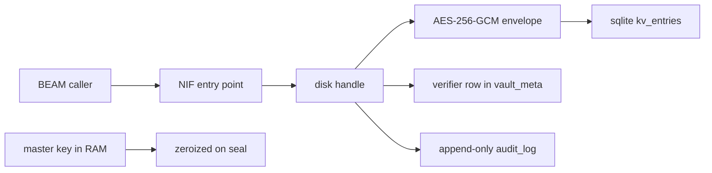

# 20261026-1525 — Telegram wave 6v: VF-01 closed, the vault NIF persists through sqlite, refuses a wrong key and is rebuilt and re-pinned from the tracked crate

#fractal-l1 #fractal-l3 #fractal-l5 #fractal-l8 #fractal-l9 #zk-adr #zero-muda #km-triad

[This journal](http://nas-1.tail55d152.ts.net:4100/files/docs/journal/20261026-1525-claude-telegram-wave6v-vault-nif-vf01-closure.md) · [Wave 6u](http://nas-1.tail55d152.ts.net:4100/files/docs/journal/20261026-1413-claude-telegram-wave6u-source-control-verification-and-reviews-complete.md) · [Crate README](http://nas-1.tail55d152.ts.net:4100/files/apps/cepaf_gleam/native/rusty_vault_nif/README.md) · [Review packets](http://nas-1.tail55d152.ts.net:4100/files/docs/sop/20261026-1018-telegram-review-packets.md) · [Skill](http://nas-1.tail55d152.ts.net:4100/files/.claude/skills/uos-telegram-journeys/SKILL.md) · [KPI ledger](http://nas-1.tail55d152.ts.net:4100/files/governance/planning/20261026-0639-claude-telegram-wave-kpi-ledger.json) · [Cockpit](http://nas-1.tail55d152.ts.net:4100/)

Transclusions: [[zk:20260905-1801-moc-uos-unified-master]] · [[wiki:20260905-1801-uos-zk-km-corpus-index]]

## 1. Scope & Trigger

Sa-plan `uos/telegram-runtime/20261001-1150` VAULT_NIF_FIX attempt 1 (class P1, phase implementation; created with VAULT_NIF_REVIEW as its dependent; claimed through the gated claim after three holds were repaired; PREFLIGHT_PASS, ACTIVE_OBSERVATION_PASS; integrator `claude-fable-l0-35600f5c`). Trigger: the session goal "complete all telegram features" with the staging token still outstanding, and finding VF-01 from wave 6u, which was the one open defect in this session's control. Standard scale by files.

## 2. Pre-State Assessment

The pinned NIF (f5aaab89) kept its key-value store and audit log in RAM and `vault_unseal` accepted any 32-byte key; the crate already carried a disk-backed handle with sqlite and AES-256-GCM envelopes that nothing called. Prior: the handle wires into the entry points in one wave; the laws split between cargo and the BEAM; the rebuild from the tracked crate is reproducible offline.

## 3. Execution Detail

1. **Backend.** `sqlite_backend.rs` gains a `vault_meta` table, `BEFORE UPDATE` and `BEFORE DELETE` triggers that make `audit_log` append-only at the store, and the row queries the entry points need: a put that stores the lease id, the latest row with its metadata, versions with timestamps, lease renewal by lease id, audit append and tail, and a conditional meta insert.
2. **Handle.** `vault_handle.rs` gains `unseal_verified`: the first unseal of an empty vault encrypts a fixed verifier under the key and writes it with `INSERT OR IGNORE`; every later unseal must decrypt it, so a wrong key returns `WrongKey`, a verifier that is not an envelope returns `Crypto`, and a lost race re-verifies against what is on disk. It also gains `put_with_lease`, `get_latest_meta`, `versions_with_ts`, `destroy`, `lease_renew` and `audit_tail`.
3. **Entry points.** `lib.rs` drops the `HashMap` and `Vec`; the resource owns the disk handle; `vault_init` resolves a directory to `<dir>/vault.sqlite3`, creates the parent and returns `{error, storage_error}` instead of a handle it cannot back; `vault_unseal` maps `WrongKey` and a wrong length to `{error, wrong_key}` with the vault sealed and a malformed verifier to `corrupt`; `vault_kv_get` adds `{error, {decrypt_failed, Name}}` beside the stale and not-found refusals; `vault_audit_tail` reads the table while sealed.
4. **Laws.** Nine `vf01_laws` cargo tests on the resource type: sealed init, directory resolution, persistence across handles, wrong key, short key, no plaintext or key bytes in the file or WAL, stale read, destroy and lease renewal, append-only audit surviving a fresh handle. Crate total 66. Two mutants planted and killed: the verifier check skipped (1 law red), plaintext stored (5 laws red); the source restored byte-identical.
5. **Through the BEAM.** The release library was rebuilt offline from the tracked crate, installed into the workspace `priv/` with the old library kept outside the tree as rollback, and observed under OTP 29.0.5 in three separate `erl` processes: put in the first, get in the second after unseal with the same key (sealed read refused after `vault_seal`), wrong key and short key refused in the third with the audit trail `key_established, unseal, put, unseal, get, seal, unseal_refused`, and no plaintext on disk. `test/rusty_vault_persistence_test.erl` pins the same three laws for `gleam test`; the vault suites pass (91 tests in the targeted run). Full suite: 13894 passed, 0 failed (gleam test at the candidate).
6. **Pin and records.** `priv/rusty_vault_nif.sha256` now names 73be69d9 with its provenance; the crate README records the closure; the packets gain the VAULT_NIF_REVIEW packet with four residuals; the skill and the supervisor agent carry L-29 to L-34 and are mirrored to the three other surfaces; the ledger gains row 6v, L-33, L-34 and TG-KPI-12.

## 4. Root Cause Analysis

ACH: why did the first claim of VAULT_NIF_FIX hold three times?

| Evidence | H1: the new records were cloned from an older assessment and the portfolio still listed TELEGRAM_E2E as ready although its blocker is an operator input | H2: the checker is miscalibrated for new records | H3: Sa-plan rejected the task creation |
|---|---|---|---|
| E1: holds `RP-EVIDENCE` (evidence postdates the assessment) and `RP-SA-PLAN` (declared deps differ) on the first run, both fields inherited from the cloned record | Consistent | Inconsistent | Inconsistent |
| E2: after restamping and emptying the deps, `RP-SELECTION` named TELEGRAM_E2E (768, P1) as the first eligible candidate | Consistent | Inconsistent | Inconsistent |
| E3: with TELEGRAM_E2E marked blocked on the staging token, the claim passed at once; Sa-plan shows both tasks created | Consistent | Refuted | Refuted |
| Evaluation | **CONFIRMED** | REFUTED | REFUTED |

## 5. Fix Taxonomy

- **Poka-yoke:** the verifier row makes a wrong key a refusal rather than a vault that silently holds undecryptable rows; triggers make the audit table append-only regardless of the caller.
- **Jidoka:** `vault_init` fails closed when the file cannot be opened; `vault_kv_get` never returns a fabricated value; the first claim stopped on the checker until the records told the truth.
- **Muda:** no new dependency; the dead `KvEntry` and `AuditEntry` structures and the in-RAM store are gone; the old library lives only as a rollback copy outside the tree.

## 6. Patterns & Anti-Patterns Discovered

- Pattern (L-33): a ready record whose real blocker is a human input holds every other claim; readiness names the blocker.
- Pattern (L-34): the laws of a NIF are split by necessity, cargo for the handle, eunit for the atoms, several `erl` processes for the cross-BEAM form; the first attempt to assert atoms inside cargo aborted the test binary.
- Devil's Advocate: the first unseal of an empty vault establishes the key; whoever writes to an empty vault file first chooses its key. The residual is recorded in the packet for the reviewer; the file store the Telegram secrets use is unaffected.
- Devil's Advocate: the rebuilt library is 2.8 MB against 0.6 MB before; the pin names the build, not a reproducibility claim, and V-LAW-06 asks the reviewer to rebuild and compare.
- Anti-pattern: a stale completion helper hard-wired to wave 6s posted a wrong board message when reused; sequence 2747 corrects 2746.

## 7. Verification Matrix

| Check | Result | Admiralty |
|---|---|---|
| Crate tests at the candidate | 66 passed, 0 failed | A2 |
| Mutants | 2 planted, 2 killed, source restored (sha256 equal) | A2 |
| Three-process OTP 29 observation (persistence, wrong key, short key, sealed read, audit order, no plaintext on disk) | all as stated in section 3 | B1 |
| `rusty_vault_persistence_test` and vault suites through the installed library | 91 passed in the targeted eunit run | A2 |
| Full Gleam suite at the candidate | 13894 passed, 0 failed (gleam test at the candidate) | A2 |
| Installed library equals the release build; pin updated | `cmp` equal; sha256 73be69d9 | A2 |
| Barred dependencies | `cargo tree` matches none | A2 |
| Diagram parity and journal linter | PASS / 10/10 | A1 |

## 8. Files Modified

- `apps/cepaf_gleam/native/rusty_vault_nif/src/{lib.rs,vault_handle.rs,sqlite_backend.rs}`, `apps/cepaf_gleam/native/rusty_vault_nif/README.md`, `apps/cepaf_gleam/test/rusty_vault_persistence_test.erl` (new), `apps/cepaf_gleam/priv/rusty_vault_nif.sha256`, `docs/sop/20261026-1018-telegram-review-packets.md`, `.claude/skills/uos-telegram-journeys/SKILL.md` and its three mirrors, `.claude/agents/20261001-1117-full-symbiosis-supervisor.md` and its three mirrors, the ledger, the portfolio, this journal; the rebuilt `priv/rusty_vault_nif.so` is host-provisioned and not committed

## 9. Architectural Observations

```text
[BEAM caller] -> [NIF entry point]
[NIF entry point] -> [disk handle]
[disk handle] -> [AES-256-GCM envelope]
[AES-256-GCM envelope] -> [sqlite kv_entries]
[disk handle] -> [verifier row in vault_meta]
[disk handle] -> [append-only audit_log]
[master key in RAM] -> [zeroized on seal]
```



## 10. Remaining Gaps

- VAULT_NIF_REVIEW: an AGY claimant reviews the closure from a workspace at this landing; its four recorded residuals are the reviewer's first questions.
- The Telegram staging and production secrets stay on the durable file store; moving them to the NIF is a decision after the review.
- The staging bot token remains operator input; TELEGRAM_E2E is now recorded as blocked on it, and RETURN, RELEASE and ADMISSION wait behind it.
- BRIDGE_EVIDENCE waits for the 24-hour soak to close on 2026-10-27.

## 11. Metrics Summary

- Laws added: 9 cargo, 3 eunit; mutants killed 2/2; TG-KPI-12 vault_nif_law_closure 4/4 at pin 73be69d9.
- Bayesian (Beta over "a planted mutant is killed by the wave's laws", this session): Beta(9,2) → Beta(11,2); mean 0.85.
- Lyapunov: V = open defects in the session's control (VF-01): 1 → 0; dV/dt < 0.

## 12. STAMP & Constitutional Alignment

| UCA type | Hazard | Control |
|---|---|---|
| Not provided | a vault that forgets what it stored | sqlite rows with WAL and synchronous FULL; persistence laws |
| Provided unsafely | a wrong key accepted, undecryptable rows read as values | the verifier row; `decrypt_failed` instead of a value |
| Wrong timing | a library installed before its laws were observed | cargo, mutants and the three-process observation before the pin |
| Too long | an audit row changed after the fact | append-only triggers at the store |

## 13. Conclusion

The vault NIF now does what its contract says: it persists, it refuses a wrong key, and its audit trail cannot be rewritten; the library in `priv/` is a build of the tracked crate with its laws observed under OTP 29.

**Forecast:** p = 0.65 that VAULT_NIF_REVIEW is completed by an AGY claimant with APPROVE or APPROVE_WITH_CHANGES and no REFUTED law by 2026-10-27T12:00:00Z.
- Falsifier: REQUEST_CHANGES, a REFUTED law, or no completion by the horizon (outcome 0).
- Brier score: B = (0.65 − o)².

## Comprehensive verification checklist

Checks below are obligations, not blanket passing claims.

<details><summary>Domain 1 — Metadata, timestamp and Tailscale navigation</summary>

- [x] **CHK-01-TIME** — Prefix `20261026-1525-` from the host UTC clock (`date -u`).
- [ ] **CHK-02-TAIL** — Tailnet links provided; serving not re-verified.
- [x] **CHK-03-FRACT** — L1, L3, L5, L8, L9 assigned.
- [x] **CHK-04-KM** — MOC and corpus index transcluded; README, packets, skill, ledger and previous journal linked.

</details>

<details><summary>Domain 2 — Zero-Muda purity and storage safety</summary>

- [x] **CHK-05-MUDA** — No dependencies added; `cargo tree` free of Tongsuo and SM2/3/4; dead in-RAM structures removed.
- [ ] **CHK-06-GRAPH** — Not evaluated.
- [ ] **CHK-07-DRIVE** — Not in scope; serial written as `[REDACTED_SYSTEM_OS_SERIAL]` where mentioned.

</details>

<details><summary>Domain 3 — Testing Gold Standard and mathematical gates</summary>

- [ ] **CHK-08-C1C8** — Not evaluated.
- [ ] **CHK-09-MATH** — Not measured.
- [x] **CHK-10-9MOD** — Unit (cargo), property-shaped laws, mutation (2/2), system observation across processes.
- [x] **CHK-11-REGR** — Vault suites and the full Gleam suite at the candidate (section 7).

</details>

<details><summary>Domain 4 — Cross-language control and observability</summary>

- [x] **CHK-12-GLEAM** — The BEAM owns the handle lifecycle; the NIF stays a bounded storage kernel behind it.
- [ ] **CHK-13-HERMES** — Not exercised.
- [ ] **CHK-14-ZIGVM** — Not exercised.
- [ ] **CHK-15-MAX** — Not applicable.
- [x] **CHK-16-OTEL** — The audit table carries unix-second timestamps per event; not OTel-formatted.

</details>

<details><summary>Domain 5 — Sovereign governance and standalone Jujutsu</summary>

- [ ] **CHK-17-SOV** — VAULT_NIF_REVIEW outstanding; R5 outstanding.
- [x] **CHK-18-JJ** — Standalone jj; integrator workspace only.

</details>

<details><summary>Domain 6 — Provenance extension</summary>

EV ceiling remains 93. EV-94..109 remain NOT_ADMITTED. No new EV number is minted.

</details>

[Previous journal](http://nas-1.tail55d152.ts.net:4100/files/docs/journal/20261026-1413-claude-telegram-wave6u-source-control-verification-and-reviews-complete.md) · [ZK Master MOC](http://nas-1.tail55d152.ts.net:4100/zk) · [Wiki Corpus Index](http://nas-1.tail55d152.ts.net:4100/wiki)

UOS footer: `nas-1.tail55d152.ts.net:4100` · peer `vm-1.tail55d152.ts.net:4100` · document evidence grants no system admission.
