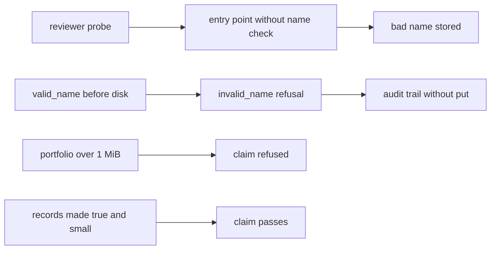

# 20261026-1525 — Telegram wave 6w: the vault NIF review approved by an independent claimant, its two surviving probes closed by name validation, and the portfolio brought back under the checker's byte bound

#fractal-l1 #fractal-l3 #fractal-l5 #fractal-l9 #zk-adr #zero-muda #km-triad

[This journal](http://nas-1.tail55d152.ts.net:4100/files/docs/journal/20261026-1525-claude-telegram-wave6w-vault-review-approved-and-name-hardening.md) · [Wave 6v](http://nas-1.tail55d152.ts.net:4100/files/docs/journal/20261026-1525-claude-telegram-wave6v-vault-nif-vf01-closure.md) · [AGY verdict](http://nas-1.tail55d152.ts.net:4100/files/governance/planning/20261026-1528-agy-vault-nif-review-independent-verdict.json) · [Crate README](http://nas-1.tail55d152.ts.net:4100/files/apps/cepaf_gleam/native/rusty_vault_nif/README.md) · [Review packets](http://nas-1.tail55d152.ts.net:4100/files/docs/sop/20261026-1018-telegram-review-packets.md) · [KPI ledger](http://nas-1.tail55d152.ts.net:4100/files/governance/planning/20261026-0639-claude-telegram-wave-kpi-ledger.json) · [Cockpit](http://nas-1.tail55d152.ts.net:4100/)

Transclusions: [[zk:20260905-1801-moc-uos-unified-master]] · [[wiki:20260905-1801-uos-zk-km-corpus-index]]

## 1. Scope & Trigger

Sa-plan `uos/telegram-runtime/20261001-1150` VAULT_NIF_HARDEN attempt 1 (class P2, phase implementation; claimed through the gated claim after the portfolio was brought back under the checker's 1 MiB bound; PREFLIGHT_PASS, ACTIVE_OBSERVATION_PASS; integrator `claude-fable-l0-35600f5c`). Trigger: VAULT_NIF_REVIEW completed by `agy-review-v-20261026` with APPROVE and two hostile probes that the entry points did not refuse. This journal also records that review. Standard scale by files.

## 2. Pre-State Assessment

Wave 6v had landed at 5b4073e4 with the vault NIF persisting and refusing a wrong key; its independent review was launched against that commit. Prior: the review approves; any finding is small; the next claim passes as the last ones did.

## 3. Execution Detail

1. **Review.** AGY claimed VAULT_NIF_REVIEW from its own workspace at 5b4073e4, verified the pin, rebuilt offline (66/66 tests; a different digest explained by workspace path strings in debuginfo), ran the five eunit suites (75 passed), observed persistence across two BEAM processes of its own, and completed with APPROVE: V-LAW-01 to V-LAW-07 VERIFIED. Its eight hostile probes: empty value, zero ttl, max_ttl below ttl, unknown lease, unwritable path and a corrupted verifier row were all refused; an empty name and a name carrying a NUL byte were stored.
2. **Hardening.** `valid_name` (non-empty, at most 512 bytes, no byte below 0x20 and no 0x7f) is checked before any disk access in `vault_kv_put`, `vault_kv_get`, `vault_kv_versions` and `vault_kv_destroy`, answering `{error, {invalid_name, Name}}`. A cargo law covers the truth table including non-ASCII names; an eunit law drives all five bad shapes through all four entry points and checks the audit trail carries no put; the mutant that accepts every name is killed (1 law red). Crate total 67; library rebuilt, installed, the five vault suites pass (76), pin 6db27c1e.
3. **The claim that would not pass.** The first preflight returned `RP-INVALID: input exceeds byte bound`: the portfolio had grown to 1,049,502 bytes against the reader's 1 MiB limit (`bounded.ml`), and the checker requires a record for every task of the plan, so archiving records is not an option. The four records cloned today (VAULT_NIF_FIX, VAULT_NIF_REVIEW, VAULT_NIF_HARDEN, BRIDGE_EVIDENCE) were found to carry another task's rationale, counterevidence and failure modes copied from the media waves. They were rewritten with their own compact content, with the factor references bound to their own evidence files; the file is 1,036,237 bytes and the claim passed. Two further holds on the way (`RP-EVIDENCE` and `RP-REFERENCE`) were stamp and reference defects of the rewrite itself.
4. **Full suite.** 13895 passed, 0 failed (gleam test at the candidate, second run after the eexist repair).

## 4. Root Cause Analysis

ACH: why were an empty name and a NUL-bearing name stored?

| Evidence | H1: no entry point validated the name; sqlite stores any bytes, so nothing failed | H2: rustler decoded the binary wrongly | H3: the reviewer's probe went through a different path |
|---|---|---|---|
| E1: the wave 6v entry points checked state, value emptiness and ttl, and nothing about the name | Consistent | Inconsistent | Inconsistent |
| E2: the reviewer's lease ids read `lease-k\0nul-1-…` and `lease--1-…`: the bytes reached the store intact | Consistent | Refuted | Refuted |
| E3: after `valid_name`, the eunit law gets `invalid_name` from all four entry points and the audit trail shows no put | Consistent | Neutral | Neutral |
| Evaluation | **CONFIRMED** | REFUTED | REFUTED |

## 5. Fix Taxonomy

- **Poka-yoke:** the name check runs before any disk access and names the offending input in the refusal.
- **Jidoka:** the portfolio stopped the claim at the byte bound rather than reading a truncated file; the fix was to make the records true and small, not to raise the bound.
- **Muda:** the cloned prose removed from four records; no new dependency.

## 6. Patterns & Anti-Patterns Discovered

- Anti-pattern (L-35): cloning a record to create a new one copies another task's rationale into it, and a plan of about 95 records fills the 1 MiB portfolio; the next Telegram tasks open a new Sa-plan plan with a fresh portfolio.
- Devil's Advocate: five AGY verdicts in one day are independent of the author, not of each other; a Codex claimant on the next review would add a second reviewer family.
- Devil's Advocate: V-LAW-06 rests on identical test outcomes, not on byte-identical builds; a reproducible build with path remapping is a separate improvement.
- Anti-pattern (found by the first full-suite run of this wave): the eunit helper named its scratch directories by `erlang:unique_integer`, which is unique within one BEAM only, so the second `gleam test` run reproduced the names of the first and three laws failed on `eexist`; the name now carries the OS pid and the microsecond clock, and the laws were run twice in separate BEAMs before the suite was rerun.
- Devil's Advocate: names stored before the hardening are not rewritten; `destroy` still accepts them only through a valid name, so a pre-existing bad row can only be removed by a direct sqlite operation under the runtime owner.

## 7. Verification Matrix

| Check | Result | Admiralty |
|---|---|---|
| VAULT_NIF_REVIEW completed in Sa-plan by an AGY claimant with APPROVE, 7/7 laws VERIFIED | `task show` state=completed; verdict filed | B1 |
| Crate tests with the name law | 67 passed, 0 failed | A2 |
| Mutant (accept every name) | killed; source restored (sha256 equal) | A2 |
| Vault suites through the installed library | 76 passed | A2 |
| Full Gleam suite at the candidate | 13895 passed, 0 failed (gleam test at the candidate, second run after the eexist repair) | A2 |
| Pin equals the installed library | sha256 6db27c1e | A2 |
| Portfolio under the byte bound with accurate records | 1,036,237 bytes; PREFLIGHT_PASS | A2 |
| Diagram parity and journal linter | PASS / 10/10 | A1 |

## 8. Files Modified

- `apps/cepaf_gleam/native/rusty_vault_nif/src/lib.rs`, `apps/cepaf_gleam/native/rusty_vault_nif/README.md`, `apps/cepaf_gleam/test/rusty_vault_persistence_test.erl`, `apps/cepaf_gleam/priv/rusty_vault_nif.sha256`, `governance/planning/20261026-1528-agy-vault-nif-review-independent-verdict.json` (new), the review packets, the portfolio (four records rewritten), the ledger (row 6w, L-35, TG-KPI-11 5/5, TG-KPI-12 5/5, forecasts), this journal

## 9. Architectural Observations

```text
[reviewer probe] -> [entry point without name check]
[entry point without name check] -> [bad name stored]
[valid_name before disk] -> [invalid_name refusal]
[invalid_name refusal] -> [audit trail without put]
[portfolio over 1 MiB] -> [claim refused]
[records made true and small] -> [claim passes]
```



## 10. Remaining Gaps

- The staging bot token remains operator input; TELEGRAM_E2E is recorded as blocked on it; RETURN, RELEASE and ADMISSION wait behind it.
- BRIDGE_EVIDENCE waits for the soak window to close on 2026-10-27 (interim: 0 locked lines, 1 curl timeout surfaced after retries).
- The Telegram secrets stay on the durable file store; moving them to the NIF is a separate decision.
- The portfolio has about 12 KB of headroom; the next tasks belong to a new plan (L-35).

## 11. Metrics Summary

- TG-KPI-11 independent review closure 5/5; TG-KPI-12 vault NIF law closure 5/5 at pin 6db27c1e. Laws added: 1 cargo, 1 eunit; mutants killed 1/1 (3/3 across 6v and 6w).
- Bayesian (Beta over "a planted mutant is killed by the wave's laws", this session): Beta(11,2) → Beta(12,2); mean 0.86.
- Lyapunov: V = reviewer findings without a landed fix: 2 → 0; dV/dt < 0.

## 12. STAMP & Constitutional Alignment

| UCA type | Hazard | Control |
|---|---|---|
| Not provided | a name never validated | `valid_name` at every entry point |
| Provided unsafely | a claim passing on records that describe another task | records rewritten with their own content before the claim |
| Wrong timing | hardening before the reviewer recorded the probes | the review completed first; the hardening cites its probes |
| Too long | a portfolio grown past the reader's bound | new plan for the next tasks (L-35) |

## 13. Conclusion

The vault NIF has an independent APPROVE at 5b4073e4 and, at this candidate, refuses the two inputs the reviewer found it storing.

**Forecast:** p = 0.8 that the production bridge journal shows no `database is locked` line and no crash in the 24 hours after the wave 6t restart, by 2026-10-27T15:00:00Z.
- Falsifier: one such line or a unit restart in the window (outcome 0).
- Brier score: B = (0.8 − o)².

## Comprehensive verification checklist

Checks below are obligations, not blanket passing claims.

<details><summary>Domain 1 — Metadata, timestamp and Tailscale navigation</summary>

- [x] **CHK-01-TIME** — Prefix `20261026-1525-` from the host UTC clock (`date -u`).
- [ ] **CHK-02-TAIL** — Tailnet links provided; serving not re-verified.
- [x] **CHK-03-FRACT** — L1, L3, L5, L9 assigned.
- [x] **CHK-04-KM** — MOC and corpus index transcluded; verdict, README, packets, ledger and previous journal linked.

</details>

<details><summary>Domain 2 — Zero-Muda purity and storage safety</summary>

- [x] **CHK-05-MUDA** — No dependencies added; cloned prose removed.
- [ ] **CHK-06-GRAPH** — Not evaluated.
- [ ] **CHK-07-DRIVE** — Not in scope; serial written as `[REDACTED_SYSTEM_OS_SERIAL]` where mentioned.

</details>

<details><summary>Domain 3 — Testing Gold Standard and mathematical gates</summary>

- [ ] **CHK-08-C1C8** — Not evaluated.
- [ ] **CHK-09-MATH** — Not measured.
- [x] **CHK-10-9MOD** — Unit (cargo), mutation (1/1), eunit through the loaded library.
- [x] **CHK-11-REGR** — Vault suites and the full Gleam suite at the candidate (section 7).

</details>

<details><summary>Domain 4 — Cross-language control and observability</summary>

- [x] **CHK-12-GLEAM** — Unchanged boundary; the NIF validates at its edge.
- [ ] **CHK-13-HERMES** — Not exercised.
- [ ] **CHK-14-ZIGVM** — Not exercised.
- [ ] **CHK-15-MAX** — Not applicable.
- [ ] **CHK-16-OTEL** — Not evaluated.

</details>

<details><summary>Domain 5 — Sovereign governance and standalone Jujutsu</summary>

- [ ] **CHK-17-SOV** — Five independent AGY reviews complete; a Codex review family and R5 remain outstanding.
- [x] **CHK-18-JJ** — Standalone jj; integrator workspace only.

</details>

<details><summary>Domain 6 — Provenance extension</summary>

EV ceiling remains 93. EV-94..109 remain NOT_ADMITTED. No new EV number is minted.

</details>

[Previous journal](http://nas-1.tail55d152.ts.net:4100/files/docs/journal/20261026-1525-claude-telegram-wave6v-vault-nif-vf01-closure.md) · [ZK Master MOC](http://nas-1.tail55d152.ts.net:4100/zk) · [Wiki Corpus Index](http://nas-1.tail55d152.ts.net:4100/wiki)

UOS footer: `nas-1.tail55d152.ts.net:4100` · peer `vm-1.tail55d152.ts.net:4100` · document evidence grants no system admission.
