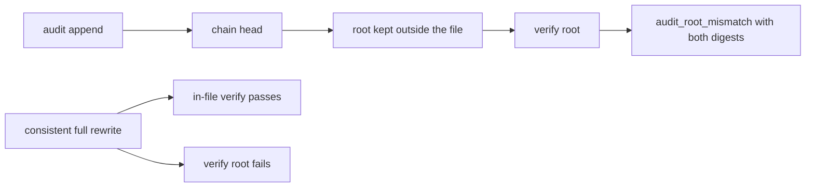

# 20261026-1645 — Telegram wave 6y: review 4 approved the race and chain closure, and the chain head is now exposed for an external root that detects a consistent full rewrite

#fractal-l1 #fractal-l3 #fractal-l5 #fractal-l9 #zk-adr #zero-muda #km-triad

[This journal](http://nas-1.tail55d152.ts.net:4100/files/docs/journal/20261026-1645-claude-telegram-wave6y-vault-external-root.md) · [Wave 6x](http://nas-1.tail55d152.ts.net:4100/files/docs/journal/20261026-1653-claude-telegram-wave6x-vault-race-closed-and-audit-chain.md) · [Review 4 verdict](http://nas-1.tail55d152.ts.net:4100/files/governance/planning/20261026-1643-agy-vault-nif-review4-independent-verdict.json) · [Crate README](http://nas-1.tail55d152.ts.net:4100/files/apps/cepaf_gleam/native/rusty_vault_nif/README.md) · [Review packets](http://nas-1.tail55d152.ts.net:4100/files/docs/sop/20261026-1018-telegram-review-packets.md) · [KPI ledger](http://nas-1.tail55d152.ts.net:4100/files/governance/planning/20261026-0639-claude-telegram-wave-kpi-ledger.json) · [Cockpit](http://nas-1.tail55d152.ts.net:4100/)

Transclusions: [[zk:20260905-1801-moc-uos-unified-master]] · [[wiki:20260905-1801-uos-zk-km-corpus-index]]

## 1. Scope & Trigger

Sa-plan `uos/telegram-vault/20261026-1530` VAULT_NIF_HARDEN3 attempt 1 (class P2, phase implementation; claimed through the gated claim after a score defect in its own record was corrected; PREFLIGHT_PASS, ACTIVE_OBSERVATION_PASS; integrator `claude-fable-l0-35600f5c`). Trigger: VAULT_NIF_REVIEW4 completed with APPROVE and carried forward the residual that two reviews had recorded, a consistent rewrite of the whole audit chain. Trivial scale by source files; standard by records.

## 2. Pre-State Assessment

The chain made rewrites, insertions, deletions and pre-chain rows visible, but a tamperer who recomputes every digest from the first row produces a chain that verifies. Prior: exposing the verified head and comparing it with a root the caller keeps elsewhere closes that in one small primitive; the keeper of the root is a separate decision.

## 3. Execution Detail

1. **Review 4.** `agy-review-v4-20261026` re-ran its predecessor's reproducers at d75aa8f1: 30 s of 190,661 seal and unseal cycles against 4,960,940 reads and puts on one handle with every answer typed and zero `nif_panicked`; four writers, 207 chained rows, no shared predecessor; tamper-evidence with the correct first broken id for a rewrite, a forged insert, a delete and a rename; a vault created with the previous library migrates on open and its legacy rows are refused at id 1; the pin equals the installed library and `Cargo.lock` changed only by the direct `blake2` dependency. APPROVE, 6/6, 69 cargo and 77 eunit tests.
2. **The primitive.** `sqlite_backend::audit_head` returns the row count and last digest; `DiskVaultHandle::audit_root` verifies the chain and returns the head, `audit_verify_root` compares it with an expected digest and reports both digests on a mismatch; the NIF exposes `vault_audit_root/1` and `vault_audit_verify_root/2`, registered in `rustler::init!` and stubbed in `rusty_vault_nif.erl`.
3. **Laws.** A cargo law performs the consistent rewrite itself with rusqlite (drops the trigger, rewrites row 3, recomputes every digest with the crate's own `audit_digest`) and asserts the in-file verification passes while the external root fails; the mutant that makes root verification ignore the mismatch is killed. An eunit law shows the head moving with every append, a stale root answered with both digests, and a fresh handle on the same file reporting the same head. Crate 70 tests; vault suites 78, twice in separate BEAMs; pin ab61df88.
4. **Record defect.** The new record declared score 432 with factors 3, 3, 4, 3, 3; the checker held on `RP-INVALID: five-factor product mismatch` and the score was corrected to 324 before the claim.
5. **Full suite.** 13897 passed, 0 failed (gleam test at the candidate).

## 4. Root Cause Analysis

ACH: why could a consistent full rewrite pass the chain?

| Evidence | H1: a hash chain inside one file proves only internal consistency; the first row has no predecessor outside the file to anchor it | H2: the digest function was weak | H3: the verifier skipped rows |
|---|---|---|---|
| E1: the cargo law recomputes every digest with the crate's own function after a rewrite and the verifier accepts all four rows | Consistent | Inconsistent | Inconsistent |
| E2: the same chain compared with the head recorded before the rewrite reports `audit_root_mismatch` | Consistent | Neutral | Neutral |
| E3: single-row tampering is still caught at the right id (review 4) | Neutral | Refuted | Refuted |
| Evaluation | **CONFIRMED** | REFUTED | REFUTED |

## 5. Fix Taxonomy

- **Poka-yoke:** the head is returned only after the chain verifies, so a caller never anchors a broken chain.
- **Jidoka:** `audit_root_mismatch` carries both digests; nothing is repaired silently.
- **Muda:** two functions, no new dependency; the keeper of the root is left to the caller rather than invented here.

## 6. Patterns & Anti-Patterns Discovered

- Pattern: a chain anchors history inside a file; a root anchors the file in history. Both are needed; the second is a caller's record.
- Anti-pattern: a cloned record with a hand-written score; the product of its factors is the only score (held by `RP-INVALID`).
- Devil's Advocate: the root is only as safe as its keeper; a root written to the same disk by the same user is a weaker anchor than a row in the Sa-plan store. The keeper decision is recorded as the residual for review 5.
- Devil's Advocate: eight approvals from one reviewer family; a Codex claimant on the next review would add independence between reviewers.

## 7. Verification Matrix

| Check | Result | Admiralty |
|---|---|---|
| VAULT_NIF_REVIEW4 completed in Sa-plan by an AGY claimant with APPROVE, 6/6 laws | `task show` state=completed; verdict filed | B1 |
| Crate tests with the external-root law | 70 passed, 0 failed | A2 |
| Mutant (root verification ignores mismatch) | killed; source restored (sha256 equal) | A2 |
| Vault suites through the installed library, two separate BEAMs | 78 passed, twice | A2 |
| Full Gleam suite at the candidate | 13897 passed, 0 failed (gleam test at the candidate) | A2 |
| Pin equals the installed library | sha256 ab61df88 | A2 |
| Diagram parity and journal linter | PASS / 10/10 | A1 |

## 8. Files Modified

- `apps/cepaf_gleam/native/rusty_vault_nif/src/{lib.rs,vault_handle.rs,sqlite_backend.rs}`, `apps/cepaf_gleam/native/rusty_vault_nif/README.md`, `apps/cepaf_gleam/src/rusty_vault_nif.erl`, `apps/cepaf_gleam/test/rusty_vault_persistence_test.erl`, `apps/cepaf_gleam/priv/rusty_vault_nif.sha256`, `governance/planning/20261026-1643-agy-vault-nif-review4-independent-verdict.json` (new), the review packets, the vault-plan portfolio, the ledger (row 6y, TG-KPI-11 8/8, TG-KPI-12 8/8), this journal

## 9. Architectural Observations

```text
[audit append] -> [chain head]
[chain head] -> [root kept outside the file]
[root kept outside the file] -> [verify root]
[verify root] -> [audit_root_mismatch with both digests]
[consistent full rewrite] -> [in-file verify passes]
[consistent full rewrite] -> [verify root fails]
```



## 10. Remaining Gaps

- A keeper for the root: a Sa-plan evidence row or ledger entry written by the vault owner after each session; decided after review 5.
- VAULT_NIF_REVIEW5 for this candidate by an independent claimant.
- The staging bot token remains operator input; TELEGRAM_E2E is blocked on it; RETURN, RELEASE and ADMISSION wait behind it. BRIDGE_EVIDENCE waits for the soak window on 2026-10-27.

## 11. Metrics Summary

- TG-KPI-11 independent review closure 8/8; TG-KPI-12 vault law closure 8/8 at pin ab61df88. Laws added: 1 cargo, 1 eunit; mutants killed 1/1 (6/6 across 6v to 6y).
- Bayesian (Beta over "a planted mutant is killed by the wave's laws", this session): Beta(14,2) → Beta(15,2); mean 0.88.
- Lyapunov: V = recorded residuals of the vault reviews without a landed primitive: 1 → 0; dV/dt < 0.

## 12. STAMP & Constitutional Alignment

| UCA type | Hazard | Control |
|---|---|---|
| Not provided | a chain with no anchor outside its file | the head exposed for an external root |
| Provided unsafely | a head anchored from a broken chain | the head returned only after verification |
| Wrong timing | a root compared before the chain is verified | verify first, compare second |
| Too long | a record carrying a score its factors do not produce | `RP-INVALID` held the claim until corrected |

## 13. Conclusion

The vault's audit history can now be anchored outside its file, and the one way to forge it that the chain could not see is visible to whoever keeps that anchor.

**Forecast:** p = 0.7 that VAULT_NIF_REVIEW5 is completed by an AGY claimant with APPROVE or APPROVE_WITH_CHANGES and no REFUTED law by 2026-10-27T12:00:00Z.
- Falsifier: REQUEST_CHANGES, a REFUTED law, or no completion by the horizon (outcome 0).
- Brier score: B = (0.7 − o)².

## Comprehensive verification checklist

Checks below are obligations, not blanket passing claims.

<details><summary>Domain 1 — Metadata, timestamp and Tailscale navigation</summary>

- [x] **CHK-01-TIME** — Prefix `20261026-1645-` from the host UTC clock (`date -u`).
- [ ] **CHK-02-TAIL** — Tailnet links provided; serving not re-verified.
- [x] **CHK-03-FRACT** — L1, L3, L5, L9 assigned.
- [x] **CHK-04-KM** — MOC and corpus index transcluded; verdict, README, packets, ledger and previous journal linked.

</details>

<details><summary>Domain 2 — Zero-Muda purity and storage safety</summary>

- [x] **CHK-05-MUDA** — No dependency added; `cargo tree` free of Tongsuo and SM2/3/4.
- [ ] **CHK-06-GRAPH** — Not evaluated.
- [ ] **CHK-07-DRIVE** — Not in scope; serial written as `[REDACTED_SYSTEM_OS_SERIAL]` where mentioned.

</details>

<details><summary>Domain 3 — Testing Gold Standard and mathematical gates</summary>

- [ ] **CHK-08-C1C8** — Not evaluated.
- [ ] **CHK-09-MATH** — Not measured.
- [x] **CHK-10-9MOD** — Unit (cargo), mutation (1/1), eunit through the loaded library.
- [x] **CHK-11-REGR** — Vault suites and the full Gleam suite at the candidate (section 7).

</details>

<details><summary>Domain 4 — Cross-language control and observability</summary>

- [x] **CHK-12-GLEAM** — Unchanged boundary; the root keeper is a BEAM-side decision.
- [ ] **CHK-13-HERMES** — Not exercised.
- [ ] **CHK-14-ZIGVM** — Not exercised.
- [ ] **CHK-15-MAX** — Not applicable.
- [x] **CHK-16-OTEL** — Audit rows carry unix-second timestamps and a chained digest; not OTel-formatted.

</details>

<details><summary>Domain 5 — Sovereign governance and standalone Jujutsu</summary>

- [ ] **CHK-17-SOV** — Eight AGY reviews complete; a Codex review family and R5 remain outstanding.
- [x] **CHK-18-JJ** — Standalone jj; integrator workspace only.

</details>

<details><summary>Domain 6 — Provenance extension</summary>

EV ceiling remains 93. EV-94..109 remain NOT_ADMITTED. No new EV number is minted.

</details>

[Previous journal](http://nas-1.tail55d152.ts.net:4100/files/docs/journal/20261026-1653-claude-telegram-wave6x-vault-race-closed-and-audit-chain.md) · [ZK Master MOC](http://nas-1.tail55d152.ts.net:4100/zk) · [Wiki Corpus Index](http://nas-1.tail55d152.ts.net:4100/wiki)

UOS footer: `nas-1.tail55d152.ts.net:4100` · peer `vm-1.tail55d152.ts.net:4100` · document evidence grants no system admission.
