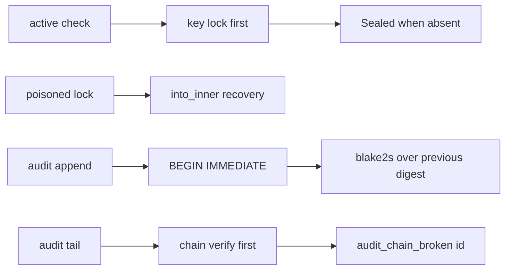

# 20261026-1653 — Telegram wave 6x: the adversarial vault review approved, its seal-vs-read race closed with poison-tolerant locks, and the audit trail made tamper-evident by a hash chain

#fractal-l1 #fractal-l3 #fractal-l5 #fractal-l9 #zk-adr #zero-muda #km-triad

[This journal](http://nas-1.tail55d152.ts.net:4100/files/docs/journal/20261026-1653-claude-telegram-wave6x-vault-race-closed-and-audit-chain.md) · [Wave 6w](http://nas-1.tail55d152.ts.net:4100/files/docs/journal/20261026-1525-claude-telegram-wave6w-vault-review-approved-and-name-hardening.md) · [Adversarial verdict](http://nas-1.tail55d152.ts.net:4100/files/governance/planning/20261026-1637-agy-vault-nif-review3-independent-verdict.json) · [Crate README](http://nas-1.tail55d152.ts.net:4100/files/apps/cepaf_gleam/native/rusty_vault_nif/README.md) · [Review packets](http://nas-1.tail55d152.ts.net:4100/files/docs/sop/20261026-1018-telegram-review-packets.md) · [KPI ledger](http://nas-1.tail55d152.ts.net:4100/files/governance/planning/20261026-0639-claude-telegram-wave-kpi-ledger.json) · [Cockpit](http://nas-1.tail55d152.ts.net:4100/)

Transclusions: [[zk:20260905-1801-moc-uos-unified-master]] · [[wiki:20260905-1801-uos-zk-km-corpus-index]]

## 1. Scope & Trigger

Sa-plan `uos/telegram-vault/20261026-1530` VAULT_NIF_HARDEN2 attempt 1 (class P1, phase implementation; claimed through the gated claim in the vault plan; PREFLIGHT_PASS, ACTIVE_OBSERVATION_PASS; integrator `claude-fable-l0-35600f5c`). Trigger: VAULT_NIF_REVIEW3, the adversarial review by `agy-review-v3-20261026`, completed with APPROVE and two reproduced defects. This journal also records VAULT_NIF_REVIEW2 (APPROVE, 4/4 laws) and VAULT_NIF_REVIEW3 (APPROVE, 6/6 laws). Standard scale by files.

## 2. Pre-State Assessment

The crate held two approvals; the adversarial review was asked to try what they had not. Prior: durability, concurrency and the verifier race hold; the `.expect` sites around the key lock are the likely weak point; audit tampering by direct sqlite access is undetectable by construction.

## 3. Execution Detail

1. **The reviews.** REVIEW2 verified name validation at every entry point and that a bad-name row written directly with sqlite is neither read nor destroyed through the NIF; its five new probes found a spaces-only name accepted (left as a contract decision). REVIEW3 proved a put survives `kill -9` of its BEAM, four BEAMs writing 200 versions leave an exact store with `integrity_check` ok, ten two-process races on an empty file each produced one winner and one `wrong_key`, and the 32 key bytes are absent from NIF memory after `vault_seal`. It reproduced two defects: a `vault_seal` between `require_active` and the key lock panics on `.expect("require_active guarantees Some")` while holding the lock, poisoning it so the handle answers only `nif_panicked` from then on; and with direct sqlite access `DROP TRIGGER`, `UPDATE`, a past-timestamp `INSERT` and a `RENAME` all succeed and `vault_audit_tail` returns the forged rows.
2. **The race.** Every `.lock().expect(...)` in `vault_handle.rs` became `.lock().unwrap_or_else(|p| p.into_inner())`, and every `.expect("require_active guarantees Some")` became `.ok_or(VaultHandleError::Sealed)?`, so a key read takes the lock first and answers `Sealed` when the key is gone. A cargo law seals and re-unseals from a second thread 400 times while the main thread alternates reads and writes; every outcome is `Ok` or `Sealed`, the flipper thread never panics and the handle serves afterwards.
3. **The chain.** `audit_log` gains a `digest` column (added by `ALTER TABLE` to files that predate it). `audit_append` runs under `BEGIN IMMEDIATE` on a connection with a 5 s busy timeout: it reads the last digest, computes blake2s-256 over that digest and the row's fields joined by newlines, inserts and commits. `audit_verify` walks the rows in id order recomputing; `vault_audit_tail` calls it first and answers `{error, {audit_chain_broken, Id}}` at the first row that does not recompute. The handle's own `append_audit`, which opened its own connection, now delegates to the backend so every row joins the chain. `blake2` 0.10.6 was already in the tree through argon2 and became a direct dependency; `Cargo.lock` was updated once offline for it and `--locked` holds again.
4. **Laws and mutants.** Cargo: 69 tests, 12 `vf01_laws`, including the chain law that drops a trigger, rewrites a row and forges a past-timestamp row and sees `Err(3)` then `Err(5)`. Mutants: the verifier ignoring a mismatch and the append forgetting its predecessor, both killed. Eunit: the tamper law drives the same sqlite statements through the host `sqlite3` and sees the tail refuse with the offending id; the five vault suites pass twice in separate BEAMs (77). Library rebuilt, installed, pinned a5b63b75.
5. **Full suite.** 13896 passed, 0 failed (gleam test at the candidate).

## 4. Root Cause Analysis

ACH: why could one concurrent seal disable a handle for good?

| Evidence | H1: the key was read in two steps (state check, then lock and `expect`), and a panic while holding a `std::sync::Mutex` poisons it, so every later lock also panicked | H2: rustler failed to trap the panic | H3: sqlite returned an error that was mis-mapped |
|---|---|---|---|
| E1: the reviewer's reproducer names `vault_handle.rs:293` and `:320`, the two `.expect("require_active guarantees Some")` sites in the entry-point paths | Consistent | Neutral | Inconsistent |
| E2: rustler trapped the first panic as `nif_panicked` and the BEAM stayed up; later calls alternated `sealed` and `nif_panicked` | Consistent | Refuted | Inconsistent |
| E3: after the lock-first rewrite the 400-iteration flipper law yields only `Ok` and `Sealed` and the handle serves afterwards | Consistent | Neutral | Refuted |
| Evaluation | **CONFIRMED** | REFUTED | REFUTED |

## 5. Fix Taxonomy

- **Poka-yoke:** a read that cannot observe "active without a key" because it holds the lock while it looks; a chain that makes every audit row vouch for its predecessor.
- **Jidoka:** `vault_audit_tail` refuses the whole trail on the first broken link rather than returning the rows that still recompute.
- **Muda:** no new crate downloaded; the handle's second audit code path removed.

## 6. Patterns & Anti-Patterns Discovered

- Anti-pattern: `expect` on a `Mutex` guard inside a library that the BEAM keeps alive; a poisoned lock is a permanent denial of service of the resource, not a crash.
- Pattern: a check-then-lock pair on two different locks is a race; take the lock that guards the value and decide from the value.
- Devil's Advocate: the chain detects rewrites, insertions, deletions and pre-chain rows, but a tamperer who rewrites every row from the first one consistently is not detected; a root digest kept outside the file (for example in the Sa-plan ledger) is the next step and is recorded as a residual.
- Devil's Advocate: the busy timeout turns contention into latency; with the 5 s ceiling a writer under heavy contention waits rather than fails, which is the behaviour a secrets store wants and a hot path would not.

## 7. Verification Matrix

| Check | Result | Admiralty |
|---|---|---|
| VAULT_NIF_REVIEW2 and VAULT_NIF_REVIEW3 completed in Sa-plan by AGY claimants with APPROVE | `task show` state=completed; verdicts filed | B1 |
| Crate tests with the race and chain laws | 69 passed, 0 failed | A2 |
| Mutants (verifier ignores mismatch; append forgets predecessor) | 2 killed; source restored (sha256 equal) | A2 |
| Vault suites through the installed library, two separate BEAMs | 77 passed, twice | A2 |
| Full Gleam suite at the candidate | 13896 passed, 0 failed (gleam test at the candidate) | A2 |
| Pin equals the installed library | sha256 a5b63b75 | A2 |
| Barred dependencies after the lock update | `cargo tree` matches none | A2 |
| Diagram parity and journal linter | PASS / 10/10 | A1 |

## 8. Files Modified

- `apps/cepaf_gleam/native/rusty_vault_nif/src/{vault_handle.rs,sqlite_backend.rs,lib.rs}`, `apps/cepaf_gleam/native/rusty_vault_nif/{Cargo.toml,Cargo.lock,README.md}`, `apps/cepaf_gleam/test/rusty_vault_persistence_test.erl`, `apps/cepaf_gleam/priv/rusty_vault_nif.sha256`, `governance/planning/20261026-1637-agy-vault-nif-review3-independent-verdict.json` (new), the review packets, the vault-plan portfolio, the ledger (row 6x, TG-KPI-11 7/7, TG-KPI-12 7/7), this journal

## 9. Architectural Observations

```text
[active check] -> [key lock first]
[key lock first] -> [Sealed when absent]
[poisoned lock] -> [into_inner recovery]
[audit append] -> [BEGIN IMMEDIATE]
[BEGIN IMMEDIATE] -> [blake2s over previous digest]
[audit tail] -> [chain verify first]
[chain verify first] -> [audit_chain_broken id]
```



## 10. Remaining Gaps

- A root digest outside the file so a consistent full rewrite of the chain is detectable.
- VAULT_NIF_REVIEW4 for this candidate by an independent claimant.
- The staging bot token remains operator input; TELEGRAM_E2E is blocked on it; RETURN, RELEASE and ADMISSION wait behind it. BRIDGE_EVIDENCE waits for the soak window on 2026-10-27.

## 11. Metrics Summary

- TG-KPI-11 independent review closure 7/7; TG-KPI-12 vault law closure 7/7 at pin a5b63b75. Laws added: 2 cargo, 1 eunit; mutants killed 2/2 (5/5 across 6v to 6x).
- Bayesian (Beta over "a planted mutant is killed by the wave's laws", this session): Beta(12,2) → Beta(14,2); mean 0.875.
- Lyapunov: V = reviewer-reproduced defects without a landed fix: 2 → 0; dV/dt < 0.

## 12. STAMP & Constitutional Alignment

| UCA type | Hazard | Control |
|---|---|---|
| Not provided | a handle that stops serving after one race | poison-tolerant locks; lock-first key reads; the flipper law |
| Provided unsafely | forged audit rows returned as true | the hash chain verified before any row is returned |
| Wrong timing | a seal landing between a check and a read | the check and the read under one lock |
| Too long | a chain that is never verified | verification on every tail call |

## 13. Conclusion

The vault NIF survives a concurrent seal without losing the handle, and its audit trail now refuses to be read once a row has been rewritten, inserted or removed.

**Forecast:** p = 0.7 that VAULT_NIF_REVIEW4 is completed by an AGY claimant with APPROVE or APPROVE_WITH_CHANGES and no REFUTED law by 2026-10-27T12:00:00Z.
- Falsifier: REQUEST_CHANGES, a REFUTED law, or no completion by the horizon (outcome 0).
- Brier score: B = (0.7 − o)².

## Comprehensive verification checklist

Checks below are obligations, not blanket passing claims.

<details><summary>Domain 1 — Metadata, timestamp and Tailscale navigation</summary>

- [x] **CHK-01-TIME** — Prefix `20261026-1653-` from the host UTC clock (`date -u`).
- [ ] **CHK-02-TAIL** — Tailnet links provided; serving not re-verified.
- [x] **CHK-03-FRACT** — L1, L3, L5, L9 assigned.
- [x] **CHK-04-KM** — MOC and corpus index transcluded; verdict, README, packets, ledger and previous journal linked.

</details>

<details><summary>Domain 2 — Zero-Muda purity and storage safety</summary>

- [x] **CHK-05-MUDA** — `blake2` promoted from transitive to direct; nothing downloaded; `cargo tree` free of Tongsuo and SM2/3/4.
- [ ] **CHK-06-GRAPH** — Not evaluated.
- [ ] **CHK-07-DRIVE** — Not in scope; serial written as `[REDACTED_SYSTEM_OS_SERIAL]` where mentioned.

</details>

<details><summary>Domain 3 — Testing Gold Standard and mathematical gates</summary>

- [ ] **CHK-08-C1C8** — Not evaluated.
- [ ] **CHK-09-MATH** — Not measured.
- [x] **CHK-10-9MOD** — Unit (cargo), concurrency (flipper law), mutation (2/2), eunit through the loaded library.
- [x] **CHK-11-REGR** — Vault suites and the full Gleam suite at the candidate (section 7).

</details>

<details><summary>Domain 4 — Cross-language control and observability</summary>

- [x] **CHK-12-GLEAM** — Unchanged boundary; the NIF stays a bounded storage kernel behind the BEAM.
- [ ] **CHK-13-HERMES** — Not exercised.
- [ ] **CHK-14-ZIGVM** — Not exercised.
- [ ] **CHK-15-MAX** — Not applicable.
- [x] **CHK-16-OTEL** — Audit rows carry unix-second timestamps and a chained digest; not OTel-formatted.

</details>

<details><summary>Domain 5 — Sovereign governance and standalone Jujutsu</summary>

- [ ] **CHK-17-SOV** — Seven AGY reviews complete; a Codex review family and R5 remain outstanding.
- [x] **CHK-18-JJ** — Standalone jj; integrator workspace only.

</details>

<details><summary>Domain 6 — Provenance extension</summary>

EV ceiling remains 93. EV-94..109 remain NOT_ADMITTED. No new EV number is minted.

</details>

[Previous journal](http://nas-1.tail55d152.ts.net:4100/files/docs/journal/20261026-1525-claude-telegram-wave6w-vault-review-approved-and-name-hardening.md) · [ZK Master MOC](http://nas-1.tail55d152.ts.net:4100/zk) · [Wiki Corpus Index](http://nas-1.tail55d152.ts.net:4100/wiki)

UOS footer: `nas-1.tail55d152.ts.net:4100` · peer `vm-1.tail55d152.ts.net:4100` · document evidence grants no system admission.
