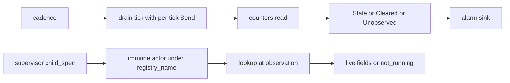

# 20261026-1721 — Telegram wave 6z: the two review residuals in the author's control closed, a supervised gateway ticker that raises the staleness alarm and a supervised, discoverable immune actor

#fractal-l2 #fractal-l3 #fractal-l4 #fractal-l5 #zk-adr #zero-muda #km-triad

[This journal](http://nas-1.tail55d152.ts.net:4100/files/docs/journal/20261026-1721-claude-telegram-wave6z-review-residuals-closed.md) · [Wave 6y](http://nas-1.tail55d152.ts.net:4100/files/docs/journal/20261026-1645-claude-telegram-wave6y-vault-external-root.md) · [Review packets](http://nas-1.tail55d152.ts.net:4100/files/docs/sop/20261026-1018-telegram-review-packets.md) · [KPI ledger](http://nas-1.tail55d152.ts.net:4100/files/governance/planning/20261026-0639-claude-telegram-wave-kpi-ledger.json) · [Cockpit](http://nas-1.tail55d152.ts.net:4100/)

Transclusions: [[zk:20260905-1801-moc-uos-unified-master]] · [[wiki:20260905-1801-uos-zk-km-corpus-index]]

## 1. Scope & Trigger

Sa-plan `uos/telegram-residuals/20261026-1752` GATEWAY_TICKER attempt 1 and IMMUNE_SUPERVISED attempt 1 (class P2, phase implementation; the plan opened per L-35 because the runtime plan's portfolio is at the checker's byte bound; both claimed through the gated claim; PREFLIGHT_PASS, ACTIVE_OBSERVATION_PASS; integrator `claude-fable-l0-35600f5c`). Trigger: with the staging token and the soak window outside this session's control, the packets still named two residuals the author could close: the gateway staleness alarm had no consumer (G-04) and the Mini App immune actor was started by no supervisor. Standard scale by files.

## 2. Pre-State Assessment

The drain exposed `uncertain_oldest_observed_at_ms` since wave 6p and `gateway_tick` since 6q, but nothing in the tree ticked the drain or alarmed on age; the immune actor had an unnamed `start` only, so every observer answered `immune_actor_not_running` by construction. Prior: a ticker in the janitor's shape and a named start with discovery close both with laws in one landing.

## 3. Execution Detail

1. **Ticker.** `gateway/telegram_gateway_ticker.gleam`: on a cadence it runs one bounded `drain.try_tick` with a Send built by `make_send` for that tick, reads `try_counters`, and raises `Stale(oldest, age, uncertain)` while the oldest uncertain request is older than the bound (repeated every tick, a dead-man signal), `Cleared(after_age)` once when the condition ends, and `Unobserved(reason)` when the drain does not answer. The state holds the factory and the drain subject, never a built Send. `telegram_service.gateway_ticker_child` builds the named child beside `gateway_drain_child`. Seven laws in `telegram_gateway_ticker_test` through the real drain actor and a fake Send; two mutants killed (bound ignored; never cleared). Two law defects found on the way: the silent-drain law first killed its own test process through the drain's link (unlink before kill), then timed out while the ticker was blocked for a full second in a scheduled tick against a dead unnamed drain (a short call timeout in that law).
2. **Immune actor.** `immune/system.gleam` gains `registry_name` (a fixed atom through `immune_system_ffi`, because `process.new_name` mints a fresh atom per call and a discoverable actor needs one name), `start_named`, `child_spec` and `lookup`; `mini_runtime` calls `lookup()` at observation time instead of holding `None`. Two laws in `immune_system_supervised_test`: without a supervisor the answer is the typed not-running reason; under a one-for-one supervisor the actor is discovered, observed with live fields, restarted under the same name after a kill, and gone again once the supervisor stops. One mutant killed (lookup always None). 51 immune and Mini App tests green twice.
3. **Real traffic (REAL_TRAFFIC_OUTBOUND, same plan).** On the operator's direction that use cases must work with real messaging, the outbound gateway path ran end to end against `api.telegram.org`: `harness/telegram_real_traffic_probe` reads the production token and chat id from the vault store inside the BEAM, starts the drain and the new ticker under a one-for-one supervisor exactly as a deployment would, enqueues one Critical and one Notice, and the ticker delivers them. Observed: 2 enqueued, 2 delivered, 0 failed, 0 uncertain, 1 tick, no alarm, 1,025 ms, bot 8660817750 to chat 6249174059; receipt `governance/planning/20261026-1734-claude-telegram-real-traffic-outbound-receipt.json`. Inbound real traffic needs the operator to send messages; the staging bot token remains the operator's step.
4. **Full suite.** 13906 passed, 0 failed (gleam test at the candidate, after the L-36 rebuild).

## 4. Root Cause Analysis

ACH: why were both residuals still open after nine reviews?

| Evidence | H1: each is a deployment-side obligation (a ticker, a supervisor child) that no code owner existed for, so reviews recorded them and moved on | H2: the laws were impossible to write | H3: the components were unsafe to add |
|---|---|---|---|
| E1: both packets record the gap as "a caller obligation" and "not started by any supervisor", not as a defect in the surface under review | Consistent | Inconsistent | Inconsistent |
| E2: both closures reuse existing patterns (the janitor's cadence actor; a named child spec) and needed no new dependency | Consistent | Refuted | Refuted |
| E3: nine laws and three mutants landed in one session against them | Consistent | Refuted | Neutral |
| Evaluation | **CONFIRMED** | REFUTED | REFUTED |

## 5. Fix Taxonomy

- **Poka-yoke:** a silent drain is an alarm; an absent immune actor is a typed reason from a lookup, not a hard-coded `None`.
- **Jidoka:** the ticker repeats `Stale` while the condition holds rather than firing once and going quiet.
- **Muda:** no new dependency; the Mini App observer code is unchanged, only the subject it receives is now real when a supervisor runs the actor.

## 6. Patterns & Anti-Patterns Discovered

- Anti-pattern (found by the first full-suite run of this wave, L-36): the mutant scripts restored the original source with `cp -p`, which preserves the original modification time, so `gleam build` judged the mutant beams up to date and the "clean" rebuild recompiled nothing; the first full suite and three targeted reruns then failed exactly where the two mutants bite (Cleared recorded but never sent; lookup always None) and looked like flakes. A restore must touch the file, and a law known to kill the mutant must pass again before any result is read. The vault crate was not affected in what it shipped: its release libraries were built before each mutant run and the reviewers rebuilt them independently, but its debug test fingerprint carried the same hazard and the restore now touches there too.
- Pattern: a residual that reads "caller obligation" has no caller until one is written; the fix is the caller, in the tree, with laws.
- Anti-pattern: `process.new_name` for an actor other modules must find; a fixed atom through an FFI is the honest registry.
- Devil's Advocate: a ticker against a dead unnamed drain blocks for its call timeout on every tick; a named drain fails fast through `live()`. Deployments use the named child.
- Devil's Advocate: placement under the production supervisor remains deployment configuration for both; this wave adds the components and their start sites, not a change to `uos_sup`.

## 7. Verification Matrix

| Check | Result | Admiralty |
|---|---|---|
| Ticker laws through the real drain (cadence, Stale repeated then Cleared once, Unobserved on a dead drain, no built Send in state, named child, invalid config refused) | 7 passed, twice (27 with the wiring and drain suites) | A2 |
| Ticker mutants | 2 killed; source restored | A2 |
| Immune laws (not running; discovered, restarted, observed, honest again) | 51 passed with the Mini App suites, twice | A2 |
| Immune mutant | killed; source restored | A2 |
| Real traffic: outbound Critical and Notice delivered by the ticker through api.telegram.org to the operator chat | 2 enqueued, 2 delivered, 0 failed, 0 uncertain, no alarm | B1 |
| Full Gleam suite at the candidate | 13906 passed, 0 failed (gleam test at the candidate, after the L-36 rebuild) | A2 |
| Diagram parity and journal linter | PASS / 10/10 | A1 |

## 8. Files Modified

- `apps/cepaf_gleam/src/cepaf_gleam/gateway/telegram_gateway_ticker.gleam` (new), `apps/cepaf_gleam/src/cepaf_gleam/harness/telegram_service.gleam` (`gateway_ticker_child`), `apps/cepaf_gleam/src/cepaf_gleam/immune/system.gleam`, `apps/cepaf_gleam/src/immune_system_ffi.erl` (new), `apps/cepaf_gleam/src/cepaf_gleam/telegram/mini_runtime.gleam`, `apps/cepaf_gleam/test/telegram_gateway_ticker_test.gleam` (new), `apps/cepaf_gleam/test/immune_system_supervised_test.gleam` (new), `apps/cepaf_gleam/src/cepaf_gleam/harness/telegram_real_traffic_probe.gleam` and `apps/cepaf_gleam/src/telegram_real_traffic_probe_ffi.erl` (new, operational tool), `governance/planning/20261026-1734-claude-telegram-real-traffic-outbound-receipt.json` (new), the review packets, the residuals portfolio `governance/planning/20261026-1752-claude-telegram-residuals-risk.json` (new), the ledger (row 6z, TG-KPI-13 2/2), this journal

## 9. Architectural Observations

```text
[cadence] -> [drain tick with per-tick Send]
[drain tick with per-tick Send] -> [counters read]
[counters read] -> [Stale or Cleared or Unobserved]
[Stale or Cleared or Unobserved] -> [alarm sink]
[supervisor child_spec] -> [immune actor under registry_name]
[immune actor under registry_name] -> [lookup at observation]
[lookup at observation] -> [live fields or not_running]
```



## 10. Remaining Gaps

- Placement of both children under the production supervisor and the alarm sink's destination are deployment decisions.
- An independent review of this wave (RESIDUALS_REVIEW) by an AGY claimant.
- The staging bot token remains operator input; TELEGRAM_E2E is blocked on it; RETURN, RELEASE and ADMISSION wait behind it. BRIDGE_EVIDENCE waits for the soak window on 2026-10-27.

## 11. Metrics Summary

- TG-KPI-13 review residuals closed 2/2. Laws added: 9; mutants killed 3/3 (18 across the session's Telegram waves since 6v).
- Bayesian (Beta over "a planted mutant is killed by the wave's laws", this session): Beta(15,2) → Beta(18,2); mean 0.9.
- Lyapunov: V = author-control residuals recorded by the reviews and still open: 2 → 0; dV/dt < 0.

## 12. STAMP & Constitutional Alignment

| UCA type | Hazard | Control |
|---|---|---|
| Not provided | an uncertain Critical ages with no alarm | the ticker's Stale, repeated while stale |
| Provided unsafely | a fabricated immune snapshot | the observer still answers only live state or a typed reason |
| Wrong timing | a Cleared before the condition ended | Cleared only on the tick where staleness is absent after a stale tick |
| Too long | a ticker blocked on a dead drain | bounded call timeout; Unobserved alarm; named drains fail fast |

## 13. Conclusion

Both residuals the reviews left in the author's control are closed with laws and killed mutants; the gateway alarms on staleness and the immune actor can be run and found.

**Forecast:** p = 0.7 that RESIDUALS_REVIEW is completed by an AGY claimant with APPROVE or APPROVE_WITH_CHANGES and no REFUTED law by 2026-10-27T12:00:00Z.
- Falsifier: REQUEST_CHANGES, a REFUTED law, or no completion by the horizon (outcome 0).
- Brier score: B = (0.7 − o)².

## Comprehensive verification checklist

Checks below are obligations, not blanket passing claims.

<details><summary>Domain 1 — Metadata, timestamp and Tailscale navigation</summary>

- [x] **CHK-01-TIME** — Prefix `20261026-1721-` from the host UTC clock (`date -u`).
- [ ] **CHK-02-TAIL** — Tailnet links provided; serving not re-verified.
- [x] **CHK-03-FRACT** — L2, L3, L4, L5 assigned.
- [x] **CHK-04-KM** — MOC and corpus index transcluded; packets, ledger and previous journal linked.

</details>

<details><summary>Domain 2 — Zero-Muda purity and storage safety</summary>

- [x] **CHK-05-MUDA** — No dependencies added.
- [ ] **CHK-06-GRAPH** — Not evaluated.
- [ ] **CHK-07-DRIVE** — Not in scope; serial written as `[REDACTED_SYSTEM_OS_SERIAL]` where mentioned.

</details>

<details><summary>Domain 3 — Testing Gold Standard and mathematical gates</summary>

- [ ] **CHK-08-C1C8** — Not evaluated.
- [ ] **CHK-09-MATH** — Not measured.
- [x] **CHK-10-9MOD** — Unit, system (real actors), chaos (killed drain and actor), mutation (3/3).
- [x] **CHK-11-REGR** — Gateway, immune and Mini App suites and the full Gleam suite at the candidate (section 7).

</details>

<details><summary>Domain 4 — Cross-language control and observability</summary>

- [x] **CHK-12-GLEAM** — Both components are OTP actors with child specs; the only Erlang is the one-atom FFI.
- [ ] **CHK-13-HERMES** — Not exercised.
- [ ] **CHK-14-ZIGVM** — Not exercised.
- [ ] **CHK-15-MAX** — Not applicable.
- [x] **CHK-16-OTEL** — Alarms carry the oldest observation and age in milliseconds; not OTel-formatted.

</details>

<details><summary>Domain 5 — Sovereign governance and standalone Jujutsu</summary>

- [ ] **CHK-17-SOV** — Independent review of this wave outstanding; R5 outstanding.
- [x] **CHK-18-JJ** — Standalone jj; integrator workspace only.

</details>

<details><summary>Domain 6 — Provenance extension</summary>

EV ceiling remains 93. EV-94..109 remain NOT_ADMITTED. No new EV number is minted.

</details>

[Previous journal](http://nas-1.tail55d152.ts.net:4100/files/docs/journal/20261026-1645-claude-telegram-wave6y-vault-external-root.md) · [ZK Master MOC](http://nas-1.tail55d152.ts.net:4100/zk) · [Wiki Corpus Index](http://nas-1.tail55d152.ts.net:4100/wiki)

UOS footer: `nas-1.tail55d152.ts.net:4100` · peer `vm-1.tail55d152.ts.net:4100` · document evidence grants no system admission.
