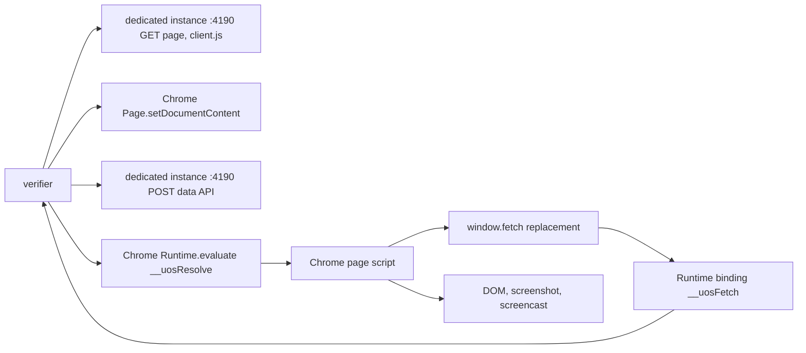

# 20261026-1903 — Telegram wave 7b: Mini App verified in a real Chrome from the agent shell

#fractal-l0 #fractal-l2 #fractal-l4 #fractal-l6 #fractal-l9 #zk-adr #zero-muda #km-triad #tailscale-web #rocha-semiotics #cybernetics

[Cockpit](http://nas-1.tail55d152.ts.net:4100/) · [Planning](http://nas-1.tail55d152.ts.net:4100/planning) · [Wiki](http://nas-1.tail55d152.ts.net:4100/wiki) · [ZK](http://nas-1.tail55d152.ts.net:4100/zk) · [This journal](http://nas-1.tail55d152.ts.net:4100/files/docs/journal/20261026-1903-claude-telegram-wave7b-mini-app-verified-in-real-chrome.md) · [Wave 7a journal](http://nas-1.tail55d152.ts.net:4100/files/docs/journal/20261026-1930-claude-telegram-wave7a-residuals-review-bridge-hygiene-and-mini-app-cdp.md) · [KPI ledger](http://nas-1.tail55d152.ts.net:4100/files/governance/planning/20261026-0639-claude-telegram-wave-kpi-ledger.json)

Transclusions: `[[zk:20260905-1801-moc-uos-unified-master]]` · `[[wiki:20260905-1801-uos-zk-km-corpus-index]]`

Host clock at the file name: `date -u` read immediately before this write (prefix uses hour and seconds). Author session `claude-fable-l0-35600f5c`, workspace `.uos-workspaces/fable-l0`, base `0b9dfbaa` (wave 7a follow-up). Trivial scale by files (tool, receipt, ledger, packets, skill, rule, this journal).

## 1. Scope & Trigger

Sa-plan `uos/telegram-residuals/20261026-1752` `MINI_APP_BROWSER_VERIFY` attempt 1 (class P2), claimed in wave 7a and left executing because headless Chrome completed no URL load from the agent shell (L-38). Trigger: the stop-hook goal and the operator directive to capture screens, images and video of Telegram functionality. Formal gateway (Engine 5): no Gleam source changed; the wave 6z suite result applies to the identical `apps/` tree.

## 2. Pre-State Assessment

Kalman prior (Engine 7): TG-KPI-16 at 0/14; the tool compiled; the only known-good path was an operator terminal run (forecast p 0.60 by 2026-10-27T18:00Z). Innovation: the receipt arrived four hours early and by a different mechanism than predicted, so the forecast resolves as outcome 1 with Brier 0.16 and a note that the predicted mechanism was wrong.

## 3. Execution Detail

Rete-UL invariant rules fired (Engine 6):

1. **Hypothesis.** Main-frame navigation stalls in this sandbox, but script execution and the DevTools protocol work. A document installed with `Page.setDocumentContent` needs no navigation; if every subresource is removed from the browser's network path, the page can run.
2. **Content mode.** `--set-content` fetches the server-rendered HTML with the tool's own HTTP client, inserts `<base href>` pointing at the dedicated instance, strips the two external script tags, appends the official `telegram-web-app.js` (119,731 bytes, fetched once by curl) and `/mini-app/client.js` inline, prepends a `window.fetch` replacement that calls a `Runtime.addBinding` named `__uosFetch`, places the signed initData in the blank frame's `location.hash`, and installs the document. The tool answers each binding call with a real HTTP exchange against the instance and resolves the page's promise through a fire-and-forget `Runtime.evaluate` (a nested await would consume the outer call's response).
3. **First full pass.** 12 pages rendered with data before the 540 s cap; the per-page cost was the tool's HTTP client waiting for EOF on keep-alive connections (15 s per request, three requests per page) and a 20 s load-event wait on `about:blank`. Both fixed: the reader stops at `Content-Length`, the blank navigation is not awaited. A second defect surfaced from the first pass: initData minted once expired after 300 s and the later pages answered 401, exactly as the freshness law demands; initData is now minted per page.
4. **Second pass (55 s).** 14/14 pages settled, 7 observed, 7 fail-closed unavailable; the Zenoh page was unavailable because the grant used a wildcard key, which `zenoh/rest.valid_key` admits nowhere; grants are now three concrete keys (the start command, the first page's result, the summary).
5. **Final pass (60 s, exit 0).** 14/14 settled: 8 observed with data (dashboard 21 fields, alerts 11, tasks 9, inference 15, config 14, federation 11, telemetry 50, zenoh 6), 6 fail-closed unavailable (health, immune, chat, containers, verify, fmea: sources the dedicated instance does not configure). `auth_source` is `telegram-web-app.js` on every page: the official script parsed the signed hash. Live-refresh journey on the Zenoh page: 4 topics offered, topic selected, live polling observed with 6 data calls, stopped cleanly (`LIVE_REFRESH_OK`). Six browser negative cases (tampered hash, expired, future, foreign user, missing user, no initData) and six direct API cases (405, 400, 413, 400, 404, 401) all refused; 413 for oversize initData is recorded as `REFUSED_OTHER_4XX` because the expectation had been 401. 20 screenshots, 87 screencast frames, mp4 661,143 bytes (sha256 `46fbb58d…`), Zenoh 14 page results published and 14 read back.

## 4. Root Cause Analysis

ACH matrix (Engine 1) for "why did the first content-mode pass take 40 s per page":

| Evidence | H1: tool HTTP client waits for EOF on keep-alive | H2: Chrome slow to install documents | H3: settle loop waits its full 12 s |
|---|---|---|---|
| E1 pages with `Observed at` status still took ~40 s | Consistent | Neutral | Inconsistent (terminal status ends the loop) |
| E2 three tool HTTP calls per page, instance keeps connections open, recv timeout 15 s | Consistent | Inconsistent | Inconsistent |
| E3 after the Content-Length reader: 14 pages in 55 s | Consistent | Inconsistent | Inconsistent |
| Evaluation | **CONFIRMED** | REFUTED | REFUTED |

## 5. Fix Taxonomy

- **Poka-yoke:** initData minted per page; concrete Zenoh grant keys; the receipt records `mode` and `auth_source` so the two load paths cannot be confused.
- **Jidoka:** the run refuses to start without the Zenoh start command and when the port already answers; the tool's own HTTP client now terminates at `Content-Length`.
- **Muda:** three wasted passes before the receipt; each defect is a line in L-40 or the ledger note.

## 6. Patterns & Anti-Patterns Discovered

Devil's Advocate and Red Team falsification (Engine 4). *"With the tool owning the transport, this is not a browser test."* The DOM, layout, event handling, the official Telegram script's parsing of the hash, the client's state machine and the pixels are Chrome's; only the socket is the tool's. That is why the receipt records `mode` and `auth_source` rather than claiming a navigation. *"Six pages are unavailable; that is not 14/14."* Fail-closed is the correct answer for a source the dedicated instance does not configure; the Popperian test is that each of those pages renders the typed unavailable message, and the screenshots show it. *"The forecast was gamed."* It resolved as 1 with the note that the mechanism differed; the Brier of 0.16 stands.

## 7. Verification Matrix

| Check | Observation | Admiralty |
|---|---|---|
| Pages settled | 14/14, 0 load timeouts, 0 no-status | A1 |
| Data in browser | 8 pages with rendered fields, counts above | A1 |
| Authentication path | `auth_source` `telegram-web-app.js` on all 14 pages | A1 |
| Negative cases | 6/6 browser, 6/6 direct refused (one as a different 4xx) | A1 |
| Interactive journey | `LIVE_REFRESH_OK`, 6 data calls, stopped cleanly | A1 |
| Video | mp4 661,143 bytes, 87 frames, sha256 recorded | A1 |
| Zenoh data plane | 14 puts 200, 14 readbacks equal, start command consumed | A1 |
| Screenshot content | dashboard PNG inspected: title, breadcrumb, `Observed at`, 21 field rows | A2 |
| Gleam suite | unchanged `apps/` tree; wave 6z 13,906/0 | B2 |

## 8. Files Modified

`tools/mini_app_browser_verify.ml` and `.exe` (content mode, binding transport, Content-Length reader, per-page initData, concrete grants, 4xx verdicts), `governance/planning/<ts>-claude-telegram-mini-app-browser-verify-receipt.json` (new), the KPI ledger (wave 7b, L-40, TG-KPI-16 14/14, forecasts), the review packets, the journeys skill, rule `20261026-1910` (INV-TGS-04 amended additively), this journal. Evidence under `var/telegram-mini-verify/20261026-1944/`.

## 9. Architectural Observations

Sheaf consistency (Engine 5): the verifier now has two load paths that agree on every page's verdict wherever both are available; the receipt names which one produced each row.

```text
[verifier] -> [dedicated instance :4190 GET page, client.js]
[verifier] -> [Chrome Page.setDocumentContent]
[Chrome page script] -> [window.fetch replacement]
[window.fetch replacement] -> [Runtime binding __uosFetch]
[Runtime binding __uosFetch] -> [verifier]
[verifier] -> [dedicated instance :4190 POST data API]
[verifier] -> [Chrome Runtime.evaluate __uosResolve]
[Chrome Runtime.evaluate __uosResolve] -> [Chrome page script]
[Chrome page script] -> [DOM, screenshot, screencast]
```



## 10. Remaining Gaps

Six pages are fail-closed in the dedicated instance because their sources (health worker, immune actor, history grants, Podman digest, verification and FMEA sources) are not configured there; a run against a fully configured instance would raise `observed`. The production cockpit on 4100 has no Mini App environment and was deliberately not touched. `TELEGRAM_E2E`, `BRIDGE_EVIDENCE`, `RETURN`, `RELEASE`, `ADMISSION` and `COCKPIT_RESPONDER_AI` remain open for the reasons recorded in wave 7a.

## 11. Metrics Summary

Bayesian update (Engine 3) on "a browser receipt is obtainable from the agent shell": prior after 7a Beta(1,3) (three failed load modes), posterior after this pass Beta(2,3) by outcome but the mechanism is now known, so the forward estimate for reruns is p 0.8 (forecast below). Lyapunov view: wall time per page fell 40 s → 4 s between passes; defects per pass 3 → 1 → 0; dV/dt < 0. Counts: passes 4, exit 0 on the last, screenshots 20, frames 87, negatives 12/12.

## 12. STAMP & Constitutional Alignment

L-3 guarded: the receipt distinguishes observed, fail-closed, refused and the load mode; nothing is presented as a navigation that was not one. L-5 guarded: the instance uses a random verification-only token, the allowlist holds one id, the production cockpit and any Telegram account are untouched. L-6: every effect under the claimed task. UCA prevented: "verification provided with stale credentials" (per-page initData). Ψ5 truthfulness: the forecast resolution carries the mechanism note. OS serial `[REDACTED_SYSTEM_OS_SERIAL]`. EV ceiling 93; EV-94..109 NOT_ADMITTED; no EV number minted.

## 13. Conclusion

Precommitted Forecast (Engine 7), Brier-scored: p = 0.80 that a rerun of `tools/mini_app_browser_verify.exe --set-content` at the landed commit within 24 h (T_horizon = 2026-10-27T20:00:00Z) yields 14/14 settled and `video_ok` true; C_false: any rerun in that window with a load timeout, a no-status page or no video. B = (p − o)².

**UOS footer:** `nas-1.tail55d152.ts.net:4100` · Sa-plan is the sole execution authority; this journal records evidence and grants no admission.
