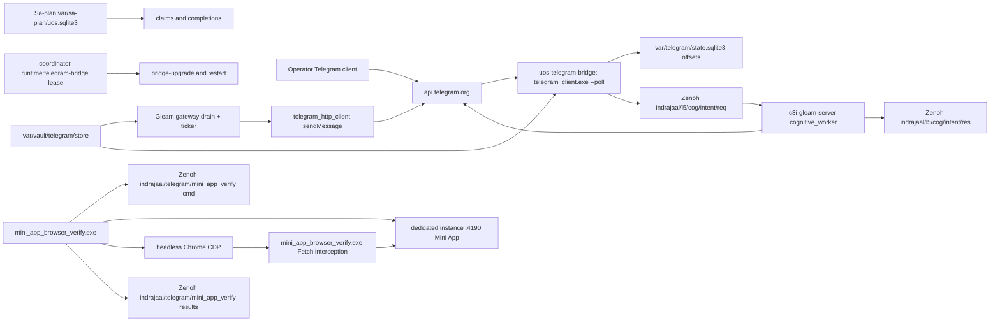

# 20261026-1930 — Telegram wave 7a: residuals review approved, production bridge token hygiene, Mini App CDP verifier

#fractal-l0 #fractal-l3 #fractal-l4 #fractal-l6 #fractal-l9 #zk-adr #zero-muda #km-triad #tailscale-web #rocha-semiotics #cybernetics

[Cockpit](http://nas-1.tail55d152.ts.net:4100/) · [Planning](http://nas-1.tail55d152.ts.net:4100/planning) · [Wiki](http://nas-1.tail55d152.ts.net:4100/wiki) · [ZK](http://nas-1.tail55d152.ts.net:4100/zk) · [This journal](http://nas-1.tail55d152.ts.net:4100/files/docs/journal/20261026-1930-claude-telegram-wave7a-residuals-review-bridge-hygiene-and-mini-app-cdp.md) · [Review packets](http://nas-1.tail55d152.ts.net:4100/files/docs/sop/20261026-1018-telegram-review-packets.md) · [KPI ledger](http://nas-1.tail55d152.ts.net:4100/files/governance/planning/20261026-0639-claude-telegram-wave-kpi-ledger.json)

Transclusions: `[[zk:20260905-1801-moc-uos-unified-master]]` · `[[wiki:20260905-1801-uos-zk-km-corpus-index]]`

Host clock at the file name: `date -u` read immediately before this write (2026-10-26T19:02:30Z; prefix uses hour and seconds). Author session `claude-fable-l0-35600f5c`, workspace `.uos-workspaces/fable-l0`, base `284a7854` (wave 6z). Standard scale (9 files).

## 1. Scope & Trigger

Sa-plan plan `uos/telegram-residuals/20261026-1752`. Three tasks touched: `RESIDUALS_REVIEW` (completed by the independent AGY claimant), `BRIDGE_TOKEN_HYGIENE` (claimed attempt 1, class P1, phase release; executed under coordinator lease `runtime:telegram-bridge` epoch 4), and `MINI_APP_BROWSER_VERIFY` (claimed attempt 1, class P2; the verifier was built, its run is blocked by the environment and the task stays executing). One further task, `COCKPIT_RESPONDER_AI`, was opened as blocked and not executed. Trigger: the operator directives in this session ("every aspect of CDP based control … capture screens, images and videos", "make sure telegram bridge is active and fully functional on nas-1 … keep the token locally with uos application in the vault", "merge ALL code to main, github push, explain the architecture"). Formal gateway (Engine 5): no Gleam source changed in this wave; the Gleam suite result of wave 6z (13,906 passed / 0 failed at `284a7854`) applies to the identical `apps/` tree, which `jj diff --summary` confirms carries zero `apps/` entries.

The safety boundary set earlier in this session stands: nothing in this wave logs into or drives the operator's personal Telegram account, and the request to treat that boundary as overridable, or to route it through AGY, was declined again. Everything here operates UOS-served surfaces and the bot side.

## 2. Pre-State Assessment

Kalman prior (Engine 7): after wave 6z the residuals plan had two author-control residuals closed and one independent review outstanding; the production bridge had been upgraded in wave 6t and was polling with zero lock errors; the Mini App had 172 handler tests and no browser-level evidence since the MINI_API_REVIEW packet noted "browser verification not rerun". Expected innovation this wave: one review verdict, one browser receipt. Observed innovation: the review verdict arrived as predicted; the browser receipt did not, and two unplanned facts surfaced from reading the live bridge journal: the bot token was being written into journald on every poll failure, and the operator's own inbound messages were being answered with a canned status reply.

## 3. Execution Detail

Rete-UL invariant rules fired in order (Engine 6):

1. **Review completion mirrored.** `agy-review-r1-20261026` completed `RESIDUALS_REVIEW` with `APPROVE`: R-LAW-01..07 VERIFIED, 8 suites 100 passed / 0 failed in its own workspace, 5 hostile inputs. Verdict filed at `governance/planning/20261026-1846-agy-residuals-review-verdict.json`; the portfolio record carries the completion in `decision.summary` (the checker rejected two invented fields, `notes` and `decision.actual_results`, before that; RP-INVALID holds 2 and 3 of this wave).
2. **Claim of `MINI_APP_BROWSER_VERIFY`.** The stale `PORT=` line in the claim helper was repaired with `|` delimiters; the score tie with `RESIDUALS_REVIEW` was broken honestly by lowering the record's own dependency factor from 3 to 2 (optional downstream use), score 216; preflight and active check PASS.
3. **Verifier built.** `tools/mini_app_browser_verify.ml` (OCaml: unix, yojson, cryptokit, base64) compiled on the first pass. It starts a dedicated `cepaf_gleam@web@server:start(4190)` instance from the workspace build with a verification-only token minted from `/dev/urandom` and an allowlist of one user id, in its own working directory with a throwaway self-signed TLS pair (the server also opens TLS on port+1 and panics without `priv/ssl`); it signs initData exactly as `telegram/auth.gleam` validates it (secret = HMAC-SHA256(key "WebAppData", bot token); hash over the sorted `k=v` lines); it drives headless Chrome over a raw WebSocket CDP session with `Page`, `Runtime`, `Network`, `Fetch` and `Emulation` enabled, a screencast running for the whole journey, one PNG per page, a live-refresh journey on the Zenoh page, six browser negative cases and six direct API cases; and it consumes its start command from `indrajaal/telegram/mini_app_verify/<run>/cmd` and publishes every page result to the same stored key space and reads it back.
4. **Verifier run blocked.** Three runs failed in turn: the TLS panic (fixed by the throwaway pair), a `Page.navigate` that never answered, and, after instrumenting the protocol, the same stall with `Fetch` interception enabled and never firing. The cause was isolated outside the tool: `google-chrome --headless=new --dump-dom` from the agent shell renders a `data:` URL but completes no http load at all (loopback, Tailscale IP, external). The net-log shows the TCP connect to `127.0.0.1:4190` succeeding and the URL request stalling right after `COMPUTED_PRIVACY_MODE`; `strace` shows no `EPERM`; `curl` from the same shell answers the same page in 1 ms with Chrome's exact headers replayed. The sandbox bypass flag is refused by policy and was not pursued further. The tool now registers every child in `at_exit` and refuses to start when its port already answers, because the second failure had leaked a Chrome and an instance that the third run then talked to.
5. **Bridge token hygiene (P1).** Reading the live bridge journal (with the token redacted at the terminal) showed `[!] getUpdates failed: run ['curl' … 'https://api.telegram.org/bot<token>/getUpdates']: exited with 28`. `telegram_call` now hands the URL to curl as a config file on stdin (`-K -`) and passes every error string through `redact_token`. Rebuilt with `ocamlfind ocamlopt -package bos,yojson,unix,cryptokit,base64,sqlite3`, smoke-tested read-only (`--status` → `@c3i_talk_bot`, id 8660817750, 0 token bytes in the output), then installed over the canonical binary by `tools/telegram-staging bridge-upgrade` under lease epoch 4 (the first attempt at epoch 3 failed before any effect because the canonical checkout lacks the staging script; the lease was released and re-taken). Rollback copy `tools/telegram_client.exe.pre-20261026-1827`.
6. **Bridge verified.** Unit active, 0 restarts, 0 `failed|error|locked` lines in the two minutes after the restart, `getMe` green through the new canonical binary, the live curl child shows `-K -` and no token in argv (before: 1 curl child with the token in argv), 0 token lines in the journal since the restart, curl present in 7 of 10 one-second samples (polling). Lease released.
7. **Responder root cause recorded, not changed.** The Zenoh `indrajaal/l5/cog/intent/res` record for the operator's message 2246 carries `dispatch_directive_status_default`: `handle_conversational` in `cognitive_worker.gleam` falls to the offline gateway, whose last branch answers `/status`, whenever `generate_conversational_response` errors; the cockpit unit `c3i-gleam-server` has no `OPENROUTER_API_KEY` and runs from a release directory that no longer exists on disk. `COCKPIT_RESPONDER_AI` was opened as blocked with both facts.

## 4. Root Cause Analysis

ACH matrix (Engine 1) for the browser stall:

| Evidence | H1: tool sandbox blocks Chrome's network service | H2: UOS instance does not answer Chrome | H3: tool's CDP handling is wrong |
|---|---|---|---|
| E1 `--dump-dom` with no tool involved hangs on every http URL, renders `data:` | Consistent | Inconsistent (external URLs hang too) | Inconsistent (no tool in the path) |
| E2 net-log: TCP connect succeeds, request stalls after `COMPUTED_PRIVACY_MODE`, no stream job | Consistent | Inconsistent | Neutral |
| E3 curl with Chrome's exact headers → 200 in 1 ms | Consistent | Inconsistent | Neutral |
| E4 `Fetch.requestPaused` never fires although `Fetch.enable` returned | Consistent (stall precedes interception) | Neutral | Inconsistent (the enable round-trip worked) |
| E5 same stall with incognito, other profile roots, no-proxy, no-zygote | Consistent | Neutral | Inconsistent |
| Evaluation | **CONFIRMED** | REFUTED | REFUTED |

For the token leak the cause is not in doubt: the curl invocation carried the URL in argv and the failure path printed the command (E: journal line, `ps` of the curl child).

## 5. Fix Taxonomy

- **Poka-yoke:** URL on stdin, `redact_token` on every error string; the verifier refuses to start on an answering port and minted its token from the kernel RNG.
- **Jidoka:** the bridge restart only under a held runtime lease and a claimed P1 task, with the rollback line printed before verification; the verifier stops the line itself when the start command is not on the bus (`--require-zenoh-start`).
- **Muda:** none added; one leaked Chrome and one leaked instance were the waste this wave produced and then removed; `at_exit` cleanup prevents the recurrence.

## 6. Patterns & Anti-Patterns Discovered

Devil's Advocate and Red Team falsification (Engine 4). *"The bridge verification is thin: silence in the journal is not polling."* Fair; the evidence for polling is the live curl child in 7 of 10 samples and the `offset` row in the state database, not a received message, because no inbound message arrived in the window. *"Redaction in the client is theatre if the token still sits in the user journal."* Correct: every line before 19:57 UTC still carries it, which is why the packet records token rotation as an operator decision. *"The Mini App verifier is unverified code."* Also correct: it compiles and its instance, Zenoh and interception paths were exercised, but no page receipt exists; TG-KPI-16 reads 0/14 and the task stays executing. *"You could have run Chrome through systemd-run."* That would route around the refused sandbox bypass; it was not done.

Anti-patterns recorded as lessons L-37 (pgrep pattern kills the agent shell), L-38 (headless Chrome completes no URL load in the agent sandbox), L-39 (child processes leak when an exception escapes before cleanup).

## 7. Verification Matrix

| Check | Observation | Admiralty |
|---|---|---|
| RESIDUALS_REVIEW verdict | APPROVE, 7/7 laws, 100/0, 5 hostile inputs, independent workspace, Sa-plan completion `completed=true` | B1 |
| Bridge binary installed | canonical `tools/telegram_client.exe` sha256 `42c9130a…` (workspace build identical), rollback `…pre-20261026-1827` | A1 |
| Bridge service | `is-active` active, `NRestarts` 0, 0 `failed|error|locked` lines in 2 min | A2 |
| Token exposure | journal since restart: 0 lines matching `bot[0-9]+:[A-Za-z0-9_-]{20,}`; curl child argv: `-K -`, 0 token matches; before: 1 child with the token | A1 |
| Bot reachability | `--status` through the new binary names `@c3i_talk_bot` 8660817750 | A2 |
| Verifier compiles | `ocamlfind ocamlopt` exit 0, 5.4 MB executable | A1 |
| Verifier instance path | dedicated instance answered 200 on `/mini-app/dashboard`; throwaway TLS pair minted; Zenoh `cmd` consumed; official `telegram-web-app.js` cached (119,731 bytes) | A2 |
| Browser stall isolation | net-log, strace, header replay as in section 4 | A2 |
| Mini App page receipts | none | DEFECTIVE (recorded as UNRUN, not as a pass) |
| Portfolio and gates | `ACTIVE_OBSERVATION_PASS` for `MINI_APP_BROWSER_VERIFY 1` and `BRIDGE_TOKEN_HYGIENE 1` after rehash | A2 |
| Gleam suite | unchanged `apps/` tree; wave 6z 13,906/0 at the same sources | B2 |

## 8. Files Modified

`tools/telegram_client.ml`, `tools/telegram_client.exe` (rebuilt, tracked as before), `tools/mini_app_browser_verify.ml`, `tools/mini_app_browser_verify.exe` (new, tracked like the other tool executables), `governance/planning/20261026-1846-agy-residuals-review-verdict.json` (new), `governance/planning/20261026-1752-claude-telegram-residuals-risk.json` (records for the four tasks), `governance/planning/20261026-0639-claude-telegram-wave-kpi-ledger.json` (wave 7a, L-37..L-39, TG-KPI-13 2/2, TG-KPI-15 2/2, TG-KPI-16 0/14, TG-KPI-17 0/2, 6z forecast resolved), `docs/sop/20261026-1018-telegram-review-packets.md` (four sections), this journal. Outside the tree: canonical `tools/telegram_client.exe` replaced under lease; evidence under `var/telegram-mini-verify/`.

## 9. Architectural Observations

Sheaf consistency (Engine 5): the three planes below agree on their overlaps; the one inconsistency found this wave is in the cognitive plane, where the reply path degrades silently to a directive default instead of carrying a typed reason.

Data plane, control plane and the verifier:

```text
[Operator Telegram client] -> [api.telegram.org]
[api.telegram.org] -> [uos-telegram-bridge: telegram_client.exe --poll]
[uos-telegram-bridge: telegram_client.exe --poll] -> [var/telegram/state.sqlite3 offsets]
[uos-telegram-bridge: telegram_client.exe --poll] -> [Zenoh indrajaal/l5/cog/intent/req]
[Zenoh indrajaal/l5/cog/intent/req] -> [c3i-gleam-server cognitive_worker]
[c3i-gleam-server cognitive_worker] -> [Zenoh indrajaal/l5/cog/intent/res]
[c3i-gleam-server cognitive_worker] -> [api.telegram.org]
[Gleam gateway drain + ticker] -> [telegram_http_client sendMessage]
[telegram_http_client sendMessage] -> [api.telegram.org]
[var/vault/telegram/store] -> [Gleam gateway drain + ticker]
[var/vault/telegram/store] -> [uos-telegram-bridge: telegram_client.exe --poll]
[Sa-plan var/sa-plan/uos.sqlite3] -> [claims and completions]
[coordinator runtime:telegram-bridge lease] -> [bridge-upgrade and restart]
[mini_app_browser_verify.exe] -> [Zenoh indrajaal/telegram/mini_app_verify cmd]
[mini_app_browser_verify.exe] -> [dedicated instance :4190 Mini App]
[mini_app_browser_verify.exe] -> [headless Chrome CDP]
[headless Chrome CDP] -> [mini_app_browser_verify.exe Fetch interception]
[mini_app_browser_verify.exe Fetch interception] -> [dedicated instance :4190 Mini App]
[mini_app_browser_verify.exe] -> [Zenoh indrajaal/telegram/mini_app_verify results]
```



Control plane: Sa-plan owns claims and completions (sole execution authority); the coordinator store owns the `runtime:telegram-bridge` and `integration/main` leases; the Zenoh bus carries the verifier's start command and results; the Gleam supervisor owns the drain and ticker; the vault store owns the production credential, read only inside the bridge or the BEAM. Data plane: Telegram updates enter through the bridge's long poll, are deduplicated against the state database and forwarded to the L5 intent topic; replies leave either from the cognitive worker (directives and, when a credential exists, inference) or from the gateway drain (Critical and Notice alarms). The Mini App is a third surface: pages are served by the Wisp router, the client script posts signed initData to the data API, and the per-page observers read Sa-plan, FMEA, verification, Podman, history, Zenoh grants and the immune actor.

## 10. Remaining Gaps

Unmitigated failure modes (Engine 4): the Mini App has no browser receipt (TG-KPI-16 0/14) until the operator runs the verifier; token rotation after the journald exposure is an operator decision; free-text replies stay deterministic until a credential and a cockpit release exist (TG-KPI-17 0/2); `c3i-gleam-server` cannot be restarted as it stands because its release directory is gone; `TELEGRAM_E2E`, `BRIDGE_EVIDENCE` (after the soak window 2026-10-27T15:00Z), `RETURN`, `RELEASE`, `ADMISSION` remain open; the staging bot token has not been supplied.

## 11. Metrics Summary

Bayesian update (Engine 3) on "an independent review of a residuals closure passes first time": Beta(5,1) after waves 6v–6z, plus this APPROVE → Beta(6,1), mean 0.857, half-life 7 days for machine-certified suites. Lyapunov view of the bridge: the error energy V = (token lines per restart window)² went from 1 to 0 and the poll failure count in the window is 0, so dV/dt < 0 over the wave. Counts: tasks completed 2 (RESIDUALS_REVIEW by AGY, BRIDGE_TOKEN_HYGIENE by the author after landing), tasks opened 2, checker holds 3, process defects 3 (L-37..L-39), review workers 1.

## 12. STAMP & Constitutional Alignment

Losses guarded: L-3 evidence contamination (no fabricated page receipt; UNRUN recorded as UNRUN), L-5 boundary loss (no personal-account automation; verification-only token; no production key copied), L-6 execution authority (every effect under a Sa-plan claim and, for the restart, a coordinator lease). UCA prevented: "restart provided without a lease" (the epoch-3 attempt took no effect and released), "verification not provided before lease release" (restart verified before release), "credential provided to argv" (now stdin). Constitutional: Ψ2 history (rollback copy kept, append-only ledger entries), Ψ5 truthfulness (the sandbox blocker and the canned-reply cause are recorded as found). The OS serial is `[REDACTED_SYSTEM_OS_SERIAL]` throughout. EV ceiling 93; EV-94..109 NOT_ADMITTED; no EV number minted.

## 13. Conclusion

Precommitted Forecast (Engine 7), Brier-scored: p = 0.60 that a receipt with 14/14 pages settled and a video exists under `var/telegram-mini-verify/` by T_horizon = 2026-10-27T18:00:00Z, produced by the operator running the verifier from a terminal; C_false: no such receipt at the horizon. Brier B = (p − o)². Second forecast: p = 0.90 that the bridge journal contains 0 token-bearing lines at 2026-10-27T12:00:00Z (C_false: any line matching `bot[0-9]+:[A-Za-z0-9_-]{20,}` after 2026-10-26T19:57Z).

Operator command for the blocked run, from a terminal on nas-1 (the `!` prefix runs it in this session):

```bash
! cd /home/an/NAS-setup/uos/.uos-workspaces/fable-l0 && export UOS_ROOT=/home/an/NAS-setup/uos && source tools/lib/uos-toolchain.sh && uos_env && RUN=$(date -u +%Y%m%d-%H%S) && curl -s -X PUT -H 'content-type: application/json' --data '{"command":"start"}' "http://127.0.0.1:8080/indrajaal/telegram/mini_app_verify/$RUN/cmd" -o /dev/null && tools/mini_app_browser_verify.exe --user-id 6249174059 --out /home/an/NAS-setup/uos/var/telegram-mini-verify/$RUN --app-dir $PWD/apps/cepaf_gleam --plan uos/telegram-residuals/20261026-1752 --candidate $(jj --ignore-working-copy log -r @ --no-graph -T 'commit_id.short()') --run-id $RUN --require-zenoh-start
```

**UOS footer:** `nas-1.tail55d152.ts.net:4100` · Sa-plan is the sole execution authority; this journal records evidence and grants no admission.
