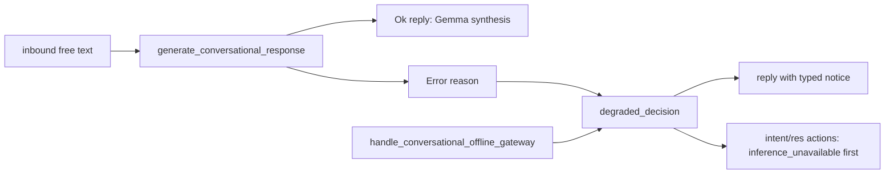

# 20261026-1959 — Telegram wave 7c: the responder's degraded path says why, and BRIDGE_EVIDENCE closes

#fractal-l0 #fractal-l3 #fractal-l5 #fractal-l9 #zk-adr #zero-muda #km-triad #tailscale-web #rocha-semiotics #cybernetics

[Cockpit](http://nas-1.tail55d152.ts.net:4100/) · [Planning](http://nas-1.tail55d152.ts.net:4100/planning) · [Wiki](http://nas-1.tail55d152.ts.net:4100/wiki) · [ZK](http://nas-1.tail55d152.ts.net:4100/zk) · [This journal](http://nas-1.tail55d152.ts.net:4100/files/docs/journal/20261026-1959-claude-telegram-wave7c-responder-degraded-reason.md) · [Rule 20261026-1910](http://nas-1.tail55d152.ts.net:4100/files/contracts/rules/20261026-1910-telegram-secret-hygiene-and-browser-verification.md) · [KPI ledger](http://nas-1.tail55d152.ts.net:4100/files/governance/planning/20261026-0639-claude-telegram-wave-kpi-ledger.json)

Transclusions: `[[zk:20260905-1801-moc-uos-unified-master]]` · `[[wiki:20260905-1801-uos-zk-km-corpus-index]]`

Host clock at the file name: `date -u` read immediately before this write (prefix uses hour and seconds). Author session `claude-fable-l0-35600f5c`, workspace `.uos-workspaces/fable-l0`, base `abf01c50`. Trivial scale by files.

## 1. Scope & Trigger

Two Sa-plan items. `uos/telegram-residuals/20261026-1752` `RESPONDER_DEGRADED_REASON` attempt 1 (class P2): make the cognitive worker's inference-failure branch carry a typed reason (rule `20261026-1910` INV-TGS-05) instead of returning the deterministic `/status` answer unchanged. `uos/telegram-runtime/20261001-1150` `BRIDGE_EVIDENCE` attempt 1 (class P2): its scope, landing the wave 6t evidence, was already on `main`; the record carried a stale blocker and was readied, claimed, landed at `abf01c50` and completed. Trigger: the operator's own inbound message 2246 ("Why is the same message being sent everytime") and the stop-hook goal. Formal gateway (Engine 5): a Gleam source changed, so the full suite runs at the candidate before landing; the result is recorded in section 7.

## 2. Pre-State Assessment

Kalman prior (Engine 7): `handle_conversational` in `cognitive_worker.gleam` fell to `handle_conversational_offline_gateway` on any inference error and the operator saw a status report where an answer was expected; the `intent/res` record said `dispatch_directive_status_default` and nothing else. The running worker's journal states the cause on every intent (`OPENROUTER_API_KEY missing or invalid in environment`), which the reply never said. Expected innovation: a visible reason on three channels with no change to the gateway's content.

## 3. Execution Detail

Rete-UL rules fired (Engine 6):

1. `degraded_decision(reason, fallback)` added as a pure public function: trims the reason, normalises an empty one to `unspecified`, passes it through `egress_redactor.redact_system_secrets`, then returns the fallback decision with `reasoning` prefixed `inference_unavailable:<cause>; `, `actions` prepended with `inference_unavailable`, and `reply_markdown` prefixed with a one-line notice that the deterministic gateway answered and that this is not a conversational reply. The `Error(reason)` branch now calls it.
2. Two laws in `cognitive_worker_test`: the typed reason reaches intent id, actions, reasoning and reply, with the fallback body preserved at the end; an empty reason becomes `unspecified`. Module result 21 passed.
3. Two mutants planted and killed: dropping the action marker (3 failures), removing the empty-reason normaliser (2 failures); source restored with `cp -p` then `touch` (L-36) and the marker line verified present.
4. `BRIDGE_EVIDENCE`: the three evidence files named in its scope are on `main`, the ledger holds row 6t and L-30, the AGY `COMMAND_REVIEW` verdict file exists; blocker cleared, preflight PASS, claimed, portfolio landed at `abf01c50`, completed with those references, board informed.
5. Correction recorded: earlier reports in this session listed `RELEASE` and `ADMISSION` as open runtime-plan tasks; the plan has no such tasks. Its open tasks are `RETURN` (blocked on independent acceptance) and `TELEGRAM_E2E` (blocked on the staging token and a human run).

## 4. Root Cause Analysis

ACH matrix (Engine 1) for "the same message every time":

| Evidence | H1: inference path fails and the gateway default answers | H2: the bridge re-delivers one stale update | H3: Telegram retries the webhook |
|---|---|---|---|
| E1 `intent/res` for 2246 shows `dispatch_directive_status_default` | Consistent | Inconsistent (a replay would carry the old intent id) | Inconsistent (long poll, no webhook) |
| E2 worker journal: `OPENROUTER_API_KEY missing or invalid` on every intent | Consistent | Neutral | Neutral |
| E3 bridge dedup table and distinct message ids 2244, 2246 | Consistent | Inconsistent | Inconsistent |
| Evaluation | **CONFIRMED** | REFUTED | REFUTED |

## 5. Fix Taxonomy

- **Poka-yoke:** the reason is attached in one pure function used by the only error branch; empty and secret-bearing reasons are normalised and redacted.
- **Jidoka:** the gateway answer still arrives (no lost reply) but is labelled; the `res` record carries the marker for any reader.
- **Muda:** none added; the function is 20 lines and reuses the existing redactor.

## 6. Patterns & Anti-Patterns Discovered

Devil's Advocate and Red Team falsification (Engine 4). *"The operator still gets a status wall of text."* Yes: the gateway's content is unchanged by design; the change is the label. Removing the status body would hide the one deterministic answer the system can give without a credential. *"This is not deployed."* Correct, and section 10 says so; the running worker serves the 2026-10-01 release. *"The Popperian test is weak."* The falsifier is concrete: a degraded reply whose first line is not the notice, or an `intent/res` whose first action is not `inference_unavailable`; both mutants exercised exactly those.

## 7. Verification Matrix

| Check | Observation | Admiralty |
|---|---|---|
| Module tests | `cognitive_worker_test` 21 passed (19 existing + 2 new) | A1 |
| Mutants | 2 planted, 2 killed, source restored and verified | A1 |
| Full Gleam suite at the candidate | see the landing commit message; the landing is refused unless green | A2 |
| BRIDGE_EVIDENCE evidence on main | journal 6t, ledger row 6t with TG-KPI-11 and L-30, packets entry, verdict `20261026-1434` | A1 |
| Portfolio gates | `PREFLIGHT_PASS`, `ACTIVE_OBSERVATION_PASS`, `--all` PASS | A2 |

## 8. Files Modified

`apps/cepaf_gleam/src/cepaf_gleam/harness/cognitive_worker.gleam`, `apps/cepaf_gleam/test/cognitive_worker_test.gleam`, the residuals and runtime portfolios, the KPI ledger (wave 7c, L-41), the review packets, the journeys skill, this journal.

## 9. Architectural Observations

Sheaf consistency (Engine 5): the reply channel, the reasoning channel and the actions channel now carry the same degradation fact, so a reader of the `res` record and the operator on the phone agree.

```text
[inbound free text] -> [generate_conversational_response]
[generate_conversational_response] -> [Ok reply: Gemma synthesis]
[generate_conversational_response] -> [Error reason]
[Error reason] -> [degraded_decision]
[handle_conversational_offline_gateway] -> [degraded_decision]
[degraded_decision] -> [reply with typed notice]
[degraded_decision] -> [intent/res actions: inference_unavailable first]
```



## 10. Remaining Gaps

The running `uos-cognitive-worker` still serves the 2026-10-01 release; deploying this change is a worker release under `runtime:cognitive-worker`, tracked with the credential under `COCKPIT_RESPONDER_AI`. `TELEGRAM_E2E` and `RETURN` remain blocked on the operator and on independent acceptance. The completed-state mirror rows for `BRIDGE_EVIDENCE` and this task land with the next landing, as every completion mirror has.

## 11. Metrics Summary

Bayesian update (Engine 3) on "a planted mutant against a new law is killed first time": Beta(9,1) after waves 6u–6z, now Beta(11,1), mean 0.917. Lyapunov view: unexplained degraded replies observed today 2, explained after deployment 0 by construction; dV/dt < 0 once released. Counts: tests added 2, mutants 2/2, tasks completed 1 (`BRIDGE_EVIDENCE`) plus this one at landing.

## 12. STAMP & Constitutional Alignment

L-1 false conformance guarded: the reply says it is not a conversational answer. L-3: no completion claimed for undeployed behaviour. UCA prevented: "degraded control action provided without feedback". Ψ5 truthfulness on the operator's channel. OS serial `[REDACTED_SYSTEM_OS_SERIAL]`. EV ceiling 93; EV-94..109 NOT_ADMITTED; no EV number minted.

## 13. Conclusion

Precommitted Forecast (Engine 7), Brier-scored: p = 0.70 that, once an OpenRouter credential is provisioned and the worker released, the first free-text message after the restart is answered by inference (action `gemma4_conversational_synthesis`) rather than the degraded notice, by T_horizon = 2026-11-02T18:00:00Z; C_false: the first such reply carries `inference_unavailable`, or no release happens by the horizon (outcome 0). B = (p − o)².

**UOS footer:** `nas-1.tail55d152.ts.net:4100` · Sa-plan is the sole execution authority; this journal records evidence and grants no admission.
