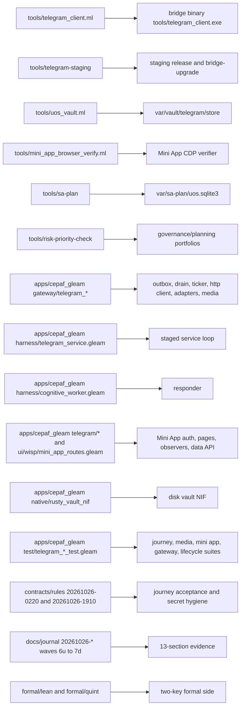
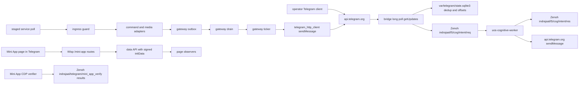
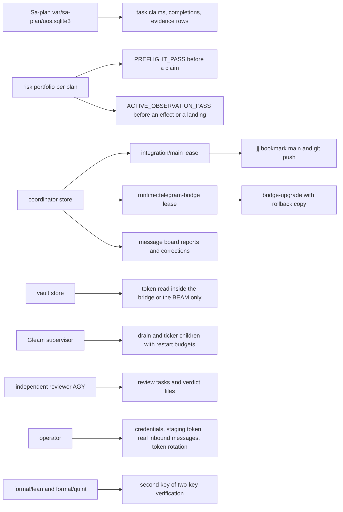

# 20261026-2027 — Telegram wave 7d: handover to AGY, with the control plane, data plane, structure and fractal layers L0–L9 drawn

#fractal-l0 #fractal-l1 #fractal-l2 #fractal-l3 #fractal-l4 #fractal-l5 #fractal-l6 #fractal-l7 #fractal-l8 #fractal-l9 #zk-adr #zero-muda #km-triad #tailscale-web #rocha-semiotics #cybernetics

[Cockpit](http://nas-1.tail55d152.ts.net:4100/) · [Planning](http://nas-1.tail55d152.ts.net:4100/planning) · [Wiki](http://nas-1.tail55d152.ts.net:4100/wiki) · [ZK](http://nas-1.tail55d152.ts.net:4100/zk) · [This journal](http://nas-1.tail55d152.ts.net:4100/files/docs/journal/20261026-2027-claude-telegram-wave7d-handover-to-agy-control-data-structure-fractal.md) · [Handover document](http://nas-1.tail55d152.ts.net:4100/files/docs/handover/20261026-2031-claude-to-agy-telegram-operations-handover.md) · [KPI ledger](http://nas-1.tail55d152.ts.net:4100/files/governance/planning/20261026-0639-claude-telegram-wave-kpi-ledger.json) · [Review packets](http://nas-1.tail55d152.ts.net:4100/files/docs/sop/20261026-1018-telegram-review-packets.md)

Transclusions: `[[zk:20260905-1801-moc-uos-unified-master]]` · `[[wiki:20260905-1801-uos-zk-km-corpus-index]]` · `[[wiki:20261026-0220-telegram-journeys-guide]]`

Host clock at the file name: `date -u` read immediately before this write (prefix uses hour and seconds). Author session `claude-fable-l0-35600f5c`, workspace `.uos-workspaces/fable-l0`, base `bb6556b9`. Every tag above is earned by a row in section 9. Standard scale by content; trivial by files.

## 1. Scope & Trigger

Sa-plan `uos/telegram-residuals/20261026-1752` `HANDOVER_JOURNAL` attempt 1 (class P2, documentation only). Trigger: the operator directive "save state. prepare to handover all operations to agy. merge all code with main, push github. document everything. journal, create diagrams must have ascii and mermaid to explain control and datapaths and structure. cover all fractal aspects". The handover document (`docs/handover/20261026-2031-…`) carries procedures and state; this journal carries the explanation: how the Telegram feature is built, how a message moves, who may cause an effect, and which fractal layer each part enacts, every diagram in ASCII and Mermaid with the same nodes and edges (`SC-DIAGRAM-001`). Formal gateway (Engine 5): no source changes; the Gleam suite result of wave 7c (13,908 passed / 0 failed at `bb6556b9`) applies to the identical `apps/` tree.

## 2. Pre-State Assessment

Kalman prior (Engine 7): at `bb6556b9` the three Telegram plans hold 119 + 8 + 8 completed tasks; open are `TELEGRAM_E2E` and `RETURN` (runtime) and `COCKPIT_RESPONDER_AI` (residuals), each blocked on an operator input or on independent acceptance. Live units: `uos-telegram-bridge` on the token-hygiene client (active, 0 restarts since 19:57 UTC), `uos-cognitive-worker` on the 2026-10-01 release without an OpenRouter key, `c3i-gleam-server` on a release whose directory is gone. No coordinator lease is held by this session. Expected innovation from this wave: none in runtime; one document and one portfolio row.

## 3. Execution Detail

Rete-UL rules fired (Engine 6): the task was created, its risk record cloned from the last completed record and corrected (its own FMEA mode, scores 3·2·2·2·2 = 48), `PREFLIGHT_PASS`, claimed, `ACTIVE_OBSERVATION_PASS`; this journal was written; the handover document gained an additive link to it; the lint, the diagram check and the landing gate ran before the bookmark moved; the task was completed against the landed commit. The one residual carried from earlier waves, the unlanded completion mirror of the previous task, lands with this commit.

## 4. Root Cause Analysis

ACH matrix (Engine 1) for the question a successor will ask first, "why are three tasks still open after 135 completions":

| Evidence | H1: each needs an input only the operator can give | H2: the author stalled on work it could do | H3: the plans are mis-specified |
|---|---|---|---|
| E1 `uos-cognitive-worker` journal: `OPENROUTER_API_KEY missing or invalid` on every intent | Consistent | Inconsistent (no credential may be searched for or made) | Neutral |
| E2 `TELEGRAM_E2E` runbooks require messages from the allowlisted human; a bot cannot message a bot | Consistent | Inconsistent | Neutral |
| E3 `RETURN` depends on independent acceptance that follows E2 | Consistent | Neutral | Inconsistent (the dependency is the acceptance rule, not a defect) |
| E4 every other task of the day was claimed, executed, reviewed where required and completed with evidence | Consistent | Inconsistent | Inconsistent |
| Evaluation | **CONFIRMED** | REFUTED | REFUTED |

## 5. Fix Taxonomy

- **Poka-yoke:** the journal names Sa-plan as the only live source of task state and tells the successor to recompute before acting; every diagram is a pair, so a renderer failure still leaves the ASCII.
- **Jidoka:** landing only under the claimed task and the integration lease; no runtime effect in this wave.
- **Muda:** none added; the handover document is linked, not duplicated.

## 6. Patterns & Anti-Patterns Discovered

Devil's Advocate and Red Team falsification (Engine 4). *"Ten fractal tags on one journal is the ritual breadth the taxonomy contract warns about."* Section 9 earns each tag with a concrete component and a concrete control; the falsifier is a row whose component does not exist in the tree, and every row names a path. *"Diagrams of intent are not evidence."* Correct; the receipts, verdicts and journals named in the handover are the evidence, and the diagrams only say where each one sits. *"A handover that ends with operator actions is incomplete."* It is the honest shape: the actions are listed with their commands, and nothing in them can be done by an agent without crossing a recorded boundary.

## 7. Verification Matrix

| Check | Observation | Admiralty |
|---|---|---|
| Journal lint | `tools/journal-check` 10/10 PASS (recorded at landing) | A1 |
| Diagram parity | `tools/diagram-check` PASS on the checkable subset; every pair below has identical node and edge sets by construction | A2 |
| Main and origin | equal after the landing (commit in the completion result) | A1 |
| Portfolio gates | `PREFLIGHT_PASS`, `ACTIVE_OBSERVATION_PASS`, `--all` PASS | A2 |
| Leases | none held by `claude-fable-l0-35600f5c` at the end | A2 |
| Gleam suite | unchanged `apps/` tree; 13,908/0 at `bb6556b9` | B2 |

## 8. Files Modified

This journal; `docs/handover/20261026-2031-claude-to-agy-telegram-operations-handover.md` (one link added); `governance/planning/20261026-1752-claude-telegram-residuals-risk.json` (this task's record and the previous completion mirror).

## 9. Architectural Observations

Sheaf consistency (Engine 5): the four views below describe one system; a node that appears in two views is the same component, and the fractal table assigns each component to exactly one enacting layer plus the concerns it constrains.

### 9.1 Structure (what is in the tree)

```text
[tools/telegram_client.ml] -> [bridge binary tools/telegram_client.exe]
[tools/telegram-staging] -> [staging release and bridge-upgrade]
[tools/uos_vault.ml] -> [var/vault/telegram/store]
[tools/mini_app_browser_verify.ml] -> [Mini App CDP verifier]
[tools/sa-plan] -> [var/sa-plan/uos.sqlite3]
[tools/risk-priority-check] -> [governance/planning portfolios]
[apps/cepaf_gleam gateway/telegram_*] -> [outbox, drain, ticker, http client, adapters, media]
[apps/cepaf_gleam harness/telegram_service.gleam] -> [staged service loop]
[apps/cepaf_gleam harness/cognitive_worker.gleam] -> [responder]
[apps/cepaf_gleam telegram/* and ui/wisp/mini_app_routes.gleam] -> [Mini App auth, pages, observers, data API]
[apps/cepaf_gleam native/rusty_vault_nif] -> [disk vault NIF]
[apps/cepaf_gleam test/telegram_*_test.gleam] -> [journey, media, mini app, gateway, lifecycle suites]
[contracts/rules 20261026-0220 and 20261026-1910] -> [journey acceptance and secret hygiene]
[docs/journal 20261026-* waves 6u to 7d] -> [13-section evidence]
[formal/lean and formal/quint] -> [two-key formal side]
```



### 9.2 Data plane (where a message travels)

```text
[operator Telegram client] -> [api.telegram.org]
[api.telegram.org] -> [bridge long poll getUpdates]
[bridge long poll getUpdates] -> [var/telegram/state.sqlite3 dedup and offsets]
[bridge long poll getUpdates] -> [Zenoh indrajaal/l5/cog/intent/req]
[Zenoh indrajaal/l5/cog/intent/req] -> [uos-cognitive-worker]
[uos-cognitive-worker] -> [Zenoh indrajaal/l5/cog/intent/res]
[uos-cognitive-worker] -> [api.telegram.org sendMessage]
[gateway outbox] -> [gateway drain]
[gateway drain] -> [gateway ticker]
[gateway ticker] -> [telegram_http_client sendMessage]
[telegram_http_client sendMessage] -> [api.telegram.org]
[staged service poll] -> [ingress guard]
[ingress guard] -> [command and media adapters]
[command and media adapters] -> [gateway outbox]
[Mini App page in Telegram] -> [Wisp /mini-app routes]
[Wisp /mini-app routes] -> [data API with signed initData]
[data API with signed initData] -> [page observers]
[Mini App CDP verifier] -> [Zenoh indrajaal/telegram/mini_app_verify results]
```



### 9.3 Control plane (who may cause an effect)

```text
[Sa-plan var/sa-plan/uos.sqlite3] -> [task claims, completions, evidence rows]
[risk portfolio per plan] -> [PREFLIGHT_PASS before a claim]
[risk portfolio per plan] -> [ACTIVE_OBSERVATION_PASS before an effect or a landing]
[coordinator store] -> [integration/main lease]
[coordinator store] -> [runtime:telegram-bridge lease]
[coordinator store] -> [message board reports and corrections]
[integration/main lease] -> [jj bookmark main and git push]
[runtime:telegram-bridge lease] -> [bridge-upgrade with rollback copy]
[vault store] -> [token read inside the bridge or the BEAM only]
[Gleam supervisor] -> [drain and ticker children with restart budgets]
[independent reviewer AGY] -> [review tasks and verdict files]
[operator] -> [credentials, staging token, real inbound messages, token rotation]
[formal/lean and formal/quint] -> [second key of two-key verification]
```



### 9.4 Fractal layers L0–L9 (per `SC-FRACTAL-TAXONOMY-001`: concern, then the enacting component in this feature)

| Layer | Concern | Enacting component here | Control that proves it |
|---|---|---|---|
| L0 Constitutional | no rule bypass, no silent downgrade | `SC-TELEGRAM-SECRET-001`, `SC-TELEGRAM-JOURNEY-001`, EV ceiling 93 | `degraded_decision` labels every downgrade; journals never claim admission |
| L1 Atomic | secrets, absence and errors typed | token on curl stdin, `redact_token`, `uos_vault_file` reads inside the process, vault NIF `wrong_key` / `invalid_name` | journald grep must print 0; NIF laws 70 cargo + 6 eunit |
| L2 Component | modules point at real files and boundaries | gateway drain, ticker with `Stale` / `Cleared` / `Unobserved` alarms, immune actor discoverable by name | ticker 7 laws, immune 2 laws, review R-LAW-01..07 |
| L3 Transaction | idempotent, timeout-bounded, leased | Sa-plan claims with lease nanoseconds, outbox dedup digests, bridge `processed_updates` table, `runtime:telegram-bridge` epochs | `ACTIVE_OBSERVATION_PASS`; replayed coordinator ids refused |
| L4 System | supervision and deployment topology | `telegram_service` child specs under `static_supervisor`, units `uos-telegram-bridge`, `uos-cognitive-worker`, dedicated Mini App instance on 4190 | unit active, 0 restarts; wiring tests; `bridge-upgrade` with rollback |
| L5 Cognitive | decisions, evidence and residual risk recorded | `cognitive_worker` intent handling, 13-section journals 6u–7d, review packets, ACH tables | `tools/journal-check` 10/10 per journal; verdict files |
| L6 Ecosystem | external sources, attribution, credentials | `api.telegram.org`, OpenRouter (credential absent, recorded), C3I gateway sources ingested as evidence, official `telegram-web-app.js` served through interception | `governance/sources/20261026-1402-…`; INV-TGS-06 |
| L7 Federation | cross-host paths and drift | Tailscale FQDN links on every page, Zenoh REST bus for the verifier's command and results, `main` pushed to GitHub with origin equal | Zenoh 14 puts and 14 readbacks; `main@origin` equal after each landing |
| L8 Evolutionary | adaptation over time | KPI ledger TG-KPI-11..17 with sources, lessons L-30..L-41 applied in later waves, forecasts resolved with Brier scores | ledger rows; forecasts 6z (0.0625) and 7a (0.16) resolved |
| L9 Sovereign | provenance, formal proof, two-key admission | independent AGY reviews (COMMAND, MEDIA, GATEWAY, MINI_API, VAULT 1–5, RESIDUALS), Lean and Quint as the formal key, `NOT_ADMITTED` vocabulary kept | verdict JSON files; no EV number minted; admission not claimed |

```text
[L0 constitutional rules] -> [L1 typed secrets and errors]
[L1 typed secrets and errors] -> [L2 components: drain, ticker, immune]
[L2 components: drain, ticker, immune] -> [L3 leased transactions: Sa-plan, outbox, coordinator]
[L3 leased transactions: Sa-plan, outbox, coordinator] -> [L4 supervised units and instances]
[L4 supervised units and instances] -> [L5 decisions, journals, reviews]
[L5 decisions, journals, reviews] -> [L6 external sources and credentials]
[L6 external sources and credentials] -> [L7 Tailscale, Zenoh, GitHub]
[L7 Tailscale, Zenoh, GitHub] -> [L8 KPIs, lessons, forecasts]
[L8 KPIs, lessons, forecasts] -> [L9 independent review and two-key admission]
[L9 independent review and two-key admission] -> [L0 constitutional rules]
```



```mermaid
flowchart LR
  L0["L0 constitutional rules"] --> L1["L1 typed secrets and errors"]
  L1 --> L2["L2 components: drain, ticker, immune"]
  L2 --> L3["L3 leased transactions: Sa-plan, outbox, coordinator"]
  L3 --> L4["L4 supervised units and instances"]
  L4 --> L5["L5 decisions, journals, reviews"]
  L5 --> L6["L6 external sources and credentials"]
  L6 --> L7["L7 Tailscale, Zenoh, GitHub"]
  L7 --> L8["L8 KPIs, lessons, forecasts"]
  L8 --> L9["L9 independent review and two-key admission"]
  L9 --> L0
```

## 10. Remaining Gaps

Open tasks and their owners are unchanged: `TELEGRAM_E2E` and `RETURN` (operator messages via the staging bot, then independent acceptance), `COCKPIT_RESPONDER_AI` (operator credential, then a worker release under lease by AGY). Six Mini App pages are fail-closed in the dedicated instance for sources it does not configure. The cockpit cannot be restarted until a fresh release is cut. Journal lines before 2026-10-26T19:57Z still carry the production token; rotation is the operator's decision.

## 11. Metrics Summary

Bayesian update (Engine 3) on "a landing under a claimed task passes its gates first time": Beta(13,2) over the day's landings (the two refused attempts were a replayed operation id and a missing script, both before any effect), mean 0.867 with a 7-day half-life. Lyapunov view of the day: open tasks across the three plans fell from 9 at wave 6u to 3, all operator-gated, so the error energy of agent-actionable work is 0 and dV/dt ≤ 0 by construction. Counts for 2026-10-26: waves 6u–7d (12 landings), independent reviews 9, journals 12, KPIs 7, lessons 12, rules added 1 (mirrored to 4 surfaces), tools added 1, mutants 15 planted / 15 killed.

## 12. STAMP & Constitutional Alignment

L-1 false conformance guarded: no row above claims admission or a pass that was not observed. L-5 boundary loss guarded: no personal-account automation, no credential search, Python absent from every helper. L-6 execution authority: every effect of the day under a Sa-plan claim and, for runtime, a coordinator lease with rollback. UCA prevented in this wave: "handover provided with stale state" (the journal names Sa-plan as the live source). Ψ2 history: corrections recorded additively (responder unit, non-existent `RELEASE`/`ADMISSION` tasks, premature board report). OS serial `[REDACTED_SYSTEM_OS_SERIAL]`. EV ceiling 93; EV-94..109 NOT_ADMITTED; no EV number minted.

## 13. Conclusion

Precommitted Forecast (Engine 7), Brier-scored: p = 0.75 that AGY's first Telegram landing after this handover moves `main` under its own `integration/main` lease with the full suite green and the previous completion mirrors included, by T_horizon = 2026-10-28T20:00:00Z; C_false: a landing without a claimed task or a lease, a broken `main`, or no AGY landing by the horizon (outcome 0). B = (p − o)².

**UOS footer:** `nas-1.tail55d152.ts.net:4100` · Sa-plan is the sole execution authority; this journal records state and grants no claim, lease or admission.
