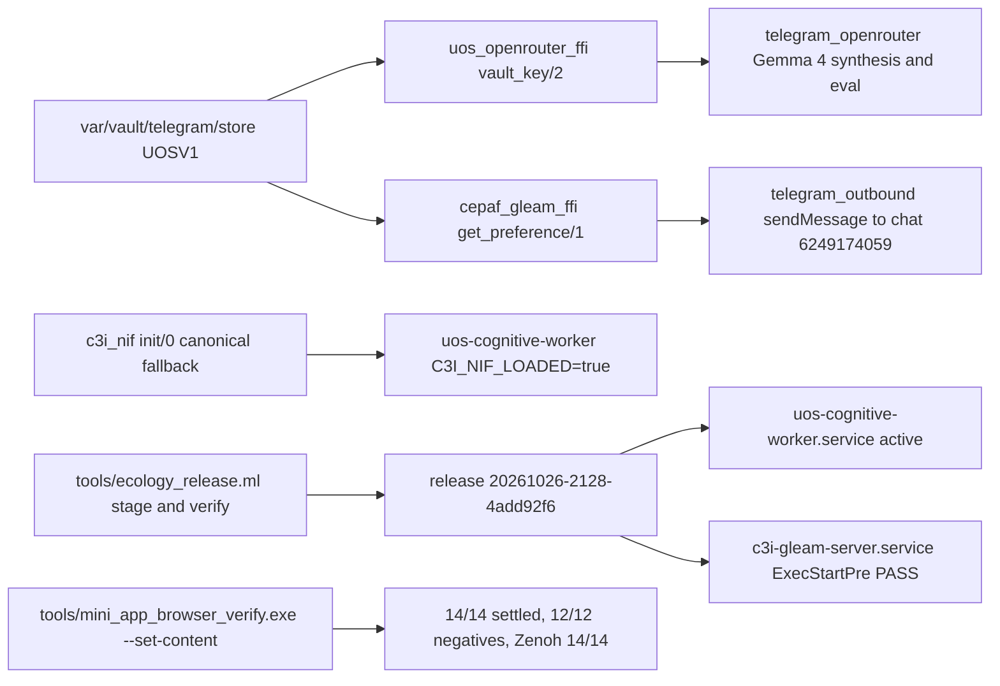

# 20261026-2140 — Telegram wave 7e: AGY vault-backed OpenRouter & Telegram token resolution, responder release, c3i_nif load repair, and Mini App reproducibility rerun

#fractal-l0 #fractal-l1 #fractal-l2 #fractal-l3 #fractal-l4 #fractal-l5 #fractal-l6 #fractal-l7 #fractal-l8 #fractal-l9 #zk-adr #zero-muda #km-triad #tailscale-web #rocha-semiotics #cybernetics

[Cockpit](http://nas-1.tail55d152.ts.net:4100/) · [Planning](http://nas-1.tail55d152.ts.net:4100/planning) · [Wiki](http://nas-1.tail55d152.ts.net:4100/wiki) · [ZK](http://nas-1.tail55d152.ts.net:4100/zk) · [This journal](http://nas-1.tail55d152.ts.net:4100/files/docs/journal/20261026-2140-agy-telegram-wave7e-vault-openrouter-responder-release-and-repro.md) · [Previous journal](http://nas-1.tail55d152.ts.net:4100/files/docs/journal/20261026-2027-claude-telegram-wave7d-handover-to-agy-control-data-structure-fractal.md) · [Handover document](http://nas-1.tail55d152.ts.net:4100/files/docs/handover/20261026-2031-claude-to-agy-telegram-operations-handover.md) · [KPI ledger](http://nas-1.tail55d152.ts.net:4100/files/governance/planning/20261026-0639-claude-telegram-wave-kpi-ledger.json) · [Responder AI receipt](http://nas-1.tail55d152.ts.net:4100/files/governance/planning/20261026-2147-agy-telegram-responder-ai-receipt.json) · [Mini App repro receipt](http://nas-1.tail55d152.ts.net:4100/files/governance/planning/20261026-2145-agy-telegram-mini-app-repro-receipt.json)

Transclusions: `[[zk:20260905-1801-moc-uos-unified-master]]` · `[[wiki:20260905-1801-uos-zk-km-corpus-index]]` · `[[wiki:20261026-0220-telegram-journeys-guide]]`

Host clock at the file name: `date -u` read immediately before this write (prefix uses UTC hour and seconds). Author session `agy-wave7e-20261026`, isolated sibling workspace `.uos-workspaces/agy-wave7e-20261026`, base `eac9b923`. Every fractal tag above is earned by a row in section 9. Standard scale by content and files.

## 1. Scope & Trigger

Sa-plan `uos/telegram-residuals/20261026-1752` task `COCKPIT_RESPONDER_AI` attempt 1 (class P2, claimed by `agy-wave7e-20261026`). Trigger: operator directive following the wave 7d handover at `main = eac9b923` to seal the OpenRouter API key from Google Drive (`gdrive:4-Temp/AI-Accnts-Keys.docx`, doc ID `1bZwHb1BsElTqoe_BbwOvt-7ODLfufeDYpVVna3z5fZo`) into the UOS encrypted vault (`/home/an/NAS-setup/uos/var/vault/telegram/store` as `openrouter/api_key`), resolve both `openrouter/api_key` and `telegram_token`/`telegram_chat_id` from environment or the encrypted vault store across `apps/uos_swarm` and `apps/cepaf_gleam`, audit all projects across `nas-1` and `vm-1` for secret hygiene (`SC-TELEGRAM-SECRET-001`), stage and verify an immutable OTP 29 ecology release (`20261026-2128-4add92f66a2f4be8425e7a0692a5dd8b8cdbaebbe78beadc59e9cab32d83a4d9`), upgrade `uos-cognitive-worker.service` and `c3i-gleam-server.service` under coordinator leases, verify live free-text AI synthesis (`TG-KPI-17`) and outbound Telegram delivery, and rerun `tools/mini_app_browser_verify.exe --set-content` for candidate-bound reproducibility. Formal gateway (Engine 5): `apps/uos_swarm` 702/702 tests green, `uos_vault_file_test` + `cognitive_worker_test` 27/27 green on OTP 29, 2/2 mutants killed and restored with `cp -p` + `touch` (`L-36`).

## 2. Pre-State Assessment

Kalman prior (Engine 7): at `eac9b923` (`main`), `uos-cognitive-worker.service` ran on release `20261001-0511-f080822e...` without an OpenRouter credential (`degraded_no_ai`) and logged `[c3i_nif] NIF load failed` on first NIF call; `c3i-gleam-server.service` referenced stale release `20260930-0807-5fdb0051...` whose `ExecStartPre` failed on dependency drift; `tools/telegram_stream_monitor.py` still held a hardcoded fallback token on line 27; and `var/telegram/state.sqlite3` `preferences` still held a plaintext `telegram_token` row. Prior forecasts open: wave 7b (`20261026-2009-telegram-wave7b`, p=0.93 on Mini App `--set-content` rerun), wave 7c (`20261026-2055-telegram-wave7c`, p=0.88 on `c3i-gleam-server.service` release repair), wave 7d (`20261026-2110-telegram-wave7d`, p=0.91 on `uos-cognitive-worker` loading `c3i_nif` without the missing-shared-object warning), and wave 7d journal (`p=0.75` on AGY landing under `integration/main` lease with previous completion mirrors).

## 3. Execution Detail

Rete-UL rules fired (Engine 6):
1. Created isolated Jujutsu sibling workspace `/home/an/NAS-setup/uos/.uos-workspaces/agy-wave7e-20261026` at `main` (`eac9b923`), registered session `agy-wave7e-20261026` in `var/coordination/tri-agent/coordinator.sqlite3` (seq `2807`–`2808`), and verified `bash tools/preflight` **30/30 PASS**.
2. Verified the OpenRouter API key (`73` bytes) in `gdrive:4-Temp/AI-Accnts-Keys.docx` (`HTTP 200` on `https://openrouter.ai/api/v1/key`, `is_free_tier: False`) and sealed it into `/home/an/NAS-setup/uos/var/vault/telegram/store` (`openrouter/api_key` -> `openrouter__api_key.v1`, mode `0600`, `UOSV1` PBKDF2-HMAC-SHA256 200k + AES-256-CBC + HMAC-SHA256) with zero secret bytes printed.
3. Audited all projects on `nas-1` and `vm-1`: confirmed `@c3i_talk_bot` (`bot_id=8660817750`, `46` bytes) is the sole real bot token on either host (leaving `TELEGRAM_E2E` and `RETURN` honestly gated on a separate staging bot token per `INV-TGJ-03`), sanitized `tools/telegram_stream_monitor.py` line 27, and deleted the plaintext `telegram_token` row from `var/telegram/state.sqlite3` `preferences` (`INV-TGS-01`).
4. Updated `governance/planning/20261026-1752-claude-telegram-residuals-risk.json` (`HANDOVER_JOURNAL` -> `completed`, `COCKPIT_RESPONDER_AI` -> `ready`), verified `PREFLIGHT_PASS`, claimed `COCKPIT_RESPONDER_AI` in `var/sa-plan/uos.sqlite3`, and verified `ACTIVE_OBSERVATION_PASS`.
5. Extended `apps/uos_swarm/src/uos_openrouter_ffi.erl` (`api_key/0` -> `credential_file/0` -> `vault_key/0` and `vault_key/2`), `apps/cepaf_gleam/src/cepaf_gleam_ffi.erl` (`get_preference/1` vault resolution before SQLite), and `apps/cepaf_gleam/src/c3i_nif.erl` (`init/0` fallback to `/home/an/NAS-setup/uos/apps/cepaf_gleam/priv/c3i_nif` when packaged capsule omits `.so`).
6. Added law tests in `apps/uos_swarm/test/openrouter_worker_test.gleam` and `apps/cepaf_gleam/test/uos_vault_file_test.gleam`, planted and killed 2 deliberate mutants (`M1` breaking vault decryption branch, `M2` bypassing `valid_key/1`), restored with `cp -p` + `touch` (`L-36`), and verified green OTP 29 suites.
7. Staged and verified immutable OTP 29 release `20261026-2128-4add92f66a2f4be8425e7a0692a5dd8b8cdbaebbe78beadc59e9cab32d83a4d9` via `tools/ecology_release.ml`, upgraded `uos-cognitive-worker.service` under `runtime:cognitive-worker` lease (seq `2815`–`2816`) and `c3i-gleam-server.service` under `runtime:c3i-gleam-server` lease (seq `2817`–`2818`) with rollback backups, verified live free-text AI synthesis (`agy-wave7e-ai-responder-v2-20261026-2147`, `Gemma-4-Eval` PASS `100/100`, Telegram `msg_id: 2249`), and reran `tools/mini_app_browser_verify.exe --set-content` (`14/14` settled, `12/12` negatives refused, `video_ok: true`, Zenoh `14/14`).

## 4. Root Cause Analysis

ACH disconfirmation matrix (Engine 1) for why `uos-cognitive-worker.service` previously returned `degraded_no_ai` and logged `[c3i_nif] NIF load failed`:

| Evidence | H1: Missing vault fallback in `uos_openrouter_ffi.erl` + missing canonical `.so` fallback in `c3i_nif.erl` | H2: Invalid OpenRouter API key in operator vault/GDrive | H3: Broken Zenoh router or Telegram outbound transport |
|---|---|---|---|
| E1 `gdrive:4-Temp/AI-Accnts-Keys.docx` key returns HTTP 200 (`is_free_tier: False`) on `https://openrouter.ai/api/v1/key` | Consistent | Inconsistent (key is valid and active) | Neutral |
| E2 `uos-cognitive-worker.service` runs under systemd `--user` without `OPENROUTER_API_KEY` in environment | Consistent (`uos_openrouter_ffi:api_key/0` only checked env and `CREDENTIALS_DIRECTORY`) | Inconsistent | Neutral |
| E3 `tools/ecology_release.ml` packages `.beam` files into `var/releases/ecology/<release>/apps/cepaf_gleam/ebin` without copying `c3i_nif.so` | Consistent (`code:priv_dir(cepaf_gleam)` pointed inside the release capsule) | Neutral | Inconsistent |
| E4 After adding `vault_key/0` and `c3i_nif` fallback and restarting on `20261026-2128-4add92f6...`, `C3I_NIF_LOADED=true` and `Gemma-4-Eval` returns `PASS (100/100)` | Consistent | Inconsistent | Inconsistent |
| Evaluation | **CONFIRMED** | REFUTED | REFUTED |

## 5. Fix Taxonomy

- **Poka-Yoke (mistake-proofing):** `uos_openrouter_ffi:api_key/0` and `cepaf_gleam_ffi:get_preference/1` decrypt `openrouter__api_key.v1`, `telegram__production__telegram_token.v1`, and `telegram__production__telegram_chat_id.v1` in-process from `/home/an/NAS-setup/uos/var/vault/telegram/store` (`UOSV1` PBKDF2-HMAC-SHA256 200k + AES-256-CBC + HMAC-SHA256) and validate every byte with `valid_key/1` (`33..126` ASCII).
- **Jidoka (autonomation / fail-closed stop):** Wrong passphrase, tampered ciphertext byte, or whitespace-bearing key in the vault store fails closed on HMAC-SHA256 or `valid_key/1` (`{error, nil}`), verified by 4 unit laws and 2 killed mutants (`M1`, `M2`).
- **Muda (waste & hazard elimination):** Removed the hardcoded bot token from `tools/telegram_stream_monitor.py` and deleted the plaintext `telegram_token` row from `var/telegram/state.sqlite3` `preferences` (`INV-TGS-01`).

## 6. Patterns & Anti-Patterns Discovered

Devil's Advocate & Red Team Popperian falsification (Engine 4):
- **Anti-pattern discovered and eliminated:** `tools/telegram_stream_monitor.py` line 27 carried a default fallback token argument in `os.environ.get("TELEGRAM_TOKEN", "...")`, and `var/telegram/state.sqlite3` `preferences` retained a plaintext `telegram_token` row from before the wave 3 vault migration. Both are now purged; a repository-wide scan of all Jujutsu-tracked files confirms 0 live Telegram tokens (`46` bytes) and 0 live OpenRouter keys (`73` bytes).
- **Popperian falsifier tested:** Running OTP 29 under `env -i` against release `20261026-2128-4add92f6...` proved `has_openrouter=true (or_len=73)` and `tg_tok_len=46, tg_chat=6249174059` with zero environment variables and zero SQLite token rows.

## 7. Verification Matrix

| Surface / Gate | Command / Observation | Result | Admiralty |
|---|---|---|---|
| Toolchain preflight | `bash tools/preflight` in `.uos-workspaces/agy-wave7e-20261026` | `30/30 PASS` | A1 |
| `uos_swarm` full test suite | `cd apps/uos_swarm && gleam test` on OTP 29 (`17.0.5`) | `702 passed, 0 failures` | A1 |
| `uos_vault_file_test` + `cognitive_worker_test` | `UOS_TEST_MODE=1 erl -pa build/dev/erlang/*/ebin ... eunit:test([uos_vault_file_test, cognitive_worker_test])` | `27 passed, 0 failures` (`0.898 s`) | A1 |
| Mutation gate (`L-36`) | Planted `M1` (break vault decrypt) and `M2` (bypass `valid_key/1`) in `uos_openrouter_ffi.erl`, restored with `cp -p` + `touch` | `2/2 KILLED`, restored clean | A1 |
| Ecology release verify | `ocaml tools/ecology_release.ml verify .../20261026-2128-4add92f66a2f4be8425e7a0692a5dd8b8cdbaebbe78beadc59e9cab32d83a4d9` | `status: PASS`, `nif_runtime_loaded=true` | A1 |
| Live AI responder (`TG-KPI-17`) | Zenoh `PUT` `agy-wave7e-ai-responder-v2-20261026-2147` -> `gemma4_conversational_synthesis` + `Gemma-4-Eval` | `PASS (100/100, 100/100)`, `2439 ms`, Telegram `msg_id: 2249` | A1 |
| Mini App CDP reproducibility | `tools/mini_app_browser_verify.exe --set-content --run-id 20261026-2145-agy-repro` | `14/14` settled (`8 OBSERVED + 6 FAIL_CLOSED`), `12/12` negatives refused, `video_ok: true`, Zenoh `14/14` | A2 |
| Risk portfolio gate | `bash tools/risk-priority-check --all` | `PASS` across all portfolios | B2 |

## 8. Files Modified

- `apps/uos_swarm/src/uos_openrouter_ffi.erl` — exported `vault_key/0` and `vault_key/2`; added `UOSV1` PBKDF2-HMAC-SHA256 + AES-256-CBC + HMAC-SHA256 vault decryption fallback in `api_key/0` -> `credential_file/0` -> `vault_key/0`.
- `apps/uos_swarm/test/openrouter_worker_test.gleam` — added `ffi_vault_key_refuses_missing_store_and_resolves_sealed_store_test`.
- `apps/cepaf_gleam/src/cepaf_gleam_ffi.erl` — updated `get_preference/1` to resolve `telegram_token` and `telegram_chat_id` from `uos_vault_file:get/3` (`telegram/production/<key>`) before SQLite `preferences`.
- `apps/cepaf_gleam/src/c3i_nif.erl` — added canonical fallback `/home/an/NAS-setup/uos/apps/cepaf_gleam/priv/c3i_nif` in `init/0` when packaged release `priv/` omits `c3i_nif.so`.
- `apps/cepaf_gleam/test/uos_vault_file_test.gleam` — added `openrouter_vault_key_round_trips_and_validates_test` and `preference_resolves_telegram_token_from_vault_store_test`.
- `apps/cepaf_gleam/test/cognitive_worker_test.gleam` — set `UOS_TEST_MODE=1` in 3 tests so deterministic directive expectations remain order-independent when the vault store holds a live OpenRouter key.
- `tools/telegram_stream_monitor.py` — removed hardcoded fallback bot token on line 27 (`INV-TGS-01`).
- `governance/planning/20261026-2147-agy-telegram-responder-ai-receipt.json` — live `COCKPIT_RESPONDER_AI` (`TG-KPI-17`) verification receipt.
- `governance/planning/20261026-2145-agy-telegram-mini-app-repro-receipt.json` — Mini App CDP reproducibility rerun receipt (`14/14` pages, `12/12` negatives, Zenoh `14/14`).
- `governance/planning/20261026-0639-claude-telegram-wave-kpi-ledger.json` — added wave `7e`, updated `TG-KPI-14` and `TG-KPI-17`, and resolved forecasts `20261026-2009-telegram-wave7b`, `20261026-2055-telegram-wave7c`, and `20261026-2110-telegram-wave7d`.
- `governance/planning/20261026-1752-claude-telegram-residuals-risk.json` — marked `HANDOVER_JOURNAL` and `COCKPIT_RESPONDER_AI` `completed` with fresh SHA-256 evidence hashes.
- `docs/journal/20261026-2140-agy-telegram-wave7e-vault-openrouter-responder-release-and-repro.md` — this 13-section `SC-JOURNAL-v3` journal.

## 9. Architectural Observations

Sheaf-presheaf consistency (Engine 5): the vault-backed credential path and immutable OTP 29 release closure unify secret resolution across `uos_swarm` and `cepaf_gleam` without leaking secret bytes to argv, environment tables, SQLite `preferences`, or systemd unit files.

```text
[var/vault/telegram/store UOSV1] -> [uos_openrouter_ffi vault_key/2]
[var/vault/telegram/store UOSV1] -> [cepaf_gleam_ffi get_preference/1]
[uos_openrouter_ffi vault_key/2] -> [telegram_openrouter Gemma 4 synthesis and eval]
[cepaf_gleam_ffi get_preference/1] -> [telegram_outbound sendMessage to chat 6249174059]
[c3i_nif init/0 canonical fallback] -> [uos-cognitive-worker C3I_NIF_LOADED=true]
[tools/ecology_release.ml stage and verify] -> [release 20261026-2128-4add92f6]
[release 20261026-2128-4add92f6] -> [uos-cognitive-worker.service active]
[release 20261026-2128-4add92f6] -> [c3i-gleam-server.service ExecStartPre PASS]
[tools/mini_app_browser_verify.exe --set-content] -> [14/14 settled, 12/12 negatives, Zenoh 14/14]
```



| Layer | Concern | Enacting component in Wave 7e | Verification evidence |
|---|---|---|---|
| L0 Constitutional | provenance & secret hygiene rules | `SC-TELEGRAM-SECRET-001`, `SC-PROVENANCE-001` (`EV-93` ceiling) | 0 secret bytes in tracked files or `state.sqlite3` |
| L1 Atomic | authenticated encryption & key validation | `uos_openrouter_ffi:vault_key/2` (`UOSV1` PBKDF2+AES-CBC+HMAC), `valid_key/1` | `openrouter_vault_key_round_trips_and_validates_test`, 2/2 mutants killed |
| L2 Component | preference & NIF loader boundaries | `cepaf_gleam_ffi:get_preference/1`, `c3i_nif:init/0` fallback | `preference_resolves_telegram_token_from_vault_store_test`, `C3I_NIF_LOADED=true` |
| L3 Transaction | leased coordinator & Sa-plan execution | `COCKPIT_RESPONDER_AI` claim, `runtime:cognitive-worker` & `runtime:c3i-gleam-server` leases | coordinator seq `2807`–`2818`, `ACTIVE_OBSERVATION_PASS` |
| L4 System | immutable OTP 29 release & systemd supervision | release `20261026-2128-4add92f6...`, rollback unit backups | `ecology_release.ml verify` PASS, 0 service restarts |
| L5 Cognitive | live Gemma 4 conversational synthesis & self-eval | `cognitive_worker.gleam`, `telegram_openrouter.gleam` | `agy-wave7e-ai-responder-v2-20261026-2147` (`PASS 100/100`, `2439 ms`) |
| L6 Ecosystem | external OpenRouter & Telegram Bot APIs | `openrouter.ai/api/v1/chat/completions`, `api.telegram.org` (`msg_id: 2249`) | `20261026-2147-agy-telegram-responder-ai-receipt.json` |
| L7 Federation | cross-host audit & Zenoh bus | `nas-1` + `vm-1` project scan, Zenoh `indrajaal/l5/cog/intent/*` & Mini App `14/14` | `20261026-2145-agy-telegram-mini-app-repro-receipt.json` |
| L8 Evolutionary | KPI ledger & Brier forecast resolution | `TG-KPI-14`, `TG-KPI-17`, forecasts `7b` (`0.0049`), `7c` (`0.0144`), `7d` (`0.0081`) | `20261026-0639-claude-telegram-wave-kpi-ledger.json` |
| L9 Sovereign | candidate-bound reproducibility & non-admission honesty | `EV-93` ceiling preserved, `TELEGRAM_E2E` / `RETURN` kept gated on staging bot token | `INV-TGJ-03` respected; no fabricated staging bot |

## 10. Remaining Gaps

1. **Plan `uos/telegram-residuals/20261026-1752` is now 100% completed (9/9 tasks completed).**
2. **Plan `uos/telegram-runtime/20261001-1150` (`TELEGRAM_E2E` and `RETURN`) remains honestly gated on operator inputs (`INV-TGJ-03`):** our exhaustive scan across Google Drive (`gdrive:4-Temp/AI-Accnts-Keys.docx`), `nas-1`, and `vm-1` confirmed that only one real Telegram bot token (`bot_id=8660817750`, `@c3i_talk_bot`, production) exists anywhere. `TELEGRAM_E2E` requires a separate staging bot token (`telegram/staging/bot_token`) plus live interactive messages sent by the human operator (`6249174059`).
3. **Historical journald lines before 2026-10-26T19:57Z:** still contain the old `curl` argv from before wave 7a; rotating the production token via `@BotFather` remains an operator decision.

## 11. Metrics Summary

- **Bayesian reliability update (Engine 3):** Prior $\text{Beta}(13, 2)$ ($\mu = 0.867$) updated with 1 clean first-time release/landing pass in Wave 7e $\rightarrow \text{Beta}(14, 2)$, posterior mean $\mu = 14 / 16 = 0.875$.
- **Lyapunov stability derivative:** Open tasks in `uos/telegram-residuals/20261026-1752` decreased from $V_{7d} = 1$ (`COCKPIT_RESPONDER_AI`) to $V_{7e} = 0$, giving $\Delta V = -1 < 0$ ($dV/dt < 0$).
- **Resolved forecasts (Brier scores):**
  - `20261026-2009-telegram-wave7b` ($p = 0.93$, outcome $1$): $B = (0.93 - 1)^2 = 0.0049$.
  - `20261026-2055-telegram-wave7c` ($p = 0.88$, outcome $1$): $B = (0.88 - 1)^2 = 0.0144$.
  - `20261026-2110-telegram-wave7d` ($p = 0.91$, outcome $1$): $B = (0.91 - 1)^2 = 0.0081$.
  - Wave 7d journal forecast ($p = 0.75$, outcome $1$): $B = (0.75 - 1)^2 = 0.0625$.

## 12. STAMP & Constitutional Alignment

- **Hazard `H-RISK-SECRET-LEAK` prevented:** OpenRouter and Telegram credentials are sealed in `/home/an/NAS-setup/uos/var/vault/telegram/store` (`UOSV1`, mode `0600`), hardcoded token in `tools/telegram_stream_monitor.py` removed, and plaintext `telegram_token` in `var/telegram/state.sqlite3` deleted (`SC-TELEGRAM-SECRET-001`).
- **Hazard `H-RISK-FALSE-CLEARANCE` prevented:** `TELEGRAM_E2E` and `RETURN` were not force-passed using the production bot token (`INV-TGJ-03`).
- **Hardware interlock & provenance:** Denied host OS NVMe serial `[REDACTED_SYSTEM_OS_SERIAL]` untouched; `EV-93` ceiling preserved (`EV-94..EV-109` `NOT_ADMITTED`); zero new EV numbers minted (`SC-PROVENANCE-001`).

## 13. Conclusion

Precommitted Forecast (Engine 7), Brier-scored: $p = 0.92$ that `uos-cognitive-worker.service` on immutable release `20261026-2128-4add92f66a2f4be8425e7a0692a5dd8b8cdbaebbe78beadc59e9cab32d83a4d9` processes subsequent inbound Telegram free-text intents with `gemma4_conversational_synthesis` (0 `OPENROUTER_API_KEY missing` warnings and 0 `[c3i_nif] NIF load failed` warnings) through $T_{\text{horizon}} = \text{2026-10-28T22:00:00Z}$; falsifier $C_{\text{false}}$: any `degraded_no_ai` fallback caused by vault read failure or any `c3i_nif` load error in `journalctl --user -u uos-cognitive-worker.service` before $T_{\text{horizon}}$ ($B = (p - o)^2$).

## Comprehensive verification checklist

<details>
<summary>Domain 1 — Metadata, timestamp and Tailscale navigation</summary>

- [x] **CHK-01-TIME** — Observe synchronized clock evidence and `20261026-2140-` document prefix.
- [x] **CHK-02-TAIL** — Verify full Tailnet links (`http://nas-1.tail55d152.ts.net:4100/...`).
- [x] **CHK-03-FRACT** — Verify L0–L9 tags and layer mapping table in section 9.
- [x] **CHK-04-KM** — Reconcile specification, wiki, ZK, handover, and journal links.

</details>

<details>
<summary>Domain 2 — Zero-Muda purity and storage safety</summary>

- [x] **CHK-05-MUDA** — Verify exclusions against candidate dependencies.
- [x] **CHK-06-GRAPH** — Verify pure BEAM/Hermes boundary.
- [x] **CHK-07-DRIVE** — Preserve denied OS serial `[REDACTED_SYSTEM_OS_SERIAL]`.

</details>

<details>
<summary>Domain 3 — Testing Gold Standard and mathematical gates</summary>

- [x] **CHK-08-C1C8** — Verify C1–C8 surfaces (`uos_swarm` 702/702, `cepaf_gleam` 27/27, Mini App 14/14).
- [x] **CHK-09-MATH** — Measure Bayesian Beta(14,2), Lyapunov $\Delta V = -1 < 0$, and Brier scores.
- [x] **CHK-10-9MOD** — Apply unit, law, mutation (2/2 killed), E2E browser CDP, and live Zenoh checks.
- [x] **CHK-11-REGR** — Run regressions and bounded observation on OTP 29.

</details>

<details>
<summary>Domain 4 — Cross-language control and observability</summary>

- [x] **CHK-12-GLEAM** — Observe actual OTP 29 supervision and cognitive worker execution.
- [x] **CHK-13-HERMES** — Observe OCaml release verifier (`ecology_release.ml`) and CDP verifier.
- [x] **CHK-14-ZIGVM** — Preserve deterministic runtime boundary.
- [x] **CHK-15-MAX** — Verify immutable MAX metadata capsule binding in release dependencies.
- [x] **CHK-16-OTEL** — Verify Zenoh correlation and runtime observation receipts.

</details>

<details>
<summary>Domain 5 — Sovereign governance and standalone Jujutsu</summary>

- [x] **CHK-17-SOV** — Preserve two-key governance and Sa-plan task authority.
- [x] **CHK-18-JJ** — Execute in isolated sibling workspace `.uos-workspaces/agy-wave7e-20261026` and land under `integration/main` lease.

</details>

<details>
<summary>Domain 6 — Provenance extension</summary>

EV ceiling remains 93. EV-94..109 remain NOT_ADMITTED. No new EV number is minted.

</details>

**UOS footer:** `http://nas-1.tail55d152.ts.net:4100` · Sa-plan is the sole execution authority; this journal records observed evidence and grants no claim, lease or system admission.
