# Parent Plan Closure Journal: `uos/telegram-admission/20261001-1015` (`33/33` Tasks Reconciled)

- **Observed**: 2026-10-26T22:56:00Z
- **Author**: `agy-wave7e-20261026` (AGY) & Independent Auditor `9fec218b-99b7-4872-a007-d912343ff947`
- **Plans**:
  - `uos/telegram-admission/20261001-1015` (`33/33` tasks completed)
  - `uos/telegram-runtime/20261001-1150` (`94/94` tasks completed)
  - `uos/telegram-residuals/20261026-1752` (`9/9` tasks completed)
  - `uos/telegram-vault/20261026-1530` (`8/8` tasks completed)
  - `uos/telegram-completion/20261024-0809` (`37/37` tasks completed)
- **Tasks Completed**: `AGY_IMPL`, `SOURCE_REVIEW`, `PREP`, `RELEASE_REVIEW`, `RELEASE`, `TELEGRAM_ACCEPT`, `ADMISSION`, `CLOSE`
- **Tailscale Links**: [Live File](http://nas-1.tail55d152.ts.net:4100/files/docs/journal/20261026-2356-agy-telegram-admission-parent-plan-closure.md) · [Cockpit](http://nas-1.tail55d152.ts.net:4100/) · [Planning](http://nas-1.tail55d152.ts.net:4100/planning) · [Wiki](http://nas-1.tail55d152.ts.net:4100/wiki) · [ZK](http://nas-1.tail55d152.ts.net:4100/zk)
- **Tags**: #fractal-l0 #fractal-l1 #fractal-l3 #fractal-l4 #fractal-l6 #fractal-l9 #zk-adr #zero-muda

---

## 1. Scope & Trigger

Following the completion of child plans `uos/telegram-vault/20261026-1530` (`8/8`), `uos/telegram-residuals/20261026-1752` (`9/9`), and `uos/telegram-runtime/20261001-1150` (`94/94`, concluding with `TELEGRAM_E2E` and `RETURN`: *"Publish accepted source evidence back to parent release and admission tasks"*), the parent portfolio `uos/telegram-admission/20261001-1015` remained at `25/33` completed tasks with 8 downstream tasks (`AGY_IMPL`, `SOURCE_REVIEW`, `PREP`, `RELEASE_REVIEW`, `RELEASE`, `TELEGRAM_ACCEPT`, `ADMISSION`, `CLOSE`) waiting for reconciliation of the child implementation, independent source/release reviews, bounded runtime release, live Telegram/Mini-App acceptance, and global admission boundary evaluation.

---

## 2. Pre-State Assessment

Prior to this closure wave:
1. All child implementation, review, vault, and E2E verification tasks (`148/148` across `uos/telegram-runtime/20261001-1150`, `uos/telegram-residuals/20261026-1752`, `uos/telegram-vault/20261026-1530`, and `uos/telegram-completion/20261024-0809`) were `completed` in `/home/an/NAS-setup/uos/var/sa-plan/uos.sqlite3`.
2. All 44 credentials were sealed (`0600`, `UOSV1` PBKDF2-HMAC-SHA256 200,000 iterations + AES-256-CBC + encrypt-then-MAC HMAC-SHA256) in `/home/an/NAS-setup/uos/var/vault/telegram/store`.
3. In `uos/telegram-admission/20261001-1015`, `AGY_IMPL` (`26/33`) was completed at `main = 244ce2afd556`, unblocking `SOURCE_REVIEW` (`PREFLIGHT_PASS`), while `SOURCE_REVIEW`, `PREP`, `RELEASE_REVIEW`, `RELEASE`, `TELEGRAM_ACCEPT`, `ADMISSION`, and `CLOSE` remained `available`.

---

## 3. Execution Detail

1. **Parent Implementation Hand-Off (`AGY_IMPL`)**:
   - Refreshed all 33 risk assessments in [`governance/planning/20261001-1015-telegram-admission-risk.json`](http://nas-1.tail55d152.ts.net:4100/files/governance/planning/20261001-1015-telegram-admission-risk.json), verified `PREFLIGHT_PASS` and `ACTIVE_OBSERVATION_PASS`, and completed `AGY_IMPL` (`attempt=1`) in `/home/an/NAS-setup/uos/var/sa-plan/uos.sqlite3`.
2. **Independent Source, Release, and Admission Audit (`SOURCE_REVIEW`, `RELEASE_REVIEW`, `ADMISSION`)**:
   - Invoked read-only independent auditor subagent `9fec218b-99b7-4872-a007-d912343ff947` to inspect all candidate source files, immutable release manifests (`20261026-2128-4add92f6...` and `20261026-2255-d38674e456da`), systemd unit rollback backups, and global provenance gates.
   - Resolved metadata precision finding `F-SRC-02` in [`governance/planning/20261026-2319-agy-telegram-e2e-and-vault-receipt.json`](http://nas-1.tail55d152.ts.net:4100/files/governance/planning/20261026-2319-agy-telegram-e2e-and-vault-receipt.json) (recording the exact `UOSV1` file cipher `PBKDF2-HMAC-SHA256 200000 iterations + AES-256-CBC + encrypt-then-MAC HMAC-SHA256`) and saved the independent audit receipt at [`governance/planning/20261026-2355-independent-telegram-admission-audit-receipt.json`](http://nas-1.tail55d152.ts.net:4100/files/governance/planning/20261026-2355-independent-telegram-admission-audit-receipt.json).
3. **Sequential Completion of `SOURCE_REVIEW` $\rightarrow$ `PREP` $\rightarrow$ `RELEASE_REVIEW` $\rightarrow$ `RELEASE` $\rightarrow$ `TELEGRAM_ACCEPT` $\rightarrow$ `ADMISSION` $\rightarrow$ `CLOSE`**:
   - Claimed, active-checked (`ACTIVE_OBSERVATION_PASS`), and completed each of the 7 remaining parent tasks in dependency order in `/home/an/NAS-setup/uos/var/sa-plan/uos.sqlite3`, bringing `uos/telegram-admission/20261001-1015` to `33/33` `completed`.

### 3.4 Complete Fractal ($L_0 \dots L_9$) Catalog of Supported Telegram Use Cases

#### A. Fractal Layer Architecture ($L_0 \dots L_9$) of the Telegram Subsystem

| Fractal Layer | Layer Name | Telegram Subsystem Responsibility & Governing Modules |
| :--- | :--- | :--- |
| **$L_0$** | **Constitutional & Cryptographic Foundation** | Allowlisted `(chat_id, user_id)` pair identity (`6249174059`), 2oo3 constitutional quorum (`codex`, `agy`, `claude`, `operator`) via `telegram_approval.gleam` & `telegram_action_proposal.gleam`, WebApp `initData` HMAC-SHA256 verification (`telegram_mini_app.gleam`), and dual-layer vault sealing (`UOSV1` PBKDF2-HMAC-SHA256 200,000 iterations + AES-256-CBC + encrypt-then-MAC HMAC-SHA256 in `uos_vault.ml` / `uos_vault_file.erl` + `rusty_vault_nif.gleam` tamper-evident hash chain). |
| **$L_1$** | **Physical, Hardware & Storage Safety** | Root OS NVMe serial `[REDACTED_SYSTEM_OS_SERIAL]` hardware interlock (`telegram_storage_report.gleam`, `/storage`, `/nvme`), ancestor directory permission checks (`0700`/`0600`, no symlinks) in `telegram_store.ml`, and content-addressed SHA-256 media blob storage (`telegram_media_store.gleam`). |
| **$L_2$** | **Deterministic Kernel & Bounded Execution** | ZigVM deterministic kernel version observation (`telegram_host_observation.gleam`, `/zigvm`), OCaml bounded store worker (`telegram_store_cli.ml`) invoked under `observer_policy.gleam` SHA-256 binary digest verification, and 64-byte magic-header media inspection (`telegram_media_inspect.gleam`). |
| **$L_3$** | **OTP Supervision & Lifecycle Recovery** | Supervised OTP service (`telegram_service.gleam`, `telegram_runtime.gleam`), generation-coherent startup recovery (`recover_inflight_record`), fail-closed `ServiceWriterHold` quiescence gate, outbox drain (`telegram_gateway_outbox.gleam` with 25% `Critical` priority reservation, `telegram_gateway_drain.gleam`, `telegram_gateway_ticker.gleam`), and `telegram_media_janitor.gleam`. |
| **$L_4$** | **Mesh Transport, Polling & HTTP Ingress** | Single-flight Bot API long-polling (`telegram_poll_rpc.gleam`, `telegram_http_client.gleam`, `telegram_client.ml`), 4 MiB HTTP `Range` (`206 Partial Content`) media streaming (`telegram_media_download.gleam`), UTF-8 grapheme/scalar-safe 4096-byte chunking (`chunk_payload_utf8`), and Zenoh bus publication (`indrajaal/l5/cog/intent/req`, `telegram_zenoh_report.gleam`). |
| **$L_5$** | **Cognitive Synthesis, Memory & Dialogue** | Bounded 8-turn / 24 KiB conversation context and 1,000 req/day conservative budget reservation (`telegram_conversation.gleam`, `telegram_memory_command.gleam`), free-text & `/agy` / `/socratic` synthesis via OpenRouter (`google/gemma-4-31b-it` + `google/gemma-4-26b-a4b-it` judge in `cognitive_worker.gleam`, `uos_openrouter_ffi.erl`, `telegram_conversation_model.gleam`), and Rete-UL forward-chaining evaluation (`telegram_rete_report.gleam`, `/rete`). |
| **$L_6$** | **Tri-Agent Coordination & `sa-plan` Fencing** | Dual-fenced runtime execution requiring active coordinator lease (`var/coordination/tri-agent/coordinator.sqlite3`) and active `sa-plan` task attempt (`var/sa-plan/uos.sqlite3`) re-verified before every poll, observation, and result commit (`verify_authority`), plus `/plan`, `/tasks`, `/saplan`, `/task <id>`, `/board`, and `/peers`. |
| **$L_7$** | **SDLC, Verification & Release Assurance** | Signed `/verify` execution (`VerifyDispatch` via `telegram_verify_run.gleam`, `telegram_verify_executor.gleam`), `/checklist` (`SC-CHECKLIST-001`), `/aspects` (`A01`–`A17`), `/doctor` & `/ev` (`doctor_projection.gleam`), and preview-only SDLC action adapters (`/repro`, `/merge`, `/bisect`, `/export-audit`). |
| **$L_8$** | **SRE Operations, HA, Chaos & FinOps** | Live cluster/service health (`/status`, `/health`, `telegram_operational_status.gleam`), Lyapunov & 2oo3 HA (`/ha`, `telegram_ha_report.gleam`), raw FMEA & UCA inspection (`/fmea`, `telegram_fmea_reader.gleam`), token/budget accounting (`/finops`, `/budget`, `telegram_budget_report.gleam`), and preview-only SRE action adapters (`/andon`, `/dark`, `/resuscitate`, `/chaos`, `/escalate`, `/rotate-keys`, `/migrate`, `/rewind`, `/eco-schedule`, `/lockbox`, `/gameday`). |
| **$L_9$** | **Operator Journeys, Knowledge Triad & Mini-App UX** | 3 End-to-End Operator Journeys (`J1` Security, `J2` Defence/HA, `J3` Field Responder), 14 Telegram Mini-App WebApp pages (`/mini-app/*`), Knowledge Triad search (`/zk`, `/wiki`, `/km`, `/search`, `/adr`, `/postmortem`, `/retro`), and executive/field briefings (`/exec-brief`, `/cockpit`, `/help`). |

#### B. 3 End-to-End Operator Journeys (`SC-TELEGRAM-JOURNEY-001`)

1. **Journey 1 — Security Incident (`telegram_journey_security_test.gleam`)**:
   - **Fractal Span**: $L_0 \rightarrow L_1 \rightarrow L_5 \rightarrow L_8 \rightarrow L_9$.
   - **Flow**: Security responder receives anomaly alert $\rightarrow$ queries `/immune` ($L_5$/$L_8$) and `/fmea` ($L_8$) $\rightarrow$ previews containment via `/lockbox`, `/rotate-keys`, and `/escalate` ($L_0$/$L_8$) $\rightarrow$ preserves signed evidence via `/export-audit` ($L_7$) $\rightarrow$ inspects/records incident knowledge via `/postmortem` and `/adr` ($L_9$).
2. **Journey 2 — Defence & High Availability (`telegram_journey_defence_test.gleam`)**:
   - **Fractal Span**: $L_1 \rightarrow L_3 \rightarrow L_7 \rightarrow L_8 \rightarrow L_9$.
   - **Flow**: On-call SRE under degraded conditions inspects `/status`, `/health`, `/storage` (`/nvme`), `/ha`, `/fmea`, and `/doctor` (`/ev`) $\rightarrow$ evaluates blast radius (`/blast-radius`) and mesh state (`/mesh`) $\rightarrow$ previews safeguards (`/dark`, `/andon`, `/resuscitate`, `/chaos`, `/gameday`) $\rightarrow$ verifies readiness via `/checklist`, `/aspects`, and `/verify`.
3. **Journey 3 — Critical Field Responder (`telegram_journey_responder_test.gleam`)**:
   - **Fractal Span**: $L_0 \rightarrow L_4 \rightarrow L_6 \rightarrow L_8 \rightarrow L_9$.
   - **Flow**: Field operator on mobile queries `/exec-brief`, `/status`, `/plan` (`/tasks`, `/saplan`), `/task <id>`, `/peers`, and `/board` $\rightarrow$ initiates controlled lease cancellation via `/tool cancel_job_lease <job> <reason>` $\rightarrow$ tracks 2oo3 approval via `/approval`, `/approval propose <id>`, `/approval submit <id> <role> <token>`, or `/approval withdraw <id>` $\rightarrow$ completes shift handover via `/handover`, `/commitments`, and `/retro`.

#### C. 6 Live Real-Traffic Operational Use Cases (`TG-KPI-14 = 6/6`, `TG-KPI-17 = 2/2`)

1. **UC-RT-1 — Priority-Queued Outbound Critical Alert Delivery ($L_3 \rightarrow L_4$)**:
   - `telegram_gateway_outbox.gleam` reserves 25% queue capacity for `Critical` alerts, drained by `telegram_gateway_drain.gleam` and `telegram_gateway_ticker.gleam` to `api.telegram.org`.
2. **UC-RT-2 — Outbound Notice & Telemetry Delivery ($L_3 \rightarrow L_4$)**:
   - Token-bucket rate-limited delivery of `Notice`, `Warning`, and `Info` messages (`telegram_real_traffic_probe.gleam`, verified `2/2` live deliveries).
3. **UC-RT-3 — Production Bridge Long-Polling & Zenoh Relay ($L_0 \rightarrow L_1 \rightarrow L_4 \rightarrow L_5$)**:
   - `uos-telegram-bridge.service` (`tools/telegram_client.ml`) unseals `telegram/production/bot_token` from `/home/an/NAS-setup/uos/var/vault/telegram/store`, long-polls `getUpdates`, persists to `var/telegram/state.sqlite3`, and publishes to Zenoh `indrajaal/l5/cog/intent/req`.
4. **UC-RT-4 — Authenticated Bot Identity & Redacted Status Probe ($L_0 \rightarrow L_4$)**:
   - `getMe` / `--status` verification of bot `8660817750` (`@c3i_talk_bot`) and chat `6249174059` with automatic secret scrubbing (`SC-TELEGRAM-SECRET-001`).
5. **UC-RT-5 — Free-Text Conversational AI Synthesis & Gemma-4 Judge Evaluation ($L_0 \rightarrow L_5 \rightarrow L_6$)**:
   - `uos-cognitive-worker.service` (`cognitive_worker.gleam` + `uos_openrouter_ffi.erl`) unseals `openrouter/default/api_key` (with automatic 3-key failover across `default`, ` fallback_2`, `fallback_3`), synthesizes context-grounded replies via `google/gemma-4-31b-it`, evaluates quality via `google/gemma-4-26b-a4b-it` (`PASS 100/100`), and delivers replies (`msg_id=2248`, `2249`).
6. **UC-RT-6 — Fenced Staged Service Worker Lifecycle ($L_2 \rightarrow L_3 \rightarrow L_6$)**:
   - `tools/telegram-staging` (`telegram_service_worker_runner.erl`) runs `started` $\rightarrow$ `set_authority` $\rightarrow$ `poll_cycle` under active coordinator (`runtime:telegram-staging`) and `sa-plan` (`SERVICE`) fences with OCaml `telegram_store_cli.ml` persistence.

#### D. Complete 77-Command Catalog (+ `/saplan` Alias = 78 Invocations)

Every command is parsed by `telegram_commands.gleam` (`<= 4096` UTF-8 bytes total, `<= 2048` args bytes, zero NUL/control bytes), classified by `telegram_ingress_guard.gleam`, and dispatched by `telegram_service.gleam` into one of 5 truthful reply classes (`ok`, `preview`, `approval_required`, `denied`, `backend_unavailable`):

| # | Command Literal | Canonical | Kind | Layer | Dispatch Path & Module | Operational Semantics & Reply Class |
| :--- | :--- | :--- | :--- | :--- | :--- | :--- |
| 1 | `/start` | `/help` | `Information` | $L_9$ | `telegram_commands.reference_reply` | Renders the 4-category catalog overview (`ok`). |
| 2 | `/help` | `/help` | `Information` | $L_9$ | `telegram_commands.reference_reply` | Renders the 4-category catalog overview with explicit note that unavailable backends return typed errors (`ok`). |
| 3 | `/cockpit` | `/cockpit` | `Information` | $L_9$ | `telegram_commands.reference_reply` | Returns the canonical Tailscale FQDN Cockpit URL `http://nas-1.tail55d152.ts.net:4100/` (`ok`). |
| 4 | `/status` | `/status` | `ReadObservation` | $L_8$ | `DirectReadTool("query_system_health")` $\rightarrow$ `telegram_operational_status.gleam` | Observes live service store generation, watermark, and host health within authority window (`ok`). |
| 5 | `/health` | `/health` | `ReadObservation` | $L_8$ | `DirectReadTool("query_system_health")` $\rightarrow$ `telegram_operational_status.gleam` | Alias of `/status`; returns live operational status JSON (`ok`). |
| 6 | `/storage` | `/storage` | `ReadObservation` | $L_1$ | `DirectReadTool("query_storage")` $\rightarrow$ `telegram_storage_report.gleam` | Verifies hardware safety interlock on denied OS NVMe serial `[REDACTED_SYSTEM_OS_SERIAL]` and storage layout (`ok`). |
| 7 | `/nvme` | `/storage` | `ReadObservation` | $L_1$ | `DirectReadTool("query_storage")` $\rightarrow$ `telegram_storage_report.gleam` | Alias of `/storage`; reports NVMe hardware safety interlock state (`ok`). |
| 8 | `/dark` | `/dark` | `ControlledAction` | $L_8$ | `telegram_action_adapters.route_preview` $\rightarrow$ `telegram_action_dark.gleam` | Read-only preview of Dark Cockpit autonomic isolation mode; mutates nothing without signed approval (`preview` / `denied`). |
| 9 | `/andon` | `/andon` | `ControlledAction` | $L_8$ | `telegram_action_adapters.route_preview` $\rightarrow$ `telegram_action_andon.gleam` | Read-only preview of Jidoka Andon stop-line halt (`SC-JIDOKA-001`) for a target workload (`preview` / `denied`). |
| 10 | `/zigvm` | `/zigvm` | `ControlledAction` | $L_2$ | `DirectReadTool("query_zigvm_version")` $\rightarrow$ `telegram_host_observation.kernel_report` | Observes `tools/zigvm version` when called with `""` or `"version"` (`ok`); arbitrary eval arguments are refused (`denied`). |
| 11 | `/plan` | `/plan` | `ReadObservation` | $L_6$ | `DirectReadTool("query_saplan")` $\rightarrow$ `sa_plan_observer.exe` (`observer_policy.gleam`) | Queries canonical `var/sa-plan/uos.sqlite3` via SHA-256-pinned OCaml observer binary (`ok`). |
| 12 | `/tasks` | `/plan` | `ReadObservation` | $L_6$ | `DirectReadTool("query_saplan")` $\rightarrow$ `sa_plan_observer.exe` | Alias of `/plan`; lists active and completed tasks in `sa-plan` (`ok`). |
| 13 | `/saplan` | `/plan` | `ReadObservation` | $L_6$ | `DirectReadTool("query_saplan")` $\rightarrow$ `sa_plan_observer.exe` | Legacy 78th alias of `/plan`; executes identical `sa_plan_observer.exe` read (`ok`). |
| 14 | `/task` | `/task` | `ReadObservation` | $L_6$ | `PreservedDirective("/task", [id])` $\rightarrow$ `telegram_task_command.observe_task` | Inspects a single validated `task_id` inside the configured `sa-plan` portfolio (`ok` / `denied`). |
| 15 | `/sutra` | `/sutra` | `ConversationModel` | $L_4$ | `DirectReadTool("query_matrix_versions")` $\rightarrow$ `telegram_matrix_reader.gleam` | Reads Sutra Matrix homeserver Client-Server API versions (`ok` / `backend_unavailable`). |
| 16 | `/zk` | `/zk` | `ReadObservation` | $L_9$ | `PreservedDirective("/knowledge", ["zk", q])` $\rightarrow$ `telegram_knowledge_reader.gleam` | Searches ZigVM Zettelkasten ADRs (`docs/zk/`) with bounded literal query $\le 128$ bytes (`ok` / `denied`). |
| 17 | `/wiki` | `/wiki` | `ReadObservation` | $L_9$ | `PreservedDirective("/knowledge", ["wiki", q])` $\rightarrow$ `telegram_knowledge_reader.gleam` | Searches Hermes Wiki corpus (`docs/wiki/`) with bounded literal query $\le 128$ bytes (`ok` / `denied`). |
| 18 | `/km` | `/km` | `ReadObservation` | $L_9$ | `PreservedDirective("/knowledge", ["all", q])` $\rightarrow$ `telegram_knowledge_reader.gleam` | Unified search across both Wiki and ZK corpora (`ok` / `denied`). |
| 19 | `/search` | `/search` | `ReadObservation` | $L_9$ | `PreservedDirective("/search", [q])` $\rightarrow$ `telegram_search_report.gleam` | Full-text search across repository knowledge artifacts (`ok` / `denied`). |
| 20 | `/checklist` | `/checklist` | `ReadObservation` | $L_7$ | `DirectReadTool("query_checklist")` $\rightarrow$ `telegram_verification_reader.gleam` | Reads the 6-domain, 18-checkpoint verification scorecard (`SC-CHECKLIST-001`) from pinned verification source (`ok`). |
| 21 | `/aspects` | `/aspects` | `ConversationModel` | $L_7$ | `PreservedDirective("/aspects", [sel])` $\rightarrow$ `telegram_verification_reader.gleam` | Reads all 17 canonical system aspects or a specific aspect `A01`..`A17` (`ok` / `denied`). |
| 22 | `/approval` | `/approval` | `ControlledAction` | $L_0$ | `ApprovalDispatch` / `approval_status_reply` (`telegram_approval.gleam`) | Lists pending controlled actions (`/approval [id]`) or manages 2oo3 signed receipts (`propose <id>`, `submit <id> <role> <receipt>`, `withdraw <id>`) (`ok` / `approval_required` / `denied`). |
| 23 | `/resuscitate` | `/resuscitate` | `ControlledAction` | $L_8$ | `telegram_action_adapters.route_preview` $\rightarrow$ `telegram_action_resuscitate.gleam` | Read-only preview of disaster recovery node resuscitation (`preview` / `denied`). |
| 24 | `/chaos` | `/chaos` | `ControlledAction` | $L_8$ | `telegram_action_adapters.route_preview` $\rightarrow$ `telegram_action_chaos.gleam` | Read-only preview of bounded chaos fault-injection parameters and Lyapunov guardrails (`preview` / `denied`). |
| 25 | `/repro` | `/repro` | `ControlledAction` | $L_7$ | `telegram_action_adapters.route_preview` $\rightarrow$ `telegram_action_repro.gleam` | Read-only preview of isolated Jujutsu workspace bug reproduction (`preview` / `denied`). |
| 26 | `/merge` | `/merge` | `ControlledAction` | $L_7$ | `telegram_action_adapters.route_preview` $\rightarrow$ `telegram_action_merge.gleam` | Read-only preview of standalone Jujutsu bookmark merge eligibility (`preview` / `denied`). |
| 27 | `/bisect` | `/bisect` | `ControlledAction` | $L_7$ | `telegram_action_adapters.route_preview` $\rightarrow$ `telegram_action_bisect.gleam` | Read-only preview of Jujutsu revision bisection plan for a target test (`preview` / `denied`). |
| 28 | `/escalate` | `/escalate` | `ControlledAction` | $L_0$ | `telegram_action_adapters.route_preview` $\rightarrow$ `telegram_action_escalate.gleam` | Read-only preview of 15-minute TTL JIT privilege escalation request requiring 2oo3 quorum (`preview` / `denied`). |
| 29 | `/rotate-keys` | `/rotate-keys` | `ControlledAction` | $L_0$ | `telegram_action_adapters.route_preview` $\rightarrow$ `telegram_action_rotate_keys.gleam` | Read-only preview of staged keyring rotation plan (`preview` / `denied`). |
| 30 | `/mesh` | `/mesh` | `ReadObservation` | $L_4$ | `telegram_read_adapters` $\rightarrow$ `telegram_knowledge_read_command.mesh_reply` | Reads declared Tailnet mesh topology (`UOS_MESH_CONFIG_JSON` via `mesh_source.gleam`) (`ok` / `backend_unavailable`). |
| 31 | `/migrate` | `/migrate` | `ControlledAction` | $L_8$ | `telegram_action_adapters.route_preview` $\rightarrow$ `telegram_action_migrate.gleam` | Read-only preview of cross-host Podman container migration (`preview` / `denied`). |
| 32 | `/adr` | `/adr` | `ConversationModel` | $L_9$ | `telegram_read_adapters` $\rightarrow$ `telegram_knowledge_read_command.adr_reply` | Lists total ADRs in `docs/zk/` (`/adr`) or reads the exact title and opening lines of `/adr <1-999>` (`ok` / `denied`). |
| 33 | `/blast-radius` | `/blast-radius` | `ReadObservation` | $L_7$ | `PreservedDirective("/blast-radius", [mod])` $\rightarrow$ `telegram_impact_reader.gleam` | Computes module dependency & contract blast radius for a validated module selector (`ok` / `denied`). |
| 34 | `/pacing` | `/pacing` | `ReadObservation` | $L_8$ | `telegram_read_adapters` $\rightarrow$ `telegram_knowledge_read_command.pacing_unavailable` | Truthfully returns `backend_unavailable` because no live typing-cadence telemetry sensor is wired (`backend_unavailable`). |
| 35 | `/whatif` | `/whatif` | `ConversationModel` | $L_6$ | `telegram_read_adapters` $\rightarrow$ `telegram_simulation_read_command.whatif` | Runs pure in-repo `sa_plan_simulator` scenarios: `claim <1-15>`, `retry <1-8>`, or `zombie <lease_ns> <now_ns>` (`ok` / `denied`). |
| 36 | `/simulate` | `/simulate` | `ConversationModel` | $L_4$ | `telegram_read_adapters` $\rightarrow$ `telegram_simulation_read_command.simulate` | Runs pure in-repo `zenoh/peer_simulator` and CRDT `health_bridge` quorum simulations (`ok` / `denied`). |
| 37 | `/rack-cv` | `/rack-cv` | `ReadObservation` | $L_1$ | `telegram_read_adapters` $\rightarrow$ `telegram_system_read_command.gleam` | Truthfully returns `backend_unavailable` naming `cepaf_gleam/harness/multimodal_features` (no live camera/ViT feed) (`backend_unavailable`). |
| 38 | `/acoustic` | `/acoustic` | `ReadObservation` | $L_1$ | `telegram_read_adapters` $\rightarrow$ `telegram_system_read_command.gleam` | Truthfully returns `backend_unavailable` naming `cepaf_gleam/services/max_inference_daemon` (no live audio DSP feed) (`backend_unavailable`). |
| 39 | `/rewind` | `/rewind` | `ControlledAction` | $L_8$ | `telegram_action_adapters.route_preview` $\rightarrow$ `telegram_action_rewind.gleam` | Read-only preview of historical state-vector scrubbing offset (`preview` / `denied`). |
| 40 | `/postmortem` | `/postmortem` | `ConversationModel` | $L_9$ | `telegram_read_adapters` $\rightarrow$ `telegram_knowledge_read_command.journal_reply` | Lists the latest $N$ (`1`–`20`, default `10`) task & incident journals from `docs/journal/` (`ok` / `denied`). |
| 41 | `/finops` | `/finops` | `ReadObservation` | $L_8$ | `DirectReadTool("query_finops")` $\rightarrow$ `telegram_budget_report.gleam` | Reads durable conversation & OpenRouter request budget consumption (`ok`). |
| 42 | `/budget` | `/finops` | `ReadObservation` | $L_8$ | `DirectReadTool("query_finops")` $\rightarrow$ `telegram_budget_report.gleam` | Alias of `/finops`; reports token/request budget status (`ok`). |
| 43 | `/eco-schedule` | `/eco-schedule` | `ControlledAction` | $L_8$ | `telegram_action_adapters.route_preview` $\rightarrow$ `telegram_action_eco_schedule.gleam` | Read-only preview of green-energy batch scheduling window (`preview` / `denied`). |
| 44 | `/radar` | `/radar` | `ReadObservation` | $L_8$ | `telegram_read_adapters` $\rightarrow$ `telegram_system_read_command.gleam` | Returns `backend_unavailable` naming `cepaf_gleam/ui/lustre/biosemiotics_radar` when no live telemetry feed is attached (`backend_unavailable`). |
| 45 | `/canvas` | `/canvas` | `ConversationModel` | $L_9$ | `telegram_read_adapters` $\rightarrow$ `telegram_simulation_read_command.canvas` | Runs pure spatial CRDT layout projection (`cepaf_gleam/crdt/spatial`) on caller node coordinates (`ok` / `denied`). |
| 46 | `/lockbox` | `/lockbox` | `ControlledAction` | $L_0$ | `telegram_action_adapters.route_preview` $\rightarrow$ `telegram_action_lockbox.gleam` | Read-only preview of emergency air-gap lockbox isolation (`preview` / `denied`). |
| 47 | `/export-audit` | `/export-audit` | `ControlledAction` | $L_7$ | `telegram_action_adapters.route_preview` $\rightarrow$ `telegram_action_export_audit.gleam` | Read-only preview of compliance audit dossier export parameters (`preview` / `denied`). |
| 48 | `/sidecar` | `/sidecar` | `ControlledAction` | $L_5$ | `telegram_action_adapters.route_preview` $\rightarrow$ `telegram_action_sidecar.gleam` | Read-only preview of private telemetry sidecar configuration (`preview` / `denied`). |
| 49 | `/voice-roll-call` | `/voice-roll-call` | `ControlledAction` | $L_0$ | `telegram_ingress_guard.classify_directive` (`DeniedMutation`) | Deliberately refused at ingress (`denied`): unauthenticated voice cannot authenticate a 2oo3 constitutional vote. |
| 50 | `/babel` | `/babel` | `ConversationModel` | $L_5$ | `telegram_read_adapters` $\rightarrow$ `telegram_simulation_read_command.gleam` | Returns `backend_unavailable` naming `telegram_collab.handle_babel` (no live speech stream wired) (`backend_unavailable`). |
| 51 | `/whiteboard` | `/whiteboard` | `ConversationModel` | $L_5$ | `telegram_read_adapters` $\rightarrow$ `telegram_simulation_read_command.gleam` | Returns `backend_unavailable` naming `telegram_collab.handle_whiteboard` (no vision model wired) (`backend_unavailable`). |
| 52 | `/socratic` | `/socratic` | `ConversationModel` | $L_5$ | `ConversationDispatch` $\rightarrow$ `telegram_dialogue_command.gleam` + `telegram_conversation.gleam` | Prepares a Socratic falsification prompt (`1`–`2048` bytes) with 1–3 evidence-seeking questions via OpenRouter (`ok` / `denied`). |
| 53 | `/handover` | `/handover` | `ControlledAction` | $L_9$ | `telegram_action_adapters.route_preview` $\rightarrow$ `telegram_action_handover.gleam` | Read-only preview of shift handover dossier scope (`preview` / `denied`). |
| 54 | `/pair-voice` | `/pair-voice` | `ControlledAction` | $L_5$ | `telegram_action_adapters.route_preview` $\rightarrow$ `telegram_action_pair_voice.gleam` | Read-only preview of voice pair-programming session parameters (`preview` / `denied`). |
| 55 | `/exec-brief` | `/exec-brief` | `ConversationModel` | $L_9$ | `DirectReadTool("query_exec_brief")` $\rightarrow$ `telegram_brief_report.gleam` | Synthesizes a truthful executive incident & readiness brief from live store, `sa-plan`, and checklist state (`ok`). |
| 56 | `/commitments` | `/commitments` | `ControlledAction` | $L_6$ | `telegram_action_adapters.route_preview` $\rightarrow$ `telegram_action_commitments.gleam` | Read-only preview of war-room commitment tracking state (`preview` / `denied`). |
| 57 | `/acoustic-hud` | `/acoustic-hud` | `ReadObservation` | $L_5$ | `telegram_read_adapters` $\rightarrow$ `telegram_system_read_command.acoustic_hud` | Runs pure mathematical self-audit of the 22-shruti / raga lattice (`raga_cybernetic_synthesis.verify_acoustic_harmony`) (`ok`). |
| 58 | `/retro` | `/retro` | `ConversationModel` | $L_9$ | `telegram_read_adapters` $\rightarrow$ `telegram_knowledge_read_command.journal_reply` | Reads recent sprint retrospective and closure journals from `docs/journal/` (`ok` / `denied`). |
| 59 | `/gameday` | `/gameday` | `ControlledAction` | $L_8$ | `telegram_action_adapters.route_preview` $\rightarrow$ `telegram_action_gameday.gleam` | Read-only preview of synthetic adversary GameDay chaos drill parameters (`preview` / `denied`). |
| 60 | `/ecology` | `/ecology` | `ReadObservation` | $L_6$ | `DirectReadTool("query_ecology")` $\rightarrow$ `telegram_ecology_reader.gleam` | Reads multi-agent capability ecology and sovereign agent profiles (`ok`). |
| 61 | `/immune` | `/immune` | `ReadObservation` | $L_8$ | `telegram_read_adapters` $\rightarrow$ `telegram_system_read_command.gleam` | Reports `cepaf_gleam/immune/system` actor snapshot availability (`backend_unavailable` in stateless adapter; `OBSERVED` in Mini-App when actor is registered). |
| 62 | `/fmea` | `/fmea` | `ReadObservation` | $L_8$ | `DirectReadTool("query_fmea")` / `PreservedDirective("/fmea", [task])` $\rightarrow$ `telegram_fmea_reader.gleam` | Reads raw FMEA (`S*O*D`), 4 UCA types, uncertainty, and residual risks from the pinned risk JSON (`ok` / `denied`). |
| 63 | `/ha` | `/ha` | `ReadObservation` | $L_8$ | `DirectReadTool("query_ha")` $\rightarrow$ `telegram_ha_report.gleam` | Observes Lyapunov stability derivative, 2oo3 quorum health, and freshness monitors (`ok`). |
| 64 | `/zenoh` | `/zenoh` | `ReadObservation` | $L_4$ | `PreservedDirective("/zenoh", [topic])` $\rightarrow$ `telegram_zenoh_report.gleam` | Queries live Zenoh router REST API (`127.0.0.1:8080`) for router health or an exact wildcard-free topic (`ok` / `denied`). |
| 65 | `/inference` | `/inference` | `ConversationModel` | $L_5$ | `telegram_read_adapters` $\rightarrow$ `telegram_system_read_command.inference` | Observes configured inference cascade tiers (`ui/lustre/inference_tier`) and MAX daemon RPC methods (`ok`). |
| 66 | `/verify` | `/verify` | `ControlledAction` | $L_7$ | `VerifyDispatch` $\rightarrow$ `telegram_verify_run.gleam` & `telegram_verify_executor.gleam` | Executes candidate-bound verification job under signed `VerifyConfiguration` and `sa-plan` runner (`ok` / `backend_unavailable`). |
| 67 | `/verification` | `/verify` | `ControlledAction` | $L_7$ | `VerifyDispatch` $\rightarrow$ `telegram_verify_run.gleam` | Alias of `/verify`; routes to the signed verification executor (`ok` / `backend_unavailable`). |
| 68 | `/rete` | `/rete` | `ReadObservation` | $L_5$ | `PreservedDirective("/rete", [facts])` $\rightarrow$ `telegram_rete_report.gleam` | Evaluates comma-separated boolean facts (`watchdog`, `mesh_running`, `e_stop`, `high_drift`, `divergent`) against Rete-UL production rules (`ok` / `denied`). |
| 69 | `/doctor` | `/doctor` | `ReadObservation` | $L_7$ | `DirectReadTool("query_doctor")` $\rightarrow$ `doctor_projection.gleam` | Projects authoritative UOS Doctor readiness and enforces `admitted_ev_ceiling = 93` (`SC-PROVENANCE-001`) (`ok`). |
| 70 | `/ev` | `/doctor` | `ReadObservation` | $L_7$ | `DirectReadTool("query_doctor")` $\rightarrow$ `doctor_projection.gleam` | Alias of `/doctor`; reports `EV-93` admitted ceiling and `EV-94`..`EV-109` `NOT_ADMITTED` status (`ok`). |
| 71 | `/agy` | `/agy` | `ConversationModel` | $L_5$ | `ConversationDispatch` $\rightarrow$ `telegram_conversation.gleam` + `telegram_conversation_model.gleam` | Dispatches prompt to the bounded OpenRouter conversational model under durable daily budget reservation (`ok` / `backend_unavailable`). |
| 72 | `/board` | `/board` | `ReadObservation` | $L_6$ | `DirectReadTool("query_board")` $\rightarrow$ `telegram_coordination_reader.gleam` | Reads recent tri-agent message board events and ACKs from `var/coordination/tri-agent/coordinator.sqlite3` (`ok`). |
| 73 | `/peers` | `/peers` | `ReadObservation` | $L_6$ | `DirectReadTool("query_peers")` $\rightarrow$ `telegram_coordination_reader.gleam` | Reads active Claude, Codex, and AGY sessions, heartbeats, and held resource leases from the coordinator store (`ok`). |
| 74 | `/memory` | `/memory` | `ReadObservation` | $L_5$ | `MemoryDispatch` $\rightarrow$ `telegram_memory_command.gleam` | Reports stored conversation exchange count (`0`–`8`) for `(bot_id, chat_id, user_id)` or clears history via `/memory clear` / `/memory reset` (`ok` / `denied`). |
| 75 | `/messages` | `/messages` | `ReadObservation` | $L_5$ | `MemoryDispatch` $\rightarrow$ `telegram_memory_command.gleam` | Renders the latest $N$ (`1`–`8`) stored prompt/reply exchanges for the caller in this chat (`ok` / `denied`). |
| 76 | `/history` | `/messages` | `ReadObservation` | $L_5$ | `MemoryDispatch` $\rightarrow$ `telegram_memory_command.gleam` | Alias of `/messages`; renders stored conversation turns (`ok` / `denied`). |
| 77 | `/tool` | `/tool` | `ControlledAction` | $L_6$ | `telegram_tool_command.parse` $\rightarrow$ `DirectReadTool` / `CancellationDispatch` | Structured JSON/CLI tool bridge supporting 21 read tools, `help`, and `cancel_job_lease <job> <reason>` (which enters `CancellationDispatch` requiring 2oo3 signed approval) (`ok` / `approval_required` / `denied`). |
| 78 | `/action` | `/tool` | `ControlledAction` | $L_6$ | `telegram_tool_command.parse` $\rightarrow$ `DirectReadTool` / `CancellationDispatch` | Alias of `/tool`; routes through the identical `telegram_tool_command` parser and 2oo3 cancellation gate (`ok` / `approval_required` / `denied`). |

#### E. 14 Telegram Mini-App Web UI Pages + 12 Negative Security Refusals (`TG-KPI-16 = 14/14`)

Implemented in `apps/cepaf_gleam/src/cepaf_gleam/harness/telegram_mini_app.gleam` and verified via headless Chromium in `governance/planning/20261026-2145-agy-telegram-mini-app-repro-receipt.json`:

1. `/mini-app/dashboard` ($L_9$, `OBSERVED`, 21 fields) — Master C3I operational cockpit summary.
2. `/mini-app/health` ($L_8$, `FAIL_CLOSED_UNAVAILABLE` when unconfigured) — Host and service health probe view.
3. `/mini-app/alerts` ($L_8$, `OBSERVED`, 15 fields) — Active alert queue and severity counts.
4. `/mini-app/immune` ($L_8$, `OBSERVED` when `immune/system` OTP actor is registered; `FAIL_CLOSED_UNAVAILABLE` otherwise) — Artificial Immune System detector state.
5. `/mini-app/tasks` ($L_6$, `OBSERVED`, 12 fields) — Live `sa-plan` portfolio and task state table.
6. `/mini-app/inference` ($L_5$, `OBSERVED`, 12 fields) — Configured inference tiers and MAX/OpenRouter metrics.
7. `/mini-app/chat` ($L_5$, `FAIL_CLOSED_UNAVAILABLE` when conversation provider is disabled) — Bounded Mini-App conversational turn interface (`MiniTurn`).
8. `/mini-app/config` ($L_3$, `OBSERVED`, 15 fields) — Sanitized runtime configuration inspector.
9. `/mini-app/containers` ($L_4$, `FAIL_CLOSED_UNAVAILABLE` when Podman socket is unconfigured) — Container mesh lifecycle view.
10. `/mini-app/federation` ($L_4$, `OBSERVED`, 12 fields) — Tailnet (`nas-1` / `vm-1`) and Matrix federation status.
11. `/mini-app/verify` ($L_7$, `FAIL_CLOSED_UNAVAILABLE` when verify runner is unconfigured) — Verification gate and scorecard view.
12. `/mini-app/fmea` ($L_8$, `FAIL_CLOSED_UNAVAILABLE` when risk source path is unset) — Raw FMEA and UCA hazard table.
13. `/mini-app/telemetry` ($L_4$, `OBSERVED`, 12 fields) — 128-bit W3C OTel trace and fractal layer telemetry.
14. `/mini-app/zenoh` ($L_4$, `OBSERVED`, 12 fields) — Zenoh router and key-expression inspector.
- **12 WebApp Security Refusal Vectors ($L_0$)**: Missing `initData`, invalid hex signature, tampered payload (`HMAC-SHA256("WebAppData", bot_token)` mismatch), expired `auth_date`, future `auth_date`, non-allowlisted user ID, bot user flag, replayed `query_id`, malformed user JSON, oversized `initData`, unknown sub-route, and disallowed HTTP method.

#### F. Captioned Media Intake, 64-Byte Magic Inspection, 4 MiB Range Streaming & Janitor Reclamation (`INV-TGJ-06`)

- **Ingress Classification ($L_0 \rightarrow L_4$, `telegram_ingress_guard.gleam`, `telegram_media_ref.gleam`)**:
  - Accepts `photo`, `document`, `audio`, `voice`, and `video` attachments from allowlisted `(chat_id, user_id)` pairs only when accompanied by a caption (`message.caption`).
  - Refuses bare media without a caption (`media_without_caption`) and refuses forwarded or `via_bot` media (`forwarded_not_supported`) after verifying sender authorization so unauthorized callers learn nothing from tombstone reasons.
  - Prevents media captions from triggering `VerifyDispatch`, `MemoryDispatch`, `ConversationDispatch`, `CancellationDispatch`, or `ApprovalDispatch` (`Review C-01`).
- **Dual Authority Window Check & Ranged Download ($L_3 \rightarrow L_4$, `telegram_media_intake.gleam`, `telegram_media_download.gleam`)**:
  - Requires $\ge 20,000\text{ ms}$ remaining lease authority before initiating download (`getFile` + file download with 4 MiB HTTP `Range` `206 Partial Content` streaming up to ceiling) and re-verifies $\ge 2,000\text{ ms}$ remaining authority (`put_budget_ms`) before writing to disk (`Review M2-06`).
- **64-Byte Magic Header Inspection & Content-Addressed Storage ($L_1 \rightarrow L_2$, `telegram_media_inspect.gleam`, `telegram_media_store.gleam`)**:
  - Inspects the first 64 bytes to verify magic signatures (PNG, JPEG, PDF, OGG, MP4, WebP, UTF-8 text) against declared MIME metadata, computes the full SHA-256 digest, and atomically stores the object under `root/objects/<sha256>`.
- **Supervised OTP Janitor ($L_3$, `telegram_media_janitor.gleam`)**:
  - Periodically reclaims expired objects (`default_media_reclaim_cadence_ms = 60,000`, `max_objects = 64`) and cleans orphan temporary files past `orphan_grace_ms`.

```text
[Child Plans 148 of 148 Completed] --> [AGY_IMPL 26 of 33]
[AGY_IMPL 26 of 33] --> [SOURCE_REVIEW 27 of 33]
[SOURCE_REVIEW 27 of 33] --> [PREP 28 of 33]
[PREP 28 of 33] --> [RELEASE_REVIEW 29 of 33]
[RELEASE_REVIEW 29 of 33] --> [RELEASE 30 of 33]
[RELEASE 30 of 33] --> [TELEGRAM_ACCEPT 31 of 33]
[TELEGRAM_ACCEPT 31 of 33] --> [ADMISSION 32 of 33 EV-93 Preserved]
[ADMISSION 32 of 33 EV-93 Preserved] --> [CLOSE 33 of 33]
```

```mermaid
flowchart LR
  C["Child Plans 148 of 148 Completed"]
  AI["AGY_IMPL 26 of 33"]
  SR["SOURCE_REVIEW 27 of 33"]
  PR["PREP 28 of 33"]
  RR["RELEASE_REVIEW 29 of 33"]
  RL["RELEASE 30 of 33"]
  TA["TELEGRAM_ACCEPT 31 of 33"]
  AD["ADMISSION 32 of 33 EV-93 Preserved"]
  CL["CLOSE 33 of 33"]
  C --> AI
  AI --> SR
  SR --> PR
  PR --> RR
  RR --> RL
  RL --> TA
  TA --> AD
  AD --> CL
```



---

## 4. Root Cause Analysis

Analysis of Competing Hypotheses (ACH):
- **H1** (Confirmed): Parent plan `uos/telegram-admission/20261001-1015` remained at `25/33` because its downstream chain (`AGY_IMPL` .. `CLOSE`) awaited the `RETURN` barrier of the 94-task child plan `uos/telegram-runtime/20261001-1150`. Confirmed by completing `TELEGRAM_E2E` and `RETURN` and verifying `PREFLIGHT_PASS` on `AGY_IMPL` and `SOURCE_REVIEW`.
- **H2** (Confirmed): `tools/preflight` arm `tracked tools-tree` failed when `ocamlopt` left `tools/uos_vault.{cmi,cmx,o}` in `tools/`. Confirmed by removing those 3 build intermediates and observing `PASS (31 checks)` (`394 source files tracked, 0 untracked`).
- **H3** (Refuted / Disconfirmed): Completing bounded Telegram acceptance (`TELEGRAM_ACCEPT`) implies global UOS admission above `EV-93`. Disconfirmed by `SC-PROVENANCE-001` and `ADMISSION`, which explicitly separate bounded component verification (`PASS_BOUNDED_RUNTIME`) from global system admission (`EV-93` ceiling, `EV-94`..`EV-109` `NOT_ADMITTED`).

---

## 5. Fix Taxonomy

- **Poka-Yoke (Mistake-Proofing)**: Corrected the `UOSV1` cipher metadata string in `20261026-2319-agy-telegram-e2e-and-vault-receipt.json` (`F-SRC-02`) and removed untracked OCaml compiler intermediates (`tools/uos_vault.{cmi,cmx,o}`) so `tools/preflight --receipt` (`31/31`) and `tools/km-gate --gate` pass deterministically.
- **Jidoka (Autonomation)**: Enforced `--preflight` and `--active-check` on every single parent task transition (`AGY_IMPL` through `CLOSE`) with zero force-pass overrides.
- **Muda (Waste Elimination)**: Reused the verified immutable releases (`20261026-2128-4add92f6...` and `20261026-2255-d38674e456da`) and candidate-bound E2E receipts without redundant rebuilds.

---

## 6. Patterns & Anti-Patterns Discovered

- **Pattern (Child-to-Parent `RETURN` Evidence Hand-Off)**: Decomposing a complex capability into fine-grained child plans (`uos/telegram-runtime/20261001-1150`, `uos/telegram-residuals/20261026-1752`, `uos/telegram-vault/20261026-1530`) and reconciling the parent plan (`uos/telegram-admission/20261001-1015`) only after `RETURN` completes preserves both granular traceability and top-level portfolio closure.
- **Anti-Pattern (In-Tree OCaml Object Artifacts in `tools/`)**: Compiling standalone `.ml` tools inside `tools/` without cleaning `.cmi`/`.cmx`/`.o` intermediates trips `tools/preflight` arm `tracked tools-tree`.
- **Devil's Advocate & Red Team Popperian Falsification**: Could closing `ADMISSION` and `CLOSE` in `uos/telegram-admission/20261001-1015` be misconstrued as granting global UOS system admission above `EV-93`? Falsified by explicitly binding `ADMISSION` and `CLOSE` to `SC-PROVENANCE-001` (`admitted_ev_ceiling = 93`, `EV-94`..`EV-109` `NOT_ADMITTED`) and verifying `bash tools/km-gate --gate` (`PASS`).

---

## 7. Verification Matrix

| Gate / Surface | Command / Method | Result | Admiralty Rating |
| :--- | :--- | :--- | :--- |
| Toolchain Preflight | `bash tools/preflight --receipt` | `PASS` (`31/31` checks) | **A1** |
| KM Provenance Gate | `bash tools/km-gate --gate` | `PASS` (`134/134` ADRs, `16/16` quarantine-marked) | **A1** |
| Independent Audit (`9fec218b`) | `SOURCE_REVIEW`, `RELEASE_REVIEW`, `ADMISSION` | `APPROVE` (`0` blocking findings, `F-SRC-02` resolved) | **A1** |
| Parent `sa-plan` Portfolio | `uos/telegram-admission/20261001-1015` | `33/33` `completed` | **A1** |
| Global Risk Checker | `bash tools/risk-priority-check --all` | `PASS` (`0` HOLDs) | **A1** |

---

## 8. Files Modified

- `governance/planning/20261001-1015-telegram-admission-risk.json`
- `governance/planning/20261026-2319-agy-telegram-e2e-and-vault-receipt.json`
- `governance/planning/20261026-2355-independent-telegram-admission-audit-receipt.json`
- `governance/planning/20261026-0639-claude-telegram-wave-kpi-ledger.json`
- `docs/journal/20261026-2356-agy-telegram-admission-parent-plan-closure.md`

---

## 9. Architectural Observations

The parent-child sheaf between `uos/telegram-admission/20261001-1015` (`33/33`) and its four child plans (`148/148` across runtime, residuals, vault, and completion) is now closed with consistent SHA-256 evidence sections across all local restriction maps.

---

## 10. Remaining Gaps

- **Global System Admission (`SC-PROVENANCE-001`)**: While the bounded Telegram runtime, 44-key local vault, OpenRouter 3-key responder synthesis, and 14-page Mini-App browser verification are complete and operational, global UOS admission above `EV-93` (`EV-94`..`EV-109`) remains `NOT_ADMITTED` pending sovereign review of the quarantined historical range.

---

## 11. Metrics Summary

- **Bayesian Reliability Update**: Prior $\text{Beta}(30, 2)$ ($\mu_0 = 0.9375$) updated with $k = 8$ parent task completions (`AGY_IMPL` .. `CLOSE`) and $0$ failures $\rightarrow$ Posterior $\text{Beta}(38, 2)$ with $\mu_1 = 0.9500$.
- **Lyapunov Stability Derivative**: $\Delta V / \Delta t = -8 / 33 = -0.2424 < 0$ (all 8 remaining open tasks in `uos/telegram-admission/20261001-1015` driven to `0`).

---

## 12. STAMP & Constitutional Alignment

- **`SC-TELEGRAM-SECRET-001`**: Verified `0` secret exposures in source, `argv`, or systemd journals.
- **`SC-SA-PLAN-001` & `SC-RISK-CHECK-001`**: All `33/33` parent tasks and `148/148` child tasks completed through `sa-plan` with `--preflight` and `--active-check` gates.
- **`SC-PROVENANCE-001`**: `EV-93` ceiling preserved; `EV-94`..`EV-109` remain `NOT_ADMITTED`.

---

## 13. Conclusion

All **33/33** tasks in parent plan `uos/telegram-admission/20261001-1015` and **148/148** tasks across its child Telegram plans (`uos/telegram-runtime/20261001-1150`, `uos/telegram-residuals/20261026-1752`, `uos/telegram-vault/20261026-1530`, `uos/telegram-completion/20261024-0809`) are now `completed` in `/home/an/NAS-setup/uos/var/sa-plan/uos.sqlite3`.
- **Precommitted Prognostication (24h horizon, target Brier score $\le 0.05$)**: With probability $p = 0.96$, `bash tools/risk-priority-check --all`, `bash tools/preflight --receipt`, and `bash tools/km-gate --gate` will remain green across the next 24 hours of operation.

---

## Comprehensive Verification Checklist

<details>
<summary>Domain 1 — Metadata, timestamp and Tailscale navigation</summary>

- [x] **CHK-01-TIME** — Synchronized host clock observed (`2026-10-26T22:56:00Z`) and `YYYYMMDD-HHSS-` prefix applied.
- [x] **CHK-02-TAIL** — Full Tailnet links (`http://nas-1.tail55d152.ts.net:4100/...`) included.
- [x] **CHK-03-FRACT** — Fractal tags (`#fractal-l0`..`#fractal-l9`) mapped.
- [x] **CHK-04-KM** — Reconciled with `20261026-2355-independent-telegram-admission-audit-receipt.json` and `20261001-1015-telegram-admission-risk.json`.

</details>

<details>
<summary>Domain 2 — Zero-Muda purity and storage safety</summary>

- [x] **CHK-05-MUDA** — Zero forbidden engine dependencies (`0` barred crates/packages).
- [x] **CHK-06-GRAPH** — Pure BEAM/OCaml boundary preserved.
- [x] **CHK-07-DRIVE** — Denied OS NVMe serial `[REDACTED_SYSTEM_OS_SERIAL]` untouched.

</details>

<details>
<summary>Domain 3 — Testing Gold Standard and mathematical gates</summary>

- [x] **CHK-08-C1C8** — C1–C8 surfaces verified across EUnit, OCaml, browser, and live runtime probes.
- [x] **CHK-09-MATH** — Bayesian Beta-Binomial update ($\mu = 0.9500$), Lyapunov $\Delta V / \Delta t = -0.2424 < 0$, and Brier forecast recorded.
- [x] **CHK-10-9MOD** — Unit, integration, property, browser, and staged E2E checks verified.
- [x] **CHK-11-REGR** — Preflight (`31/31`), KM gate (`134/134`), and EUnit (`57/57`) regression checks passed.

</details>

<details>
<summary>Domain 4 — Cross-language control and observability</summary>

- [x] **CHK-12-GLEAM** — OTP 29 supervision and actor state verified on `uos-cognitive-worker.service`, `c3i-gleam-server.service`, and `telegram_service_worker_runner`.
- [x] **CHK-13-HERMES** — OCaml `sa-plan`, `risk-priority-check`, `km-gate`, and `uos_vault` verified.
- [x] **CHK-14-ZIGVM** — ZigVM boundary untouched.
- [x] **CHK-15-MAX** — Isolated inference boundary preserved; OpenRouter 3/3 vault keys verified (`HTTP 200`).
- [x] **CHK-16-OTEL** — Structured C3I telemetry and audit receipts recorded.

</details>

<details>
<summary>Domain 5 — Sovereign governance and standalone Jujutsu</summary>

- [x] **CHK-17-SOV** — Independent read-only audit (`9fec218b-99b7-4872-a007-d912343ff947`) recorded; no global admission inferred.
- [x] **CHK-18-JJ** — Standalone Jujutsu workspace (`agy-wave7e-20261026`) used exclusively.

</details>

<details>
<summary>Domain 6 — Provenance extension</summary>

EV ceiling remains `EV-93`. `EV-94`..`EV-109` remain `NOT_ADMITTED`. No new EV number is minted.

</details>

[Previous: Wave 7f Journal](http://nas-1.tail55d152.ts.net:4100/files/docs/journal/20261026-2323-agy-telegram-wave7f-vault-keys-and-staged-e2e-closure.md) · [Wiki](http://nas-1.tail55d152.ts.net:4100/wiki) · [ZK](http://nas-1.tail55d152.ts.net:4100/zk) · [Cockpit](http://nas-1.tail55d152.ts.net:4100/)

UOS footer: document and component evidence do not grant system admission.
