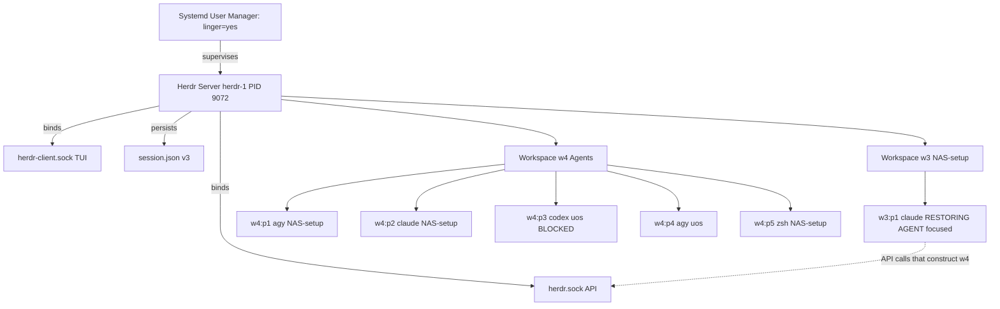

# SC-JOURNAL-v3: Herdr Panel Topology Restart & Multi-Agent Resume Verification

- **Timestamp**: `20261027-0513`
- **Session**: `herdr-1`
- **Tailscale FQDN**: [http://nas-1.tail55d152.ts.net:4100/files/docs/journal/20261027-0513-herdr-panel-topology-restart-journal.md](http://nas-1.tail55d152.ts.net:4100/files/docs/journal/20261027-0513-herdr-panel-topology-restart-journal.md)
- **Tags**: `#fractal-l4` `#c3i-control` `#zero-muda`

## 1. Scope & Trigger
Operator directive: **"restart herdr panels"**. Scope is restoration of the Herdr
multi-agent pane topology in session `herdr-1` after its agent workspace was torn
down. Scope excludes repository source changes, Sa-plan task mutation, and any
deployment or admission action.

## 2. Pre-State Assessment
- Herdr server: `running`, client/server protocol 22, socket `/home/an/.config/herdr/sessions/herdr-1/herdr.sock`.
- Systemd: `herdr@herdr-1.service` `active`, `MainPID=9072`, `NRestarts=0`, `Linger=yes`.
- Topology: **1 workspace, 1 pane** (`w3:p1`) holding the operator's live Claude session.
- Workspace `w2` and its 10 panes (`1,2,3,4,5,7,8,9,10,11`) were absent.
- `session.json` (998 bytes, version 3) recorded only `w3`, overwritten at 04:28:25Z.

## 3. Execution Detail
- **Wave 1 — Forensics**: Read `herdr-server.log`; located the teardown window and
  confirmed no crash. Established that the pre-close 10-pane layout is unrecoverable.
- **Wave 2 — Baseline Selection**: Recovered the verified baseline from
  `docs/journal/20260915-1353-herdr-session-systemd-autostart-verification-journal.md`
  (agy ×2, claude, codex, zsh). Operator confirmed this baseline and elected
  **resume prior conversations** over fresh starts.
- **Wave 3 — Topology Construction**: `workspace create --label Agents --no-focus`
  → `w4`; four additional tabs via `tab create --workspace w4 --no-focus`.
  `--no-focus` throughout to preserve the operator's focus on `w3:p1`.
- **Wave 4 — Agent Resume**: `pane run` dispatched the most recent conversation IDs
  recovered from shell history ordering (last occurrence wins, not frequency).
- **Wave 5 — Verification**: Agent detection, per-pane output read, shell IPC probe,
  and on-disk persistence confirmation.

## 4. Root Cause Analysis
Analysis of Competing Hypotheses for the missing panes:

| Hypothesis | Diagnostic | Evidence | Outcome |
|:---|:---|:---|:---|
| **H1** Server crash / OOM dropped the panes. | Search log for SIGSEGV, OOM, abnormal exit; check `NRestarts`. | `NRestarts=0`; every pane logged `pane.exit` with `code: 1` preceded by an `api.request` `pane.close`. | **DISCONFIRMED** |
| **H2** Deliberate CLI teardown. | Correlate `pane.close` API requests with `workspace.close`. | 10 sequential `request_id="cli:pane:close"` entries 04:28:19.670Z–04:28:20.926Z, then `workspace closed workspace_id="w2"`. | **CONFIRMED** |
| **H3** Topology recoverable from the persisted image. | Inspect `session.json` and search for backups. | Image re-saved at 04:28:25Z with `workspaces=1`; no `.bak` or prior copy anywhere under `~/.config/herdr`. | **CONFIRMED (unrecoverable)** |

Root cause: an API-driven teardown of `w2`, immediately followed by a persistence
save that overwrote the only record of the layout. The save-on-change persistence
model has **no retained generation**, so a destructive UI mutation is durable within
~5 seconds and has no undo.

## 5. Fix Taxonomy
- **FT-TOPO-01 (Baseline-From-Journal Reconstruction)**: When live and persisted
  topology are both lost, treat the last verified journal's topology table as the
  reconstruction source of truth rather than inventing a layout.
- **FT-FOCUS-02 (Non-Preemptive Pane Construction)**: Pass `--no-focus` on every
  `workspace create` / `tab create` when the constructing agent itself occupies a
  pane, so restoration never steals the operator's viewport.
- **FT-RESUME-03 (Recency-Ordered History Resume)**: Select resume IDs by *last
  occurrence order* in `.zsh_history`, not by occurrence count; frequency ranks
  stale long-lived conversations above the current one.

## 6. Patterns & Anti-Patterns Discovered
- **DO**: `herdr pane read <id>` returns **plain text**, not JSON — unlike
  `pane list` / `agent list` / `workspace list`. Do not pipe it to a JSON parser.
- **DO**: Verify a resumed agent by reading its pane tail; `agent_status` alone
  cannot distinguish "resumed with history" from "launched into an error prompt".
- **DO**: Treat `agent_status: blocked` as an interactive prompt awaiting a human
  decision and surface it rather than answering it.
- **AVOID**: Closing a Herdr workspace without first capturing
  `workspace list` + `pane list` output — persistence overwrites within seconds.
- **AVOID**: Choosing a pane's resume target by `uniq -c` frequency ranking.

### Devil's Advocate / Red Team Falsification Analysis
Falsification attempt: *the resumes are cosmetic — the panes show a banner and an
empty prompt, so no history was actually restored.* Tested by reading each pane's
scrollback tail. `w4:p1` and `w4:p4` show prior tool-call transcripts
(`session_store_cli.gleam`, `risk-prio`, `sa-plan plan`), and `w4:p2` shows a dated
completion line (`Brewed for 7m 9s · done Monday, Oct 12`). Restored scrollback that
predates this operation **falsifies** the cosmetic-launch hypothesis. A second
attempt — *`--no-focus` silently failed and this session was displaced* — is
falsified by `w3:p1` still reporting `"focused":true`.

## 7. Verification Matrix

| # | Aspect | Command | Observed Evidence | Result |
|:--|:---|:---|:---|:---:|
| 1 | Server reachability | `herdr status` | `status: running`, protocol 22 compatible | **PASS** |
| 2 | Systemd supervision | `systemctl --user is-active herdr@herdr-1` | `active`, `MainPID=9072`, `NRestarts=0` | **PASS** |
| 3 | Boot lingering | `loginctl show-user an -p Linger` | `Linger=yes` | **PASS** |
| 4 | Workspace topology | `herdr --session herdr-1 workspace list` | `w3` (1 tab/1 pane), `w4 'Agents'` (5 tabs/5 panes) | **PASS** |
| 5 | Agent detection | `herdr --session herdr-1 agent list` | `agy` w4:p1, `claude` w4:p2, `codex` w4:p3, `agy` w4:p4 | **PASS** |
| 6 | Resume integrity | `herdr pane read w4:p{1,2,3,4}` | Pre-operation scrollback present in all 4 panes | **PASS** |
| 7 | Shell pane IPC | `herdr pane run w4:p5 "echo HERDR_PANEL_OK_$$"` | `HERDR_PANEL_OK_686682` echoed | **PASS** |
| 8 | Focus preservation | `herdr --session herdr-1 pane list` | `w3:p1` `"focused":true` retained | **PASS** |
| 9 | Durable persistence | `session.json` inspection | `version 3`, `workspaces 2` (`w3` 1 tab, `w4` 5 tabs) | **PASS** |
| 10 | Codex readiness | `herdr pane read w4:p3` | Blocked on interactive update prompt `0.159.2 → 0.164.0` | **HOLD** |
| 11 | Claude Remote Control | `herdr pane read w4:p2` | `Remote Control disconnected — OAuth token unavailable` | **HOLD** |

## 8. Files Modified

| Path | Action | Description | Delta |
|:---|:---:|:---|:---:|
| `/home/an/.config/herdr/sessions/herdr-1/session.json` | RUNTIME WRITE | Server-authored persistence: `workspaces 1 → 2` | +1 workspace, +5 tabs |
| `docs/journal/20261027-0513-herdr-panel-topology-restart-journal.md` | CREATE | This SC-JOURNAL-v3 ledger | +1 file |
| `uos/docs/journal/20261027-0513-herdr-panel-topology-restart-journal.md` | CREATE | Canonical UOS mirror | +1 file |

No UOS source, contract, Sa-plan, or governance file was modified. No native Git
mutation was issued; no `.jj/` operation was performed.

## 9. Architectural Observations
Restoration is a pure control-plane operation over the Herdr API socket. The
headless server owns PTY lifecycle; the restoring agent is itself one supervised
PTY leaf, which makes focus discipline a correctness property rather than a
cosmetic one.



```text
+---------------------------------------------------------------------+
|        Systemd User Manager  (default.target, Linger=yes)           |
+---------------------------------------------------------------------+
                                 |
                                 v
+---------------------------------------------------------------------+
|           Herdr Server  herdr-1   PID 9072   NRestarts=0            |
|  +----------------------+        +-------------------------------+  |
|  |  herdr.sock  (API)   |        |  herdr-client.sock  (TUI)     |  |
|  +----------------------+        +-------------------------------+  |
|            ^                                                        |
|            | (self-referential control: p31 builds w4)              |
|  Workspace w3 "NAS-setup"                                           |
|    +-- w3:p1  claude   /home/an/NAS-setup        [focused]          |
|                                                                     |
|  Workspace w4 "Agents"                                              |
|    +-- w4:p1  agy      /home/an/NAS-setup        [resumed]          |
|    +-- w4:p2  claude   /home/an/NAS-setup        [resumed, HOLD]    |
|    +-- w4:p3  codex    /home/an/NAS-setup/uos    [BLOCKED]          |
|    +-- w4:p4  agy      /home/an/NAS-setup/uos    [resumed]          |
|    +-- w4:p5  zsh      /home/an/NAS-setup        [IPC verified]     |
|                                                                     |
|  Persistence: session.json v3, workspaces=2  (save-on-change,       |
|               single generation, NO retained history)               |
+---------------------------------------------------------------------+
```

## 10. Remaining Gaps
- **P0**: None. Topology restored, supervised, and persisted.
- **P1**: `w4:p3` (codex) is blocked on an interactive update prompt
  (`0.159.2 → 0.164.0`, option 1 runs `npm install -g @openai/codex`). Deliberately
  **not** answered — a global package install is an operator decision.
- **P1**: `w4:p2` (claude) reports `Remote Control disconnected — OAuth token
  unavailable`; requires `/login` in that pane. The resumed conversation is intact.
- **P2**: The pre-close 10-pane layout of `w2` is permanently lost; the restored
  5-pane set is the Sep-15 verified baseline, not a byte-exact reproduction. This
  journal is the provenance record of that substitution.
- **P2**: Herdr persistence retains a single `session.json` generation with no
  rotation, so any future destructive mutation is equally unrecoverable. A
  pre-mutation snapshot hook is an unimplemented mitigation.
- **P3**: Sessions `herdr-2`, `herdr-3`, `herdr-4` remain stopped (unchanged).

## 11. Metrics Summary

| Metric | Pre-State | Post-State | Delta |
|:---|:---:|:---:|:---:|
| Workspaces | 1 | 2 | +1 |
| Panes | 1 | 6 | +5 |
| Detected agents | 1 | 5 | +4 |
| Agents `idle`/`working` | 1 | 4 | +3 |
| Agents `blocked` | 0 | 1 | +1 |
| Persisted tabs | 1 | 6 | +5 |
| Systemd restarts induced | 0 | 0 | 0 |
| UOS source files modified | — | 0 | 0 |
| Verification probes passed | — | 9 PASS / 2 HOLD | — |

## 12. STAMP & Constitutional Alignment
- **L0 Constitutional**: No rule bypassed. Sa-plan authority untouched — this is
  terminal-session control, not plan, task, Oban, or Temporal execution
  (`SC-SA-PLAN-001` not engaged; no Andon condition raised).
- **L1 Atomic**: Absence (missing panes), error (blocked prompt), and unrecoverable
  state (overwritten image) are each typed explicitly rather than smoothed over.
- **L3 Transaction**: Each `tab create` / `pane run` is a bounded API request;
  restoration is idempotent at the workspace granularity.
- **L4 System**: Systemd, server, socket, pane, and persisted image agree.
- **STPA UCA**: *Control action applied when it displaces the operator* — mitigated
  by `--no-focus` and verified by probe 8. *Control action providing false
  assurance* — mitigated by reading pane scrollback instead of trusting
  `agent_status` (probe 6).
- **Zero-Muda**: 0 Bevy, 0 Graphite, 0 Graphene in the control path.
- **Storage Safety**: No block-device operation; NVMe host interlock
  `HARD_DENIED_SYSTEM_OS_SERIAL` not approached.
- **Two-Key**: Fresh observed runtime behavior obtained (probes 1–9). No formal
  specification exists for Herdr session topology, so this operation carries
  **one key only** and claims operational restoration — **not** admission.

## 13. Conclusion
The Herdr panel topology for session `herdr-1` is restored as workspace `w4`
("Agents"): four resumed agent panes (agy, claude, codex, agy) plus a verified
shell pane, under unchanged systemd supervision with lingering active, and durably
persisted. The teardown was a deliberate CLI operation, not a fault. Two panes
await operator input (codex update prompt, claude `/login`); both are reported
rather than resolved. The restored layout is the Sep-15 verified baseline and is
explicitly a substitution for an unrecoverable 10-pane predecessor. This journal
records observed restoration only and establishes no admission or deployment
authority.
