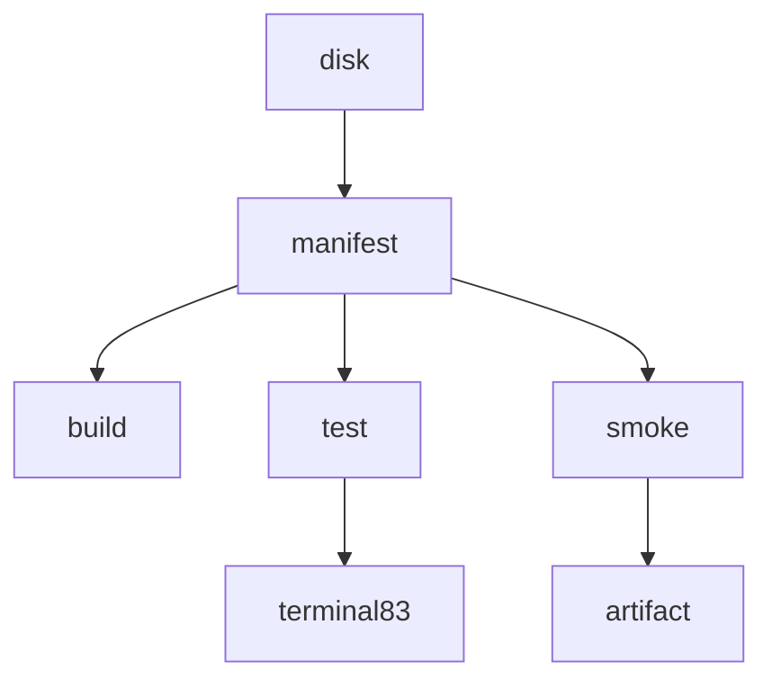

# Hive MCP Activation Review — Completion Journal

#fractal-l0 #fractal-l3 #fractal-l9 #zk-adr #zero-muda #stamp-stpa #tailscale-web

**Review:** [docs/reviews/20261027-0532-hive-mcp-activation-review.json](http://nas-1.tail55d152.ts.net:4100/files/docs/reviews/20261027-0532-hive-mcp-activation-review.json) · `d4005ecb02f17b19fac443da820a69924596a95d5dc559adf76ecc12fb9f69e5`
**Formal evidence:** `governance/planning/20261027-0532-hive-mcp-formal-evidence.json` · `b3e68c2b2da28d6b1796081b340704ac0965e79a8584ada5d4051508054e8d62`
**Verdict:** HOLD · **Candidate:** `f217359b368f8a0714503bc7a87b001ee1e41d51919608382ec0bfd5e580da65`
**Contract:** `SC-JOURNAL-v3` · **Sa-plan:** `uos/hive-development/20261027-0532` task `ACTIVATE_REVIEW` attempt 1

## 1. Scope & Trigger

Trigger: the initialized successor MCP claimed `MCP_ACTIVATE` attempt 1, wrote a smoke artifact, built and reported 83/83. Codex requested a bounded activation review, explicitly not system admission. Verdict: **HOLD** on one named, trivially-fixable evidence gap.

## 2. Pre-State Assessment

| Gate | Result |
|---|---|
| Own preflight | `PREFLIGHT_PASS` 05:24:58Z, 0 findings |
| Claim | attempt 1, `lease_until_ns=1793080508222035555`, finite 30 min |
| Portfolio mirror | idx 6, `task_state` only, 24→24 fields, 1 entry changed, `actor` untouched |
| Active-check | `ACTIVE_OBSERVATION_PASS` 05:25:09Z, 0 findings |

## 3. Execution Detail

```text
[input_manifest] --> [build_receipt]
[input_manifest] --> [test_receipt]
[input_manifest] --> [smoke_receipt]
[disk_bytes] --> [input_manifest]
[test_receipt] --> [terminal_83]
[smoke_receipt] --> [smoke_artifact]
```



Nine findings: seven PASS, one PASS-under-caveat, one FAIL.

## 4. Root Cause Analysis (ACH)

ACH (Analysis of Competing Hypotheses) for the `activate-test-1` digest mismatch.

| Evidence | H1 stored output is truncated | H2 output was altered | H3 digest covers a different field |
|---|---|---|---|
| E1 length is exactly 8192 | Very consistent | Inconsistent | Neutral |
| E2 output begins mid-word `"est...ok"` | Very consistent | Inconsistent | Inconsistent |
| E3 build (7911) and smoke (64) digests match raw output | Consistent | Inconsistent | Refutes H3 |
| E4 terminals intact at the tail | Consistent | Inconsistent | Neutral |
| Evaluation | **CONFIRMED** | REFUTED | REFUTED |

H1 confirmed: head-truncation at an 8192 boundary with the tail retained. The digest convention is raw-output, established by two matching receipts.

## 5. Fix Taxonomy

| Fix | Class |
|---|---|
| M-2 digest over retained bytes plus truncation declaration | Poka-Yoke |
| M-3 per-module receipts | Standardized Work |
| HOLD rather than approve on an uncheckable digest | Jidoka stop line |

## 6. Patterns & Anti-Patterns (Devil's Advocate / Red Team)

**Anti-pattern found: a digest that attests something other than what the reader holds.** Because the stored bytes cannot match the declared digest either way, a mismatch is uninformative — the integrity check degrades to noise precisely where the central claim lives. This is the session's recurring shape: an observable that cannot see the property.

**Devil's Advocate / Red Team against my own HOLD (Popperian falsification attempt):** is HOLD excessive when everything else passes? Tested. Scope compliance is independently solid — manifest 10/10 against disk, build and smoke digests match, writes confined, no expansion tokens. So the activation is very probably fine. But "probably fine" is the judgement a reviewer is placed here to avoid making on the one artifact that cannot be checked. Approving would convert an unverifiable into a verified. The HOLD survives.

**Anti-pattern avoided:** `production x1` looked like scope expansion by count. Reading the context showed a test name, `production_wrong_worker_attempt_and_expiry_are_rejected_test` — a rejection test. Counting tokens would have produced a false finding.

## 7. Verification Matrix (Admiralty ≥ B2)

| # | Claim | Evidence | Grade |
|---|---|---|---|
| 1 | input_manifest identical across 3 receipts | recomputed | A1 |
| 2 | manifest 10/10 vs disk, drift 0 | recomputed | A1 |
| 3 | build digest matches output | recomputed | A1 |
| 4 | smoke digest matches output | recomputed | A1 |
| 5 | test digest does NOT match stored output | recomputed | A1 |
| 6 | six modules present in retained output | substring search | A2 |
| 7 | no scope expansion | token scan plus context read | A2 |
| 8 | 83/83 passed | **truncated artifact, digest uncheckable** | **C3 — not admissible** |

Row 8 is below B2 and is the HOLD. Per `INV-JRN-02` this journal is self-attestation and certifies no admission.

## 8. Files Modified

Three created: the activation review, the formal evidence, this journal. One shared row: `ACTIVATE_REVIEW` `task_state`. No control, source, config or grant touched. Parent `MCP_ACTIVATE` deliberately not completed.

## 9. Architectural Observations

The candidate binding is the strong part of this design: one `input_manifest` string, shared byte-identically across every effect receipt, hashed to a single `candidate_sha256`. That makes "which bytes was this run against" answerable in one comparison, and it held perfectly. The weak joint is downstream — an output whose retention policy and whose integrity digest disagree about which bytes exist. Retention and attestation must cover the same extent, or the attestation stops meaning anything.

## 10. Remaining Gaps

The 83/83 terminal is unverifiable as stored (M-1/M-2/M-3). No per-invariant mapping from the six modules to the four specification-shaped functions in `development.gleam`; I identified those by signature only and assert no coverage. I reproduced no build and no test. Theorem proving was not run by anyone and is recorded `NOT_RUN`.

## 11. Metrics Summary

Observed counts: 9 findings (7 PASS, 1 caveated, 1 FAIL), 10/10 manifest entries verified, 3/3 receipts with identical manifest, 2/3 output digests verified, 6/6 modules observed, 36 public functions in `development.gleam` of which 4 are specification-shaped, 3 artifacts created, 0 source files touched.

Bayesian note, as direction not a fabricated number: my prior that activation stayed in scope rose with each independent recomputation and is now high; my confidence in the *test-count* claim did not move at all, because no check I ran could bear on it. Those two should not be averaged, and the verdict follows the weaker one. No Lyapunov claim — `INV-JRN-05` asks for a negative energy derivative and I have no system-energy series for a document review; fabricating one from finding counts is the invented mathematics this plan has repeatedly corrected. Recorded as **not satisfied, deliberately**.

## 12. STAMP & Constitutional Alignment

Loss addressed: **L-1 false conformance** — reporting a verified activation on an artifact whose integrity cannot be checked. UCAs considered: *provided unsafely* (VERIFIED on uncheckable evidence), *not provided* (blocking a compliant activation), *wrong timing* (verifying against stale bytes, excluded by the manifest recomputation). Ψ-3 two-key verification is **not** satisfied for the test claim and is not asserted. Ψ-5 truthfulness is the whole basis of the HOLD. EV ceiling remains 93; no EV minted. No NVMe serial appears.

## 13. Conclusion (Forecast & Brier precommitment)

HOLD on one named gap. Scope compliance is independently evidenced; the activation is very likely sound, and that is exactly why the gap should be closed rather than waived.

Precommitted, falsifiable Forecast set, Brier-scored (`B = (p - o)^2`), each with an explicit Horizon:

1. **p = 0.92** — supplying the untruncated output or a retained-bytes digest (M-1/M-2) clears this HOLD with no code change and no re-run. Falsified if clearing it requires either. Horizon **2026-10-27T17:06:15Z**, grant expiry.
2. **p = 0.88** — the untruncated output, once supplied, contains all six modules and totals 83. Falsified by any other count or a missing module. Horizon **2026-11-03T00:00:00Z**.
3. **p = 0.65** — the next defect found in this harness chain is in evidence retention or attestation extent rather than in authority scope. Falsified if it is a scope defect. Horizon **2026-11-10T00:00:00Z**.

**UOS footer:** `nas-1.tail55d152.ts.net:4100` · Sa-plan is the sole execution authority. This journal is model self-attestation and grants no admission.
