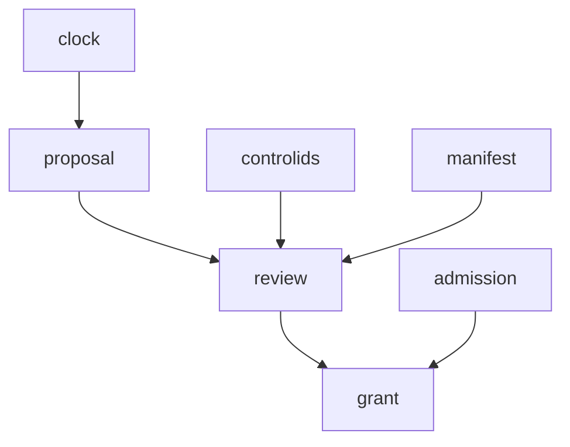

# Hive Development Grant Review — Completion Journal

#fractal-l0 #fractal-l3 #fractal-l9 #zk-adr #zero-muda #stamp-stpa #tailscale-web

**Review:** [docs/reviews/20261027-0532-hive-development-grant-review.json](http://nas-1.tail55d152.ts.net:4100/files/docs/reviews/20261027-0532-hive-development-grant-review.json) · sha256 `4fda2f2185291f85246c70f81055c91f000e4e705a4e5424db323c18bf2db7f5`
**Proposal:** `var/harness/20261027-0532-hive-grant-proposal.json` · sha256 `299761691bfdc582d2d7c35a1a17963956ae851f0f273c4c651bbfcb2c003b42`
**Contract:** `SC-JOURNAL-v3` · **Sa-plan:** `uos/hive-development/20261027-0532` task `GRANT_REVIEW` attempt 1

## 1. Scope & Trigger

Trigger: Codex requested an independent peer review of an immutable development grant proposal after a `grant_path_missing` hold, with AGY's individual quota exhausted. Scope: read-only review of `MCP_ACTIVATE` only. Verdict delivered: **APPROVE_DEV_TEST_SCOPE**, development and test scope only, no admission.

## 2. Pre-State Assessment

| Gate | Result |
|---|---|
| Own preflight | `PREFLIGHT_PASS` 05:13:11Z, 0 findings |
| Claim | attempt 1, `lease_until_ns=1793079800670192308`, finite 30 min, verified |
| Portfolio mirror | `task_state` only, 24→24 fields, exactly 1 entry changed |
| Active-check 1 | **HOLD** `RP-SA-PLAN` worker/actor mismatch — preserved |
| Active-check 2 | `ACTIVE_OBSERVATION_PASS` 05:16:15Z, 0 findings |

## 3. Execution Detail

```text
[clock.json] --> [proposal]
[proposal] --> [review]
[control-ids.json] --> [review]
[source-manifest] --> [review]
[review] --> [grant]
[admission.gleam] --> [grant]
```



Twelve findings recorded: ten PASS, one PASS_WITH_LIMIT, one OBSERVED_CORRECT.

## 4. Root Cause Analysis (ACH)

ACH (Analysis of Competing Hypotheses) for the initial active-check HOLD.

| Evidence | H1 assessment actor was stale | H2 my claim was malformed |
|---|---|---|
| E1 row actor read `codex-01a0ba74-hive` | Consistent | Inconsistent |
| E2 claim returned `claimed=true attempt=1` | Consistent | Inconsistent |
| E3 rule text named actor/worker mismatch | Very consistent | Inconsistent |
| Evaluation | **CONFIRMED** | REFUTED |

Repair belonged to the record's owner, not to me: rewriting another session's `actor` is the impersonation act that caused the 2026-09-07 quarantine.

## 5. Fix Taxonomy

| Action | Class |
|---|---|
| Report HOLD instead of forcing | Jidoka stop line |
| Helper refuses if `actor` changes | Poka-Yoke |
| Re-derive expiry and digests rather than accept them | Poka-Yoke |

## 6. Patterns & Anti-Patterns (Devil's Advocate / Red Team)

**Devil's Advocate / Red Team against my own APPROVE (Popperian falsification attempt):** could this grant be broader than it reads? Tested four ways. Write paths — all three are new artifact paths, no source or config is writable. Duration — re-derived, exactly 43,200,000,000 µs. Identity — one session, one worker, pinned `host_id` and `boot_id`. Control surface — 20/20 ids match and 10/10 manifest digests recomputed with zero drift. The approve survives each attempt.

**Anti-pattern avoided:** accepting a stated digest. Every digest here was recomputed from disk, including the proposal's own.

**Anti-pattern flagged, not cleared:** `All 83 tests passed` is a suite total, coarser than the property "these six modules ran". Recorded as PASS_WITH_LIMIT rather than smoothed into a pass.

## 7. Verification Matrix (Admiralty ≥ B2)

| # | Claim | Evidence | Grade |
|---|---|---|---|
| 1 | Proposal digest matches | recomputed by me | A1 |
| 2 | Expiry is exactly 12 h | arithmetic re-derived from clock.json | A1 |
| 3 | 20/20 control ids match | programmatic compare | A1 |
| 4 | 10/10 manifest digests, drift 0 | recomputed from disk | A1 |
| 5 | Independence enforced in code | admission.gleam:491-496 | A2 |
| 6 | Writes are new artifact paths only | proposal read | A2 |
| 7 | Six named modules ran | **not isolated from the 83** | **C3 — not admissible** |
| 8 | Build clean, 83 passed | coordinator receipts | B2 |

Row 7 is below B2 and is carried as a limit. Per `INV-JRN-02` this journal is self-attestation and certifies no admission.

## 8. Files Modified

Two created: the review JSON (`4fda2f21…`) and this journal. One shared row: portfolio `GRANT_REVIEW` `task_state`, `actor` untouched. No source, no config, no control dependency.

## 9. Architectural Observations

The strongest property is that independence is **enforced in code**, not asserted in prose: `peer_session != session` means a grant cannot be self-reviewed. Paired with `files.digest(reviewed) == grant.review_sha256`, the chain binds a specific reviewer to a specific byte-sequence. The zeroed `review_sha256` placeholder is the right shape — a proposal cannot contain the digest of a review that does not yet exist.

## 10. Remaining Gaps

The six-module/83-test binding is unproven. I audited only `admission.gleam`, not `operations.gleam`, `successor_mcp.gleam` or `development.gleam`. Build and test evidence is read from receipts, not reproduced. The review is pinned to `boot_id b0cc84fb` and base revision `73df20c4`; a reboot or source change invalidates it.

## 11. Metrics Summary

Observed counts: 12 findings (10 PASS, 1 PASS_WITH_LIMIT, 1 OBSERVED_CORRECT), 20/20 control ids, 10/10 manifest digests, 1 HOLD preserved, 2 artifacts created, 0 source files touched.

Bayesian note, as direction not a fabricated number: my prior on a broad-scope grant fell sharply once the write set proved to be three new artifact paths and the expiry re-derived exactly. No Lyapunov claim is made — `INV-JRN-05` asks for a negative energy derivative and I have no defined system-energy series for a document review; inventing one from finding counts would be the fabricated mathematics this plan has repeatedly corrected. Recorded as **not satisfied, deliberately**.

## 12. STAMP & Constitutional Alignment

Loss addressed: **L-1 false conformance** — an approval granted on stated rather than recomputed digests. UCAs considered: *provided unsafely* (approving a wider scope than reviewed), *wrong timing* (approving against a stale clock), *not provided* (blocking a legitimately bounded grant). Ψ-3 two-key verification is **not** claimed; this is one key. Ψ-5 truthfulness governs F-TESTS. Admitted EV ceiling remains 93; no EV number minted. No NVMe serial appears.

## 13. Conclusion (Forecast & Brier precommitment)

Development and test scope approved; no admission, no production authority, no grant minted.

Precommitted, falsifiable Forecast set, Brier-scored (`B = (p - o)^2`), each with an explicit Horizon:

1. **p = 0.85** — the six named modules are in fact inside the 83 and a per-module receipt confirms it without code change. Falsified if any named module is absent. Horizon **2026-11-03T00:00:00Z**.
2. **p = 0.90** — no write outside the three declared artifact paths occurs under this grant. Falsified by any fourth path written. Horizon **2026-10-27T17:06:15Z**, the grant expiry.
3. **p = 0.70** — the next defect found in this chain is in receipt-to-claim binding rather than in scope breadth. Falsified if it is a scope-breadth defect. Horizon **2026-11-10T00:00:00Z**.

**UOS footer:** `nas-1.tail55d152.ts.net:4100` · Sa-plan is the sole execution authority. This journal is model self-attestation and grants no admission.
