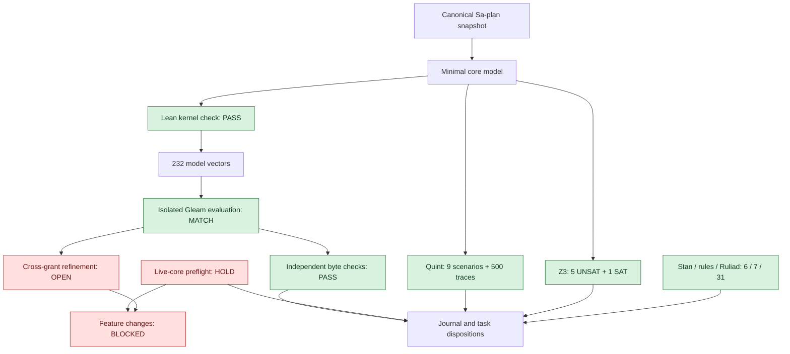

# Protected-core evolutionary readiness: analysis and results

Baseline2026-10-27T06:08:34Z; evidence summarized through07:06:44Z. #fractal-l0 #fractal-l1 #fractal-l2 #fractal-l3 #fractal-l4 #fractal-l5 #fractal-l6 #fractal-l7 #fractal-l8 #fractal-l9 #zk-adr #zero-muda

[Cockpit](http://nas-1.tail55d152.ts.net:4100/) · [Planning](http://nas-1.tail55d152.ts.net:4100/planning) · [Plan](http://nas-1.tail55d152.ts.net:4100/files/docs/plans/20261027-0634-hive-development-readiness-plan.md) · [Raw journal](http://nas-1.tail55d152.ts.net:4100/files/docs/journal/20261027-0634-hive-development-readiness-plan-journal.md) · [Lean source](http://nas-1.tail55d152.ts.net:4100/files/formal/lean/DevelopmentCoreGate.lean)

## 1. Scope & Trigger

The operator requested another robust planning pass, journal and Sa-plan registration, then challenged task necessity and requested protected-core evolution, mathematical/runtime checks, decision analysis and human-readable results. This is bounded planning/document/formal-analysis work; the implementation goal remains paused. No product/runtime implementation was changed and no task was claimed, reclaimed or completed.

### Operator prompt, preserved verbatim

> continue. are these tasks absolutely necessary. are we adding complexity and tasks for the correct utility and payoff. take fractal organic evolutionary approach. the core parts must be absolutely robust. make sure the mcp, rules, skills , superpowers, sop etc are absolutely robust. the core capabilities must always be functional and robustly working before any chnages are made.so fractal and evolutionary analysis to ensure we are working with the correct set and capabilities. document this . makthematically prove and robust check. make the lean model as robust and sophisticated as possible. goal is that the core is extremely sophisticated and robust and resilient. fractal and biomorphically evolvable. document the analyis, thinking , approach , expected utility and behavior  and results in the journal. keep improving the lean model till we have very high confidence that it will actually give us the results we are looking for in the runtime system. use the full power and intelligence of the model. keep recursing and improving till we are getting very very high quality results. cross check lean model  with runtime code to verify. graphically show analyis and logs to explain to a human what is happening. use all the mathematical and modellling tools - lean, quint, etc, stan, rete ul, ruliad etc - all system capabilities and sops and processes. summarize the results and learnigs till now. explain in detail what you mean and what the results are showing. use all decision analysis techniques also. write the promptt in journal also. provide tailscale fqdn link

The material below records evidence, alternatives, concise decision rationale, expected behavior and results. The governance references remain AGENTS.md, SC-SA-PLAN-001, SC-HARNESS-MCP-001, the local risk SOP and canonical AINF specification.

## 2. Pre-State Assessment

Baseline observation2026-10-27T06:08:34Z:10 hive tasks with5 completed,1 ready and1 recorded executing; the recorded RECEIPT_FIX worker had been stopped. Telegram plan had16 tasks with1 completed. Four native MCP read tools were available; canonical planning/publication mutations were not exposed. The receipt source repair existed with an84-pass report from the old live harness; fresh activation acceptance remained HOLD. Source hashes and loaded module IDs are in the proof receipt. The handover's produced_utc predates its described later changes; preserve it and reconstruct time from actual receipts, never use it as a lease clock.

Clock was observed synchronized via chrony, stratum3 with sub-millisecond offset. Root JJ observation was pkyvxzuzrqyouyvnrvxpmzrmxnpmzskm /3b37bcbb91ad465b0c186d9987bfd542d98ab325. No Kalman prior or probability of whole-system health is justified by these point observations.

## 3. Execution Detail

Registered17 planning rows through the existing Gleam bounded Sa-plan adapter, producing27 total. Canonical readback confirmed the original10 rows unchanged and zero claims. The user's utility challenge was correct: the initial roadmap was over-gated. Fourteen new names were classified visibly through canonical rename:6 backlog,5 covered-by-core,2 conditional,1 reuse-evidence. Two recovery/authorization gates and1 new planning capability retain their names. All actual task states/attempts were preserved. Existing CLI lacks cancellation/dependency editing; no raw DB mutation, false completion or scheduler-deferral claim was used.

The first useful loop reuses RECEIPT_FIX, MCP_ACTIVATE, AGENT_PARITY, SERVICE_VERIFY and HIVE_VERIFY. PLANNING_MCP is the one distinct new operator-facing workflow; necessary core hardening remains test-driven repair within existing tasks. Current risk preflight returned HOLD because the prior10-row assessment no longer covers27 tasks and the requested task was not first eligible. Preserve the report and refresh the complete assessment before any future claim.

Developed an isolated Lean model, corrected compiler failures (preserved logs), checked47 named theorems and12 satisfiable examples, and rejected3 intentionally weakened variants. Cross-checked216 grant-budget cases and16 replay combinations against the actual compiled Gleam functions; checked2 parser refusals and10 output fixtures with independent full/retained SHA256. Added a concrete cross-grant refinement-gap observation without performing a physical side effect.

Reused the existing Quint coordination model:9 scenarios and500 seeded depth30 simulations passed,2 seeded mutants failed as intended. Z3 bounded queries returned5 UNSAT and1 SAT control. Already-built advisory substrate tests passed6 Stan-model,7 rule-adapter and31 Ruliad checks. No downloads, new inference, Bayesian reliability estimate or running-service change was performed. Public artifacts are a plan, manifest, journal, Lean source, proof receipt and raw proof log.

## 4. Root Cause Analysis

ACH H1 “all17 additions are required immediately” is disconfirmed: the least declared dependency closure for HIVE_VERIFY plus PLANNING_MCP contains13 IDs, including existing/completed history, and excludes13 newly registered roadmap packages. H2 “the core is accepted because unit tests passed” is disconfirmed by stale grant identities, missing fresh activation and the strong risk HOLD. H3 “the mathematical model proves the runtime” is disconfirmed by explicit missing bindings and the grant-specific receipt-path observation. H4 “a digest mismatch means tampering” is unsupported; stored diagnostic tail versus full-output hash explains the original defect. H5 “tool names mean full implementation” is disconfirmed by naive matcher documentation, separately named adapters and missing current source-to-prebuilt-binary evidence.

Fractal RCA follows evidence from L1 bytes/IDs through L2 functions, L3 durable attempts/effects, L4 services, L5 model advice, L6 agent ownership, L7 transport, L8 candidate integration and L0/L9 authority/assurance. A missing MCP planning write caused repeated bootstrap friction; broad task registration added assessment burden. Local cause, propagation, discriminating test, containment and residual risk are recorded rather than inventing five causal steps.

The runtime effect_path_for produces different result paths for the same intent under two grants. That is a demonstrated naming fact, not a demonstrated duplicate physical effect. It identifies the exact model/refinement question: how global logical identity survives grant/attempt replacement and where higher-level reconciliation/CAS supplies the required protection.

## 5. Fix Taxonomy

Poka-Yoke: require a fresh accepted core/authority/policy/evidence/bounds/rollback contract before normal changes; check matching host/boot and full effect horizon; make output retention explicit. Jidoka: HOLD stops feature work and unknown outcomes stop blind retry. Isolated recovery is narrow, separately authorized and cannot silently enable unrelated features. These runtime gates are required/proposed until actual enforcement is observed.

Zero-Muda correction: the core should be sophisticated in invariants, recovery and evidence, not in task count or framework count. Keep the protected baseline; grow one typed capability slice for a measured need/failure; verify, independently review, reversibly promote and observe. Reuse relevant evidence at the same boundary/candidate; do not execute170 repetitive checks per feature or require every backlog item for first usability. The17 rows remain real metadata and incur assessment cost; only their first-delivery scope was reduced.

Decision analysis:
| Method | Actual application and decision |
|---|---|
| STPA | All4 UCA types constrain absent authority, unsafe/excessive action, wrong timing and excessive duration. |
| FMEA | Raw S/O/Det and severity floor retained in manifest; unknown occurrence/detection stays unknown; no invented risk score. |
| Dependency/minimality | Kernel proof identifies the least closed declared task set; deferred work does not block the first loop. |
| Expected utility / cost-benefit | Prioritize safe task execution, evidence integrity and one MCP planning write; expected reduction in blocked/manual work is a hypothesis, not measured savings. |
| Dominance / Pareto reasoning | With nonnegative additive costs, an unnecessary superset cannot be cheaper; real shared costs and useful benefits may change the tradeoff. |
| Sensitivity / scenario analysis | Hidden dependencies invalidate an incomplete operational graph; unavailable required AGY yields a degraded/held profile; external uncertainty may block progress. |
| Value of information | Next high-value checks are fresh live MCP/policy loading and cross-grant crash/reply-loss behavior; more unrelated abstract theorems have diminishing payoff. |
| ACH / falsification / red team | Competing explanations,3 Lean mutants,2 Quint mutants and satisfiable controls challenge false greens. |
| Bayesian discipline | Stan adapter guards tested; correlated deterministic passes are not IID reliability data and do not justify a posterior. |
| Sequential stopping | Stop adding modeling layers when the remaining question requires actual runtime evidence; revisit only on new counterevidence. |

## 6. Patterns & Anti-Patterns Discovered

Falsifiers: removing healthy-core admission, allowing unknown redispatch, or adding an unnecessary performance task to the minimum core makes Lean reject the altered proof. Quint detects stale-fence and overspend mutants. Valid-state controls establish that the guards do not prohibit all progress vacuously.

Useful patterns: stable trusted identity distinct from caller text; durable reservation before dispatch; explicit uncertain outcome; pure decisions/effect isolation; same restrictions at any holon depth; child authority is a subset of its parent; healthy ancestors cannot hide required unknown children.

Avoid: equating more tasks/theorems with utility; counting historical/fixture results as runtime admission; inferring a full Stan sampler from a model adapter; relabeling a naive matcher Rete-UL; treating bounded simulation as exhaustive proof; assuming probability or universal exactly-once physical delivery; declaring a policy loaded merely because its file/symlink exists.

## 7. Verification Matrix

Admiralty B2 below is an author-assigned grade for directly observed reproducible artifacts, not an independent peer verdict or system admission. Wider runtime conclusions remain HOLD/UNRUN. Journal-linter wording does not execute the7 evidence engines.

| Evidence | Observed result | Scope / boundary |
|---|---|---|
| Canonical registration/readback |17 additions,27 total; original10 unchanged | B2 metadata-only; no task execution |
| Utility correction/readback |14 visible renames; state and attempt unchanged | B2 classification, not native cancellation/deferral |
| Lean4.33.0 bounded check |47 theorems+12 satisfiable examples PASS | B2 abstract laws and frozen graph; explicit Init/propext/Quot.sound foundations |
| Lean negative controls |3/3 altered variants rejected | Expected proof failures; mutant errors are not accepted proofs |
| Grant-budget differential |216/216 match | Actual admission.grant_budget_valid/3; finite boundary grid |
| Replay differential/parser |16/16 match;2 refusals | Actual operations.replay/2; arbitrary JSON not exhaustive |
| Receipt byte oracle |10 fixtures;10 full+10 retained digests match | GNU sha256sum independent of the Gleam constructor |
| Quint0.32.0 |9 scenarios PASS;500 seeded depth30 traces no violation;2 mutants rejected | Bounded existing coordination model; no full LTL/refinement claim |
| Z3 4.16.0 |5 UNSAT safety queries+1 SAT valid-state control | Isolated QF_LIA,3s solver/10s wall bounds |
| Stan-model adapter |6/6 fixture checks PASS | Prebuilt report-only adapter, not new NUTS sampling or system-reliability inference |
| Rule adapter / Hermes oracle |7/7 checks PASS | Prebuilt named adapter, actual algorithm identity/live binding unverified |
| Ruliad explorer |31/31 unit/property/chaos/fuzz checks PASS | Prebuilt synthetic multiway substrate tests |
| Strong pre-change risk check |HOLD on portfolio coverage and selection | Expected containment; no normal change authority |
| Cross-grant effect identity |REFINEMENT NOT ESTABLISHED | Different receipt paths observed; duplicate physical effect not demonstrated |
| Live MCP, loaded policy, process recovery, all services |HOLD / UNRUN | Required before core or full-profile readiness |

[Lean source](http://nas-1.tail55d152.ts.net:4100/files/formal/lean/DevelopmentCoreGate.lean) · [Raw proof log](http://nas-1.tail55d152.ts.net:4100/files/governance/planning/20261027-0634-core-gate-proof.log) · [Full proof/runtime receipt](http://nas-1.tail55d152.ts.net:4100/files/governance/planning/20261027-0634-core-gate-proof-receipt.json). Twenty-two raw inputs/logs/executable hashes are listed in that receipt. Private analysis artifacts remain under var/harness/20261027-0634-*. Earlier compiler failures are preserved and superseded by the successful final check. The first G-DIAGRAM run reported2 UNVERIFIED arrow layouts, so the ASCII source was converted to explicit bracketed edge lists for mechanical topology comparison; co-presence alone was not accepted as parity.

## 8. Files Modified

New artifacts: [plan](http://nas-1.tail55d152.ts.net:4100/files/docs/plans/20261027-0634-hive-development-readiness-plan.md), [manifest](http://nas-1.tail55d152.ts.net:4100/files/governance/planning/20261027-0634-hive-development-readiness-plan.json), this journal, [Lean model](http://nas-1.tail55d152.ts.net:4100/files/formal/lean/DevelopmentCoreGate.lean), [proof receipt](http://nas-1.tail55d152.ts.net:4100/files/governance/planning/20261027-0634-core-gate-proof-receipt.json) and [proof log](http://nas-1.tail55d152.ts.net:4100/files/governance/planning/20261027-0634-core-gate-proof.log). Private staging, normalized SMT input, mutation controls and fixture receipts preserve provenance.

Canonical DB writes were limited to requested task metadata via the existing Gleam bounded Sa-plan adapter. Original task states and attempts remain unchanged; no claim/reclaim/completion or VCS mutation occurred. Existing runtime source hashes admission8edc624f..., operationsf64da7e1..., and test7c7787cb... were observed unchanged during this analysis. The new formal model is an unloaded specification artifact, not a change to the serving core.

## 9. Architectural Observations

The mathematical core is a contract: normal work needs fresh healthy core, authority, policy, evidence, bounds and rollback; recovery can repair a red baseline only under narrow authorization after resume. Candidate edits preserve a protected baseline; promotion requires a green candidate and independent review. The runtime must actually implement and bind those predicates—an abstract Bool named policyLoaded is not a proof of loaded policies.

The finite task graph and subset-cost law justify a smaller declared dependency set under stated assumptions. They do not discover hidden runtime dependencies or measure economics. The model explicitly blocks unknown effect redispatch and models trusted reconciliation; its trusted observation input must be grounded in runtime evidence. Liveness requires environment/recovery/fairness assumptions; no unlimited uptime or general exactly-once external-effect theorem is claimed.

```text
[Canonical Sa-plan snapshot] --> [Minimal core model]
[Minimal core model] --> [Lean kernel check: PASS]
[Lean kernel check: PASS] --> [232 model vectors]
[232 model vectors] --> [Isolated Gleam evaluation: MATCH]
[Isolated Gleam evaluation: MATCH] --> [Independent byte checks: PASS]
[Independent byte checks: PASS] --> [Journal and task dispositions]
[Live-core preflight: HOLD] --> [Feature changes: BLOCKED]
[Live-core preflight: HOLD] --> [Journal and task dispositions]
[Minimal core model] --> [Quint: 9 scenarios + 500 traces]
[Quint: 9 scenarios + 500 traces] --> [Journal and task dispositions]
[Minimal core model] --> [Z3: 5 UNSAT + 1 SAT]
[Z3: 5 UNSAT + 1 SAT] --> [Journal and task dispositions]
[Stan / rules / Ruliad: 6 / 7 / 31] --> [Journal and task dispositions]
[Isolated Gleam evaluation: MATCH] --> [Cross-grant refinement: OPEN]
[Cross-grant refinement: OPEN] --> [Feature changes: BLOCKED]
```



ASCII and Mermaid describe the same nodes, edges and labels. The green model/component branches feed the journal; the live-core HOLD and open refinement branch still block normal feature changes. The existing Quint model provides overlapping protocol checks, not a proved equivalence with the new Lean state machine.

## 10. Remaining Gaps

P1: reconcile the stopped task and current grant/clock/control identity before implementation; refresh the full27-task assessment; observe fresh live MCP mutation/refusal/replay/release; establish the cross-grant stable-ID/reconciliation behavior; demonstrate actual core-health and policy gates at effect time. CORE_DEV_READY is not yet justified.

Core policy loading and instruction-pressure tests remain required: pause versus autonomous work, unsupported tools, wrong VCS, prohibited delegation, forged identity/backend, historical evidence, stale clocks/leases, uncertain effects, provider quota and Unicode diagnostic behavior. Advisory hooks are not enforcement.

P2/conditional: repair demonstrably used false-health/native bounds and missing MCP planning writes, then grow required capabilities from real use. Preserve the existing Telegram campaign including its operational soak; operator-visible routes and human journeys need actual evidence and explicit recipient scope. Full UI/catalog/federation/scale/KM/EV cleanup is later unless a current core risk requires it. AGY availability must be freshly observed.

Source-to-prebuilt-binary binding for Stan/rule/Ruliad substrate executables remains unestablished. No new Bayesian posterior is justified from these fixtures. Exact all-service/all-capability coverage and production release/state authority are open. Mathematical proof growth cannot close these runtime gaps by itself.

## 11. Metrics Summary

Task count10→27 after registration;17 additions comprise2 gates,1 evidence-reuse gate,1 new public workflow,5 absorbed,2 conditional and6 later packages. Fourteen names changed visibly;0 new claims and0 completions. The selected dependency closure has13 IDs including existing history;13 new packages lie outside it. Do not describe this as deleting tasks or reducing the DB count.

Formal/component observations:47 named Lean theorems,12 valid-state examples,3 rejected Lean mutants;216 budget+16 replay matches,2 parser refusals,10 fixtures with20 independent digest matches;9 Quint scenarios,500 depth30 traces and2 rejected mutants;5 UNSAT+1 SAT Z3 controls;6/7/31 advisory substrate checks. These are heterogeneous correlated observations, not a common sample of system reliability.

Expected utility is reduced manual bootstrap, less rework/unsafe retry, a usable protected development loop and useful capability growth per resource. Actual token/cost/latency savings are not established. No Beta-Binomial reliability update, calibrated high-confidence percentage or Lyapunov dV/dt<0 conclusion is justified. The Stan fixture protects against pseudo-replicated evidence; it does not supply missing data.

## 12. STAMP & Constitutional Alignment

Losses: unauthorized effects, duplicate or lost work, corrupt evidence, false readiness and damaged baseline. Four UCA classes: required stop/authority/recovery omitted; excessive or false-success action provided; stale/wrong-order effect; duration outlives lease/budget or ends before durable reconciliation. Core guards, explicit recovery, independent receipts and candidate promotion prevent these only when the actual runtime binding is verified.

Gleam remains control authority; Sa-plan is canonical; deterministic/native/inference backends retain their boundaries. The current MCP has no admitted planning publication write, so this requested metadata/formal-analysis operation used the previously operator-authorized bounded bootstrap and is explicitly recorded as such, not mislabeled MCP enforcement. Current preflight HOLD and paused goal grant no normal feature change. EV93 remains ceiling; no new EV or imported-history admission. Source trees outside UOS, pinned dependencies, storage interlocks and production were untouched.

## 13. Conclusion

The correct first delivery set is smaller than the original roadmap. The useful engineering result is a defined protected-core contract, a kernel-checked minimum declared dependency set, observed agreement on selected compiled runtime functions, and a concrete refinement gap that now has a falsifiable recovery question. This increases confidence in the stated model and tested boundaries without pretending that all runtime predicates are established.

Precommitted Forecast at2026-10-27T07:06:44Z: p = 0.90 that this planning packet, task dispositions and proof artifacts can be persisted and read back correctly by Horizon2026-10-27T07:36:44Z. Readback resolved the forecast true by2026-10-27T07:19:26Z, before the Horizon; Brier score=(0.90-1)^2=0.01. The served journal route returned HTTP200 with the actual document identity. This forecasts documentation/metadata integrity, not full-hive readiness. Falsifier: missing canonical rows, changed original state, failed model/kernel/validator, byte/hash drift or missing served journal. Expected next highest-value work after explicit implementation resume is bounded core recovery and runtime correspondence, not more roadmap or decorative mathematical layers.


## Comprehensive verification checklist

Checks describe this planning packet only; unchecked runtime obligations remain pending.

<details><summary>Domain 1 — Metadata and navigation</summary>

- [x] CHK-01-TIME: observed host UTC and synchronized chrony, stratum3, absolute offset below1ms.
- [x] CHK-02-TAIL: full FQDN locators provided; live delivery remains unverified.
- [x] CHK-03-FRACT: L0-L9 responsibilities and canonical aspect mapping recorded.
- [x] CHK-04-KM: plan, manifest, journal and governing sources linked.

</details>
<details><summary>Domain 2 — Purity and storage</summary>

- [ ] CHK-05-MUDA: full candidate dependency/runtime exclusion scan pending.
- [ ] CHK-06-GRAPH: native and graph boundaries require actual runtime checks.
- [ ] CHK-07-DRIVE: denied OS serial preserved; physical storage tests not performed.

</details>
<details><summary>Domain 3 — Verification</summary>

- [ ] CHK-08-C1C8: actual UI/surface checks pending.
- [ ] CHK-09-MATH: applicable bounded mathematical checks pending.
- [ ] CHK-10-9MOD: unit, system, TDD, BDD, property, fuzz, chaos, performance and scalability campaign pending.
- [ ] CHK-11-REGR: affected regression and operational soak pending.

</details>
<details><summary>Domain 4 — Control and observability</summary>

- [ ] CHK-12-GLEAM: fresh successor acceptance pending.
- [ ] CHK-13-HERMES: candidate-bound analysis and oracle checks pending.
- [ ] CHK-14-ZIGVM: required kernel/VFS evidence pending.
- [ ] CHK-15-MAX: required inference boundary evidence pending.
- [ ] CHK-16-OTEL: actual end-to-end causal trace and failure visibility pending.

</details>
<details><summary>Domain 5 — Governance</summary>

- [ ] CHK-17-SOV: independent candidate acceptance remains pending.
- [x] CHK-18-JJ: standalone JJ observed; no VCS mutation or unrelated source overwrite in this planning action.

</details>
<details><summary>Domain 6 — Provenance</summary>

EV-93 ceiling. EV-94..109 remain NOT_ADMITTED. No new EV identifier. No task count or passing document validator confers runtime admission.

</details>

[Previous: bootstrap](http://nas-1.tail55d152.ts.net:4100/files/docs/plans/20261027-0532-hive-development-bootstrap.md) · [Planning](http://nas-1.tail55d152.ts.net:4100/planning) · [Wiki](http://nas-1.tail55d152.ts.net:4100/wiki) · [ZK](http://nas-1.tail55d152.ts.net:4100/zk)

UOS footer: canonical execution state lives in Sa-plan; this is a planning projection, not a second task queue.
