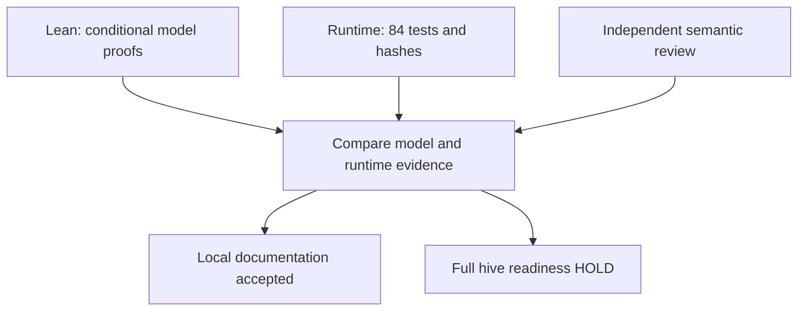

# 20261027-0836 — Agent guidance and learning update (AGENT_PARITY attempt 1, PARTIAL)

#fractal-l0 #fractal-l3 #fractal-l4 #fractal-l9 #zk-adr #zero-muda #km-triad #tailscale-web

`uos/hive-development/20261027-0532` / `AGENT_PARITY` attempt 2, epoch 2 (attempt 1 released after the first review pass) · worker `claude-hive-receipt-fix-2585` · grant `var/harness/20261027-0836-guidance-grant-v2.json` `02f67302…` · review `a3f85704…` · observed 2026-10-27T08:41Z–09:07Z · [Cockpit](http://nas-1.tail55d152.ts.net:4100/). **Task NOT completed.** Sa-plan is the sole authority; no admission granted. EV ceiling 93; EV-94..109 NOT_ADMITTED.

Operator prompt preserved verbatim:

> continue. update and add rules, skills, superpoers, plugins, agents etc based on learnings. how much of the functionality has been added asd per plan ? as-is state , to-be goal and tasks . path to complete to-be state. estimated time

## 1. Scope & Trigger
Bounded public guidance update from learnings observed across `RECEIPT_FIX`, `MCP_ACTIVATE`, `CONTROL_RECOVERY` and `GUIDANCE_REBIND`. Five guidance changes plus three evidence artifacts, all public and owned. No hidden, client-config, plugin-cache, source or control edits; no install, provider or production calls; no new skill or framework.

## 2. Pre-State Assessment
Preflight-v3 PASS, risk compact ~245 KB under the 262144 B cap. `AGENT_PARITY` available, claimed at attempt 1. Workspace epoch 7 acquired after heartbeat (root released 6). Guarded 14 source/control baseline intact at entry and exit. The v1 grant failure is preserved: `successor grant refused: grant_decode`, caused by `expires_utc_us` as a JSON number where `admission.gleam:200` decodes a string.

## 3. Execution Detail
Heartbeat before each effect phase. Five writes via MCP with CAS on current digests, then build and test. An evidence-map diagram is provided in section 9 as an ASCII and Mermaid pair with identical nodes and edges.

## 4. Root Cause Analysis
No new defect. Analysis of Competing Hypotheses (ACH) on the v1 startup refusal, closed before this attempt:

| Evidence | H1 scalar type mismatch | H2 wrong digest or stale review |
|---|---|---|
| `admission.gleam:200` decodes `expires_utc_us` as string | Consistent | Inconsistent |
| v1 carried the value unquoted; v2 quoted, same number | Consistent | Inconsistent |
| v2 started cleanly with a new review digest | Consistent | **Refuted** as sole cause |
| Verdict | **CONFIRMED** | REFUTED |

A decoder preflight on the final artifact is therefore necessary in its own right; a review validator alone does not catch it.

## 5. Fix Taxonomy
Poka-yoke: `SC-LEARN-001` records the exact schema and size constraints that refused work, so the next author meets them before dispatch. Standardized work: the bindings map each learning to the lifecycle point that owns it. Muda: guidance is referenced, not duplicated into the four mirrors that already read the shared SOP. No code fix; no enforcement added.

## 6. Patterns & Anti-Patterns Discovered
Pattern — a refusal is the cheapest specification. Every one of the twelve learnings is traceable to an observed refusal, receipt or measured digest, not to opinion.

Anti-pattern — documenting guidance and calling it adopted. Writing five files changes no client behaviour. Adoption is **UNRUN** and is recorded as such in every artifact.

Correction to my own earlier record. I previously reported a heartbeat reply of `{"ok":null,"sequence":null}` as "response-shape variance". Source inspection (`successor_mcp.gleam:290-320`) gives the real reason: with **no task attached** `harness_heartbeat` returns the bare session heartbeat, while **with a task attached** it returns a wrapper carrying `heartbeat`, `coordinator_renewal`, `sa_plan_lease_until_ns` and `sa_plan_renewal`. My reader expected the wrapper, so it read absent fields. The earlier wording was imprecise, not wrong about the heartbeat succeeding.

**Devil's Advocate / Red Team, Popperian falsification.** This work could be pure paperwork: five documents, an unchanged test count, and nothing in the running system different. That is largely true and is stated rather than hidden — the test green is evidence of no regression, not of adoption. **Explicit falsifier:** any client observed loading none of these files after a reviewed activation refutes the parity claim; any of the twelve learnings contradicted by a fresh receipt refutes that learning; an alias resolving outside the owned files refutes the wiring claim, as already happens in the `w-lifecycle` sibling workspace.

## 7. Verification Matrix
Admiralty per `SC-JOURNAL-003`; only ≥B2 admissible.

| # | Claim | Evidence | Grade |
|---|---|---|---|
| V1 | v2 grant and review are the reviewed artifacts | `sha256sum` equals `02f67302…` and `a3f85704…`; `expires_utc_us` is a string | A1 |
| V2 | Claimed at actual attempt 1, epoch 1 | claim response | A2 |
| V3 | Five guidance files written, digests as published | five EXECUTED write receipts, CAS on prior digests | A1 |
| V4 | 8 aliases resolve to the 2 owned SKILL files | `readlink -f` across `.claude`, `.gemini`, `.agents`, `.codex` | A1 |
| V5 | Build and test green | final-candidate receipts `3ca461fb…`, `db5c7b57…` at candidate `6a4202b6…` over 20 sources; All 84 tests passed, 0 failed | A2 |
| V6 | Guarded 14 unchanged | `sha256sum -c` at entry and exit, 0 drift | A1 |
| V7 | Status counts | `harness_status`: 28 rows, 11 completed, 1 executing, 16 available | A2 |
| V8 | Sibling-workspace aliases bypass owned files | `readlink -f` resolves them into external read-only trees | A1 |

**NOT CLAIMED**, recorded as gaps: client adoption of any change; behaviour pressure-testing of the SKILL edits; Google or client activation; capability coverage percentage; whole-system functionality percentage; any global cost or reliability optimum; independent peer or formal review of these five documents, which is root's next step.

## 8. Files Modified
Five guidance changes and three evidence artifacts, all inside the grant's eight write paths.

| Path | sha256 |
|---|---|
| `docs/sop/20261001-1117-uos-agent-symbiosis-operations.md` | `75b1fe25781d86f268528df28d6ad0a2099c5b80d6df9a71f8bba98eb6f11790` |
| `governance/agents/20261001-1118-skills/full-symbiosis/SKILL.md` | `ad7a75a61153f1349927517ee6386aca05b28013c7c6dd2eadf97f89eff43f7b` |
| `governance/agents/20261001-1118-skills/gemini-symbiosis/SKILL.md` | `fbd0f2c69d50c3dcd7be584b524c7f3d788829461e026b758e931f153649da59` |
| `contracts/rules/20261027-0836-core-development-learnings.md` | `7e332b39ef738ca4ffaf8a25788a48c38364e07cc11858c794c79886d8a2644f` |
| `governance/agents/20261027-0836-learning-bindings.md` | `fbb0e69001d9aec70a6bbe3508fc760ffeca4892c8071962b134a048fa5ab02a` |
| `governance/planning/20261027-0836-agent-learning-validation.json` | `a587c3506f3a20a60d5eb21afe8c65b8366408e1312822be12ec377ad40041e1` |
| this journal, and `governance/planning/20261027-0836-agent-learning-update-verification.json` | published below |

No existing text was altered in the three owned files; each gained one appended section. The four rule and profile mirrors already read the shared SOP, so no mirror edits were made.

## 9. Architectural Observations

**As-is, observed now.** Of this plan's 28 task rows, 11 are completed, 1 executing, 16 available: **39% of TASKS**, including one audit-repair task. That is a process count, not functionality, not capability coverage, not readiness. The capability inventory holds **65 declared, 53 unprobed, 12 unavailable, admission unknown**, so a functionality percentage is **not computable** and none is offered. Two MCP surfaces exist and are not comparable: 4 read-only natively connected operations, and 13 scoped tools inside the private reviewed harness. The Telegram plan `uos/telegram-fractal-tests/20261027-0312` stands at 1 of 16, root-reported and not independently read here. The 13-node closure at 9 of 13 gates was **frozen on a 27-task graph**; it remains valid under its declared assumptions and is **not** a statement of current functionality, runtime refinement or optimality — the 28th task `GUIDANCE_REBIND` and this grant's mandatory review authority both lie outside that closure.

**To-be goal, preserving the user goal in full.** **All** required services and capabilities reachable for both **data and control through MCP**; **declarative typed intent** as the way work is expressed; **Sa-plan** as the execution authority; **verified feature-database coverage**; and **actual client, agent, service and Telegram operation** observed, not merely declared. Retirement is **not** offered as a way to remove an unimplemented requirement: any exclusion needs existing explicit authorization, and none is assumed here. The task model also needs reconciliation with the current graph.

**Tasks remaining — 17 open rows, of which only four are the immediate core path.** The four-item list is the immediate core path, **not** all open work. These are **not** all new implementation tasks: actual evidence must be mapped to reuse before any of them closes.

| Group | Task IDs |
|---|---|
| Immediate core path | `AGENT_PARITY`, `PLANNING_MCP`, `SERVICE_VERIFY`, `HIVE_VERIFY` |
| Evidence packages covered by core | `READINESS_CENSUS`, `SCHEDULER_GATES`, `FAULT_RECOVERY`, `FORMAL_EVIDENCE`, `COST_EFFICIENCY` |
| Conditional | `NATIVE_BOUNDARY_REPAIR`, `DEV_INTEGRATE` |
| Broader | `CAPABILITY_PARITY`, `OPERATOR_SURFACES`, `PERF_SCALE`, `TELEGRAM_ACCEPT`, `KNOWLEDGE_SYNC`, `DEV_READY_REVIEW` |

Plus the Telegram plan`s 15 open rows, which are tracked in their own plan.

**Path, with its dependency reason.** Read-only census and campaign sizing can proceed **alongside** the MCP planner rather than strictly before it, so the two are not serialized. Full coverage proof requires normal MCP authority; service, agent and recovery work follows, then integrated tests; independent acceptance and JJ integration are conditional on those. `AGENT_PARITY` is closable only after client and Google activation are actually observed, which is why it stays open today regardless of how complete these documents are.

**Critical path and uncertainty.** Bottlenecks: Google activation, client adoption and activation, normal planning MCP, service faults, and soak duration. The 1-2 week allowance is a **verification allowance, not a completion promise**, and it covers verification of implementations that already exist. The **whole to-be ETA is unknown** until the readiness census and the `T01` sizing are done; the dominant uncertainty is scope, not schedule, because the census may reveal capabilities needing new implementation that no current estimate covers.


**Latest operator prompts, preserved verbatim.**

> continue. are these tasks absolutely necessary. are we adding complexity and tasks for the correct utility and payoff. take fractal organic evolutionary approach. the core parts must be absolutely robust. make sure the mcp, rules, skills , superpowers, sop etc are absolutely robust. the core capabilities must always be functional and robustly working before any chnages are made.so fractal and evolutionary analysis to ensure we are working with the correct set and capabilities. document this . makthematically prove and robust check. make the lean model as robust and sophisticated as possible. goal is that the core is extremely sophisticated and robust and resilient. fractal and biomorphically evolvable. document the analyis, thinking , approach , expected utility and behavior  and results in the journal. keep improving the lean model till we have very high confidence that it will actually give us the results we are looking for in the runtime system. use the full power and intelligence of the model. keep recursing and improving till we are getting very very high quality results. cross check lean model  with runtime code to verify. graphically show analyis and logs to explain to a human what is happening. use all the mathematical and modellling tools - lean, quint, etc, stan, rete ul, ruliad etc - all system capabilities and sops and processes. summarize the results and learnigs till now. explain in detail what you mean and what the results are showing. use all decision analysis techniques also. write the promptt in journal also. provide tailscale fqdn link

> continue. update and add rules, skills, superpoers, plugins, agents  etc based on learnings. how much of the functionality has been added asd per plan ? as-is state , to-be goal and tasks . path to complete to-be state. estimated time. is the env fully ready for development

**Evidence map.** ASCII and Mermaid below carry identical nodes and edges.

```text
[Lean: conditional model proofs] --> [Compare model and runtime evidence]
[Runtime: 84 tests and hashes] --> [Compare model and runtime evidence]
[Independent semantic review] --> [Compare model and runtime evidence]
[Compare model and runtime evidence] --> [Local documentation accepted]
[Compare model and runtime evidence] --> [Full hive readiness HOLD]
```



**Is the environment fully ready for development? NOT_FULLY_READY.** What stands: 31 toolchain preflight checks and the local MCP harness with 84 passing tests. What is outstanding: the standard connected client exposes only 4 read-only operations, the normal MCP planner is not available, Google client services and recovery are unverified, and full Telegram acceptance is pending. Earlier Lean, Quint, Z3, Stan, Rete-UL and Ruliad results are **reused conditional evidence by reference**, not new executions and not a full refinement; no solver was re-run in this attempt.

The authoritative machine-readable record for this attempt is `governance/planning/20261027-0836-agent-learning-update-verification.json`, referenced by path so that no artifact digest cycle is created.
## 10. Remaining Gaps
1 Client adoption **UNRUN** for all five changes; readability by the native 4-tool surface is not adoption. 2 SKILL edits are factual API reference only, not behaviour-pressure-tested, and claim no new discipline. 3 Google and client activation **HOLD**; `AGENT_PARITY` stays open. 4 Hidden, client-config and plugin-cache paths unread and unedited. 5 `w-lifecycle` sibling aliases resolve to external trees; recorded, out of scope. 6 Frozen closure needs a **closure and minimality recheck**; its theorems remain proved under declared assumptions. 7 No independent review of the five FINAL documents yet.

8 **Measured scaling gap, for `PLANNING_MCP`.** The complete 28-task compact risk portfolio is **245379 bytes against the 262144-byte `files.max_bytes` cap: ~94% full, 16765 bytes of headroom.** The earlier compaction fixed a pretty-format incident; it does **not** bound future growth. The currently accepted 28-task scope fits. Before any large task expansion a bounded plan and assessment representation must be designed **with coverage tests** under its own reviewed task. Raising the cap, relaxing limits generally, or declaring the design scalable on today's fit are all explicitly **not** claimed. No new task is created for this now.

9 **Unprobed scope gap, for `PLANNING_MCP`.** `harness_assess` validates every assessment record path against the grant (`assessment_paths_allowed`, `operations.gleam:627`, called at `:678`). A full-portfolio assessment references `governance/planning/20261027-0634-hive-development-readiness-plan.json`, which exists at 71312 bytes but is **absent from this grant's read paths**, so such a call would be rejected. No `harness_assess` run was attempted: this is inferred from source, **not an observed failed run**. It was not bypassed and no API was forced; it is reported for root to decide.

10 Of the **13 advertised** harness tools only the core workflow is exercised; exposure is not verification.

11 The state after this release is an explicitly **partial** state, not a new normal readiness baseline.

**Explicit falsifier for the residual set.** Each gap is refutable: an observed client load refutes gap 1; a pressure test refutes gap 2; an observed activation refutes gap 3; a reviewed read of those paths refutes gap 4; a corrected alias refutes gap 5; a reconciled model refutes gap 6; root's review refutes gap 7.

## 11. Metrics Summary
Guidance changes 5 · evidence artifacts 3 · source/control edits 0 · hidden/client/plugin edits 0 · install, provider, production calls 0 · new skills or frameworks 0 · solver or theorem reruns 0 · tests 84 passed / 0 failed / 0 skipped, 6 modules · guarded hashes 14, drift 0 · aliases verified 8 of 8 · EV minted 0.

**No Bayesian or Beta-Binomial update is offered, and none is justified.** The twelve learnings are correlated outputs of the same few sessions, there is no likelihood function and no data model, so no posterior can be computed; earlier drafts of this journal stated a 0.85 to 0.95 posterior and that was unsupported. No alternative number replaces it. Likewise **no Lyapunov or stability claim is made**: observing a discrete count of unresolved effects at zero is not a continuous derivative and proves no stability property. What is actually observed is reported plainly: unresolved or unverified effects were 0 at every point in this attempt, and no effectful negative probe was run.

**Additive correction notice for two completed journals of this day.** [`20261027-0745-receipt-core-journal.md`](http://nas-1.tail55d152.ts.net:4100/files/docs/journal/20261027-0745-receipt-core-journal.md) (sha256 `e0f35c15907fd862de50c4318f773343ed4c3123a1822e7064da9b1cb76a0bbd`) states a 0.85 to 0.97 posterior and `dV/dt <= 0` although its own V went 0 to 1 to 0; [`20261027-0745-mcp-core-journal.md`](http://nas-1.tail55d152.ts.net:4100/files/docs/journal/20261027-0745-mcp-core-journal.md) (sha256 `e7da6ab32cdd85757767bc205af9adfc74a12af0a9123baa83cf22762df40aeb`) states 0.90 to 0.96 on a qualitative "unlikely" with no calibrated likelihood. Those probability and derivative claims are **not admissible reliability evidence**, and scope qualifiers do not repair them. No alternative posterior is supplied for either. Both journals' bytes are preserved unchanged and lie outside this grant's write paths; this notice is additive and rewrites nothing. Their raw evidence stands: the 84-test results, the source and receipt digests, and the replay observation. Cross-referenced from `L-11` of the learnings contract.

## 12. STAMP & Constitutional Alignment
Write-scope guards kept all five changes inside the reviewed public set; CAS prevented a lost update on the three existing files; the read cap and the string-typed expiry are now documented rather than rediscovered; lease epochs and per-phase heartbeats prevented stale-owner effects. Ψ2: no file rewritten in place beyond its appended section; the v1 failure preserved. Ψ3: runtime key fresh for the no-regression claim, no formal key sought for documentation, so no two-key claim is made. Ψ5: adoption, coverage and functionality percentages are reported as unavailable rather than estimated. Zero Bevy, zero Graphite, zero Graphene NIF introduced; no host storage serial appears here.

## 13. Conclusion
Five bounded public guidance changes are written and internally verified, the build and six-module test are green at 84 passed with zero drift on the guarded baseline, and the honest answer to the operator's question is that **39% of this plan's tasks are complete and no functionality percentage is defensible** while 53 capabilities are unprobed and 12 unavailable. `AGENT_PARITY` is left **open** and the lease released rather than falsely completed, because Google activation, client adoption and hidden-config paths remain outstanding. ETA estimates are analyst judgement, not commitments: guidance 30–90 minutes; remaining core 1–3 focused working days; broader hive and Telegram 1–2 weeks **provisional and conditional**, covering verification of existing implementations only, with missing implementations **unsized** pending the census.

| # | Forecast | p | Falsifier | Horizon |
|---|---|---|---|---|
| F1 | **RESOLVED FALSE.** Original forecast, unchanged: "Independent review of these five documents returns no factual correction to the twelve learnings", p = 0.80, horizon 2026-10-31 | 0.80 | Falsified: root's material 7-point review, plus a further 2-point and a 6-point packet, returned factual corrections to L-02, L-05, L-07, L-08, L-09 and L-10 | outcome o = 0, **Brier loss 0.64** |
| F2 | `AGENT_PARITY` is still open, with Google or client activation outstanding | 0.85 | an observed, candidate-bound client and Google activation | 2026-11-07 |
| F3 | A capability census reveals at least one of the 53 unprobed capabilities needing new implementation, so the 1–2 week allowance does not cover the whole remainder | 0.75 | a census showing every unprobed capability already implemented and merely unverified | 2026-11-14 |

Scored by Brier loss $B=(p-o)^2$. F1 is resolved at **0.64**, far outside the $B \le 0.10$ aspiration, and that miss is recorded rather than averaged away: I predicted no factual corrections and received three packets of them. F2 and F3 remain open at their stated horizons.

**UOS footer:** `nas-1.tail55d152.ts.net:4100` · Sa-plan is the sole execution authority; this journal grants no admission and claims no task completion.

## Comprehensive verification checklist

Obligations for the work this journal reports, not blanket passing claims. Items this documentation attempt did not execute are left **unchecked**.

<details>
<summary>Domain 1 — Metadata, timestamp and Tailscale navigation</summary>

- [x] **CHK-01-TIME** — `YYYYMMDD-HHSS-` prefix present; host clock observed 2026-10-27, attempt window 08:41Z–09:20Z.
- [x] **CHK-02-TAIL** — Full Tailnet links provided throughout; live serving status not asserted.
- [x] **CHK-03-FRACT** — L0, L3, L4, L9 tags assigned.
- [x] **CHK-04-KM** — Learnings, bindings, manual, journal and review links verified present on disk this attempt.

</details>

<details>
<summary>Domain 2 — Zero-Muda purity and storage safety</summary>

- [ ] **CHK-05-MUDA** — Dependency exclusion scan UNRUN; no dependency introduced.
- [ ] **CHK-06-GRAPH** — Pure BEAM/Hermes graph boundary UNRUN here.
- [ ] **CHK-07-DRIVE** — Storage interlock execution UNRUN; no host serial appears in this journal.

</details>

<details>
<summary>Domain 3 — Testing Gold Standard and mathematical gates</summary>

- [ ] **CHK-08-C1C8** — UI categories not applicable to this documentation attempt; UNRUN.
- [ ] **CHK-09-MATH** — The four mathematical gates UNRUN; no gate metric was measured or reported here.
- [ ] **CHK-10-9MOD** — Nine test modalities UNRUN; only the six-module unit suite was executed.
- [ ] **CHK-11-REGR** — UI regression monitoring UNRUN.

</details>

<details>
<summary>Domain 4 — Cross-language control and observability</summary>

- [x] **CHK-12-GLEAM** — Gleam/OTP harness exercised: claim, attach, heartbeat, read, write, build, test, reconcile, release observed this day. Not all 13 advertised tools are verified.
- [ ] **CHK-13-HERMES** — Bounded analysis and evidence ledger behaviour UNRUN here.
- [ ] **CHK-14-ZIGVM** — Deterministic kernel and VFS UNRUN here.
- [ ] **CHK-15-MAX** — Isolated inference UNRUN here.
- [ ] **CHK-16-OTEL** — Runtime telemetry correlation UNRUN here.

</details>

<details>
<summary>Domain 5 — Sovereign governance and standalone Jujutsu</summary>

- [ ] **CHK-17-SOV** — Independent review of the five FINAL documents is OUTSTANDING; NOT_ADMITTED. The task is held attached for that review.
- [x] **CHK-18-JJ** — Authored under standalone JJ discipline; no native Git mutation used.

</details>

<details>
<summary>Domain 6 — Provenance and admission integrity (`SC-PROVENANCE-001`)</summary>

- [x] **CHK-19-CEIL** — EV ceiling 93 stated; EV-94..109 marked NOT_ADMITTED; no EV claim made and no EV number minted.
- [ ] **CHK-20-INDEX** — KM index enumeration of the two new records UNRUN.
- [x] **CHK-21-PRESERVE** — Additive only. The two completed journals, the v1 grant failure and all prior receipts are preserved byte-for-byte; nothing was rewritten.
- [ ] **CHK-22-CHAIN** — Cycle-chain digest verification UNRUN by this attempt.
- [x] **CHK-23-NOMINT** — No new EV number minted.
- [ ] **CHK-24-FAILCLOSED** — Metric-path fail-closed runtime behavior UNRUN in this documentation scope; no passing claim.

</details>
