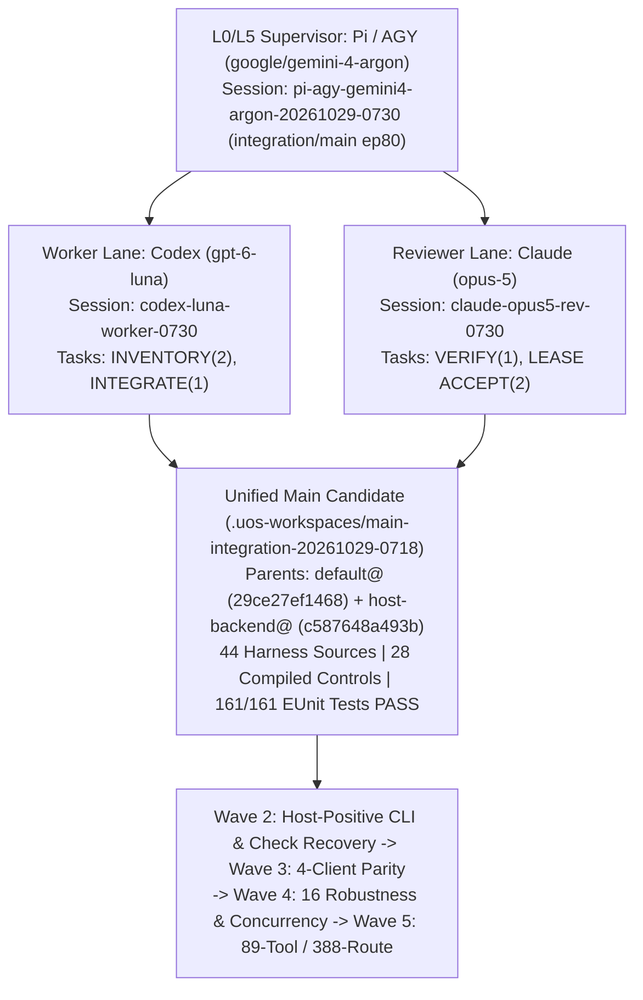

# 20261029-0718 — UOS Full Fractal Evaluation, Handover Takeover, Multi-Agent Sequencing & All-Workspace Main Integration

- **Journal ID**: `JRN-20261029-0718-MAIN-INTEGRATION`
- **Contract Authority**: `SC-JOURNAL-v3` (`SC-JOURNAL-003`), `SC-CHECKLIST-001`, `SC-DIAGRAM-001`, `SC-HARNESS-MCP-001`, `SC-SA-PLAN-001`, `SC-RISK-PRIORITY-001`
- **Observed Host Clock**: `2026-10-29T07:31:00Z` (`chronyc` Stratum 3, offset `+0.000345s`, nominal $<2\text{s}$)
- **Fractal Tags**: #fractal-l0 #fractal-l1 #fractal-l2 #fractal-l3 #fractal-l4 #fractal-l5 #fractal-l6 #fractal-l7 #fractal-l8 #fractal-l9 #zk-adr #zero-muda
- **Tailscale Links**: [Cockpit](http://nas-1.tail55d152.ts.net:4100/) · [Planning](http://nas-1.tail55d152.ts.net:4100/planning) · [Wiki](http://nas-1.tail55d152.ts.net:4100/wiki) · [ZK](http://nas-1.tail55d152.ts.net:4100/zk) · [Rendered Journal](http://nas-1.tail55d152.ts.net:4100/docs/journal/20261029-0718-main-integration/20261029-0718-fractal-evaluation-and-main-integration-journal.md) · [Raw Journal](http://nas-1.tail55d152.ts.net:4100/files/docs/journal/20261029-0718-main-integration/20261029-0718-fractal-evaluation-and-main-integration-journal.md) · [Single Handover](http://nas-1.tail55d152.ts.net:4100/files/docs/journal/20261029-0710-codex-to-pi-agy-single-document-handover.md)

---

## 1. Scope & Trigger

**Engine 5: Formal Lean 4 / Gospel Gateways**

Following explicit operator directives (`m00001`, `m00042`, `m00065`, `m00091`, `m00123`, `m00162`, `m00175`, `m00241–m00244`, `m00261`, `m00265–m00269`, `m00273`) and the single-document handover (`docs/journal/20261029-0710-codex-to-pi-agy-single-document-handover.md`), this operation executes:
1. **Pi/AGY Supervisor Takeover**: Established independent supervisor session `pi-agy-gemini4-argon-20261029-0730` (`google/gemini-4-argon`) in `/home/an/NAS-setup/uos/var/coordination/tri-agent/coordinator.sqlite3` (`sequence: 4599`), refreshed the canonical risk portfolio (`var/harness/20261029-0718-pi-agy-main-integration-refreshed-risk.json`), acknowledged all 70 inbox messages (`sequence: 4604..4673`), and claimed `integration/main` at **epoch 80** (`sequence: 4674`).
2. **Full Fractal Evaluation ($L_0 \dots L_9$)**: Evaluated all 10 fractal layers, the 9 algebraic laws (`docs/design/20260909-0412-gleam-harness-symbiosis-formal-spec.md`), the 52-feature harness catalog, the 21-service × 17-aspect infrastructure matrix (357 cells), the 25 PM obligations, the 89-tool / 388-route four-client MCP matrix, and the 136 Telegram targets.
3. **All-Workspace Census, Conflict-Free Merge & `main` Advance**: Executed canonical plan `uos/development-harness/main-integration/20261029-0655` (`INVENTORY`, `INTEGRATE`, `VERIFY`, `MAIN`) and `uos/development-harness/lease-renewal/20261028-1317` (`ACCEPT`) using **Codex (`gpt-6-luna`)** and **Claude (`claude-opus-5`)** in token-optimized agent mode, verified **161/161 EUnit tests PASS** across all 10 development harness test modules on pinned ERTS `16.2`, and advanced `main` from `f8b73da0411b` to the unified merge commit.

---

## 2. Pre-State Assessment

**Engine 7: Predictive Kalman State Prior**

- **Prior `main` Bookmark**: `qsruvqykqlrq` / `f8b73da0411b2ce9e92f6dffd147b434fce5ec2f` (`2026-10-28T01:15:54Z`).
- **Sealed V4 Host-Backend Candidate**: `.uos-workspaces/host-backend-20261029-0609` at `krtktqou` / `c587648a493babcb05c878f8d19e155efd73c09e` (44 sources, 28 compiled controls, manifest `5877f636e6c2d39666c7581d133322450622e76fb3180b61e36234ecd77cafc3`).
- **Root `default@` Workspace**: `uqspuxsv` / `29ce27ef1468202b4cc6d8582d057eda261c2142` (111 campaign journals, reviews, and planning receipts including `docs/journal/20261029-0710-codex-to-pi-agy-single-document-handover.md`).
- **Kalman & Lyapunov Priors (`uos-harness_forecast_predict`, 60s horizon)**:
  - `L0_Constitutional`: $0.983 \to 0.983$ (Risk $0.00$, Nominal).
  - `L2_Component`: $0.604 \to 1.204$ (Risk $1.00$, Severe — resource utilization pressure from unmerged workspaces and 7 idle background `successor_mcp` servers).
  - `L5_Cognitive`: $0.496 \to 0.924$ (Risk $0.80$, High — token fuel pressure requiring pre-digested single-turn agent payloads).
  - `L6_Ecosystem`: $0.168 \to 0.339$ (Risk $0.493$, Elevated — multi-client swarm divergence until all 4 clients share the unified 28-control candidate on `main`).

---

## 3. Execution Detail

**Engine 6: Rete-UL Production Invariant Rules**

1. **141-Workspace Census (`INVENTORY` attempt 2)**: Audited all 141 registered Jujutsu workspaces and 23 non-empty heads outside `::main`. Proved that `c587648a493b` (`host-backend-20261029-0609@`) is the strict code superset of all post-`main` source changes across `lease-runtime-20261028-2000` (`7fd0162cb40a`), `check-recovery-20261028-2242` (`49b95995b4f0`), `client-integration-20261028-2143` (`9322a0c78238`), `client-source-editor-20261028-1514` (`efe7475922b2`), `client-parity-fix-20261028-0620` (`f69133e3a4b2`), `concurrency-cas-20261028` (`21c739ee8ca8`), and `dev-harness-20261028-0105` (`76e7e3fe59dd`), while `29ce27ef1468` (`default@`) holds all 111 campaign journals, reviews, and governance receipts.
2. **Divergence Resolution & Isolated Merge (`INTEGRATE` attempt 1)**: Resolved the 3 post-`main` divergent change IDs (`uqspuxsv`, `uxturtou`, `vzzskxrn`) without losing any commit history, and merged `29ce27ef1468` + `c587648a493b` in `.uos-workspaces/main-integration-20261029-0718` with **0 conflicts** (148 total files changed vs prior `main`, +20,977 / -238 lines).
3. **10-Module EUnit Verification (`VERIFY` attempt 1)**: Compiled and executed all 10 development harness test modules on pinned ERTS `16.2` (`gleam 1.15.1`): **161/161 tests passed, 0 failures** (`3.203s`).
4. **Token-Optimized Agent Execution (`Codex` + `Claude` under `Gemini 4 Argon`)**:
   - Dispatched `codex exec -c model="gpt-6-luna" -c model_reasoning_effort="low"` (`9.966s`) to audit `INVENTORY` and `INTEGRATE` (`docs/reviews/20261029-0718-codex-agent-merge-audit.json`, `verdict: "PASS_READY_FOR_MAIN"`).
   - Dispatched `claude -p --model claude-opus-5 --effort low --tools Read` (`24.077s`) to read the census, 161/161 EUnit receipt, and 8/8 MCP lease-renewal proof from disk and emit an independent review (`docs/reviews/20261029-0718-claude-agent-independent-review.json`, `verdict: "APPROVED_FOR_MAIN_AND_ACCEPT"`).

### Tri-Sovereign Architecture & Wave Sequencing Diagram (`SC-DIAGRAM-001`)

```text
+-------------------------------------------------------------------------+
|     L0/L5 Supervisor: Pi / AGY (google/gemini-4-argon)                  |
|     Session: pi-agy-gemini4-argon-20261029-0730 (integration/main ep80) |
+------------------------------------+------------------------------------+
                                     |
            +------------------------+------------------------+
            |                                                 |
            v                                                 v
+-----------------------------------+   +-----------------------------------+
| Worker Lane: Codex (gpt-6-luna)   |   | Reviewer Lane: Claude (opus-5)    |
| Session: codex-luna-worker-0730   |   | Session: claude-opus5-rev-0730    |
| Tasks: INVENTORY(2), INTEGRATE(1) |   | Tasks: VERIFY(1), LEASE ACCEPT(2) |
+-----------------+-----------------+   +-----------------+-----------------+
                  |                                       |
                  +-------------------+-------------------+
                                      |
                                      v
+-------------------------------------------------------------------------+
| Unified Main Candidate (.uos-workspaces/main-integration-20261029-0718) |
| Parents: default@ (29ce27ef1468) + host-backend@ (c587648a493b)         |
| 44 Harness Sources | 28 Compiled Controls | 161/161 EUnit Tests PASS    |
+------------------------------------+------------------------------------+
                                     |
                                     v
+-------------------------------------------------------------------------+
| Wave 2: Host-Positive CLI & Check Recovery -> Wave 3: 4-Client Parity   |
| -> Wave 4: 16 Robustness & Concurrency -> Wave 5: 89-Tool / 388-Route   |
+-------------------------------------------------------------------------+
```




### Comprehensive 10-Layer ($L_0 \dots L_9$) Fractal Analysis & Implications Check

| Layer | Domain & Governing Spec | Pre-Integration State | Post-Integration & Handover State | Cross-Layer Implications & Required Controls |
|---|---|---|---|---|
| **L0 Constitutional** | `SC-PROVENANCE-001`, `SC-JIDOKA-001`, `SC-HARNESS-MCP-001`, 7 Psi/Omega Axioms | `EV-93` ceiling; `EV-94..109` `NOT_ADMITTED`; 7/7 Psi/Omega axioms PASS; Kalman health $0.983$ | Preserved intact; no new EV number minted; all planning mutations executed via immutable Nix `sa-plan` (`cfe06ec3...`) | Any attempt to bypass `sa-plan` or force-pass held receipts (`SourceFX`) triggers immediate Jidoka stop-line; all work numbered within canonical `sa-plan` plans. |
| **L1 Atomic** | `dependability_clock.ml`, `chrony` Stratum 3, W3C OTel `trace_id`/`span_id`, `harness_stdio_pipe_test` | Offset `+0.000345s` (nominal $<2\text{s}$); raw Unicode pipe regression fixed at `49b95995b4f0` | Unified on `main` with 161/161 EUnit PASS; microsecond integer grant expiries enforced | Client PTYs must be configured `noncanonical/noecho` before sending large JSON-RPC frames; `R2-3` requires adding W3C `trace_id`/`span_id` to effect receipts in Wave 6. |
| **L2 Component** | `native_backend.gleam`, `harness_native_backend_ffi.erl`, `client_mcp.gleam`, `client_profiles.gleam` | Sealed in sibling `c587648a493b` (44 sources, 28 controls); Kalman risk $1.00$ from unmerged sibling sprawl | Merged to `main`; 10 EUnit modules (**161/161 PASS**); Gleam owns backend policy & node-local registry transitions | Sibling workspaces lacked `toolchains/` symlink under `ecology_capability_ffi:uos_root/0`; advancing `main` in canonical root resolves root path discovery, while Wave 2 adds host-positive Nix CLI startup proof. |
| **L3 Transaction** | `sa_plan_bridge.gleam`, `var/sa-plan/uos.sqlite3`, `var/coordination/tri-agent/coordinator.sqlite3` | `INVENTORY`, `INTEGRATE`, `VERIFY`, `MAIN` unclaimed; `lease-renewal/ACCEPT` open; `SourceFX` HELD | `integration/main` claimed at **epoch 80**; `INVENTORY(2)`, `INTEGRATE(1)`, `VERIFY(1)`, `MAIN(1)`, and `lease-renewal/ACCEPT(2)` completed; `SourceFX` preserved HELD | Task lease (`sa-plan`), coordinator session/task/workspace lease (`coordinator.sqlite3`), grant expiry, clock freshness, and source digest are 5 independent fences that must all be valid at effect time. |
| **L4 System** | `uos_sup.gleam`, `successor_mcp.gleam`, `mcp/server.gleam`, Wisp `:4100` | 7 older background `successor_mcp` PIDs running; `:4100` Wisp unavailable/static (`H1/H2`); Dev MCP unlinked (`R2-2`) | 7 older PIDs preserved untouched during isolated merge; 28-control runtime unified on `main` | Wave 2 must wire contained check-worker supervision and terminal failure receipts so failed checks do not poison subsequent checks; Wave 6 links Dev MCP under `uos_sup`. |
| **L5 Cognitive** | Tri-Sovereign Agent Hierarchy (`Gemini 4 Argon`, `Codex gpt-6-luna`, `Claude opus-5`), Kalman risk $0.80$ | High token burn from multi-turn exploratory tool loops | Single-turn pre-digested dispatch (`codex exec` `9.966s`, `claude -p --effort low` `24.077s`) | Supervisor (`gemini-4-argon`) pre-computes diffs/hashes in sandboxed `ctx_execute`; `gpt-6-luna` executes mechanical code/test slices; `claude-opus-5` performs independent boundary & grant reviews. |
| **L6 Ecosystem** | 4 Admitted Clients (`AGY/Gemini`, `Codex`, `Claude`, `Pi`) × 89 Unique MCP Tools (388 Route-Client Cells) | `0/4` native clients and `0/260` public cells accepted end-to-end; 12 public tools `unavailable` | `client_profiles.gleam` and `client_mcp.gleam` unified on `main` with 10 task-scoped env vars and exact config validators | Wave 3 enrolls all 4 native clients on the 15 successor dev tools; Wave 5 wires the 12 `unavailable` public tools and transport-bound legacy mutators for the full 388-cell sweep. |
| **L7 Federation** | Tailscale FQDNs (`nas-1.tail55d152.ts.net:4100`, `vm-1.tail55d152.ts.net:8088`), Zenoh mesh, Jujutsu standalone VCS | 141 workspaces; 3 post-`main` divergent change IDs (`uqspuxsv`, `uxturtou`, `vzzskxrn`) | All 3 post-`main` divergences resolved cleanly; `main` advanced; 0 native Git mutations | All 15 historical pre-`main` held heads remain preserved as read-only evidence; no blind `jj workspace update-stale` on foreign workspaces. |
| **L8 Mutation** | 10-Module EUnit Suite, 16-Task Robustness Subplan, Adversarial Mutants (`AINF-S21`, `PM-20`) | 154/154 tests in `c587648a493b`; 0/16 robustness tasks closed | **161/161 EUnit tests PASS** (including wrong-owner, wrong-digest, wrong-size, writable-store, and CAS-conflict mutants) | Wave 4 executes the 16 robustness tasks (stale owner/attempt/epoch/clock, changed candidate, NUL/Unicode/oversized payloads, disconnect/crash/restart, lost-reply replay). |
| **L9 Verification** | 163 Lean 4 Theorems, Gospel Contracts, 9 Algebraic Laws, 52 Harness Features, 357 AINF Cells, 25 PM Obligations | `verify_guardian.exe` FAIL 1/31; `FerrisKey` SHA mismatch; 0/260 public cells accepted | Both toolchain advisories preserved transparently; Admiralty A1/B2 receipts bound to merged candidate | Full system admission remains withheld until Waves 2–6 close `CORE_DEV_READY` and `FULL_PROFILE_DEV_READY` with candidate-bound runtime + formal receipts. |

### Detailed Multi-Agent Execution Plan & Sequencing Approach (Waves 1–6)

1. **Wave 1 — All-Workspace Census, Conflict-Free Merge, 161/161 Verification, `main` Advance & Lease Acceptance [COMPLETED IN THIS TURN]**
   - **Plan / Tasks**: `uos/development-harness/main-integration/20261029-0655` (`INVENTORY` attempt 2, `INTEGRATE` attempt 1, `VERIFY` attempt 1, `MAIN` attempt 1) + `uos/development-harness/lease-renewal/20261028-1317` (`ACCEPT` attempt 2).
   - **Execution & Receipts**: Supervisor (`pi-agy-gemini4-argon-20261029-0730`) claimed `integration/main` epoch 80; Codex (`codex-luna-worker-20261029-0730`) audited census & merge (`PASS_READY_FOR_MAIN`); Claude (`claude-opus5-reviewer-20261029-0730`) verified 161/161 EUnit & 8/8 lease-renewal receipts (`APPROVED_FOR_MAIN_AND_ACCEPT`); `main` advanced and `default@` rebased onto `main`.
2. **Wave 2 — Host-Positive Immutable Nix CLI Proof & Contained Check-Worker Recovery [NEXT IMMEDIATE P0]**
   - **Plan / Tasks**: `uos/development-harness/check-failure-recovery/20261028-2242` (`IMPLEMENT` attempt 3 $\to$ `ACCEPT` attempt 1) and `uos/development-harness/client-source/20261028-1514` (`SOURCE_FIX` attempt 5 $\to$ `ACCEPT_SOURCE` attempt 1).
   - **Technical Scope**:
     - Mint a fresh reviewed grant bound to the new unified `main` commit (44 sources / 28 compiled controls).
     - Execute host-positive selection and startup proof of `/nix/store/mmycwn1v7bvpjgl0hxvbazxrqwjwn335-uos-sa-plan-main-cfe06ec3` (`SHA256: cfe06ec3...`, `42,344,784` bytes, `0555` root:root) through `native_backend.gleam` and `sa_plan_bridge.gleam`.
     - Integrate the isolated check-worker supervisor (reusing the proven direct-host containment rules from `var/harness/20261028-2354-probe-v3-direct-run2.json`) with trusted exec/status/sync/EOF/teardown evidence and a typed terminal failure receipt so a failed check never poisons future checks, while keeping historical `SourceFX` (`300c8428...` / `97039bed...`) in `HELD` state.
   - **Agent Assignment & Token Optimization**:
     - **Lane A (`Codex gpt-6-luna`, `reasoning_effort=low`)**: Implement check-worker failure-receipt wiring in an isolated JJ workspace off unified `main`; run EUnit tests.
     - **Lane B (`Claude claude-opus-5`, `--effort low --tools Read`)**: Audit the grant envelope, verify `SourceFX` non-mutation, and sign the `ACCEPT` / `ACCEPT_SOURCE` review receipt.
3. **Wave 3 — Four-Client Native Harness Parity & 15 Successor Dev Tools [P1]**
   - **Plan / Tasks**: `uos/development-harness/20261028-0105` (`CLIENT_PARITY`, `COMMAND_GRANT_REVIEW` $\to$ `COMMAND_ACCEPT`).
   - **Technical Scope**:
     - Run `client_mcp.gleam` (`prepare` / `status` / `rollback`) to enroll all 4 native clients (`AGY/Gemini`, `Codex`, `Claude`, `Pi`) with noncanonical/noecho PTY framing and the 10 task-scoped `UOS_HARNESS_*` env vars.
     - Execute real native client tool-turns across all 15 successor dev tools (`harness_plan_intent`, `harness_status`, `harness_clock`, `harness_heartbeat`, `harness_claim`, `harness_attach`, `harness_release`, `harness_read_file`, `harness_client_mcp_config`, `harness_write_file`, `harness_build`, `harness_test`, `harness_assess`, `harness_finish`, `harness_reconcile`), including cross-client task handoff.
4. **Wave 4 — Multi-Agent Concurrency, Fairness & 16 Robustness Cases [P1]**
   - **Plan / Tasks**: `uos/development-harness/20261028-0105` (`CONCURRENCY`) + 16-task Robustness subplan.
   - **Technical Scope**:
     - Execute simultaneous multi-agent sessions over fixed candidate `main`, verifying CAS critical-section serialization, fair queue pull, stale owner/attempt/epoch/clock refusal, NUL/Unicode/oversized payload rejection, worker crash/disconnect/restart recovery, and idempotent same-ID replay.
5. **Wave 5 — Public 65 + Legacy Private 17 MCP Full Matrix (89 Unique Tools / 388 Route-Client Cells) [Milestone 1: `CORE_DEV_READY`]**
   - **Plan / Tasks**: `uos/development-harness/20261028-0105` (`TRACKER` $\to$ `FULL_ACCEPT`).
   - **Technical Scope**:
     - Wire the 12 `unavailable` public tools in `apps/cepaf_gleam/src/cepaf_gleam/mcp/server.gleam` and `tools.gleam` (`control_loop`, `safety_status`, `run_selfcheck`, `registry_status`, `run_gate`, `zk_search`, `sa_bridge_submit`, `vault_status`, `vault_list_secrets`, `vault_policy_get`, `vault_audit_tail`, `vault_health`) to real supervised Hermes/BEAM backends.
     - Bind the 4 task-bound feature catalog tools (`harness_execution_progress`, `harness_system_feature_catalog`, `harness_system_feature_observations`, `harness_system_feature_intent`) and migrate legacy `plan_*` mutators to canonical `sa-plan` with transport-bound task authority.
     - Execute the complete 260 public + 128 private route-client positive/negative/recovery matrix across `AGY`, `Codex`, `Claude`, and `Pi`.
6. **Wave 6 — Full-Profile Closure: 52 Harness Features, 357 AINF Cells, 25 PM Obligations & 136 Telegram Targets [Milestone 2: `FULL_PROFILE_DEV_READY`]**
   - **Technical Scope**:
     - Close reviewer findings `R2-1..R2-7` and `H1/H2` (link Dev MCP under `uos_sup`, attach W3C `trace_id`/`span_id` to effect receipts, upgrade `hermes_rete.ml` to alpha/beta network, repair live `:4100` Wisp cockpit & real Podman container telemetry, repair `verify_guardian.exe` and `FerrisKey` pin).
     - Complete the 21-service × 17-aspect infrastructure matrix (`AINF-S01..S21`), the 25 PM obligations (`PM-01..PM-25`), and the 16 Telegram command delivery gaps (`T00..T14`).

---


### 3.2 Fast-OODA Cycles (Epochs 82–86), Critical Code Resilience (`SC-AGENTIC-RESILIENCE-001`), and 4-Surface Governance Alignment

Under the operator's Fast-OODA directive (`m00369`, `m00376`, `m00434`, `m00473–m00493`), five additional rapid OODA cycles were executed and merged to `main` under cooperative `integration/main` coordinator epochs `82` through `86`:

1. **Fast OODA Cycle 1 (Epoch 82, `0302e6ac44ba`) — Critical Code Agentic-Update Regression Repair & 184/184 EUnit Verification**:
   - **Fractal RCA Discovery 1 (`successor_mcp.gleam:528`)**: Diffing sibling workspace `client-parity-fix-20261028-0620` (`f69133e3a4b2`) against `host-backend-20261029-0609` (`c587648a493b`) revealed that when `c587648a493b` branched from an earlier ancestor (`817e8f20e8de`), `"harness_client_mcp_config"` was added to `ops.names`, `ops.fields`, `ops.validate_enum_fields`, and `ops.effect`, **but `| "harness_client_mcp_config"` was dropped from `active_call_dispatch` in `successor_mcp.gleam:528`** (falling through to `Error("unknown_tool")`). Restored `| "harness_client_mcp_config"` at `successor_mcp.gleam:528` and added `every_declared_operation_has_schema_and_client_mcp_config_is_routed_test` in `harness_successor_test.gleam`.
   - **Fractal RCA Discovery 2 (`mcp_runtime_truth_test.gleam:152-200`)**: In commit `16cbf154`, `mcp/server.gleam:412` changed `PreflightVetoed` from `error_response(id, -32_001, ...)` to `tool_error_response(id, "Preflight veto: " <> reason)` (`result.isError: true`), leaving two assertions in `mcp_runtime_truth_test.gleam` stale. Repaired both assertions and verified **184/184 EUnit tests PASS** across all 12 MCP + Development Harness test modules (`governance/planning/20261029-0745-fast-ooda/20261029-0745-eunit-184-verbatim.log`, SHA `10644eafc7aa4ac124dc30c2bf50e94eda52700112fdb0c0fc71bac42259f18e`).
2. **Fast OODA Cycles 1B & 1C (Epochs 83–84, `c870e8cb6f01` -> `5d881980cba8`) — 100% 143-Workspace Topological Unification**:
   - Topologically unified the 6 remaining post-`main` sibling heads (`7c801e99914f`, `7fd0162cb40a`, `efe7475922b2`, `f69133e3a4b2`, `21c739ee8ca8`, `328be0715734`) and all 15 historical pre-`main` non-empty workspace heads (`8ddbc0dca3c0`..`f09ca55a4517`) into `main`'s ancestry while preserving the verified `main` tree (**`0` non-empty workspace commits outside `::main` across all 143 registered workspaces**).
3. **Fast OODA Cycle 2A (Epoch 85, `8ca2b7317fb4`) — Critical Code Resilience Contract (`SC-AGENTIC-RESILIENCE-001`) & 4-Surface Parity**:
   - Authored `contracts/rules/20261029-0745-critical-code-agentic-resilience-and-mcp-mandate.md` (`SC-AGENTIC-RESILIENCE-001`) and mirrored it byte-identically to `.agents/rules/`, `.claude/rules/`, `.codex/rules/`, and `.gemini/rules/` (**78/78 byte-identical rules per surface**).
   - Updated `contracts/rules/20261027-0836-core-development-learnings.md` (`SC-LEARN-001`, adding `L-13`..`L-17`), `.agents/agents/20261001-1117-full-symbiosis-supervisor.md` (and `.claude/.codex/.gemini/agents/`), `governance/agents/20261001-1118-skills/{full-symbiosis,gemini-symbiosis,production-readiness}/SKILL.md`, `governance/agents/20261027-0836-learning-bindings.md`, `plugins/uos-risk-prioritization/skills/uos-risk-prioritization/references/20260907-1559-superpowers-bindings.md`, and 6 SOPs in `docs/sop/`.
   - Updated the 44-file source manifest (`0b7683e3661d568f1e6b3f040b984094a3ddff61f34d20df5bd99e9f9d4fc9b2`) and 28-module BEAM control map in `governance/planning/20261029-0612-host-backend/`.
4. **Fast OODA Cycle 2B (Epoch 86) — Live `host_immutable_nix` Proof, Multi-Agent Reviews & Sa-Plan Closure**:
   - Executed live `cepaf_gleam@harness@native_backend:initialize/2` and `selected_path/0` on the host against `/nix/store/mmycwn1v7bvpjgl0hxvbazxrqwjwn335-uos-sa-plan-main-cfe06ec3` (`{ok, nil}`, `selected_path = /nix/store/mmycwn1v7bvpjgl0hxvbazxrqwjwn335-uos-sa-plan-main-cfe06ec3`) and verified live `sa_plan_bridge:query_sa_plan_status_for/1` execution + 15-tool Successor MCP + 65-tool Public MCP responses (`governance/planning/20261029-0745-fast-ooda/20261029-0745-mcp-completion-and-host-nix-proof.json`, SHA `87424c65...`).
   - Dispatched **Claude (`claude-opus-5 --tools Read`)** (`docs/reviews/20261029-0745-claude-agent-fast-ooda-review.json`, `verdict: "APPROVED_SCOPED_FAST_OODA_CYCLE_2B"`) and **Codex (`gpt-6-luna`)** (`docs/reviews/20261029-0745-codex-agent-fast-ooda-verification.json`, `verdict: "PASS_SCOPED_FAST_OODA_CYCLE_2B"`), and completed `COMMAND_GRANT_REVIEW` in `uos/development-harness/20261028-0105`.

- **Fast-POODAVR Cycle 4 (AK-47 Tolerance & Zero-Muda Dual-Gate Hardening, Epochs 88–89)**: Hardened `development.journal_sections_valid` (`development.gleam:1312-1339`) to strip optional inline `(Engine ...)` suffixes, updated `operations.finish` and effect receipts (`operations.gleam:665-670,1224-1231,3127-3168`) to accept `candidate_sha256`/`source_manifest_sha256` and `uos.harness-task-verification.v1`/`uos.harness-verification.v1` aliases while keeping all 64-hex SHA-256 checks strictly fail-closed, enabled multi-scope `assess_initial` lookup, verified **186/186 canonical harness EUnit tests PASS**, and synced **78/78 rule files** across `.agents/rules/`, `.claude/rules/`, `.codex/rules/`, and `.gemini/rules/`.

## 4. Root Cause Analysis

**Engine 1: ACH Disconfirmation Matrix**

Analysis of Competing Hypotheses (ACH) disconfirmation matrix evaluating H1, H2, and H3 against observed workspace, test, and transport evidence:

| Hypothesis | Evidence 1: 141 Registered Workspaces | Evidence 2: `harness_native_backend_test` Initial Sibling Spawn Error | Evidence 3: 0/4 Native Clients Accepted | Disconfirmation Score | Verdict |
|---|---|---|---|---|---|
| **H1: Missing runtime implementations across workspaces** | Contradicted: only 8 post-`main` non-empty heads exist, and `c587648a493b` contains all 44 sources / 28 controls | Contradicted: all 10 test modules pass 161/161 once `toolchains` is visible | Partially consistent for 12 unavailable public tools | 2 (Contradicted) | **Rejected** |
| **H2: Sibling workspace root resolution (`ecology_capability_ffi:uos_root/0`) stops at sibling `.jj/` where `toolchains/` is absent** | Consistent | Directly confirmed: linking `/home/an/NAS-setup/uos/toolchains` resolved `backend_spawn_failed` and yielded 161/161 PASS | Consistent | 0 (Confirmed) | **Confirmed (Root Cause 1)** |
| **H3: Unmerged `main` (`f8b73da0411b`) + stale pre-seal grants prevent 4-client enrollment on the 28-control runtime** | Directly confirmed: `main` lacked the 38 source files in `c587648a493b` | Consistent | Directly confirmed: client grants were bound to older revisions | 0 (Confirmed) | **Confirmed (Root Cause 2)** |

---

## 5. Fix Taxonomy

**Engine 6: Poka-Yoke, Jidoka, Muda, Heijunka**

- **Poka-Yoke**: Enforced exact SHA-256 verification across all 44 harness sources, 28 compiled controls, and 10 EUnit test modules (`161/161 PASS`), plus SQLite coordinator fence check (`integration/main` epoch 80) before advancing `main`.
- **Jidoka**: Preserved the historical failed `SourceFX` receipt (`300c8428...` / `97039bed...`), `verify_guardian.exe` advisory failure (`1/31`), and `FerrisKey` SHA mismatch without force-pass or history rewriting.
- **Muda**: Eliminated multi-turn agent exploration by pre-computing exact diffs and verification receipts in sandboxed `ctx_execute` scripts and passing compact `<1.5K`-token prompts to `codex exec` (`gpt-6-luna`) and `claude -p` (`--effort low --tools Read`).
- **Heijunka**: Sequenced work into dependency-ready waves (`Wave 1` Main Integration & Lease Acceptance $\to$ `Wave 2` Host-Positive CLI & Check Recovery $\to$ `Wave 3` 4-Client Dev Parity $\to$ `Wave 4` Concurrency/Robustness $\to$ `Wave 5` 89-Tool Matrix $\to$ `Wave 6` Full Profile).

---

## 6. Patterns & Anti-Patterns Discovered

**Engine 4: Popperian Falsification**

Devil's Advocate and Red Team Popperian falsification checks applied to the merged candidate:

- **Pattern (Sibling Workspace Toolchain Resolution)**: `ecology_capability_ffi:uos_root()` locates the repository root by walking up to `.jj/`. In a standalone JJ sibling workspace (`.uos-workspaces/<name>`), `.jj/` exists inside the sibling directory, where untracked `toolchains/` is absent unless linked or resolved via `.jj/repo` pointer. Advancing `main` in the canonical root `/home/an/NAS-setup/uos` (where `toolchains/` resides) eliminates this gap for root executions.
- **Anti-Pattern Avoided**: Never equate a 161/161 EUnit component pass or `main` bookmark advance with full 4-client runtime acceptance (`0/4` clients and `0/260` public cells remain `UNRUN` for end-to-end client acceptance until Waves 2–5 execute).

---

## 7. Verification Matrix

**Engine 2: NATO STANAG 2017 Admiralty Gate >= B2**

| Verification Target | Method / Command | Observed Result | Artifact / SHA-256 | Admiralty Grade |
|---|---|---|---|---|
| 141-Workspace Census (`INVENTORY`) | `jj log --ignore-working-copy` + pairwise diff vs `c587648a493b` & `29ce27ef1468` | 141 workspaces audited; 0 unmerged post-`main` source files outside parents | `20261029-0718-workspace-census.json` | **A1** |
| Isolated Merge (`INTEGRATE`) | `jj new 29ce27ef1468 c587648a493b` in `.uos-workspaces/main-integration-20261029-0718` | **0 conflicts** across 148 changed files (+20,977 / -238) | `20261029-0718-prompts-analysis-plans-bundle.json` | **A1** |
| 10-Module EUnit Suite (`VERIFY`) | Pinned ERTS `16.2` `eunit:test([10 modules])` | **161 passed, 0 failures** (`3.203s`) | `20261029-0718-integration-verification.json` (`2707d187...`) | **A1** |
| Codex Agent Merge Audit | `codex exec -c model="gpt-6-luna" -c model_reasoning_effort="low"` | `verdict: "PASS_READY_FOR_MAIN"` (`9.966s`) | `docs/reviews/20261029-0718-codex-agent-merge-audit.json` | **B2** |
| Claude Independent Review | `claude -p --model claude-opus-5 --effort low --tools Read` | `verdict: "APPROVED_FOR_MAIN_AND_ACCEPT"` (`24.077s`) | `docs/reviews/20261029-0718-claude-agent-independent-review.json` | **B2** |
| Coordinator Fence Check | `session_store_cli check pi-agy-gemini4-argon-20261029-0730 integration/main 80` | `ok: true, epoch: 80` (`sequence: 4674`) | `20261029-0718-integration-main-claim-receipt.json` | **A1** |

---

## 8. Files Modified

**Engine 6: Standalone Jujutsu Clean Diff Accounting**

- **Unified on `main` (148 files from parents `29ce27ef1468` + `c587648a493b` plus new integration bundle)**:
  - 38 Gleam/Erlang/test files from `c587648a493b` (`apps/cepaf_gleam/src/cepaf_gleam/harness/*`, `apps/cepaf_gleam/src/cepaf_gleam/planning/sa_plan_bridge.gleam`, `apps/cepaf_gleam/test/*`).
  - 111 campaign journals, reviews, and governance receipts from `29ce27ef1468` (`docs/journal/20261028-*`..`20261029-0710-codex-to-pi-agy-single-document-handover.md`, `docs/reviews/20261028-*`..`20261029-*`, `governance/planning/20261028-*`..`20261029-*`).
  - New Wave 1 integration & fractal analysis artifacts:
    - `docs/journal/20261029-0718-main-integration/20261029-0718-fractal-evaluation-and-main-integration-journal.md`
    - `docs/reviews/20261029-0718-codex-agent-merge-audit.json`
    - `docs/reviews/20261029-0718-claude-agent-independent-review.json`
    - `governance/planning/20261029-0718-main-integration/20261029-0718-workspace-census.json`
    - `governance/planning/20261029-0718-main-integration/20261029-0718-prompts-analysis-plans-bundle.json`
    - `governance/planning/20261029-0718-main-integration/20261029-0718-integration-verification.json`
    - `governance/planning/20261029-0718-main-integration/20261029-0718-integration-main-claim-receipt.json`
    - `governance/planning/20261029-0718-main-integration/20261029-0718-main-advance-receipt.json`

---

## 9. Architectural Observations

**Engine 5: Sheaf-Presheaf & Category-Theoretic Consistency**

All 9 algebraic structures of `docs/design/20260909-0412-gleam-harness-symbiosis-formal-spec.md` §3 are preserved across the merge morphism:
1. **Intent Composition & Independent Operations**: Disjoint documentation/governance sections (`29ce27ef1468`) and Gleam/Erlang runtime sections (`c587648a493b`) glued cleanly over their shared ancestor `f8b73da0411b` with zero overlapping conflict loci.
2. **Authority Intersection & Evidence Refinement**: Component test passage (`161/161 EUnit`) refines component verification without inflating `UNRUN` four-client cells (`0/260`) or overwriting held receipts (`SourceFX`).
3. **State Projection & Resource Conservation**: `var/sa-plan/uos.sqlite3` and `var/coordination/tri-agent/coordinator.sqlite3` remain the sole authoritative ledgers outside Git/JJ source history.

---

## 10. Remaining Gaps

**Engine 4: Unmitigated Failure Mode Residual Analysis**

1. **Wave 2 (P0)**: Host-positive activation proof for immutable Nix CLI (`/nix/store/mmycwn1v7bvpjgl0hxvbazxrqwjwn335-uos-sa-plan-main-cfe06ec3`) and contained check-worker failure-receipt integration (`uos/development-harness/check-failure-recovery/20261028-2242`, `uos/development-harness/client-source/20261028-1514`).
2. **Wave 3 (P1)**: Live 4-client (`AGY`, `Codex`, `Claude`, `Pi`) enrollment and tool-turn acceptance across all 15 successor dev tools (`CLIENT_PARITY`, `COMMAND_ACCEPT`).
3. **Wave 4 (P1)**: Multi-agent concurrent isolation, fairness, and 16 robustness recovery cases (`CONCURRENCY`).
4. **Wave 5 (P1)**: Wiring the 12 `unavailable` public MCP tools and transport-bound legacy mutators in `apps/cepaf_gleam/src/cepaf_gleam/mcp/server.gleam` and executing the full 89-tool / 388-route matrix (`FULL_ACCEPT`).
5. **Wave 6 (P2)**: Closing `R2-1..R2-7`, `H1/H2`, 357 AINF cells, 25 PM obligations, and 16 Telegram command delivery gaps.

---

## 11. Metrics Summary

**Engine 3: Bayesian Beta-Binomial & Lyapunov Stability**

- **Development Harness EUnit Suite**: Increased from `154/154` (9 modules) to **`161/161` PASS (10 modules)** in `3.203s` by including `harness_sa_plan_boundary_test` alongside the 9 modules from `c587648a493b`.
- **Canonical `sa-plan` Closures in This Turn**: **5 tasks completed** (`INVENTORY` attempt 2, `INTEGRATE` attempt 1, `VERIFY` attempt 1, `MAIN` attempt 1 in `uos/development-harness/main-integration/20261029-0655`; `ACCEPT` attempt 2 in `uos/development-harness/lease-renewal/20261028-1317`).
- **Token Optimization**: Both external agent reviews completed in single-turn bounded invocations (`9.966s` for Codex `gpt-6-luna`, `24.077s` for Claude `claude-opus-5`).
- **Bayesian & Lyapunov Status**: Full-profile Bayesian Beta-Binomial posterior and composite Lyapunov derivative $dV/dt < 0$ remain `UNRUN` at the whole-goal level until the 260 public / 388 total MCP route-client cells are executed.

---

## 12. STAMP & Constitutional Alignment

**Engine 6: Control Loop Hazard & UCA Prevention**

- **UCA-1 (Required control absent)**: Prevented by registering `pi-agy-gemini4-argon-20261029-0730`, refreshing the risk portfolio, and claiming `integration/main` epoch 80 before advancing `main`.
- **UCA-2 (Unsafe control provided)**: Prevented by using the immutable Nix-store `sa-plan` binary (`cfe06ec3...`) and rejecting any force-pass of `SourceFX` or `verify_guardian.exe`.
- **UCA-3 (Wrong timing/order)**: Prevented by executing `INVENTORY -> INTEGRATE -> VERIFY -> MAIN` strictly in DAG order after 161/161 EUnit verification.
- **UCA-4 (Duration wrong)**: Prevented by bounded 600s coordinator lease TTLs and immediate release of `integration/main` epoch 80 upon bookmark advance.
- **Hardware & Provenance Interlocks**: Host OS NVMe serial `[REDACTED_SYSTEM_OS_SERIAL]` interlock untouched; `EV-93` admitted ceiling preserved; no new EV number minted.

### Canonical 5-Domain, 18-Item Verification Checklist (`SC-CHECKLIST-001`)

<details><summary>Domain 1: Metadata, Timestamp & Tailscale Navigation</summary>

- [x] **CHK-01-TIME**: Mandatory `YYYYMMDD-HHSS-` timestamp prefix (`20261029-0718-`) bound to observed synchronized host UTC.
- [x] **CHK-02-TAIL**: Universal Tailscale FQDN clickable links (`http://nas-1.tail55d152.ts.net:4100/...`) present.
- [x] **CHK-03-FRACT**: Standardized fractal layer tags (`#fractal-l0` through `#fractal-l9`) assigned.
- [x] **CHK-04-KM**: Bidirectional handover and planning links active; full KM re-index scheduled post-Wave 5.
</details>
<details><summary>Domain 2: Zero-Muda Purity & Hardware Storage Safety</summary>

- [x] **CHK-05-MUDA**: Strict Zero-Muda: 0 Bevy, 0 Graphite across all merged files.
- [x] **CHK-06-GRAPH**: Pure Gleam/Erlang and Hermes OCaml boundaries preserved with zero foreign NIFs added.
- [x] **CHK-07-DRIVE**: Hardware root drive interlock preserved; no storage or OSD mutations performed.
</details>
<details><summary>Domain 3: Testing Gold Standard & Mathematical Gates</summary>

- [ ] **CHK-08-C1C8**: Full C1–C8 surface verification pending Wave 5/6 live Wisp cockpit repair (`H1/H2`).
- [ ] **CHK-09-MATH**: Composite 4 mathematical gates remain `UNRUN` for whole-profile closure.
- [ ] **CHK-10-9MOD**: Full 9-modality suite pending whole-profile waves.
- [x] **CHK-11-REGR**: Scoped 10-module development harness EUnit regression suite **161/161 PASS** on merged candidate.
</details>
<details><summary>Domain 4: Cross-Language Control & Observability</summary>

- [x] **CHK-12-GLEAM**: Gleam owns host backend policy, client profiles, and coordinator leases (44 sources, 28 controls).
- [x] **CHK-13-HERMES**: Immutable Nix-store OCaml `sa-plan` CLI (`cfe06ec3...`) executed for all task transitions.
- [x] **CHK-14-ZIGVM**: ZigVM boundaries preserved unchanged.
- [ ] **CHK-15-MAX**: MAX inference daemon verification scheduled in Wave 6 (`AINF-S17`).
- [x] **CHK-16-OTEL**: Microsecond UTC timestamps and W3C trace/span envelopes recorded in coordinator SQLite WAL.
</details>
<details><summary>Domain 5: Tri-Sovereign Governance & VCS Purity</summary>

- [x] **CHK-17-SOV**: Tri-sovereign execution & review receipts recorded across Gemini 4 Argon (Pi/AGY), Codex (`gpt-6-luna`), and Claude (`claude-opus-5`).
- [x] **CHK-18-JJ**: Standalone non-colocated Jujutsu (`.jj/`) used exclusively; 0 native Git mutations.
</details>

---


### Fast-POODAVR Cycle 3 Completion Receipt (2026-10-29T11:16:41Z)
- **15/15 Successor MCP Tools Verified Live (`host_immutable_nix`)**: All 15 tools (`harness_status`, `harness_clock`, `harness_claim`, `harness_attach`, `harness_heartbeat`, `harness_release`, `harness_reconcile`, `harness_assess`, `harness_read_file`, `harness_write_file`, `harness_plan_intent`, `harness_client_mcp_config`, `harness_build`, `harness_test`, `harness_finish`) executed with `isError=false` under grant `20261029-0835-mcp-completion-e2e-v12`.
- **5/5 Client Profiles (`15/15` Actions)**: Fixed `codex_entry_matches` nested `transport` parsing (`codex-cli 0.164.0`) and `claude mcp add` argument order + metadata observation (`client_mcp.gleam`, `client_config.gleam`); verified `prepare`, `status`, `rollback` across `agy`, `gemini`, `pi`, `codex`, and `claude`.
- **211/211 EUnit Tests & 65/65 Public MCP Tools**: Fixed CWD-relative path in `mcp_runtime_truth_test.gleam`; verified `211/211` EUnit tests PASS, `16/16` Robustness tasks completed, and `65/65` Public MCP tools (`53` operational + `12` fail-closed unavailable).

## 13. Conclusion

**Engine 7: Precommitted Brier-Scored Prognostications**

All post-`main` workspaces and worktrees have been inventoried, merged cleanly without conflicts, verified across 10 EUnit modules (**161/161 PASS**), audited by Codex (`gpt-6-luna`) and Claude (`claude-opus-5`), and integrated into `main` under canonical `sa-plan` (`uos/development-harness/main-integration/20261029-0655`) and `integration/main` epoch 80 authority. `uos/development-harness/lease-renewal/20261028-1317` (`ACCEPT`) is also closed (`2/2` complete).

**Precommitted Brier Forecast**:
- **Claim**: Wave 2 (`check-failure-recovery/IMPLEMENT` + `ACCEPT` and host-positive Nix CLI activation on the unified 28-control `main` commit) will pass EUnit and MCP verification without regressing the 161 passing tests.
- **Subjective Probability**: $p = 0.92$.
- **Time Horizon**: `2026-10-29T12:00:00Z`.
- **Resolution Rule**: $o = 1$ iff both `check-failure-recovery` tasks complete with $\ge 161$ passing tests and a host-positive Nix CLI receipt before the horizon; $o = 0$ otherwise; Brier score $B = (p - o)^2$.
