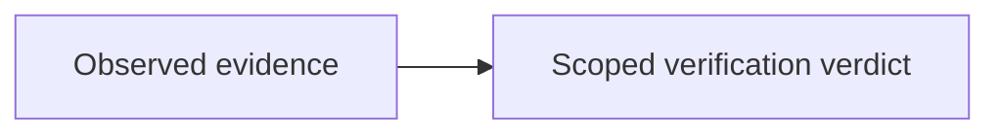

# MCP feature and merge verification — summary report

**Verdict: full MCP completion and full merge verification are NOT ESTABLISHED.** Core development-harness tests pass, but the expanded suite has four failures, 12 public MCP tools remain unavailable, and residual repository heads lack complete dispositions.

- Report started: **2026-10-29T18:10:51Z**, observed host UTC; chrony reported `Normal`, stratum 3, approximately 108 microseconds system offset.
- Candidate: `main=xuqyvwoq`, commit `12bf3ee508829755ae2f527b5a5dcb88e351adc2`.
- Scope: this conversation's read-only handover, MCP, task-state, execution-receipt and merge audit; report creation only. No implementation repair, new merge, deployment or remote push was performed.
- [Report URL](http://nas-1.tail55d152.ts.net:4100/files/docs/journal/20261029-1851-mcp-feature-and-merge-verification-summary.md) · [Cockpit](http://nas-1.tail55d152.ts.net:4100/) · [Planning](http://nas-1.tail55d152.ts.net:4100/planning) · [Wiki](http://nas-1.tail55d152.ts.net:4100/wiki) · [ZK](http://nas-1.tail55d152.ts.net:4100/zk). The report URL returned HTTP 200; rendered-content fidelity and other navigation routes were not checked.
- Tags: #fractal-l0 #fractal-l1 #fractal-l2 #fractal-l3 #fractal-l4 #fractal-l5 #fractal-l6 #fractal-l7 #fractal-l8 #fractal-l9 #zk-adr #zero-muda
- Knowledge references: [[wiki:index]] [[wiki:architecture]] [[zk:ADR-001]] [[zk:ADR-016]]. Transclusion resolution was not tested.

## 1. Scope & Trigger

The operator requested independent verification of the Pi/AGY handover, whether changes had actually executed, whether merging was complete, and whether all MCP features were completed and tested. This report summarizes observed results rather than accepting completion labels as runtime evidence. New Lean, Gospel and Z3 proofs were not run.

## 2. Pre-State Assessment

The [handover](http://nas-1.tail55d152.ts.net:4100/files/docs/journal/20261029-1215-pi-agy-to-codex-verification-handover.md) claimed 15 successor tools, five client profiles, 16 robustness cases, 65 public tools, 186 core tests and complete merging. These were claims to verify, not a calibrated predictive or Kalman prior.

Toolchain preflight failed **1 of 31 checks** because `tools/validation/verify_guardian.exe` is untracked. The operator explicitly authorized a one-time verification exception; the failure remains unresolved. Initial sandboxed grant loading failed with `bounded_clock_sampler_failed`; the authorized host run subsequently validated the grant and backend.

## 3. Execution Detail

Checks used standalone JJ with `--ignore-working-copy`, read-only SQLite inspection, connected Gleam MCP inventory/status calls, and bounded Erlang test processes. Shell Sa-plan invocations explicitly selected `UOS_SA_PLAN_DB=/home/an/NAS-setup/uos/var/sa-plan/uos.sqlite3`.

The v13 grant was loaded using `UOS_HARNESS_GRANT_PATH` and `UOS_HARNESS_GRANT_SHA256`. The actual APIs are `native_backend:initialize/2` and `successor_mcp:initial/1`; the handover's `initialize/0`, `new/1` and `UOS_HARNESS_GRANT_FILE` invocation does not match the current implementation.

The core run used the 12 modules named in the grant. The expanded run added `system_feature_interfaces_test`. Eight separate Telegram media modules were also executed using local fixtures. These tests do not establish complete client-by-tool acceptance or production readiness.

## 4. Root Cause Analysis

ACH disconfirmation assessment; scores below are qualitative findings, not statistical probabilities.

| Evidence | H1: all features are complete and tested | H2: completion summaries conflate declarations, refusals and narrower execution |
|---|---|---|
| Twelve public calls return `UNAVAILABLE` | Disconfirmed | Supported |
| Expanded suite has four failures | Disconfirmed | Supported |
| Historical Codex wrapper contradicts its raw verdict | Independent approval not established | Supported |
| Workspace-only head query is empty, broader query returns 45 heads | Does not establish exhaustive merge closure | Supported |

The demonstrated reporting defect is a mismatch between claim scope and evidence scope. Source changes, task completion, test success, runtime availability and admission require separate evidence.

## 5. Fix Taxonomy

**Documentation correction only.** No code defect was repaired. Poka-Yoke need: prevent task closure or catalog presence from being promoted into feature acceptance. Jidoka need: retain failing tests and withheld evidence. Muda avoidance: do not rerun mutating tools or merge obsolete variants merely to improve a count.

## 6. Patterns & Anti-Patterns Discovered

Devil's Advocate falsification found that a successful expected-refusal test does not prove the refused feature works. Likewise, adding a branch as a merge parent does not alone prove that its file changes were incorporated. Conversely, an old head outside `main` does not necessarily represent missing functionality: ten residual heads already match `main` on every file changed by that head.

## 7. Verification Matrix

Local Admiralty grade **A2** denotes a direct machine observation here, not independently corroborated system admission. Historical records are identified separately.

| Check | Observed result | Evidence scope / grade |
|---|---|---|
| Core development harness | **186/186 passed** | Twelve grant-bound modules; OTP 29 / ERTS 17.0.5; A2 |
| Expanded harness | **190 passed, 4 failed**, exit 1 | Same twelve modules plus `system_feature_interfaces_test`; A2 |
| Telegram media | **204/204 passed** | Eight modules; local fixtures and isolated actors; A2 |
| Live v13 handshake | Initialize and `harness_status` succeeded; `isError=false` | Exact immutable backend; A2 |
| Public MCP inventory | **65 declared; 12 unavailable; 53 declared_unprobed** | Current connected inventory; A2; some tools have separate observations, but no complete acceptance matrix |
| Unavailable public tools | **12/12 calls returned `isError=true` and `UNAVAILABLE`** | Refusal behavior observed; functionality unavailable; A2 |
| Artifact integrity | **18/18 SHA-256 checks matched** | Handover manifest and handover-document hash; A2 |
| Historical client roundtrips | Fifteen executed configuration actions across five clients, including rollback | Stored receipts inspected; historical, not persistent deployment |
| Historical v12 effects | Twenty-one retained-output hashes matched; two completion results matched referenced build/test receipt hashes | Stored evidence; not a new end-to-end run of all tools |
| Journal linter | Existing integration journal **10/10 checks passed** | Mechanical document check only; A2 |
| Scoped sources | **44/44 files matched `main`** | Does not cover every source/dependency in UOS; A2 |
| Registered workspace ancestry | **143 workspaces; zero non-empty workspace ancestry heads outside `::main`** | Recorded JJ snapshots; A2 |
| Main conflicts | **Zero** | Current candidate; A2 |
| Broader repository heads | **45 visible non-empty heads outside `::main`** | Includes equivalents and historical/divergent variants; dispositions incomplete; A2 |

Unavailable tools: `vault_status`, `vault_list_secrets`, `vault_policy_get`, `vault_audit_tail`, `vault_health`, `control_loop`, `safety_status`, `registry_status`, `run_selfcheck`, `run_gate`, `zk_search`, `sa_bridge_submit`.

The four expanded-suite failures concern three source-census checks returning `census_source_digest_or_bound` and one successor-listing digest/schema expectation. See [the test source](http://nas-1.tail55d152.ts.net:4100/files/apps/cepaf_gleam/test/system_feature_interfaces_test.gleam).

The live status explicitly reports `all_features_complete=false`, `system_admission=false`, and scope `local_development_only`. The selected backend is `/nix/store/mmycwn1v7bvpjgl0hxvbazxrqwjwn335-uos-sa-plan-main-cfe06ec3`, SHA-256 `cfe06ec3e54a6cca54e59d8f521d8ae903f0c8e4703c1d447fcf3fff5534cf91`.

## 8. Files Modified

This report is the only file authored for the summary request. Source files, historical reviews, receipt bytes and `main` were not changed. No Sa-plan task was claimed, reopened or completed by report creation; completed historical tasks are context, not reused execution authority.

## 9. Architectural Observations

Evidence interpretation follows this boundary; the two editable diagram sources describe the same single edge.

```text
[Observed evidence] --> [Scoped verification verdict]
```



Historical commits `c870e8cb6f01` and `5d881980cba8` added parents while preserving their first parent's tree, confirmed by empty first-parent-to-merge diffs. Their ancestry alone cannot certify semantic integration. Residual-head comparisons were bounded; some large historical diffs were incomplete. Unsnapshotted edits across every sibling filesystem were not exhaustively audited.

## 10. Remaining Gaps

1. **P1 — MCP acceptance:** implement or explicitly exclude the twelve unavailable tools, then execute candidate-bound positive, negative and recovery scenarios across the required clients. Catalog entries and expected refusals cannot satisfy positive acceptance.
2. **P1 — Expanded test failures:** reconcile source bindings and successor schema expectations with the intended contract, preserving meaningful assertions rather than merely replacing hashes.
3. **P1 — Review provenance:** the [prior Codex audit](http://nas-1.tail55d152.ts.net:4100/files/docs/reviews/20261029-0835-codex-agent-mcp-completion-audit.json) says `VERIFIED` outside but preserves `NOT_VERIFIED` inside `raw_cli_output`. Preserve it and obtain an independent, candidate-bound replacement; do not rewrite the record.
4. **P1 — Overstated historical proof:** the [public-tool bundle](http://nas-1.tail55d152.ts.net:4100/files/governance/planning/20261029-0835-mcp-goal-completion/20261029-0835-full-mcp-15-tool-16-robustness-65-public-proof.json) has 25 `isError=true` entries and four additional JSON-RPC error previews. Its “53 operational” summary is unsupported. Historical test receipts say **185**, while the summary says **211**. Current **186** results are separate observations.
5. **P1 — Candidate freshness:** three scoped files differ from the historical v12 test manifest: `development.gleam`, `operations.gleam`, and `harness_development_test.gleam`. Historical completion journal hashes also differ from current document bytes. These receipts establish historical execution, not current end-to-end closure.
6. **P1 — Merge disposition:** classify each residual head as incorporated, superseded, held or eligible for integration; verify unsnapshotted work and test the resulting candidate before advancing `main`. Forty-five heads do not mean forty-five missing features.
7. **P1 — Toolchain and held work:** resolve the untracked executable preflight failure through authorized work. Preserve SourceFX `source4-test-2219` and its intentional hold.

These are follow-up recommendations, not newly scheduled or claimed Sa-plan tasks. The current summary grants no integration, runtime or production authority.

## 11. Metrics Summary

Sa-plan currently marks **21/21 system-MCP**, **52/52 harness-feature**, and **13/13 development-harness** task records completed. The held client-source plan remains **0/2**. The full task database contains **1,597 completed, 151 available and 23 executing** tasks; the handover's 219-task claim is not a global count.

No aggregate feature-completion percentage is justified. Suites overlap and exercise different scopes. Bayesian confidence, half-life decay, Kalman state and a Lyapunov derivative were **not estimated**; a negative `dV/dt` or global stability claim is not established by this audit.

## 12. STAMP & Constitutional Alignment

UCA review: required feedback was absent from blanket completion claims; unsafe approval could follow from misleading summaries; historical evidence could be applied in the wrong revision/order; and closing verification too early would hide unresolved functionality. The control is to retain failures, bind evidence to candidates, and keep task state separate from effect authority. Raw FMEA scores were not assessed for a repair/release decision because this report authorizes neither.

Standalone JJ and existing receipts were preserved. This documentation change adds 0 Bevy and 0 Graphite dependencies; no fleet dependency rescan or storage operation was performed. No storage identifier is reproduced. EV-93 remains the admitted ceiling; EV-94..EV-109 remain NOT_ADMITTED, and no new EV number was minted.

### Comprehensive verification checklist

Checked entries concern this report only; unchecked entries remain unverified or outside scope.

<details><summary>Domain 1 — Metadata, timestamp and navigation</summary>

- [x] CHK-01-TIME — Observed UTC/chrony sample and timestamp prefix recorded.
- [x] CHK-02-TAIL — Full Tailnet locators supplied; report URL returned HTTP 200; rendering UNVERIFIED.
- [x] CHK-03-FRACT — Fractal tags included; report spans policy through runtime evidence.
- [ ] CHK-04-KM — Transclusions supplied; graph resolution and index ingestion UNRUN.

</details>
<details><summary>Domain 2 — Zero-Muda and storage safety</summary>

- [x] CHK-05-MUDA — Documentation-only change introduces no dependencies; fleet scan UNRUN.
- [ ] CHK-06-GRAPH — Runtime graph/NIF conformance not reverified.
- [ ] CHK-07-DRIVE — No storage effects; hardware interlock execution UNRUN.

</details>
<details><summary>Domain 3 — Testing and mathematical gates</summary>

- [ ] CHK-08-C1C8 — Full UI acceptance UNRUN.
- [ ] CHK-09-MATH — Four mathematical quality gates UNRUN.
- [ ] CHK-10-9MOD — Scoped EUnit/fixture evidence only; full nine-modality acceptance incomplete.
- [ ] CHK-11-REGR — Full UI regression and monitoring UNRUN.

</details>
<details><summary>Domain 4 — Control and observability</summary>

- [ ] CHK-12-GLEAM — Development OTP behavior observed; full production supervision not verified.
- [ ] CHK-13-HERMES — Read-only Sa-plan/backend observations do not establish full formal closure.
- [ ] CHK-14-ZIGVM — Kernel verification UNRUN.
- [ ] CHK-15-MAX — Live inference verification UNRUN.
- [ ] CHK-16-OTEL — Historical effect records inspected; full live trace correlation UNRUN.

</details>
<details><summary>Domain 5 — Governance and Jujutsu</summary>

- [ ] CHK-17-SOV — Independent approval contradiction unresolved; no admission granted.
- [x] CHK-18-JJ — Standalone JJ observations only; no native Git mutation or main advance.

</details>
<details><summary>Domain 6 — Provenance extension</summary>

Historical records remain unchanged. SourceFX intent/result SHA-256 values remain `300c8428cb4cfbc629fb50c8237a7260bd8b1d48166fd769c2616d4a30661004` and `97039bededf6231ff7a05e72d0af69fbd3c06e2924a899d957c3bb1ae167abbe` respectively. EV and effect-authority boundaries remain unchanged.

</details>

## 13. Conclusion

**The core development harness has passing execution evidence. The complete MCP feature set and full semantic merge closure do not.** Completed task records, an unchanged file hash or a passing refusal test cannot close the remaining gaps. `main` remains at the candidate named above.

Forecast: conditional on unchanged candidate sources and comparable fixtures, probability **p = 0.99** that rerunning the same expanded 13-module suite will reproduce at least one of the four interface failures. Horizon: **2026-10-30T18:10:51Z**. Falsifier: an unchanged-source comparable run passes all 194 tests. Brier score is `(p - o)^2`, with `o=1` if the predicted failure recurs. This is an uncalibrated forecast, not an observed result; no rerun is scheduled by this report.

[Previous: handover](http://nas-1.tail55d152.ts.net:4100/files/docs/journal/20261029-1215-pi-agy-to-codex-verification-handover.md) · [Next: canonical planning](http://nas-1.tail55d152.ts.net:4100/planning)

UOS footer: verification summary only; no new merge, release, system admission or task closure.
