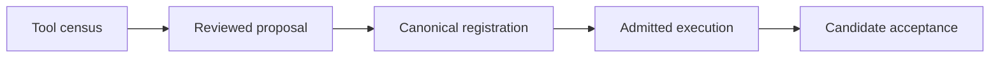

# UOS MCP server completion planning journal

Observed planning batch: 2026-10-29T19:33:13Z; chrony Normal, stratum 3, system offset approximately 44 microseconds.
[Journal](http://nas-1.tail55d152.ts.net:4100/files/docs/journal/20261029-1913-uos-mcp-server-completion-planning-journal.md) · [Detailed plan](http://nas-1.tail55d152.ts.net:4100/files/docs/plans/20261029-1913-uos-mcp-server-completion-plan.md) · [Proposal](http://nas-1.tail55d152.ts.net:4100/files/governance/planning/20261029-1913-uos-mcp-server-completion-proposal.json) · [Planning](http://nas-1.tail55d152.ts.net:4100/planning) · [Wiki](http://nas-1.tail55d152.ts.net:4100/wiki) · [ZK](http://nas-1.tail55d152.ts.net:4100/zk).

#fractal-l0 #fractal-l1 #fractal-l2 #fractal-l3 #fractal-l4 #fractal-l5 #fractal-l6 #fractal-l7 #fractal-l8 #fractal-l9 #zk-adr #zero-muda
[[wiki:index]] [[wiki:architecture]] [[zk:ADR-001]] [[zk:ADR-016]]

## 1. Scope & Trigger

The operator requested a detailed plan to add all UOS MCP server functionality. Deliverables are a reviewable implementation plan and machine-readable coverage/DAG proposal. No product code, canonical task state, release or main bookmark was changed. Proposed formal/runtime gates remain UNRUN.

## 2. Pre-State Assessment

The preceding audit found 65 declared public tools, 12 unavailable functions, four failures in the expanded harness suite, contradictory review evidence and incomplete content dispositions for residual heads. The existing v13 and integration task records are completed and cannot authorize new work. No calibrated predictive/Kalman prior is asserted.

## 3. Execution Detail

Read actual public/private dispatch, admission, worker/client/feature code and previous UOS plans. Confirmed unwired Vault init/unseal and constant status, declarative-versus-actual supervisor mismatch, legacy mutation refusals, and current protocol version drift. Consulted official MCP sources. Connected knowledge search returned no results for the engineering query; no sales corpus was used because it is outside this task.

Authored 25 dependency-bound tasks across nine public-tool workstreams, shared authority/worker contracts, private-route convergence, protocol/server facilities, five-client acceptance, formal/fault/load checks and source integration. Every task has paths, interfaces, named tests, verification recipe and acceptance conditions.

## 4. Root Cause Analysis

ACH planning choice:

| Evidence | H1: enable missing dispatch arms only | H2: complete shared admission, backends, protocol and evidence |
|---|---|---|
| Existing Vault methods are unwired | Disconfirmed as sufficient | Supported |
| Current root startup omits declared gateway | Disconfirmed as sufficient | Supported |
| Task completion conflicts with runtime results | Disconfirmed as sufficient | Supported |
| Modern and legacy MCP lifecycle differ | Disconfirmed as sufficient | Supported |

The selected recommendation is incremental shared-core integration; this is an author recommendation, not an approved implementation decision.

## 5. Fix Taxonomy

Planning/documentation only. Poka-Yoke proposals bind listing to dispatch and acceptance ownership; Jidoka proposals preserve failures and refuse missing authority; Muda reduction reuses current harness invariants and avoids a wholesale rewrite. No runtime defect is claimed fixed.

## 6. Patterns & Anti-Patterns Discovered

Devil's Advocate review: a perfect task DAG still cannot grant its own bootstrap authority. T00 explicitly requires an admitted external maintenance/registration path. Expected refusal is a negative-scenario success, never positive feature implementation. Configuration roundtrips are distinct from actual native-client tool turns.

## 7. Verification Matrix

Admiralty A2 denotes local deterministic observations, not sovereign or independent approval.

| Check | Result | Grade / scope |
|---|---|---|
| JSON parse and task count | 25 distinct task IDs | A2; proposal structure |
| Public tool coverage | 65 unique tools; no missing or extra live-catalog names | A2; ownership mapping |
| Dependencies | 59 edges, known references, acyclic topological ordering | A2; proposal DAG |
| Existing modify/inspect paths | 55 paths exist | A2; presence only |
| Proposed tests | 79 named test requirements | A2; count, not executed tests |
| Profile coverage | Five named clients; conditional initial denominator 485 route/profile pairs | A2; arithmetic, not acceptance |
| Execution claims | No task claim, verification result or execution state in proposal | A2; no authority amplification |
| Journal structure | 10/10 mechanical checks passed | A2; document only |
| Editable diagram topology | Both Markdown artifacts verified; zero unverified/failed edge comparisons | A2; G-DIAGRAM, two files |
| Tailnet delivery | Plan and proposal URLs returned HTTP 200 | A2; HTTP status, not rendered-content fidelity |
| Product tests / formal proofs | UNRUN for proposed implementation | No passing implementation claim |

The artifact checks do not validate the future canonical importer schema or grant runtime authority. Registration remains PROPOSED_NOT_REGISTERED.

## 8. Files Modified

Created only:
- docs/plans/20261029-1913-uos-mcp-server-completion-plan.md
- governance/planning/20261029-1913-uos-mcp-server-completion-proposal.json
- docs/journal/20261029-1913-uos-mcp-server-completion-planning-journal.md

Source, historical evidence, Sa-plan database and main were not edited. These files remain proposal artifacts; no historical completed task is reused as their execution authority.

## 9. Architectural Observations

The same path is represented in editable ASCII and Mermaid:

```text
[Tool census] --> [Reviewed proposal]
[Reviewed proposal] --> [Canonical registration]
[Canonical registration] --> [Admitted execution]
[Admitted execution] --> [Candidate acceptance]
```



The implementation plan distinguishes protocol request correlation from durable logical effects, transport authentication from effect admission, and development readiness from release authority.

## 10. Remaining Gaps

The plan is not independently approved, imported into canonical Sa-plan or executed. Fresh maintenance/registration access, risk portfolios, grants and task attempts remain prerequisites. Backend availability, client-version compatibility, exact protocol/extension pins and all final acceptance cells remain to be established.

No process/model opinion or mechanical plan check resolves the previously reported runtime gaps.

## 11. Metrics Summary

Planning output: 25 tasks, 59 dependency edges, nine public families, 65 public tools, five client profiles, 79 named test requirements. Expected 325 public plus 160 private route/profile pairs depends on freezing the 17/15 private counts; scenarios/transports/versions expand that matrix.

Proposed effort is 52–102 serial engineer-days, not a calendar promise, token budget or observed throughput. Bayesian confidence, half-life decay, Kalman state and Lyapunov dV/dt were not estimated. No stability improvement is claimed from authoring a plan.

## 12. STAMP & Constitutional Alignment

All four UCA classes appear in risk profiles: absent required action, unsafe provided action, wrong order/timing and premature stop/excess duration. Unknown occurrence remains unknown. Authority, privacy, recovery, evidence, truth and protocol profiles must become fresh canonical assessments before claims.

Standalone JJ and existing provenance remain unchanged. Documentation adds 0 Bevy and 0 Graphite dependencies and performs no storage action. EV-93 ceiling and the held SourceFX records remain intact. Canonical execution and production release are distinct gates.

### Comprehensive verification checklist

<details><summary>Domain 1 — Metadata and navigation</summary>

- [x] CHK-01-TIME — Observed clock and timestamp prefix.
- [x] CHK-02-TAIL — Full Tailnet locators; route checks recorded separately.
- [x] CHK-03-FRACT — Fractal scope tags included.
- [ ] CHK-04-KM — Actual transclusion/index ingestion pending T10/T22.

</details>
<details><summary>Domain 2 — Zero-Muda and storage</summary>

- [x] CHK-05-MUDA — Documentation introduces no dependencies; fleet rescan UNRUN.
- [ ] CHK-06-GRAPH — Future runtime/native checks pending.
- [ ] CHK-07-DRIVE — No storage effect; interlock runtime checks UNRUN.

</details>
<details><summary>Domain 3 — Tests and mathematical gates</summary>

- [ ] CHK-08-C1C8 — Future UI acceptance.
- [ ] CHK-09-MATH — Future actual mathematical gates.
- [ ] CHK-10-9MOD — Proposed implementation modalities UNRUN.
- [ ] CHK-11-REGR — Future combined-candidate regression.

</details>
<details><summary>Domain 4 — Control and observability</summary>

- [ ] CHK-12-GLEAM — Proposed gateway/worker supervision UNRUN.
- [ ] CHK-13-HERMES — Proposed bounded evidence/analysis acceptance UNRUN.
- [ ] CHK-14-ZIGVM — Proposed applicable runtime tests UNRUN.
- [ ] CHK-15-MAX — Proposed inference acceptance UNRUN.
- [ ] CHK-16-OTEL — Proposed correlated tracing acceptance UNRUN.

</details>
<details><summary>Domain 5 — Governance and JJ</summary>

- [ ] CHK-17-SOV — Independent plan/candidate/release acceptance pending.
- [x] CHK-18-JJ — No Git mutation, source integration or main advance.

</details>
<details><summary>Domain 6 — Provenance</summary>

No new EV number, changed historical receipt, completed task claim or runtime admission follows from this planning work.

</details>

## 13. Conclusion

The requested detailed plan is authored as a reviewable proposal. It covers every current public MCP tool and the additional server, transport, client, evidence and integration work needed for genuine completion.

Forecast: conditional on unchanged proposal bytes, p = 0.99 that re-running the structural validation will again find 25 unique tasks, 65 unique public tools and an acyclic graph. Horizon: 2026-10-30T19:33:13Z. Falsifier: unchanged bytes fail any of those assertions. Brier score is (p-o)^2 with o=1 for the predicted outcome. This forecast is uncalibrated and schedules no job.

[Previous: gap report](http://nas-1.tail55d152.ts.net:4100/files/docs/journal/20261029-1851-mcp-feature-and-merge-verification-summary.md) · [Next: detailed plan](http://nas-1.tail55d152.ts.net:4100/files/docs/plans/20261029-1913-uos-mcp-server-completion-plan.md).

UOS footer: planning evidence only; implementation and canonical registration remain unperformed.

