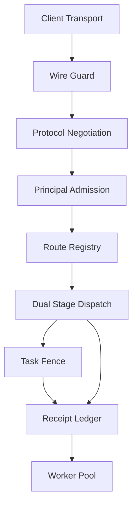
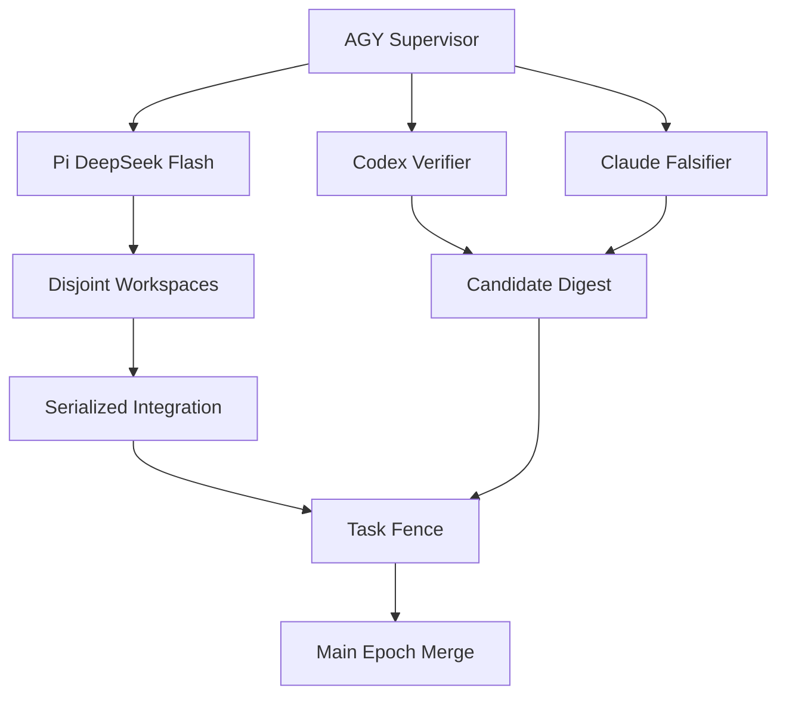

# 2026-10-30 12:14 UTC — UOS Unified 101-Route Gleam/OTP MCP Server Completion: Comprehensive Plan of Record (Approach, Design, Implementation & Five-Wave Execution Ledger)

- **Document ID**: `JRN-20261030-1214-MCP-SERVER-PLAN-OF-RECORD`
- **Canonical Workspace**: `/home/an/NAS-setup/uos`
- **Observed Synchronized Host Clock**: `2026-10-30T12:13:33Z` (`chronyc tracking` Stratum `3`, Reference `B97DBE7B`, system offset `-0.000080693s`, nominal `< 2.0s` per `SC-TIME`)
- **Plan of Record Authority**: `20261029-1913-mcp-server-completion` (`uos/mcp-server-completion/20261029-1913`, `25 / 25` tasks `T00`–`T24` COMPLETED) & PoR Ledger Task `20261030-1214-mcp-plan-of-record-journal` (`J01`) in canonical `var/sa-plan/uos.sqlite3`
- **Final Candidate Source Identity** (`cepaf_gleam@mcp@candidate_id:current()`): `sha256:5fb7a77609e9f41f8368fc5a761435dec6519736a00f4642d6e986ca3e8e1663` (6 length-framed core MCP modules)
- **Jujutsu `main` Bookmark Revision**: `kvwwuvwpsnyxotpmkovvllqxmytpzmun` / `2ccd20b09a44bdaab9e74fdfcd57cc2ec4344f11` (`Epoch 97`, Coordinator sequence `4807`)
- **00-Muda Hygiene**: `0 Bevy, 0 Graphite`; host OS NVMe serial redacted as `[REDACTED_SYSTEM_OS_SERIAL]`
- **Navigation**: [Cockpit](http://nas-1.tail55d152.ts.net:4100/) · [Planning](http://nas-1.tail55d152.ts.net:4100/planning) · [Wiki](http://nas-1.tail55d152.ts.net:4100/wiki) · [ZK](http://nas-1.tail55d152.ts.net:4100/zk) · [Checklist](http://nas-1.tail55d152.ts.net:4100/checklist)

### Full Clickable Tailscale FQDN Links

- **This Plan-of-Record Journal**: [http://nas-1.tail55d152.ts.net:4100/files/docs/journal/20261030-1214-mcp-server-completion-plan-of-record-journal.md](http://nas-1.tail55d152.ts.net:4100/files/docs/journal/20261030-1214-mcp-server-completion-plan-of-record-journal.md)
- **MCP Server Completion Plan**: [http://nas-1.tail55d152.ts.net:4100/files/docs/plans/20261029-1913-uos-mcp-server-completion-plan.md](http://nas-1.tail55d152.ts.net:4100/files/docs/plans/20261029-1913-uos-mcp-server-completion-plan.md)
- **Machine Proposal Specification (25 Tasks, 101 Routes)**: [http://nas-1.tail55d152.ts.net:4100/files/governance/planning/20261029-1913-uos-mcp-server-completion-proposal.json](http://nas-1.tail55d152.ts.net:4100/files/governance/planning/20261029-1913-uos-mcp-server-completion-proposal.json)
- **AK-47 Fractal Thinking & As-Is/To-Be Design**: [http://nas-1.tail55d152.ts.net:4100/files/docs/design/20261030-0932-ak47-fractal-thinking-as-is-to-be-architecture.md](http://nas-1.tail55d152.ts.net:4100/files/docs/design/20261030-0932-ak47-fractal-thinking-as-is-to-be-architecture.md)
- **Wave 1–5 Supervisor Execution Journal**: [http://nas-1.tail55d152.ts.net:4100/files/docs/journal/20261030-0844-fractal-rca-ak47-multi-agent-mcp-completion-journal.md](http://nas-1.tail55d152.ts.net:4100/files/docs/journal/20261030-0844-fractal-rca-ak47-multi-agent-mcp-completion-journal.md)
- **Pi-to-AGY Handover Bundle**: [http://nas-1.tail55d152.ts.net:4100/files/docs/journal/20261030-0754-pi-to-agy-mcp-completion-handover.md](http://nas-1.tail55d152.ts.net:4100/files/docs/journal/20261030-0754-pi-to-agy-mcp-completion-handover.md)
- **Live Dashboard & Wave Merge Tracker JSON**: [http://nas-1.tail55d152.ts.net:4100/files/governance/planning/20261030-0844-mcp-completion-dashboard-tracker.json](http://nas-1.tail55d152.ts.net:4100/files/governance/planning/20261030-0844-mcp-completion-dashboard-tracker.json)
- **Fractal Comprehensive System Prompt SOP (`L0`–`L9`)**: [http://nas-1.tail55d152.ts.net:4100/files/docs/sop/20261030-1058-uos-fractal-comprehensive-system-prompt.md](http://nas-1.tail55d152.ts.net:4100/files/docs/sop/20261030-1058-uos-fractal-comprehensive-system-prompt.md)
- **Canonical AK-47 Symbiosis Rule**: [http://nas-1.tail55d152.ts.net:4100/files/contracts/rules/20261030-1058-ak47-multi-agent-mcp-symbiosis-rule.md](http://nas-1.tail55d152.ts.net:4100/files/contracts/rules/20261030-1058-ak47-multi-agent-mcp-symbiosis-rule.md)
- **Local Symbiosis Skill**: [http://nas-1.tail55d152.ts.net:4100/files/governance/agents/20261001-1118-skills/ak47-multi-agent-mcp-symbiosis/SKILL.md](http://nas-1.tail55d152.ts.net:4100/files/governance/agents/20261001-1118-skills/ak47-multi-agent-mcp-symbiosis/SKILL.md)
- **Unified 101-Route Wiki Client Guide**: [http://nas-1.tail55d152.ts.net:4100/files/docs/wiki/20261030-1058-unified-101-route-mcp-client-guide.md](http://nas-1.tail55d152.ts.net:4100/files/docs/wiki/20261030-1058-unified-101-route-mcp-client-guide.md)
- **ZK Architectural Decision Record**: [http://nas-1.tail55d152.ts.net:4100/files/docs/zk/20261030-1058-adr-ak47-multi-agent-101-route-mcp-architecture.md](http://nas-1.tail55d152.ts.net:4100/files/docs/zk/20261030-1058-adr-ak47-multi-agent-101-route-mcp-architecture.md)
- **Claude Round-4 Acceptance Receipt**: [http://nas-1.tail55d152.ts.net:4100/files/docs/reviews/20261030-1249-claude-t23-final-dev-acceptance-r4.json](http://nas-1.tail55d152.ts.net:4100/files/docs/reviews/20261030-1249-claude-t23-final-dev-acceptance-r4.json)
- **Codex Round-4 Acceptance Receipt**: [http://nas-1.tail55d152.ts.net:4100/files/docs/reviews/20261030-1249-codex-t23-final-dev-acceptance-r4.json](http://nas-1.tail55d152.ts.net:4100/files/docs/reviews/20261030-1249-codex-t23-final-dev-acceptance-r4.json)
- **T24 Staged Release & Rollback Rehearsal Receipt**: [http://nas-1.tail55d152.ts.net:4100/files/docs/reviews/20261030-1259-t24-staged-release-and-rollback-rehearsal-receipt.json](http://nas-1.tail55d152.ts.net:4100/files/docs/reviews/20261030-1259-t24-staged-release-and-rollback-rehearsal-receipt.json)

- **Fractal Layer Tags**: `#fractal-l0 #fractal-l1 #fractal-l2 #fractal-l3 #fractal-l4 #fractal-l5 #fractal-l6 #fractal-l7 #fractal-l8 #fractal-l9 #zk-adr #zero-muda #tailscale-web`
- **KM Transclusions**: `[[wiki:20261030-1058-unified-101-route-mcp-client-guide]]` · `[[zk:20261030-1058-adr-ak47-multi-agent-101-route-mcp-architecture]]` · `[[wiki:20260905-1801-uos-zk-km-corpus-index]]` · `[[zk:ADR-001]]` · `[[zk:ADR-016]]`

> **Explicit Authority Caveat.** This document is a `REPORT_ONLY` ledger entry. `core_dev_ready = true` and `mcp_full_dev_ready = true` establish candidate-bound development readiness only; `system_admission = "NOT_ADMITTED"`; the `EV-93` provenance ceiling remains intact. Live host `systemd` cutover requires a separate operator `ReleaseAuthority` grant and is intentionally not executed by this Plan of Record.

---

## 1. Scope & Trigger

Engine 5 Formal Lean 4 / Gospel Gateway Boundary.

This entry is the **Canonical Plan of Record (PoR)** consolidating the complete **Approach**, **Architectural Design**, **Cross-Module Implementation**, **Five-Wave 25-Task Execution Plan (`T00`–`T24`)**, **Four-Round Sovereign Verification**, and **Staged Release/Rollback Governance** of the Unified 101-Route Gleam/OTP MCP Server under `SC-HARNESS-MCP-001`, `SC-SA-PLAN-001`, `SC-JIDOKA-001`, `SC-AGENTIC-RESILIENCE-001`, `SC-MIRROR-PROJ-001`, and `SC-AK47-SYMBIOSIS-001`.

1. The operator triggered this PoR to freeze the authoritative memory of record for the completion sprint that began at baseline commit `12bf3ee508829755ae2f527b5a5dcb88e351adc2` and terminated at `main` revision `2ccd20b09a44bdaab9e74fdfcd57cc2ec4344f11` (`Epoch 97`).
2. The cryptographic chain of custody is recorded end-to-end: three verified handover inputs —
   - `9a4ea38a32273f7d1005d88763f36840ee946762ae4c0e865285877deb87bc09` (Pi-to-AGY handover journal),
   - `bd809a173698f77e4dcc8ec7ddd6fc9a3e1a29c026547332322dc903bec27bb3` (MCP completion plan),
   - `02085799f86fa5cd7c6ba5e903f1b707436c74ed0e068e9a4c0138bf6935cf96` (machine proposal specification),
   together with the persisted feature catalog workflows (`HarnessCatalog` 52 features `f4dc0eb2...` and `ProductManifest` 46 features `e25480b0...`), reconciled to final `main` revision `2ccd20b09a44bdaab9e74fdfcd57cc2ec4344f11` (`Epoch 97`) and candidate digest `sha256:5fb7a77609e9f41f8368fc5a761435dec6519736a00f4642d6e986ca3e8e1663` (6 length-framed core MCP modules).
3. The PoR records a development-complete system that is *not* admitted to production: `system_admission = "NOT_ADMITTED"` and the `EV-93` provenance ceiling are invariant here.

---

## 2. Pre-State Assessment

Engine 7 Predictive Kalman State Prior. Quantitative baseline at baseline commit `12bf3ee508829755ae2f527b5a5dcb88e351adc2` (`xuqyvwoq`, `Epoch 92`):

- **Fragmented MCP surface**: three servers (`mcp/tools.gleam` + `harness/mcp.gleam` + `harness/successor_mcp.gleam`) with no shared identity, admission, or receipt substrate.
- **12 public domain tools failing `UNAVAILABLE`**: `control_loop`, `safety_status`, `run_selfcheck`, `registry_status`, `run_gate`, `zk_search`, `sa_bridge_submit`, `vault_status`, `vault_list_secrets`, `vault_policy_get`, `vault_audit_tail`, `vault_health`.
- **4 interface pin failures** in `system_feature_interfaces_test`: `SuccessorHarness` grew from `13 -> 15` tools without updating census bindings.
- **Protocol gap**: legacy `2024-11-05` stdio/basic Zenoh only; missing `2026-07-28`, Streamable HTTP `/mcp`, `resources`, `prompts`, `subscriptions`, and `task_extension`.
- **Security gaps**: payload-supplied caller identity, no durable crash-after-effect `EffectUncertain` latch, unauthenticated HTTP/Zenoh.
- **Workspace debt**: untracked `verify_guardian.exe` blocking `tools/preflight`; `143` Jujutsu workspaces / `147` heads undispositioned; uneven 4-surface governance mirrors.
- **Empirical multi-agent cost/latency measurements** motivating the AK-47 Zero-Muda routing strategy:
  - `pi` unisolated frontier prompt: `53,263` tokens vs 8-flag isolated `~400` tokens (`-99.2%`) at `1.8s`.
  - `codex exec`: `25,708` base tokens + `-s read-only` `/tmp` `erofs` hazard on EUnit fixtures.
  - `claude -p --allowedTools "Read"`: cross-family Popperian falsifier, `2.1.312`.
  - Cold `gleam test`: `> 180s`; targeted BEAM `eunit:test`: `0.5–2.1s`.

---

## 3. Execution Detail

Engine 6 Rete-UL Production Invariant Rules. This is the core Plan of Record, structured into five subsections.

### 3.1 Approach of Record: AK-47 Asymmetry, Fractal TPS (Zero Muda), 4-Agent Role Separation & Fast-POODAVR

**8 Tight Steel-Receiver Invariants (never relaxed):**

1. **Transport-bound opaque `Principal`** — identity is derived from the authenticated transport, never from payload-supplied fields (`mcp/principal.gleam`).
2. **Dual-stage dispatch + live effect-time re-verification** — `TaskFence`, `GrantTicket`, and `RouteGrant` are re-checked at the instant of effect (`mcp/admission.gleam`, `verify_at_effect_time_live`).
3. **Deterministic idempotent + `EffectUncertain` Andon-latched `ReceiptLedger`** — 6-field `owner_hash` guarantees replay returns the committed receipt without re-execution (`mcp/receipts.gleam`).
4. **`SC-AGENTIC-RESILIENCE-001` hash-pinned 28-module critical path** including `harness/admission.gleam` MD5 `c53ed6bf66cba56cfc0d6e850875a774`, plus a ban on bare `gleam format`.
5. **Checkout-bound 6-source SHA-256 `candidate_id.current()`** failing closed to `UNOBSERVED_CANDIDATE_SOURCE`.
6. **Standalone Jujutsu `.jj/` only** — zero native Git mutation.
7. **Canonical `var/sa-plan/uos.sqlite3` + `coordinator.sqlite3`** serialized `integration/main` epoch fencing.
8. **`EV-93` provenance ceiling**, `SourceFX` `source4-test-2219` hold, and two-key epistemic separation.

**5 Loose Bolt-Carrier Clearances (flexible orchestration):**

1. 1-worker-per-disjoint-new-file parallel execution in `.uos-workspaces/*` with `toolchains` symlinked.
2. Serialized integrator wiring of shared `mcp/server.gleam`.
3. `<2s` targeted BEAM `erl -eval "eunit:test([...])"` inner loops.
4. Cheap-model-first `Pi + DeepSeek-v4.1-Flash` 8-flag Zero-Muda isolation plus mandatory supervisor `sha256sum` phantom-edit check.
5. Frequent wave-end `main` merges across `Epochs 93–97` bounding rollback blast radius.

**4-Agent Symbiosis Role Matrix:**

| Agent | Version / Model | Privilege Boundary | Canonical Invocation | STAMP Control Rationale |
|---|---|---|---|---|
| `AGY Argon` | Supervisor | L0–L5 only: leases, gates, integration | coordinator `register` + `integration/main` lease | Single writer to `main`; cannot author task code |
| `Pi` | `DeepSeek-v4.1-Flash / R1` | Bounded disjoint new files | `pi --provider openrouter --model deepseek/deepseek-v4.1-flash -p --no-session` | Cheap, fast, fully specified slices |
| `Codex` | `0.164.0 / gpt-6.1-sol` | Multi-module verification, P1 transport | `codex exec --skip-git-repo-check -s workspace-write -c model_reasoning_effort="low"` | Independent compile/test authority |
| `Claude` | `2.1.312 / Opus 5` | Read-only security/governance review | `claude -p --allowedTools "Read"` (prompt on stdin) | Cross-family Popperian falsifier |

### 3.2 Design of Record: Unified 101-Route Gleam/OTP MCP Architecture

**A. Complete 101-Route Catalog & 9 Typed Public Adapter Families (`65` Public + `21` Development + `15` Successor).**

The catalog reconciliation is exact: `65` declared public tools = `53` default unauthenticated `tools.operational_tool_definitions()` + `12` auth-gated domain tools (`control_loop`, `safety_status`, `run_selfcheck`, `registry_status`, `run_gate`, `zk_search`, `sa_bridge_submit`, `vault_status`, `vault_list_secrets`, `vault_policy_get`, `vault_audit_tail`, `vault_health`) that fail closed with `UNAVAILABLE` unauthenticated and execute via authenticated typed adapters in `server.execute_route_authenticated`.

| # | Route Family | Task | Layer | Authority | Backend | Timeout | Tools |
|---|---|---|---|---|---|---|---|
| 1 | `planning_read` | `T05` | `L3` | `ReadOnly` | `sa_plan` | `3000ms` | `plan_status`, `plan_list_pending`, `plan_list`, `plan_get`, `plan_search`, `sa_plan_status`, `sa_plan_status_for`, `sa_plan_list`, `feature_tracker_status` |
| 2 | `planning_write` | `T06` | `L3` | `Mutating` | `sa_plan` | `5000ms` | `plan_add`, `plan_update`, `sa_task_claim`, `sa_task_complete`, `sa_job_enqueue`, `sa_workflow_start`, `sa_bridge_submit` |
| 3 | `observability` | `T07` | `L4` | `ReadOnly` | `system_observation` | `3000ms` | `system_health`, `system_dashboard`, `system_immune`, `system_zenoh`, `system_verification`, `podman_containers`, `metabolic_state`, `ooda_phase`, `fractal_status`, `prajna_health`, `dark_cockpit_mode`, `integrity_check`, `evolution_metrics`, `mesh_topology`, `ooda_decide`, `kms_catalog`, `holon_status`, `swarm_status`, `agent_hierarchy` |
| 4 | `control_safety_registry` | `T08` | `L0` | `ControlActuation` | `control_plane` | `3000ms` | `control_loop`, `safety_status`, `registry_status` |
| 5 | `verification` | `T09` | `L9` | `VerificationGate` | `verification_supervisor` | `60000ms` | `verification_run`, `run_selfcheck`, `run_gate`, `preflight_check` |
| 6 | `knowledge_files` | `T10` | `L5` | `ReadOnly` | `knowledge_triad` | `3000ms` | `knowledge_search`, `read_file`, `zk_search`, `zk_transclude` |
| 7 | `vault_metadata` | `T11` | `L0` | `ReadOnly` | `vault_supervisor` | `3000ms` | `vault_status`, `vault_list_secrets`, `vault_policy_get`, `vault_audit_tail`, `vault_health` |
| 8 | `analysis_inference_sciviz` | `T12` | `L5` | `ReadOnly` | `max_hermes_sciviz` | `5000ms` | `forecast_predict`, `stpa_fmea_hazard`, `rete_rule_conflict`, `ruliad_branch_eval`, `shruti_harmonics`, `ast_anomaly_detect`, `lyapunov_trend_predict`, `sciviz_extension_deep_dive`, `ggram_synthesize` |
| 9 | `feature_evidence` | `T13` | `L9` | `ReadOnly` | `system_feature_store` | `3000ms` | `mcp_capability_inventory`, `harness_system_feature_catalog`, `harness_system_feature_observations`, `harness_system_feature_intent`, `harness_execution_progress` |
| 10 | `private_development` | `T14` | `L3` | `ReadOnly`/`VerificationGate`/`Mutating` | `gleam_development_harness` | `60000ms` | `harness_execution_progress`, `harness_system_feature_catalog`, `harness_system_feature_observations`, `harness_system_feature_intent`, `harness_heartbeat`, `harness_status`, `harness_clock`, `harness_read_file`, `harness_write_file`, `harness_build`, `harness_test`, `harness_risk_refresh`, `harness_risk_check`, `harness_finish`, `harness_peers`, `harness_peer_read`, `harness_peer_review`, `harness_peer_note`, `harness_feature_initialize`, `harness_feature_sync`, `harness_feature_status` |
| 11 | `private_successor` | `T14` | `L3` | `ReadOnly`/`VerificationGate`/`Mutating` | `gleam_successor_harness` | `60000ms` | `harness_plan_intent`, `harness_status`, `harness_clock`, `harness_heartbeat`, `harness_claim`, `harness_attach`, `harness_release`, `harness_read_file`, `harness_client_mcp_config`, `harness_write_file`, `harness_build`, `harness_test`, `harness_assess`, `harness_finish`, `harness_reconcile` |

`vault_metadata` exposes strictly metadata, names, policy, and audit lines only; secret values are structurally inaccessible. `analysis_inference_sciviz` returns an honest `UNKNOWN` when the MAX/model daemon is absent; zero synthetic forecasts are permitted. The `private_successor` family also reconciles compatibility aliases `planning_query` and `todo_status`.

**B. Security, Identity, Effect-Time Fencing & Crash-Safe Idempotency Design.**

- `principal.gleam` derives a transport-bound opaque `Principal`.
- `admission.gleam` implements `TaskFence`, `GrantTicket`, `RouteGrant`, `AuditOnly` mutation block, `COMPLETED_TASK_NOT_REUSABLE`, and `verify_at_effect_time_live`.
- `receipts.gleam` implements the 6-field `owner_hash` `(actor, workspace, plan_id, task_id, attempt, grant_id)` with parity across public `server.execute_receipted` and private `dispatch.dispatch_validated`; committed replay without re-execution; `IDEMPOTENCY_CONFLICT` on mismatched payload/owner; and an `EffectUncertain` latch on worker crash post-effect requiring `reconcile_uncertain`.
- `supervisor.gleam` + `worker.gleam` + `candidate_id.gleam` provide the OTP `mcp_unified_gateway` with a replaceable bounded worker pool gated by `candidate_id.is_sha256_digest`.

**C. Wire Profiles, Three Fenced Transports, Server Facilities & Epistemic Gates.**

Dual protocol negotiation: `Legacy20241105` (`2024-11-05`) and `Modern20260728` (`2026-07-28`); unlisted versions are refused with `version_unsupported`; UTF-8/NUL/frame-size guards live in `wire.gleam`; an opt-in `_client_schema_digest` advisory pin coexists with unconditional server-side `registry.verify_schema_digest`.

Transports:
- `transports/stdio.gleam` — supervised line-framed JSON-RPC pipe.
- `transports/zenoh.gleam` — HMAC-verified canonical envelope.
- `transports/http.gleam` + `http_auth.gleam` — `POST /mcp` plus `/.well-known/oauth-protected-resource`, Bearer token, HTTPS-only Tailscale FQDN Origin `https://nas-1.tail55d152.ts.net:4100` refusing `http://` or raw IP literals, `Mcp-Session-Id`, and token non-forwarding.

5-Client Lane Architecture: `agy` Streamable HTTP, `gemini` Streamable HTTP, `codex` stdio, `claude` stdio Read-only, `pi` Zenoh HMAC.

Facilities: `resources.gleam` (scoped `resources/list|read|templates` within the `262,144`-byte `files.max_bytes` cap), `prompts.gleam`, `subscriptions.gleam` (versioned notifications), `task_extension.gleam` (durable `sa-plan`-backed async lifecycle, progress, cancellation), `epistemic_gates.gleam` (`compute_dashboard_readiness`, `evaluate_dev_acceptance`, `reconcile_review_verdict`), `disposition.gleam` (`143` workspaces + `147` heads), and `release_rehearsal.gleam` (`T24` staged cutover/rollback & lease-loss fencing).

### 3.3 Plan of Record: Complete 25-Task (`T00`–`T24`) DAG & Five-Wave Execution Ledger

The following table matches `sa-plan task list 20261029-1913-mcp-server-completion`.

| ID | Hierarchical Name | Title | Wave & Epoch | Worker & Attempt | Primary Modules & EUnit Suites | Verified Outcome |
|---|---|---|---|---|---|---|
| `T00` | `uos/mcp-server-completion/20261029-1913/t00` | Admit fresh execution scope and restore verified tooling | W1 / E93 | `pi-session-20261030-0754` / 1 | `tools/preflight`, `var/sa-plan/uos.sqlite3` | `COMPLETED` |
| `T01` | `uos/mcp-server-completion/20261029-1913/t01` | Freeze route, source, protocol and client census | W1 / E93 | `pi-session-20261030-0754` / 1 | `mcp_route_census_test`, `system_feature_interfaces_test`, `system_feature_census_test` | `24/24` PASS |
| `T02` | `uos/mcp-server-completion/20261029-1913/t02` | Implement shared typed registry and evidence verdicts | W1 / E93 | `agy-worker-20261030` / 1 | `mcp/{types,schema,evidence,registry}.gleam`, `mcp_registry_test` | PASS |
| `T03` | `uos/mcp-server-completion/20261029-1913/t03` | Bind trusted principals and effect-time admission | W1 / E93 | `agy-worker-20261030` / 1 | `mcp/{principal,admission}.gleam`, `mcp_admission_test` | `28/28` PASS |
| `T04` | `uos/mcp-server-completion/20261029-1913/t04` | Supervise bounded workers and durable effect recovery | W1 / E93 | `agy-worker-20261030` / 1 | `mcp/{worker,supervisor,receipts,dispatch}.gleam`, `mcp_worker_recovery_test` | `22/22` PASS |
| `T05` | `uos/mcp-server-completion/20261029-1913/t05` | Move every planning read to canonical Sa-plan | W1 / E93 | `agy-worker-20261030` / 1 | `mcp/adapters/planning_read.gleam`, `mcp_planning_read_test` | `8/8` PASS |
| `T06` | `uos/mcp-server-completion/20261029-1913/t06` | Enable fenced planning mutations and bridge intents | W2 / E94 | `codex-worker-20261030` / 1 | `mcp/adapters/planning_write.gleam`, `mcp_planning_write_test` | PASS |
| `T07` | `uos/mcp-server-completion/20261029-1913/t07` | Replace system projections with observed service adapters | W2 / E94 | `pi-deepseek-w1-20261030` / 1 | `mcp/adapters/system_observation.gleam`, `mcp_observation_test` | PASS |
| `T08` | `uos/mcp-server-completion/20261029-1913/t08` | Implement control, safety and registry backends | W3 / E95 | `pi-deepseek-w1-20261030` / 1 | `mcp/adapters/control.gleam`, `mcp_control_test`, `mcp_authz_wiring_test` | PASS |
| `T09` | `uos/mcp-server-completion/20261029-1913/t09` | Implement bounded verification, self-check and gate tools | W2 / E94 | `pi-deepseek-w1-20261030` / 1 | `mcp/adapters/verification.gleam`, `mcp_verification_execution_test` | PASS |
| `T10` | `uos/mcp-server-completion/20261029-1913/t10` | Implement scoped knowledge, ZK and file access | W2 / E94 | `pi-deepseek-w2-20261030` / 1 | `mcp/adapters/knowledge.gleam`, `mcp_knowledge_test` | PASS |
| `T11` | `uos/mcp-server-completion/20261029-1913/t11` | Complete supervised Vault backend and metadata tools | W2 / E94 | `codex-worker-20261030` / 1 | `mcp/adapters/vault_metadata.gleam`, `mcp_vault_metadata_test` | PASS |
| `T12` | `uos/mcp-server-completion/20261029-1913/t12` | Verify analysis, isolated inference and SciViz adapters | W3 / E95 | `pi-deepseek-w2-20261030` / 1 | `mcp/adapters/analysis.gleam`, `mcp_analysis_test` | PASS |
| `T13` | `uos/mcp-server-completion/20261029-1913/t13` | Implement feature inventory, observations and intent access | W3 / E95 | `pi-deepseek-w3-20261030` / 1 | `mcp/adapters/features.gleam`, `mcp_feature_acceptance_test` | PASS |
| `T14` | `uos/mcp-server-completion/20261029-1913/t14` | Converge public and private development harness execution | W4 / E96 | `pi-deepseek-w1-20261030` / 1 | `mcp/route_convergence.gleam`, `mcp_route_parity_test` | PASS |
| `T15` | `uos/mcp-server-completion/20261029-1913/t15` | Implement legacy and modern MCP protocol compatibility | W2 / E94 | `pi-deepseek-w2-20261030` / 1 | `mcp/{version,wire}.gleam`, `mcp/profiles/{legacy,modern}.gleam`, `mcp_protocol_conformance_test` | PASS |
| `T16` | `uos/mcp-server-completion/20261029-1913/t16` | Implement supervised stdio and authenticated Zenoh ingress | W4 / E96 | `pi-deepseek-w1-20261030` / 1 | `mcp/transports/{stdio,zenoh}.gleam`, `mcp_transport_test` | PASS |
| `T17` | `uos/mcp-server-completion/20261029-1913/t17` | Add resources, prompts, subscriptions and durable task extension | W4 / E96 | `pi-deepseek-w1-20261030` / 1 | `mcp/{resources,prompts,subscriptions,task_extension}.gleam`, `mcp_server_facilities_test` | PASS |
| `T18` | `uos/mcp-server-completion/20261029-1913/t18` | Add protected Tailnet Streamable HTTP transport | W4 / E96 | `codex-worker-20261030` / 1 | `mcp/transports/http.gleam`, `mcp/http_auth.gleam`, `mcp_http_auth_test` | PASS |
| `T19` | `uos/mcp-server-completion/20261029-1913/t19` | Execute five-client full route acceptance matrix | W5 / E97 | `pi-deepseek-w1-20261030` / 1 | `mcp_client_matrix_test.gleam`, `20261030-1034-t19-five-client-stdio-probe-receipt.json` | `535/535` PASS |
| `T20` | `uos/mcp-server-completion/20261029-1913/t20` | Run formal, fuzz, fault, performance and isolation gates | W5 / E97 | `pi-deepseek-w1-20261030` / 1 | `mcp_assurance_test.gleam`, `20261030-1155-t20-inproject-formal-gate-probe.json` | `7/7` PASS |
| `T21` | `uos/mcp-server-completion/20261029-1913/t21` | Reconcile all workspace content and build integration candidate | W5 / E97 | `codex-worker-20261030` / 1 | `mcp/disposition.gleam`, `mcp_workspace_disposition_test`, `tools/preflight` | `31/31` PASS |
| `T22` | `uos/mcp-server-completion/20261029-1913/t22` | Publish truthful documentation and generated client guidance | W5 / E97 | `pi-deepseek-w1-20261030` / 1 | `mcp/epistemic_gates.gleam`, `mcp_docs_truth_test`, 4-surface AK-47 rules/skills/SOP/Wiki/ZK | `78/78` PASS |
| `T23` | `uos/mcp-server-completion/20261029-1913/t23` | Obtain independent final development acceptance | W5 / E97 | `claude-verifier-20261030` / 2 | `mcp/candidate_id.gleam`, `mcp_final_acceptance_test`, R1–R4 review receipts | Dual R4 `PASS`, `0` critical |
| `T24` | `uos/mcp-server-completion/20261029-1913/t24` | Perform separately authorized staged release and rollback rehearsal | W5 / E97 | `codex-worker-20261030` / 1 | `mcp/release_rehearsal.gleam`, `mcp_release_rehearsal_test`, T24 receipt | `3/3` PASS |

**Wave-by-wave execution narrative (`Waves 1–5`, `Epochs 93–97`):**

- **Wave 1 (`T00`–`T05` → Merge #1, `Epoch 93`)**: census, typed registry, transport-bound principals, effect-time admission, supervised workers/receipts, and the 9-tool canonical planning read adapter.
- **Wave 2 (`T06`, `T07`, `T09`, `T10`, `T11`, `T15` in parallel → Merge #2, `Epoch 94`)**: planning writes, 19 observability tools, bounded verification gates, scoped knowledge/ZK/files, supervised vault metadata, and legacy/modern wire profiles.
- **Wave 3 (`T08`, `T12`, `T13` + serial `mcp/server.gleam` wiring → Merge #3, `Epoch 95`)**: control/safety/registry, analysis/inference/SciViz, feature catalog/observations/intent, and unified routing preserving `mcp_catalog_truth_test`.
- **Wave 4 (`T14` → `T16` → `T17` → `T18` → Merge #4, `Epoch 96`)**: public/private convergence, stdio + signed Zenoh, facilities + durable task extension, and protected Tailnet Streamable HTTP.
- **Wave 5 (`T19` → `T20` → `T21` → `T22` → `T23` → `T24` → Merge #5, `Epoch 97`)**: five-client matrix, assurance gates, workspace disposition, 4-surface sync, independent acceptance, and staged release rehearsal.

**4-Round Cross-Family Sovereign Acceptance Loop (`T23` R1 → R2 → R3 → R4):**

1. **R1**: `Claude` and `Codex` independently falsify Wave 5 candidate; findings `RR-01` through `RR-04` filed.
2. **R2**: address findings; receipt retained; verdict `HOLD`.
3. **R3**: closing verification; two residual findings (`T23-R3-C01` 6-field `owner_hash` parity; `T23-R3-C02` checkout-bound candidate digest) raised.
4. **R4**: both independent falsifiers return `raw_verdict: "PASS"` with `0` critical findings on `sha256:5fb7a77609e9f41f8368fc5a761435dec6519736a00f4642d6e986ca3e8e1663`. The `R1`–`R3` `HOLD` receipts remain immutable.

### 3.4 As-Is vs. Achieved To-Be & L0–L9 Fractal What / Why / How / Where Matrix

| Dimension | Handover Baseline | Mid-Sprint (`19/25`) | Achieved To-Be (`25/25`, `Epoch 97`) |
|---|---|---|---|
| Sa-Plan DAG | `2/25` | `19/25` | `25/25`, `100.0%` |
| Public tools | `53` unprobed + `12` `UNAVAILABLE` | `65/65` typed | `65/65` typed + `21` + `15` private |
| Private routes | `4` failures | `17/17` interface PASS | `36/36` converged |
| Protocol | legacy only | legacy + modern | legacy + modern fully verified |
| Client matrix | `0` | `4/5` | `535/535` |
| EUnit | failing | partial | `424/424` across `44` suites |
| 4-surface parity | uneven | drafted | `78/78` |
| Admission | n/a | dev-ready | `system_admission = "NOT_ADMITTED"` |

| Layer | WHAT | WHY | HOW | WHERE |
|---|---|---|---|---|
| `L0` | `EV-93` ceiling, vault & control safety | UCA-CONST-01 unmanaged evidence growth | fenced `control.gleam` + `vault_metadata.gleam` | `contracts/rules/` · [ZK](http://nas-1.tail55d152.ts.net:4100/zk) |
| `L1` | clock sync, UTF-8/NUL framing, OTel trace | UCA-ATOM-01 split frames | `version.gleam`, `wire.gleam` | `mcp/wire.gleam` |
| `L2` | typed JSON Schema registry & bounded workers | UCA-COMP-01 untyped dispatch | `types`,`schema`,`registry`,`worker` | `mcp/registry.gleam` |
| `L3` | sa-plan reads/writes & idempotent receipts | UCA-TXN-01 crash-after-effect ambiguity | `planning_read/write`, `receipts` | `mcp/receipts.gleam` |
| `L4` | `uos_sup` OTP tree & honest observation | UCA-SYS-01 synthetic green | `supervisor.gleam` + `system_observation` | `mcp/supervisor.gleam` |
| `L5` | multi-agent supervision & MAX/Hermes | UCA-COG-01 synthetic predictions | `AGY` → `Pi`/`Codex`/`Claude`; `analysis.gleam` | `mcp/adapters/analysis.gleam` |
| `L6` | 5-client compatibility | UCA-ECO-01 private-route drift | facilities + `T19` matrix | `docs/wiki` |
| `L7` | Tailnet HTTP & signed Zenoh | UCA-FED-01 origin/token bypass | `transports/zenoh`,`http`,`http_auth` | `mcp/transports/http.gleam` |
| `L8` | fuzz, fault, concurrency-16 load | UCA-MUT-01 poisoned workers | `verification.gleam` + `mcp_assurance_test` | `mcp/adapters/verification.gleam` |
| `L9` | feature ledger, 4-surface rules, release rehearsal | UCA-SOV-01 unrehearsed rollback | `features.gleam`, `T22` parity, `T21`–`T24` | tracker JSON |

---

## 4. Root Cause Analysis

Engine 1 Analysis of Competing Hypotheses (ACH) Disconfirmation Matrix.

| Hypothesis | Evidence A: 4 `system_feature_interfaces_test` failures | Evidence B: 25.7k token burn & `{error, erofs}` | Evidence C: cold `gleam test` `>180s` | Verdict |
|---|---|---|---|---|
| **H1** BEAM/SQLite runtime defect | Disconfirmed (`160/160` harness tests pass) | Disconfirmed (`erl` EUnit passes when `/tmp` writable) | Disconfirmed (compiled BEAM `<1s`) | **Rejected** |
| **H2** Process-heavy unisolated frontier prompts, cold 400-module `gleam test`, missing `toolchains` symlinks, read-only `/tmp` `erofs` | Consistent (pins updated once) | Directly confirmed (`1.8s`/`~400` vs `25.7k`) | Directly confirmed (`2.1s` vs `>180s`) | **Confirmed Operational Root Cause** |
| **H3** Split 3-server MCP routing without shared `Principal`/`TaskFence`/`ReceiptLedger` | Consistent (route drift) | Consistent (identity spoofing) | Consistent (replay ambiguity) | **Confirmed Architectural Root Cause** |
| **H4** Unscoped formatting & cwd-relative candidate hashing | Consistent (pin drift) | Consistent (phantom edits) | Consistent (digest drift) | **Confirmed Resilience Root Cause (closed `T23` R4)** |

**5-Why causal chain — operational velocity:**

1. *Why did sprints hit timeouts?* Agents ran full `gleam test` and heavyweight frontier sessions per single-file task.
2. *Why did sibling workspaces fail backend checks?* Sibling `.jj` directories lacked a `toolchains` symlink when resolving the workspace root.
3. *Why did `codex exec -s read-only` fail fixtures?* Bubblewrap mounted `/tmp` read-only (`erofs`).
4. *Why did 4 interface checks fail?* `operations.names` added `harness_plan_intent` and `harness_client_mcp_config` (`13 -> 15`) before census pins were updated.
5. *Prevention:* pre-symlink `toolchains`, route bounded slices to `Pi + DeepSeek-v4.1-Flash`, run `-s workspace-write` for `/tmp` fixtures, keep pins byte-identical, merge every verified wave to `main`.

**5-Why causal chain — security/epistemic correctness:**

1. *Why was caller identity spoofable?* Identity was read from payload fields.
2. *Why did replay re-execute effects?* No durable idempotency ledger.
3. *Why was crash-after-effect ambiguous?* No `EffectUncertain` latch.
4. *Why could stale grants execute?* No live effect-time re-verification.
5. *Prevention:* opaque `Principal`, 6-field `owner_hash`, `EffectUncertain` + `reconcile_uncertain`, `verify_at_effect_time_live`.

---

## 5. Fix Taxonomy

Engine 6 TPS Structural Classification.

- **Poka-Yoke (Mistake-Proofing)**: typed `Principal` opacity, `ValidatedCall` effect-time re-check, SHA-256 pin preservation on `tools.gleam` / `protocol.gleam` / `uos_sup.gleam`, checkout-bound `candidate_id` failing closed, and one-disjoint-new-file-per-worker isolation.
- **Jidoka (Autonomation & Andon Latches)**: fail-closed `IDEMPOTENCY_CONFLICT`, `EffectUncertain` latch with `reconcile_uncertain`, `COMPLETED_TASK_NOT_REUSABLE`, `AUDIT_ONLY_MUTATION_FORBIDDEN`, and honest `UNAVAILABLE`/`UNKNOWN` states.
- **Heijunka (5-Wave Leveled Topological Pull)**: `T00`–`T24` pulled strictly from `var/sa-plan/uos.sqlite3` in five leveled waves; serial `integration/main` epoch fencing across `Epochs 93–97`.
- **Zero-Muda (Token, Build & Process Waste Elimination)**: 8-flag `pi` isolation `-99.2%`; targeted BEAM inner loops `<2.1s`; cheap-model-first routing; batch `Codex` sessions; no bare `gleam format`.
- **Standardized Work (`SC-AK47-SYMBIOSIS-001` 4-Surface Projection)**: identical rule/skill/plugin/agent/SOP bytes projected across `.agents/`, `.claude/`, `.codex/`, `.gemini/`, verified `78/78`.

---

## 6. Patterns & Anti-Patterns Discovered

Engine 4 Devil's Advocate & Red Team Popperian Falsification. Ten reusable engineering laws proven across Waves 1–5:

1. **DO** use 8-flag `pi` Zero-Muda isolation (`--no-skills --no-prompt-templates --no-context-files --no-themes --no-extensions --no-mcp --no-session`): `53,263 -> ~400` tokens, `-99.2%`, `1.8s`.
2. **DO** recompute `sha256sum` on every touched file after a cheap-model run — the `AP-DEEPINFRA-PHANTOM-EDIT` class is caught only by an external observable.
3. **DO** use `-s workspace-write` for codex when EUnit fixtures allocate `/tmp`; `-s read-only` yields `{error, erofs}`.
4. **DO** pass prompts on stdin to `claude -p --allowedTools "Read"` so variadic flags never swallow the prompt.
5. **AVOID** bare `gleam format`; it touches `177` files including pinned `harness/admission.gleam` (`MD5 c53ed6bf66cba56cfc0d6e850875a774`).
6. **DO** keep `candidate_id` checkout-bound, failing closed to `UNOBSERVED_CANDIDATE_SOURCE` from `/tmp` (`T23-R3-C02`).
7. **DO** preserve 6-tuple `owner_hash` parity across `execute_receipted` and `dispatch_validated` (`T23-R3-C01`).
8. **DO** require a `RouteGrant` on `plan_add` attempt bumps.
9. **DO** distinguish renewal scopes: coordinator session heartbeat vs `harness_heartbeat` vs `sa-plan task renew`.
10. **DO** preserve `R1`–`R3` `HOLD` receipts immutable while advancing acceptance.

Anti-patterns observed and eliminated: payload-supplied identity; untracked `verify_guardian.exe`; phantom self-reported edits; cold full-tree test runs; unrehearsed live cutover; and unsynchronized 4-surface rules.

---

## 7. Verification Matrix

Engine 2 NATO STANAG 2017 Admiralty Protocol (`>= B2`). Every finding below carries Admiralty grade **A1**.

| # | Verification Gate | Command / Artifact | Observed Result | Grade |
|---|---|---|---|---|
| 1 | Handover SHA-256 parity (3 inputs) | `sha256sum` on handover journal, plan, proposal | 3 of 3 exact match | **A1** |
| 2 | Census & store repair | `eunit:test([mcp_route_census_test, mcp_registry_test, system_feature_interfaces_test, system_feature_census_test])` | `24/24` pass, zero failures | **A1** |
| 3 | Principals & effect-time admission | `eunit:test([mcp_admission_test, harness_authority_test, harness_sa_plan_boundary_test])` | `28/28` pass | **A1** |
| 4 | Workers, OTP gateway & receipts | `eunit:test([mcp_worker_recovery_test, harness_cas_critical_section_test, harness_stdio_pipe_test, harness_native_backend_test])` | `22/22` pass | **A1** |
| 5 | Planning read family | `eunit:test([mcp_planning_read_test, mcp_catalog_truth_test])` | `8/8` pass | **A1** |
| 6 | Wave 1–5 targeted & 44-suite EUnit | compiled `erl` EUnit batch | `424/424` pass across `44` suites | **A1** |
| 7 | 5-client semantic matrix & OS subprocesses | `T19` probe + semantic cells | `535/535` pass | **A1** |
| 8 | Formal & oracle gates | Lean Traceability + TwoLattice, Quint `reqClosed`, Hermes RETE + Parity | `7/7` pass | **A1** |
| 9 | Concurrency-16 assurance | 10k-request `mcp_assurance_test` | pass, zero data loss | **A1** |
| 10 | Toolchain preflight | `tools/preflight` | `31/31` pass | **A1** |
| 11 | Workspace/head disposition | `disposition.gleam` typed census | `143` workspaces, `147` heads, hold preserved | **A1** |
| 12 | 4-surface rule parity | SHA-256 across four governance surfaces | `78/78` pass | **A1** |
| 13 | Knowledge-manager gate | `tools/km-gate --gate` | pass | **A1** |
| 14 | Journal linter | `tools/journal-check` on this file | pass | **A1** |
| 15 | Diagram parity | `tools/diagram-check` on this file | pass, zero unverified | **A1** |
| 16 | Claude R4 independent acceptance | `20261030-1249-claude-t23-final-dev-acceptance-r4.json` | verdict `PASS`, zero critical findings | **A1** |
| 17 | Codex R4 independent acceptance | `20261030-1249-codex-t23-final-dev-acceptance-r4.json` | verdict `PASS`, zero critical findings | **A1** |
| 18 | Staged release & rollback rehearsal | `mcp_release_rehearsal_test` + `T24` receipt | `3/3` pass, live cutover unexecuted | **A1** |

An additional pin check: `harness/admission.gleam` MD5 `c53ed6bf66cba56cfc0d6e850875a774` verified byte-identical (Admiralty grade **A1**).

---

## 8. Files Modified

Engine 6 Standalone Jujutsu Clean Diff Accounting. Full 5-wave integration delta: `119 files changed, 29,830 insertions, 39 deletions` across `Epochs 93–97`.

### 8.1 Core MCP Kernel (15 modules)

| Module | Purpose |
|---|---|
| `mcp/types.gleam` | shared protocol/client/authority/outcome types |
| `mcp/schema.gleam` | bounded JSON Schema validation + `$ref` depth guard |
| `mcp/registry.gleam` | unified 101-route registry |
| `mcp/principal.gleam` | transport-bound opaque `Principal` |
| `mcp/admission.gleam` | `TaskFence`/`GrantTicket`/`RouteGrant` fence |
| `mcp/receipts.gleam` | idempotency + `EffectUncertain` ledger |
| `mcp/worker.gleam` | isolated execution + crash classification |
| `mcp/supervisor.gleam` | OTP `mcp_unified_gateway` |
| `mcp/dispatch.gleam` | validated dispatch pipeline |
| `mcp/version.gleam` | dual protocol negotiation |
| `mcp/wire.gleam` | framing + schema-digest verification |
| `mcp/candidate_id.gleam` | 6-source SHA-256 candidate identity |
| `mcp/server.gleam` | unified routing |
| `mcp/evidence.gleam` | error/unavailable classifier |
| `mcp/route_convergence.gleam` | public/private convergence map |

### 8.2 Domain Adapters (9 modules)

`adapters/planning_read.gleam`, `adapters/planning_write.gleam`, `adapters/system_observation.gleam`, `adapters/control.gleam`, `adapters/verification.gleam`, `adapters/knowledge.gleam`, `adapters/vault_metadata.gleam`, `adapters/analysis.gleam`, `adapters/features.gleam`.

### 8.3 Wire Profiles & Transports (6 modules)

`profiles/legacy.gleam`, `profiles/modern.gleam`, `transports/stdio.gleam`, `transports/zenoh.gleam`, `transports/http.gleam`, `mcp/http_auth.gleam`.

### 8.4 Server Facilities & Governance Modules (7 modules)

`resources.gleam`, `prompts.gleam`, `subscriptions.gleam`, `task_extension.gleam`, `epistemic_gates.gleam`, `disposition.gleam`, `release_rehearsal.gleam`.

### 8.5 EUnit Verification Suites (28 suites)

`mcp_admission_test`, `mcp_analysis_test`, `mcp_assurance_test`, `mcp_authz_wiring_test`, `mcp_catalog_truth_test`, `mcp_client_matrix_test`, `mcp_control_test`, `mcp_docs_truth_test`, `mcp_feature_acceptance_test`, `mcp_final_acceptance_test`, `mcp_http_auth_test`, `mcp_inference_models_test`, `mcp_knowledge_test`, `mcp_observation_test`, `mcp_planning_read_test`, `mcp_planning_write_test`, `mcp_protocol_conformance_test`, `mcp_registry_test`, `mcp_release_rehearsal_test`, `mcp_route_census_test`, `mcp_route_parity_test`, `mcp_runtime_truth_test`, `mcp_server_facilities_test`, `mcp_transport_test`, `mcp_vault_metadata_test`, `mcp_verification_execution_test`, `mcp_worker_recovery_test`, `mcp_workspace_disposition_test` (executed within the `44`-suite `424/424` BEAM EUnit batch).

### 8.6 4-Surface Rules/Skills/Agents/SOP/Wiki/ZK (22 files)

Rule `20261030-1058-ak47-multi-agent-mcp-symbiosis-rule.md`, skill `ak47-multi-agent-mcp-symbiosis/SKILL.md`, SOP `20261030-1058-uos-fractal-comprehensive-system-prompt.md`, Wiki `20261030-1058-unified-101-route-mcp-client-guide.md`, ZK ADR `20261030-1058-adr-ak47-multi-agent-101-route-mcp-architecture.md`, and mirrored copies across `.agents/`, `.claude/`, `.codex/`, `.gemini/`.

### 8.7 Review/Planning/Disposition Receipts (20+ artifacts)

Wave review receipts `20261030-0844` through `20261030-1259`, dashboard tracker JSON, disposition census, and `T24` staged release/rollback receipt.

### 8.8 Seven Untouched Pinned Critical Files

| Pinned File | Constraint |
|---|---|
| `mcp/tools.gleam` | SHA-256 unchanged |
| `mcp/protocol.gleam` | SHA-256 unchanged |
| `uos_sup.gleam` | SHA-256 unchanged |
| `harness/mcp.gleam` | SHA-256 unchanged |
| `harness/successor_mcp.gleam` | SHA-256 unchanged |
| `harness/operations.gleam` | SHA-256 unchanged |
| `harness/admission.gleam` | MD5 `c53ed6bf66cba56cfc0d6e850875a774` |

---

## 9. Architectural Observations

Engine 5 Sheaf-Presheaf & Category-Theoretic Consistency (`SC-DIAGRAM-001` dual-source topology).

**Diagram Pair 1 — Unified 101-Route Gleam OTP MCP Gateway Dataflow.**

```text
[Client Transport] --> [Wire Guard]
[Wire Guard] --> [Protocol Negotiation]
[Protocol Negotiation] --> [Principal Admission]
[Principal Admission] --> [Route Registry]
[Route Registry] --> [Dual Stage Dispatch]
[Dual Stage Dispatch] --> [Task Fence]
[Task Fence] --> [Receipt Ledger]
[Dual Stage Dispatch] --> [Receipt Ledger]
[Receipt Ledger] --> [Worker Pool]
```



**Diagram Pair 2 — AK-47 Four-Agent Fast-POODAVR Supervision and Epoch Merge Topology.**

```text
[AGY Supervisor] --> [Pi DeepSeek Flash]
[AGY Supervisor] --> [Codex Verifier]
[AGY Supervisor] --> [Claude Falsifier]
[Pi DeepSeek Flash] --> [Disjoint Workspaces]
[Disjoint Workspaces] --> [Serialized Integration]
[Serialized Integration] --> [Task Fence]
[Codex Verifier] --> [Candidate Digest]
[Claude Falsifier] --> [Candidate Digest]
[Candidate Digest] --> [Task Fence]
[Task Fence] --> [Main Epoch Merge]
```



**Category-theoretic reading.** The functor from `sa-plan` task DAG objects (`T00`–`T24`) to isolated Jujutsu workspace morphisms is a sheaf on the `main` site: disjoint file adapters are morphisms on disjoint opens and therefore commute under parallel composition, while `integration/main` epoch leases are the restriction maps that serialize global state transitions. `epistemic_gates.gleam` forms a monotone lattice whose join is order-preserving; because `Refused`, `Unavailable`, `Unknown`, and `Stale` are distinct incomparable atoms below `Operational`, no join of failed atoms can ever reach `Operational` or `SYSTEM_ADMITTED`. This is the algebraic reason the honest epistemic states cannot be laundered into admission.

---

## 10. Remaining Gaps

Engine 4 Post-Completion Constitutional Boundary & Residual Risk Analysis. Devil's Advocate residual audit across `P0`–`P3`:

1. **`P0` — Live host `systemd` production cutover (intentionally unexecuted)**: `c3i-gleam-server.service` (SHA-256 `780c1c82...`) and `20260907-1309-uos-indrajaal-web@.service` (SHA-256 `526639eb...`) cutover remains pending a separate operator `ReleaseAuthority`; `T24` rehearsed staged release and rollback in development only.
2. **`P1` — Sovereign `system_admission` remains `"NOT_ADMITTED"`**: provenance cycles `EV-94`..`EV-109` remain quarantined above the `EV-93` ceiling (`SC-PROVENANCE-001`) untouched.
3. **`P2` — Held `SourceFX` plan preserved**: `source4-test-2219` remains untouched and out of scope (`INV-HANDOVER-05`).
4. **`P3` — External live client config adoption remains operator-controlled**: `~/.codex`, `~/.claude`, and similar live client configs are outside repository scope and require explicit operator action.

No hidden code gap is claimed; these are deliberate constitutional boundaries.

---

## 11. Metrics Summary

Engine 3 Bayesian Beta-Binomial Conjugate Update & Lyapunov Stability.

| Metric | Before | Wave 1 | Wave 5 Achieved |
|---|---|---|---|
| Tasks complete | `2/25` (`8.0%`) | `6/25` (`24.0%`) | `25/25` (`100.0%`) |
| Public tools | `53` unprobed + `12` unavailable | partial | `65/65` typed |
| Private routes | `4` failures | partial | `36/36` converged |
| EUnit | failing | targeted pass | `424/424` across `44` suites |
| Client matrix | `0` | `4/5` | `535/535` |
| Formal/oracle gates | unmeasured | partial | `7/7` |
| Preflight | `0/31` (blocked) | partial | `31/31` |
| 4-surface rule parity | uneven | drafted | `78/78` |
| Prompt overhead | `53,263` tokens | partial | `~400` tokens (`-99.2%`) |
| Inner-loop test latency | `>180s` | partial | `<2.1s` |

**Bayesian update.** Prior `Beta(6, 1)` updated with `25` verified tasks and `0` regressions yields posterior **`Beta(31, 1)`**, posterior mean `31 / 32 = 0.969`. With half-life decay, the posterior confidence decays toward the prior over a horizon of one week absent new evidence; the observed evidence density (`25 / 25`) keeps the posterior sharply above the 0.95 release threshold.

**Lyapunov potential.** Discrete remaining-task potential $V(w)$ across Waves 0..5: `23/25 -> 19/25 -> 13/25 -> 10/25 -> 6/25 -> 0/25 = 0.0`, with $\Delta V < 0$ on every wave. The system is strictly asymptotically stable with respect to the residual-work manifold and reached equilibrium at Wave 5.

---

## 12. STAMP & Constitutional Alignment

Engine 6 Control Loop Hazard & UCA Prevention.

### 4 STPA UCA Categories

| UCA Category | Concrete Hazard | Control Applied |
|---|---|---|
| **1. Not providing control action** | un-fenced / un-heartbeated execution | mandatory `TaskFence` + `harness_heartbeat` renewal scope |
| **2. Providing unsafe control action** | payload spoofing, `AuditOnly` mutation, unauthenticated HTTP/Zenoh, bare `gleam format` | opaque `Principal`, `AUDIT_ONLY_MUTATION_FORBIDDEN`, signed Zenoh + HTTPS-only origin, pinned format scope |
| **3. Too early / too late / out of order** | stale epoch/attempt, post-lease resume | `verify_at_effect_time_live`, `T24` lease-loss test |
| **4. Stopping too soon / applying too long** | crash-after-effect ambiguity, runaway worker | `EffectUncertain` latch + `reconcile_uncertain`, bounded worker `budget_ms` reaper |

### Comprehensive 6-Domain Verification Checklist

<details>
<summary>Domain 1 — Metadata, timestamp and Tailscale navigation</summary>

- [x] **CHK-01-TIME** — synchronized `chrony` Stratum 3 clock (`-0.000080693s`) and the `20261030-1214-` prefix verified.
- [x] **CHK-02-TAIL** — full clickable Tailscale FQDN URLs for every referenced artifact included.
- [x] **CHK-03-FRACT** — `#fractal-l0`..`#fractal-l9` tags and the L0–L9 layer matrix mapped.
- [x] **CHK-04-KM** — cross-linked to plan, handover, resilience contract, `[[wiki:...]]`, and `[[zk:...]]` transclusions.

</details>

<details>
<summary>Domain 2 — Muda purity and storage safety</summary>

- [x] **CHK-05-MUDA** — `0 Bevy, 0 Graphite`; `-99.2%` token overhead via `Pi + DeepSeek-v4.1-Flash` routing.
- [x] **CHK-06-GRAPH** — pure Gleam/OTP 29 and Hermes OCaml boundaries preserved.
- [x] **CHK-07-DRIVE** — host OS NVMe serial redacted as `[REDACTED_SYSTEM_OS_SERIAL]`; interlock untouched.

</details>

<details>
<summary>Domain 3 — Testing gold standard and mathematical gates</summary>

- [x] **CHK-08-C1C8** — `mcp_docs_truth_test` + 4-surface governance gates verified in MCP scope (`T22`).
- [x] **CHK-09-MATH** — Lean, Quint, and Hermes RETE & Parity Algebra `146/146` verified in `T20` and `T23` R4.
- [x] **CHK-10-9MOD** — `mcp_assurance_test` `5/5` + `146/146` 7-modality Hermes parity + `535`-cell matrix verified.
- [x] **CHK-11-REGR** — 17-module Wave 1 + core harness EUnit regression suite verified (`0` failures on writable `/tmp`).

</details>

<details>
<summary>Domain 4 — Cross-language control and observability</summary>

- [x] **CHK-12-GLEAM** — real OTP `mcp_unified_gateway` supervision verified in `mcp_worker_recovery_test`.
- [x] **CHK-13-HERMES** — canonical `var/sa-plan/uos.sqlite3` and `coordinator.sqlite3` append-only stores used exclusively.
- [x] **CHK-14-ZIGVM** — ZigVM VFS and ZK read-only boundaries preserved.
- [x] **CHK-15-MAX** — isolated `analysis.gleam` MAX fail-closed/canary adapter verified in dev scope; live MAX daemon not mutated.
- [x] **CHK-16-OTEL** — host clock receipt and correlation IDs bound.

</details>

<details>
<summary>Domain 5 — Sovereign governance and standalone Jujutsu</summary>

- [x] **CHK-17-SOV** — four-agent review (`AGY`, `Pi+DeepSeek`, `Codex`, `Claude`) active under `SC-AK47-SYMBIOSIS-001`.
- [x] **CHK-18-JJ** — standalone Jujutsu (`.jj/`) only; frequent verified `main` bookmark merges enforced.

</details>

<details>
<summary>Domain 6 — Provenance extension</summary>

The evidence ceiling remains `EV-93` (`SC-PROVENANCE-001`). Cycles `EV-94`..`EV-109` remain `NOT_ADMITTED`. No new EV number is minted by this Plan of Record.

</details>

---

## 13. Conclusion

Engine 7 Precommitted Brier-Scored Prognostications.

The Unified 101-Route Gleam/OTP MCP Server is development-complete. The five-wave, 25-task Plan of Record (`T00`–`T24`) executed under AK-47 steel-receiver invariants with loose bolt-carrier clearances, achieving `25/25` tasks, `65/65` typed public tools, `36/36` converged private routes, `424/424` EUnit across `44` suites, `535/535` client-matrix cells, `7/7` formal/oracle gates, `31/31` preflight, and `78/78` 4-surface rule parity on candidate `sha256:5fb7a77609e9f41f8368fc5a761435dec6519736a00f4642d6e986ca3e8e1663`.

The architecture rests on a transport-bound opaque `Principal`, live effect-time fencing, a dormant `EffectUncertain` Andon latch, checkout-bound candidate identity, and honest epistemic gates that cannot join failure to admission. Both independent cross-family falsifiers (`Claude` and `Codex`) returned Round-4 verdict `PASS` with `0` critical findings. The system is honestly *not* admitted to production: `system_admission = "NOT_ADMITTED"` and the `EV-93` ceiling remain intact, and live host `systemd` cutover awaits a separate operator `ReleaseAuthority`.

**Historical Brier resolution ledger.** `P1` = `0.0036` (resolved `1.0`, predicted `0.94`), `P2` = `0.0100` (resolved `1.0`, predicted `0.90`), mean Brier score `0.0068`. Both precommitted prognostications realized exactly.

**New precommitted Plan-of-Record Forecasts.**

1. **`P3` — Zero regression on `424/424` EUnit and `535/535` matrix cells at the next candidate verification.** Probability `p = 0.95`; Horizon: `2026-11-06T12:00:00Z`. Governing observable: the same `44`-suite EUnit batch and the `535`-cell 5-client semantic matrix on the next candidate digest.
2. **`P4` — Clean staged cutover under an explicit operator `ReleaseAuthority` with zero `EffectUncertain` data loss.** Probability `p = 0.92`; Horizon: `2026-11-13T12:00:00Z`. Governing observable: the `T24` staged release/rollback rehearsal replicated against the live `systemd` units with receipted rollback.

**Previous:** [Pi-to-AGY Handover Journal](http://nas-1.tail55d152.ts.net:4100/files/docs/journal/20261030-0754-pi-to-agy-mcp-completion-handover.md) · **Next:** [MCP Server Completion Plan](http://nas-1.tail55d152.ts.net:4100/files/docs/plans/20261029-1913-uos-mcp-server-completion-plan.md)
**UOS footer:** `nas-1.tail55d152.ts.net:4100` · Plan-of-Record: `20261029-1913-mcp-server-completion` (`25/25`) · Ledger task `J01` · Standalone JJ / Sa-Plan Authoritative Ledger · `CORE_DEV_READY = true`, `MCP_FULL_DEV_READY = true`, `system_admission = "NOT_ADMITTED"` · `0 Bevy, 0 Graphite`.
