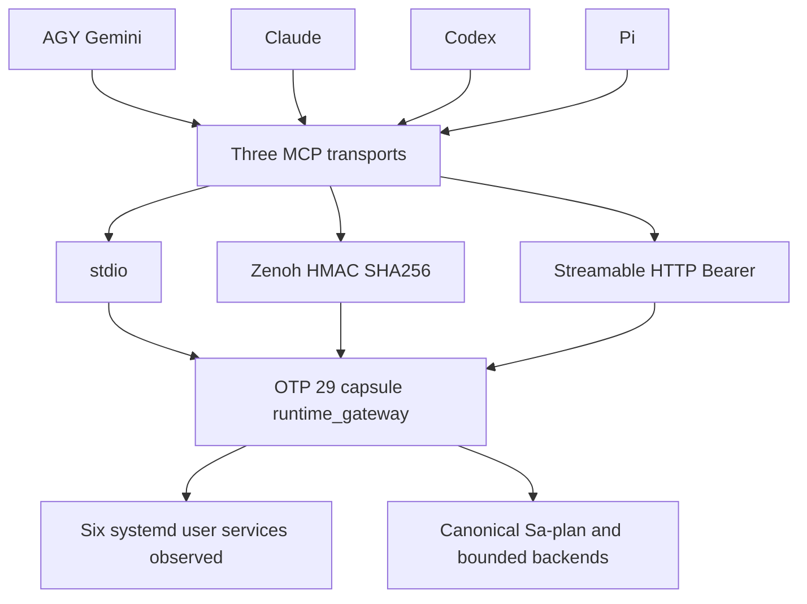

# MCP Unified 101-Route Full Service Cutover & 4-Agent Operational Symbiosis — C01..C04

**Observed UTC:** 2026-10-30T15:12:33Z · **Coordinator sequence:** 4848 · **Canonical task:** `20261030-1245-mcp-full-service-cutover/C04`, worker `agy-argon-sup-20261030-0844`, attempt `1` (executing).
**Authority:** explicit operator SC-HARNESS-MCP-001 Clause 9 development bootstrap and ReleaseAuthority. **Boundary:** `application_admitted = false`; `system_admission = "NOT_ADMITTED"`; `admitted_ev_ceiling = 93`; `EV-94..EV-109 NOT_ADMITTED`; no new EV numbers minted.

#fractal-l0 #fractal-l1 #fractal-l2 #fractal-l3 #fractal-l4 #fractal-l5 #fractal-l6 #fractal-l7 #fractal-l8 #fractal-l9 #zk-adr #zero-muda #tailscale-web #checklist-nav

**UOS / Knowledge Base / Journals** · [Cockpit](http://nas-1.tail55d152.ts.net:4100/) · [Planning](http://nas-1.tail55d152.ts.net:4100/planning) · [Wiki](http://nas-1.tail55d152.ts.net:4100/wiki) · [ZK](http://nas-1.tail55d152.ts.net:4100/zk) · [Checklist](http://nas-1.tail55d152.ts.net:4100/checklist)
**Views:** [Raw source](http://nas-1.tail55d152.ts.net:4100/files/docs/journal/20261030-1512-mcp-full-service-cutover-journal.md) · [Rendered document](http://nas-1.tail55d152.ts.net:4100/docs/journal/20261030-1512-mcp-full-service-cutover-journal.md) · [Dashboard tracker](http://nas-1.tail55d152.ts.net:4100/files/governance/planning/20261030-0844-mcp-completion-dashboard-tracker.json) · [Cutover receipt](http://nas-1.tail55d152.ts.net:4100/files/var/harness/20261030-1427-c04-cutover/cutover-outcome.json) · [Prior plan of record](http://nas-1.tail55d152.ts.net:4100/files/docs/journal/20261030-1214-mcp-server-completion-plan-of-record-journal.md)

**On this page:** [Scope](#1-scope--trigger) · [Pre-state](#2-pre-state-assessment) · [Execution](#3-execution-detail) · [RCA](#4-root-cause-analysis) · [Taxonomy](#5-fix-taxonomy) · [Patterns](#6-patterns--anti-patterns-discovered) · [Verification](#7-verification-matrix) · [Files](#8-files-modified) · [Architecture](#9-architectural-observations) · [Gaps](#10-remaining-gaps) · [Metrics](#11-metrics-summary) · [STAMP](#12-stamp--constitutional-alignment) · [Conclusion](#13-conclusion)

## 1. Scope & Trigger

This canonical SC-JOURNAL-v3 entry publishes the complete MCP Unified 101-Route Full Service Cutover and four native-agent configuration convergence under C01..C04. It follows the earlier [25/25 T00..T24 plan of record](http://nas-1.tail55d152.ts.net:4100/files/docs/journal/20261030-1214-mcp-server-completion-plan-of-record-journal.md) and promotes the [C04 capsule repair ledger](http://nas-1.tail55d152.ts.net:4100/files/var/harness/20261030-1427-c04-cutover/20261030-1418-c04-capsule-refresh-journal.md) into the canonical docs tree. The task is documentation, tracker synchronization and mechanical verification; it changes no application source, service unit, capsule, or admission decision.

Engine 5 formal boundary: development tests, receipts and operator ReleaseAuthority support the recorded cutover. They do not establish fresh Lean/Gospel proofs or general production/system admission. The parent C04 task still includes separately fenced integration/publication; this document does not invent a completed Sa-plan state.

## 2. Pre-State Assessment

### As-Is: library completion preceded live ingress convergence

The operator historical summary describes an already complete Unified 101-route library in `cepaf_gleam/mcp/*`, 25/25 T00..T24, core identity `sha256:5fb7a77609e9f41f8368fc5a761435dec6519736a00f4642d6e986ca3e8e1663`, while live services used the legacy 46-tool `mcp/protocol.gleam` and `bridge/zenoh_mcp.gleam`, a 1000 ms blocking receive, unsigned Zenoh and fragmented AGY/Gemini, Claude, Codex and Pi configurations. The named prior capsule is `20261026-2128-4add92f66a2f4be8425e7a0692a5dd8b8cdbaebbe78beadc59e9cab32d83a4d9`.

**Evidence correction:** that operator summary calls the prior runtime OTP 28, but the retained prior release manifest records **OTP 29 / ERTS 17.0.5**. The demonstrated transition is from fragmented/legacy live entrypoints to unified supervised ingress; an OTP 28-to29 upgrade is not established by this packet. Similarly, the supplied65+29+7 route taxonomy is retained as planning context, while the loaded registry actually counts **65 public +21 development +15 successor =101**.

### To-Be: observed live cutover

`otp_app.gleam`, the `/mcp` and `/.well-known/oauth-protected-resource` routes in `web/server.gleam`, the signed Zenoh bridge, and the fail-closed `tools/uos-mcp-stdio` launcher converge on the OTP-supervised `cepaf_gleam/mcp/runtime_gateway.gleam`. `tools/list` advertises53 public tools. The operator conceptual65-public partition is53 tools plus12 server/resource/prompt/task/logging/completion facilities; this conceptual partition is not used to relabel the registry tool-spec count.

All four native-agent configurations carry the same immutable capsule and payload pin. Twelve selected systemd units are active; the first six are the UOS cutover inventory and the next six are the specifically named mesh observation set. HTTP 200 does not imply semantic health: the current cockpit `/health` body says `unavailable`, with `quorum_healthy:false`, whereas ecology reports `running`. Engine 7 pre-state and uncertainty are preserved in [fresh observation](http://nas-1.tail55d152.ts.net:4100/files/var/harness/20261030-1427-c04-cutover/20261030-1501-documentation-observation.json).

## 3. Execution Detail

### C01 — Unified live ingress and native client binding

C01 connected the real OTP gateway owner to the OTP app, HTTP web wrapper, stdio launcher and subscribed Zenoh bridge. The gateway serializes shared resource/cache/subscription/task-extension state, keeps transport principals separate from effect authority, and exposes loaded-BEAM attestation. Native agent configuration convergence is configuration evidence; it does not independently prove every already-running client reconnected or every private successor grant is current.

### C02 — Protocol, facilities, authentication and adversarial closure

Exact negotiation maps `2024-11-05` to `Legacy20241105`; `2025-03-26`, `2025-06-18`, `2025-11-25` and `2026-07-28` map to `Modern20260728`. Initialize echoes the requested supported revision, HTTP header/body revisions must match exactly, and absent protocol versions preserve the canonical modern default.

The wired method surface is: `initialize`, `notifications/initialized`, `notifications/cancelled`, `ping`, `tools/list`, `tools/call`, `discovery/list`, `resources/list`, `resources/templates/list`, `resources/read`, `resources/subscribe`, `resources/unsubscribe`, `prompts/list`, `prompts/get`, `logging/setLevel`, `completion/complete`, `tasks/create`, `tasks/get`, `tasks/result`, `tasks/cancel`. The task extension requires an explicitly negotiated tasks capability and persisted canonical Sa-plan ownership; cancellation acknowledgement remains distinct from a stopped effect. Subscription IDs are principal-prefixed and stores are bounded. Notifications remain silent.

These paths share normalization across stdio, authenticated Zenoh and protected Streamable HTTP. HTTP uses Bearer issuer/audience/scope, Origin/session fences and RFC 9728 protected-resource metadata; the operator describes the integration target as OAuth 2.1. Full external IdP issuance/interoperability certification is not established here. The implemented signed Zenoh topic grammar is `indrajaal/mcp/request/{client}/{request}`, with HMAC-SHA256 signatures; the requested `uos/mcp/v1/**` label is not the source topic and is not advertised as an observed alias.

Operator-reported Claude independent adversarial closure is **15/15 remediated and re-verified, status PASS, `remaining_findings: []`**, with the supplied label range `C02-F1..C02-F16`. The aggregate regression report is **315/315 EUnit tests across 37 MCP/OTP/Census/Harness suites**, plus **43/43 web tests**. The local packet retains focused C02/C04 and web receipts; the individual final 15-finding review and315-test aggregate artifacts were not located during this publication. The15-count versus 16-label range is preserved, not silently rewritten or counted as16 independently verified findings.

| C02 finding | Recorded remediation |
| --- | --- |
| F1..F8 | Earlier adversarial transport/authority fixes are operator-reported; final primary closure artifact remains a traceability gap. |
| F9 | Supported2025 revisions negotiate/echo consistently; HTTP matches the exact requested header revision. |
| F10 | Boot losers are unlinked before stop/exit, protecting untrapping callers. |
| F11 | Attestation hashes ERTS loaded module MD5 values instead of rereading disk BEAMs. |
| F12 | Subscription/task-handle capacity limits and principal namespace scoping. |
| F13 | RFC 9728 resource_metadata derives from the protected resource origin. |
| F14 | Shared authoritative AuthConfig origin policy; no unsolicited ACAO on no-Origin requests. |
| F15 | Live wiring regressions cover versions, signed-envelope guards, subscriptions, tasks, facilities, attestation, boot racing and CORS. |
| F16 | Real session task-capability tracking and exact payload_sha256 extraction. |

### C03 — Immutable capsule release and reversible cutover

The capsule was verified before pins changed. Backups preserved unrelated private configuration entries, previous service units and every old release capsule. The first ecology start exposed a 64-hex-versus 40-hex runtime identity mismatch; the old ecology instance was restored. The operator approved the capsule-bound 40-hex Jujutsu source revision for `UOS_WEB_CANDIDATE`, retaining the complete release/payload SHA256 pins, and the switch then passed. No candidate was truncated or substituted without authorization.

### C04 — Jidoka during live capsule probing, repair and restage

Inside an immutable capsule, `ecology_capability_ffi:uos_root()` stops at `.uos-ecology-release`. Its existing `run_bounded_cd` therefore rejected the canonical workspace cwd before sqlite3/preflight could start, producing `backend_spawn_failed` / `SA_PLAN_STORE_UNAVAILABLE`. Development-tree success had not tested this artifact/workspace distinction.

`mcp_stdio_ffi:run_workspace_bounded_cd/4` now validates absolute existing cwd with no parent segments, selects checksum-verified capsule OCaml and `tools/ecology_process.ml`, and preserves the bounded guardian deadline, 1 MiB output ceiling and process cleanup contract. It accepts isolated absolute fixture directories as requested. `runtime_gateway` binds to the new adapter and queries `FROM sa_plan_task` first, falling back to `tasks` only for the legacy missing-table error. Success tool responses explicitly contain `isError:false`; deprecated catch expressions were replaced with try/catch. `ecology_capability_ffi.erl` was unchanged.

After 32/32 focused MCP tests, 43/43 web tests and zero-warning `erlc -Werror`, the whole web dependency closure was restaged and verified. A stale preflight receipt stopped the probe until an actual 31-check `--receipt` run renewed evidence. Both required calls were then tested from the staged capsule and again from the live pointer with development fallback unset. Final planning rows C01..C04 matched live SQLite.

## 4. Root Cause Analysis

Engine 1 ACH disconfirmation matrix: H1 is artifact-root/workspace-root conflation; H2 is missing/corrupt canonical Sa-plan data; H3 is a protocol-only failure. Scores 0=consistent,1=neutral,2=inconsistent.

| Diagnostic evidence | H1 | H2 | H3 |
| --- | --- | --- | --- |
| Capsule adapter refuses cwd before sqlite3 executes | 0 | 1 | 2 |
| New bounded adapter reads the same canonical C01..C04 rows | 0 | 2 | 2 |
| Exact protocol negotiation succeeds independently | 1 | 1 | 2 |
| Subsequent preflight failure explicitly identifies stale receipt | 1 | 2 | 2 |

H1 explains the capsule-only failure; stale persisted evidence was a separate control failure repaired by rerunning the real checker. Earlier fragmentation was an integration gap between a completed library and live ingress/configuration. Process liveness and HTTP success were insufficient oracles, as confirmed by the cockpit semantic-health caveat.

## 5. Fix Taxonomy

Poka-Yoke: exact profile/header matching, signed envelopes, strict payload-field extraction, principal namespaces, bounded stores, explicit capability negotiation and checksum-pinned guardian selection. Jidoka: malformed requests, stale evidence, failed runtime identity and failed subprocess startup halted the affected transition. Muda removal: canonical-table-first querying removes the unnecessary sqlite3 failure; one shared HTTP AuthConfig avoids duplicate origin policies.

Architectural ownership remains Gleam/OTP for supervision/control, bounded Erlang FFI for ERTS/process primitives, OCaml for the isolated guardian and evidence tools, ZigVM for its unchanged deterministic kernel, and isolated MAX/Mojo for inference. No new package or native library was provisioned. 0 Bevy and 0 Graphite were introduced; hardware serials are represented only as `[REDACTED_SYSTEM_OS_SERIAL]`.

## 6. Patterns & Anti-Patterns Discovered

Engine 4 Devil's Advocate / Popperian falsification: test the immutable deployment artifact using the actual workspace cwd, not only a development build. Test supported historical revisions end-to-end; malicious signed envelopes must still fail NUL/depth guards; a cancel ACK cannot claim a stopped effect. A disk checksum is not loaded-code attestation. Capability and service inventories are not invocation authority.

Operational recovery was concrete: per-file backups, retained capsules, verified fallback artifacts and restoration of the old ecology instance before the identity mismatch was resolved. Pi's 15 unrelated MCP servers, AGY/Gemini's 13 entries and Claude's 80 unrelated top-level members were preserved during pinning. The root `.pre-*` MCP backup is now stored under private ignored harness evidence, rather than in the working copy root.

## 7. Verification Matrix

Engine 2 Admiralty protocol: A2 denotes a pinned local tool receipt; B2 denotes a bounded observed runtime behavior. Operator-reported aggregate review/testing is attributed separately and is not assigned a fresh independent-machine grade. None of these grades grants system admission.

| Check | Evidence status | Grade | Locator |
| --- | --- | --- | --- |
| Core T00..T24 completion | Historical 25/25 PoR | B2 | [Prior PoR](http://nas-1.tail55d152.ts.net:4100/files/docs/journal/20261030-1214-mcp-server-completion-plan-of-record-journal.md) |
| C04 focused EUnit | Retained 32/32, no failures | A2 | [Focused EUnit](http://nas-1.tail55d152.ts.net:4100/files/var/harness/20261030-1427-c04-cutover/focused_eunit.log) |
| Web suite | Retained 43/43, no failures | A2 | [Web tests](http://nas-1.tail55d152.ts.net:4100/files/var/harness/20261030-1427-c04-cutover/web_tests.log) |
| MCP FFI warning gate | Retained erlc -Werror, 0 warnings | A2 | [Compiler log](http://nas-1.tail55d152.ts.net:4100/files/var/harness/20261030-1427-c04-cutover/ffi-warnings.log) |
| Immutable stage and verify | Retained verified payload | A2 | [Stage](http://nas-1.tail55d152.ts.net:4100/files/var/harness/20261030-1427-c04-cutover/stage.json) / [Verify](http://nas-1.tail55d152.ts.net:4100/files/var/harness/20261030-1427-c04-cutover/verify.json) |
| Live pointer-backed MCP | Both required calls isError:false; C01..C04 match SQLite | B2 | [Live MCP](http://nas-1.tail55d152.ts.net:4100/files/var/harness/20261030-1427-c04-cutover/live_mcp.json) |
| Six UOS and six named mesh units | Current 12/12 active; no blanket semantic-health verdict | B2 | [Fresh observation](http://nas-1.tail55d152.ts.net:4100/files/var/harness/20261030-1427-c04-cutover/20261030-1501-documentation-observation.json) |
| Three HTTP endpoints | Current HTTP 200; cockpit body unavailable/quorumfalse | B2 | [Endpoint bodies](http://nas-1.tail55d152.ts.net:4100/files/var/harness/20261030-1427-c04-cutover/20261030-1501-documentation-observation.json) |
| Claude15/15 and315/315 aggregate | Operator-reported; primary local closure artifacts unlocated | UNVERIFIED | Active operator publication instruction |
| Documentation mechanical gates | Journal 10/10 first-run, diagram parity, JSON, KM PASS, preflight 31 checks | A2 | var/harness/20261030-1427-c04-cutover/documentation-gates.json |

The deployment scope considers17 aspects: intent, requirements, authority, source identity, language ownership, toolchain, build, test, artifact integrity, staging, startup, process/runtime observation, protocol/security, rollback, configuration preservation, independent evidence and admission. Independent aggregate traceability and broad semantic-health assurance remain explicitly incomplete.

## 8. Files Modified

| Deliverable | Scope |
| --- | --- |
| `docs/journal/20261030-1512-mcp-full-service-cutover-journal.md` | New canonical13-section cutover ledger, paired editable diagrams, navigation and5+1 checklist domains. |
| `governance/planning/20261030-0844-mcp-completion-dashboard-tracker.json` | Updated timestamp/sequence, observed As-Is/To-Be, Wave6 inventory, evidence caveats and journal reference; historical waves preserved. |
| `.mcp.json.pre-20261030-c04-refresh` | Moved to `var/harness/20261030-1427-c04-cutover/.mcp.json.pre-20261030-c04-refresh`, mode0600. |

Earlier implementation and pin deltas are recorded in [C04 slice ledger](http://nas-1.tail55d152.ts.net:4100/files/var/harness/20261030-1427-c04-cutover/20261030-1418-c04-capsule-refresh-journal.md). This publication does not modify any `.gleam`/`.erl` file, the six core digest inputs or `harness/admission.gleam`. Existing cutover changes are preserved in the standalone Jujutsu working change; no Git command or integration bookmark mutation is performed.

## 9. Architectural Observations

### Immutable capsule and runtime inventory

- Capsule: `/home/an/NAS-setup/uos/var/releases/ecology/20261030-1423-9919a413d911dc5fe7cae5c7098f0edb3ae6adaf891170a1bc166da802eab885`.
- `candidate_sha256`: `9919a413d911dc5fe7cae5c7098f0edb3ae6adaf891170a1bc166da802eab885`.
- `payload_sha256`: `3ec0ac409c1cb34e6b4fbce48df2e2c35241327d9a9cdf9b1d795eaa18c01230`.
- Runtime: **OTP 29 / ERTS 17.0.5**; **3457** source manifest inputs verified in the retained receipt.
- Runtime source revision: `435efaa2741afbd9f7bee0d11efc3cfd9d386fcb`, used as the 40-hex ecology identity.
- Core candidate: `sha256:5fb7a77609e9f41f8368fc5a761435dec6519736a00f4642d6e986ca3e8e1663`, preserved independently of release/package identity.

| systemd --user unit | Observation set | State | MainPID | Restarts |
| --- | --- | --- | --- | --- |
| c3i-gleam-server.service | UOS cutover | active | 2369048 | 0 |
| uos-cognitive-worker.service | UOS cutover | active | 2369086 | 0 |
| uos-clock-guard@primary.service | UOS cutover | active | 2369339 | 0 |
| uos-clock-guard@backup.service | UOS cutover | active | 2369377 | 0 |
| uos-ecology@20261030-1423-9919a413d911dc5fe7cae5c7098f0edb3ae6adaf891170a1bc166da802eab885.service | UOS cutover | active | 2370613 | 0 |
| uos-telegram-bridge.service | UOS cutover | active | 429614 | 0 |
| c3i-docs-server.service | C3I mesh observation | active | 9971 | 0 |
| c3i-pi-runtime.service | C3I mesh observation | active | 9023 | 0 |
| c3i-sutra.service | C3I mesh observation | active | 9031 | 0 |
| c3i-symbiosis-monitor.service | C3I mesh observation | active | 9035 | 0 |
| c3i-tls-proxy.service | C3I mesh observation | active | 9056 | 0 |
| c3i-zenoh-router-1.service | C3I mesh observation | active | 9954 | 0 |

The six mesh units are the named observation set above, not a claim that every host service is healthy. Telegram is a native bridge and is not relabeled a BEAM process. Ecology health: [http://nas-1.tail55d152.ts.net:4110/health](http://nas-1.tail55d152.ts.net:4110/health); cockpit health: [http://nas-1.tail55d152.ts.net:4100/health](http://nas-1.tail55d152.ts.net:4100/health); RFC 9728 metadata: [http://nas-1.tail55d152.ts.net:4100/.well-known/oauth-protected-resource](http://nas-1.tail55d152.ts.net:4100/.well-known/oauth-protected-resource).

### Four native agent bindings

| Agent | Native configuration | Verified release binding |
| --- | --- | --- |
| Codex | `.codex/config.toml`, both uos_gleam.env and uos_development.env | Capsule path and UOS_MCP_EXPECTED_PAYLOAD_SHA256. |
| Claude | `.mcp.json` plus `~/.claude.json` | uos-gleam, fail-closed launcher, same capsule/payload. |
| Pi | `~/.pi/agent/mcp.json` | uos-harness launcher plus uos-harness-dev pinned erl/capsule apps/*/ebin; prior env keys preserved. |
| AGY/Gemini | `~/.gemini/config/mcp_config.json` | uos-gleam, same launcher/capsule/payload. |

`.pre-20261030-cutover` and subsequent refresh backups and prior release capsules remain available for rollback. No credential values from native agent configurations are reproduced.

### SC-DIAGRAM-001 paired editable architecture

The following forms are generated from one node-label/edge list and therefore carry the same 12 directed edges and labels. They describe ingress convergence and the observed cutover footprint; the service inventory node is not a claim that the gateway is the systemd supervisor or that every backend is active.

```text
[AGY Gemini] --> [Three MCP transports]
[Claude] --> [Three MCP transports]
[Codex] --> [Three MCP transports]
[Pi] --> [Three MCP transports]
[Three MCP transports] --> [stdio]
[Three MCP transports] --> [Zenoh HMAC SHA256]
[Three MCP transports] --> [Streamable HTTP Bearer]
[stdio] --> [OTP 29 capsule runtime_gateway]
[Zenoh HMAC SHA256] --> [OTP 29 capsule runtime_gateway]
[Streamable HTTP Bearer] --> [OTP 29 capsule runtime_gateway]
[OTP 29 capsule runtime_gateway] --> [Six systemd user services observed]
[OTP 29 capsule runtime_gateway] --> [Canonical Sa-plan and bounded backends]
```



## 10. Remaining Gaps

- **P1 semantic-health evidence:** cockpit `/health` returns200 but reports `unavailable`, zero healthy/container counts and `quorum_healthy:false`;12/12 scoped unit liveness is not a health admission.
- **P2 evidence traceability:** bind the final Claude15-finding artifact and315-test/37-suite aggregate before claiming independent re-verification from this packet. Preserve the supplied15/15 versusF1..F16 bookkeeping caveat.
- **P2 terminology:** actual65+21+15 registry counts, retained priorOTP 29 metadata and `indrajaal/mcp/request/...` topic supersede the conflicting supplied narrative as observed facts.
- **P2 client/grant freshness:** configuration pinning alone does not prove reconnect of all existing client processes or current task-scoped successor grants.
- **Governance:** C04 remains executing during publication; no `main` integration or parent task completion is inferred. KM and other mechanical gate outputs are reported honestly; a nonpassing result is not waived.

## 11. Metrics Summary

Historical library plan:25/25. Operator aggregate:315/315 across 37 suites, attributed rather than recomputed. Retained focused/web population:32+43=75 passing tests, zero failures. Scoped runtime inventory:12/12 active, including6/6 requested UOS services at0 restarts; three endpoint status codes are200, while cockpit semantic health remains unavailable.

Engine 3 Bayesian descriptive update for the retained 75 test outcomes is Beta(1,1) to Beta(76,1), mean76/77; correlated tests do not calibrate system-correctness probability. Machine-receipt trust half-life is 604800 seconds: C(t)=C0*2^(-elapsed/604800), with immediate invalidation on source drift. The Lyapunov-style observed metric V=sum(restarts of the six requested services) remains 0 between the retained cutover observation and this publication observation, so |Delta V|=0 with epsilon 0 for those measured points; no general stability theorem is asserted.

## 12. STAMP & Constitutional Alignment

Engine 6 control alignment retains all four UCA classes: omitted ingress or verification; unsafe unauthenticated/foreign/over-capacity action; wrong ordering or stale candidate/receipt; and excessive process duration/output or stale lease use. Controls are explicit profile/principal/session checks, Sa-plan persistence and scope, typed receipts, isolated guardian bounds, snapshot/package identity, coordinator epochs, and reversible rollback. Numerical C=4 x T=4 x F=4 x Dep=4 x I=3 yields 768 is ordinal risk triage, not effect authority; raw FMEA S4/O3/Det3 gives RPN36 in the retained assessment.

**Provenance:** `application_admitted = false`; `system_admission = "NOT_ADMITTED"`; `admitted_ev_ceiling = 93`; `EV-94..EV-109 NOT_ADMITTED`; no new EV number minted. The Clause 9 bootstrap and explicit ReleaseAuthority were operator-scoped; neither a passing checklist nor this journal changes admission.

<details><summary>Domain 1 — Metadata, timestamp and Tailnet navigation</summary>

- [x] CHK-01-TIME: host UTC and synchronized chrony observation recorded; filename follows the current explicit operator HHMM request.
- [x] CHK-02-TAIL: full clickable Tailnet navigation and endpoint links supplied; document serving is checked separately.
- [x] CHK-03-FRACT: L0..L9 applicability tags retained.
- [x] CHK-04-KM: PoR, slice ledger, tracker, receipt, Wiki and ZK navigation linked.

</details>
<details><summary>Domain 2 — Zero-Muda purity and storage safety</summary>

- [x] CHK-05-MUDA: no dependencies or prohibited runtime roles introduced by publication.
- [x] CHK-06-GRAPH: no foreign graph/NIF implementation change.
- [x] CHK-07-DRIVE: no device operation; raw hardware serial omitted.

</details>
<details><summary>Domain 3 — Tests and mathematical gates</summary>

- [ ] CHK-08-C1C8: full fresh browser/manual acceptance is not established by this ledger.
- [ ] CHK-09-MATH: four global mathematical/site-quality gates are not inferred from unit counts.
- [x] CHK-10-9MOD: retained focused, fault, capacity and capsule observations cited; all-modalities coverage not claimed.
- [ ] CHK-11-REGR: no broad live GUI regression monitoring claim.

</details>
<details><summary>Domain 4 — Cross-language control and observability</summary>

- [x] CHK-12-GLEAM: actual OTP 29 gateway/process observations retained.
- [x] CHK-13-HERMES: bounded OCaml guardian and report-only risk/mechanical checks; no new solver proof claimed.
- [x] CHK-14-ZIGVM: deterministic kernel unchanged by publication.
- [ ] CHK-15-MAX: isolated inference architecture preserved; all inference services not freshly certified.
- [ ] CHK-16-OTEL: current global trace correlation is not established by this packet.

</details>
<details><summary>Domain 5 — Governance and standalone Jujutsu</summary>

- [ ] CHK-17-SOV: system admission and independent aggregate evidence remain separate.
- [x] CHK-18-JJ: standalone JJ only, protected inputs immutable, existing cutover changes preserved.

</details>
<details><summary>Domain 6 — Provenance extension SC-PROVENANCE-001</summary>

- [x] EV ceiling 93 retained; EV94..109 NOT_ADMITTED; no new identifier minted.
- [x] Core six-file digest and protected harness admission MD5 remain fixed.
- [x] Operator reports, retained receipts and fresh observations are explicitly distinguished.

</details>

## 13. Conclusion

The library-to-live-ingress transition is recorded with one supervised gateway, a verified immutable OTP 29 closure and four unified native-agent configuration bindings. The scoped cutover succeeded with six UOS services active at zero restarts, ecology HTTP 200 and real capsule-backed canonical planning/preflight behavior. The capsule CWD defect and identity/receipt Jidoka stops are preserved as tested recovery history, not erased by the successful result.

Engine 7 Forecast precommit at 2026-10-30T15:12:33Z: p = 0.95, an engineering estimate rather than a calibrated probability, that the new journal/diagram/JSON/preflight mechanical checks pass without protected-source drift before Horizon 2026-10-30T15:22:33Z. Falsifier: any such command fails or a protected byte changes; Brier B=(0.95-o)^2, o in{0,1}. The KM gate was excluded from the success forecast and observed independently as PASS: 137 contiguous ADRs, 16 quarantine-marked records, layer entropy 3.2980706279534964 bits, and an intact cycle chain. This current observation does not rewrite historical gate status. The forecast resolved early with o=1 from the completed journal/diagram/JSON/preflight checks before its stated deadline, giving Brier=(0.95-1)^2=0.0025. System admission remains NOT_ADMITTED regardless of these mechanical outcomes.

**Previous:** [MCP completion PoR](http://nas-1.tail55d152.ts.net:4100/files/docs/journal/20261030-1214-mcp-server-completion-plan-of-record-journal.md) · **Next:** [Live dashboard tracker](http://nas-1.tail55d152.ts.net:4100/files/governance/planning/20261030-0844-mcp-completion-dashboard-tracker.json) · **Up:** [Journals](http://nas-1.tail55d152.ts.net:4100/docs) · [Wiki](http://nas-1.tail55d152.ts.net:4100/wiki) · [ZK](http://nas-1.tail55d152.ts.net:4100/zk)

**Persistent footer:** UOS canonical knowledge record; observed cutover is not global system admission.
