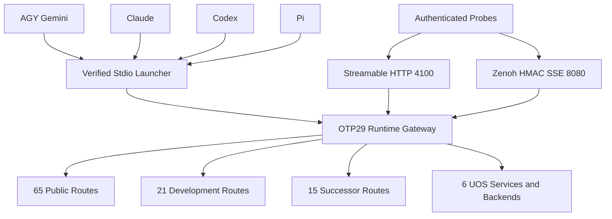

# 20261030-1846 — Full 101-Route MCP and Four-Agent Symbiosis Closure Journal

- **Contract**: SC-JOURNAL-v3; SC-AK47-SYMBIOSIS-001; SC-MIRROR-PROJ-001; SC-HARNESS-MCP-001 Clause 9.
- **Observed UTC**: 2026-10-30T18:46:12Z; chrony stratum 3, system offset 0.000143393 seconds slow at the S04 observation. This is host clock evidence, not model-clock equality.
- **Canonical authority**: `20261030-1634-mcp-full-symbiosis-closure`, worker `agy-argon-sup-20261030-0844`; S01/S02/S03 completed, S04 executing attempt1. S04 completion and leased integration/main merge are reserved to AGY.
- **State**: operational and documentation closure evidence; `application_admitted = false`, `SYSTEM_ADMITTED = false`, `system_admission = "NOT_ADMITTED"`, `admitted_ev_ceiling = 93`. EV-94..EV-109 NOT_ADMITTED; no EV numbers minted.
- **Navigation**: [Cockpit](http://nas-1.tail55d152.ts.net:4100/) · [Planning](http://nas-1.tail55d152.ts.net:4100/planning) · [Wiki](http://nas-1.tail55d152.ts.net:4100/wiki) · [ZK](http://nas-1.tail55d152.ts.net:4100/zk) · [This journal](http://nas-1.tail55d152.ts.net:4100/files/docs/journal/20261030-1846-mcp-full-101-route-4-agent-symbiosis-closure-journal.md).

#fractal-l0 #fractal-l1 #fractal-l2 #fractal-l3 #fractal-l4 #fractal-l5 #fractal-l6 #fractal-l7 #fractal-l8 #fractal-l9 #zk-adr #zero-muda #tailscale-web

Transclusions: [[wiki:20261030-1058-unified-101-route-mcp-client-guide]] · [[zk:20261030-1058-adr-ak47-multi-agent-101-route-mcp-architecture]].

## 1. Scope & Trigger

Engine 5 formal boundary: the operator requested final S03 completion and S04 evidence/documentation closure after AGY's native calls succeeded on the reviewed immutable capsule. This journal records observations and falsifiers; it adds no Lean/Gospel theorem, grant authority or global admission. The 28 pinned control modules and six-source MCP candidate were preserved throughout implementation and this documentation phase. The scope comprises native CLI MCP execution, vendor rule/skill projection, protocol/client-guide correction, tracker update and mechanical gates. No S04 application source, service, release capsule or main bookmark change is authorized or performed here.

The source and service work was completed under S01..S03 with separate operator ReleaseAuthority. This journal links its receipts rather than reclassifying a unit-test result or a model verdict as production admission.

## 2. Pre-State Assessment

Engine 7 predictive prior: the prior C01..C04 cutover supplied the unified public library/gateway and preserved core digest, but S01 began with unbound private development/successor execution arms. Subsequent S03 live probes exposed a missing daemon Zenoh subscription even though isolated envelope verification passed. Agent configs were fragmented across project/global surfaces; Codex had a four-tool exposure restriction; a connected client-list command did not prove an actual tool invocation.

At S04 entry, the reviewed capsule and three transports were observed passing and AGY's native execution was operator-attested. Claude/Codex/Pi in-agent tool execution and current vendor documentation parity still needed fresh evidence. A Kalman-style prior separates the observed coordinates (101 wired specs, three tested transports) from unobserved CLI coordinates; no numeric covariance or calibrated Kalman estimator was measured. Cockpit HTTP200 already coexisted with `quorum_healthy=false`.

## 3. Execution Detail

Engine 6 Rete-UL boundary: typed admission and effect fences were exercised; no new runtime Rete scheduler enforcement is inferred. Six closure categories summarize S01..S04, without creating additional canonical tasks:

| Gap | Remediation and evidence |
|---|---|
| Private route executors absent | S01 bound21 development and15 successor tools through real harness loading/fences. Caller-side snapshot/admit/execute/commit preserves the non-blocking GatewayState owner, receipt identity and lossless typed arguments. |
| Private authority/uncertainty edge cases | S02's six findings closed: truthful observed task state/worker/lease, independent ticket expiry, post-effect Uncertain receipts, principal/session ownership, cheap schema prechecks, zero actor self-waits and reviewed sibling-root support. Independent Claude PASS was operator-confirmed. |
| Fragmented native client binding and exposure | S03 re-pinned11 project/global files for four clients; Codex exposes53 operational tools, private Codex/Pi routes remain disabled. S04 proved real in-agent calls and retained trust/approval boundaries. |
| Missing live Zenoh daemon ingress | S03b added a dedicated MCP SSE worker, then closed F1..F7: stdio exclusion, host-wide mutex, safe monitored initialization, independent supervisor, idle/freshness state, mailbox cleanup, shared topic bounds, registered/cross-BEAM tests and atomics updates. Claude task-1831 -> task-1858 -> task-1872 returned PASS, zero remaining findings, INV-ZEN-01..06 NOT_FALSIFIED. |
| Mutable/runtime and transport divergence | S03c staged and verified OTP29/ERTS17.0.5, re-cut over six services, and passed stdio, signed HTTP and live Zenoh positive/negative probes. Earlier C04's capsule-root/CWD Jidoka fix remained in the verified payload. |
| Stale governance and closure evidence | S04 synchronizes five accepted protocol revisions, four vendor rule copies, canonical skill target and client guide; publishes this journal and Wave7 tracker; refreshes preflight and runs journal/diagram/KM/hash/symlink/secret checks. |

The canonical Sa-plan completion records S03 only after AGY's native proof. S04 preflight passed before its worker-first one-hour claim; the active check passed at attempt1. The installed CLI takes worker, plan, nanosecond duration, task for claiming. No direct database writes were used.

Native CLI proofs are in the [sanitized four-agent ledger](http://nas-1.tail55d152.ts.net:4100/files/var/harness/20261030-s03-symbiosis-cutover/s04-4agent-cli-proofs.json). AGY PID2693276 was observed with the new capsule pin; AGY reported native inventory, plan and health calls at18:29:28Z. The process start derived from procfs was approximately18:29:06.950Z; these are different observations, not a clock contradiction. Claude invoked inventory and plan through its native `uos-gleam` connection. Codex invoked `system_health` (`backend=beam_otp29_live`, healthy, fresh, read_only, no effect authority) and plan. Pi invoked inventory and plan through its native adapter; `pi mcp list --json` exited0 with zero failed servers and53 tools.

The first Codex headless health attempt needed approval; a process-only approval for the explicitly authorized read resolved it. Pi's project trust initially blocked calls despite list connectivity; explicit `--mcp-config .pi/mcp.json` selected the reviewed two-server configuration without globally permitting project servers/scripts. Native `sa_plan_status_for` requires `plan`, not the internal/normalized `plan_id` label; using the advertised schema resolved that refusal. Failed attempts remain identified in the ledger.

## 4. Root Cause Analysis

Engine 1 ACH (Analysis of Competing Hypotheses): 0=consistent,1=neutral,2=inconsistent. H1: missing or mismatched binding/admission/client-selection layers caused the gaps. H2: the unified candidate or canonical Sa-plan database was unavailable/corrupt.

| Discriminating observation | H1 | H2 |
|---|---:|---:|
| Library/isolated signed-envelope tests passed while live Zenoh had no reply before the subscriber existed | 0 | 2 |
| Registered loopback tests and real router replies passed after supervised ingress wiring | 0 | 2 |
| Codex plan worked while a separate health call was stopped by client approval | 0 | 2 |
| Pi list connected while its headless project approval gate denied execution | 0 | 2 |
| Correct native schema and scoped client selection returned3 completed/1 executing canonical tasks | 0 | 2 |

H1 survives these falsifiers. Independent findings identified additional availability hazards: linked startup failure could kill callers, multiple OS processes could duplicate consumers, silent streams could look healthy, and per-segment persistent-term replacement could trigger literal-area GC. The fixes preserve distinct grant clocks, execution uncertainty and observed lease identity rather than fabricating authority. Source compilation, transport authentication, client trust and system admission are separate layers.

## 5. Fix Taxonomy

Poka-Yoke: route/schema prechecks, safe five-segment topics, fixed production router host/port, exact body/header revisions, 1MiB framing and safe response-key limits. Jidoka: preserve HOLD on missing positive control, unknown post-effect commits and stale proof; never classify a silent non-consumer as a successful bad-HMAC drop. Availability isolation: separate SSE supervisor/restart budget, cross-process loopback mutex41199, idle deadlines and stable worker-owned atomics. Muda reduction: canonical-table-first planning queries and targeted EUnit, not a cold all-project gleam test. Source-level changes stopped after independent PASS.

## 6. Patterns & Anti-Patterns Discovered

Engine 4 Devil's Advocate/Popperian falsification: a process PID, connected-list row, green model reply or decoded envelope is insufficient. Require actual MCP tool events and candidate-bound returned data. The negative Zenoh probe is bracketed by valid replies; a failed positive invalidates a claimed silent-drop pass. The actual prefix selector is `s03live$*`; a bare attached star produced no matching events, while both whole-chunk `*` and sub-chunk `$*` controls worked.

Mutation regressions rejected removed stdio exclusion, supervisor isolation, truthful freshness, stale-handshake cleanup and raw topic bounds. F7's isolated OTP trace observed zero persistent_term:put calls in receive/reconnect paths while at least eight atomic timestamp writes occurred and the same owner/ref publication persisted. Reintroducing a hot-path put failed that test. An old worker's cleanup mutates only its own atomics ref.

Do not globally weaken project trust or private route approval to make a read proof pass. Do not equate public transport probes with live execution of all private effects. General zenoh/client subscription support remains False, preserving Telegram G-09; MCP's dedicated bounded subscriber is separate.

## 7. Verification Matrix

Engine 2 Admiralty / STANAG evidence grades: A2 denotes exact local machine receipts or byte/hash checks; B2 denotes bounded observed runtime/tool behavior. These are evidence descriptions, not sovereign admission grades. The source-test run predates this documentation edit and remains bound to unchanged application bytes.

| Observation | Result | Grade | Evidence |
|---|---|---|---|
| OTP/ERTS and source suites | 526/526 EUnit across46 suites;65/65 focused subset;43/43 web;0 modified-file warnings,32 unrelated pre-existing build warnings | A2 | [source/EUnit receipt](http://nas-1.tail55d152.ts.net:4100/files/var/harness/20261030-s03-symbiosis-cutover/s03-zenoh-source-eunit.json) |
| Independent private and SSE review | S02 and S03b findings F1..F7 CLOSED, INV-ZEN-01..06 NOT_FALSIFIED; independent verdict PASS; operator-attested read-only reviews | B2 | [cutover receipt](http://nas-1.tail55d152.ts.net:4100/files/var/harness/20261030-s03-symbiosis-cutover/s03-outcome.json) |
| Immutable capsule | Verify PASS;3457 manifest inputs;28/28 control md5 parity; core and protected admission unchanged | A2 | [capsule verify](http://nas-1.tail55d152.ts.net:4100/files/var/harness/20261030-s03-symbiosis-cutover/s03c/verify-final.json) |
| Six scoped services | active/running, zero restarts; HTTP200 on4100 and4110 | B2 | [service proof](http://nas-1.tail55d152.ts.net:4100/files/var/harness/20261030-s03-symbiosis-cutover/s03c/service-verification-final.json) |
| stdio and Streamable HTTP |53 tools,101-route inventory, real plan; bad HTTP token401 with WWW-Authenticate | B2 | [stdio](http://nas-1.tail55d152.ts.net:4100/files/var/harness/20261030-s03-symbiosis-cutover/s03c/stdio-probe.json); [HTTP](http://nas-1.tail55d152.ts.net:4100/files/var/harness/20261030-s03-symbiosis-cutover/s03c/http-probe.json) |
| Live Zenoh |53-tool reply, canonical plan, zero forged reply and signed ping after it: OBSERVED_SILENT_DROP_WITH_POSITIVE_BRACKET | B2 | [Zenoh probe](http://nas-1.tail55d152.ts.net:4100/files/var/harness/20261030-s03-symbiosis-cutover/s03c/zenoh-probe.json) |
| Four native clients | AGY operator/native+PID proof; Claude/Codex/Pi actual MCP tool events and returned values; Pi53 tools/0 failed | B2 | [CLI ledger](http://nas-1.tail55d152.ts.net:4100/files/var/harness/20261030-s03-symbiosis-cutover/s04-4agent-cli-proofs.json) |
| Rule/skill projection | Four byte-identical rule mirrors; four canonical skill symlinks retained; zero broken links across708 checked at S04 | A2 | [final mechanical receipt](http://nas-1.tail55d152.ts.net:4100/files/var/harness/20261030-s03-symbiosis-cutover/s04-closure-outcome.json) |
| Journal, diagrams, KM, fresh preflight | Journal10/10, diagrams4/4, KM and31-check preflight observed passing; final refreshed receipts and exit codes are recorded in handoff receipt | A2 | [final mechanical receipt](http://nas-1.tail55d152.ts.net:4100/files/var/harness/20261030-s03-symbiosis-cutover/s04-closure-outcome.json) |

17-aspect disposition: scope, authority, clock, source identity, language boundary, toolchain, build, focused/full selected tests, payload integrity, startup, process observation, authentication, config preservation, recovery retention and documentation consistency have scoped receipts. New global formal proof and system admission are not claimed. Manual GUI acceptance and fleet-wide backend availability remain outside these MCP read probes.

## 8. Files Modified

| Deliverable | Change |
|---|---|
| contracts/rules/20261030-1058-ak47-multi-agent-mcp-symbiosis-rule.md | Five revisions, observed authority-scoped operational note and transport scope |
| .agents/.claude/.codex/.gemini rules with the same basename | Four byte-identical projections from canonical rule |
| governance/agents/20261001-1118-skills/ak47-multi-agent-mcp-symbiosis/SKILL.md | Canonical skill target only; four existing symlinks unchanged |
| docs/wiki/20261030-1058-unified-101-route-mcp-client-guide.md | Exact11-file binding matrix, three transports, truthful native approval/schema details, paired diagram |
| docs/journal/20261030-1846-mcp-full-101-route-4-agent-symbiosis-closure-journal.md | This13-section ledger and six-domain checklist |
| governance/planning/20261030-0844-mcp-completion-dashboard-tracker.json | Wave7 evidence, status, timestamps and preserved NOT_ADMITTED boundary |
| var/harness/... | Ignored sanitized CLI, risk/task, gate, integrity and outcome receipts |

S01..S03 source changes already exist in the working change. S04 changes no application source or immutable capsule. Repository-native configs re-pinned during S03 remain present; unrelated private client keys were not rewritten by this documentation phase. No Git command, main move or integration merge occurs.

## 9. Architectural Observations

Engine 5 category boundary: transport identity, real grant/fence authority, effect/receipt identity and observed epistemic status are separate coordinates. The gateway is a common convergence point; route counts do not imply every backend is available or every private effect admitted. Native tool calls exercise the clients' real schema/approval adapters, which shell-only transport probes cannot prove.

```text
[AGY Gemini] --> [Verified Stdio Launcher]
[Claude] --> [Verified Stdio Launcher]
[Codex] --> [Verified Stdio Launcher]
[Pi] --> [Verified Stdio Launcher]
[Authenticated Probes] --> [Streamable HTTP 4100]
[Authenticated Probes] --> [Zenoh HMAC SSE 8080]
[Verified Stdio Launcher] --> [OTP29 Runtime Gateway]
[Streamable HTTP 4100] --> [OTP29 Runtime Gateway]
[Zenoh HMAC SSE 8080] --> [OTP29 Runtime Gateway]
[OTP29 Runtime Gateway] --> [65 Public Routes]
[OTP29 Runtime Gateway] --> [21 Development Routes]
[OTP29 Runtime Gateway] --> [15 Successor Routes]
[OTP29 Runtime Gateway] --> [6 UOS Services and Backends]
```



Both editable diagrams describe identical nodes, edges and labels. Four native clients use stdio; independent authenticated probes exercise the other ingress transports. The gateway holds public65/development21/successor15 registry specs. The services/backend node describes the six scoped services plus their bounded data-plane interfaces, not a claim that all external backends are available.

## 10. Remaining Gaps

Engine 4 residual falsifiers remain explicit: cockpit `/health` is HTTP200 with semantic status unavailable and quorum_healthy=false, while MCP system_health is healthy only for its declared gateway-ping scope. Vault/MAX and other unavailable backend refusals remain truthful. The inventory still reports admitted_count=0; no universal formal or individual-tool execution claim follows from101 wired routes.

S04 is intentionally executing until AGY's final native preflight_check and sa_plan_status_for; integration/main requires its own leased supervisor action. Default Pi project approval remains ask, and Codex's process-only health approval does not change persistent policy. Existing Pi adapter shadows builtin:mcp and unrelated unapproved project-server warnings are recorded; the reviewed UOS config's requested calls passed. Full GUI acceptance, all C1-C8/quality mathematics, and global fleet admission are not closed here.

## 11. Metrics Summary

526 source EUnit outcomes plus43 web outcomes total569 passing observations;65 focused tests are a subset and are not double-counted. A descriptive Bayesian Beta(1,1) bookkeeping update yields Beta(570,1), but correlated tests and narrow read probes do not calibrate whole-system correctness. Use evidence half-life604800s with C(t)=C0*2^(-elapsed/604800); changed application bytes immediately invalidate the associated source-bound evidence regardless of decay.

Live metrics:101 wired specs,53 advertised operational tools, four native clients,11 config files, three authenticated transports, six active services, zero systemd restarts,28 matching control modules and zero broken vendor symlinks. Lyapunov-style V=sum(service restarts)=0 at the observed checkpoints, with observed deltaV=0; no dV/dt<0 stability theorem is established. No new EV number is minted.

## 12. STAMP & Constitutional Alignment

Engine 6 STPA control constraints cover all four UCA classes: not_provided (missing private/SSE/client binding), provided_unsafe (synthetic authority, duplicate consumers, leaked secrets), wrong_timing (pre-effect gates versus post-effect uncertainty, stale observations) and duration (idle streams, lease expiry, restart and memory growth). Real task/worker/attempt fences, canonical risk checks, separate runtime leases, byte pins and negative-control brackets prevent these hazards within the tested scope. No model or hook replaces Sa-plan authority.

SC-DIAGRAM-001 pairs sources; SC-MIRROR-PROJ-001 preserves rule byte equality and skill links; SC-PROVENANCE-001 keeps application_admitted=false, SYSTEM_ADMITTED=false, EV ceiling93 and EV-94..EV-109 NOT_ADMITTED. Zero-Muda:0 Bevy,0 Graphite; no package, storage-device or runtime-role addition. No host storage serial is exposed.

<details><summary>Domain 1 — Metadata, timestamp and navigation</summary>

- [x] CHK-01-TIME: observed host UTC and synchronized risk/chrony evidence.
- [x] CHK-02-TAIL: full Tailscale FQDN navigation and evidence links; route-specific publication status is not inferred merely from a link.
- [x] CHK-03-FRACT: L0..L9 tags and scoped layer responsibilities retained.
- [x] CHK-04-KM: canonical rule, guide, skill, tracker and evidence references supplied.

</details>
<details><summary>Domain 2 — Purity and storage safety</summary>

- [x] CHK-05-MUDA: no new dependency or prohibited runtime role.
- [x] CHK-06-GRAPH: no foreign graph/NIF or kernel source change in S04.
- [x] CHK-07-DRIVE: not applicable; no storage-device operation or exposed serial.

</details>
<details><summary>Domain 3 — Testing and mathematics</summary>

- [ ] CHK-08-C1C8: full manual/browser acceptance outside this read-only CLI closure.
- [ ] CHK-09-MATH: no new four-quality-math or global formal claim.
- [x] CHK-10-9MOD: applicable source, integration, bounds, auth, fault, mutation and live client observations recorded; not all possible modalities claimed.
- [ ] CHK-11-REGR: continued GUI/long-duration fleet monitoring remains outside this task.

</details>
<details><summary>Domain 4 — Control and observability</summary>

- [x] CHK-12-GLEAM: OTP29 supervised gateway, isolated subscriber and actual client calls observed.
- [x] CHK-13-HERMES: bounded guardian and canonical Sa-plan/risk commands; no new solver proof.
- [x] CHK-14-ZIGVM: no deterministic-kernel change.
- [x] CHK-15-MAX: no inference service change or availability claim.
- [ ] CHK-16-OTEL: no new end-to-end trace-correlation acceptance claim.

</details>
<details><summary>Domain 5 — Governance and standalone Jujutsu</summary>

- [x] CHK-17-SOV: independent Claude source audits PASS recorded; final supervisor native checks and task/main finalization remain reserved.
- [x] CHK-18-JJ: standalone snapshots only, scoped diff/secret checks; main unchanged by Codex.

</details>
<details><summary>Domain 6 — Provenance</summary>

EV-93 ceiling preserved. EV-94..EV-109 NOT_ADMITTED; application_admitted=false; SYSTEM_ADMITTED=false; no new EV identifiers, no system admission, and no automatic promotion from green component counts.

</details>

## 13. Conclusion

The six identified gap categories now have source, independent-review, live transport/native-client and governance evidence. The released capsule is /home/an/NAS-setup/uos/var/releases/ecology/20261030-1811-79c8aa73a27a372e027e3fa677b75deae56e4fd1a1f84af6632b4409e82ba1e2; candidate_sha256 79c8aa73a27a372e027e3fa677b75deae56e4fd1a1f84af6632b4409e82ba1e2; payload_sha256 a1e7125f39055bc9321027138935843bc4c77a483f9457c6ecd77ec9557cd1d3; capsule-bound40-hex Jujutsu source revision 761deef798fc2156dd8d9f56757ba55f856d68dc. Core MCP identity remains sha256:5fb7a77609e9f41f8368fc5a761435dec6519736a00f4642d6e986ca3e8e1663 and harness/admission.gleam MD5 remains c53ed6bf66cba56cfc0d6e850875a774. The supervisor retains final S04 completion and leased main integration after its own native calls.

Precommitted Forecast: at a15-minute Horizon after 2026-10-30T18:46:12Z, with no intervening capsule/config/source change, p = 0.90 that AGY's native preflight_check and sa_plan_status_for both succeed and still report S04 executing until its explicit completion. Score Brier=(p-y)^2 after the horizon, y=1 only if both actual tool receipts satisfy that criterion; otherwise y=0. This is an operational forecast, not a calibrated whole-system probability or proof. Any failed call or source/pin drift reopens the relevant gap instead of being averaged away.
