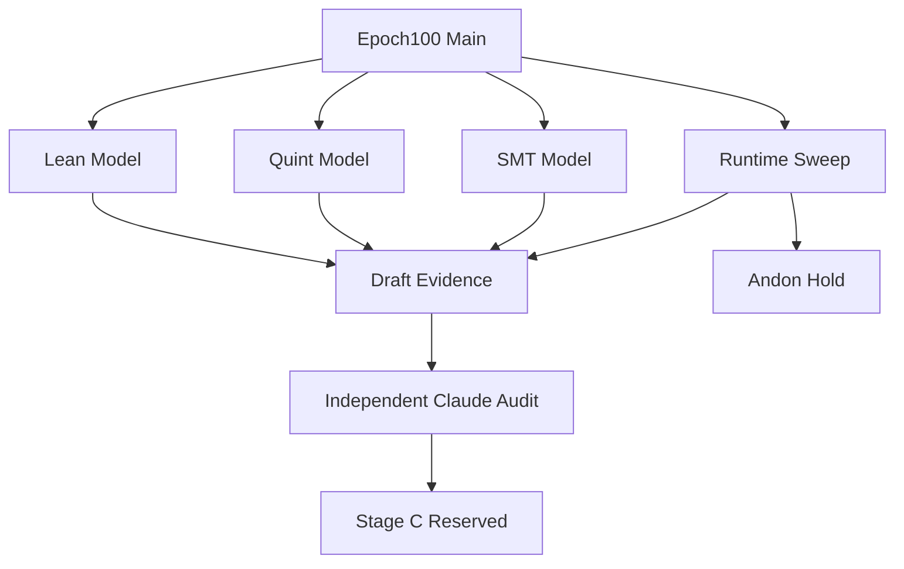

# 20261030-2215 — Formal and Mathematical Verification and GitHub Checkpoint Draft

- **Contract:** SC-JOURNAL-v 3; SC-RISK-CHECK-001; SC-HARNESS-MCP-001 Clause 9; SC-PROVENANCE-001.
- **Observed UTC:** 2026-10-30T21:37:43Z latest draft observation; exact command timestamps and chrony observations are retained in the machine receipt. The filename is the operator-requested checkpoint label, not a claim that the host clock observed 22:15 UTC.
- **Canonical authority:** Sa-plan `20261030-2215-formal-math-verify-and-github-checkpoint`, worker `agy-argon-sup-20261030-0844`. V01 analysis and V02 sweep completed; V03 executing for draft and independent review; V04 available and reserved. Task completion does not turn failed verification green.
- **Disposition:** **HOLD — full-suite failures and governance limits remain open.** No main advance, tag, push, capsule restage, service cutover, client configuration mutation or application source edit in Stage A. Stage C is separately authorized for a recovery checkpoint, with global system verification still HOLD.
- **Provenance:** `application_admitted = false`, `SYSTEM_ADMITTED = false`, `admitted_ev_ceiling = 93`; EV-94..EV-109 NOT_ADMITTED. No new EV number minted.
- **Navigation:** [Cockpit](http://nas-1.tail55d152.ts.net:4100/) · [Planning](http://nas-1.tail55d152.ts.net:4100/planning) · [Wiki](http://nas-1.tail55d152.ts.net:4100/wiki) · [ZK](http://nas-1.tail55d152.ts.net:4100/zk) · [Machine receipt](http://nas-1.tail55d152.ts.net:4100/files/docs/reviews/20261030-2215-formal-math-system-verification-receipt.json) · [This journal](http://nas-1.tail55d152.ts.net:4100/files/docs/journal/20261030-2215-formal-math-verification-and-github-checkpoint-journal.md).

#fractal-l 0 #fractal-l 1 #fractal-l 2 #fractal-l 3 #fractal-l 4 #fractal-l 5 #fractal-l 6 #fractal-l 7 #fractal-l 8 #fractal-l 9 #zk-adr #zero-muda #tailscale-web

Transclusions: [[wiki: 20261030-1058-unified-101-route-mcp-client-guide]] · [[zk:20261030-1058-adr-ak47-multi-agent-101-route-mcp-architecture]].

## 1. Scope & Trigger

Engine 5 formal boundary: the operator requested mathematical impact analysis, a comprehensive verification sweep and an auditable recovery checkpoint. Stage A deliberately stops before publication. The comparison `main@origin..main` contains 341 changed paths; current main is `981a668e839566aa2f784a371a602c55db1ebcb2`. New formal artifacts and documentation stay in its working-copy child for independent Claude Fable review.

Lean proofs, bounded Quint traces and SMT obligations describe explicit abstractions. They are not generated from the Gleam implementation, compiler extraction, cryptographic primitive proofs, scheduling guarantees, a new Gospel contract implementation, or system admission. Fresh source identity and live probes are separate evidence. Source inputs of the reviewed capsule remain pinned; failures are not repaired by silently changing application source or tests.

## 2. Pre-State Assessment

Engine 7 predictive prior: S01..S04 had completed under Epoch 100, with an OTP 29 capsule, six services, eleven four-agent configuration surfaces, and previously observed three-transport round-trips. Selected source suites had 526 passing tests, but that did not establish the state of the full application suite. The prior uncertainty set therefore included unexecuted broad Telegram integration paths, historical governance admission checks and production arrival rates.

A Kalman-style distinction separates observed coordinates from unknown ones; no numeric Kalman covariance or calibrated state estimator is asserted. The cockpit already returned HTTP 200 with `quorum_healthy=false`. The modern profile is `2026-07-28`; the legacy profile is `2024-11-05`. Compatibility alias handling remains unchanged in pinned source. Current prose cites canonical profiles; archived raw security-review JSON remains original evidence.

## 3. Execution Detail

Engine 6 Rete-UL boundary: canonical task operations and report-only risk observations controlled execution order; no new runtime scheduler or Rete admission enforcement was added. V01 preflight preceded its one-hour claim, active checks bound worker and attempt, and the same sequence governed V02 and V03. All planning mutations used `tools/sa-plan`; database observations were read-only.

V01 introduced 24 Lean theorems and checked 60 existing theorems across five canonical files. Five Quint safety invariants held for 200 bounded samples and 15 steps using seed 20261030. A deliberately false no-completion invariant produced a violation, and four deterministic transition controls passed. Existing parity and intent models typechecked and ran; their negative convergence control also failed as expected. Z3 returned `sat`, `unsat`, `unsat`; an independent evaluator checked 1024 Boolean assignments with 36 authorized witnesses and zero safety counterexamples. Two private mutants were rejected: removal of HMAC protection and removal of the live-owner condition.

Hermes Rete and parity executables passed 1 and 146 tests. V01 measured three stdio cold attaches and warm calls, twelve HTTP pings and eight Zenoh pings. Numeric public arguments produced JSON-RPC `-32600`; the invalid-request reply had a null ID, which required a single-outstanding-request correlation in the probe rather than a server change.

V02 ran full `gleam test` in all four requested applications. Cepaf finished with 14,139 passed and 115 failures. Web 43, swarm 702 and TUI 198 passed without failures. The separately selected 46 MCP/OTP/census/harness suites passed 526 tests, including 65 focused wiring cases; these overlapping counts are not added to the full-suite total. ZigVM passed 1121 tests. Four offline Rust storage tests confirmed protected-disk and serial rejection without touching live disks.

The default risk self-test wrapper rejected an ignored Dune build symlink. Temporarily moving that cache outside the inventory, running the same isolated self-test and restoring the cache yielded 375 checks; source was unchanged. `uos-cli preflight --receipt` only printed usage despite exit 0, so canonical `bash tools/preflight --receipt` was executed and produced 31 passing checks. Checklist and doctor retained their intentional HOLD results. The sweep task completed as an evidence collection task, with failures preserved and no readiness acceptance.

One web dependency `.app` build artifact changed during the authorized test run. It was restored byte-for-byte from the pre-test baseline. No `src`, `test`, manifest, toolchain input or immutable capsule file was edited. Final comparison checks all 3457 source-manifest inputs, not merely the six protected files.

## 4. Root Cause Analysis

Engine 1 ACH — Analysis of Competing Hypotheses. Scores 0=consistent,1=neutral,2=inconsistent. H1: broad integration prerequisites/guardian paths and governance inventory limits explain the non-green sweep. H2: corruption of the unified MCP core or active capsule explains it.

| Observation | H1 | H2 |
|---|---:|---:|
| Full suite reports 115 failures, with many named Telegram guardian/refusal cases | 0 | 1 |
| All 526 selected MCP/OTP/census/harness tests succeed independently | 0 | 2 |
| Three live transports return current canonical rows and negative auth controls hold | 0 | 2 |
| Capsule verification and all pinned input/control comparisons agree | 0 | 2 |
| Doctor reports 91 EV records without declared checkable artifacts | 0 | 2 |

H1 is the better bounded explanation, not a completed causal proof. No pre-change full-suite control at `main@origin` was run, so regression attribution remains UNKNOWN. The structured failure index retains 109 parsed named failures and six unparsed failure records against the runner's 115-failure summary. A representative symptom is `guardian_artifact_unavailable`; existence of a pinned file is not sufficient evidence that its guardian contract executes successfully. Those paths require separately scoped investigation, not a patch inside this pin-preserving stage.

## 5. Fix Taxonomy

Poka-Yoke: assert exact route counts and config pins, validate satisfiable SMT witnesses, require a Quint negative control, scan proof placeholders and compare all manifest inputs. Jidoka: retain 115 failures and governance HOLD, preserve unknown regression attribution, and reserve publication for independent audit. Muda reduction: reuse installed repository wrappers, bounded isolated solver processes and an explicit duplicate-count policy. No package download, source repair or secret-bearing command line was required.

The runtime's 30-second socket idle deadline and 60-second health freshness window are distinct. Lean models the ideal receive deadline separately from a normalized tuple-to-integer-slot encoding proof for an arbitrary freshness window. Distinct representations are compared after encoding; owner liveness is external to the real ERTS array. The proof does not establish simultaneous atomic-slot snapshots or scheduler response time. The Lean name `publicGatedUnavailable` accurately counts the 12 declared gated/unavailable tool definitions in `tools.unavailable_tools`, alongside 53 operational definitions. JSON-RPC protocol methods are separate from the 101 tool routes.

## 6. Patterns & Anti-Patterns Discovered

Engine 4 Devil's Advocate and Popperian falsification: exit 0 alone can be vacuous (`uos-cli` usage); a checker can run zero matching tests unless selection is explicit; and a high posterior mean can conceal serious failures. Four named Quint transition controls now execute explicitly. Expected mutant rejection and negative reachability violations establish checker sensitivity, not a new product defect.

The requested HTTPS Origin on port 4100 returns 403. The configured approved HTTPS Origin on port 4101 permits signed requests and yields the expected 401 challenge for a forged bearer. The live HTTP URL remains `http://nas-1.tail55d152.ts.net:4100/mcp`; origin policy is distinct from endpoint location. No allowlist was weakened.

Fresh four-agent evidence in this stage is eleven-file capsule/payload parity. Prior S04 native CLI tool-event evidence remains linked separately; it is not mislabeled as a fresh Stage A native invocation. Raw historical security reviews are not rewritten to change their observed alias data. Current Markdown uses only the canonical modern and legacy profile strings.

## 7. Verification Matrix

Engine 2 Admiralty / STANAG evidence grades: A2 for exact local checker/byte observations, B2 for bounded live behavior. Passing a component does not override a failed suite or sovereign admission boundary.

| Observation | Result | Grade | Evidence |
|---|---|---|---|
| New Lean impact model |24 theorems checked; no proof placeholders or declared postulates | A2 | [Lean scan](http://nas-1.tail55d152.ts.net:4100/files/var/harness/20261030-2215-formal-checkpoint/lean-scan.json) |
| Existing Lean files |60 theorems across five files checked | A2 | [prover receipts](http://nas-1.tail55d152.ts.net:4100/files/docs/reviews/20261030-2215-formal-math-system-verification-receipt.json) |
| Quint and SMT |Five bounded invariants hold; negative control violated; four deterministic controls; SMT sat/unsat/unsat | A2 | [machine receipt](http://nas-1.tail55d152.ts.net:4100/files/docs/reviews/20261030-2215-formal-math-system-verification-receipt.json) |
| Full cepaf run |14,139 passed;115 failures; exit 1 | A2 | [full log](http://nas-1.tail55d152.ts.net:4100/files/var/harness/20261030-2215-formal-checkpoint/test-cepaf_gleam.log) |
| Selected source suites |526 selected tests;65 focused subset; zero failures | A2 | [selected log](http://nas-1.tail55d152.ts.net:4100/files/var/harness/20261030-2215-formal-checkpoint/eunit-46.log) |
| Other applications, kernel, storage |Web 43, swarm 702, TUI 198, ZigVM 1121, storage 4; zero failures | A2 | [commands and counts](http://nas-1.tail55d152.ts.net:4100/files/docs/reviews/20261030-2215-formal-math-system-verification-receipt.json) |
| Services and transports |Six active/running, zero restarts;53 tools; real plan rows; bearer 401 and forged-HMAC silent drop with valid ping bracket | B2 | [runtime evidence](http://nas-1.tail55d152.ts.net:4100/files/var/harness/20261030-2215-formal-checkpoint/V02-services-health.json) |
| Immutable boundary |3457 source inputs,28 control-module md5 values and eleven config pins agree; protected admission md5 unchanged | A2 | [integrity](http://nas-1.tail55d152.ts.net:4100/files/var/harness/20261030-2215-formal-checkpoint/M1-integrity.json) |
| Governance |KM and 31-check canonical preflight verified; checklist and doctor HOLD; cache-isolated risk self-test 375 checks | A2 | [gate dispositions](http://nas-1.tail55d152.ts.net:4100/files/docs/reviews/20261030-2215-formal-math-system-verification-receipt.json) |

The 17-aspect disposition is bounded: scope, task/clock authority, source identity, tool locality, build execution, tests, model controls, artifact seal, service identity, transport authentication, client pins, secret hygiene, recovery retention, documentation and VCS boundary have observations. Manual GUI acceptance, production queue statistics, universal backend behavior and global admission remain UNVERIFIED.

## 8. Files Modified

| Deliverable | Purpose |
|---|---|
| `formal/lean/McpSymbiosis101FormalImpact.lean` |24 source-bound abstract safety theorems |
| `formal/quint/mcp_symbiosis_101_cutover.qnt` |Finite transition simulation, reachability and deterministic controls |
| `formal/z3/20261030-2215-mcp-symbiosis-impact.smt2` |Authorized witness and counterexample refutations |
| `docs/reviews/20261030-2215-formal-math-system-verification-receipt.json` |Exact commands, identities, calculations, failures and scope limits |
| This journal |13-section audit handoff and subsequent independent checkpoint PASS reference |
| `docs/reviews/20261030-2259-claude-formal-checkpoint-review.json` |Verbatim Claude Fable review and separately verified post-review precision refinements |
| Sixteen existing Markdown rule/guide/agent/skill/design/journal surfaces |Canonical profile citations; four rule mirrors remain byte-identical; historical review JSON preserved |

Private logs, baselines, backups and risk observations remain under the ignored evidence directory. Standalone Jujutsu records all intended changes in `@`; main remains Epoch 100. No native Git operation, recovery tag or origin push occurred. Application source and capsule inputs are excluded from the diff.

## 9. Architectural Observations

Engine 5 sheaf-presheaf/category consistency boundary: route identities are pairs `(plane,name)`. Their three tagged partitions are disjoint even where bare names overlap. The proofs, transition models and runtime probes are separate evidence projections joined by source digests; agreeing projections are not an automatic implementation-refinement theorem.

Editable ASCII and matching Mermaid source describe exactly the same nodes and edges. The diagram depicts the Stage A handoff boundary, when Stage C was unexecuted; the Andon node records unresolved global failures. The separately authorized Stage C publication outcome is recorded in `var/harness/20261030-2215-formal-checkpoint/stage-c-github-push-outcome.json`.

```text
[Epoch100 Main] --> [Lean Model]
[Epoch100 Main] --> [Quint Model]
[Epoch100 Main] --> [SMT Model]
[Epoch100 Main] --> [Runtime Sweep]
[Lean Model] --> [Draft Evidence]
[Quint Model] --> [Draft Evidence]
[SMT Model] --> [Draft Evidence]
[Runtime Sweep] --> [Draft Evidence]
[Runtime Sweep] --> [Andon Hold]
[Draft Evidence] --> [Independent Claude Audit]
[Independent Claude Audit] --> [Stage C Reserved]
```



## 10. Remaining Gaps

P0/P1b: public wire arguments accept string values only; `preflight_check({benefit:95,cost:5})` refuses with `-32600`. The Lean decoder theorem states precisely this boundary rather than claiming typed public decoding. Private typed argument preservation is a different path.

P1: 115 full-suite failures and unknown regression attribution remain open. Independent Claude Fable checkpoint review is now PASS and explicitly accepts these recorded limits for checkpoint publication. P2: checklist/doctor admission evidence is incomplete; the default risk-wrapper cache inventory fails; requested Origin 4100 is not approved; cockpit semantic quorum is false. Container/NIF fallback is retained as context, not independently established as the sole causal explanation of health in this stage. P3: measured cold attach latency and unmeasured production arrival/service distributions remain optimization work. Archived raw JSON review alias observations are retained, so a literal prohibition across historical structured review records is not claimed satisfied.

Stage A left V03 executing. The operator now authorizes Stage C V03 closure and a separately fenced V04 recovery checkpoint following Claude Fable 5.1 review. This journal, a model, a task count or an aggregate posterior alone grants no publication authority. No global admission or all-system-green claim is made.

## 11. Metrics Summary

Engine 3 Bayesian Beta-Binomial conjugate bookkeeping uses a Beta(1,1) prior. The primary non-duplicate V01/V02 groups contribute 16,733 successes and 115 failures, giving exact undecayed `Beta(16734,116)`. Group evidence decays with half-life 604800 seconds: `alpha = 1 + sum(w_i successes_i)`, `beta = 1 + sum(w_i failures_i)`, `w_i = 2^(-age_i/604800)`. The recorded evaluation gives mean approximately 0.993116 and a one-sided 95% credible lower bound approximately 0.992035. Exact observation groups, numerical values, quantile controls and CDF residual are in M3. Exchangeability and independent-trial calibration are unverified; this is an evidence score, not measured production reliability. The 115 failures remain blocking evidence regardless of the high mean.

M1: 53+12=65 and 65+21+15=101; all three tagged pairwise intersections are empty; eleven config pin checks and 28 control md5 comparisons agree. M2 uses a historical finding-count-squared defect metric: 49 -> 1 -> 0, deltas-48 and-1, local contraction rates 48/49 and 1, uniform rate 48/49. This is a retrospective review metric, not a physical runtime Lyapunov theorem or evidence that current global defect energy is zero. The 115 newly observed broad-suite failures are outside that old seven-finding series.

F7 complexity changes potential persistent-term literal-area work from Theta(N*K) to Theta(N)+Theta(K) atomic writes, with zero per-chunk persistent-term replacements and one publication per registered worker lifetime. This is a conditional cost model; no heap-scan or pause latency was measured.

M4 measured mean cold stdio attach 1746.02ms, warm HTTP ping 4.45ms and warm Zenoh RTT34.39ms in V01. Zenoh RTT includes a 30ms observation polling interval; it is not isolated server service time. An M/G/1 scenario at assumed lambda 1/s yields rho approximately 0.00445 for HTTP and 0.03439 for Zenoh using end-to-end latency proxies. Poisson arrivals, independent service times and actual production lambda are unmeasured. Pollaczek-Khinchine waits are scenario calculations, not measured production queue delays.

## 12. STAMP & Constitutional Alignment

Engine 6 STAMP controller: operator-scoped verifier; action: produce draft evidence. Four UCA types are recorded: not-provided checks omit safety evidence; unsafe-provided actions mislabel a proof or expose a secret; wrong-timing publication precedes audit; excessive duration lets subprocesses or authority outlive bounds. Controls are source-bound risk observations, bounded subprocess groups, explicit negative controls, immutable input comparisons and Stage C reservation.

SC-NIX-DEVENV-001 prover locality holds through repository-owned Lean, Quint and Z3 wrappers; OTP 29/ERTS 17.0.5 and pinned OCaml were observed. SC-JIDOKA-001 retains nonpassing results. SC-PROVENANCE-001 preserves the EV93 ceiling and false application/system admission. No live storage mutation, shared Zenoh deletion, service restart, secret log or native Git command was required.

<details><summary>Domain 1 — Metadata, timestamp and Tailscale navigation</summary>

- [x] **CHK-01-TIME** — Host UTC/chrony observations retained; operator filename label distinguished.
- [x] **CHK-02-TAIL** — Full Tailnet links provided; file serving is not assumed from link syntax.
- [x] **CHK-03-FRACT** — L0–L9 tags and bounded layer scope recorded.
- [x] **CHK-04-KM** — Wiki/ZK lineage and receipt links present.

</details>
<details><summary>Domain 2 — Zero-Muda purity and storage safety</summary>

- [x] **CHK-05-MUDA** —68 dependency manifests checked; zero forbidden dependency hits.
- [ ] **CHK-06-GRAPH** — No new foreign graph dependency; global graph/runtime proof UNRUN.
- [x] **CHK-07-DRIVE** —Four protected-drive/serial unit tests; no live disk operation.

</details>
<details><summary>Domain 3 — Testing and mathematical gates</summary>

- [ ] **CHK-08-C1C8** —Full suite non-green; manual browser acceptance UNRUN.
- [x] **CHK-09-MATH** —Four calculations/model gates completed with explicit assumptions and failed-test input.
- [ ] **CHK-10-9MOD** —Only named proof, simulation, differential, unit, runtime and mutation surfaces executed; no all-modalities claim.
- [ ] **CHK-11-REGR** —115 failures retained; pre-change full-suite regression attribution UNKNOWN.

</details>
<details><summary>Domain 4 — Cross-language control and observability</summary>

- [x] **CHK-12-GLEAM** —OTP 29, six services and authenticated transports observed.
- [x] **CHK-13-HERMES** —Rete/parity executable tests and bounded source-bound checker observations.
- [x] **CHK-14-ZIGVM** —1121 deterministic kernel tests; not universal BEAM parity.
- [ ] **CHK-15-MAX** —Inference daemon execution UNRUN.
- [ ] **CHK-16-OTEL** —Fleet trace propagation and production queue distributions UNRUN.

</details>
<details><summary>Domain 5 — Sovereign governance and standalone Jujutsu</summary>

- [x] **CHK-17-SOV** —Independent Claude Fable checkpoint audit PASS and operator Stage C authority recorded; application and global system admission remain false/NOT_ADMITTED.
- [x] **CHK-18-JJ** —Standalone working-copy child; main/tag/origin unchanged.

</details>
<details><summary>Domain 6 — Provenance extension</summary>

`application_admitted = false`; `admitted_ev_ceiling = 93`; EV-94..EV-109 NOT_ADMITTED. No new EV number minted. HTTP 200 and a passing component checker never establish sovereign system admission.

</details>

## 13. Conclusion

Engine 7 Forecast: precommitted Brier-scored prognostications with Horizon 1800 seconds are retained in the [forecast record](http://nas-1.tail55d152.ts.net:4100/files/var/harness/20261030-2215-formal-checkpoint/precommitted-forecasts.json): probability 0.80 that the first new-journal checker exits 0 and 0.95 that final capsule/input comparisons agree, each within 1800 seconds of the recorded commitment. Each observed binary outcome is scored as `(p-y)^2`. The first journal check exited 1 because the literal keyword heuristic missed the forecast phrasing, so that first-pass forecast has outcome 0 and Brier score 0.64. The wording was clarified without changing the checker or erasing the first failure. The source-parity forecast has outcome 1 and Brier score 0.0025 after capsule verification and all 3457 input comparisons agreed. The earlier one-hour transport-availability forecast remains pending its full horizon; successful point probes alone do not settle it. No calibrated forecast accuracy is inferred from these few observations.

Stage A provides mathematical models, sensitive controls, comprehensive execution receipts and a candid failure ledger. It does not provide an all-green system checkpoint: the full suite has 115 failures and governance remains HOLD. Independent Claude Fable 5.1 checkpoint review returned PASS with no blocking findings and approved tagging/pushing the candid recovery checkpoint; see the [verbatim review and post-review disposition](http://nas-1.tail55d152.ts.net:4100/files/docs/reviews/20261030-2259-claude-formal-checkpoint-review.json). This is checkpoint approval, not global system admission.

**UOS footer:** component evidence and completed verification tasks do not confer application or system admission.
