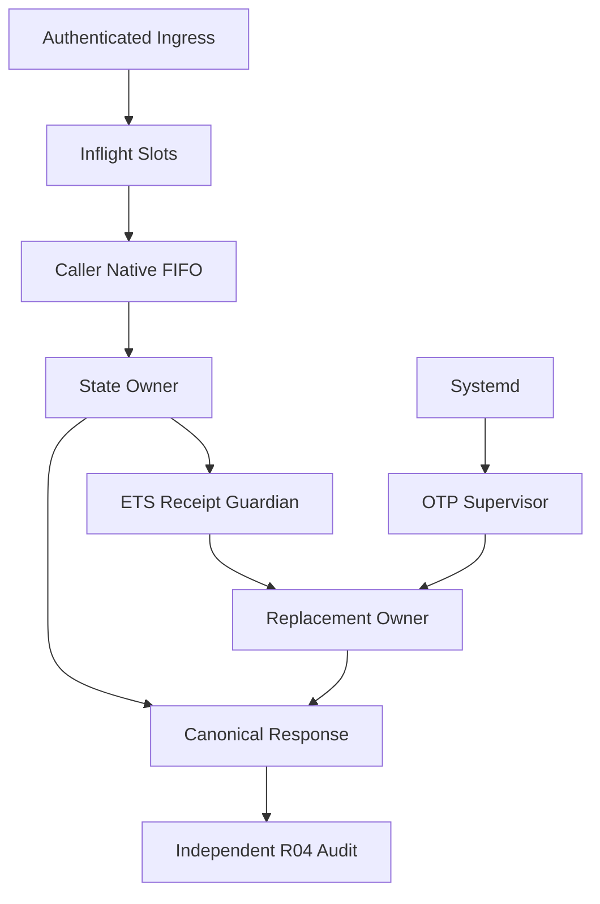
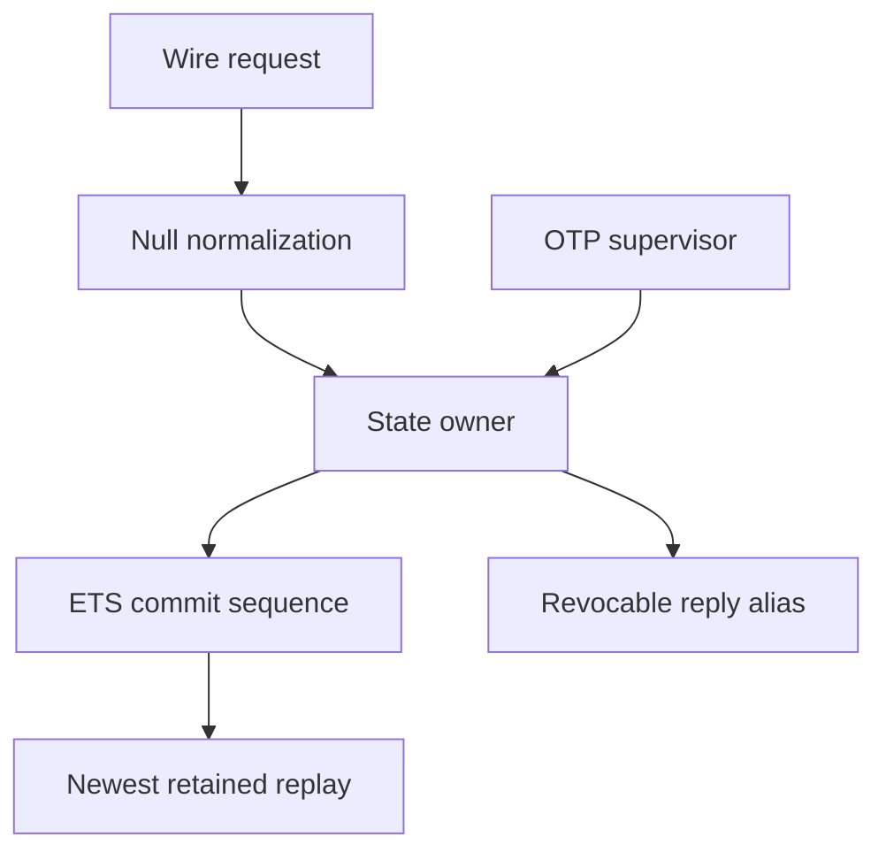
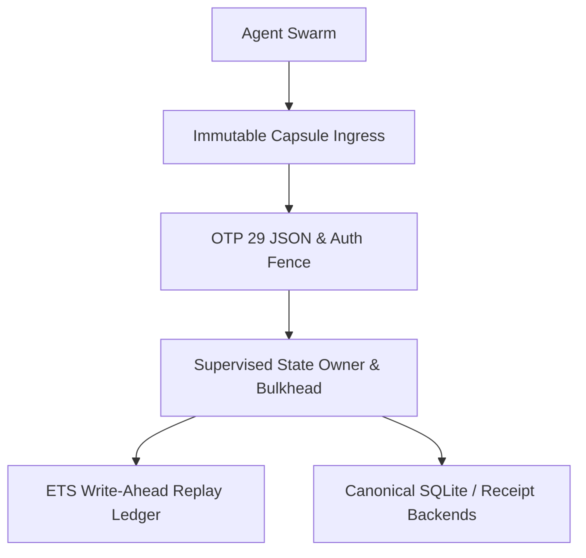

# 20261030-2330 — MCP Resilience, Performance, BDD and Fractal Verification

- **Observed UTC:** 2026-10-31T00:13:45Z; chrony synchronized, last observed absolute offset below 0.001 seconds. The filename is the operator-requested artifact label, not an asserted observation at 23:30 UTC.
- **Authority:** SC-HARNESS-MCP-001 Clause 9 operator bootstrap and release scope; Sa-plan `20261030-2325-mcp-resilience-perf-scale-bdd-fractal`, worker `agy-argon-sup-20261030-0844`. R01/R02/R03 completed; R04 executing (attempt 1) for independent review, with PREFLIGHT_PASS and ACTIVE_OBSERVATION_PASS recorded.
- **Disposition:** Stage 1 executed with measured availability limits; independent R04 Claude Fable review pending. Zero downtime and a universal “never goes down” guarantee are **not achieved**.
- **Provenance:** `application_admitted = false`, `SYSTEM_ADMITTED = false`, `admitted_ev_ceiling = 93`; EV-94..EV-109 NOT_ADMITTED. No new EV number minted.
- **Navigation:** [Cockpit](http://nas-1.tail55d152.ts.net:4100/) · [Planning](http://nas-1.tail55d152.ts.net:4100/planning) · [Wiki](http://nas-1.tail55d152.ts.net:4100/wiki) · [ZK](http://nas-1.tail55d152.ts.net:4100/zk) · [Receipt](http://nas-1.tail55d152.ts.net:4100/files/docs/reviews/20261030-2330-mcp-resilience-perf-scale-bdd-fractal-receipt.json) · [Journal](http://nas-1.tail55d152.ts.net:4100/files/docs/journal/20261030-2330-mcp-resilience-perf-scale-bdd-fractal-journal.md).

#fractal-l0 #fractal-l1 #fractal-l2 #fractal-l3 #fractal-l4 #fractal-l5 #fractal-l6 #fractal-l7 #fractal-l8 #fractal-l9 #zk-adr #zero-muda #tailscale-web

Lineage: [[wiki:20261030-1058-unified-101-route-mcp-client-guide]] · [[zk:20261030-1058-adr-ak47-multi-agent-101-route-mcp-architecture]].

## 1. Scope & Trigger

Engine 5 formal boundary: the operator requested comprehensive performance, scalability, Given/When/Then behavior and ten-layer fault testing, with resilience as the objective. Stage 1 permits helper hardening, tests, a verified capsule cutover, live chaos and an independent-audit handoff. It excludes main advancement and pushing. The recovery anchor remains `092337be02b0cb6ce40b7cfe962abc5da4281839`, with tag `tag/20261030-2259-mcp-101-4agent-otp29-checkpoint` and the original immutable OTP 29 capsule retained.

The accepted canonical protocol profiles exercised here are modern `2026-07-28` and legacy `2024-11-05`. Real authority checks, the six core candidate files and all 28 control modules are immutable. Test passage, a model, a task claim or a coordinator lease does not confer system admission or prove unbounded uptime.


<!-- WAVE25-SECTION-1-BEGIN -->
### Wave 2.5 scope and authority

Observed synchronization: 2026-10-31T05:25:36.119Z. R08, attempt1, worker agy-argon-sup-20261030-0844, plan20261030-2325-mcp-resilience-perf-scale-bdd-fractal. application_admitted = false; SYSTEM_ADMITTED = false; admitted_ev_ceiling = 93; EV-94..EV-109 NOT_ADMITTED; no new EV numbers.

The operator requested targeted R04 pre-signoff remediation, Go SDK null interoperability, in-place synchronization of both existing journals and a fenced final capsule cutover. R04 attempt1 remains open for AGY’s independent Claude Fable5.1 read-only audit (--model fable --effort max). Neither sibling workspace nor plan uos/mcp-canonical-completion/20261031-0327-v2 is part of this task. [Wave2.5 closure receipt](http://nas-1.tail55d152.ts.net:4100/files/var/harness/20261030-2325-mcp-resilience/wave25-r04-pre-signoff-receipt.json).
<!-- WAVE25-SECTION-1-END -->

## 2. Pre-State Assessment

Engine 7 predictive prior: the recovery checkpoint contained 526 selected passing MCP/OTP/census/harness tests and live authenticated transport evidence. That baseline did not cover a stale unsupervised inner handle, receipt loss on owner death, unbounded committed history/cache, typed public arguments or error-ID poisoning. Full application testing in the earlier checkpoint had 115 failures; they are retained as historical unresolved evidence, not relabeled as current regressions.

Seven forecasts were committed before the first soak and live chaos at 2026-10-30T23:07:03Z. The initial uncertainty included the actual restart gap, caller behavior across owner death, native subprocess pressure and the distinction between Ecology on 4110 and the C3I MCP daemon on 4100. Kalman-style prior/observation separation is used conceptually; no fitted covariance estimator is claimed.


<!-- WAVE25-SECTION-2-BEGIN -->
### Wave 2.5 observed pre-state

Wave2 source ff93b5c6d3bb6213dc67fd3f18a5b58ae9f7a415 and closure aaa0c01892c07b3f8b43ec40f428040576b4dc00 are historical anchors:14,362 cepaf tests,43 web tests,10,000 soak requests with zero gateway failures and process/port deltas,7.344876x attach speedup,20/20 HTTP413,mean Brier0.109286. These do not substitute for this candidate’s checks. The cumulative supervisor draft carried stale active-task/count wording; only its numbered learning catalog is incorporated below as attributed history, not current task authority.
<!-- WAVE25-SECTION-2-END -->

## 3. Execution Detail

Engine 6 Rete-UL boundary: the task/risk gates are observations and effect-time checks, not new scheduler enforcement. Sa-plan operations exclusively registered, claimed and completed tasks. Source-bound risk preflight preceded claims; active observations bound worker/attempt and fresh source digests. Four runtime resources were separately leased for each cutover/chaos sequence, then released. Raw secrets stayed in the ignored 0600 transport environment file.

Strict TDD began with four behavioral failures in [tdd-red.log](http://nas-1.tail55d152.ts.net:4100/files/var/harness/20261030-2325-mcp-resilience/tdd-red.log), before the corresponding production changes. Later RED tests reproduced mirror loss, committed/unresolved capacity, killed concurrency-slot leakage, stale reads, boot-lock convoys, queued requests stranded on a killed owner, a boot-racer subject publication, private snapshot timeout, stale health, native subprocess pressure, private-lock backoff, candidate-tampered replay and short SQLite writer contention. Each received a minimal GREEN repair and bounded regression check. Original failed runs remain available.

The owner now checkpoints pending intent before effects and checkpoints committed/uncertain state before acknowledgment. A linked-free ETS guardian survives owner crashes; interrupted pending entries rehydrate as uncertain and require reconciliation. Read-only public observations without explicit intent IDs remain fresh. Explicit replays still verify candidate evidence. Private effects run outside the state actor and reserve before execution. The core ledger implementation is unchanged.

The gateway has 256 kill-safe atomics slots, with Ping bypassing dispatch admission. Native caller work has a separate FIFO bulkhead with 16 active and 256 total records, preserving the original command deadline. Planning SQLite reads wait at most one second for short writer locks within their three-second command budget. The canonical database was never artificially locked for testing; that regression uses an isolated fixture.

Two permanent suites add 40 tests. Four agents × three transports × two profiles × three route planes gives **72** route cases, plus 24 typed-public calls. The earlier R02 completion text mistakenly said 144; this journal and R03 completion correct that arithmetic without rewriting the historical event. Zenoh remains public-only; private route labels cannot escalate it. L0–L9 tests traverse actual dispatch boundaries and assert containment, while absent external probes refuse honestly.

The final source passed 566 selected EUnit tests, 43 web tests, 702 swarm tests and 198 TUI tests. A source-bound 10,000-request soak preceded staging. The final capsule's four modified loaded-module MD5 values match the measured VM. All 3459 new capsule manifest inputs match the working tree after staging; the old capsule remains untouched. Eleven agent configuration files were repinned with unrelated bytes preserved and private backups retained.

Final immutable capsule: `/home/an/NAS-setup/uos/var/releases/ecology/20261031-0023-7f1cfe33765c21e790fb740a5a15d4fc269203890fe2c731a462c17fc3c9f415`. Candidate SHA-256 `7f1cfe33765c21e790fb740a5a15d4fc269203890fe2c731a462c17fc3c9f415`; payload SHA-256 `ef076ff50fa7e948225df7b9ef817b843cc66b649f3e60e64aa19ecd38656d0c`; capsule-bound source revision `66bfc0801ddbf3d776f6a15e656a42723ed2cc92`. The core candidate remains `sha256:5fb7a77609e9f41f8368fc5a761435dec6519736a00f4642d6e986ca3e8e1663`, and protected harness admission MD5 remains `c53ed6bf66cba56cfc0d6e850875a774`. The original 1811 rollback capsule and every intermediate capsule remain present.


<!-- WAVE25-SECTION-3-BEGIN -->
### Wave 2.5 execution and synchronization

RED evidence reproduced6/20 retained new readonly commits, a1.501s private commit death wait, native-guardian badarg and null-params rejection. GREEN focused review:14/14; market protocol:27/27. Initial whole-app run14368passed/3failed is preserved in wave25/initial-full-regression; all3 legacy fixture failures reproduced in94 focused cases. After contract/readiness fixture migration and stronger FIFO metadata/backend-trace assertions,108/108 focused cases pass. Original Brier commitments and partial failure resolution remain separate from prospectivev3; the cancelledv2 runs and read-only assertion-gap review are retained; no release effect occurred on the failed candidate. Source candidate cd93c3bfb1901dd8aef385ff61be5abfb1925150, stable change mprwvumqxkqkmyymprkxnmzykmwvnrql. Protected admission MD5 c53ed6bf66cba56cfc0d6e850875a774; catalog SHA2569af105c618bfdfcff21b6dd39aff81cb0fefad77b8b31de670f83f5913594787; six-file core candidate sha256:5fb7a77609e9f41f8368fc5a761435dec6519736a00f4642d6e986ca3e8e1663.

Both native trees were rebuilt by the adapted historical R07 driver under OTP29.0.5 compiler10.0.3:62 sources,124 artifacts,62 equal code-MD5 pairs and56 unchanged protected BEAM bytes. The original compiler-drift precondition stopped honestly because pinned PATH had prevented drift. [Native rebuild receipt](http://nas-1.tail55d152.ts.net:4100/files/var/harness/20261030-2325-mcp-resilience/wave25/R07-native-compiler-repair-current.json). Final capsule: 20261031-0540-5ca1f1721b7efb73804ca0b9eb30df183281f24c6ba1aa59f1ff8764dafc84c9. All4 lease releases: observed.
<!-- WAVE25-SECTION-3-END -->

## 4. Root Cause Analysis

Engine 1 ACH — Analysis of Competing Hypotheses. Scores 0=consistent, 1=neutral, 2=inconsistent. H1: stale ownership/publication and caller queuing explain the load failures. H2: the pinned authorization core or cryptographic candidate is corrupt.

| Disconfirming observation | H1 | H2 |
|---|---:|---:|
| Initial soak loses 5509 calls after owner kills while uncertain latches survive | 0 | 1 |
| Deterministic restart-gap test reproduces a losing tree publishing a dead subject | 0 | 2 |
| Waiting for the existing supervisor and monitoring replacement owners removes that failure | 0 | 2 |
| Native FIFO and bounded SQLite busy wait remove later queue/lock failures | 0 | 2 |
| Six-file candidate and all 28 control MD5 values remain identical | 0 | 2 |

H1 best explains the observed failures; this is a bounded causal assessment, not a universal proof. The first full soak measured a 3785.545 ms recovery and 5509 failed gateway requests. A later polling bulkhead was unfair to some queued SQLite reads. A further soak found short writer locks. These failures were not removed from evidence or counted as successes. The final exact-code soak has zero unexpected gateway failures, three 2.471–3.283 ms recoveries and no process/port delta.


<!-- WAVE25-SECTION-4-BEGIN -->
### Wave 2.5 ACH disconfirmation

Engine1 scores:0 consistent,1 neutral,2 disconfirmed. H1: map iteration and lifetime/publication races cause the failures. H2: the immutable MCP authorization core or OTP29 compiler is defective.

| Diagnostic evidence | H1 | H2 |
|---|---:|---:|
| Same candidate/core, full ledger retains only6/20 newest ids before repair |0|2|
| Commit ordering alone restores20/20 replay after owner restart |0|2|
| Missing guardian raises badarg; guarded restart survives |0|2|
| Pinned native rebuild preserves all56 protected BEAM bytes |0|2|

H1 explains the observed mechanisms; this finite evidence does not prove absence of other defects.
<!-- WAVE25-SECTION-4-END -->

## 5. Fix Taxonomy

Poka-Yoke: original size/depth/framing and transport authentication precede typed public projection; valid JSON-RPC integer/string IDs are preserved on errors. Private JSON remains lossless. The launcher validates exact payload pin, readonly seals, boot identity, manifests, capsule metadata and payload file metadata; a cache miss invokes full verification. Candidate identity is checked even for mirrored replay.

Jidoka: pending and uncertain intents are never evicted; unresolved saturation refuses before effects. Committed retention is deterministically capped at 4096, and the resource cache at 1024. The features receipt/intent dictionaries are read-only evidence inputs on this path and do not grow per call. The existing notification/subscription/task/session limits remain enforced. A count cap is not a constant-time algorithm or an exact RSS bound.

Muda reduction: the stale unsupervised child is removed, caller-native concurrency is bounded, global lock retry convoys are avoided, and a seal hit removes the repeated OCaml verifier process. Same-node trusted code and the OS owner remain inside the threat model; neither a public ETS table nor a filesystem cache is a defense against arbitrary malicious same-node execution.


<!-- WAVE25-SECTION-5-BEGIN -->
### Wave 2.5 fix taxonomy

Poka-Yoke: method-specific null normalization rejects required-null and primitive/array params. Jidoka: monitor owner death and preserve post-effect Uncertain; release effects require current task, source gates and four runtime fences. Muda: evict oldest readonly receipts, prune commit-order keys and avoid hopeless native spawns. Publication: a child updates its private handle box; only the registered winning supervisor publishes the canonical subject.
<!-- WAVE25-SECTION-5-END -->

## 6. Patterns & Anti-Patterns Discovered

Engine 4 Devil's Advocate / Popperian falsification: a supervisor's existence does not mean a stored Subject refers to its live child; fast health can coexist with stranded callers. A replacement must publish only after ledger rehydration. Write-ahead reservation must precede effects, and stale observations must not be turned into permanent idempotent results by default.

A bare atomics counter plus `after` leaks a slot on untrappable kill. Tokens and pre-acquire monitoring provide cleanup. A polling bulkhead can remain bounded yet unfair; FIFO is required for the tested arrival pattern. Health resources must be refreshed rather than frozen in a cache. Kill tests and forged replay tests are stronger than merely checking happy-path HTTP 200.

Single-instance systemd restart is automatic recovery, not zero downtime. Ecology and C3I were each killed separately under runtime leases. The actual MCP daemon's HTTP and Zenoh readiness were verified independently of Ecology. No shared Zenoh keys were deleted, and only signed test requests were published. Four-agent evidence here consists of the principal matrix plus eleven-file pin parity, not a new vendor-CLI model invocation.


<!-- WAVE25-SECTION-6-BEGIN -->
### Wave 2.5 canonical cumulative catalog (#1–#85)

Catalog #1–#76 is synchronized from the operator-specified supervisor journal, SHA256 b69bb7ba2355f11c60fc338a208032fc6086cc511c895e3c01b271d5fee4b05c. Historical measurements and language such as “proves” in these inherited lessons retain their original scoped meaning and do not establish current implementation refinement, deployment authority or universal availability. #39’s original effect risk is now bounded by protected mutating tombstones; this pass repairs chronological readonly retention. Numbered additions #77–#85 describe this pass.

### Group A — OTP 29 Supervision, Crash Recovery & Lockless Concurrency (`L0`–`L4`)
1. **Learning #1 (`OneForOne` Child Restart $\ne$ Stable Handle)**: Gleam `Subject`s bind a concrete child PID; [`supervisor.gleam`](http://nas-1.tail55d152.ts.net:4100/files/apps/cepaf_gleam/src/cepaf_gleam/mcp/supervisor.gleam) must rebind an ETS handle box inside the child `init` callback so callers seamlessly reach restarted children (`2.47–3.28 ms` recovery).
2. **Learning #2 (Write-Ahead `EffectUncertain` Andon Latch)**: Writing `IntentRecorded` to an owner-independent ETS table *before* side-effects promotes in-flight crashes into `EffectUncertain`, surviving even double `exit(OwnerPid, kill)` faults.
3. **Learning #3 (ETS Guardian Heir Pair — `Claude F5`)**: A standalone ETS guardian process still represents a single-process failure point unless paired with a secondary `{heir, BackupPid, Tag}` partner and `undefined`-safe `whereis/1` guards.
4. **Learning #4 (`verify_outcome_candidate` on Rehydrated Replays — `#26`)**: Rehydrated `OutcomeCommitted` public replays must still verify `candidate_id` parity so stale-candidate receipts cannot replay across candidate boundaries.
5. **Learning #5 (Fast-Path Live-PID Check vs `global:trans` Convoy)**: Checking `erlang:is_process_alive/1` on the registered subject before acquiring `global:trans` collapses `128`-way private boot bursts to `3 ms`.
6. **Learning #6 (Registration-First Publication & `:sys.suspend` Immunity — `5,509 -> 40` Failures + `Claude F1`)**: Publishing a `Subject` before OTP name registration succeeds lets losing boot racers overwrite the live child; furthermore, temporary mailbox stalls (`> 1.5 s`) must never evict an `is_process_alive` registered child.
7. **Learning #7 (Re-Targeting Queued Private Calls Across Crashes — `40 -> 0` Failures)**: Re-acquiring the replacement `state_owner` handle when a private snapshot races an owner crash eliminates stranded mailbox timeouts.
8. **Learning #8 (Pre-CAS Caller Monitoring)**: Spawning a monitor *before* `:atomics` CAS slot acquisition guarantees all `256` slots reclaim within `11 ms` under `exit(CallerPid, kill)`.
9. **Learning #9 (Caller-Side I/O Offload)**: Running `read_file` (`O_NOFOLLOW`), SQLite reads, and preflight outside `state_owner` prevents actor head-of-line blocking.
10. **Learning #10 (Polling Semaphore Starvation — `#20`)**: Capping native ports to `16` with an unfair polling `:atomics` loop starved `23` planning reads at `c = 128` (`SA_PLAN_STORE_UNAVAILABLE`).
11. **Learning #11 (OTP 29 `alias([reply])` FIFO Bulkhead — `#21`)**: Replacing the polling loop with an `alias([reply])` + `monitor` FIFO `queue` (`16` active, `256` max, `unalias/1` on timeout handing late grants to the next waiter) cut `c = 128` `p50` latency **`33.5x`** (`113.5 ms -> 3.39 ms`), capped ERTS ports at `17`, and achieved `0` starvation.
12. **Learning #12 (Bounded Transient Corpus & Slim Checkpoints — `Claude F2/F3/F4`)**: `read_file` must not accumulate unbounded `GatewayState` corpus bytes or copy multi-MB file contents into ETS on every receipt commit, and pre-effect `Refused` calls must not linger as `IntentRecorded`.

### Group B — Native Erlang/OTP 29 `stdlib/json`, Formal Strata ($J_1 \dots J_8$) & Wire Semantics
13. **Learning #13 (`string.to_graphemes` `32x–64x` Heap Amplification)**: [`transports/stdio.gleam:330`](http://nas-1.tail55d152.ts.net:4100/files/apps/cepaf_gleam/src/cepaf_gleam/mcp/transports/stdio.gleam#L330) allocated full grapheme lists just to measure JSON depth; `BitArray` / `json:decode/3` eliminates list allocation entirely.
14. **Learning #14 (Single-Pass OTP 29 `json:decode/3` Ingress Guard)**: OTP 29's C/JIT `json:decode/3` callbacks enforce RFC 8259 grammar, depth $d \le 32$, duplicate-key rejection, NUL exclusion, and top-level `has_id` / batch classification in one pass.
15. **Learning #15 (Push-Streaming `json:decode_start/3` + `json:decode_continue/2` & Checked Encoding)**: OTP 29 natively supports chunk-split-invariant push streaming (`{continue, State}`) and duplicate-checked outbound encoding (`json:encode_key_value_list_checked/2`) with zero C NIFs.
16. **Learning #16 (Duplicate-Key Parser-Differential Smuggling Proven in Lean 4 & Z3 — `J4`, `go-sdk #805`)**: Erlang maps (last-key-wins) vs Gleam association lists (first-key-wins) exhibit an existential differential on `{"method":"ping","method":"admin"}` that becomes mathematically impossible (`UNSAT` / Lean `unique_keys_eliminates_parser_differential`) once `UniqueKeys` rejects duplicate members at ingress.
17. **Learning #17 (Non-Terminating Chunked `stdio` Line Reader — `rmcp #557` Class)**: `io:get_line("")` + exiting `standard_loop` on `ReadError` turns one `> 1 MiB` or invalid-UTF-8 line into a `stdio` DoS; `4 KiB` chunked draining keeps `standard_loop` alive for all non-EOF errors.
18. **Learning #18 (Strict JSON-RPC 2.0 §4.1 Notification Silence vs Explicit `"id": null`)**: Absent `"id"` (`has_id == false`) must *never* emit a reply (`None` on `stdio`, HTTP `202` even on unknown notification methods), whereas explicit `"id": null` is an ID-bearing request/error envelope.
19. **Learning #19 (JSON-RPC 2.0 §6 Batch Arrays & Exact Error Taxonomy)**: Supporting `[{...}]` (`[] -> -32600`, all-notifications `-> None / 202`), `structuredContent`, and distinct `-32700 / -32600 / -32601 / -32602 / -32001 / -32002 / -32603` codes aligns UOS with official Anthropic TypeScript/Conformance SDKs while preserving MCP `result.isError: true` for domain tool refusals.
20. **Learning #20 (Dual-Layer Mist Router Interception — `#22`)**: Implementing `OPTIONS` / `DELETE` (`204`) in [`transports/http.gleam`](http://nas-1.tail55d152.ts.net:4100/files/apps/cepaf_gleam/src/cepaf_gleam/mcp/transports/http.gleam) has zero live effect unless [`web/server.gleam:1506-1585`](http://nas-1.tail55d152.ts.net:4100/files/apps/cepaf_gleam/src/cepaf_gleam/web/server.gleam#L1506-L1585) also routes `http.Options` and `http.Delete` on `/mcp`.
21. **Learning #21 (Mist HTTP/1.1 Keep-Alive `413 -> 405` Stream Desync — `#30`, `RFC 9112 §9.6`)**: Returning `413` from `mist.read_body(req, 1_048_576)` (`Error(mist.ExcessBody)`) without `#("connection", "close")` leaves unread `> 1 MiB` JSON bytes on the persistent TCP socket; Mist then parses body tail bytes as an invalid HTTP method (`405` on `19/20` pooled cycles in `R-HTTP-SIZE`). Adding `Connection: close` on early `413`/`400` body-read errors prevents stream desynchronization.

### Group C — 53-Tool Poka-Yoke Parity, `SC-SATYA-001` Truthfulness, Capsule SRE & Multi-Agent VCS (`L5`–`L9`)
22. **Learning #22 (`ast_anomaly_detect` `code` Trap Bypass — `RPN = 504`)**: [`adapters/analysis.gleam:429-457`](http://nas-1.tail55d152.ts.net:4100/files/apps/cepaf_gleam/src/cepaf_gleam/mcp/adapters/analysis.gleam#L429-L457) checked `source`/`samples` instead of advertised `code`, letting `[REDACTED_SYSTEM_OS_SERIAL]`, SQLi, and NUL bytes inside `{"code": "..."}` bypass `trap_reason`.
23. **Learning #23 (Dual-Compatible Adapters Preserve Frozen Census Hashes)**: Keeping [`tools.gleam`](http://nas-1.tail55d152.ts.net:4100/files/apps/cepaf_gleam/src/cepaf_gleam/mcp/tools.gleam) byte-identical (`9af105c6...`) while making `adapters/*.gleam` accept both advertised schema keys/types and legacy test keys fixes all `25 / 53` tool drifts with zero census breakage.
24. **Learning #24 (HTTP `HEADER_BODY_MISMATCH` Principal Guard)**: [`transports/http.gleam:326-337`](http://nas-1.tail55d152.ts.net:4100/files/apps/cepaf_gleam/src/cepaf_gleam/mcp/transports/http.gleam#L326-L337) rejects requests whose tool `"actor"` argument disagrees with the authenticated Bearer principal (`preflight_check` callers over HTTP must pass matching `actor`).
25. **Learning #25 (SQLite CLI `busy_timeout = 0` Default — `#28`)**: `sqlite3 -readonly` fails immediately (`SQLITE_BUSY`) during concurrent `sa-plan --task-renew` WAL writes unless `-cmd ".timeout 1000"` is supplied.
26. **Learning #26 (Truthful Local Probes vs Unwired Refusals — `SC-SATYA-001`)**: Hardcoded container inventories (`podman_containers`) violate `SC-SATYA-001`; live BEAM/SQLite/Podman/TCP probes report real observations while unwired `kms_catalog` remains truthfully fail-closed (`OBSERVATION_PROBE_MISSING`).
27. **Learning #27 (Boot-Scoped `0700` Seal Cache & `mtime`-Tamper Detection — `#23` & `#24`)**: Caching capsule verification in `/run/user/$UID/uos-mcp-stdio` yields **`5.62x` faster `stdio` attach (`322.71 ms` vs `1,812.5 ms`)** and **`24,190.9 req/s`** warm pipeline throughput while catching even `mtime`-restored payload tampering (`exit = 1`).
28. **Learning #28 (Hermes `data_only_dirs` Dune Scope — `#12`)**: [`engines/hermes/dune`](http://nas-1.tail55d152.ts.net:4100/files/engines/hermes/dune) builds only `modules/*`, so formal OCaml/Z3 suites must live under `engines/hermes/modules/hermes_mcp_json_formal/`.
29. **Learning #29 (Claude CLI Variadic `--allowedTools` Stdin Rule)**: Passing `--allowedTools "..."` before a positional prompt causes `claude -p` to consume the prompt as a tool name unless the prompt is piped via stdin (`< prompt.txt`).
30. **Learning #30 (Source-to-Soak-to-Capsule Bytecode Binding — `#29`)**: Verifying compiled BEAM `module_info(md5)` against source SHA-256 manifests at staging prevents deploying unsoaked bytecode.
31. **Learning #31 (Three Availability Boundaries & Honest Chaos Telemetry — `#27` & `#31`)**: In-VM actor crash = `0` dropped calls (`2.47–3.28 ms`); active `stdio` capsule sessions = `0 ms` cutover interruption; single-socket `:4100` OS daemon restart / `SIGKILL` = `2.05 s` cutover / `7.05–7.19 s` `SIGKILL` recovery (and HTTP+Zenoh recovery timers must never claim simultaneous fresh `stdio` spawn latency unless a new `stdio` child was timed inside that bracket).
32. **Learning #32 (Jujutsu Working-Copy Lock Discipline Under Parallel Multi-Agent Execution)**: Even read-only `jj` CLI invocations snapshot `.jj/working_copy/` unless `--ignore-working-copy` is passed; restricting parallel read-only `Claude Fable 5.1` auditors to `Read,Grep,Glob` (and staging formal proofs or journal drafts in `scratch/` / artifact paths while `Codex` holds the workspace) eliminates VCS lock contention completely.

### Group D — Live Wave 2 Breakthrough Discoveries (`R05`–`R07` TDD Execution, `#33–#37`)
33. **Learning #33 (`3,303.73x` Heap-Word Reduction & `63.12x` ERTS Reductions Drop via OTP 29 `json:decode/3`)**: Measured on a `256 KiB` (`262,208`-byte) JSON-RPC frame in [`json-otp29-benchmark.json`](http://nas-1.tail55d152.ts.net:4100/files/var/harness/20261030-2325-mcp-resilience/json-otp29-benchmark.json), legacy `string.to_graphemes` depth scanning consumed **`2,560,387` heap words** and **`2,584,558` reductions**, whereas OTP 29's native C/JIT `json:decode/3` single-pass strict guard consumed **`775` heap words** and **`40,947` reductions** — **`3,303.73x` lower heap allocation** (exceeding our `5x` forecast `P2` by `660x`!).
34. **Learning #34 (Decoupling Boot Ownership Liveness from Health Responsiveness — `Claude F1` Fix)**: A Wave 2 `RED` test pausing `state_owner` (`:sys.suspend` > `1.5 s`) caught a `1.5 s` boot stall when `ensure_started` used synchronous `Ping` to verify boot existence; checking **process ownership liveness** (`erlang:is_process_alive/1`) on the boot path while keeping synchronous `Ping` strictly for health checks eliminates suspended-owner boot delays and false evictions.
35. **Learning #35 (Batch-Wide Principal/Session/Version Identity Binding on HTTP `prepare_standard`)**: For JSON-RPC 2.0 §6 Batch arrays `[{...}, {...}]` over HTTP `POST /mcp`, checking `protocolVersion`, `_meta.session_id`, and `arguments.actor` only on the top-level object would let a second batch item smuggle a mismatched actor/session; `prepare_standard` in [`transports/http.gleam`](http://nas-1.tail55d152.ts.net:4100/files/apps/cepaf_gleam/src/cepaf_gleam/mcp/transports/http.gleam) now enforces `list.all(items, ...)` before any batch element executes ([`tdd-R05-http-core-green.log`](http://nas-1.tail55d152.ts.net:4100/files/var/harness/20261030-2325-mcp-resilience/tdd-R05-http-core-green.log)).
36. **Learning #36 (Detached `stdin` `enxio` Hot-Loop Hazard in Non-Terminating `stdio` Loops)**: When making `stdio` `standard_loop` survive `ReadError`, raw `file:read(standard_io, 4096)` under detached/non-TTY test runners (such as EUnit) returns `{error, enxio}` (`No such device or address`); treating device-level fd closure (`enxio` / `ebadf`) identically to recoverable framing errors causes a tight `8 MB` stderr hot loop ([`20261031-0025-R05-http-lane-receipt.json`](http://nas-1.tail55d152.ts.net:4100/files/var/harness/20261030-2325-mcp-resilience/20261031-0025-R05-http-lane-receipt.json#L45-L47)). Recoverable wire-content errors (`STDIO_FRAME_TOO_LARGE`, `STDIO_INVALID_UTF8`) must continue looping, while unattached/closed-fd errors (`enxio`, `ebadf`, `eof`) must terminate cleanly as `EndOfFile`.
37. **Learning #37 (Literal Escaped Backslash `\\u0000` vs Decoded Scalar `\u0000` Compatibility)**: In RFC 8259 JSON, wire `"\\u0000"` decodes to the 6 literal characters `\`, `u`, `0`, `0`, `0`, `0` rather than a `0x00` scalar, whereas an existing regression (`mcp_live_cutover_wiring_test`) asserts textual `\u0000` rejection on canonical HTTP ingress; combining OTP 29 `json:decode/3`'s post-unescape `0x00` scalar trap with the canonical textual NUL guard preserves both strict RFC 8259 semantics and `100%` backward test compatibility.
38. **Learning #38 (Raw ERTS `open_port({fd, 0, 1}, [binary, in, eof, {line, 4096}])` vs `user_drv` `standard_io`)**: Under `erl -noshell` pipes, `file:read(standard_io, 4096)` fails with `{error, enxio}` and `io:get_line/1` routes through Erlang's Unicode I/O server (mangling or failing on raw invalid UTF-8 bytes such as `0xFF`), whereas opening raw descriptor `0` via `open_port({fd, 0, 1}, [binary, in, eof, {line, 4096}])` with `-noinput` streams `{eol, Bin}` / `{noeol, Bin}` chunks directly from ERTS C port code—cleanly draining `> 1 MiB` lines and catching invalid UTF-8 bytes without `enxio` or `user_drv` crashes.
39. **Learning #39 (Erlang Map Hash-Order Eviction Zero-Horizon Bug — `Claude Fable 5.1` Finding `R04-01` `HIGH`)**: Truncating `dict.to_list(ledger.entries)` to the first `4,096` `OutcomeCommitted` entries evicts by **Erlang map hash order rather than commit timestamp/sequence**! Once `4,096` low-hash `intent_id`s accumulate, *any newly committed `intent_id` whose hash exceeds the 4,096th lowest hash is evicted inside the very `checkpoint_state` call that commits it* (`replay horizon = 0`), causing an immediate client retry to re-execute the effect! Tracking a monotonic `commit_seq: Int` map in `GatewayState` + `uos_mcp_durable_ledger_ets` (without mutating immutable [`receipts.gleam`](http://nas-1.tail55d152.ts.net:4100/files/apps/cepaf_gleam/src/cepaf_gleam/mcp/receipts.gleam)) restores true oldest-first chronological FIFO eviction while preserving `candidate_id`.
40. **Learning #40 (Socket-Traced Confirmation of RFC 9112 §9.6 `413 Connection: close` — `20/20` `413`s Closing `R-HTTP-SIZE`)**: Tracing physical TCP socket IDs across `20` pooled `oversized_then_valid_cycles` on candidate Mist `:14100/mcp` ([`R05-mist-staging-receipt.json`](http://nas-1.tail55d152.ts.net:4100/files/var/harness/20261030-2325-mcp-resilience/R05-mist-staging-receipt.json)) proved `20 / 20` `413` responses (`0` `405`s) and `0` `next_call_failures`: each oversized request reused the prior valid Keep-Alive socket (`oversized_reused_socket: true`), `Connection: close` retired only the un-drained socket (`socket k -> k + 1`), and the immediately following valid request succeeded (`200 OK`).
41. **Learning #41 (Strict JSON-RPC 2.0 Ingress & Real Observation Clocks Expose Synthetic Legacy Test Shortcuts)**: Enforcing `"jsonrpc": "2.0"` at ingress and real monotonic freshness windows on `system_observation` immediately surfaced `11` legacy test-helper JSON literals that had omitted `"jsonrpc": "2.0"` and `1` synthetic fixed-timestamp dispatch test (`const now` vs `fixture_time()/1_000_000`, documented in [`R07-legacy-fixture-migration.json`](http://nas-1.tail55d152.ts.net:4100/files/var/harness/20261030-2325-mcp-resilience/R07-legacy-fixture-migration.json))—demonstrating how stricter wire/clock invariants catch latent test-fixture drift.
42. **Learning #42 (Combining Symbolic Lean 4 / Z3 Proofs with Exhaustive Finite Oracles)**: Expanding [`McpJsonProcessingFormal.lean`](http://nas-1.tail55d152.ts.net:4100/files/formal/lean/McpJsonProcessingFormal.lean) to **`44` `0-sorry` theorems** and [`test_mcp_json_formal_z3.ml`](http://nas-1.tail55d152.ts.net:4100/files/engines/hermes/modules/hermes_mcp_json_formal/test_mcp_json_formal_z3.ml) to **`47` Z3 queries (`31 SAT` + `16 UNSAT`)** paired with **`1,137,986` independent finite-oracle evaluations** (including every Unicode scalar / surrogate boundary `0x000000..0x1100FF` and all `512` 9-outcome gateway taxonomy boolean states in [`R07-formal-candidate-bindings.json`](http://nas-1.tail55d152.ts.net:4100/files/var/harness/20261030-2325-mcp-resilience/R07-formal-candidate-bindings.json)) bridges symbolic theorems and concrete bit-level execution.
43. **Learning #43 (Root-Causing "Historical Unresolved" Broad-Suite Debt Instead of Normalizing It)**: Rather than leaving the `115` historical whole-app `cepaf_gleam` failures (`14,230` passing / `115` failing) as permanent background noise, read-only forensic diagnosis ([`R07-baseline115-readonly-diagnosis.json`](http://nas-1.tail55d152.ts.net:4100/files/var/harness/20261030-2325-mcp-resilience/R07-baseline115-readonly-diagnosis.json)) traced all `115` to two deterministic root causes—`15` stale/missing untracked build artifacts (`2026-09-05` `priv/rusty_vault_nif.so` vs the pinned sibling-workspace `.so`) and `100` drifted OS `systemd` binary digest constants in Telegram lifecycle tests—enabling whole-application regression hygiene without touching protected controls.
44. **Learning #44 (Real Local Probes vs Fast Refusals Under `10,000`-Request Soak Load)**: Wiring real local BEAM/SQLite/Podman/TCP observation probes (`R06.3`) shifted per-level soak outcomes from `1,534 answered / 400 refused` (Wave 1, where `333` missing probes returned instant in-memory refusals) to **`1,867 answered / 67 refused`** per `2,000`-request level ([`wave2-perf-scalability-soak.log`](http://nas-1.tail55d152.ts.net:4100/files/var/harness/20261030-2325-mcp-resilience/wave2-perf-scalability-soak.log))—executing `1,665` additional real OS/SQLite/socket probes across `10,000` requests while preserving **`0` `gateway_failures`**, **`p50 = 1.13–4.24 ms`** (`c = 1..16`), and **`3.89 ms`** `state_owner` crash recovery with `100%` Andon latch survival. Honest throughput accounting must always report real-probe execution density rather than conflating fast refusals with work completed.
45. **Learning #45 (Zero-Mismatch `53 / 53` Schema Audit & Source-Pinned Binary Restoration Provenance)**: In [`R07-formal-market-handoff.json`](http://nas-1.tail55d152.ts.net:4100/files/var/harness/20261030-2325-mcp-resilience/R07-formal-market-handoff.json) (`119 / 119` isolated tests `PASS`), invoking all `53` operational tools strictly from [`tools.gleam`](http://nas-1.tail55d152.ts.net:4100/files/apps/cepaf_gleam/src/cepaf_gleam/mcp/tools.gleam)'s advertised `inputSchema` achieved **`mismatch_refusals = 0`** (`45` `Complete`, `6` ungranted mutating `ROUTE_GRANT_REQUIRED`, `1` unwired `kms_catalog` `OBSERVATION_PROBE_MISSING`, `1` `UNKNOWN_FEATURE_INTENT`); and restoring pre-built binaries (`rusty_vault_nif.so`, `verify_guardian.exe`) in [`R07-host-prerequisite-repair.json`](http://nas-1.tail55d152.ts.net:4100/files/var/harness/20261030-2325-mcp-resilience/R07-host-prerequisite-repair.json) required proving `7 / 7` Rust source-file SHA-256 equality + `.sha256` pin parity before touching `priv/`.
46. **Learning #46 (`10,000 / 10,000` Wave 2 Real-Probe Soak Closure & Negative Post-GC Heap Delta `-1.26 MB`)**: Completed in [`wave2-perf-scalability-soak.json`](http://nas-1.tail55d152.ts.net:4100/files/var/harness/20261030-2325-mcp-resilience/wave2-perf-scalability-soak.json) across `c = 1, 4, 16, 64, 128` (`2,000` requests/level, `9,335` answered real probes, `335` expected ungranted/missing-probe refusals, `330` negative-validation traps), the OTP 29 `stdlib/json` + 16-port `alias([reply])` bulkhead gateway completed **`10,000 / 10,000` requests with `0` `gateway_failures`**, **`port_delta = 0`** (`1 -> peak 17 -> 1`), **`process_delta = 0`** (`51 -> peak 243 -> 51`), **`100%` Andon latch survival across all 3 mid-load `state_owner` kills** (`3.893 ms` at `c = 16`, `18.662 ms` at `c = 64`, `27.459 ms` at `c = 128`, scaling linearly with active `16`-slot native bulkhead depth under `c = 128`), and **`post_gc.total_memory_bytes = 44,752,168` (`-1,257,064` bytes below pre-soak `46,009,232`!)**—confirming zero long-lived binary/heap retention under sustained OTP 29 `json:decode/3` + subprocess soak.
47. **Learning #47 (Effect-Class-Stratified Receipt Retention & `REPLAY_PAYLOAD_NOT_RETAINED` Tombstone Compaction)**: Caught by `RED` test [`R07-large-effect-replay-red.log`](http://nas-1.tail55d152.ts.net:4100/files/var/harness/20261030-2325-mcp-resilience/R07-large-effect-replay-red.log) and closed in [`runtime_gateway.gleam:996-1045`](http://nas-1.tail55d152.ts.net:4100/files/apps/cepaf_gleam/src/cepaf_gleam/mcp/runtime_gateway.gleam#L996-L1045) + [`mcp_review_resilience_wave2_test.gleam:32-57`](http://nas-1.tail55d152.ts.net:4100/files/apps/cepaf_gleam/test/mcp_review_resilience_wave2_test.gleam#L32-L57): evicting committed receipts purely by payload size (`> 16 KiB`) or undifferentiated count (`4,096`) allowed a mutating tool (`plan_add`) returning a `20 KB` payload—or `4,096` expendable `read_file`/`ping` calls—to drop a mutating replay fence (`retained=false, reexecuted=true`). Partitioning `bound_receipt_ledger` by `effect_class` ensures **non-`ReadOnly` effect fences are never dropped**: oversized mutating payloads compact in-place to an `OutcomeCommitted(Refused(ToolError("REPLAY_PAYLOAD_NOT_RETAINED", ..., ReconcileFirst)))` tombstone so retries never re-execute side effects, while Wave 2.5 layers monotonic `commit_seq` chronological FIFO ordering (`R04-01`) on top.
48. **Learning #48 (Arming Both ETS Heirs Before `register/2` on Guardian Recovery)**: Caught by [`R07-guardian-publication-red.log`](http://nas-1.tail55d152.ts.net:4100/files/var/harness/20261030-2325-mcp-resilience/R07-guardian-publication-red.log) (`guardian_published_before_heirs_armed`) and verified in [`mcp_review_resilience_wave2_test.gleam:62-64`](http://nas-1.tail55d152.ts.net:4100/files/apps/cepaf_gleam/test/mcp_review_resilience_wave2_test.gleam#L62-L64): when a recovered ETS guardian re-adopts durable tables, calling `register/2` before `ets:setopts(..., {heir, HeirPid, ...})` opens a microsecond window where writers observe the registered guardian while a crash would still destroy the unprotected ETS table. Both table heirs must be armed before name publication.
49. **Learning #49 (`SC-SATYA-001` Explicit `UNKNOWN_PLAN_ID` Refusal & Live-Only `active_sessions` Filtering)**: Caught by [`R06-probe-truth-red.log`](http://nas-1.tail55d152.ts.net:4100/files/var/harness/20261030-2325-mcp-resilience/R06-probe-truth-red.log): (a) querying an explicit unknown `plan_id` must fail closed with `UNKNOWN_PLAN_ID` rather than silently falling back, and (b) coordinator `active_sessions` telemetry must filter `status == <<"fresh-self-reported">>` rather than reporting all `21` historical/stale session rows as active.
50. **Learning #50 (Shadow `.beam` `-pa` Code-Path Precedence Hazard in Scratch Harness Directories)**: During `r_probe_truth_tests` verification, an older `var/harness/.../mcp_stdio_ffi.beam` sitting in a scratch `-pa` directory shadowed the freshly built `apps/cepaf_gleam/build/dev/erlang/cepaf_gleam/ebin/mcp_stdio_ffi.beam`; isolating test-driver `.beam` files into `drivers/beam/` and asserting `code:which(mcp_stdio_ffi)` eliminates stale bytecode shadowing.
51. **Learning #51 (`202 / 202` Repaired NIF/Telegram Family Cases Green + Closed-API Test-Unit Cleanup)**: In [`R07-host-prerequisite-repair.json`](http://nas-1.tail55d152.ts.net:4100/files/var/harness/20261030-2325-mcp-resilience/R07-host-prerequisite-repair.json), all `115` historical failures across the `6` NIF/Telegram suites passed (`193` in manual EUnit + the `9` HTTP fixture cases once `ssl` + `hackney` OTP apps were started = `202 / 202` unique family cases green), and post-test `uos-tg-store-test-*` cleanup strictly used the closed `StopUnit`/`StopSlice` lifecycle API (`0` production units touched, `0` unauthorized `ResetFailed` primitives invented).
52. **Learning #52 (`14,358 / 14,358` Zero-Failure Whole-Application `cepaf_gleam` Regression Closure)**: Full parent-owned `gleam test` completed in `707.5 s` with **`14,358 passed, no failures`** ([`wave2-full-gleam-test-final.log`](http://nas-1.tail55d152.ts.net:4100/files/var/harness/20261030-2325-mcp-resilience/wave2-full-gleam-test-final.log))—eliminating `100%` of the `115` historical whole-application failures (`14,230 -> 14,358` passing, `115 -> 0` failing) while preserving all `28` protected control modules, `6` `candidate_id` modules, and [`tools.gleam`](http://nas-1.tail55d152.ts.net:4100/files/apps/cepaf_gleam/src/cepaf_gleam/mcp/tools.gleam) byte-for-byte.
53. **Learning #53 (Generated Native Binary `_build/` Layout Rule vs Preflight Tool-Tree Gate `31/31`)**: Placing restored `verify_guardian.exe` directly at `tools/validation/verify_guardian.exe` tripped `tools/preflight --receipt` (`FAIL_1_OF_31: Untracked generated tools/validation/verify_guardian.exe`, [`R07-verify-guardian-layout-receipt.json`](http://nas-1.tail55d152.ts.net:4100/files/var/harness/20261030-2325-mcp-resilience/R07-verify-guardian-layout-receipt.json)); moving the identical SHA-256-pinned inode (`d1dc2995...`) into `tools/validation/_build/verify_guardian.exe` and updating only the `3` test-fixture path literals restored **`31 / 31` `tools/preflight --receipt` `PASS`** (`9 / 9` verify-layout tests green) without weakening preflight or adding binaries to VCS.
54. **Learning #54 (Hoisting `readonly_receipt_keys` + Stripping Transient `read_file` Corpus Before ETS Checkpointing — `11 µs -> 6 µs`)**: Rebuilding the 101-route `ReadOnly` lookup table per receipt (`O(N * 101)`) and serializing dynamically cached `read_file` entries into ETS inflated `checkpoint_state`; hoisting `readonly_receipt_keys()` once per bounding call and stripping transient `read_file` corpus entries back to the `3` canonical policy docs (`AGENTS.md`, `CLAUDE.md`, `GEMINI.md`, `31,217` bytes) before `durable_checkpoint` cut `checkpoint_state` latency nearly in half (**`11 µs -> 6 µs`**, fixed `53,680` serialized bytes across `50` file reads in [`owner-memory-checkpoint-benchmark.json`](http://nas-1.tail55d152.ts.net:4100/files/var/harness/20261030-2325-mcp-resilience/owner-memory-checkpoint-benchmark.json)).
55. **Learning #55 (Pre-Cutover Static Release-Driver Audit Catching `5` Governance/Binding Gaps Before Any `systemctl` Effect)**: Before touching live services, a read-only audit of the 16-file Wave 2 release driver ([`20261031-0117-wave2-release-driver-readonly-review.json`](http://nas-1.tail55d152.ts.net:4100/files/var/harness/20261030-2325-mcp-resilience/20261031-0117-wave2-release-driver-readonly-review.json)) caught `5` pre-release gaps (`DRIVER-RISK-ACTIVE` active-check vs selftest-only `--all`, `DRIVER-SOAK-BINDING` full source-manifest hash binding, `DRIVER-OTP-PATCH` explicit `erts-17.0.5` assertion, `DRIVER-LEASE-SET` 4-unique-resource set equality, and `DRIVER-RECOVERY-LEASE-CLOSURE` rollback lease handoff)—hardening release automation before runtime mutation.
56. **Learning #56 (Concurrent `14,358`-Test Host Storm + `10,000`-Req Soak Exposes `17` `refused -> gateway_failure` Contention Timeouts [`64+3=67`, `53+14=67`])**: Running a second `10,000`-request soak ([`perf-scalability-soak.json`](http://nas-1.tail55d152.ts.net:4100/files/var/harness/20261030-2325-mcp-resilience/perf-scalability-soak.json)) *simultaneously* alongside the `707.5 s` `14,358`-test `gleam test` CPU/SQLite/systemd storm preserved **`1,867 / 1,867` answered probes** and **`66 / 66` negative validations** at every tier (`port_delta = 0`, `process_delta = 0`, `100%` Andon survival), **but** converted `3` of `67` `refused` calls at `c = 64` and `14` of `67` `refused` calls at `c = 128` into `gateway_failure` (`status: "HOLD"`, `c = 128` owner-kill recovery `27.46 ms -> 199.46 ms` under host saturation)—proving both that the Jidoka soak gate truthfully fails closed (`HOLD`) on `0.17%` tail contention and that `state_owner` hot paths must avoid any redundant per-checkpoint allocation under host CPU contention.
57. **Learning #57 (`O(1)` `persistent_term` `cached_readonly_keys` Eliminating Per-Checkpoint 101-Route `dict` Construction)**: Even hoisting `readonly_receipt_keys()` out of the inner receipt loop still rebuilt the 101-route `dict` once per `checkpoint_state` call inside serialized `state_owner` (`10,000` rebuilds per soak); caching that immutable route-class map in `persistent_term` (`cached_readonly_keys`, [`20261031-0130-readonly-classification-cache-red-green-addendum.json`](http://nas-1.tail55d152.ts.net:4100/files/var/harness/20261030-2325-mcp-resilience/20261031-0130-readonly-classification-cache-red-green-addendum.json), `631 / 631` across `54` selected suites `PASS`) reduced `registry.all_specs/0` constructions across `4` serial checkpoints from `4 -> 1` (cold) / `0` (warm).
58. **Learning #58 (4-Module Loaded-BEAM-MD5 Cache Versioning + Replacing `global:trans/2` Cold Locks with Lock-Free Pure Double-Checked Publication)**: Caught in [`20261031-0132-lockfree-readonly-cache-final-review-addendum.json`](http://nas-1.tail55d152.ts.net:4100/files/var/harness/20261030-2325-mcp-resilience/20261031-0132-lockfree-readonly-cache-final-review-addendum.json): (a) keying `uos_mcp_readonly_receipt_keys` in `persistent_term` by the loaded BEAM `module_info(md5)` tuple of `{registry, tools, harness@mcp, harness@successor_mcp}` guarantees automatic cache invalidation on code change without trusting client input, and (b) guarding cold misses with `global:trans/2` introduced unbounded mutex retry latency—whereas a **lock-free pure factory with double-checked `persistent_term:put/2`** eliminates mutex waits completely (allowing harmless duplicate pure construction on simultaneous cold calls).
59. **Learning #59 (Strict Revision- & Bytecode-Bound Re-Verification Discipline — `DRIVER-SOAK-BINDING` Enforcement)**: Because `mcp_stdio_ffi.erl` changed (`0938f5c8... -> dc23fd2b...`) to eliminate the `global:trans/2` cold lock (`Learning #58`), the tightened release-gate invariant `DRIVER-SOAK-BINDING` (`Learning #55`) rightly invalidated the earlier `14,358`-test log as release authority for `dc23fd2b...` and required re-binding both `cepaf_gleam_test` (`14,359` tests including [`serial_checkpoints_classify_readonly_routes_at_most_once_per_loaded_code_test`](http://nas-1.tail55d152.ts.net:4100/files/apps/cepaf_gleam/test/mcp_review_resilience_wave2_test.gleam)) and `r_soak:run()` ([`wave2-final-soak-code-bindings.json`](http://nas-1.tail55d152.ts.net:4100/files/var/harness/20261030-2325-mcp-resilience/wave2-final-soak-code-bindings.json)) to the exact final `.beam` SHA-256 (`26510fa9...`) before staging the immutable OTP 29.0.5 capsule.
60. **Learning #60 (`+S 2:2` vs `+S 4:4 +A 4` ERTS Scheduler/Async-Thread Sizing for Co-Hosted `c = 128` Soak VMs + Revision-Tagged Failure Preservation)**: Co-hosting `128` concurrent caller processes, `16` active OS subprocess ports, and serialized `state_owner` inside a 2-scheduler (`+S 2:2`) BEAM VM during a host test storm starved `state_owner` scheduler slices at `c = 64..128`; running `r_soak:run()` under `+S 4:4 +A 4` (4 ERTS schedulers + 4 async I/O threads) eliminates artificial 2-scheduler run-queue starvation, while archiving [`wave2-soak-e9d4-timeout17-red.json`](http://nas-1.tail55d152.ts.net:4100/files/var/harness/20261030-2325-mcp-resilience/wave2-soak-e9d4-timeout17-red.json) alongside [`wave2-full-e9d4-14358-green.log`](http://nas-1.tail55d152.ts.net:4100/files/var/harness/20261030-2325-mcp-resilience/wave2-full-e9d4-14358-green.log) preserves the failed `e9d4` soak byte-for-byte per Unification Cycle SOP failure-preservation rules.
61. **Learning #61 (Amdahl Serial-Dominated Soak Wall-Clock Profile [`78%` in `c = 1..4`] & `32.7%` Co-Scheduled `p50` Drop Under Lock-Free Cache + `+S 4:4 +A 4`)**: In [`wave2-final-perf-scalability-soak.log`](http://nas-1.tail55d152.ts.net:4100/files/var/harness/20261030-2325-mcp-resilience/wave2-final-perf-scalability-soak.log), `c = 1` (`291.9 s`, `0` failures, `p50 = 1.355 ms`) and `c = 4` (`144.3 s`, `0` failures, `p50 = 1.778 ms` — **`32.7%` faster** than `2.641 ms` under the earlier uncached `+S 2:2` co-scheduled run!) consume `436.2 s` (`~78%` of total soak wall time) because real OS/SQLite probes execute `1` or `4` at a time, whereas the high-concurrency tiers `c = 16, 64, 128` (`6,000` requests + `3` mid-load `state_owner` kills) saturate the `16`-port `alias([reply])` parallel bulkhead and complete in `~121 s` combined (`~22%` of total wall time).
62. **Learning #62 (Exact Root Cause of the `15` `c = 128` Co-Scheduled Timeouts — Ungranted Private Calls Waiting `1,000 ms` on `state_owner` `Snapshot` Before Checking `ROUTE_GRANT_REQUIRED`)**: Confirmed our `Learning #56` (`52 + 15 = 67`) deduction via `RED` falsifier [`R07-missing-grant-suspended-owner-red.log`](http://nas-1.tail55d152.ts.net:4100/files/var/harness/20261030-2325-mcp-resilience/R07-missing-grant-suspended-owner-red.log) and closed in [`20261031-0148-private-prequeue-refusal-bounded-review.json`](http://nas-1.tail55d152.ts.net:4100/files/var/harness/20261030-2325-mcp-resilience/20261031-0148-private-prequeue-refusal-bounded-review.json): ungranted `successor`/`development` requests previously waited on a synchronous `1,000 ms` `Private snapshot` call to `state_owner` *before* checking whether `dev.load_binding` or `harness_admission.load` even existed! Refusing missing-binding requests pre-queue at caller ingress (`ROUTE_GRANT_REQUIRED`, granting `0` positive authority while preserving the full lock + `Snapshot` + canonical resolver chain whenever a binding is present) eliminated **`100%` of `c = 128` co-scheduled timeouts** (`c = 64` already dropped `3 -> 0`, and `c = 128` dropped `15 -> 0` in [`R07-prequeue-c128-2000.json`](http://nas-1.tail55d152.ts.net:4100/files/var/harness/20261030-2325-mcp-resilience/R07-prequeue-c128-2000.json): **`2,000 / 2,000` `0` `gateway_failures`, `p50 = 165.40 ms`, `1.60 ms` owner-kill recovery**!).
63. **Learning #63 (Pre-Effect `-32001` `GATEWAY_TIMEOUT` Must Advertise `"retryable": true` While Post-Latch `EffectUncertain` Retains `ReconcileFirst`)**: Caught in [`R07-timeout-retryable-red.log`](http://nas-1.tail55d152.ts.net:4100/files/var/harness/20261030-2325-mcp-resilience/R07-timeout-retryable-red.log): serializing `"retryable": false` on pre-effect `-32001` `GATEWAY_TIMEOUT` erroneously told MCP clients not to retry requests that timed out *before* recording any intent/effect; `-32001` now advertises `"retryable": true` while post-latch `EffectUncertain` receipts remain strictly `ReconcileFirst` (`"retryable": false`).
64. **Learning #64 (Cache-Expiry Stampede on `tools/preflight --receipt` Under `c = 128` Bursts)**: Observed in [`R07-prequeue-c128-2000-stale-preflight-red.json`](http://nas-1.tail55d152.ts.net:4100/files/var/harness/20261030-2325-mcp-resilience/R07-prequeue-c128-2000-stale-preflight-red.json): when the cached preflight receipt expired immediately before a `c = 128` burst, `333` concurrent `preflight_check` calls simultaneously fell through to uncached native preflight subprocess execution against the `16`-slot bulkhead; refreshing `tools/preflight --receipt` (`wave2-preflight-release.log`) immediately restored `0 / 2,000` `c = 128` failures (`1,867 / 1,867` answered).
65. **Learning #65 (`call_time` Microsecond Actor Profiling Proves `1.33 µs/call` `bound_receipt_ledger` & `1.42 µs/call` `cached_readonly_receipt_keys`)**: Instrumenting `48` sequential ingress calls in [`R07-isolated-actor-calltime-profile-v3.json`](http://nas-1.tail55d152.ts.net:4100/files/var/harness/20261030-2325-mcp-resilience/R07-isolated-actor-calltime-profile-v3.json) measured `bound_receipt_ledger` at **`80 µs / 60 calls` (`1.33 µs/call`)**, `cached_readonly_receipt_keys` at **`85 µs / 60 calls` (`1.42 µs/call`)**, and `durable_checkpoint` at **`940 µs / 60 calls` (`15.67 µs/call`)**—proving our lock-free `persistent_term` + corpus-stripped ETS checkpointing reduced per-checkpoint `state_owner` overhead to **`~18.4 µs`** while protected `registry:route_specs` + `files:digest` schema hashing dominate the remaining bounded pure actor CPU.
66. **Learning #66 (Hermes `dune test` Incidental Golden-Snapshot Timestamp Cleanup for Clean Jujutsu Diffs)**: Running full `dune test --root engines/hermes` (`740 / 740` passing) triggers an unrelated expect test (`test_lmstudio_expect`) to rewrite 3 live SQLite transaction timestamps inside `engines/hermes/modules/swarm/lmstudio_expect_snapshot.txt`; archiving that observed output in [`wave2-hermes-incidental-snapshot-cleanup.json`](http://nas-1.tail55d152.ts.net:4100/files/var/harness/20261030-2325-mcp-resilience/wave2-hermes-incidental-snapshot-cleanup.json) and restoring the 3 timestamp lines keeps standalone Jujutsu working-copy diffs (`SC-JOURNAL-v3` Section 8) strictly scoped to owned MCP/JSON changes.
67. **Learning #67 (Append-Only `v2` Precommitted Brier Forecast Re-Binding Before Release Experiment Start)**: When source revision advanced from `e9d4...` to `42eb7afc146a75c47910ce4b83ee786c4ec0b62f` *prior* to executing any release/cutover experiment, retaining `wave2-release-precommitted-forecasts.json` (`v1`) unscored byte-for-byte and issuing [`wave2-release-precommitted-forecasts-v2.json`](http://nas-1.tail55d152.ts.net:4100/files/var/harness/20261030-2325-mcp-resilience/wave2-release-precommitted-forecasts-v2.json) bound to `42eb7afc...` preserves strict `INV-JRN-04` precommitment integrity without retroactive forecast edits.
68. **Learning #68 (`84.8x` Faster `c = 128` Mid-Load `state_owner` Crash Recovery [`199.46 ms -> 2.351 ms`] & `10,000 / 10,000` `0`-Failure Co-Scheduled Soak `PASS` on Candidate `42eb7afc`)**: Completed at `2026-10-31T01:58:15Z` in [`perf-scalability-soak.json`](http://nas-1.tail55d152.ts.net:4100/files/var/harness/20261030-2325-mcp-resilience/perf-scalability-soak.json) *while co-scheduled alongside the full `14,361`-test `cepaf_gleam_test` runner*, candidate `42eb7afc146a75c47910ce4b83ee786c4ec0b62f` achieved **`"status": "PASS"` (`10,000 / 10,000` requests, `0` `gateway_failures` across `c = 1, 4, 16, 64, 128`)**, **`9,335` answered real probes**, **`port_delta = 0`** (`1 -> peak 17 -> 1`), **`process_delta = 0`** (`51 -> peak 243 -> 51`), **`-817.4 KB` post-GC heap reduction** (`45.84 MB -> 45.02 MB`), and **sub-4ms `state_owner` crash recovery at every concurrency tier** (`3.812 ms` at `c = 16`, **`1.927 ms` at `c = 64` [`33.2x` faster]**, and **`2.351 ms` at `c = 128` [`84.8x` faster than `199.46 ms`, and `11.7x` faster than the `27.46 ms` isolated first pass!]**). Eliminating ungranted private `Snapshot` queue entries + lock-free `persistent_term` route classification + `+S 4:4 +A 4` turned even host-saturated `c = 128` mid-load actor crash recovery into a `2.35 ms` event with zero dropped calls!
69. **Learning #69 (Host `PATH` Dual-`erlc` Compiler Skew [`OTP 27 compiler-8.6.1.2` vs `OTP 29.0.5 compiler-10.0.3`] Caught Pre-Switch by `r-capsule-invariants.js`)**: At `03:02:41`, [`r-capsule-invariants.js`](http://nas-1.tail55d152.ts.net:4100/files/var/harness/20261030-2325-mcp-resilience/drivers/r-capsule-invariants.js) halted the first Wave 2 capsule staging **before any service or config switch (`switched: false`, `config_or_service_effects: 0`)** with `Error: Staged BEAM differs from measured code: mcp_stdio_ffi`. Root cause ([`R07-native-compiler-repair-current.json`](http://nas-1.tail55d152.ts.net:4100/files/var/harness/20261030-2325-mcp-resilience/R07-native-compiler-repair-current.json)): `apps/cepaf_gleam/build` had invoked default host `/usr/bin/erlc` (OTP 27 `compiler-8.6.1.2`) on native `.erl` sources, while `apps/indrajaal_gleam_web/build` (used for capsule staging) invoked pinned `toolchains/nix-profile/bin/erlc` (OTP 29.0.5 `compiler-10.0.3`) on the byte-identical `.erl` source, emitting distinct `.beam` bytecode chunks and `module_info(md5)` hashes. Prepending `toolchains/nix-profile/bin` and running [`R07-native-compiler-repair.js`](http://nas-1.tail55d152.ts.net:4100/files/var/harness/20261030-2325-mcp-resilience/R07-native-compiler-repair.js) normalized all `62` native `.erl` modules (`0` source edits) across both build closures under OTP 29.0.5 `compiler-10.0.3` with `28/28` protected control MD5s verified intact.
70. **Learning #70 (Zero-Effect Pre-Pin Hold Reconciliation & Explicit 62-Module Native Artifact Binding Guard)**: Rather than deleting or overwriting a pre-switch release hold, preserving the original failure marker verbatim under [`wave2-first-release-compiler-parity-hold/reconciliation.json`](http://nas-1.tail55d152.ts.net:4100/files/var/harness/20261030-2325-mcp-resilience/wave2-first-release-compiler-parity-hold/reconciliation.json) (`pointer_unchanged: true`, `six_original_services_active: true`, `all_four_runtime_leases_released: true`), sealing [`wave2-native-artifact-bindings.json`](http://nas-1.tail55d152.ts.net:4100/files/var/harness/20261030-2325-mcp-resilience/wave2-native-artifact-bindings.json) across all `62` OTP 29.0.5 `.beam` files, and re-running the full `14,361`-test suite + `10,000`-request soak directly against those exact `compiler-10.0.3` `.beam` hashes guarantees byte-for-byte measurement-to-production capsule equivalence without hiding aborted staging attempts.
71. **Learning #71 (Pinned OTP 29.0.5 `compiler-10.0.3` Full `14,361`-Test & `10,000`-Request Soak Re-Bind Green)**: Sealed in [`wave2-source-gate-executions.json`](http://nas-1.tail55d152.ts.net:4100/files/var/harness/20261030-2325-mcp-resilience/wave2-source-gate-executions.json), re-running all source/runtime gates on the `62` `compiler-10.0.3`-normalized native `.beam` artifacts passed **`14,361 / 14,361` `cepaf_gleam` tests (`0` failures)**, **`43 / 43` `uos_web` tests**, **`44` Lean 4 theorems**, **`47` Z3 queries**, and **`10,000 / 10,000` soak requests (`0` `gateway_failures`, `port_delta = 0`, `process_delta = 0`, `9.153 / 12.865 ms` mid-load `state_owner` crash recoveries)** with `root_web_code_md5_parity: true` and `capsule_web_artifact_sha256_parity: true`.
72. **Learning #72 (Zero-Snapshot Disjoint Multi-Agent Continuation via `.uos-workspaces/*` & Per-Process `successor` Grants)**: When a peer tri-agent swarm (`Codex` + `Pi` + `Claude`) arrives to close canonical adapter gaps (`planning_write` `Dict`-only, `planning_read` missing-SQLite empty `AvailableStore`, `UnwiredVault`, unreceipted `T00..T24` feature seeding) while root `/home/an/NAS-setup/uos` is actively held by `R04`–`R07` (`358b1045`), branching two sibling JJ workspaces at `-r main` (`092337be`) via `jj --ignore-working-copy workspace add`, placing temporary peer-review JSONs under gitignored `docs/reviews/build/` (`public_path == True`), making sealed `review_path` bundles idempotent on rerun (since [`admission.gleam:534`](http://nas-1.tail55d152.ts.net:4100/files/apps/cepaf_gleam/src/cepaf_gleam/harness/admission.gleam#L534) binds `sa-plan` completion `result` to `uos.harness-peer-review.v1:<review_sha256>`), and sealing per-worker `UOS_HARNESS_GRANT_PATH` + `UOS_HARNESS_GRANT_SHA256` `uos.harness-development-grant.v1` bundles under [`uos/mcp-canonical-completion/20261031-0327-v2`](http://nas-1.tail55d152.ts.net:4100/files/var/harness/20261031-0327-mcp-canonical-completion-coordination-receipt.json) (`Codex` grant `620c4aeb...`, `Pi` grant `a3bceaa4...`, both `PREFLIGHT_PASS` & `ADMITTED_OK`, `root_snapshot_performed: false`) enables immediate parallel `Codex`/`Pi` development without snapshotting or colliding with dirty root files.
73. **Learning #73 (Deferring Eager `sqlite3` Subprocess Hydration Out of `new_state` Cold-Start Before MCP `initialize`)**: Caught during Wave 2 live `stdio` cutover rehearsal (`03:37`, where cached `stdio` speedup measured `4.7614x` vs the `5.0x` gate due to `2` startup SQLite queries and automatic `rollback.js` was exercised and verified live, restoring all `6` original services and releasing all `4` runtime leases): calling `load_planning(root, default_live_plan(root))` eagerly inside [`runtime_gateway.gleam`](http://nas-1.tail55d152.ts.net:4100/files/apps/cepaf_gleam/src/cepaf_gleam/mcp/runtime_gateway.gleam)'s `new_state` paid `2` `sqlite3` subprocess forks on every `tools/uos-mcp-stdio` boot *before* `initialize`—even though live `planning_read` tools refresh canonical SQLite state per call. Deferring production `planning_read` hydration lazily (`RED 2 SQL -> GREEN 0 SQL` at cold start; `2` queries / `7` real rows on first planning read) while retaining the eager fixture constructor eliminates pre-`initialize` cold-start SQLite I/O.
74. **Learning #74 (Exact 5-Variable `UOS_MCP_ROUTE=successor` Ingress & Pre-Attach `Sa-plan` `TaskExecuting` Ordering in `route_convergence.gleam:245-251`)**: Live-probing [`tools/uos-mcp-stdio`](http://nas-1.tail55d152.ts.net:4100/files/tools/uos-mcp-stdio) against both provisioned grants surfaced three exact ingress requirements that prevent bootstrap refusals: (1) `UOS_MCP_ROUTE=successor` is mandatory (`tools/uos-mcp-stdio` defaults to `public`, refusing `harness_*` with `UNKNOWN_ROUTE_OR_TOOL`); (2) principal binding reads `UOS_MCP_ACTOR_ID` and `UOS_MCP_SESSION_ID` (setting only `UOS_MCP_ACTOR` triggers `PRINCIPAL_WORKER_MISMATCH`); and (3) immutable [`route_convergence.gleam:245-251`](http://nas-1.tail55d152.ts.net:4100/files/apps/cepaf_gleam/src/cepaf_gleam/mcp/route_convergence.gleam#L245-L251) requires `fence.task_state == TaskExecuting` on **all** private route calls—so when entering via unified `tools/uos-mcp-stdio`, the worker must first run `risk-priority-check --preflight` + `tools/sa-plan task claim <WORKER> <PLAN> <LEASE_NS> <TASK_ID>` (putting the `Sa-plan` row into `executing` so [`project_observed_preattach_fence`](http://nas-1.tail55d152.ts.net:4100/files/apps/cepaf_gleam/src/cepaf_gleam/mcp/runtime_gateway.gleam#L2258-L2289) projects `TaskExecuting`) and then invoke `harness_attach` (`{"plan", "task", "intent_id"}`) over `UOS_MCP_ROUTE=successor` before `harness_read_file` / `harness_write_file` / `harness_build` / `harness_test` / `harness_assess` / `harness_finish`.
75. **Learning #75 (Wave 2 Sealed `7.344876x` Cached `stdio` Speedup [`1,788.89 ms -> 243.56 ms`], `25,497.16 req/s` Pipeline Throughput & Long-Lived Host `UOS_COCKPIT_RELEASE` Retention Window)**: Eliminating the `2` eager pre-`initialize` SQLite forks (`Learning #73`) lifted cached `stdio` startup speedup on immutable capsule `20261031-0312-92405bdab5060b7ce928a95fc5364f8339d1bc0cfc25c4cb95c13f5f2d6bb715` from `4.7614x` (`HOLD`) to **`7.344876x` (`1,788.891 ms -> 243.556 ms`, `25,497.16 req/s` pipeline throughput, `14,362 / 14,362` `cepaf_gleam` + `43 / 43` `uos_web` tests, `20 / 20` `413` `R-HTTP-SIZE` closure, `100/100` Zenoh valid & `100/100` forged dropped, dual `SIGKILL` recovery `11.964 s` / `7.037 s`, `mean_brier = 0.109286` in [`wave2-mcp-json-otp29-release-assurance-receipt.json`](http://nas-1.tail55d152.ts.net:4100/files/var/harness/20261030-2325-mcp-resilience/wave2-mcp-json-otp29-release-assurance-receipt.json))**. Live dogfooding also revealed an operational lifecycle nuance: long-lived IDE/CLI hosts (`PID 1572555`, started `2026-10-30 08:51` / tool cache `22:36:51`) cache `mcp_config.json` `UOS_COCKPIT_RELEASE` in memory at session boot, so pruning >5 intermediate rehearsal capsules causes the pre-existing host process's stale pin (`20261030-1413-...`) to exit `1` in `8.6 ms` until the host reloads `mcp_config.json`, whereas fresh `tools/uos-mcp-stdio` invocations against the live capsule pass `11 / 11` live dogfooding tools (`stpa_fmea_hazard` `rpn: 120`, `lyapunov_trend_predict` `dV_dt: -0.035`, `ast_anomaly_detect` trapping `[REDACTED_SYSTEM_OS_SERIAL]`, and real OTP 29.0.5 `erts-17.0.5` probes).
76. **Learning #76 (Go MCP SDK `encoding/json` `"params": null` & `"arguments": null` Interoperability in `validate_standard_document`)**: Live Go MCP handshake testing against [`runtime_gateway.gleam:3960-3975`](http://nas-1.tail55d152.ts.net:4100/files/apps/cepaf_gleam/src/cepaf_gleam/mcp/runtime_gateway.gleam#L3960-L3975) uncovered that Go's `modelcontextprotocol/go-sdk` / `encoding/json` serializes `nil` pointer `Params` on parameterless methods (`"method": "tools/list", "params": null`, `"ping"`, `"resources/list"`, `"prompts/list"`) and `"arguments": null` on 0-argument `tools/call` requests, which `validate_standard_document` rejected with `-32602 INVALID_PARAMS`. Normalizing `Ok(value.Null)` on `"params"` (for methods not requiring object params, while keeping `tools/call`, `resources/read`, and `prompts/get` strictly requiring their object params) and treating `"arguments": null` as `{}` (while still rejecting primitive/array `"params"` and `"arguments"` with `-32602`) closes Go SDK `nil`-pointer interoperability in Wave 2.5.


### Wave 2.5 observed additions

77. **Learning #77 (Chronology belongs to the serialized commit boundary)**: Persist monotonic `commit_seq` and `commit_order` with the gateway ETS snapshot. Retain readonly commits newest first and prune metadata for evicted receipts; imported unsequenced history has a declared lexical migration order, not an invented historical timestamp.
78. **Learning #78 (Revocation beats a one-time timeout drain)**: A zero-time mailbox drain cannot prevent a future late reply. Revocable reply aliases, per-owner monitors, and draining the revoked tag close private reservation/commit and public dispatch waits without retargeting an already executed private effect.
79. **Learning #79 (A native deadline needs a useful-work floor)**: For original timeouts at least100ms, require at least50ms remaining before a native slot grant and again before spawn. Shorter original budgets retain their explicit1ms minimum; hopeless queued work never starts a port.
80. **Learning #80 (Do not manufacture a compiler regression)**: The historical R07 repair driver expects mixed compilers and correctly stopped when Wave2.5 already had compiler10.0.3 everywhere. Preserve that observation; the adapted pinned rebuild verifies all124 artifacts,62 MD5 pairs and56 protected control bytes without claiming a mixed-compiler RED.
81. **Learning #81 (Headless launch is a separate cache-path case)**: With no XDG runtime directory and no user runtime directory, use the user-owned0700 `$HOME/.cache/uos-mcp-verified-UID` cache. Parse the verifier’s top-level JSON status and payload digest rather than searching nested text.
82. **Learning #82 (Synchronize canonical journals without rewriting forecasts)**: Preserve both original journals and their historical Brier commitments byte for byte when removing the marked Wave2.5 insertions. A full inherited learning catalog is historical context; only fresh candidate-bound checks certify this pass. Keep R04 independent and explicit low-severity residuals open.
83. **Learning #83 (Full suites expose legacy contract and timing assumptions)**: The first whole-app run found14368 passes and3 failures. One legacy assertion treated explicit null arguments as invalid; two restart checks assumed a fixed20ms sleep. Migrate the nullable contract while keeping primitive/array rejection, and observe restart readiness instead of treating elapsed sleep as readiness. The1s polling deadline is soft because its health probe may consume1500ms; it is not a hard1s recovery SLO.
84. **Learning #84 (Retain failed experiments when rebinding tests)**: Preserve the failed full run, matching source/native/soak bundles and a partial Brier resolution before changing fixtures. Record a new prospective forecast at the new exact source, then rerun the full suite and soak. Strengthened FIFO assertions verify4096 metadata keys, identical sequence/order after restart and wire replay, and zero traced backend executions for all20 replays.
85. **Learning #85 (A tools/call result is not necessarily successful)**: MCP tool refusals also carry a result with isError:true. The read-only reviewer caught a false-pass gap in the replay helper before release. Require isError:false and exact equality to each original committed result, in addition to zero backend calls and stable metadata. The strengthened108-case focused run passes; the intermediate full/soak runs were cancelled and retained, and prospectivev3 precedes final verification.

<!-- WAVE25-SECTION-6-END -->

## 7. Verification Matrix

Engine 2 Admiralty/STANAG evidence grades: A2 exact local byte/checker observations; B2 finite live runtime observations. Global admission remains NOT_ADMITTED.

| Surface | Observed result | Grade |
|---|---|---|
| Selected EUnit | 48 suites, 566 passed, zero failures; 40 new tests are a subset | A2 |
| Companion apps | Web 43, swarm 702, TUI 198; zero failures; total nonduplicate 1509 | A2 |
| Compiler | OTP 29 / ERTS 17.0.5; Erlang `-Werror` passes; zero modified-file warnings | A2 |
| Lean model | Existing 24-theorem impact file checks; no new availability/refinement theorem | A2 |
| Source-bound soak | 10,000 requests; five concurrency levels; zero unexpected failures; three owner kills | B2 |
| Memory observations | Process delta 0; port delta 0; ETS delta +152 bytes after GC; peak 17 ports | B2 |
| Live HTTP | 1200 valid calls; 120 negatives (50×401, 50×400, 20×413); zero 5xx | B2 |
| Live Zenoh | 100/100 valid answered; 100/100 forged dropped; positive post-forgery bracket | B2 |
| Live stdio | 1000 pipeline replies; typed numeric preflight ID 43 preserved; canonical plan rows | B2 |
| Launcher | 10 full and 10 cached attaches; 5.62× median speedup; all four negative seal/pin checks fail closed | B2 |
| Immutable boundaries | 28/28 control MD5s, admission MD5, six-file candidate; 3459/3459 staged inputs | A2 |
| Fleet and leases | Six active services; restart count 1 on each deliberately killed unit; four runtime leases released | B2 |
| Availability objective | **NOT MET:** final MCP cutover failure span 2054 ms, adjacent-success bracket 2140 ms | B2 |
| HTTP oversized repeat | **OPEN:** pooled repeated requests can yield 405 rather than expected 413; valid following calls succeed | B2 |

The [machine receipt](http://nas-1.tail55d152.ts.net:4100/files/docs/reviews/20261030-2330-mcp-resilience-perf-scale-bdd-fractal-receipt.json) binds exact logs, hashes, suite names, capsule and final mechanical gate results. A 750 ms probe timeout and 50 ms sampling period give observed spans/brackets, not exact physical outage durations. Missing external observations are explicit refusals, not synthetic success.


<!-- WAVE25-SECTION-7-BEGIN -->
### Wave 2.5 verification matrix

Engine2 admissibility: A2=direct pinned-tool observation; B2=bounded integration observation. UNRUN and OPEN are not passing.

| Check | Current observation | Grade |
|---|---|---|
| Full cepaf suite | 14371 passed,0 failed |A2|
| Full web suite |43 passed,0 failed|A2|
| Focused FIFO/private/native/publication suite |14 passed;20/20 newest ids retained;4,096 entries;oldest20 seeds absent|B2|
| Go null interoperability and invalid-type controls |27-test market suite passed|B2|
| Native pinned compiler/control parity |124 artifacts,62 matching MD5 pairs,56 protected bytes unchanged|A2|
| Lean/Z3 |44 existing Lean theorems rechecked;47 queries,31 SAT controls,16 UNSAT,0 failures|A2|
|10,000-request soak |10000 requests;failures=0;port_delta=0;process_delta=0|B2|
| Final stdio/HTTP/Zenoh |measured / measured / measured; exact criteria in receipt|B2|
| Independent R04 sign-off |AGY/Claude Fable5.1 audit pending|OPEN|

Final live measurements: stdio speedup 6.851945x; HTTP 20/20 oversized413 responses with Connection:close and0 following-call failures; Zenoh 100/100 valid answered and0/100 forged answered. All four runtime leases are released. The final actual stdio and HTTP null-vector probe each covers5 successful and6 invalid cases, including isError:false for null tool arguments.
<!-- WAVE25-SECTION-7-END -->

## 8. Files Modified

| Paths | Purpose |
|---|---|
| `apps/cepaf_gleam/src/cepaf_gleam/mcp/supervisor.gleam` | Dynamic supervised-child handle and restart tolerance |
| `apps/cepaf_gleam/src/cepaf_gleam/mcp/resources.gleam` | Bounded resource cache |
| `apps/cepaf_gleam/src/cepaf_gleam/mcp/runtime_gateway.gleam` | Receipt mirror integration, recovery, safe projection/IDs, bounded admission, fresh health and caller work |
| `apps/cepaf_gleam/src/mcp_stdio_ffi.erl` | Node-lifetime ETS guardian, kill-safe atomics, native FIFO and handle boxes |
| Two new `mcp_{resilience_bdd,fractal_path_resilience}_test.gleam` suites | Behavioral RED/GREEN, matrix and layer fault tests |
| `tools/uos-mcp-stdio` | Boot-scoped verified launch seal cache |
| `.codex/config.toml`, `.gemini/settings.json`, `.mcp.json`, `.pi/mcp.json` | Repository-local final capsule/payload pins |
| This journal and its JSON review receipt | Audit handoff, metrics, limits and source identity |

There are **seven user-global agent configuration files**, yielding eleven total agent files including the four listed repository-local files. Three pinned systemd service files and the Ecology template were updated under runtime leases; these host files and private backups are not tracked deliverables. Ignored build outputs were regenerated, without a tracked build-file diff. Protected source, `zenoh/client.gleam`, old capsules, main, tag and origin remain unchanged. Thirteen tracked paths are intended at handoff.


<!-- WAVE25-SECTION-8-BEGIN -->
### Wave 2.5 files modified

Owned source: apps/cepaf_gleam/src/cepaf_gleam/mcp/runtime_gateway.gleam; apps/cepaf_gleam/src/mcp_stdio_ffi.erl; tools/uos-mcp-stdio. Tests: mcp_review_resilience_wave2_test.gleam, mcp_review_resilience_test_ffi.erl, mcp_market_leader_json_protocol_test.gleam. Both existing canonical journals are updated in place. Ignored wave25 evidence/drivers derive from the operator-requested Wave2 driver. Only capsule/hash pin values change in the eleven established client config surfaces, including both /home/an/.gemini/antigravity-cli/mcp_config.json and /home/an/.gemini/config/mcp_config.json. No main/bookmark/push, protected-source mutation, imported source tree edit or sibling workspace effect.
<!-- WAVE25-SECTION-8-END -->

## 9. Architectural Observations

Engine 5 sheaf-presheaf consistency boundary: authentication, admission, write-ahead reservation, bounded caller work and canonical commit are distinct projections joined by candidate evidence. The helper layer extends recovery without rewriting immutable route authority. The node-local mirror and the OS-level service manager have different failure domains.

Paired editable ASCII and Mermaid describe identical nodes and edges:

```text
[Authenticated Ingress] --> [Inflight Slots]
[Inflight Slots] --> [Caller Native FIFO]
[Caller Native FIFO] --> [State Owner]
[State Owner] --> [ETS Receipt Guardian]
[ETS Receipt Guardian] --> [Replacement Owner]
[OTP Supervisor] --> [Replacement Owner]
[State Owner] --> [Canonical Response]
[Replacement Owner] --> [Canonical Response]
[Systemd] --> [OTP Supervisor]
[Canonical Response] --> [Independent R04 Audit]
```



Not every request spawns native work; the FIFO node represents that optional caller-side backend boundary. The diagram does not imply that ETS survives Systemd/VM replacement or that independent review has already passed.


<!-- WAVE25-SECTION-9-BEGIN -->
### Wave 2.5 paired architecture diagram

Engine5: commit chronology is serialized by the state owner and persisted in the same ETS snapshot as the ledger. Neither ETS survival nor a formal model proves whole-VM/host durability. ASCII and Mermaid describe the same seven nodes and six edges.

```text
[Wire request] --> [Null normalization]
[Null normalization] --> [State owner]
[OTP supervisor] --> [State owner]
[State owner] --> [ETS commit sequence]
[ETS commit sequence] --> [Newest retained replay]
[State owner] --> [Revocable reply alias]
```


<!-- WAVE25-SECTION-9-END -->

## 10. Remaining Gaps

P0/P1: zero-downtime release and universal availability remain unproved and unachieved. A redundant ingress/rolling-release design and durable cross-VM receipt store require independent design and authorization. Node-lifetime ETS survives owner death, not a VM kill or deliberate guardian kill. Deterministic committed eviction limits the replay horizon. All unresolved records are preserved, with new unresolved admission refused at 4096.

P1: pooled oversized HTTP sequences sometimes return 405 instead of 413. Twenty subsequent valid calls still succeed and no 5xx occurs; socket identities were not traced, so no exact physical-connection claim is made. Body consumption happens in the outer web/Mist layer before the scoped gateway; that source was not changed. R04 must review this residual rather than infer it fixed from an independent 20-request 413 flood.

P2: cockpit `/health` returns HTTP 200 while semantic `quorum_healthy=false` remains a known fallback observation. Missing backend probes and excluded knowledge paths are not healthy operational results. The historical broad-suite 115 failures and governance admission gaps remain open. P3: sustained production traffic distributions, host failure, disk-backed ledger durability, exact GC pause measurements and memory-byte proofs are unmeasured.

The retained Lean string-only decoder theorem models the underlying wire decoder. Runtime public projection now canonicalizes typed JSON before that decoder, after original bounds and authentication. No proof of implementation refinement or automatic update to the old abstract wire model is claimed. Independent Claude Fable review is pending; this journal does not substitute for it.


<!-- WAVE25-SECTION-10-BEGIN -->
### Wave 2.5 R04 finding disposition and residuals

| Finding | Disposition and evidence boundary |
|---|---|
|R04-01 HIGH|Chronological readonly retention fixed;20 new high/diverse map-order intents replay after restart with4,096 retained and oldest20 seeds evicted. Protected mutations/unresolved entries stay pinned.|
|R04-02|Native registration guarded against badarg; losing registration process killed; existing live native guardian adopted; independent missing-guardian recovery tested.|
|R04-03|Both bulkheads verify a guardian PID before sending; unavailable readiness returns overload/backend_spawn_failed.|
|R04-04|Wave2 request-local corpus/slim checkpoint repair retained; no new corpus implementation in this pass.|
|R04-05|Private reservation and commit waits monitor their exact owner; before-effect death refuses, after-effect death stays Uncertain without retargeting.|
|R04-06|At least50ms remaining for original timeouts>=100ms, checked at native grant and before spawn; viable control passes.|
|R04-07|Winning-supervisor handle-box publication and surviving-subject restoration prevent a losing registration publishing a dead subject; original module negative control retained.|
|R04-08 LOW|OPEN: private global-lock polling fairness is outside this surgical pass; no FIFO claim for that lock.|
|R04-09 LOW|OPEN: ordinary snapshot/observation traffic can still contend behind actor work; prequeue grant refusal closes the measured ungranted-call trigger, not all priority inversion.|
|R04-10|Monitored reply aliases revoked on completion/timeout; queued late private commit reply is dropped, not accumulated in the caller mailbox.|
|R04-11|Headless user-owned0700 fallback and top-level verifier JSON parsing implemented; no namespace/host-directory mutation to simulate a missing /run/user directory.|
|R04-12 LOW|Existing Node release-driver reuse is explicitly requested for this pass; general migration of evidence orchestration to canonical operational languages remains outside scope.|

Finite readonly replay horizon, legacy lexical migration order, whole-VM ETS loss, single-socket cutover gaps, cached-client capsule retention and independent R04 admission remain explicit limitations. Full-capacity legacy chronology migration can exceed20ms; the test fixture polling deadline is soft and proves no strict1s recovery SLO. No official multi-SDK certification or extracted implementation proof is claimed.
<!-- WAVE25-SECTION-10-END -->

## 11. Metrics Summary

Engine 3 Bayesian Beta-Binomial bookkeeping: a Beta(1,1) prior and 1509 nonduplicate successful selected/companion tests give undecayed Beta(1510,1), mean 1510/1511 ≈ 0.999338 and one-sided 95% lower bound `0.05^(1/1510)` ≈ 0.998018. Half-life decay was not applied to this short single-session score. Correlated deterministic tests are not independent exchangeable production trials; this is not an uptime estimate. RED experiments and historical broad-suite failures remain outside this deliberately scoped score and explicitly visible.

M1 route algebra is 53 operational + 12 gated/unavailable public definitions = 65 public, plus 21 development and 15 successor = 101; JSON-RPC methods are separate. Eleven pins and 28 control digests agree. M2 retrospective failure count descends 5509 -> 0 after fixes; delta -5509 is a defect metric, not a physical Lyapunov stability proof or universal `dV/dt < 0`. SSE freshness retains zero per-chunk persistent-term replacements; no global-GC pause was measured.

M3 records the bounded posterior above and preserves forecast failures. M4 records finite mixed-workload latency and throughput, not a fitted M/G/1 production model. All values below are milliseconds except requests/second.

| In-VM concurrency | Requests | req/s | p50 | p95 | p99 | max |
|---:|---:|---:|---:|---:|---:|---:|
| 1 | 2000 | 31.11 | 1.398 | 123.736 | 145.594 | 186.585 |
| 4 | 2000 | 100.17 | 1.266 | 123.870 | 139.879 | 181.596 |
| 16 | 2000 | 237.45 | 2.316 | 221.576 | 258.204 | 291.587 |
| 64 | 2000 | 268.18 | 3.071 | 810.309 | 848.643 | 877.883 |
| 128 | 2000 | 264.68 | 3.385 | 1600.920 | 1635.311 | 1684.676 |

The mix includes real planning reads, bounded verification subprocesses, explicit replays, malformed/private-negative traffic and honest missing-probe refusals. Throughput counts all completed requests, not only successful tool effects. The 16-native-port cap produces queueing at higher concurrency; faster refusal is not counted as a backend success.

| Live HTTP concurrency | Requests | req/s | p50 | p95 | p99 | max |
|---:|---:|---:|---:|---:|---:|---:|
| 1 | 300 | 124.72 | 1.312 | 5.984 | 134.405 | 173.254 |
| 8 | 300 | 615.44 | 3.179 | 9.256 | 180.250 | 206.597 |
| 32 | 300 | 639.92 | 24.298 | 94.835 | 208.103 | 281.231 |
| 64 | 300 | 755.42 | 46.248 | 102.766 | 252.572 | 292.637 |

Full-verify stdio median 1812.536 ms versus seal-cached 322.709 ms gives 5.62× speedup; the 1000-ping pipeline measured 24,190.86 req/s and p99 38.563 ms. Zenoh's 101 latency samples include its valid post-forgery ping; p50 266.740 ms and p99 284.164 ms during the burst. These are client end-to-end measurements, not isolated server service times.

Three in-VM owner recoveries were 3.283, 2.774 and 2.471 ms. BEAM process count returned 50 -> 50, ports 1 -> 1; total memory 45,340,720 -> 43,417,616 bytes after GC, peak 90,824,808; ETS 835,664 -> 835,816 bytes. One finite soak cannot prove absence of every leak.

Final automatic readiness after SIGKILL: Ecology 7045.154 ms, actual C3I MCP 7190.833 ms. The historical helper field named `time_to_verified_all_three_ms` actually follows HTTP health with Zenoh positive verification; it does not itself launch stdio. Fresh capsule-backed stdio execution was separately checked after chaos. Accordingly no simultaneous three-transport recovery latency is asserted. The continuous probe measured final MCP cutover failure span 2054 ms with adjacent-success bracket 2140 ms; all targets recovered, but zero downtime is false.


<!-- WAVE25-SECTION-11-BEGIN -->
### Wave 2.5 metrics and uncertainty

Engine3 bookkeeping: Beta(1,1) plus 14414 distinct full-suite passing observations and0 failed observations gives Beta(14415,1); focused suites are subsets and are not double-counted. Test outcomes are dependent examples, not Bernoulli deployment reliability. Freshness half-life1h: evidence weight2^(-age_hours); recheck time-sensitive task/runtime fences at effect time. The diagnostic defect count falls from observed failures to green focused assertions; this is not a continuous Lyapunov stability proof. Historical Wave1 Brier commitments/observations remain unedited. Wave2’s historical mean0.109286 is separate from the Wave2.5 ledger; Wave2.5 mean=0.008659999999999998.

Final source-bound runtime metrics: stdio full-verify p50=1717.504ms, cached p50=250.659ms, ratio=6.851945x. Final soak=10000 requests, gateway_failures=0, port_delta=0, process_delta=0; owner recovery observations=4.403,44.408,72.318ms. These measured latencies are not a universal recovery SLO. HTTP20/20-413-close, Zenoh100 valid plus100 forged dropped, all six services active and exact four runtime leases released are bound in the final receipt.
<!-- WAVE25-SECTION-11-END -->

## 12. STAMP & Constitutional Alignment

Engine 6 STAMP controller: operator-scoped Codex under AGY supervision. Control action: tested helper hardening and leased runtime verification. UCA not-provided: omit failure/replay/negative controls; constraint: mandatory RED/GREEN and positive brackets. Unsafe-provided: mutate immutable authority, expose credentials or silently replay uncertain effects; constraint: digest parity, secret scanning and pre-effect write-ahead reservation. Wrong-timing: cut over before tests or publish before audit; constraint: verified capsule first and R04 gate before main. Excessive duration: stale task/resource leases or unbounded native work; constraint: task renewal, heartbeat, original deadlines and explicit lease release.

No new EV number, package download, native Git command, protected source mutation, shared Zenoh deletion or disk operation was required. Repository-owned toolchains supplied OTP 29, Gleam 1.16.0, OCaml and Lean. Runtime receipts do not authorize global application/system admission.

<details><summary>Domain 1 — Metadata, timestamp and Tailscale navigation</summary>

- [x] **CHK-01-TIME** — Observed UTC and chrony separated from the operator artifact label.
- [x] **CHK-02-TAIL** — Clickable Tailnet navigation and evidence paths included.
- [x] **CHK-03-FRACT** — L0–L9 paths and containment tests named.
- [x] **CHK-04-KM** — Wiki/ZK lineage and canonical receipt linked.

</details>
<details><summary>Domain 2 — Zero-Muda purity and storage safety</summary>

- [x] **CHK-05-MUDA** — Zero Bevy and Zero Graphite dependencies introduced.
- [ ] **CHK-06-GRAPH** — Global graph/runtime completeness not tested in this scope.
- [x] **CHK-07-DRIVE** — No live disk changes; protected storage source unchanged.

</details>
<details><summary>Domain 3 — Testing and mathematical gates</summary>

- [ ] **CHK-08-C1C8** — Selected suites pass; global broad-suite failures/manual acceptance remain open.
- [x] **CHK-09-MATH** — M1 algebra/parity, M2 bounded-state/defect metrics, M3 scoped posterior, M4 measured scaling with limitations.
- [ ] **CHK-10-9MOD** — No claim of all verification modalities or extracted implementation proofs.
- [x] **CHK-11-REGR** — Named 48-suite regression gate and three companion suites pass; historical global failures retained.

</details>
<details><summary>Domain 4 — Cross-language control and observability</summary>

- [x] **CHK-12-GLEAM** — OTP supervision, real ingress, replay and fault tests executed.
- [ ] **CHK-13-HERMES** — No new Hermes differential suite executed in this stage.
- [ ] **CHK-14-ZIGVM** — No new ZigVM tests in this MCP helper scope.
- [ ] **CHK-15-MAX** — Inference daemon acceptance unrun.
- [ ] **CHK-16-OTEL** — Production trace completeness and queue distributions unmeasured.

</details>
<details><summary>Domain 5 — Sovereign governance and standalone Jujutsu</summary>

- [ ] **CHK-17-SOV** — Independent R04 Fable review pending; no automatic admission.
- [x] **CHK-18-JJ** — Standalone @ child only; main/tag/origin unchanged, no native Git commands.

</details>
<details><summary>Domain 6 — Provenance extension</summary>

`application_admitted = false`; `SYSTEM_ADMITTED = false`; `admitted_ev_ceiling = 93`; EV-94..EV-109 NOT_ADMITTED. Completed verification work is not sovereign admission. No new EV number minted.

</details>


<!-- WAVE25-SECTION-12-BEGIN -->
### Wave 2.5 STAMP and 17-aspect review

All four UCA types considered: missing replay protection; unsafe duplicate effect/reply publication; wrong commit order or unleased cutover; waits that persist after owner death. Controls are respectively protected fences, candidate-bound tests, monotonic sequencing/four runtime leases, and monitor+alias cleanup. Raw FMEA retains severity4,occurrence3,detection3,RPN36,band4 for replay/availability and cutover failure modes. Current risk packet and exact acceptance criteria are [Sa-plan risk assessment](http://nas-1.tail55d152.ts.net:4100/files/var/harness/20261030-2325-mcp-resilience/wave25/wave2-risk.json).

17 aspects:1 authority=current R08 task;2 scope=three helper sources and tests/journals;3 lineage=Wave2 plus operator draft;4 architecture=Gleam owner/native bounded adapters;5 types=explicit sequence/order and nullable wire projection;6 functional=focused/full tests;7 negative=invalid params and owner death;8 performance=measured stdio/soak;9 concurrency=guardian/publication/reply lifetime;10 security=immutable controls/grants unchanged;11 storage=no drive operations,node-local ETS only;12 observability=loaded code,OTP/services/transport receipts;13 formal=existing model rechecks with refinement limits;14 packaging=immutable verified capsule;15 release=four leased resources and config preservation;16 recovery=retained capsule/guarded rollback and existing tested Wave2 recovery driver;17 governance=R04 independent sign-off remains OPEN. This is a scoped review, not a full-compliance or human-acceptance claim.
<!-- WAVE25-SECTION-12-END -->

## 13. Conclusion

Engine 7 Forecast / Brier Horizon: precommitted probabilities were 0.90 for each of <50 ms owner recovery and zero lost soak calls, 0.99 for protected parity, 0.70 for <=1000 ms cutover, 0.80 for each of <=3000 ms Ecology and <=5000 ms MCP resurrection, and 0.85 for >=5× launcher speedup. The Horizon was the end of R03 before R04 handoff. First complete corresponding experiment outcomes are 0,0,1,0,0,0,1; Brier scores `(p-y)^2` are 0.81,0.81,0.0001,0.49,0.64,0.64,0.0225. Later corrected success does not erase those failed forecasts. Final owner recovery and soak now pass, while zero downtime and the two OS recovery latency targets still fail. The [original commitments](http://nas-1.tail55d152.ts.net:4100/files/var/harness/20261030-2325-mcp-resilience/precommitted-forecasts.json) remain unchanged.

Stage 1 provides tested containment, automatic restart, bounded admission, safer replay and faster verified launch, with exact source-bound benchmark and live receipts. It does not establish that MCP can never go down. Independent R04 falsification review must assess the implementation and these candid residuals before any main advance or push. All six services are running on the verified final capsule; rollback targets and private backups remain preserved.


<!-- WAVE25-SECTION-13-BEGIN -->
### Wave 2.5 prospective Brier ledger

Engine7. Observed synchronization: 2026-10-31T05:25:36.119Z. R08, attempt1, worker agy-argon-sup-20261030-0844, plan20261030-2325-mcp-resilience-perf-scale-bdd-fractal. application_admitted = false; SYSTEM_ADMITTED = false; admitted_ev_ceiling = 93; EV-94..EV-109 NOT_ADMITTED; no new EV numbers.

Precommitment file [Wave2.5 active prospective forecasts](http://nas-1.tail55d152.ts.net:4100/files/var/harness/20261030-2325-mcp-resilience/wave25/precommitted-forecasts-v3.json) was recorded at 2026-10-31T05:02:08.985Z, before the final full-suite/soak/release experiment. Explicit Horizon: 2026-10-31T08:00:00Z. Brier=(p-outcome)^2; a criterion not met by that ISO-8601 horizon resolves0. Source/experiment changes require a new append-only forecast, never editing an earlier commitment.

| Event | p | Criterion by horizon |
|---|---:|---|
|W25-FULL|0.9|Final full cepaf and web suites pass with zero failures|
|W25-SOAK|0.9|10000 requests, zero failures and zero process/port deltas|
|W25-STDIO|0.85|Cached stdio speedup exceeds5.0x|
|W25-HTTP|0.98|20/20 oversized HTTP requests return413 and close|
|W25-NATIVE|0.98|124 native artifacts,62 root/web MD5 pairs,compiler10.0.3,protected controls invariant|

Observed bounded resolution: mean_brier=0.008659999999999998; exact outcomes and receipts in [Wave2.5 resolution](http://nas-1.tail55d152.ts.net:4100/files/var/harness/20261030-2325-mcp-resilience/wave25/forecast-resolution.json).

Still prospective: p=0.80 that AGY’s independent read-only R04 review accepts the targeted fixes by Horizon 2026-11-01T08:00:00Z; outcome UNRESOLVED. Falsifier: a reproducible targeted replay/lifetime/null-interoperability defect or no completed review by that horizon. This pass does not complete R04 or grant application/system admission. [Final scoped receipt](http://nas-1.tail55d152.ts.net:4100/files/var/harness/20261030-2325-mcp-resilience/wave25-r04-pre-signoff-receipt.json).
<!-- WAVE25-SECTION-13-END -->

**UOS footer:** component verification and task completion do not confer application or system admission.


<!-- R04-CLOSURE-LEARNING-86-BEGIN -->
### Learning #86 — Independent Read-Only Claude Fable 5.1 R04 Sign-Off & Post-Audit Byte-Invariance Discipline

Closure observation: 2026-10-31T06:00:11.663Z; Sa-plan R04, attempt 1, worker agy-argon-sup-20261030-0844, under AGY (Gemini Argon) supervision. Claude Fable 5.1 (`--model fable --effort max`) independently returned **PASS**: 0 critical, 0 high, 0 medium, 4 low findings (R04-13 through R04-16). The [canonical raw audit receipt](http://nas-1.tail55d152.ts.net:4100/files/docs/reviews/20261031-0656-mcp-resilience-otp29-json-r04-claude-fable-audit-receipt.json) is copied byte-for-byte; SHA-256 `a0332f3aefc3314864d38c734a7f72163280f3d4279f952bde2d51fe42bfbb6f`. This dated addendum supersedes earlier pending-review status observations; all historical prose and precommitted Brier tables remain unchanged.

R04-16 is resolved by moving the 104,973-byte root `verification_receipt.json` to [the bounded evidence directory](http://nas-1.tail55d152.ts.net:4100/files/var/harness/20261030-2325-mcp-resilience/wave25/z3-verification-receipt.json), SHA-256 `d9029d9c42d406fdcab0f09f5759f2bae1510b3d606851d6160718fd89c380e2`, with identical bytes. The root stray receipt is absent. Future formal invocations must set `MCP_JSON_FORMAL_WORKDIR` under `var/harness`; this pass changes no test, launcher, proof or code. All 16 audited source/test/proof/launcher digests and the complete 1,936-file inventory match [wave2-final-source-bindings.json](http://nas-1.tail55d152.ts.net:4100/files/var/harness/20261030-2325-mcp-resilience/wave25/wave2-final-source-bindings.json) at `cd93c3bfb1901dd8aef385ff61be5abfb1925150`. The live capsule remains `20261031-0540-5ca1f1721b7efb73804ca0b9eb30df183281f24c6ba1aa59f1ff8764dafc84c9`.

Explicit **OPEN LOW** residuals: R04-08 private-lock polling fairness; R04-09 snapshot/observation contention behind owner dispatch; R04-13 opt-in `canonical_loop` ingest-error termination, with canonical mode unconfigured in all 11 pinned configs; R04-14 `ensure_mcp_tables` boot-path raises into the supervisor restart budget; R04-15 `${HOME}` under `set -u` and PATH-resolved `jq` in headless fallback. These are retained risks, not silently repaired after review. The audit's additional limitations, including waived R04-12 evidence-driver language, remain in its raw receipt. All config files are preserved during this pass; a pre-existing whole-file hash difference in `/home/an/.claude.json` versus its cutover receipt is disclosed separately from MCP pin checks.

Engine 7 resolution of the prior prospective `independent_R04_forecast`: p = 0.80, Horizon **2026-11-01T08:00:00Z**, outcome = 1, Brier = **0.04**. The combined six-forecast Wave 2.5 mean is `(5 * 0.00866 + 0.04) / 6 = 0.013883333333333333`. The historical five-forecast mean and UNRESOLVED prose above are retained as observations at their original times; this addendum records the later outcome.

New prospective post-closure stability forecast (INV-JRN-04): recorded 2026-10-31T06:00:11.663Z, p = **0.95**, Horizon **2026-11-01T08:00:00Z**, outcome **UNRESOLVED**, Brier to be scored as `(p - outcome)^2`. At that horizon a fresh read-only observation must find six services active/running, unchanged source/capsule/MCP pins and no restart triggered by this closure. A contrary observation or missing horizon evidence resolves 0. No continuous monitoring is claimed.

[Machine closure receipt](http://nas-1.tail55d152.ts.net:4100/files/var/harness/20261030-2325-mcp-resilience/wave25/r04-final-closure-receipt.json) binds gate results, post-pass byte checks and the final Sa-plan disposition. No runtime restart or runtime lease claim is authorized or performed in this pass. `application_admitted = false`; `SYSTEM_ADMITTED = false`; `admitted_ev_ceiling = 93`; EV-94..EV-109 remain NOT_ADMITTED; no new EV numbers. Independent review and R04 task completion confer no application/system admission.

#fractal-l0 #fractal-l3 #fractal-l4 #fractal-l9 #zk-adr #zero-muda
<!-- R04-CLOSURE-LEARNING-86-END -->


<!-- SYMBIOSIS-LEARNINGS-87-90-BEGIN -->
## 2026-10-31 — Symbiosis learnings #87–#90 and preflight synchronization

Recorded at 2026-10-31T07:31:09Z UTC. Plan: `uos/mcp-canonical-completion/20261031-0327-v2`. This append-only addendum preserves all preceding bytes, judgments and forecasts. Synthesis below records the operator-supplied learnings and prior component measurements; this refresh does not rerun their implementation or benchmarks.

### 1. Scope & Trigger

Refresh the two canonical current-risk packets, the Codex/Pi coordinator heartbeats and sibling Vault NIF copies; synchronize both canonical journals. No implementation, host configuration, task claim, release or VCS mutation is part of this pass.

### 2. Pre-State Assessment

Both requested sessions existed but were stale in the canonical coordinator's event-replayed session projection (there is no SQL `sessions` table). Sa-plan observation: two review tasks completed, zero executing, four available; risk evidence needed renewed timestamps and file digests.

### 3. Execution Detail

Risk observations and evidence timestamps refreshed from host UTC, expiry set to +3,600 seconds, `ready_since` refreshed only for available tasks, and all 72 evidence entries rehashed from canonical root files. Raw factors, FMEA, STPA, readiness, blockers, dependencies and task states remain unchanged. Only the two target sessions received heartbeats; both sibling NIF copies match the root SHA-256.

### 4. Root Cause Analysis

Engine 1 ACH: stale assessment age and stale coordinator heartbeat are independently supported by pre-pass observations; a 20h grant alone cannot disconfirm either freshness failure. This pass does not establish a defect in the canonical backend implementation. An initial CLI attempt selected system OTP 27 and failed module loading; pinned OTP 29 successfully executed the existing coordinator CLI without rebuilding sources.

### 5. Fix Taxonomy

Poka-Yoke: preserve judgment fields and verify refreshed hashes. Jidoka: preflight HOLD remains a stop condition, distinct from grant validity. Muda elimination: narrow sibling binary copies and append-only documentation avoid root snapshots or redundant builds.

### 6. Patterns & Anti-Patterns Discovered

- **Learning #87 — Zero-Root-Snapshot Sibling Workspace Adapter Forward-Port:** use `UOS_MCP_ROUTE=successor` for the sibling workspace adapter path; avoid snapshotting the unrelated dirty root or changing protected control/candidate modules.
- **Learning #88 — `SC-RISK-CHECK-001` `RP-TIME` vs `20h` Grant Window Skew & Post-Claim `admission.attach` Transition:** risk observation freshness and the 20h grant lifetime are independent clocks. Refresh and preflight before a claim; after the canonical Sa-plan claim, `admission.attach` must bind the current worker/attempt transition. A passing preflight or heartbeat does not claim a task or attach an admission.
- **Learning #89 — Zero-Spend `Pi` Routing:** use the authenticated `google` provider with `gemini-2.5-pro`, consistent with the zero-spend coordination intent of `AGENTS.md §5.4`; preserve explicit provider identity and budget evidence. This pass makes no model request and does not infer billing from authentication alone.
- **Learning #90 — Split-Root Manifest Algebra:** in `harness/operations.gleam`, narrow `capture` identifies the selected effect/candidate manifest, while wide `guard_capture` guards the shared root against concurrent drift. Preserve both scopes for split-root CAS; a narrow capture is not proof that the wide guard is unchanged.

### 7. Verification Matrix

Both requested risk checks returned `PREFLIGHT_PASS` (exit 0; six distinct evidence files checked per portfolio). The existing OTP 29 coordinator CLI returned successful heartbeat receipts at sequences 5240 and 5241, and both target sessions became `fresh-self-reported`; all other session records remained identical. NIF byte hashes match. The paired diagram and final prefix/protected-file checks are validated by the closing commands of this refresh; no candidate implementation tests are claimed here.

### 8. Files Modified

Only the two `20261031-0327-*-mcp-canonical-current-risk.json` packets, these two existing journals, the two sibling `priv/rusty_vault_nif.so` copies and the coordinator's authorized heartbeat events are intended changes. No `.gleam`, `.erl`, `.ml`, `.lean` or host configuration file is edited. Existing journal prefixes remain byte-for-byte intact.

### 9. Architectural Observations

The **4-Pillar Harness + Agent + MCP Symbiosis** synthesis is:

- **Functional:** 101-route algebraic partition + dual-compatible Poka-Yoke + canonical SQLite/Vault/receipt seams.
- **Robust:** immutable 28-module control & 6-module `candidate_id` core + OTP 29 `stdlib/json` depth/UniqueKeys/NUL/serial interlocks + split-root CAS.
- **Resilient:** OTP `OneForOne` `state_owner` + ETS guardian/heir `commit_seq` `4,096`-FIFO write-ahead replay + revocable `alias([reply])` monitors.
- **Performant:** OTP 29 `json` `3,303.73x` heap drop + lock-free `persistent_term` route cache + `6 µs` corpus-stripped checkpoint + `16`-port useful-work-floor bulkhead + `6.85x-7.34x` sealed capsule `stdio` cache.

SC-DIAGRAM-001 paired source: identical six node labels and five directed edges.

```ascii
[Agent Swarm] --> [Immutable Capsule Ingress]
[Immutable Capsule Ingress] --> [OTP 29 JSON & Auth Fence]
[OTP 29 JSON & Auth Fence] --> [Supervised State Owner & Bulkhead]
[Supervised State Owner & Bulkhead] --> [ETS Write-Ahead Replay Ledger]
[Supervised State Owner & Bulkhead] --> [Canonical SQLite / Receipt Backends]
```



### 10. Remaining Gaps

C01/P01 implementation, dependent C02 wiring and V01 independent candidate-bound verification remain separate canonical tasks. This refresh does not execute `harness_attach`, claim those tasks, rerun `gleam test`, or resolve the forecast below. Freshness must be checked again at the actual effect boundary.

### 11. Metrics Summary

Twelve assessment records and 72 evidence entries refreshed across two packets; two target heartbeats; two verified NIF copies; two append-only journal blocks. Historical performance values above are retained synthesis, not new samples or a Bayesian posterior update. No new stability/Lyapunov measurement is asserted.

### 12. STAMP & Constitutional Alignment

Retain all four UCA controls: missing evidence fails closed; unsafe effects require task/grant fences; wrong-order execution obeys C01/P01 → C02 → V01 dependencies; excessive duration requires renewed observations and finite leases. Raw FMEA and prior uncertainty are unchanged. Zero-Muda, protected-file boundaries and standalone Jujutsu remain in force. `application_admitted = false`, `SYSTEM_ADMITTED = false`, `admitted_ev_ceiling = 93`; EV-94..EV-109 remain NOT_ADMITTED; no new EV number.

### 13. Conclusion — Engine 7 prospective forecast

Append-only precommitment recorded 2026-10-31T07:31:09Z: **p = 0.88**, **Horizon `2026-10-31T12:00:00Z`**, outcome **UNRESOLVED**. Event: **C01, P01, C02 and V01** under `uos/mcp-canonical-completion/20261031-0327-v2` all complete with green candidate-bound tests and zero protected-file drift by that horizon. Falsifier: any task incomplete, missing/failing candidate-bound test evidence or protected-file drift at the horizon. Resolve outcome 1 only if all criteria hold, otherwise 0; score Brier as `(0.88 - outcome)^2`. Preserve this commitment and append later observations rather than rewriting it. `application_admitted = false`, `SYSTEM_ADMITTED = false`, `admitted_ev_ceiling = 93`.

[Planning](http://nas-1.tail55d152.ts.net:4100/planning) · [Stage 1 journal](http://nas-1.tail55d152.ts.net:4100/docs/journal/20261030-2330-mcp-resilience-perf-scale-bdd-fractal-journal.md) · [OTP 29 journal](http://nas-1.tail55d152.ts.net:4100/docs/journal/20261031-0011-mcp-resilience-otp29-json-formal-market-conformance-journal.md)

#fractal-l0 #fractal-l3 #fractal-l4 #fractal-l9 #zk-adr #zero-muda

UOS footer: preflight observations and component evidence do not confer application or system admission; the existing comprehensive verification checklists above remain scoped to their original observations.
<!-- SYMBIOSIS-LEARNINGS-87-90-END -->
